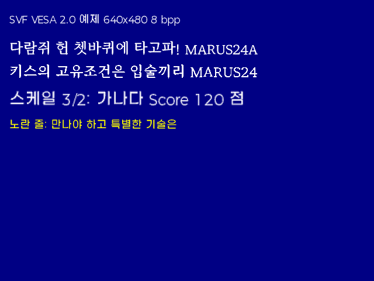
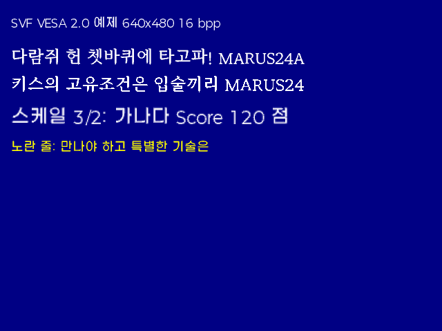
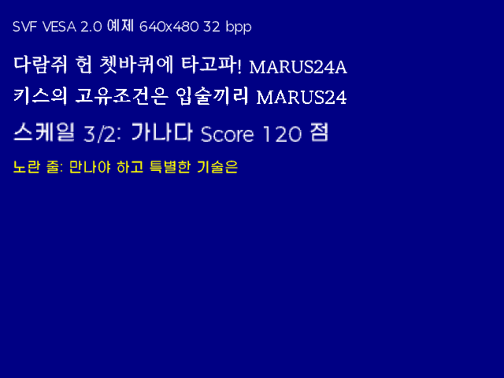
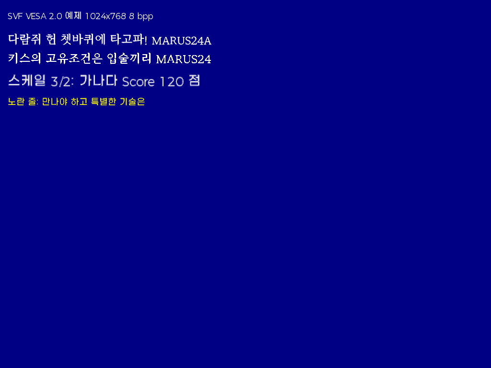
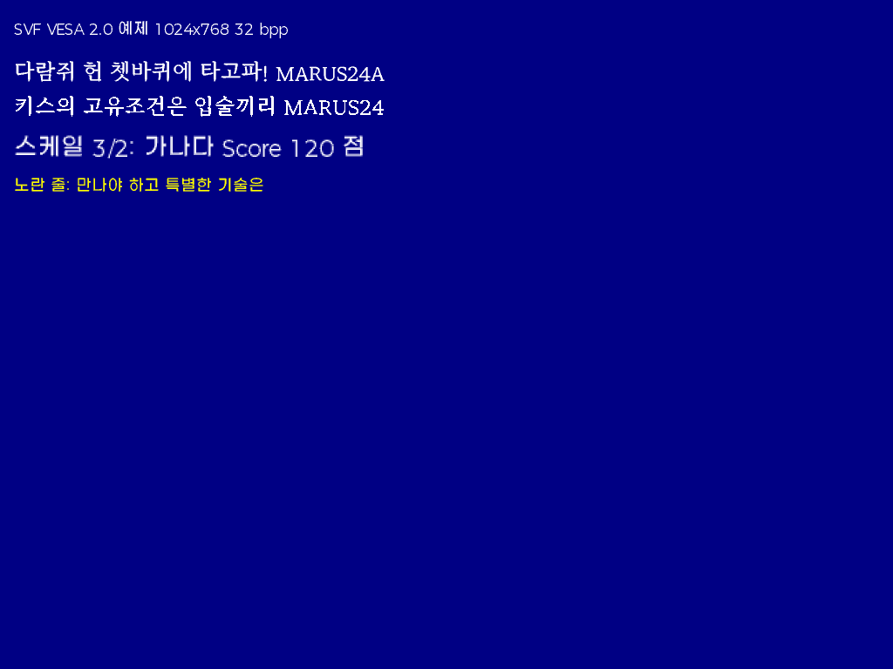

[English](README.md) | **한국어**

# DOS 예제 (DJGPP, VGA 모드 13h)

`svfdemo.c`는 PAPLG16(ASCII) + PAPLG18(2 bpp 자모, 모든 음절을 조합)으로 한글과 ASCII 여섯 줄을 320 x 200 모드 13h
화면에 그린다. 두 페이스 모두 자기 파일에서 스트리밍한다: `svf_open_stream`이 테이블을 한 번 읽고, 이후 읽기
콜백(파일 핸들에 대한 `lseek` + `read`)이 glyph를 그릴 때 정렬된 1 KB 블록을 블록 캐시로 가져온다. 캐시는 한 줄이 건드리는
모든 블록을 담는다(PAPLG16: 슬롯 16개로 15 KB 파일 전체. PAPLG18: 슬롯 64개로, 음절 한 줄은 122개 블록 중 최대 약 40개를
건드린다). 한 줄의 블록보다 작은 캐시는 같은 블록을 거듭 다시 읽는다(c/bench/MEASUREMENTS.md). 텍스트는 GRAY8 버퍼에
그려지고, 팔레트는 그레이 램프이므로 커버리지 바이트가 곧 자기 색 인덱스이며, 버퍼는 비디오 메모리로 복사된다. 키를
누르면 텍스트 모드로 돌아가고, 프로그램은 각 페이스가 수행한 읽기 호출 수를 출력한다(`svfdemo: 9 reads from PAPLG16, 57 from PAPLG18`).

빌드(저장소 루트에서, `c/cross/SIZES.md`가 설명하는 대로 DJGPP는 `~/opt/djgpp`에):

    DJ=~/opt/djgpp/bin/i586-pc-msdosdjgpp
    $DJ-gcc -std=gnu99 -O2 -Ic/include c/ports/dos/svfdemo.c c/src/*.c -o SVFDEMO.EXE

`svf/dos/PAPLG16.SVF`와 `svf/dos/PAPLG18.SVF`가 있는 디렉터리에서 `SVFDEMO.EXE`를 실행한다.

`c/cross/build-all.sh --ports`가 이를 빌드한다(프로그램 전체, 스텁 없음). `screenshot.png`는 DOSBox-X 2026.08.31(헤드리스,
xvfb-run)에서 실행한 화면이며, 다음으로 만든다.

    c/ports/dos/screenshot.sh

이 스크립트는 프로그램을 빌드하고 DOSBox-X에서 실행하며, 프로그램이 키를 기다리면 ffmpeg으로 2배 창을 잡아 정확한
2 x 2 블록인지 검사하고 320 x 200 픽셀(그레이 레벨 0, 85, 170, 255: 2 bpp 커버리지)을 저장한다.

## SVFVESA: VBE 2.0 선형 프레임버퍼 모드 (`svfvesa.c`)

`svfvesa.c`는 `vesa-lines.txt`의 줄들을 VBE 2.0 LFB 모드에 새 패킹 종류로 그린다: INDEXED8(색마다 팔레트 램프가 있는
8 bpp), RGB555(15), RGB565(16), RGB888(24), XRGB8888(32). 텍스트는 RAM의 백 버퍼에 들어가고, 더러운 행은 그 위의 DPMI
디스크립터를 통해 프레임버퍼로 복사되며(`movedata`, 각 복사를 `vbe_copy_ok`가 검사하고, near 포인터는 쓰지 않는다),
모드는 번호가 아니라 기하와 채널 배치로 고른다(`vbe_select.c`, 호스트에서 `c/tests/test_vbe.c`가 테스트). 텍스트 모드는
모든 종료 경로에서 복원된다.

    SVFVESA.EXE                    640 x 480 at 16, 8 and 32 bpp in turn, a key after each (a missing depth is skipped)
    SVFVESA.EXE W H BPP [DUMP]     one mode (BPP 8, 15, 16, 24 or 32), a key; with DUMP the back buffer goes to that file

빌드: `c/cross/build-all.sh --ports`(`port-dos: OK SVFDEMO.EXE N bytes, SVFVESA.EXE M bytes`), 또는 직접

    $DJ-gcc -std=gnu99 -O2 -Ic/include -Ic/ports/dos c/ports/dos/svfvesa.c c/ports/dos/vbe_select.c \
        c/ports/dos/vesa_lines.c c/src/*.c -o SVFVESA.EXE

`vesa-lines.txt`와 그것이 이름을 든 네 페이스(`svf/dos`의 `PAPLG16.SVF`, `PAPLG18.SVF`, `MARUS24A.SVF`, `MARUS24.SVF`)가 있는
디렉터리에서 실행한다. 긴 파일 이름이 없는 DOS에서는 표가 `VESALINE.TXT`이다(기본 이름 `vesa-lines`는 10자이다.
스크린샷 스크립트 같은 복사 스크립트는 이를 `VESALINE.TXT`로 이름 붙이며, 파싱 오류는 열린 파일의 이름을 말한다).
페이스는 `svfdemo.c`처럼 1 KB 블록 캐시를 통해 자기 파일에서 스트리밍한다. 프로그램은 텍스트 모드가 돌아온 뒤(그래픽
모드에서 출력한 줄은 그림 위에 떨어진다) 다음을 출력한다.

    flush_640x480_16 rows=480 us=8159
    sum=adff6c42 dac=8 mode=0x111 640x480 16bpp pitch=1280 bits=16

`flush_` 줄은 복사한 행 수와 복사의 `uclock()` 시간을 준다. 둘째 줄은 `SUM.TXT`에도 쓰이며(키를 기다리기 전에 닫힘)
백 버퍼의 FNV-1a, 사용 중인 DAC 폭(8 bpp 모드가 6비트 DAC로 후퇴해야 했을 때만 6), 모드 번호, 논리 깊이, 블록의
`BitsPerPixel`을 준다.
`python3 tools/vesa_lines.py --expect c/ports/dos/vesa-lines.txt --faces svf/dos 640 480 16`은 같은 파일에 대해 기준
(`tools/svfline.py`)이 주는 합을 출력한다. 둘은 8, 15, 16, 24, 32 bpp에서 같다(DOSBox-X
2026.08.31, `machine = svga_s3`, `vmemsize = 8`. 24 bpp에는 `vesa vbe 1.2 modes are 32bpp = false`가 필요하다).

### 파일 `vesa-lines.txt`

UTF-8 텍스트, LF 줄 끝, 두 언어의 파서 하나(`vesa_lines.c`, `tools/vesa_lines.py`)에 `TestVesaLines`가 같은 파일을 먹인다.
파일은 최대 65536 바이트이며(더 큰 파일은 그것을 넘겨 읽는 첫 줄에서 1행 "file too large"로 거부된다), 줄은 개행을 포함해
최대 512 바이트이다. `#` 줄과 빈 줄은 주석이다. 필드는 `|`로 나뉘고, 모든 필드는 앞뒤의 공백과 탭을 잃으며(텍스트
필드도), 빈 텍스트는 허용되고 다른 빈 필드는 오류이다.

    [colours]     first; at most 16 records: name | rgb565 | rgb555 | rgb888 | index_base | index_levels
    [lines]       once, after it; at most 32 records: faces | scale | x | baseline | colour | text

- 숫자는 십진수 또는 `0x` 16진수이다(x와 baseline은 `-`로 시작할 수 있다). `rgb565`는 0..0xFFFF, `rgb555`는 0..0x7FFF(15 bpp
  픽셀의 비트 15는 파일에서 설정되지 않는다), `rgb888`은
  0..0xFFFFFF(24비트 색: 32 bpp의 X 바이트는 파일에서 설정되지 않으므로 0x1000000 범위는 없다), `index_base`와 `index_levels`는
  0..255이고 `index_base + index_levels <= 255`이다. `scale`은 `num/den`이며 각각 1..16, x와 baseline은 -32768..32767이다.
- `background`는 한 번 필수이고, `index_levels`가 0이며, `index_base`가 다른 모든 색의 것보다 아래이다. 두 색의
  램프 `index_base .. index_base + index_levels`는 겹치지 않는다. 색 이름은 공백 없는 인쇄 가능 ASCII 1..31바이트이다.
  줄의 색은 `background`가 아닌 정의된 색을 이름으로 든다.
- 페이스는 `+`로 이으며(최대 4개), 각각 정확히 `[A-Z0-9_]{1,8}\.SVF`이다(대문자, 순수 DOS 이름, 장치 이름이 아님: CON PRN AUX NUL
  COM1..9 LPT1..9). 호스트 도구는 각각을 `realpath`로도 해석하여 페이스 디렉터리 밖의 것을 거부한다.
- 텍스트의 `{W}`, `{H}`, `{BPP}`는 모드의 폭, 높이, 논리 깊이가 된다.
- 8 bpp 팔레트: 인덱스 `background.index_base`와 어떤 색도 이름을 들지 않은 모든 인덱스는 `background.rgb888`이다.
  `n` 레벨 색의 인덱스 `base + k`는 채널마다 `(bg * (n - k) + fg * k + n / 2) / n`(`vbe_palette_entry`)이며,
  6비트 DAC에서는 `>> 2`한다. 배경은 모든 종류의 clear 값이기도 하다.
- 거부는 그 줄을 이름으로 든다(배경 누락처럼 파일 끝에서의 거부는 마지막 줄의 다음 줄).
  `c/tests/vesa-lines-dump --print-table FILE [--dac 6|8]`(`make -C c vesa-lines-dump`)은 파싱된 표와 팔레트를
  출력하고, `tools/vesa_lines.py --print-table FILE`은 같은 텍스트를 출력한다.
- 표는 서로 다른 페이스 파일을 최대 128개(4개씩 32줄) 들 수 있으며, 각각 한 번 열고 스트리밍한다. DAC: BIOS가 8비트
  DAC를 허락하고 나서 팔레트 호출을 거부하면, VGA 포트 쓰기 전에 DAC를 6비트로 되돌린다(`dac=6`). 그것이 실패하면
  8비트 표가 포트로 간다(`dac=8`). 호스트 도구에는 테스트용 `--substitute`, `--cache-slots`, `--open-face`도 있다.

### 캡처: `vesa-shots.sh`

    c/ports/dos/vesa-shots.sh [OUT]       default c/build/ports/dos-vesa; DOSBOX_X, OPT as the other scripts

`build-all.sh`처럼 `SVFVESA.EXE`를 빌드한 뒤, 640 x 480과 1024 x 768의 8, 15, 16, 24, 32 bpp마다 DOSBox-X에서
실행하고(`xvfb-run -a -s "-screen 0 1280x1024x24"`, `machine = svga_s3`, `vmemsize = 8`, `cycles = fixed 23880`. 24 bpp
실행은 `vesa vbe 1.2 modes are 32bpp = false`를 더한다), 각 실행을 두 번 검사한다.

1. **sum**: `SUM.TXT`의 `mode=` 줄이 요청한 W, H, 깊이를 이름으로 들고 `sum=`이 `tools/vesa_lines.py --expect`(Python 기준
   버퍼의 FNV-1a)와 같다.
2. **capture**: DOSBox-X 자체의 캡처(Ctrl-F5, 렌더된 프레임의 PNG. `screenshot.sh`의 ffmpeg x11grab은 10초 안에 PNG가
   나타나지 않을 때만의 폴백이며, `capture ok` 줄이 `source=scrshot` 또는 `source=x11grab`을 말한다)를 `vesa_check.py`가
   `DUMP.RAW`와 비교한다: 덤프는 먼저 기준 버퍼와 바이트 단위로 대조된다(차이는 첫 차이 픽셀, x, y와 종류를 이름으로 들고
   diff 이미지를 쓴다). PNG는 W x H여야 하고 자기 픽셀의 최소 1 %가 배경이 아니어야 한다. 그다음 덤프를 RGB로 바꾸어
   (32/24는 정확히, 16/15는 `v * 0x21 >> 2`와 `v * 0x41 >> 4`, 8은 DAC 폭에서의 의도된 팔레트를 통해) PNG와 비교한다.
   하나의 확장 규칙이 세 채널 모두를 설명해야 한다: `exact`, `shl`(`v << (8 - bits)`, 즉 5비트는 `<< 3`, 6비트는 `<< 2`)
   또는 `scale255`(`v * 255 // (2**bits - 1)`). 일부 채널에는 맞지만 전부에는 맞지 않는 규칙은 실패한다("one rule").
   어떤 규칙에도 맞는 채널이 없을 때만 허용 오차를 시도하며(5비트는 채널당 +-8, 6비트는 +-4, 8비트 채널은 없음),
   `tolerance=yes`로 출력된다. 종료 코드: 0 정상, 1 검사 실패, 2 쓸 수 없는 입력(잘못된 `--dac`, 없거나 짧은 덤프, PNG 아님),
   트레이스백은 절대 없다.

`vesa-shots.sh`는 심볼릭 링크가 하나라도 있는 OUT을 거부하고, 모든 모드를 `timeout` 아래에서 실행하며, DOSBox-X를
SIGTERM으로 멈추고 5초 뒤 SIGKILL하고, 열 모드가 모두 통과한 뒤에만 PNG 열 장을 `shots/`에 저장하며, `flush_` 줄이 정확히
`flush_WxH_BPP rows=<n> us=<n>`이 아니면 실패한다.

결과(DOSBox-X 2026.08.31): `sum ok` 열 건, `capture ok` 열 건, 열 건 모두 **`rule=exact`**: 5비트와 6비트 확장은
`v * 0x21 >> 2`와 `v * 0x41 >> 4`이고 8비트 DAC는 쓴 그대로 보이며, 허용 오차는 필요하지 않았다. 실행은 재현 가능하다:
두 번째 실행도 같은 줄과 바이트 단위로 같은 PNG를 낸다.

매퍼 파일은 모든 기본 바인딩을 대체하므로 `vesa-shots.sh`는 Ctrl 키(`mod_1`), 프로그램을 끝내는 키(`key_space`),
스크린샷 이벤트를 함께 쓴다: `hand_scrshot "key 62 mod1"`(이벤트는 `hand_scrshot`, SDL2 키 62는 F5이며, Ctrl-F5는
달리 DOSBox-X의 "copy to clipboard"이다). 캡처는 `OUT/capture/svfvesa_000.png`에 떨어진다.

카드의 그림 여섯 장(`{W}x{H} {BPP}`가 있는 제목, 24 px 줄 둘, 3/2로 스케일한 줄, 노란 줄, 파란 배경. 같은 크기의 모든 깊이에서
배치는 같다):

| | 8 bpp | 16 bpp | 32 bpp |
|---|---|---|---|
| 640 x 480 |  |  |  |
| 1024 x 768 |  |  |  |

15 bpp와 24 bpp 캡처는 `shots/640x480-15bpp.png`, `shots/640x480-24bpp.png`, `shots/1024x768-15bpp.png`,
`shots/1024x768-24bpp.png`이다.

flush 시간(`OUT.TXT`의 `flush_WxH_bpp`: `cycles = fixed 23880` 아래의 **DOSBox-X 에뮬레이션** `uclock()` 시간이며 실제 하드웨어가 아니다. 모든 모드는 H 행 전부를 한 번
flush하므로 여기서는 더러운 행 표시를 실행하지 않는다. 시간은 복사한 바이트를 따르며 15와 16 bpp는 같다. 두 번의 실행은 두 행에서 1 µs 다르고, 표는 2026-10-21의 실행이다):

| 모드 | 행 | us |
|---|---|---|
| 640x480 8 bpp | 480 | 4140 |
| 640x480 15 bpp | 480 | 8159 |
| 640x480 16 bpp | 480 | 8159 |
| 640x480 24 bpp | 480 | 12180 |
| 640x480 32 bpp | 480 | 16201 |
| 1024x768 8 bpp | 768 | 10475 |
| 1024x768 15 bpp | 768 | 20768 |
| 1024x768 16 bpp | 768 | 20768 |
| 1024x768 24 bpp | 768 | 31059 |
| 1024x768 32 bpp | 768 | 41352 |
