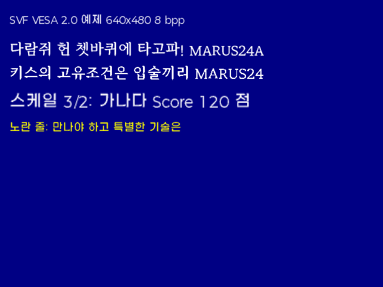
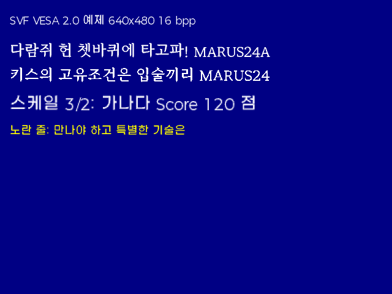
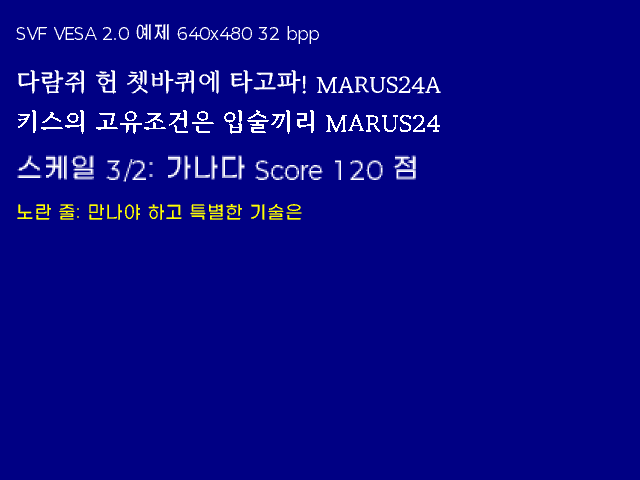
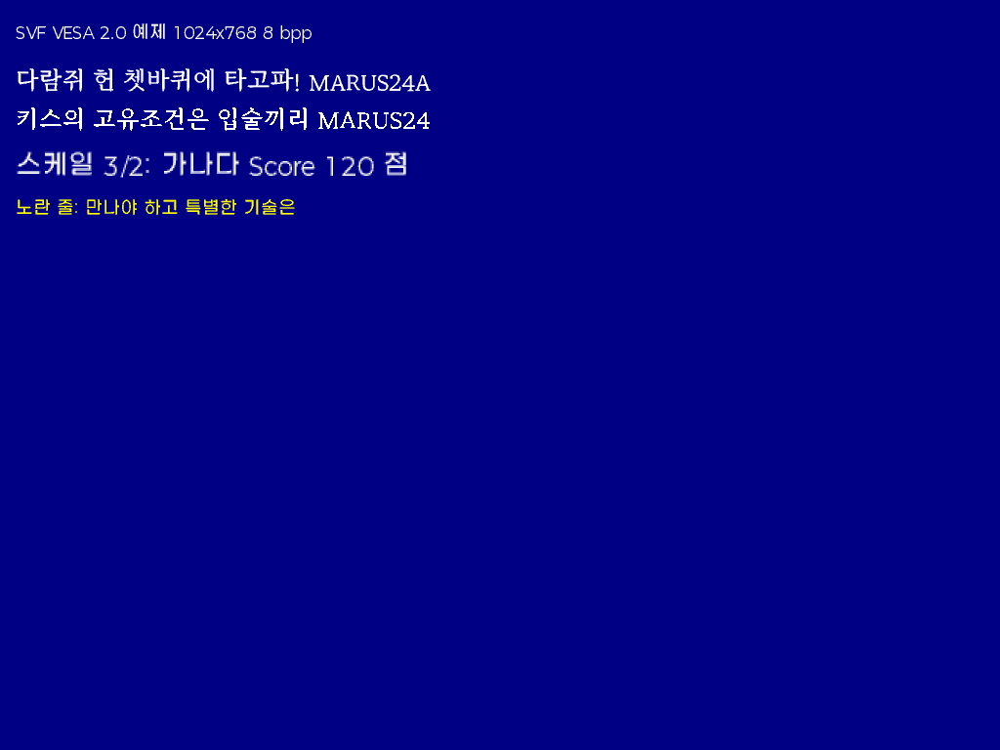
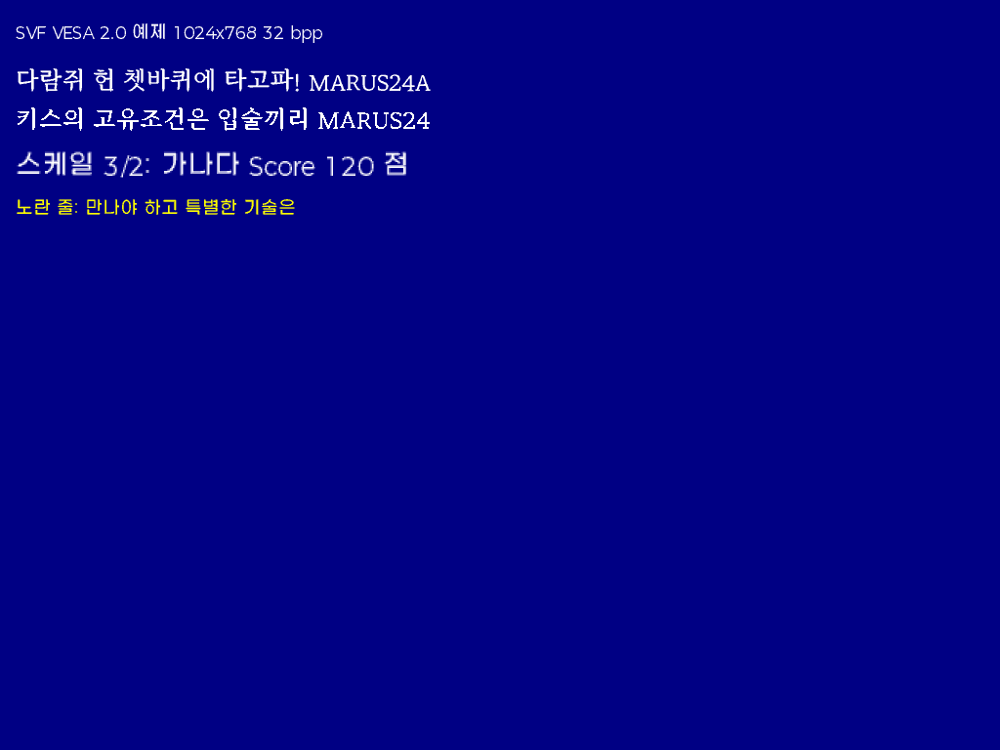

**English** | [한국어](README.ko.md)

# DOS example (DJGPP, VGA mode 13h)

`svfdemo.c` draws six lines of Korean and ASCII with PAPLG16 (ASCII) + PAPLG18 (2 bpp jamo, every syllable composed)
on a 320 x 200 mode 13h screen. Both faces are streamed from their files: `svf_open_stream` reads the tables once,
then the read callback (`lseek` + `read` on a file handle) fetches aligned 1 KB blocks into a block cache as glyphs are
drawn. The caches hold every block a line touches (PAPLG16: 16 slots, the whole 15 KB file; PAPLG18: 64 slots, a line
of syllables touches up to about 40 of its 122 blocks): a cache smaller than a line's blocks is read again and again
(c/bench/MEASUREMENTS.md). The text is drawn into a GRAY8 buffer, the palette is a grey ramp, so a coverage byte is its
own colour index, and the buffer is copied to video memory. A key returns to text mode; the program then prints the
read calls each face made (`svfdemo: 9 reads from PAPLG16, 57 from PAPLG18`).

Build (from the repository root, DJGPP in `~/opt/djgpp` as `c/cross/SIZES.md` describes):

    DJ=~/opt/djgpp/bin/i586-pc-msdosdjgpp
    $DJ-gcc -std=gnu99 -O2 -Ic/include c/ports/dos/svfdemo.c c/src/*.c -o SVFDEMO.EXE

Run `SVFDEMO.EXE` in a directory holding `svf/dos/PAPLG16.SVF` and `svf/dos/PAPLG18.SVF`.

`c/cross/build-all.sh --ports` builds it (whole program, nothing stubbed). `screenshot.png` is the screen of a run in
DOSBox-X 2026.08.31 (headless, xvfb-run), made by

    c/ports/dos/screenshot.sh

which builds the program, runs it in DOSBox-X, grabs the 2x window with ffmpeg once the program waits for its key,
checks it is exact 2 x 2 blocks and stores the 320 x 200 pixels (grey levels 0, 85, 170, 255: the 2 bpp coverage).

## SVFVESA: VBE 2.0 linear framebuffer modes (`svfvesa.c`)

`svfvesa.c` draws the lines of `vesa-lines.txt` into a VBE 2.0 LFB mode with the new packed kinds: INDEXED8 (8 bpp
with a palette ramp per colour), RGB555 (15), RGB565 (16), RGB888 (24) and XRGB8888 (32). The text goes into a back
buffer in RAM, the dirty rows are copied to the framebuffer through a DPMI descriptor over it (`movedata`, each copy
checked by `vbe_copy_ok`; no near pointers), and the mode is chosen by geometry and channel layout, never by number
(`vbe_select.c`, tested on the host by `c/tests/test_vbe.c`). Text mode is restored on every exit path.

    SVFVESA.EXE                    640 x 480 at 16, 8 and 32 bpp in turn, a key after each (a missing depth is skipped)
    SVFVESA.EXE W H BPP [DUMP]     one mode (BPP 8, 15, 16, 24 or 32), a key; with DUMP the back buffer goes to that file

Build: `c/cross/build-all.sh --ports` (`port-dos: OK SVFDEMO.EXE N bytes, SVFVESA.EXE M bytes`), or by hand

    $DJ-gcc -std=gnu99 -O2 -Ic/include -Ic/ports/dos c/ports/dos/svfvesa.c c/ports/dos/vbe_select.c \
        c/ports/dos/vesa_lines.c c/src/*.c -o SVFVESA.EXE

Run it in a directory holding `vesa-lines.txt` and the four faces it names (`PAPLG16.SVF`, `PAPLG18.SVF`,
`MARUS24A.SVF`, `MARUS24.SVF` from `svf/dos`); on a DOS without long file names the table is `VESALINE.TXT` (the base
name `vesa-lines` has 10 characters; a copy script such as the screenshot one names it `VESALINE.TXT`, and a parse error names the
file that was opened). The faces are streamed from their files through 1 KB block caches, as in
`svfdemo.c`. The program prints, after text mode is back (a line printed in a graphics mode would land on the picture),

    flush_640x480_16 rows=480 us=8159
    sum=adff6c42 dac=8 mode=0x111 640x480 16bpp pitch=1280 bits=16

The `flush_` line gives the rows copied and the `uclock()` time of the copy; the second line, which is also written to
`SUM.TXT` (closed before the key is awaited), gives the FNV-1a of the back buffer, the DAC width in use (6 only when an
8 bpp mode had to fall back to a 6-bit DAC), the mode number, the logical depth and the block's `BitsPerPixel`.
`python3 tools/vesa_lines.py --expect c/ports/dos/vesa-lines.txt --faces svf/dos 640 480 16` prints the sum the
reference (`tools/svfline.py`) gives for the same file; the two are equal at 8, 15, 16, 24 and 32 bpp (DOSBox-X
2026.08.31, `machine = svga_s3`, `vmemsize = 8`; 24 bpp needs `vesa vbe 1.2 modes are 32bpp = false`).

### The file `vesa-lines.txt`

UTF-8 text, LF line ends, one parser in two languages (`vesa_lines.c`, `tools/vesa_lines.py`) fed the same files by
`TestVesaLines`. The file is at most 65536 bytes (a larger one is refused at line 1, "file too large", by the first line that reads past it), a line at most 512 bytes including its newline. `#` lines and blank lines are comments. Fields are
split on `|`; every field loses its leading and trailing spaces and tabs (the text field too), an empty text is
allowed and any other empty field is an error.

    [colours]     first; at most 16 records: name | rgb565 | rgb555 | rgb888 | index_base | index_levels
    [lines]       once, after it; at most 32 records: faces | scale | x | baseline | colour | text

- Numbers are decimal or `0x` hex (x and baseline may start with `-`). `rgb565` is 0..0xFFFF, `rgb555` 0..0x7FFF (bit 15 of a 15 bpp pixel is never set from the file), `rgb888`
  0..0xFFFFFF (a 24-bit colour: the X byte of 32 bpp is never set from the file, so there is no 0x1000000 range), `index_base` and `index_levels` 0..255 with
  `index_base + index_levels <= 255`; `scale` is `num/den`, each 1..16; x and baseline are -32768..32767.
- `background` is required once, has `index_levels` 0 and its `index_base` below every other colour's; the ramps
  `index_base .. index_base + index_levels` of two colours do not overlap. A colour name is 1..31 printable ASCII
  bytes without spaces. A line's colour names a defined colour other than `background`.
- Faces are `+`-joined (at most 4), each `[A-Z0-9_]{1,8}\.SVF` exactly (upper case, a bare DOS name, not a device name: CON PRN AUX NUL COM1..9 LPT1..9); the host
  tools also resolve each with `realpath` and refuse one outside the faces directory.
- `{W}`, `{H}` and `{BPP}` in a text become the mode's width, height and logical depth.
- The 8 bpp palette: index `background.index_base` and every index no colour names are `background.rgb888`; index
  `base + k` of a colour with `n` levels is `(bg * (n - k) + fg * k + n / 2) / n` per channel (`vbe_palette_entry`),
  `>> 2` with a 6-bit DAC. The background is also the clear value of every kind.
- A refusal names its line (a refusal at the end of the file, such as a missing background, the line after the last).
  `c/tests/vesa-lines-dump --print-table FILE [--dac 6|8]` (`make -C c vesa-lines-dump`) prints the parsed table and
  palette; `tools/vesa_lines.py --print-table FILE` prints the same text.
- A table may name up to 128 different face files (32 lines of 4); each is opened once and streamed. The DAC: if the
  BIOS grants an 8-bit DAC and then refuses the palette call, the DAC is put back to 6 bits before the VGA-port
  writes (`dac=6`); if that fails the 8-bit table goes to the ports (`dac=8`). The host tool also has
  `--substitute`, `--cache-slots` and `--open-face` for the tests.

### The captures: `vesa-shots.sh`

    c/ports/dos/vesa-shots.sh [OUT]       default c/build/ports/dos-vesa; DOSBOX_X, OPT as the other scripts

builds `SVFVESA.EXE` as `build-all.sh` does, then for 640 x 480 and 1024 x 768 at 8, 15, 16, 24 and 32 bpp runs it in
DOSBox-X (`xvfb-run -a -s "-screen 0 1280x1024x24"`, `machine = svga_s3`, `vmemsize = 8`, `cycles = fixed 23880`; the
24 bpp run adds `vesa vbe 1.2 modes are 32bpp = false`), and checks each run twice:

1. **sum**: `SUM.TXT`'s `mode=` line names the requested W, H and depth and its `sum=` equals
   `tools/vesa_lines.py --expect` (the FNV-1a of the Python reference buffer);
2. **capture**: DOSBox-X's own capture (Ctrl-F5, a PNG of the rendered frame; the ffmpeg x11grab of `screenshot.sh` is
   only the fallback when no PNG appears in 10 s, and the `capture ok` line says `source=scrshot` or `source=x11grab`)
   is compared with `DUMP.RAW` by `vesa_check.py`: the dump is first held byte for byte to the reference buffer (a
   difference names the first differing pixel, x, y and kind, and writes a diff image); the PNG must be W x H with at
   least 1 % of its own pixels off its background; then the dump is converted to RGB (32/24 exact, 16/15 by
   `v * 0x21 >> 2` and `v * 0x41 >> 4`, 8 through the intended palette at the DAC width) and compared with the PNG.
   One expansion rule must explain all three channels: `exact`, `shl` (`v << (8 - bits)`, so `<< 3` for 5 bits and
   `<< 2` for 6) or `scale255` (`v * 255 // (2**bits - 1)`); a rule that fits some channels but not all fails
   ("one rule"). Only when no channel fits any rule is a tolerance tried (every channel within +-8 for 5 bits, +-4 for
   6 bits, none for 8-bit channels), printed as `tolerance=yes`. Exit codes: 0 ok, 1 a check failed, 2 an input
   cannot be used (bad `--dac`, missing or short dump, not a PNG), never a traceback.

`vesa-shots.sh` refuses an OUT that holds any symlink, runs every mode under `timeout`, stops DOSBox-X with SIGTERM and
then SIGKILL after 5 s, stores the ten PNGs in `shots/` only after all ten modes passed, and fails if a `flush_` line is
not exactly `flush_WxH_BPP rows=<n> us=<n>`.

Result (DOSBox-X 2026.08.31): ten `sum ok`, ten `capture ok`, all ten with **`rule=exact`**: the 5-bit and 6-bit expansion
is `v * 0x21 >> 2` and `v * 0x41 >> 4` and the 8-bit DAC is shown as written; no tolerance was needed. The run is
repeatable: a second run gives the same lines and byte-identical PNGs.

The mapper file replaces every default binding, so `vesa-shots.sh` writes the Ctrl key (`mod_1`), the key that ends
the program (`key_space`) and the screenshot event with it: `hand_scrshot "key 62 mod1"` (the event is `hand_scrshot`,
SDL2 key 62 is F5; Ctrl-F5 is otherwise DOSBox-X's "copy to clipboard"). The capture lands in `OUT/capture/svfvesa_000.png`.

The six pictures of the card (title with `{W}x{H} {BPP}`, the two 24 px lines, the scaled 3/2 line, the yellow line, blue
background; the layout is the same at every depth of one size):

| | 8 bpp | 16 bpp | 32 bpp |
|---|---|---|---|
| 640 x 480 |  |  |  |
| 1024 x 768 |  |  |  |

The 15 and 24 bpp captures are `shots/640x480-15bpp.png`, `shots/640x480-24bpp.png`, `shots/1024x768-15bpp.png` and
`shots/1024x768-24bpp.png`.

Flush times (`flush_WxH_bpp` of `OUT.TXT`: **DOSBox-X emulated** `uclock()` time under `cycles = fixed 23880`, not real hardware; every mode flushes once with all H
rows, so the dirty-row marking is not exercised here; the times follow the bytes copied, 15 and 16 bpp are equal; two runs differ by 1 µs in two rows, the table is the 2026-10-21 run):

| mode | rows | us |
|---|---|---|
| 640x480 8 bpp | 480 | 4140 |
| 640x480 15 bpp | 480 | 8159 |
| 640x480 16 bpp | 480 | 8159 |
| 640x480 24 bpp | 480 | 12180 |
| 640x480 32 bpp | 480 | 16201 |
| 1024x768 8 bpp | 768 | 10475 |
| 1024x768 15 bpp | 768 | 20768 |
| 1024x768 16 bpp | 768 | 20768 |
| 1024x768 24 bpp | 768 | 31059 |
| 1024x768 32 bpp | 768 | 41352 |
