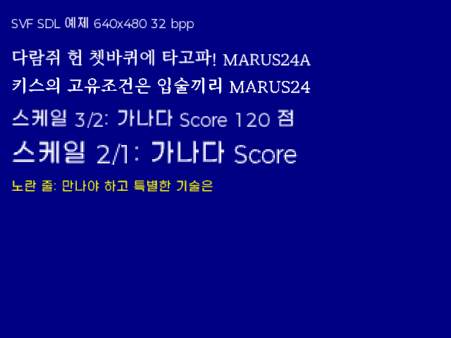
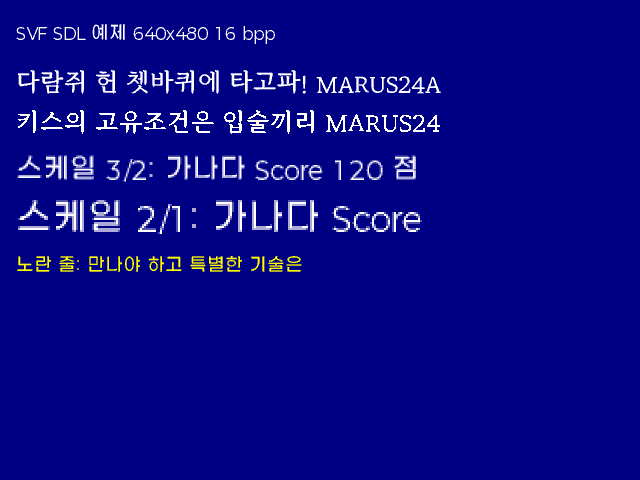
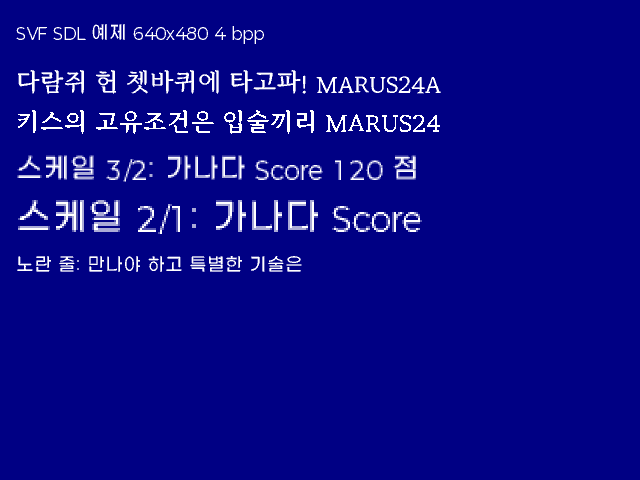

[English](README.md) | **한국어**

# SDL2 / SDL3 예제 (`svfsdl.c`)

`svfsdl.c`는 `sdl-lines.txt`(DOS 포트의 파일 형식이며 같은 `vesa_lines.c`가 파싱한다)의 줄들을, 요청한 픽셀 포맷의
`SDL_Surface`에 C 렌더러의 대응하는 `svf_target` 종류를 통해 그리고 창에 보여 준다. **하나의 소스가 SDL2와 SDL3 모두에
대해 빌드된다**(`sdl_compat.h`, ScummVM 백엔드가 쓰는 `SDL_VERSION_ATLEAST(3, 0, 0)`). `--dump`를 주면 16바이트
헤더 뒤에 서피스의 바이트 그대로를 쓰고 종료한다. 헤드리스 검사(아래)는 같은 바이트를 SDL의 실제 pitch로
`tools/svfline.py`로 다시 만들어 한 바이트도 빠짐없이 비교하며, 두 SDL 모두에서, 페이스를 mapped와 streamed로
모두 확인한다. 따라서 그림은 결코 증거가 아니다: **증명되는 대상은 스크린샷이 아니라 백 버퍼이다**(변환은 렌더러가
한다. 스크린샷 노트 참조).

이 포트는 SDL 포맷을 메모리 바이트 순서로 부르며, 있는 경우 SDL의 배열 순서 별칭을 쓴다. 라이브러리의 종류가 메모리
순서로 정의되어 있기 때문이다(`svf.h`). `PixelFormat`은 리틀 엔디언 호스트에서 ScummVM의 `Graphics::PixelFormat(bytes,
rBits, gBits, bBits, aBits, rShift, gShift, bShift, aShift)`이다.

| `--format` | 요청하는 SDL 포맷 | 메모리 순서 | `svf_target_kind` | ScummVM 대응 |
|---|---|---|---|---|
| `xrgb8888` | `SDL_PIXELFORMAT_BGRX32` (= `XRGB8888`, SDL2는 `RGB888`로 출력) | B G R X | `SVF_T_XRGB8888`, X는 0으로 기록 | `PixelFormat(4, 8, 8, 8, 0, 16, 8, 0, 0)` |
| `argb8888` | `SDL_PIXELFORMAT_BGRA32` (= `ARGB8888`) | B G R A | `SVF_T_XRGB8888`, `fg888 = 0xFFRRGGBB` (모든 곳에서 알파 255) | `PixelFormat(4, 8, 8, 8, 8, 16, 8, 0, 24)` |
| `rgb565` | `SDL_PIXELFORMAT_RGB565` | 네이티브 16비트 | `SVF_T_RGB565` (빅 엔디언 호스트에서는 + `SVF_TF_RGB16_BIGENDIAN`) | `PixelFormat(2, 5, 6, 5, 0, 11, 5, 0, 0)` |
| `rgb555` | `SDL_PIXELFORMAT_XRGB1555` | 네이티브 16비트 | `SVF_T_RGB555` | `PixelFormat(2, 5, 5, 5, 0, 10, 5, 0, 0)` |
| `bgr24` | `SDL_PIXELFORMAT_BGR24` | B G R | `SVF_T_RGB888` | 검사하지 않음(ScummVM 목록에 24비트 화면 포맷이 없음) |
| `index8` | `SDL_PIXELFORMAT_INDEX8` + 256 항목 팔레트 | 인덱스 하나 | `SVF_T_INDEXED8` (`index_base`, `index_levels`, `mono_threshold`) | `PixelFormat::createFormatCLUT8()` |
| `gray` `--gray-bits 8/4/2/1` | `INDEX8` / `INDEX4MSB` / `INDEX2MSB` / `INDEX1MSB` (`--lsb-first`이면 `...LSB`) + 2^bits 항목 팔레트 | 바이트당 픽셀 1, 2, 4 또는 8개 | `SVF_T_GRAY` (`gray_bits`, `SVF_TF_GRAY_LSB_FIRST`) | 8비트: 그레이 팔레트의 CLUT8. 더 적은 비트: 없음 |

`SDL_PIXELFORMAT_RGB24`(메모리 R G B)는 대응하는 종류가 **없어서** 제공하지 않는다. 이름만 보고
`SVF_T_RGB888`에 매핑하지 말 것. 서피스를 만든 뒤 프로그램은 SDL이 요청한 포맷을 주었는지 검사한다(불일치는 오류이며,
조용한 변환은 없다).

## 자신의 프로그램에서

가장 작은 사용은 서피스 하나, 매핑한 페이스 하나, 호출 하나이다. [docs/c-renderer-guide.ko.md](../../../docs/c-renderer-guide.ko.md) 13.6절에 완전한 SDL3 샘플이 있다
(`SDL_LoadFile`, `SDL_CreateSurface(..., SDL_PIXELFORMAT_XRGB8888)`, `SDL_LockSurface`,
`svf_target_init(&t, SVF_T_XRGB8888, surf->pixels, (size_t)surf->pitch * surf->h, w, h, (uint16_t)surf->pitch)`,
`svf_draw_utf8`). 여기서 SDL 3.5.0-dev로 빌드하고 실행했다. `c/src/*.c`, `-I c/include`, `$(pkg-config --cflags --libs sdl3)`로 컴파일하며 `-D` 스위치는 없다(호스트
기본값이 전체 집합이다). 32비트 종류의 메모리 순서는 B, G, R, X이며, 네이티브 `uint32_t` 하나로 보면 `0x00RRGGBB`인 것은 리틀 엔디언 호스트에서만이다.

## 빌드와 실행

저장소 루트에서(SDL2 2.30.0 이상, INDEX2 픽셀 포맷: `libsdl2-dev`와 `pkg-config`. 더 오래된 것은 `sdl_compat.h`가
`#error`로 막는다. SDL3은 아래):

    make -C c/ports/sdl SDL=2      # c/build/ports/sdl/svfsdl2
    make -C c/ports/sdl SDL=3      # c/build/ports/sdl/svfsdl3  (SDL3_PREFIX, default ~/opt/sdl3; linked with an rpath)
    make -C c/ports/sdl            # both;  make -C c/ports/sdl ASAN=1 SDL=2  for the sanitizer build in O/asan

또는 직접(Makefile은 `-std=c99 -Wall -Wextra -Werror`를 쓴다. 소스는 라이브러리, DOS 줄 파서, 예제이다):

    cc -std=c99 -O2 -DSVFSDL=2 -Ic/include -Ic/ports/dos c/ports/sdl/svfsdl.c c/ports/dos/vesa_lines.c \
        c/ports/dos/vbe_select.c c/src/*.c $(pkg-config --cflags --libs sdl2) -o svfsdl2
    export PKG_CONFIG_PATH=~/opt/sdl3/lib/pkgconfig      # set first: the $(pkg-config ...) below are expanded by the shell
    cc -std=c99 -O2 -DSVFSDL=3 -Ic/include -Ic/ports/dos c/ports/sdl/svfsdl.c c/ports/dos/vesa_lines.c \
        c/ports/dos/vbe_select.c c/src/*.c $(pkg-config --cflags --libs sdl3) \
        -Wl,-rpath,$(pkg-config --variable=libdir sdl3) -o svfsdl3

**root 없이 SDL3.** 이 호스트에는 SDL3이 패키지로 없다. 게이트는 사용자의 포크(`~/opt/src/SDL3`의 작업 트리,
커밋 `7a588ba6beae4b6f6cc45fdbdca6fd1aea5a2f06`, SDL 3.5.0-dev)를 쓰며, 이를 다음으로 `~/opt/sdl3`에 빌드한다.

    c/cross/install-toolchains.sh sdl3        # SDL3_SRC=... to name another tree; refuses a tree not at that commit

이 스크립트는 `-DSDL_X11_XTEST=OFF`(`libxtst-dev`가 필요 없음)로 out-of-tree 설정을 하고 커밋을
`~/opt/sdl3/COMMIT`에 기록한다. `check.sh`는 커밋이 포크 트리와 다른 SDL3 빌드를 거부한다. `pkg-config sdl3`가 찾는
SDL3(`SDL3_PREFIX`로 지정)이면 어느 것이든 예제를 빌드할 수 있지만, 게이트되는 것은 그 커밋뿐이다.

저장소 루트에서 실행한다(기본값은 `--faces svf/dos`, `--lines c/ports/sdl/sdl-lines.txt`):

    c/build/ports/sdl/svfsdl3 --format rgb565 --stream

키를 누르거나 닫기 버튼을 누르면 끝난다. 옵션:

| 옵션 | 의미 |
|---|---|
| `--format F` | `xrgb8888`(기본), `argb8888`, `rgb565`, `rgb555`, `bgr24`, `index8`, `gray` |
| `--gray-bits 1\|2\|4\|8`, `--lsb-first` | gray 서피스의 비트 수(기본 8)와 비트 순서. `--format gray` 없이 `--gray-bits`를 주면 종료 코드 2(`--alpha-demo`에서는 `--format`처럼 받아들여 무시한다). `--lsb-first`는 다른 포맷에서 무시된다 |
| `--threshold N` | 0..255, 기본 128. 아래 참조 |
| `--present surface\|texture\|texture-direct` | 창 서피스로 blit(기본). 텍스처를 통해 버퍼를 스트리밍(인덱스 서피스는 한 번 변환). 잠근 텍스처에 바로 그리기 |
| `--stream` | 페이스를 통째로 매핑하는 대신 스트림 콜백(`fseek`/`fread`, 블록 캐시)으로 읽음 |
| `--syllable-cache=BYTES` | 페이스 체인의 음절 캐시 |
| `--faces DIR`, `--lines FILE` | `.SVF` 페이스와 줄 파일의 위치 |
| `--size WxH` | 서피스와 창 크기, 기본 640x480(폭과 높이는 32767까지, pitch는 65535까지) |
| `--dump FILE` | 첫 프레임 뒤에 첫 프레임의 서피스 바이트(16바이트 헤더, 이어서 pitch x h 바이트)를 쓰고 종료한다(`--frames N`이 더 많은 프레임을 요구하지 않는 한). 헤더는 `sdl_check.py`에 있음 |
| `--shot FILE.bmp` | 첫 프레임 뒤에 창의 픽셀을 저장(창 서피스의 `SDL_SaveBMP`). `--present surface` 필요 |
| `--frames N` | N 프레임을 보여 줌(0 = 닫을 때까지. `--dump`나 `--shot`이 주어지면 1) |
| `--alpha-demo` | 아래 노트 참조 |

사용법 오류는 종료 코드 2이고 stderr에 `svfsdl:` 한 줄이 나가며 아무것도 쓰이지 않는다. SDL 또는 라이브러리 오류는
종료 코드 1이다. 성공하면 stdout에 한 줄이 나간다.

    svfsdl: SDL 3.5.0 driver x11 window SDL_PIXELFORMAT_XRGB8888 back SDL_PIXELFORMAT_XRGB8888 pitch 2560 draw 815 us sum=ec7c21b7

SDL 버전과 비디오 드라이버, 창 서피스의 포맷(`window`)과 라이브러리가 그린 백 버퍼의 포맷(`back`), 그 버퍼의 행
pitch(바이트), 모든 줄을 한 번 그린 시간, 버퍼의 FNV-1a(`sum=`)이다. `--alpha-demo`에서는 줄에 커버리지 버퍼의 pitch인
`covpitch`도 있다.

**`--threshold`와 1비트 출력.** 페이스는 1, 2, 8 bpp일 수 있다. 안티앨리어싱된 페이스를 1레벨 출력에 그릴 때는 자모
조합 뒤에 임계값에서 자른다. 2 bpp 페이스의 레벨 85/170/255에서 128은 위쪽 둘을 남기고, 255는 완전한 픽셀만 남기며,
1은 잉크가 조금이라도 있으면 남긴다. 이것은 레벨이 하나인 `index8` 색(줄 파일의 `index_levels 1`, `sdl-lines.txt`의
노란 줄)과 `gray --gray-bits 1`에 적용된다. gray 비트가 2 이상이면 임계값은 읽지 않으며(출력은 안티앨리어싱되고,
레벨은 `(cov * (2^bits - 1) + 127) / 255`이다) 다른 포맷은 이를 무시한다. `gray`는 줄 표의 줄 색을 무시한다: 팔레트는
배경에서 흰색으로 이어진다.

## 헤드리스 검사

    sh c/ports/sdl/check.sh [OUT]         (make -C c/ports/sdl check)

`svfsdl2`, `svfsdl3`, ASAN/UBSAN `svfsdl2` 하나를 빌드한 뒤, `SDL_VIDEODRIVER=dummy` 아래에서 모든 포맷을 `--dump`로
실행하고 각 덤프를 `sdl_check.py`에 비교한다. `sdl_check.py`는 `tools/svfline.py`로 바이트를 다시 만든다(stride = 덤프의
pitch, 패딩 바이트는 0이어야 하며, 서브바이트 행은 비트 단위로 비교한다). SDL마다의 행렬은 다음과 같다: 패킹된 다섯 종류 x
{mapped, `--stream`, 패딩을 위한 641x479}, `--syllable-cache`, 텍스처 실행(rgb565, rgb555, bgr24), `index8`(임계값 1과
255도), 1/2/4/8비트와 두 비트 순서의 `gray`, 작은 161x101 서피스, `--alpha-demo`, 예상된 실패(집계하지 않음). 모든
실행은 백 버퍼의 SDL 포맷 이름을 그 실행이 받아야 할 이름과, 프로그램의 `sum=`을 검사기의 것과, `window ...` 포맷도
비교한다. 모든 `index8` / `gray` 서피스 실행은 `--shot`을 C 코드와 독립적으로 `sdl_check.py`에서 계산한 팔레트와도
비교한다(창이 24비트 미만이면 안내문을 출력하고 건너뛴다. 이름 목록은 `window_deep.sh`에 있다). SDL2와 SDL3의 덤프는
헤더 이후가 같아야 한다. `sdl_check.py`의 종료 코드: 0 동일(`sdl-check: OK <kind> WxH pitch=P sdlN sum=...`), 1 바이트가
다름(`DIFF`, diff PNG 포함), 2 쓸 수 없는 입력. 마지막 줄은 다음과 같다.

    port-sdl-check: OK sdl2 56 runs, sdl3 52 runs, sum=ec7c21b7

(`sum=`은 xrgb8888 mapped 덤프의 FNV-1a이며 두 SDL에서 같다.) `SVFSDL_ONLY=2|3`이면 그 줄은 실행된 SDL과 모드를 적는다.
예: `port-sdl-check: OK sdl3 only: 52 runs, no ASAN, sum=ec7c21b7`(ASAN 실행은 SDL2에 속하며, SDL 간 비교는 없다).
`c/cross/build-all.sh --ports`는 이 스크립트를 실행하고 `port-sdl: OK svfsdl2 N bytes, svfsdl3 M bytes`(참고용 크기이며
게이트되지 않음)와 `port-sdl-check-runs: sdl2 56 runs, sdl3 52 runs, sum=ec7c21b7`을 출력한다. `make -C c check`는 이를
실행하지 않는다(SDL 라이브러리는 호스트의 문제이다). Python 테스트: `python3 -I c/ports/sdl/test_sdl_check.py`.

## 스크린샷

    sh c/ports/sdl/shots.sh [OUT]         (make -C c/ports/sdl shots)

`OUT`에는 작업 파일만 들어가며, 그림은 항상 `c/ports/sdl/shots/`(또는 `SVFSDL_SHOTS_DEST`)에 쓰이고, 거기에 추적되는 PNG를 덮어쓴다.

SDL2와 SDL3에 대해 `xvfb-run -a -s "-screen 0 1280x1024x24" svfsdlN --format K --present surface --shot B.bmp --dump D
--frames 1`을 다섯 포맷에 대해 640 x 480으로 실행하고, `sdl_shots.py`가 각 BMP를 PNG로 바꾸어 크기와 픽셀의 최소
1 %가 배경이 아닌지를 검사하며, 그림을 그 실행의 덤프를 SDL이 확장한 것과 비교한다(32비트와 팔레트는 정확히, RGB565는
5비트에 `v * 0x21 >> 2`, 6비트에 `v * 0x41 >> 4`). `exact`가 아닌 규칙(`shl`, 또는 `tolerance`: 8비트 결과의 채널당 최대
1레벨)은 실패가 아니라 픽셀 수와 최대 편차와 함께 정보로 출력되며, 그보다 더 어긋나면 DIFF이다. 그림은 **창**의
픽셀이다(깊이 24의 X 서버 위의 창). 그래서 보이는 것은 백 버퍼가 아니라 SDL이 보여 준 것이다. 이들은
[`shots/overview.png`](shots/overview.png)에도 함께 그려져 있다.

| | xrgb8888 | argb8888 | rgb565 | index8 | gray 4 bits |
|---|---|---|---|---|---|
| SDL2 |  |  |  |  |  |
| SDL3 |  |  |  |  |  |

이 호스트에서 측정(SDL 2.30.0, 3.5.0 포크): **그림 열 장 중 아홉 장이 `exact`**이다. SDL2의 `rgb565` 샷은
`tolerance`이다(`maxdev=1`: 어떤 채널도 정확한 확장과 한 레벨 넘게 다르지 않으며, 307,200 픽셀 중 306,829가 조금이라도
다르다). SDL2는 5비트 또는 6비트 채널을 자체 표로 넓힌다(측정: 정확한 값과 최대 한 레벨 차이, 예: 6비트의 63은 254,
5비트의 16은 131을 준다). SDL3은 정확한 값을 준다.
SDL2와 SDL3의 그림은 **xrgb8888, argb8888, index8, gray 4에서 픽셀 단위로 동일하다**(다섯 포맷 중 넷). `rgb565`는 오직 그
이유로 306,829 픽셀이 다르다(백 버퍼는 같은 바이트이며, `check.sh`가 이를 증명한다). 이 비교는 참고용이다: 달라지는 것은
라이브러리가 아니라 각 SDL의 윈도잉 코드이다. `rgb555`와 `bgr24`는 헤드리스 실행은 있지만 그림은 없다.

## 애플리케이션 작성자를 위한 노트

- **알려진 공백(이 포트가 아니라 라이브러리).** AVR 빌드는 `svf_draw.c`에 자체 GRAY / GRAY8 디스패치 케이스를 가진다.
  `c/cross/build-all.sh`는 모든 종류 마스크에 대해 이를 `-Werror`로 컴파일하고 링크하지만, AVR에서 GRAY를 그리는
  simavr 케이스는 없다(`c/cross/SIZES.md`의 Findings 참조).

- **Stride는 SDL의 pitch이다.** `SDL_CreateSurface`는 행을 4바이트로 올림한다(RGB565 63 px는 126이 아니라 128 바이트).
  타깃에 `stride = surface->pitch`를 주고, 먼저 서피스를 잠그고(`SDL_LockSurface`), 그 버퍼에 대해 `svf_target_init`를
  호출한다. stride는 16비트이며 65535를 넘는 pitch는 거부된다.
- **패딩 바이트**(행의 픽셀 뒤, 또는 서브바이트 행의 쓰지 않는 비트)는 라이브러리가 절대 쓰지 않는다. 그리기 전에
  서피스를 지울 것(예제는 각 행의 픽셀을 배경으로 지우고 패딩은 0으로 둔다). 컬러 종류(RGB565, RGB555, XRGB8888,
  RGB888)는 알려진 배경색에 블렌드하며 목적지를 읽지 않는다. GRAY8, GRAY, INDEXED8은 기존 값과 새 레벨의 최댓값을 취하고
  모노 종류는 비트를 OR하므로, 이들에는 지워진(또는 레벨 0의) 버퍼가 필요하다.
- **바이트 순서.** 32비트와 24비트 종류는 모든 호스트에서 메모리 순서 B G R [X]이다(표처럼 SDL의 배열 순서 이름을
  쓸 것). 16비트 종류는 호스트를 따른다: `SDL_BYTEORDER`가 빅 엔디언이면 `SVF_TF_RGB16_BIGENDIAN`을 설정한다.
  여기서는 리틀 엔디언만 실행한다.
- **ARGB8888 불투명.** `argb8888`은 모든 픽셀에 알파 255를 쓰며(`fg888 = 0xFF000000 | rgb`) 서피스는
  `SDL_BLENDMODE_NONE`으로 blit된다. 커버리지는 알파가 아니다.
- **커버리지에서 알파(`--alpha-demo`).** 라이브러리가 알 수 없는 배경(사진, 게임 화면) 위의 텍스트에는 색에 대한 블렌드가
  아니라 커버리지가 필요하다. 데모는 표의 첫 줄을 GRAY8 커버리지 버퍼에 그리고, 줄 색의 `BGRA32` 픽셀
  `(b, g, r, coverage)`를 만들고(straight alpha), 이를 그라디언트 위에 `SDL_BLENDMODE_BLEND`로 blit한다(`--present
  surface` 또는 `texture`). `--format`과 `--gray-bits`는 이때 효과가 없다(철자가 틀린 포맷은 여전히 종료 코드 2).
  GRAY8 버퍼만 검사한다(`--dump`가 이를 쓰며 pitch는 w). SDL의 블렌드 반올림은 보장하지 않으며, SDL2와 SDL3의 합성은
  반올림만큼 다를 수 있다. `SDL_BLENDMODE_BLEND_PREMULTIPLIED`는 애플리케이션이 고를 수 있는 대안이지만 보여 주지 않는다.
- **`--present texture`**는 프레임마다 버퍼를 한 번 업로드한다(인덱스 서피스는 팔레트를 거쳐 한 번 변환). SDL이 필요한 것을
  변환하므로 그림이 증거가 아닌 것이다. 렌더러가 거부하는 텍스처 포맷은 오류(종료 코드 1)이며 조용한 변환은 없다.
  **`--present texture-direct`**는 잠근 텍스처의 자체 메모리에 그리며 **데모 전용**이다: SDL이 잠금 해제 때 변환할 수
  있고 텍스처의 pitch는 SDL의 것이다. `--dump`를 할 수 없고, `index8`, `gray`(텍스처에는 팔레트가 없다), `--alpha-demo`와
  함께 쓸 수 없다.
- **`--shot`은 `--present surface`가 필요하다**: 텍스처에서는 창의 픽셀을 렌더러를 통해 되읽어야 하는데
  (`SDL_RenderReadPixels`는 SDL3에서는 서피스를 반환하고 SDL2에서는 버퍼를 채운다), 서피스 경로의 스크린샷을 위해
  `sdl_compat.h`에 이 차이를 담을 가치가 없다. 이 제한은 의도적이다. 텍스처 실행은 대신 `--dump`로 다룬다.
- **팔레트 서피스.** SDL2는 `INDEX8` 서피스에 팔레트를 주지만 SDL3은 요청하기 전까지 주지 않는다
  (`SDL_CreateSurfacePalette`). compat 헤더가 이를 감춘다. `index8` 팔레트는 DOS 8 bpp 규칙
  (`vbe_palette_entry`)을 따른다. gray 팔레트는 채널마다 `(bg * (n - k) + 255 * k + n / 2) / n`이며 `n = 2^bits - 1`이다.

## ScummVM용 (카드 t_5a7bcd78)

- 라이브러리는 ScummVM의 `SDL_VERSION_ATLEAST(3, 0, 0)` 관용구를 쓰는 SDL2 프로그램과 SDL3 프로그램 안에서
  `-Wall -Wextra -Werror`로 컴파일된다. 이 포트는 `stride = pitch`가 적응의 전부임을 보이고, 각 종류에 대한 ScummVM의
  `PixelFormat`과 함께 위의 포맷 표를 제공하여 매핑이 추측이 아니라 검사된 것이 되게 한다.
- 컬러 종류는 목적지를 읽지 않는다(알려진 단색 위에 텍스트를 올리는 용도: 메뉴, 상태 줄). GRAY8, GRAY, INDEXED8은 기존
  값과 새 레벨의 최댓값을 취하고 모노 종류는 OR하므로, 살아 있는 CLUT8 게임 화면에 그리면 덮어쓰지 않는다: 게임 픽셀의
  인덱스가 램프보다 위인 곳에서는 텍스트가 사라지며, 램프 픽셀은 인덱스를 올리기만 할 수 있다. ScummVM의 `hires_text`는
  게임 화면 위에 팔레트와 함께 합성한다. 그것은 GRAY8 / 커버리지 콜백 경로와 ScummVM 자체의 컴포지터이며,
  `--alpha-demo`가 이를 축소해서 보여 준다.
- `--stream`은 블록 캐시가 있는 스트림 리더가 전체 화면 크기에서 mapped와 같은 바이트를 낸다는 것을 증명한다. ScummVM의
  페이스는 탐색 가능한 스트림 뒤의 팩 파일에서 오며, `fseek`/`fread` 콜백과 같은 형태이다.
- 헤드리스 방법(dummy 드라이버, 덤프, 실제 pitch에서의 `svfline`)은 `engine_gate.sh` 단계가 복사할 수 있다.
- 여기서 증명하지 않은 것: ScummVM의 스레딩, 스케일러, CLUT8 플레인, 그 카드의 `JSET` 세트 한계 변경, ScummVM 안에서의
  어떤 성능도.

페이스의 라이선스는 `c/ports/FACES.md`에 있다.
