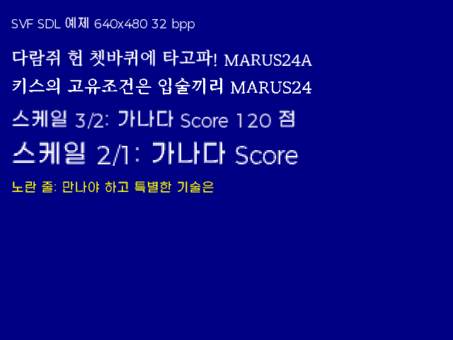
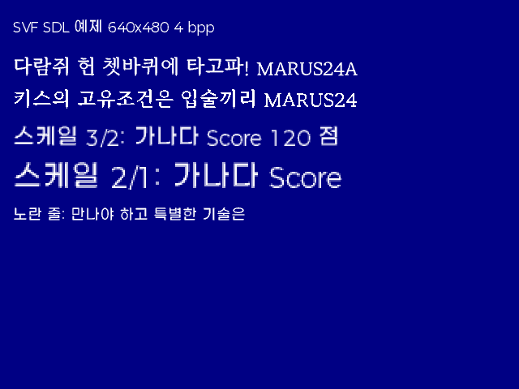
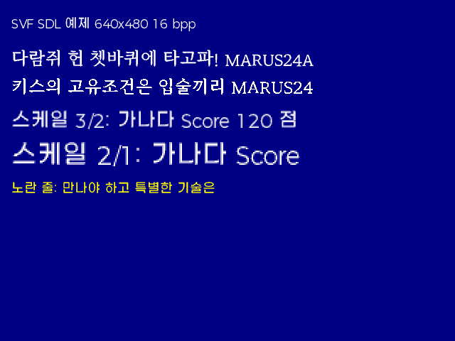

**English** | [한국어](README.ko.md)

# SDL2 / SDL3 example (`svfsdl.c`)

`svfsdl.c` draws the lines of `sdl-lines.txt` (the DOS port's file format, parsed by the same `vesa_lines.c`) into an
`SDL_Surface` of the pixel format asked for, through the matching `svf_target` kind of the C renderer, and shows it in a
window. **One source builds against SDL2 and SDL3** (`sdl_compat.h`, `SDL_VERSION_ATLEAST(3, 0, 0)` as ScummVM's
backends use it). With `--dump` it writes the surface's own bytes behind a 16-byte header and exits; the headless check
(below) rebuilds the same bytes with `tools/svfline.py` at SDL's real pitch and compares every one, on both SDLs, with the
faces mapped and streamed. The picture is therefore never the proof: **the back buffer, not the screenshot, is the
proven object** (the renderer converts; see the screenshot notes).

The port names SDL formats by memory byte order, using SDL's array-order aliases where there is one, because the
library's kinds are defined in memory order (`svf.h`). `PixelFormat` is ScummVM's `Graphics::PixelFormat(bytes, rBits,
gBits, bBits, aBits, rShift, gShift, bShift, aShift)` on a little-endian host.

| `--format` | SDL format asked for | memory order | `svf_target_kind` | ScummVM equivalent |
|---|---|---|---|---|
| `xrgb8888` | `SDL_PIXELFORMAT_BGRX32` (= `XRGB8888`; SDL2 prints `RGB888`) | B G R X | `SVF_T_XRGB8888`, X written 0 | `PixelFormat(4, 8, 8, 8, 0, 16, 8, 0, 0)` |
| `argb8888` | `SDL_PIXELFORMAT_BGRA32` (= `ARGB8888`) | B G R A | `SVF_T_XRGB8888`, `fg888 = 0xFFRRGGBB` (alpha 255 everywhere) | `PixelFormat(4, 8, 8, 8, 8, 16, 8, 0, 24)` |
| `rgb565` | `SDL_PIXELFORMAT_RGB565` | native 16 bit | `SVF_T_RGB565` (+ `SVF_TF_RGB16_BIGENDIAN` on a big-endian host) | `PixelFormat(2, 5, 6, 5, 0, 11, 5, 0, 0)` |
| `rgb555` | `SDL_PIXELFORMAT_XRGB1555` | native 16 bit | `SVF_T_RGB555` | `PixelFormat(2, 5, 5, 5, 0, 10, 5, 0, 0)` |
| `bgr24` | `SDL_PIXELFORMAT_BGR24` | B G R | `SVF_T_RGB888` | none checked (no 24 bit screen format in ScummVM's lists) |
| `index8` | `SDL_PIXELFORMAT_INDEX8` + 256-entry palette | one index | `SVF_T_INDEXED8` (`index_base`, `index_levels`, `mono_threshold`) | `PixelFormat::createFormatCLUT8()` |
| `gray` `--gray-bits 8/4/2/1` | `INDEX8` / `INDEX4MSB` / `INDEX2MSB` / `INDEX1MSB` (`...LSB` with `--lsb-first`) + palette of 2^bits entries | 1, 2, 4 or 8 pixels a byte | `SVF_T_GRAY` (`gray_bits`, `SVF_TF_GRAY_LSB_FIRST`) | 8 bit: CLUT8 with a grey palette; fewer bits: none |

`SDL_PIXELFORMAT_RGB24` (memory R G B) has **no** matching kind and is not offered; do not map it to `SVF_T_RGB888` by
the name. After the surface is made the program checks that SDL gave the format it asked for (a mismatch is an error,
never a silent conversion).

## Build and run

From the repository root (SDL2 2.30.0 or newer, the INDEX2 pixel formats: `libsdl2-dev` and `pkg-config`; `sdl_compat.h` stops an older one with an `#error`; SDL3: below):

    make -C c/ports/sdl SDL=2      # c/build/ports/sdl/svfsdl2
    make -C c/ports/sdl SDL=3      # c/build/ports/sdl/svfsdl3  (SDL3_PREFIX, default ~/opt/sdl3; linked with an rpath)
    make -C c/ports/sdl            # both;  make -C c/ports/sdl ASAN=1 SDL=2  for the sanitizer build in O/asan

or by hand (`-std=c99 -Wall -Wextra -Werror` is what the Makefile uses; the sources are the library, the DOS line parser
and the example):

    cc -std=c99 -O2 -DSVFSDL=2 -Ic/include -Ic/ports/dos c/ports/sdl/svfsdl.c c/ports/dos/vesa_lines.c \
        c/ports/dos/vbe_select.c c/src/*.c $(pkg-config --cflags --libs sdl2) -o svfsdl2
    export PKG_CONFIG_PATH=~/opt/sdl3/lib/pkgconfig      # set first: the $(pkg-config ...) below are expanded by the shell
    cc -std=c99 -O2 -DSVFSDL=3 -Ic/include -Ic/ports/dos c/ports/sdl/svfsdl.c c/ports/dos/vesa_lines.c \
        c/ports/dos/vbe_select.c c/src/*.c $(pkg-config --cflags --libs sdl3) \
        -Wl,-rpath,$(pkg-config --variable=libdir sdl3) -o svfsdl3

**SDL3 without root.** SDL3 is not packaged on this host; the gate uses the user's fork (a working tree at
`~/opt/src/SDL3`, commit `7a588ba6beae4b6f6cc45fdbdca6fd1aea5a2f06`, SDL 3.5.0-dev) built into `~/opt/sdl3` by

    c/cross/install-toolchains.sh sdl3        # SDL3_SRC=... to name another tree; refuses a tree not at that commit

which configures out of tree with `-DSDL_X11_XTEST=OFF` (no `libxtst-dev` needed) and records the commit in
`~/opt/sdl3/COMMIT`; `check.sh` refuses an SDL3 build whose commit differs from the fork tree's. Any SDL3 that
`pkg-config sdl3` finds (set `SDL3_PREFIX`) builds the example; only that commit is gated.

Run it from the repository root (the defaults are `--faces svf/dos`, `--lines c/ports/sdl/sdl-lines.txt`):

    c/build/ports/sdl/svfsdl3 --format rgb565 --stream

A key press or the close button ends it. Options:

| option | meaning |
|---|---|
| `--format F` | `xrgb8888` (default), `argb8888`, `rgb565`, `rgb555`, `bgr24`, `index8`, `gray` |
| `--gray-bits 1\|2\|4\|8`, `--lsb-first` | the gray surface's bits (default 8) and bit order; `--gray-bits` without `--format gray` is exit 2 (under `--alpha-demo` it is accepted and ignored, like `--format`), `--lsb-first` is ignored by other formats |
| `--threshold N` | 0..255, default 128; see below |
| `--present surface\|texture\|texture-direct` | blit to the window surface (default); stream the buffer through a texture (an indexed surface is converted once); draw straight into a locked texture |
| `--stream` | faces read through the stream callback (`fseek`/`fread`, a block cache) instead of mapped whole |
| `--syllable-cache=BYTES` | the syllable cache of the faces' chains |
| `--faces DIR`, `--lines FILE` | where the `.SVF` faces and the lines file are |
| `--size WxH` | surface and window size, default 640x480 (width and height up to 32767, pitch up to 65535) |
| `--dump FILE` | write the first frame's surface bytes (16-byte header, then pitch x h bytes) after the first frame, then exit (unless `--frames N` asks for more frames); header in `sdl_check.py` |
| `--shot FILE.bmp` | save the window's pixels (`SDL_SaveBMP` of the window surface) after the first frame; needs `--present surface` |
| `--frames N` | show N frames (0 = until closed; 1 when `--dump` or `--shot` is given) |
| `--alpha-demo` | see the notes below |

A usage error is exit 2 with one `svfsdl:` line on stderr and nothing written; an SDL or library error is exit 1. On
success one line goes to stdout:

    svfsdl: SDL 3.5.0 driver x11 window SDL_PIXELFORMAT_XRGB8888 back SDL_PIXELFORMAT_XRGB8888 pitch 2560 draw 815 us sum=ec7c21b7

the SDL version and video driver, the format of the window surface (`window`) and of the back buffer the library drew
into (`back`), that buffer's row pitch in bytes, the time of one draw of all lines, and the FNV-1a of the buffer
(`sum=`). With `--alpha-demo` the line also has `covpitch`, the coverage buffer's pitch.

**`--threshold` and the 1-bit outputs.** The faces may be 1, 2 or 8 bpp; an anti-aliased face drawn to a one-level output
is cut at the threshold, after jamo composition: levels 85/170/255 of a 2 bpp face: 128 keeps the upper two, 255 keeps
only full pixels, 1 keeps any ink. It applies to `index8` colours with one level (the lines file's `index_levels 1`, the
yellow line of `sdl-lines.txt`) and to `gray --gray-bits 1`; for gray bits >= 2 the threshold is not read (the output is
anti-aliased, the level is `(cov * (2^bits - 1) + 127) / 255`) and the other formats ignore it. `gray` ignores the lines
table's line colours: its palette runs from the background to white.

## The headless check

    sh c/ports/sdl/check.sh [OUT]         (make -C c/ports/sdl check)

builds `svfsdl2`, `svfsdl3` and one ASAN/UBSAN `svfsdl2`, then under `SDL_VIDEODRIVER=dummy` runs every format with
`--dump` and holds each dump to `sdl_check.py`, which rebuilds the bytes with `tools/svfline.py` (stride = the dump's
pitch; padding bytes must be 0; sub-byte rows are compared bit for bit). Per SDL the matrix is: the five packed kinds x
{mapped, `--stream`, 641x479 for the padding}, `--syllable-cache`, texture runs (rgb565, rgb555, bgr24), `index8` (thresholds 1 and 255 too),
`gray` at 1/2/4/8 bits in both bit orders, the small 161x101 surface, `--alpha-demo`, and expected failures (not
counted). Every run also compares the SDL format name of the back buffer with the one the run should get, the program's
`sum=` with the checker's, and the `window ...` format; every `index8` / `gray` surface run also compares its
`--shot` with a palette computed in `sdl_check.py` independently of the C code (skipped with a printed note when the
window is below 24 bits; `window_deep.sh` holds the name list). The SDL2 and SDL3 dumps must be equal after the header. Exit codes of `sdl_check.py`: 0
identical (`sdl-check: OK <kind> WxH pitch=P sdlN sum=...`), 1 a byte differs (`DIFF`, with a diff PNG), 2 an input that
cannot be used. The last line is

    port-sdl-check: OK sdl2 56 runs, sdl3 52 runs, sum=ec7c21b7

(`sum=` is the FNV-1a of the xrgb8888 mapped dump, equal on both SDLs). With `SVFSDL_ONLY=2|3` the line names the SDL that ran and the mode, e.g. `port-sdl-check: OK sdl3 only: 52 runs, no ASAN, sum=ec7c21b7` (the ASAN runs belong to SDL2; no cross-SDL comparison). `c/cross/build-all.sh --ports` runs the script and
prints `port-sdl: OK svfsdl2 N bytes, svfsdl3 M bytes` (informational sizes, not gated) and
`port-sdl-check-runs: sdl2 56 runs, sdl3 52 runs, sum=ec7c21b7`. `make -C c check` does not run it (the SDL libraries are
a host matter). Its Python tests: `python3 -I c/ports/sdl/test_sdl_check.py`.

## Screenshots

    sh c/ports/sdl/shots.sh [OUT]         (make -C c/ports/sdl shots)

`OUT` holds only the work files; the pictures are always written to `c/ports/sdl/shots/` (or `SVFSDL_SHOTS_DEST`), which rewrites the tracked PNGs there.

runs, for SDL2 and SDL3, `xvfb-run -a -s "-screen 0 1280x1024x24" svfsdlN --format K --present surface --shot B.bmp --dump D
--frames 1` at 640 x 480 for five formats, and `sdl_shots.py` converts each BMP to PNG, checks the size and that at least
1 % of the pixels are off the background, and compares the picture with that run's dump as SDL expands it (32 bit and
palettes exactly; RGB565 by `v * 0x21 >> 2` for 5 bits and `v * 0x41 >> 4` for 6). A rule other than `exact` (`shl`, or `tolerance`: at most 1 level of the 8 bit result per channel) is printed
as information with its pixel count and the largest deviation, not a failure; anything further off is a DIFF. The pictures are the **window's** pixels (a window on an X server of
depth 24), so what you see is what SDL showed, not the back buffer. They are also drawn together in
[`shots/overview.png`](shots/overview.png).

| | xrgb8888 | argb8888 | rgb565 | index8 | gray 4 bits |
|---|---|---|---|---|---|
| SDL2 |  |  |  |  |  |
| SDL3 |  |  |  |  |  |

Measured on this host (SDL 2.30.0, the 3.5.0 fork): **nine of the ten pictures are `exact`**; the SDL2 `rgb565` shot is
`tolerance` (`maxdev=1`: no channel is more than one level off the exact expansion, 306,829 of 307,200 pixels differ at all). SDL2 widens a 5 or 6
bit channel with its own table (measured: at most one level from the exact value, e.g. 63 of 6 bits gives 254 and 16 of 5
bits gives 131), where SDL3 gives the exact one.
SDL2 and SDL3 pictures are **identical pixel for pixel for xrgb8888, argb8888, index8 and gray 4** (4 of 5 formats);
`rgb565` differs in 306,829 pixels for that reason alone (the back buffers are the same bytes, which `check.sh` proves). The
comparison is informational: it is the windowing code of each SDL that differs, not the library. `rgb555`
and `bgr24` have headless runs but no pictures.

## Notes for an application author

- **Known gap (the library, not this port).** The AVR build has its own GRAY / GRAY8 dispatch cases in `svf_draw.c`; `c/cross/build-all.sh` compiles them with `-Werror` for every kind mask and links them, but no simavr case draws GRAY on AVR (see `c/cross/SIZES.md`, Findings).

- **Stride is SDL's pitch.** `SDL_CreateSurface` rounds a row up to 4 bytes (63 px of RGB565 is 128 bytes, not 126); give
  the target `stride = surface->pitch`, lock the surface first (`SDL_LockSurface`), and call `svf_target_init` for that
  buffer. A stride is 16 bits: a pitch over 65535 is refused.
- **Padding bytes** (past the pixels of a row, or the unused bits of a sub-byte row) are never written by the library;
  clear the surface before drawing (the example clears each row's pixels to the background and leaves the padding 0).
  The colour kinds (RGB565, RGB555, XRGB8888, RGB888) blend against a known background colour and never read the destination; GRAY8, GRAY and INDEXED8 take the maximum of the existing value and the new level, and the mono kinds OR their bits, so those need a cleared (or level-0) buffer.
- **Byte order.** The 32 and 24 bit kinds are memory order B G R [X] on every host (use SDL's array-order names, as the
  table does); the 16 bit kinds follow the host: set `SVF_TF_RGB16_BIGENDIAN` when `SDL_BYTEORDER` is big-endian. Only
  little-endian is run here.
- **ARGB8888 opaque.** `argb8888` writes alpha 255 into every pixel (`fg888 = 0xFF000000 | rgb`) and the surface is
  blitted with `SDL_BLENDMODE_NONE`; coverage is not alpha.
- **Alpha from coverage (`--alpha-demo`).** Text over a background the library cannot know (a photo, a game screen) needs
  coverage, not a blend against a colour: the demo draws the first line of the table into a GRAY8 coverage buffer, builds
  `BGRA32` pixels `(b, g, r, coverage)` of the line colour (straight alpha) and blits them with `SDL_BLENDMODE_BLEND` over a
  gradient (`--present surface` or `texture`); `--format` and `--gray-bits` have no effect with it (a misspelt format is
  still exit 2). Only the GRAY8 buffer is checked (`--dump` writes it, pitch w); SDL's blend rounding is not claimed, and
  the SDL2 and SDL3 composites can differ by rounding. `SDL_BLENDMODE_BLEND_PREMULTIPLIED` is the alternative an
  application would pick; it is not shown.
- **`--present texture`** uploads the buffer once per frame (an indexed surface once, converted through its palette);
  SDL converts what it needs, which is why the picture is not the proof. A texture format the renderer refuses is an error (exit 1), never a silent conversion. **`--present texture-direct`** draws into the
  locked texture's own memory and is a **demonstration only**: SDL may convert at unlock, and the texture's pitch is
  SDL's; it cannot `--dump` or be used with `index8`, `gray` (a texture has no palette) or `--alpha-demo`.
- **`--shot` needs `--present surface`**: with a texture the window's pixels would have to be read back through the
  renderer (`SDL_RenderReadPixels`, which returns a surface in SDL3 and fills a buffer in SDL2), a difference not worth
  carrying in `sdl_compat.h` for the screenshots, which are of the surface path. The restriction is deliberate; texture
  runs are covered by `--dump` instead.
- **Palettised surfaces.** SDL2 gives an `INDEX8` surface its palette, SDL3 does not until asked
  (`SDL_CreateSurfacePalette`); the compat header hides it. `index8` palettes follow the DOS 8 bpp rule
  (`vbe_palette_entry`); the gray palette is `(bg * (n - k) + 255 * k + n / 2) / n` per channel, `n = 2^bits - 1`.

## For ScummVM (card t_5a7bcd78)

- The library compiles with `-Wall -Wextra -Werror` inside an SDL2 and an SDL3 program with ScummVM's
  `SDL_VERSION_ATLEAST(3, 0, 0)` idiom; the port shows `stride = pitch` is the whole adaptation and gives the format
  table above, with ScummVM's `PixelFormat` for each kind so the mapping is checked, not guessed.
- The colour kinds do not read the destination (they fit text on a known solid: menus, status lines); GRAY8, GRAY and INDEXED8 take the maximum of the existing value and the new level and the mono kinds OR, so drawing onto a live CLUT8 game screen does not overwrite: wherever the game pixel's index is above the ramp the text disappears, and a ramp pixel can only raise an index. ScummVM's `hires_text`
  composes over the game screen with its palette; that is the GRAY8 / coverage-callback route plus ScummVM's own
  compositor, which `--alpha-demo` shows in miniature.
- `--stream` proves the stream reader with a block cache gives the same bytes as mapped at full-screen sizes; ScummVM's
  faces come from pack files behind a seekable stream, the same shape as the `fseek`/`fread` callback.
- The headless method (dummy driver, dump, `svfline` at the real pitch) is one an `engine_gate.sh` step can copy.
- Not proven here: ScummVM's threading, scalers, CLUT8 planes, the `JSET` set-limit change on that card, or any
  performance inside ScummVM.

The faces' licences are in `c/ports/FACES.md`.
