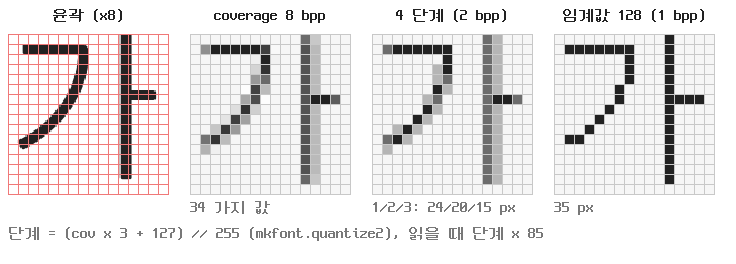
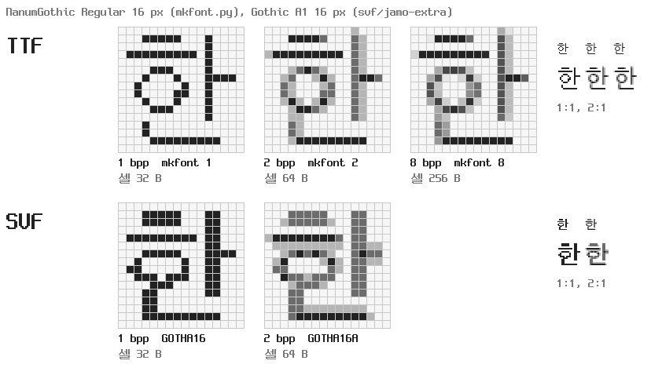
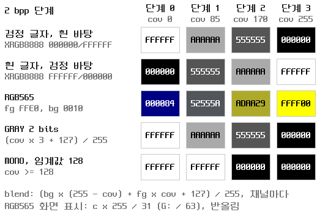
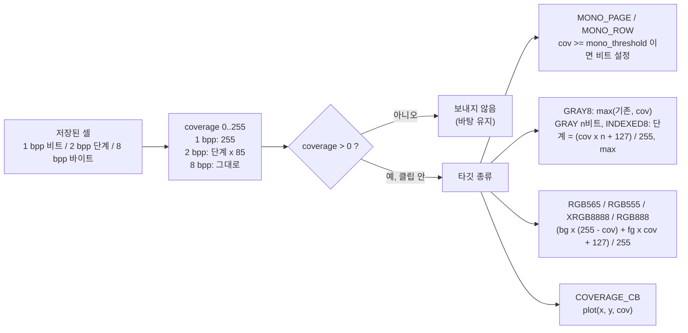
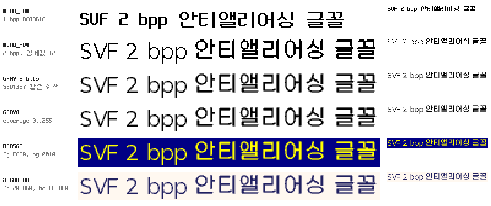
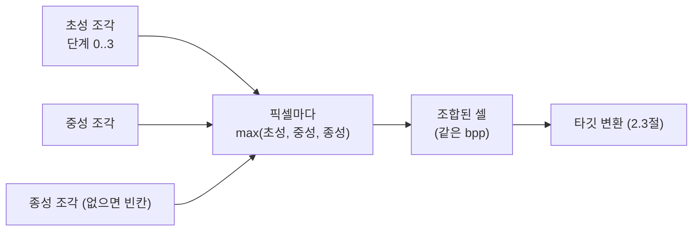
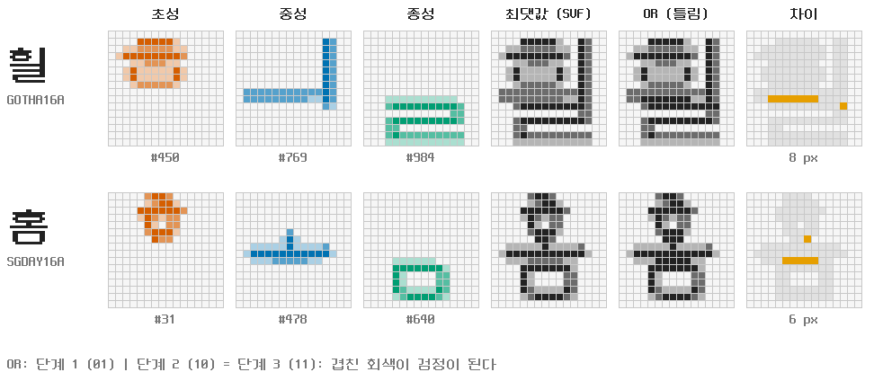
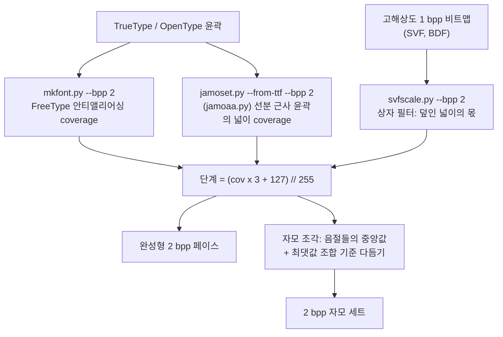
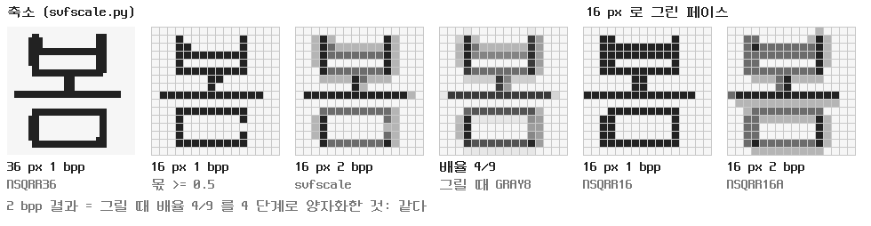

[English](anti-aliasing.md) | **한국어**

# 안티앨리어싱: SVF의 1·2·8 bpp 글꼴

작은 글자는 픽셀 몇 개로 그려야 한다. 픽셀마다 "켜짐/꺼짐"만 고르면 사선과 곡선이 계단처럼 보이고, 획의 굵기가 픽셀 단위로
튄다. **안티앨리어싱**은 가장자리 픽셀에 중간 밝기를 주어 이를 줄인다. 이 문서는 그 원리와, SVF가 회색 단계를 어떻게 저장하고
(1, 2, 8 bpp) 렌더러가 그것을 각 출력 타깃의 색으로 어떻게 바꾸는지, 조합형 자모 세트에서 조각을 겹칠 때 무엇을 조심해야
하는지, 안티앨리어싱 페이스를 어떻게 만드는지, 작은 기계에서 무엇을 고를지를 설명한다.

## 목차

1. [안티앨리어싱이란](#1-안티앨리어싱이란)
2. [SVF의 비트 깊이와 출력 변환](#2-svf의-비트-깊이와-출력-변환)
3. [자모 세트: 단계에서는 OR가 아니라 최댓값](#3-자모-세트-단계에서는-or가-아니라-최댓값)
4. [안티앨리어싱 페이스 만들기](#4-안티앨리어싱-페이스-만들기)
5. [작은 기계에서의 비용과 선택](#5-작은-기계에서의-비용과-선택)
6. [관련 문서](#6-관련-문서)
7. [참고 문헌 / References](#참고-문헌--references)

**그림.** 그림은 모두 `python3 -I tools/doc_figures_aa.py`가 만든다([tools.ko.md](tools.ko.md#toolsdoc_figures_aapy)).
글리프의 픽셀은 프로젝트 자신의 코드를 거친다. 페이스는 [svfline.py](../tools/svfline.py)가 C 라이브러리의 규칙대로 읽고(자모
음절은 `jamoset.compose`로 조합), 줄은 `svfline.placements`로 배치하고, 타깃 변환은 `svfline.Target`(C의 `svf_target`과 같은
규칙)으로 한다. 윤곽에서 만든 그림은 [mkfont.py](../tools/mkfont.py)의 `render()`로 그려 메모리 안의 SVF로 묶은 뒤 다시 읽는다.
읽는 글꼴은 이 저장소의 OFL 글꼴뿐이다(Gothic A1, Single Day, 나눔스퀘어라운드, Paperlogy, Neo 둥근모, 나눔고딕 TTF). 같은 글꼴 파일과 Pillow·FreeType 버전에서는 실행할 때마다
같은 바이트가 나오며 `--check`로 확인한다(제공된 그림은 Pillow 10.2.0, FreeType 2.13.2로 생성).

## 1. 안티앨리어싱이란

### 1.1 coverage: 픽셀이 글자에 덮인 비율

글꼴의 윤곽은 연속된 곡선이고, 화면은 정사각형 픽셀의 격자이다. 윤곽을 격자에 옮기는 일을 **래스터화**라 한다 [2]. 가장 단순한
방법은 픽셀 중심이 윤곽 안에 있으면 켜고 밖이면 끄는 것이다. 그러면 픽셀은 0 아니면 1이고, 이것이 1 bpp(bit per pixel) 비트맵이다.

안티앨리어싱은 픽셀이 윤곽에 덮인 **넓이의 비율**, 즉 **피복도(coverage)**를 구해 그 비율만큼 잉크 색을 섞는다 [1][2]. 획의 가장자리가
픽셀 절반을 덮으면 그 픽셀은 잉크와 바탕의 중간색이 된다. 신호 처리로 보면, 픽셀 넓이에 대한 평균(상자 필터)으로 고주파를
줄인 뒤 표본을 뜨는 것이다 [1].

*그림 1. 나눔고딕 Regular의 "가"를 16 px로. 왼쪽부터 윤곽(8배로 그려 픽셀 격자를 겹침), FreeType이 계산한 8비트 coverage(34가지
값), `mkfont.py --bpp 2`가 저장하는 4단계, `--bpp 1`이 저장하는 임계값 128의 1 bpp. 사선의 픽셀은 coverage가 0과 1 사이이므로
1 bpp에서는 켜지거나 꺼지는 둘 중 하나가 되어 계단이 생긴다.*

### 1.2 작은 글자가 1 bpp에서 거칠어 보이는 이유

16 px 한글 음절에서는 획 하나가 1-2 픽셀 굵기에 불과할 수 있다. 이 크기에서 1 bpp는 세 가지를 잃는다.

- **사선과 곡선의 계단.** ㅅ, ㅈ, ㅇ의 사선과 곡선이 픽셀 계단이 된다(그림 1의 오른쪽).
- **획 굵기와 위치의 양자화.** 윤곽에서 1.4 픽셀 굵기인 획은 1 또는 2 픽셀이 된다. 같은 글꼴의 같은 획이 놓인 자리에 따라 굵기가
  달라지고, 획 사이 간격도 픽셀 단위로 튄다.
- **얇은 부분의 소실.** 픽셀 절반을 넘게 덮지 못하는 가는 획이나 삐침은 사라진다.

그래서 작은 크기의 1 bpp 글꼴은 대개 사람이 픽셀 단위로 직접 그리거나, 윤곽 글꼴의 **힌팅**(글꼴의 지시나 렌더러의 추정으로 윤곽을 픽셀 격자에 맞추는 처리)으로 다듬는다 [2]. 둥근모 같은 픽셀 글꼴은 처음부터 1 bpp를 위해 그린 것이다.

### 1.3 회색 단계가 주는 것

가장자리 픽셀에 중간 단계를 주면 눈은 획의 위치와 굵기를 픽셀보다 세밀하게 읽는다. 1.4 픽셀 굵기의 획은 "꽉 찬 1 픽셀 + 옅은
1 픽셀"로 보이고, 사선은 계단 대신 매끈한 경사로 보인다. 단계가 몇 개 필요한지는 크기와 화면에 따라 다르지만, 작은 글자의
가장자리에서는 단계 몇 개로도 효과가 크다. SVF가 2 bpp(4단계)를 따로 두는 이유이다(2장). 대가는 늘어나는 셀 메모리(행 패딩에 따른 예는 5.1절)와,
화면이 회색이나 색을 표시할 수 있어야 한다는 조건이다.

*그림 2. "한"(16 px). 윗줄: 나눔고딕 Regular를 `mkfont.py --bpp 1/2/8`로 구운 셀. 아랫줄: 저장소의 Gothic A1 자모 세트
`GOTHA16`(1 bpp)과 `GOTHA16A`(2 bpp). "셀 N B"는 셀 하나의 바이트 수(32, 64, 256). 오른쪽은 실제 크기(1:1)와 2배.
2 bpp와 8 bpp는 확대하면 다르지만 실제 크기에서는 거의 구별되지 않는다.*

### 1.4 감마와 눈에 보이는 굵기

coverage는 **넓이**이지 **밝기**가 아니다. 대부분의 화면은 입력값과 빛의 세기가 비선형이며(sRGB는 대략 감마 2.2), 사람의 눈도
어두운 쪽 차이를 더 잘 느낀다 [3]. 그래서 coverage 50 %인 픽셀을 그대로 값 128로 섞으면 물리적으로 50 %의 빛이 아니다. FreeType
문서는 50 % 덮인 픽셀이 50 % 밝기로 보이려면 128이 아니라 약 186이 필요하다고 설명하고, 선형 공간에서 섞은 뒤 감마 보정을 하는
것이 올바른 렌더링이라고 한다 [4]. 보정하지 않으면 흰 바탕의 검은 글자는 실제보다 굵고 진하게, 검은 바탕의 흰 글자는 가늘고
약하게 보인다 [4]. 거꾸로 감마를 정확히 보정하면 작은 글자가 가늘어 보여, FreeType은 획을 조금 굵히는 "stem darkening"을 제공하며, Mac OS X도 이 처리를 쓴다.
FreeType 자동 힌터에서는 기본으로 꺼져 있다 [4].

SVF는 감마를 다루지 않는다. 저장된 단계는 coverage 그대로이고(도구에 감마 옵션이 없다, 4장), 렌더러는 인코딩된 채널 값을 선형 광량으로 변환하지 않고
섞는다(2.3절). 이 때문에 흰 바탕의 검은 글자가 더 진해질 수 있다 [4]. 감마가 필요하면 `SVF_T_GRAY8`이나 `SVF_T_COVERAGE_CB`로
coverage를 받아 응용 프로그램이 직접 보정해 섞으면 된다([C 렌더러 가이드 8장](c-renderer-guide.ko.md#8-타깃-픽셀이-가는-곳)).
`SVF_T_INDEXED8`의 팔레트 램프에 감마를 반영한 색을 넣는 방법도 있다.

### 1.5 서브픽셀 렌더링(ClearType)과 SVF

LCD의 픽셀은 보통 빨강, 초록, 파랑의 세로 줄 세 개(서브픽셀)로 되어 있다. **서브픽셀 렌더링**은 이 세 줄을 따로 켜서 가로 해상도를
최대 세 배로 쓴다 [5][6]. Microsoft의 ClearType이 대표적이며 [6], FreeType에도 같은 계열의 LCD 렌더링이 있다 [7]. 이 방식에는
조건이 있다.

- 소프트웨어가 서브픽셀의 **배치를 알아야 한다**(RGB인지 BGR인지, 가로 줄인지, 화면이 회전했는지). 틀리면 서브픽셀 렌더링을 하지
  않은 것보다 나빠진다 [5].
- 결과는 **색**이 있는 픽셀이다. 필터로 색 번짐(color fringe)을 줄일 수 있지만 선명도와 절충해야 한다 [5][7].
- 바탕색을 알고 채널마다 따로 섞어야 한다.

SVF는 서브픽셀 렌더링을 하지 않는다. 이유는 다음과 같다.

- **글꼴에 화면이 들어가게 된다.** SVF는 coverage를 미리 구워 저장한다. 서브픽셀 결과를 구우면 한 페이스가 한 가지 서브픽셀
  배치(RGB 세로 줄 등)와 방향에만 맞게 된다. SVF가 겨냥하는 대상에는 단색·회색 화면, 서브픽셀 배치가 제각각인
  작은 TFT, 팔레트 모드의 DOS 화면이 섞여 있다.
- **MONO와 GRAY 타깃은 색 채널을 따로 제공하지 않는다.** 같은 페이스가 MONO, GRAY, RGB 타깃 모두에서 쓰여야 한다(2.3절).
- **저장 크기.** 서브픽셀 coverage는 픽셀당 세 값이 필요하다. 2 bpp가 1 bpp의 두 배인 것도 작은 기계에서는 큰 부담이다(5장).

필요하면 SVF의 coverage를 응용 프로그램이 받아 자기 화면에 맞게 다시 처리할 수 있다(콜백 타깃). 그러나 원본 윤곽 없이 회색 coverage만
있으므로 FreeType의 LCD 렌더링과 같은 결과는 아니다.

## 2. SVF의 비트 깊이와 출력 변환

### 2.1 세 가지 저장 형식

SVF 헤더의 바이트 8이 bpp(1, 2, 8)이다([spec/SVF.ko.md](../spec/SVF.ko.md#셀-레이아웃-바이트-예약-바이트)). 셀은
`pitch = (셀 폭 x bpp + 7) / 8` 바이트의 행 `셀 높이`개이며, 행 안에서는 왼쪽 픽셀이 상위 비트이다(MSB 우선). 렌더러는 저장된 값을
8비트 **coverage**로 펼친다(`c/include/svf.h`의 `svf_target` 설명, [svfline.py](../tools/svfline.py)의 `Face.coverage`).

| bpp | 픽셀 하나 | 펼친 coverage | 16x16 셀 | 쓰임 |
|---|---|---|---:|---|
| 1 | 비트 1개 | 0 또는 255 | 32 B | 픽셀 글꼴, 단색 화면, 가장 작은 메모리 |
| 2 | 단계 0..3 (2비트) | 단계 k x 85: 0, 85, 170, 255 | 64 B | 작은 컬러/회색 화면의 안티앨리어싱 |
| 8 | 바이트 1개 | 그 바이트 0..255 | 256 B | 메모리가 넉넉한 호스트 |

2 bpp 바이트 하나에는 픽셀 네 개가 들어 있다. 픽셀 x의 단계는 `(row[x >> 2] >> (6 - 2 x (x & 3))) & 3`이다.

### 2.2 2 bpp 단계표

| 단계 | 비트 | coverage | 흰 바탕 검정 글자 | 검정 바탕 흰 글자 | RGB565 (fg `FFE0` 노랑, bg `0010` 남색) |
|---:|---|---:|---|---|---|
| 0 | `00` | 0 | (바탕 그대로) | (바탕 그대로) | (바탕 그대로) |
| 1 | `01` | 85 | `AAAAAA` | `555555` | `52AB` |
| 2 | `10` | 170 | `555555` | `AAAAAA` | `AD45` |
| 3 | `11` | 255 | `000000` | `FFFFFF` | `FFE0` |

단계 0의 픽셀은 타깃에 보내지 않는다. coverage가 0보다 큰 픽셀만 보내므로 바탕은 그대로 남는다.

*그림 3. 단계(단계 0..3, cov = coverage)마다 타깃이 쓰는 색. 줄 이름: "검정 글자, 흰 바탕", "흰 글자, 검정 바탕", RGB565(노랑 글자,
남색 바탕), GRAY 2비트, "MONO, 임계값 128". 칸 안의 값은 화면에 보이는 24비트 색이다. RGB565 값은 `c x 255 / 31`(초록은
`/ 63`)로 24비트로 늘려 표시했다.*

### 2.3 단계가 색이 되는 과정

각 타깃의 규칙은 `c/include/svf.h`의 `svf_target` 위 주석에 있고, 구현은 [svf_draw.c](../c/src/svf_draw.c), 같은 규칙의 파이썬
참조 구현은 [svfline.py](../tools/svfline.py)의 `Target.put`이다.

**컬러 타깃(RGB565, RGB555, XRGB8888, RGB888).** 채널마다 바탕색과 잉크색을 coverage로 섞는다. 모든 연산은 부호 없는 정수이며
반올림은 `+ 127` 후 255로 나누는 것이다(`svf_draw.c`의 `blend565`, `blend555`, `blend888`).

    c = (c_bg x (255 - cov) + c_fg x cov + 127) / 255        (정수 나눗셈, 채널마다)

RGB565는 5/6/5비트 채널 값(빨강 0..31, 초록 0..63, 파랑 0..31)에 이 식을 그대로 쓰고, RGB555는 5/5/5비트에 쓴 뒤 픽셀의 비트 15를
`fg565`의 비트 15로 채운다. XRGB8888과 RGB888은 8비트 채널에 쓰며 명시적인 `uint32_t` 피연산자로 계산한다. 컬러 타깃은 **기존
픽셀을 읽지 않는다**. `bg`가 실제 바탕색이어야 하며, 무늬 있는 바탕 위에 섞으려면 콜백 타깃을 쓴다
([C 렌더러 가이드 8장](c-renderer-guide.ko.md#8-타깃-픽셀이-가는-곳)). 2 bpp와 1 bpp 셀은 단계 1..3의 색을 셀마다 한 번만 계산해 두고
픽셀마다 고르기만 하며(`rgb16_pix`), 8 bpp만 픽셀마다 섞는다.

**MONO_PAGE, MONO_ROW.** coverage가 `mono_threshold`(기본 128) 이상이면 비트를 켠다. 0은 1로 친다(coverage 없는 픽셀은 켜지지 않는다).
비트는 켜기만 하고 끄지 않는다. 2 bpp 셀에서는 이것이 "단계 >= `(thr + 84) / 85`"와 같으며(`svf_draw.c`의 `least_level`), 기본값
128에서는 단계 2와 3이 남고 단계 1은 사라진다. 255로 하면 단계 3만, 1로 하면 잉크가 있는 모든 픽셀이 남는다.

**GRAY8.** 픽셀당 coverage 바이트 하나를 `max(기존, cov)`로 쓴다. 응용 프로그램이 직접 합성하는 마스크이다.

**GRAY(1, 2, 4, 8비트)와 INDEXED8.** 최대 단계 n(GRAY는 `2^gray_bits - 1`, INDEXED8은 `index_levels`)에 대해
`L = (cov x n + 127) / 255`로 단계를 정한다. GRAY는 `max(기존 값, L)`을 쓴다. INDEXED8은 L이 0이면 그대로 두고,
그 밖에는 `max(기존 값, index_base + L)`을 쓴다. 팔레트 인덱스 자체를 비교하므로 팔레트 램프는 coverage가 증가하는 순서로 배치해야 한다. n = 3이면 2 bpp 단계 k는 그대로 k이고, n = 15(4비트
회색)이면 0, 5, 10, 15가 된다. n = 1(GRAY 1비트, INDEXED8의 `index_levels 1`)이면 MONO와 같은 임계값 규칙이다.

*그림 4. 같은 줄 "SVF 2 bpp 안티앨리어싱 글꼴"(안티앨리어싱 글꼴)을 타깃마다 그린 결과(왼쪽 3배 확대, 오른쪽 실제 크기). 첫 줄은
1 bpp 페이스 NEODG16, 나머지는 컬러/회색 포트의 페이스 PAPLG16 + PAPLG18(2 bpp). 둘째 줄 "2 bpp, 임계값 128"은 같은 2 bpp
페이스를 MONO에 그려 단계 1이 사라진 결과로, 획이 가늘고 끊긴다. "SSD1327 같은 회색"은 2비트 GRAY 타깃을 가리킨다. 실제 SSD1327 포트는 픽셀당 4비트로 패킹하며
(`c/ports/pico/disp_ssd1327.c`, `c/ports/esp32/main/disp_ssd1327.c`), 이 행은 coverage 네 단계만 보여 준다.*

### 2.4 겹치는 셀

한 줄 안에서 두 셀이 같은 픽셀을 덮으면(결합 부호, 넘치는 글리프) GRAY8, GRAY, INDEXED8은 최댓값을, MONO는 OR를 남긴다. 컬러
타깃은 기존 픽셀을 읽지 않으므로 뒤에 그린 셀의 색이 남는다(`svf.h`). 1 bpp 페이스에서는 차이가 없지만, 안티앨리어싱 페이스에서
셀이 겹치면 뒤 셀의 옅은 가장자리가 앞 셀의 진한 픽셀을 덮을 수 있다. 바탕이 단색이 아니거나 셀이 겹치는 글꼴이면 GRAY8로
그린 뒤 응용 프로그램이 한 번에 섞는 편이 안전하다.

## 3. 자모 세트: 단계에서는 OR가 아니라 최댓값

자모 세트(조합형) 페이스는 음절마다 초성, 중성, 종성 조각을 골라 한 셀에 겹친다([조합형 문서 4.1절](jamo-sets.ko.md#41-생각의-틀)).
SVF의 규칙은 **픽셀마다 coverage의 최댓값**이다([spec/SVF.ko.md](../spec/SVF.ko.md#자모-세트-폰트-플래그-비트-1)). 1 bpp에서는 최댓값이
곧 OR이다. 2 bpp에서는 2비트 필드마다, 8 bpp에서는 바이트마다 최댓값을 취한다(`c/src/svf_jamo.c`의 `svf__merge`,
`tools/jamoset.py`의 `compose`).

**OR가 틀린 이유.** 2 bpp 바이트를 그대로 OR하면 2비트 필드끼리도 OR가 된다. 단계 1(`01`)과 단계 2(`10`)가 겹치면 `11`, 즉 단계 3이
된다. 두 조각의 옅은 가장자리가 만나는 곳에 진한 점이 생기는 것이다. 최댓값이면 단계 2가 남는다. 단계가 같거나 한쪽이 0이면 OR와
최댓값이 같으므로, 차이는 서로 다른 중간 단계(1과 2)가 겹친 픽셀에서만 생긴다. 8 bpp에서도 OR와 최댓값은 다를 수 있다. 예를 들어 85 | 170 = 255이지만 max(85, 170) = 170이다.

C 렌더러는 이 최댓값을 바이트 하나(또는 32비트 워드 하나)의 비트 연산으로 계산한다. 2비트 필드 a, b에 대해 `gt = a & ~b`,
`eq = ~(a ^ b)`, 필드마다 상위 비트로 "a > b"를 판정해 고른다(`svf__max2w`). 이렇게 바이트당 2비트 픽셀 네 개를 처리하고, 워드 경로가 켜지면 워드당 열여섯 개를 처리한다.
이 연산만으로 1 bpp에 대한 일정한 시간 비율을 정할 수는 없다.

*그림 5. Gothic A1 `GOTHA16A`의 "흴"과 Single Day `SGDAY16A`의 "홈". 열: 초성, 중성, 종성 조각(색의 진하기가 단계, #은 조각 번호),
"최댓값 (SVF)", "OR (틀림)", "차이"(주황이 두 결과가 다른 픽셀, 8 px와 6 px). 아래 문장: "OR: 단계 1 (01) | 단계 2 (10) = 단계 3
(11): 겹친 회색이 검정이 된다". 이런 픽셀은 KS X 1001 음절 2,350자 가운데 GOTHA16A에서 788자, SGDAY16A에서 660자에 있다.*

최댓값에도 한계가 있다. 윤곽에서 두 자모가 한 픽셀의 서로 겹치지 않는 절반을 덮으면 합친 coverage는 1이지만, 조각마다 따로 구운 단계의
최댓값은 그보다 낮다. 그래서 가는 획이 만나는 곳은 완성형 글리프보다 조금 옅게 보인다. `jamoaa.py`는 이 손실을 측정하며
(`join_loss`), 조각의 단계를 조합 결과에 맞추어 다듬어 줄인다(4.1절)
([레시피의 주의점](recipes.ko.md#truetypeopentype-폰트에서-2-bpp-안티에일리어싱-페이스-만들기)).

## 4. 안티앨리어싱 페이스 만들기

세 경로 모두 8비트 coverage를 같은 식으로 4단계로 줄인다.

    단계 = (coverage x 3 + 127) // 255        (mkfont.quantize2, jamoaa.quantize2, svfscale)

읽을 때는 단계 x 85로 되돌리므로 정수 coverage 0..255에서 픽셀당 오차는 최대 42이다. coverage 43 미만(약 17 %)의 아주 옅은 가장자리는 단계 0이 되어
사라진다. 2 bpp 양자화에는 감마, 임계값, 오버샘플링 옵션이 없다(1.4절).
`svfscale.py --threshold`는 1 bpp 출력에만 적용한다.

### 4.1 윤곽 글꼴에서

**완성형: `mkfont.py --bpp 2`.** 글리프마다 Pillow를 통해 FreeType의 안티앨리어싱 렌더러로 그리고(FreeType의 기본 힌팅), 8비트
coverage를 위 식으로 양자화한다(그림 1). 크기는 `--size`로 정하며, 배치와 셀 맞춤에는 `--cell`, `--width`, `--ascent`,
`--fit-cell`, `--clip-cell`도 쓴다([도구](tools.ko.md#toolsmkfontpy)). `--bpp 8`은 coverage를 그대로
저장한다. 1 bpp는 coverage를 128에서 자르거나, `--mono-hint`로 FreeType의 단색 렌더러와 글꼴의 힌팅을 쓴다.

**자모 세트: `jamoset.py --from-ttf --bpp 2`.** [jamoaa.py](../tools/jamoaa.py)가 fontTools로 윤곽을 읽고 곡선을 선분으로 근사한 뒤
부호 있는 넓이를 누적하여 음절을 그린다(힌팅 없음). 원래 곡선의 coverage를 근사하며, 윤곽이 겹치는 곳에서는
기하학적 합집합의 coverage와도 다를 수 있다(`jamoaa.py`의 `render_coverage`). 1 bpp 맞춤이 정한 영역으로 각 윤곽을 초성, 중성, 종성에 나누고, 조각의 단계는 그 조각을
쓰는 음절들의 픽셀별 중앙값으로 정한 뒤, 최댓값으로 조합한 결과가 음절을 통째로 그린 것에 가까워지도록 다듬는다(`--aa-refine N`, 기본 2).

명령과 측정값은 [레시피: TrueType/OpenType 폰트에서 2 bpp 안티에일리어싱 페이스 만들기](recipes.ko.md#truetypeopentype-폰트에서-2-bpp-안티에일리어싱-페이스-만들기)에
있다. 같은 레시피에 따르면 2 bpp 완성형 페이스는 1 bpp의 1.5-1.6배, 2 bpp 자모 세트는 1 bpp 세트의 약 1.2배이고, 픽셀 글꼴(둥근모)은
자기 크기에서 중간 coverage가 없어 2 bpp로 만들어도 단계 3만 나온다.

### 4.2 고해상도 비트맵에서: 축소

1 bpp 비트맵의 coverage는 두 값뿐이다. 그러나 큰 비트맵을 작게 줄이면, 출력 픽셀 하나가 덮는 원본 영역 가운데 잉크의 몫이 곧
coverage이다. [svfscale.py](../tools/svfscale.py)는 1 bpp 페이스(자모 세트는 음절을 먼저 조합)나 BDF의 글리프를 새 셀로 상자 필터링해,
1 bpp(몫 >= `--threshold`, 기본 0.5) 또는 2 bpp(위 양자화)로 저장한다.

*그림 6. 나눔스퀘어라운드 Regular. 왼쪽부터 `NSQRR36`(36 px 1 bpp, 축소하지 않음), 16 px로 축소한 1 bpp("몫 >= 0.5"), 2 bpp
(svfscale의 규칙), 렌더러가 그릴 때 배율 4/9로 줄인 GRAY8("배율 4/9, 그릴 때 GRAY8"), 같은 글꼴을 16 px로 직접 만든 `NSQRR16`(1 bpp)과
`NSQRR16A`(2 bpp). 아래 문장: 2 bpp 결과가 그릴 때 배율 4/9를 4단계로 양자화한 것과 "같다". 축소는 다시 그리는 것이 아니므로
가는 획은 회색이 되고, 16 px로 직접 만든 페이스가 더 선명하다.*

렌더러의 그릴 때 배율(`scale_num / scale_den`, [C 렌더러 가이드 9장](c-renderer-guide.ko.md#9-스케일링))도 넓이 평균을 쓴다. 다만 출력이 8비트 coverage이므로 저장된
2 bpp 페이스와 비교할 때는 GRAY8 원본이 아니라 **네 단계로 양자화한 결과**를 비교해야 한다. 이 예는 정사각형 셀을
36에서 16으로 줄이는 4/9 배율이다. 다른 크기에서는 `svfscale.py`가 셀 크기를 축별로 반올림하므로 결과가 다를 수 있다(그림 6의 2 bpp와 4/9, [레시피](recipes.ko.md#고해상도-비트맵-폰트에서-저해상도-페이스-만들기)는
OS/2 글꼴의 2,350 음절 모두에서 확인했다). 저장된 페이스는 메모리를, 그릴 때 배율은 시간을 쓴다. 현재 맞춤 경로인 `jamoset.py --bpp 2`는 윤곽 글꼴만 받는다. 축소한 1 bpp 결과에는 1 bpp 자모 세트를 맞출 수 있다.

### 4.3 품질 측정

1 bpp 자모 세트는 조합한 음절과 원래 글리프의 IoU(교집합/합집합, 1이 같음)로 잰다([조합형 문서 2.1.1절](jamo-sets.ko.md#211-iou-조합-품질)).
2 bpp에서는 단계 차이를 쓴다.

- `jamoaa.py`의 `aa_quality()`는 **픽셀당 평균 절대 단계 차이**를 0..3 척도 그대로 보고한다(`jamoset.py`의 `aa:` 줄의 "level error").
  레벨 2 이상을 잉크로 본 IoU("IoU at level 2")도 함께 낸다.
- `svf/jamo-extra/FACES.TSV`의 2 bpp 품질 열은 같은 평균 단계 차이를 **3으로 나눈** 값이다(0이 같음, `maker/quality.py`). 예를 들어
  `GOTHA16A`의 `quality_ks2350` 0.026은 단계 차이로 약 0.078이다. 1 bpp 열은 IoU이므로 값의 방향이 반대이다(1이 같음).

숫자만으로 판단하지 말고 실제 크기로 보아야 한다. `svfline.py line`은 GRAY8 버퍼를 쓰고, `web/`의 선택기는 페이스를 단계 그대로 보여 준다
([웹 렌더러 가이드](web-renderer-guide.ko.md)).

## 5. 작은 기계에서의 비용과 선택

### 5.1 메모리

셀 하나의 바이트 수는 정수 나눗셈으로 `((셀 폭 x bpp + 7) / 8) x 셀 높이`이다(`svf_cell_bytes`).
배율 1/1에서 작업 메모리(scratch)는 셀 하나이며, 블록 캐시 없는 스트리밍 페이스는 셀 두 개가 필요하다.
스케일링에는 원본 셀 두 개와 스케일된 8비트 셀이 필요하다. `svf_chain_scratch_bytes`로 버퍼 크기를 구한다.
음절 캐시의 슬롯 하나는 8바이트와 체인에서 가장 큰 원본 셀의 바이트 수를 합한 만큼 쓴다
([C 렌더러 가이드 11장](c-renderer-guide.ko.md#11-메모리-예산)).

| 셀 | 1 bpp | 2 bpp | 8 bpp |
|---|---:|---:|---:|
| 16 x 16 | 32 B | 64 B | 256 B |
| 18 x 18 | 54 B | 90 B | 324 B |
| 24 x 24 | 72 B | 144 B | 576 B |

페이스 전체(같은 글꼴, 같은 크기; [레시피](recipes.ko.md#truetypeopentype-폰트에서-2-bpp-안티에일리어싱-페이스-만들기)의 나눔고딕 Bold 16 측정):

| 페이스 | 1 bpp | 2 bpp | 비율 |
|---|---:|---:|---:|
| 완성형(`mkfont.py`, 2,446 글리프) | 125,520 B | 195,760 B | 1.56 |
| 자모 세트(`jamoset.py`, 11,172 음절 조합) | 20,064 B | 24,960 B | 1.24 |

파일 크기 증가는 잘라 저장한 잉크 상자, 글리프 수, 표, 레이아웃 패딩에 따라 달라진다. 위 비율은 예이며 일반적인 한도가 아니다.
조합 품질이 충분하면 2 bpp 자모 세트로 공간을 줄일 수 있다. `PAPLG18`(18 px 2 bpp 자모 세트)은 `mcu-strict` 배치에서 67,200 B이다
([C 렌더러 가이드 6장](c-renderer-guide.ko.md#6-타깃에-맞는-페이스-고르기)).

### 5.2 속도

`c/bench/MEASUREMENTS.md`의 에뮬레이션 측정(Raspberry Pi Pico, rp2040js 125 MHz, gcc `-Os`, GRAY8)에서 음절 "가" 하나를 그리는 시간은
16 px 1 bpp 자모 세트가 58.83 µs, 18 px 2 bpp 자모 세트(PAPLG18)가 126.58 µs, RGB565 타깃에서는 142.45 µs이다. 1 bpp 페이스는 공개 글꼴 모음에 없는 HGKEY6J이다. 페이스의 크기, 조각, 표가
다르므로 이 측정은 bpp만의 비용을 분리하지 않으며 일반적인 시간 비율을 예측하지도 않는다. 모든 수치는
에뮬레이터 값이며 실제 보드에서 잰 것이 아니다. 8 bpp는 컬러 타깃에서 0이 아닌 픽셀마다 섞기를 계산한다(2.3절). 사용할 타깃에서 메모리와 시간을 측정해야 한다.

### 5.3 무엇을 고를까

| 화면 / 상황 | 권장 | 이유 |
|---|---|---|
| 1비트 화면 또는 1비트 표시 모드 | **1 bpp** | 회색을 표시하지 못한다. 2 bpp 페이스는 임계값으로 잘려(2.3절) 획이 가늘어지고 메모리만 더 든다 |
| 2비트·4비트 회색 타깃 | **2 bpp** | 단계가 화면에 그대로 맞는다(GRAY 2비트에서 단계 k = k) |
| 16비트 컬러 TFT(RGB565), 단색 바탕 | **2 bpp** | 셀당 단계 색 세 개만 계산하므로 싸다. 작은 컬러 포트의 기본 |
| 픽셀 글꼴(둥근모 등)을 원래 크기로 | **1 bpp** | 중간 coverage가 없어 2 bpp는 같은 그림에 두 배 메모리 |
| 플래시가 아주 작음(Arduino Uno 32 KB) | **1 bpp 자모 세트** | 전체 펌웨어 크기를 확인한다. 예제 2 bpp 페이스는 수십 KB를 쓴다 |
| 호스트, 웹, 32비트 화면, 감마 보정을 직접 할 때 | 2 bpp, 필요하면 **8 bpp** | 8 bpp는 래스터라이저의 8비트 coverage를 유지한다. 셀 바이트 수는 행 패딩에 따라 달라진다 |
| 무늬 있는 바탕, 겹치는 셀 | 2 bpp + GRAY8 또는 콜백 | 컬러 타깃은 기존 픽셀을 읽지 않는다(2.3, 2.4절) |

저장소의 포트 예제도 이렇게 나뉜다. Pico와 ESP32 예제의 컬러(RGB565)와 회색(SSD1327) 프로필은 2 bpp인 `PAPLG16` + `PAPLG18`을, 단색
(SSD1306) 프로필과 Arduino, CH582 예제는 16 px 1 bpp 페이스를 쓴다(`c/ports/pico/README.md`, `c/ports/esp32/README.md`). 웹 래퍼는
GRAY8, MONO_PAGE, MONO_ROW, RGB565만 노출하며, 24/32비트 캔버스 색은 GRAY8을 변환해 만든다
([웹 렌더러 가이드](web-renderer-guide.ko.md#3-색상과-rgb565-출력)). 단색 화면에 안티앨리어싱 페이스를 꼭 써야 하면 `mono_threshold`를
조절한다. 128은 단계 2 이상, 85 이하로 내리면 단계 1까지 남아 획이 굵어진다.

크기는 그리는 크기로 굽는 것이 좋다. 안티앨리어싱은 획이 1-2 픽셀 굵기일 때 효과가 크며, 12-14 px에서는 2 bpp 페이스와 힌팅된 글꼴의
1 bpp `--mono-hint` 페이스를 실제 화면에서 비교해 고르라는 것이 레시피의 권고이다.

## 6. 관련 문서

- [SVF 형식 명세](../spec/SVF.ko.md): bpp와 셀 배치, 자모 세트의 최댓값 조합.
- [C 렌더러 가이드](c-renderer-guide.ko.md): 타깃(8장), 스케일링(9장), 한글 조합(10장), 메모리(11장).
- [웹 렌더러 가이드](web-renderer-guide.ko.md): 색상과 RGB565 출력.
- [조합형과 자모 세트](jamo-sets.ko.md): 조각과 벌, JSET.
- [레시피](recipes.ko.md): [2 bpp 안티에일리어싱 페이스](recipes.ko.md#truetypeopentype-폰트에서-2-bpp-안티에일리어싱-페이스-만들기),
  [고해상도 비트맵에서 저해상도 페이스](recipes.ko.md#고해상도-비트맵-폰트에서-저해상도-페이스-만들기).
- [도구](tools.ko.md): [mkfont.py](tools.ko.md#toolsmkfontpy), [jamoaa.py](tools.ko.md#toolsjamoaapy),
  [svfscale.py](tools.ko.md#toolssvfscalepy), [svfline.py](tools.ko.md#toolssvflinepy),
  [doc_figures_aa.py](tools.ko.md#toolsdoc_figures_aapy).

- [렌더러 설계](../spec/renderer-design.ko.md): 배치와 스케일링의 동작 모델.
- [데스크톱 앱](desktop-app.ko.md), [maker 데스크톱](maker-desktop.ko.md): 페이스 생성과 미리보기 비교.
- [README](../README.ko.md): 문서와 응용 프로그램 진입점.

## 참고 문헌 / References

[1] [Wikipedia: Spatial anti-aliasing](https://en.wikipedia.org/wiki/Spatial_anti-aliasing)
[2] [Wikipedia: Font rasterization](https://en.wikipedia.org/wiki/Font_rasterization)
[3] [Wikipedia: Gamma correction](https://en.wikipedia.org/wiki/Gamma_correction)
[4] [FreeType: On Slight Hinting, Proper Text Rendering, Stem Darkening and LCD Filters](https://freetype.org/freetype2/docs/hinting/text-rendering-general.html)
[5] [Wikipedia: Subpixel rendering](https://en.wikipedia.org/wiki/Subpixel_rendering)
[6] [Microsoft Learn: Microsoft ClearType](https://learn.microsoft.com/en-us/typography/cleartype/)
[7] [FreeType API Reference: Subpixel Rendering](https://freetype.org/freetype2/docs/reference/ft2-lcd_rendering.html)
