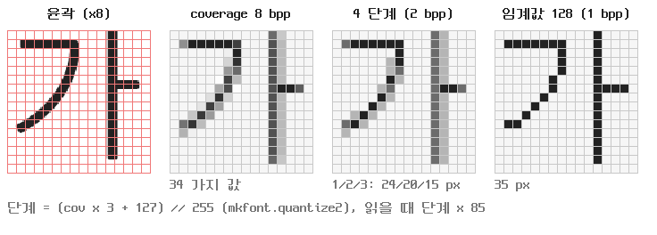
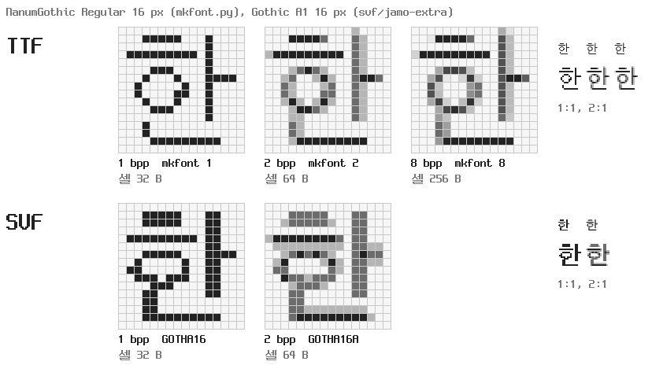
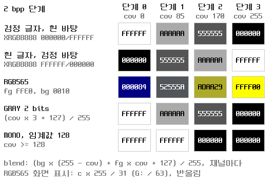
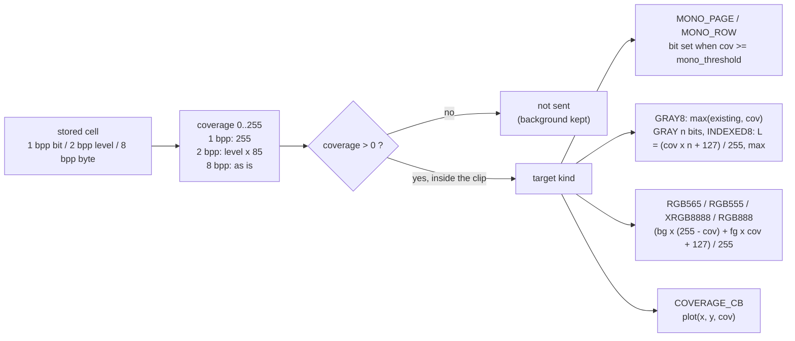
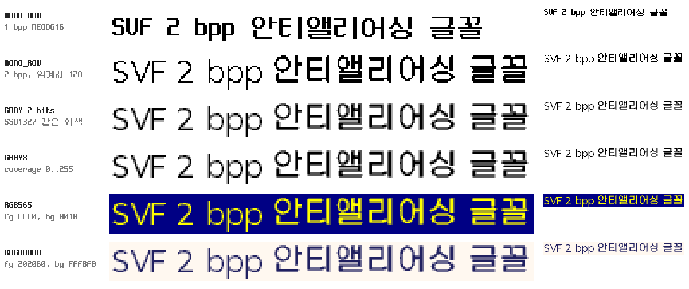
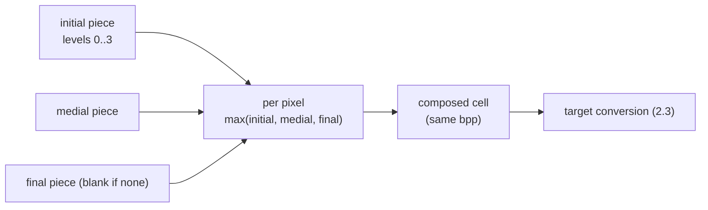
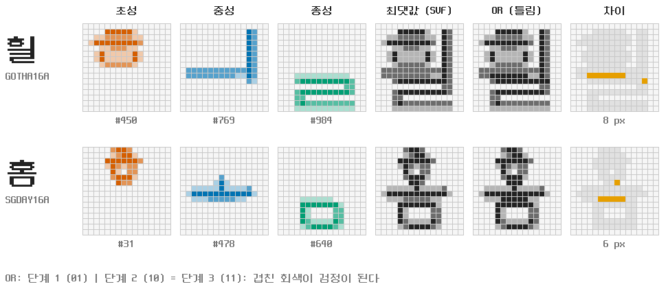
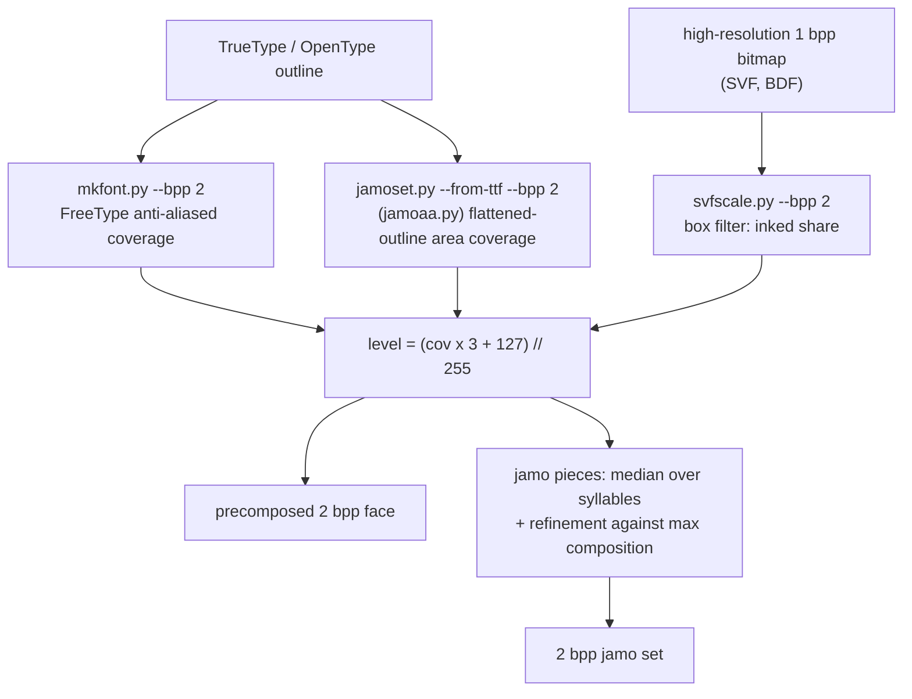
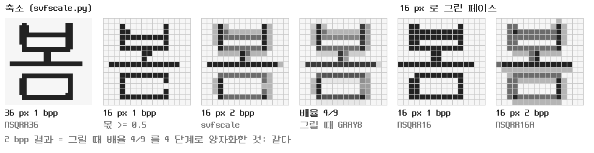

**English** | [한국어](anti-aliasing.ko.md)

# Anti-aliasing: SVF's 1, 2 and 8 bpp faces

Small text has to be drawn with few pixels. When each pixel can only be on or off, diagonals and curves turn into
staircases and stroke widths jump by whole pixels. **Anti-aliasing** reduces this by giving edge pixels intermediate
values. This document explains the principle; how SVF stores grey levels (1, 2 and 8 bpp) and how the renderer turns
them into the colour of each output target; what to watch for when the pieces of a jamo-set (조합형) face are
overlaid; how anti-aliased faces are made; and what to choose on a small machine.

## Contents

1. [What anti-aliasing is](#1-what-anti-aliasing-is)
2. [SVF bit depths and output conversion](#2-svf-bit-depths-and-output-conversion)
3. [Jamo sets: the maximum, not OR, at levels](#3-jamo-sets-the-maximum-not-or-at-levels)
4. [Making anti-aliased faces](#4-making-anti-aliased-faces)
5. [Cost and choice on small machines](#5-cost-and-choice-on-small-machines)
6. [Related documents](#6-related-documents)
7. [References](#references)

**Figures.** Every figure is made by `python3 -I tools/doc_figures_aa.py` ([tools.md](tools.md#toolsdoc_figures_aapy)).
Glyph pixels go through the project's own code: faces are read by [svfline.py](../tools/svfline.py) with the C
library's rules (jamo syllables composed by `jamoset.compose`), lines are laid out by `svfline.placements`, and target
conversion is `svfline.Target` (the same rules as C's `svf_target`). The outline figures draw the glyph with
[mkfont.py](../tools/mkfont.py)'s `render()`, pack it into an in-memory SVF and read it back. Only this repository's
OFL fonts are read (Gothic A1, Single Day, Nanum Square Round, Paperlogy, Neo Dunggeunmo, the NanumGothic TTF). With the same font files, Pillow and FreeType versions, every
run gives the same bytes; `--check` verifies them (the supplied figures use Pillow 10.2.0 and FreeType 2.13.2). Korean labels in the figures are glossed in the captions.

## 1. What anti-aliasing is

### 1.1 Coverage: how much of a pixel the glyph covers

A font's outline is a continuous curve; the screen is a grid of square pixels. Moving the outline onto the grid is
**rasterisation** [2]. The simplest way turns a pixel on when its centre is inside the outline and off when it is
outside. Each pixel is then 0 or 1: a 1 bpp (bit per pixel) bitmap.

Anti-aliasing computes the **share of the pixel's area** that the outline covers, its **coverage**, and mixes that
much ink colour into the pixel [1][2]. A pixel half covered by a stroke edge becomes halfway between ink and
background. In signal-processing terms, the image is averaged over each pixel's area (a box filter) before it is
sampled, attenuating high frequencies that would cause aliasing [1].

*Figure 1. NanumGothic Regular "가" at 16 px. From the left: "윤곽 (x8)" the outline (drawn 8 times larger, the pixel
grid over it); "coverage 8 bpp" FreeType's 8-bit coverage ("34 가지 값": 34 distinct values); "4 단계 (2 bpp)" the four
levels `mkfont.py --bpp 2` stores (pixels at levels 1/2/3 counted below); "임계값 128 (1 bpp)" the 1 bpp cut at 128
that `--bpp 1` stores. Bottom line: level = (cov x 3 + 127) // 255 (mkfont.quantize2), level x 85 when read. The
diagonal's pixels have coverage between 0 and 1, so at 1 bpp each is either on or off: a staircase.*

### 1.2 Why small text looks jagged at 1 bpp

A 16 px Hangul syllable can have strokes only 1-2 pixels wide. At this size 1 bpp loses three things:

- **Staircases on diagonals and curves.** The diagonals and curves of ㅅ, ㅈ, ㅇ become pixel steps (right of Figure 1).
- **Quantised stroke width and position.** A stroke 1.4 pixels wide in the outline becomes 1 or 2 pixels. The same
  stroke of the same font changes width with where it falls, and gaps between strokes jump by whole pixels.
- **Lost thin parts.** Thin strokes and tails that never cover half a pixel disappear.

Small 1 bpp faces are therefore usually drawn by hand pixel by pixel, or tuned by the outline font's **hinting**
(fitting outlines to the pixel grid using font instructions or renderer heuristics) [2]. Pixel fonts such as Dunggeunmo are drawn for
1 bpp from the start.

### 1.3 What grey levels buy

With intermediate values at the edges, the eye reads stroke position and width more finely than one pixel. A
1.4-pixel stroke reads as "one full pixel plus one light pixel", and a diagonal reads as a smooth slope instead of a
staircase. How many levels are needed depends on size and screen, but at the edges of small text a few levels already
do much. This is why SVF has a separate 2 bpp form (four levels, section 2). The price is more cell memory (see the row-padding examples in section 5.1)
and a screen that can show grey or colour.

*Figure 2. "한" at 16 px. Top row ("TTF"): NanumGothic Regular cells baked by `mkfont.py --bpp 1/2/8`. Bottom row
("SVF"): this repository's Gothic A1 jamo sets `GOTHA16` (1 bpp) and `GOTHA16A` (2 bpp). "셀 N B" is the bytes of one
cell (32, 64, 256). Right: actual size (1:1) and 2:1. Magnified, 2 bpp and 8 bpp differ; at actual size they are hard
to tell apart.*

### 1.4 Gamma and perceived weight

Coverage is **area**, not **brightness**. Most screens map input values to light non-linearly (sRGB is roughly gamma
2.2), and the eye is more sensitive to differences in dark tones [3]. Mixing a 50 % covered pixel as the value 128 is
therefore not 50 % of the light. The FreeType documentation explains that a 50 % covered pixel needs about 186, not
128, to look 50 % bright, and that correct rendering blends in linear space and then applies gamma correction [4].
Without correction, dark text on a light background looks heavier and darker than it should, and light text on a dark
background looks thin and frail [4]. Conversely, exact gamma correction makes small text look thin, so FreeType offers
"stem darkening", a slight emboldening also used by Mac OS X.
It is disabled by default in FreeType’s auto-hinter [4].

SVF does not handle gamma. Stored levels are coverage as is (the tools have no gamma option, section 4), and the
renderer blends encoded channel values without linear-light conversion (section 2.3). This can darken
black text on a white background [4]. When gamma matters, take coverage with `SVF_T_GRAY8` or `SVF_T_COVERAGE_CB` and blend
with correction in the application ([C renderer guide section 8](c-renderer-guide.md#8-targets-where-the-pixels-go)),
or put gamma-adjusted colours into an `SVF_T_INDEXED8` palette ramp.

### 1.5 Subpixel rendering (ClearType) and SVF

An LCD pixel is usually three vertical stripes, red, green and blue (subpixels). **Subpixel rendering** drives the
three separately and uses up to three times the horizontal resolution [5][6]. Microsoft's ClearType is the best known
[6]; FreeType has LCD rendering of the same family [7]. It has conditions:

- The software must **know the subpixel layout** (RGB or BGR, horizontal stripes, a rotated screen). Getting it wrong
  is worse than no subpixel rendering at all [5].
- The result is **coloured** pixels. Filters can suppress colour fringes, with a sharpness trade-off [5][7].
- The background colour must be known and each channel blended separately.

SVF does not do subpixel rendering:

- **The screen would be baked into the font.** SVF stores coverage baked in advance. Baked subpixel coverage fits one
  subpixel layout (RGB columns, for example) and one orientation. SVF's targets include monochrome and
  grey displays, small TFTs with assorted subpixel layouts and palette modes on DOS.
- **MONO and GRAY targets expose no separate colour channels.** One face must serve MONO, GRAY and RGB targets (section 2.3).
- **Storage.** Subpixel coverage needs three values a pixel. Even 2 bpp being twice 1 bpp weighs on small machines
  (section 5).

An application can take SVF's coverage (the callback target) and reprocess it for its own screen, but with grey
coverage and no outline this does not give what FreeType's LCD rendering gives.

## 2. SVF bit depths and output conversion

### 2.1 Three stored forms

Byte 8 of the SVF header is the bpp (1, 2, 8) ([spec/SVF.md](../spec/SVF.md#cells-layout-bytes-and-reserved-bytes)).
A cell is `cell height` rows of `pitch = (cell width x bpp + 7) / 8` bytes, the leftmost pixel in the most significant
bits (MSB first). The renderer expands the stored values to 8-bit **coverage** (the `svf_target` comment of
`c/include/svf.h`, `Face.coverage` of [svfline.py](../tools/svfline.py)).

| bpp | One pixel | Coverage | 16x16 cell | Use |
|---|---|---|---:|---|
| 1 | one bit | 0 or 255 | 32 B | pixel fonts, monochrome screens, least memory |
| 2 | level 0..3 (two bits) | level k x 85: 0, 85, 170, 255 | 64 B | anti-aliasing on small colour and grey screens |
| 8 | one byte | the byte, 0..255 | 256 B | hosts with memory to spare |

A 2 bpp byte holds four pixels; pixel x's level is `(row[x >> 2] >> (6 - 2 x (x & 3))) & 3`.

### 2.2 The 2 bpp level table

| Level | Bits | Coverage | Black on white | White on black | RGB565 (fg `FFE0` yellow, bg `0010` navy) |
|---:|---|---:|---|---|---|
| 0 | `00` | 0 | (background kept) | (background kept) | (background kept) |
| 1 | `01` | 85 | `AAAAAA` | `555555` | `52AB` |
| 2 | `10` | 170 | `555555` | `AAAAAA` | `AD45` |
| 3 | `11` | 255 | `000000` | `FFFFFF` | `FFE0` |

A level-0 pixel is never sent to the target: only pixels with coverage above 0 are, so the background stays.

*Figure 3. The colour each target writes for each level ("단계 0..3": levels 0..3; cov = coverage). Rows: "검정 글자, 흰
바탕" black text on white; "흰 글자, 검정 바탕" white text on black; RGB565 (yellow on navy); GRAY 2 bits; "MONO, 임계값
128" MONO at threshold 128. The value in each swatch is the 24-bit colour shown. RGB565 values are widened to 24 bits as
`c x 255 / 31` (green `/ 63`) for display ("RGB565 화면 표시": RGB565 as shown on screen; "채널마다": per channel).*

### 2.3 From level to colour

The rules of each target are in the comment above `svf_target` in `c/include/svf.h`; the implementation is
[svf_draw.c](../c/src/svf_draw.c), and the Python reference with the same rules is `Target.put` of
[svfline.py](../tools/svfline.py).

**Colour targets (RGB565, RGB555, XRGB8888, RGB888).** Each channel blends the background and ink colours by
coverage. All arithmetic is unsigned integer; rounding is `+ 127` then division by 255 (`blend565`, `blend555`,
`blend888` in `svf_draw.c`):

    c = (c_bg x (255 - cov) + c_fg x cov + 127) / 255        (integer division, per channel)

RGB565 applies it to the 5/6/5-bit channel values (red 0..31, green 0..63, blue 0..31); RGB555 to 5/5/5 bits, with
bit 15 of the pixel taken from bit 15 of `fg565`. XRGB8888 and RGB888 apply it to 8-bit channels, computed in
`uint32_t` using explicit 32-bit unsigned operands. Colour targets **do not read the existing pixel**: `bg` must be the real
background colour, and blending over a patterned background needs the callback target
([C renderer guide section 8](c-renderer-guide.md#8-targets-where-the-pixels-go)). For 2 bpp and 1 bpp cells the
colours of levels 1..3 are computed once a cell and picked per pixel (`rgb16_pix`); only 8 bpp blends per pixel.

**MONO_PAGE, MONO_ROW.** A bit is set when coverage is at least `mono_threshold` (default 128); 0 counts as 1 (a pixel
without coverage is never set). Bits are only set, never cleared. For a 2 bpp cell this equals "level >=
`(thr + 84) / 85`" (`least_level` in `svf_draw.c`): at the default 128 levels 2 and 3 stay and level 1 vanishes; 255
keeps level 3 only, 1 keeps every inked pixel.

**GRAY8.** One coverage byte a pixel, written as `max(existing, cov)`: a mask the application composites itself.

**GRAY (1, 2, 4, 8 bits) and INDEXED8.** With maximum level n (`2^gray_bits - 1` for GRAY, `index_levels` for INDEXED8) the
level is `L = (cov x n + 127) / 255`. GRAY writes `max(existing, L)`. INDEXED8 leaves level 0
untouched and otherwise writes `max(existing, index_base + L)`, comparing palette indices. The palette ramp
must therefore increase in coverage order. At n = 3 a 2 bpp level k stays
k; at n = 15 (4-bit grey) the levels are 0, 5, 10, 15. At n = 1 (GRAY 1 bit, INDEXED8 with `index_levels 1`) the MONO
threshold rule applies.

*Figure 4. The line "SVF 2 bpp 안티앨리어싱 글꼴" ("SVF 2 bpp anti-aliased font") on each target (left magnified 3x,
right actual size). The first row is the 1 bpp face NEODG16; the others are the colour and grey ports' faces PAPLG16 +
PAPLG18 (2 bpp). The second row, "2 bpp, 임계값 128" (2 bpp, threshold 128), is the same 2 bpp face on MONO: level 1
vanishes and strokes thin and break. "SSD1327 같은 회색" labels a 2-bit GRAY target. The actual SSD1327 ports pack output into 4-bit pixels
(`c/ports/pico/disp_ssd1327.c`, `c/ports/esp32/main/disp_ssd1327.c`); this row illustrates four coverage levels.*

### 2.4 Overlapping cells

When two cells of one line cover one pixel (a combining mark, a glyph that overhangs), GRAY8, GRAY and INDEXED8 keep the
maximum and MONO the OR. Colour targets do not read the existing pixel, so the later cell's colour wins (`svf.h`).
For 1 bpp faces this makes no difference, but with anti-aliased faces a later cell's light edge can overwrite an
earlier cell's dark pixel. With a non-plain background or overlapping cells, drawing to GRAY8 and letting the
application blend once is the safe route.

## 3. Jamo sets: the maximum, not OR, at levels

A jamo-set (조합형) face picks an initial, medial and final piece for each syllable and overlays them in one cell
([jamo sets, section 4.1](jamo-sets.md#41-the-model)). SVF's rule is the **per-pixel maximum of the coverage**
([spec/SVF.md](../spec/SVF.md#jamo-set-fonts-flags-bit-1)). At 1 bpp the maximum is the OR. At 2 bpp it is taken per
2-bit field, at 8 bpp per byte (`svf__merge` in `c/src/svf_jamo.c`, `compose` in `tools/jamoset.py`).

**Why OR is wrong.** ORing 2 bpp bytes ORs the 2-bit fields too: level 1 (`01`) over level 2 (`10`) gives `11`,
level 3. Where two pieces' light edges meet, a dark dot appears. The maximum keeps level 2. Where the levels are equal
or one is 0, OR and maximum agree, so they differ only where two different intermediate levels (1 and 2) overlap. At
8 bpp OR can also differ from the maximum: 85 | 170 = 255, whereas max(85, 170) = 170.

The C renderer computes this maximum with bit operations on one byte (or one 32-bit word): for 2-bit fields a and b,
`gt = a & ~b`, `eq = ~(a ^ b)`, and the high bit of each field decides "a > b" (`svf__max2w`). This processes four 2-bit pixels per byte, or sixteen per word when the word path is enabled; it does not
establish a fixed timing ratio to 1 bpp.

*Figure 5. "흴" of Gothic A1 `GOTHA16A` and "홈" of Single Day `SGDAY16A`. Columns: "초성" initial, "중성" medial,
"종성" final pieces (the depth of colour is the level, # the piece number); "최댓값 (SVF)" the maximum, what SVF draws;
"OR (틀림)" the OR, wrong; "차이" difference (orange: pixels where the two differ, 8 px and 6 px). Bottom line: "OR:
level 1 (01) | level 2 (10) = level 3 (11): overlapping grey becomes black". Such pixels occur in 788 of the 2,350
KS X 1001 syllables of GOTHA16A and in 660 of SGDAY16A.*

The maximum has a limit too. When two jamo cover disjoint halves of one pixel in the outline, their union covers the whole pixel, but the maximum of the separately baked pieces is lower, so thin strokes look slightly lighter where they
meet than in the precomposed glyph. `jamoaa.py` measures this loss (`join_loss`) and reduces it by refining the
pieces' levels against the composed result (section 4.1)
([recipe pitfalls](recipes.md#2-bpp-anti-aliased-faces-from-a-truetypeopentype-font)).

## 4. Making anti-aliased faces

All three routes reduce 8-bit coverage to four levels with the same formula:

    level = (coverage x 3 + 127) // 255        (mkfont.quantize2, jamoaa.quantize2, svfscale)

The reader turns a level back into level x 85, so the error is at most 42 on the integer 0..255 coverage scale. Very light edges below coverage 43
(about 17 %) become level 0 and vanish. The 2 bpp quantiser has no gamma, threshold or oversampling option (section 1.4).
`svfscale.py --threshold` controls only its 1 bpp output.

### 4.1 From outline fonts

**Precomposed: `mkfont.py --bpp 2`.** Each glyph is drawn by FreeType's anti-aliased renderer through Pillow (FreeType's
default hinting) and its 8-bit coverage quantised by the formula above (Figure 1). Size is set with `--size`; placement and cell fitting also use `--cell`, `--width`, `--ascent`,
`--fit-cell` and `--clip-cell` (see [tools](tools.md#toolsmkfontpy)). `--bpp 8` stores coverage as is; 1 bpp cuts coverage at 128, or
with `--mono-hint` uses FreeType's monochrome renderer and the font's hinting.

**Jamo sets: `jamoset.py --from-ttf --bpp 2`.** [jamoaa.py](../tools/jamoaa.py) reads the outlines with fontTools and
flattens curves into line segments and
rasterises their signed areas without hinting. Coverage is an approximation to the original curved outlines;
it can also differ from the geometric union where contours overlap (`render_coverage` in `jamoaa.py`). The regions of a 1 bpp fit assign each contour to
the initial, medial or final; each piece's levels are the per-pixel median over the syllables that use it, then refined
so that the max-composed syllables come closer to the syllables drawn whole (`--aa-refine N`, default 2).

Commands and measurements are in the recipe
[2 bpp anti-aliased faces from a TrueType/OpenType font](recipes.md#2-bpp-anti-aliased-faces-from-a-truetypeopentype-font).
By that recipe, a 2 bpp precomposed face is 1.5-1.6 times its 1 bpp face and a 2 bpp jamo set about 1.2 times its
1 bpp set, and a pixel font (Dunggeunmo) has no intermediate coverage at its own size: its 2 bpp face is level 3 only.

### 4.2 From high-resolution bitmaps: downscaling

A 1 bpp bitmap has only binary coverage, but when a large bitmap is shrunk, the inked share of the source area each output pixel
covers is its coverage. [svfscale.py](../tools/svfscale.py) box-filters each glyph of a 1 bpp face (a jamo set's
syllables composed first) or a BDF into the new cell and stores it at 1 bpp (share >= `--threshold`, default 0.5) or
2 bpp (the quantisation above).

*Figure 6. Nanum Square Round Regular. From the left ("축소": downscaling): `NSQRR36` (36 px 1 bpp, not shrunk); the
16 px 1 bpp result ("몫 >= 0.5": share >= 0.5); the 2 bpp result (svfscale's rule); the renderer's draw-time scale 4/9
on GRAY8 ("배율 4/9, 그릴 때 GRAY8"); then ("16 px 로 그린 페이스": faces made at 16 px) `NSQRR16` (1 bpp) and
`NSQRR16A` (2 bpp). Bottom line: the 2 bpp result equals the draw-time 4/9 scale quantised to 4 levels ("같다": equal).
Shrinking is not redrawing: thin strokes turn grey, and the faces made at 16 px are crisper.*

The renderer's draw-time scale (`scale_num / scale_den`, [C renderer guide section 9](c-renderer-guide.md#9-scaling))
also uses area averaging. Its output is 8-bit coverage, so compare a stored 2 bpp face with that output
**quantised to four levels**, rather than with raw GRAY8. The example uses square 36-to-16 cells at 4/9;
other sizes can differ because `svfscale.py` rounds cell dimensions separately (the 2 bpp and 4/9
panels of Figure 6; the [recipe](recipes.md#a-low-resolution-face-from-a-high-resolution-bitmap-font) checked all 2,350
syllables of an OS/2 font). The stored face costs memory, the draw-time scale costs time. The fitting path `jamoset.py --bpp 2` currently takes outline fonts only; a 1 bpp jamo set can be fitted to the 1 bpp result.

### 4.3 Measuring quality

A 1 bpp jamo set is measured by the IoU (intersection over union, 1 = identical) of its composed syllables against the
font's glyphs ([jamo sets, section 2.1.1](jamo-sets.md#211-iou-composition-quality)). At 2 bpp the level difference is
used:

- `aa_quality()` of `jamoaa.py` reports the **mean absolute level difference a pixel** on its raw 0..3 scale (the
  "level error" of `jamoset.py`'s `aa:` line), with the IoU of the level >= 2 masks ("IoU at level 2").
- The 2 bpp quality columns of `svf/jamo-extra/FACES.TSV` are the same mean level difference **divided by 3** (0 =
  identical; `maker/quality.py`). For example `GOTHA16A`'s `quality_ks2350` of 0.026 is a level difference of about
  0.078. The 1 bpp columns are IoU, so their direction is the opposite (1 = identical).

Do not judge by numbers alone; look at actual size. `svfline.py line` writes a GRAY8 buffer, and the `web/` picker
shows a face at its levels ([web renderer guide](web-renderer-guide.md)).

## 5. Cost and choice on small machines

### 5.1 Memory

A cell is `((cell width x bpp + 7) / 8) x cell height` bytes, with integer division (`svf_cell_bytes`).
At scale 1/1, drawing needs one cell of scratch, or two for a streamed face without a block cache.
Scaling needs two source cells plus the scaled 8-bit cell. Use `svf_chain_scratch_bytes` to size the buffer.
Each syllable-cache slot uses 8 bytes plus the largest unscaled cell in the chain
([C renderer guide section 11](c-renderer-guide.md#11-memory-budget)).

| Cell | 1 bpp | 2 bpp | 8 bpp |
|---|---:|---:|---:|
| 16 x 16 | 32 B | 64 B | 256 B |
| 18 x 18 | 54 B | 90 B | 324 B |
| 24 x 24 | 72 B | 144 B | 576 B |

Whole faces (same font, same size; the NanumGothic Bold 16 measurements of the
[recipe](recipes.md#2-bpp-anti-aliased-faces-from-a-truetypeopentype-font)):

| Face | 1 bpp | 2 bpp | Ratio |
|---|---:|---:|---:|
| precomposed (`mkfont.py`, 2,446 glyphs) | 125,520 B | 195,760 B | 1.56 |
| jamo set (`jamoset.py`, composes 11,172 syllables) | 20,064 B | 24,960 B | 1.24 |

File growth depends on cropped ink boxes, glyph count, tables and layout padding, so these ratios are examples,
not a general bound. A 2 bpp jamo set can save space when its composition quality is sufficient. `PAPLG18` (an 18 px 2 bpp jamo set) is
67,200 B in the `mcu-strict` layout ([C renderer guide section 6](c-renderer-guide.md#6-choosing-a-face-for-your-target)).

### 5.2 Speed

In the emulated measurements of `c/bench/MEASUREMENTS.md` (Raspberry Pi Pico, rp2040js at 125 MHz, gcc `-Os`, GRAY8),
drawing the syllable 가 takes 58.83 µs with a 16 px 1 bpp jamo set, 126.58 µs with the 18 px 2 bpp jamo set (PAPLG18),
and 142.45 µs with PAPLG18 on an RGB565 target. The 1 bpp face is HGKEY6J, absent from the public font set. These faces differ in size, pieces and tables;
the measurements do not isolate the cost of bpp or predict a general timing ratio. All numbers are from emulators,
not real boards. 8 bpp blends each nonzero pixel on colour targets (section 2.3); measure its memory and time costs on the intended target.

### 5.3 What to choose

| Screen / situation | Choose | Why |
|---|---|---|
| 1-bit display or 1-bit display mode | **1 bpp** | no grey; a 2 bpp face is cut at the threshold (2.3), strokes thin and memory grows |
| 2- or 4-bit grey target | **2 bpp** | levels map straight onto the screen (GRAY 2 bits: level k = k) |
| 16-bit colour TFT (RGB565), plain background | **2 bpp** | only three level colours a cell to compute; the default of the small colour ports |
| A pixel font (Dunggeunmo and the like) at its own size | **1 bpp** | no intermediate coverage: 2 bpp is the same picture at twice the memory |
| Very small flash (Arduino Uno, 32 KB) | **1 bpp jamo set** | check the complete firmware size; the example 2 bpp faces use tens of KB |
| Hosts, web, 32-bit screens, your own gamma correction | 2 bpp, or **8 bpp** | 8 bpp retains the rasteriser's 8-bit coverage; cell bytes depend on row padding |
| Patterned background, overlapping cells | 2 bpp + GRAY8 or the callback | colour targets do not read the existing pixel (2.3, 2.4) |

The port examples of this repository split the same way: the colour (RGB565) and grey (SSD1327) profiles of the Pico
and ESP32 examples use the 2 bpp `PAPLG16` + `PAPLG18`; the monochrome (SSD1306) profile and the Arduino and CH582
examples use a 16 px 1 bpp face (`c/ports/pico/README.md`, `c/ports/esp32/README.md`). The web wrapper exposes GRAY8,
MONO_PAGE, MONO_ROW and RGB565 only; 24/32-bit canvas colour is made by converting GRAY8
([web renderer guide](web-renderer-guide.md#3-colours-and-rgb565-output)). If an anti-aliased face must go to a
monochrome screen, tune `mono_threshold`: 128 keeps levels 2 and up, 85 or less keeps level 1 too and thickens strokes.

Bake at the size you draw. Anti-aliasing helps most when strokes are 1-2 pixels wide; at 12-14 px the recipe advises
comparing the 2 bpp face with a 1 bpp `--mono-hint` face of a hinted font on the real screen before choosing.

## 6. Related documents

- [SVF format specification](../spec/SVF.md): bpp and cell layout, the maximum rule of jamo sets.
- [C renderer guide](c-renderer-guide.md): targets (section 8), scaling (9), Hangul composition (10), memory (11).
- [Web renderer guide](web-renderer-guide.md): colours and RGB565 output.
- [Johab and jamo sets](jamo-sets.md): pieces, sets, JSET.
- [Recipes](recipes.md): [2 bpp anti-aliased faces](recipes.md#2-bpp-anti-aliased-faces-from-a-truetypeopentype-font),
  [a low-resolution face from a high-resolution bitmap](recipes.md#a-low-resolution-face-from-a-high-resolution-bitmap-font).
- [Tools](tools.md): [mkfont.py](tools.md#toolsmkfontpy), [jamoaa.py](tools.md#toolsjamoaapy),
  [svfscale.py](tools.md#toolssvfscalepy), [svfline.py](tools.md#toolssvflinepy),
  [doc_figures_aa.py](tools.md#toolsdoc_figures_aapy).

- [Renderer design](../spec/renderer-design.md): layout and scaling model.
- [Desktop app](desktop-app.md), [maker desktop](maker-desktop.md): create faces and compare previews.
- [README](../README.md): document and application entry points.

## References

[1] [Wikipedia: Spatial anti-aliasing](https://en.wikipedia.org/wiki/Spatial_anti-aliasing)
[2] [Wikipedia: Font rasterization](https://en.wikipedia.org/wiki/Font_rasterization)
[3] [Wikipedia: Gamma correction](https://en.wikipedia.org/wiki/Gamma_correction)
[4] [FreeType: On Slight Hinting, Proper Text Rendering, Stem Darkening and LCD Filters](https://freetype.org/freetype2/docs/hinting/text-rendering-general.html)
[5] [Wikipedia: Subpixel rendering](https://en.wikipedia.org/wiki/Subpixel_rendering)
[6] [Microsoft Learn: Microsoft ClearType](https://learn.microsoft.com/en-us/typography/cleartype/)
[7] [FreeType API Reference: Subpixel Rendering](https://freetype.org/freetype2/docs/reference/ft2-lcd_rendering.html)
