[English](jamo-sets.md) | **한국어**

# 조합형: 문자 집합, 글꼴 기법, 그리고 SVF의 자모 세트

"조합형"이라는 말은 두 가지를 가리킨다. 하나는 **문자 집합(인코딩)**으로서의 조합형이다. 음절 코드 하나에 초성, 중성, 종성 번호가
들어 있다. 다른 하나는 **글꼴 기법**으로서의 조합형이다. 음절을 통째로 그려 두지 않고 자모 조각(piece)을 몇 벌 그려 두었다가, 음절마다
알맞은 벌의 조각을 겹쳐 그린다. 두 가지는 함께 쓰이는 일이 많았지만 서로 독립이다. 글꼴이 조합형이라고 코드도 조합형이어야
하는 것은 아니고, 그 반대도 마찬가지이다. 예를 들어 MS-DOS 6.22 한국어판의 글꼴 파일에는 한글 음절이 없고, HBIOS가 자기 자모
세트로 음절을 조합한다(1.4절, 3.2절). 거꾸로 한국어 VGA 카드의 ROM은 음절을 완성형 격자로 담는다(3.2절).

이 문서는 순서대로 다음을 설명한다.

1. 문자 집합으로서의 조합형: 비트 배치, 완성형과의 관계, 유니코드 음절 공식(1장).
2. 글꼴 기법으로서의 조합형: 벌의 개념, DOS 시대의 벌 체계(8x4x4 등)와 그 선택 규칙, 실제 파일에서 확인한
   시스템들(2-3장).
3. 구현된 구조: SVF의 JSET 블록 버전 1, 2, BIG, 버전 3(JMAP)과 LIST. 실제 페이스로 음절 하나를 끝까지
   따라간다(4-6장).
4. 메모리가 작은 대상(MCU)에서의 제약: 빌드별 리더, 코드 크기, 표 크기, 읽지 못하는 블록, 스트리밍, 속도, 고르는 법(7-8장).

**그림의 페이스.** 픽셀 그림은 모두 `svf/iolo/SANS8J.SVF`(iolo SANS8J 고딕, 16x16 1 bpp, 변환된 레거시 8x4x4 자모 세트, JSET 버전 1)와
`svf/dos/NEODG16.SVF`(비교용으로만 쓰는 다른 글꼴의 완성형)로 그렸다. SANS8J는 iolo 8x4x4-fonts에서 왔으며 [11], 폰트 라이선스는 OFL-1.1로 해석한다(`svf/iolo/IOLO.TXT`).
그림은 `python3 -I tools/doc_figures_jamo.py`가 만든다. 실행할 때마다 같은 바이트가 나오며, `--check`로 확인한다.

## 목차

1. [문자 집합으로서의 조합형](#1-문자-집합으로서의-조합형)
2. [글꼴 기법으로서의 조합형: 벌](#2-글꼴-기법으로서의-조합형-벌)
3. [실제 시스템들: 연구가 읽어 낸 것](#3-실제-시스템들-연구가-읽어-낸-것)
4. [SVF의 자모 세트: JSET 버전 1](#4-svf의-자모-세트-jset-버전-1)
5. [JSET 버전 2와 BIG](#5-jset-버전-2와-big)
6. [버전 3: JMAP, LIST, 그리고 규칙형과 표형의 비교](#6-버전-3-jmap-list-그리고-규칙형과-표형의-비교)
7. [MCU의 제약](#7-mcu의-제약)
8. [고르는 법: 메모리 예산별 권장](#8-고르는-법-메모리-예산별-권장)
9. [참고 파일](#9-참고-파일)

여기서 EUC-KR의 2,350자는 **두 바이트로 배정된 완성 음절**의 수이다. Python의 `euc_kr` 코덱은 그 밖의 현대 음절을
채움 문자와 호환 자모로 이루어진 8바이트 조합열로도 부호화한다. 예를 들어 `"쀍".encode("euc_kr").hex(" ")`는
`a4 d4 a4 b3 a4 ce a4 aa`이다. 이는 쀍에 별도의 두 바이트 코드가 있다는 뜻이 아니다 [18].

## 1. 문자 집합으로서의 조합형

### 1.1 두 방식: 2,350자와 11,172자

현대 한글 음절은 초성 19개, 중성 21개, 종성 28가지(받침 없음 포함)를 조합해 19 x 21 x 28 = **11,172자**가 된다.
KS X 1001(옛 이름 KS C 5601)의 완성형은 그중 **2,350자**에만 코드를 준다. 0xB0-0xC8의 25행에 94자씩 들어 있다
([docs/recipes.ko.md](recipes.ko.md) "KS X 1001"). 그 밖의 음절은 코드가 없으므로 완성형 코드로는 쓸 수 없다.

조합형 코드는 음절 하나를 16비트 하나로 나타낸다. 그 안의 세 필드가 초성, 중성, 종성 번호이므로 11,172자를 모두 쓸 수 있다.
이 조합형 코드를 "KS X 1001 annex 3"(Python의 `johab` 코덱)이라 부른다([docs/recipes.ko.md](recipes.ko.md) "인코딩").
KS C 5601-1992 부속서 3 조합형은 Windows 코드 페이지 1361로도 지정되어 있다. Python에서
`codecs.lookup('cp1361')`은 `johab` 코덱을 돌려준다(2026-11-26에 확인).

| 방식 | 음절 수 | 코드 길이 | 음절 순서 | 이 프로젝트의 이름 |
|---|---:|---|---|---|
| KS X 1001 완성형 (EUC-KR) | 2,350 | 2바이트, 각 0xA1-0xFE | 가나다 순, 0xB0A1(가)부터 0xC8FE(힝)까지 | `euc_kr`, `ksx1001-hangul` |
| 조합형 (KS X 1001 annex 3, CP1361) | 11,172 | 16비트, 최상위 비트 1 | 초성, 중성, 종성 필드 순 | `johab` |
| 유니코드 한글 음절 | 11,172 | U+AC00..U+D7A3 | (초성 x 21 + 중성) x 28 + 종성 | `hangul`, `cp949-hangul` |
| CP949 (통합 완성형, UHC) | 11,172 | 2바이트 | KS 2,350자는 완성형 자리, 나머지 8,822자는 확장 코드(완성형 행 사이와 앞) | `cp949` |

CP949 행의 숫자는 Python 코덱으로 쟀다. 11,172자가 모두 2바이트로 부호화된다. KS 2,350자는 완성형과 같은 바이트이고,
나머지 **8,822자**는 첫 바이트 0x81..0xC6, 범위 0x8141..0xC652에 놓인다. 그중 5,696자는 첫 바이트 0x81..0xA0(둘째 바이트
0x41..0xFE)이고, 3,126자는 첫 바이트 0xA1..0xC6에서 둘째 바이트 0x41..0xA0을 쓴다. 그래서 확장 코드는 완성형 행의 앞에만 있는
것이 아니라 완성형 음절과 같은 첫 바이트(0xB0..0xC6)의 아래쪽 둘째 바이트에도 끼어 있다.

네 방식의 관계(음절 수와 변환 방법; 날짜는 1.4절):

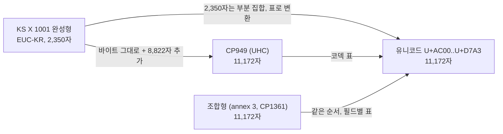

### 1.1.1 EUC-KR과 CP949

**EUC(Extended Unix Code)**는 ISO 2022의 G0–G3 코드 집합을 바탕으로 유닉스에서 쓰도록 만든 다중 바이트 인코딩 계열로, EUC-JP·EUC-KR·EUC-CN·EUC-TW 등이 있다. 다중 바이트 문자의 각 바이트는 높은 비트가 1인 범위(보통 0xA1–0xFE)에 놓이므로 ASCII와 C0 제어 문자에 충돌하지 않는다 [1]. 특히 문자 바이트에 NUL이나 경로 구분자 `/`가 없다는 성질은 유닉스의 문자 집합 요구와 일치한다 [2]. 이는 바이트 단위 C 문자열, 셸과 터미널이 ASCII 구문과 텍스트를 구별하는 데 도움이 된다 [1].

ISO 2022의 기본 집합은 G0이고, 보조 집합은 G1–G3이다. EUC는 한 바이트의 SS2(0x8E)와 SS3(0x8F)로 G2와 G3를 잠시 선택하며, 인코딩별로 G1–G3에 문자 집합을 배치한다 [1]. EUC-KR은 KS C 5601(현 KS X 1001)의 94×94 문자표를 G1에 둔다. 행과 칸 번호(0x21–0x7E)에 각각 0x80을 더해 두 바이트를 만들므로 KS 행 r, 칸 c는 `(0xA0+r, 0xA0+c)`가 된다. 한글 음절은 표의 25개 행(2,350자)에만 있으므로 EUC-KR로 표현할 수 있는 미리 조합된 음절도 2,350자이다 [3][4]. RFC 1557의 ISO-2022-KR은 메일에서 ASCII와 KS X 1001을 전환하는 절차를 정의하며, 메일 본문에서 쓰이는 EUC-KR과 같은 문자표를 다른 이스케이프 규칙으로 운반한다 [5].

**CP949(통합형 한글 코드, Unified Hangul Code, 확장 완성형)**는 Microsoft의 한국어 Windows 코드 페이지이며 ANSI/OEM Korean으로 등록되어 있다 [6]. CP949 매핑 표에서 EUC-KR 밖의 한글 음절을 세면 **확장 음절 8,822자**가 나온다. 이 음절의 첫 바이트는 0x81–0xC6, 둘째 바이트는 0x41–0x5A·0x61–0x7A·0x81–0xFE 중 하나이며 EUC-KR 배정은 그대로 유지된다 [16]. 이 둘째 바이트에는 ASCII 영문자가 포함되므로 ISO 2022의 ASCII·다중 바이트 구분과 다르다 [1][16]. 기존 KS 배정을 유지하므로 CP949 바이트 순서는 음절 순서와도 다르다 [16]. Johab(Windows 코드 페이지 1361)은 별도 인코딩이다 [6][12]. Unicode는 독립적으로 U+AC00..U+D7A3 음절 블록을 정의한다 [7]. 이 저장소가 비교한 Windows 폰트 가운데 11,172자를 모두 그리는 첫 폰트는 [어느 폰트부터 CP949 한글 11,172자를 그리는가](recipes/windows.ko.md#windows-cp949-11172)에 있다.

| 바이트/코드 | 용도 | 비고 |
|---|---|---|
| ASCII 0x00–0x7F | ASCII와 C0 | EUC 다중 바이트와 충돌하지 않음 |
| EUC-KR 0xA1–0xFE × 0xA1–0xFE | KS X 1001 94×94 표 | 한글 2,350자 |
| CP949 확장 0x81–0xC6 × (0x41–0x5A, 0x61–0x7A, 0x81–0xFE) | 추가 한글 8,822자 | EUC-KR 바이트와 겹치지 않도록 배치 |
| Johab (CP1361) | 조합형 필드 코드 | ISO 2022/EUC 계열 아님 |

### 1.1.2 유니코드와 인코딩 형식

Unicode는 U+0000..U+10FFFF의 코드 포인트 공간을 정의한다. 17개 평면(plane 0..16) 중 평면 0이 BMP(U+0000..U+FFFF)이고, 평면 1..16은 보충 평면이다. ISO/IEC 10646(UCS)은 같은 문자와 코드 포인트를 표준화하며, Unicode와 UCS는 코드 포인트를 공동으로 유지한다. 평면 15와 16에는 사용자 정의 영역이 있다. SVF 자모 조각은 사용자 정의 코드 포인트 U+F0000+n(평면 15)을 페이스 고유 조각 식별자로 쓴다 [9].

한글은 두 모델을 함께 제공한다. 미리 조합된 음절은 U+AC00..U+D7A3 11,172자이며 1.3절의 산술 공식으로 계산한다. 현대 음절은 Hangul Jamo 블록 U+1100..U+11FF의 초성·중성과 선택적인 종성으로 쓴다. 한은 U+1112 U+1161 U+11AB이다. Hangul Compatibility Jamo U+3131..U+318E는 KS X 1001처럼 독립적으로 표시하는 호환 자모이고, Hangul Jamo Extended-A/B에는 옛한글 자모가 있다. 현대 L·V 또는 L·V·T 자모열과 미리 조합된 음절은 정규적으로 동치다. NFC는 이 자모열을 음절로 조합하고 NFD는 음절을 자모로 분해한다 [8].

SVF 음절 페이스는 U+AC00..U+D7A3를 키로 삼는다. UTF-8 입력의 결합 자모열은 Unicode 정규화(NFC)나 한글 셰이핑을 거친 뒤에 이 페이스에 전달해야 한다. 그렇지 않으면 세 코드 포인트가 하나의 음절 글리프로 조회되지 않는다.

코드 포인트를 바이트로 바꾸는 형식도 구별해야 한다. UCS-2는 BMP만 16비트로 표현하고 UTF-16은 평면 1..16을 서로게이트 쌍으로 표현한다(U+F0000은 쌍이 필요하다). UCS-4/UTF-32는 모든 코드 포인트를 32비트로 저장한다. UTF-8은 1~4바이트의 자기 동기화 형식이며 ASCII와 호환된다. UTF-16LE/BE와 UTF-32LE/BE는 바이트 순서를 명시한다. 접미사 없는 UTF-16·UTF-32 형식에서는 BOM(U+FEFF)으로 그 순서를 표시할 수 있다 [9][10].

| 문자 | EUC-KR | CP949 | Johab | UTF-8 | UTF-16LE | UTF-16BE | UTF-32LE | 표현 불가 |
|---|---|---|---|---|---|---|---|---|
| A U+0041 | 41 | 41 | 41 | 41 | 41 00 | 00 41 | 41 00 00 00 | 없음 |
| 한 U+D55C | C7 D1 | C7 D1 | D0 65 | ED 95 9C | 5C D5 | D5 5C | 5C D5 00 00 | 없음 |
| ㄱ U+3131 | A4 A1 | A4 A1 | 88 41 | E3 84 B1 | 31 31 | 31 31 | 31 31 00 00 | 없음 |
| 한(LVT) U+1112 U+1161 U+11AB | — | — | — | E1 84 92 E1 85 A1 E1 86 AB | 12 11 61 11 AB 11 | 11 12 11 61 11 AB | 12 11 00 00 61 11 00 00 AB 11 00 00 | EUC-KR, CP949, Johab |
| U+F0000 | — | — | — | F3 B0 80 80 | 80 DB 00 DC | DB 80 DC 00 | 00 00 0F 00 | EUC-KR, CP949, Johab |

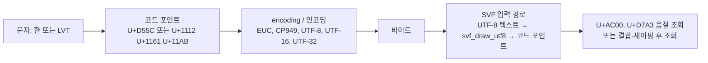

### 1.2 조합형 16비트 코드의 비트 배치

```
 비트  15 | 14 13 12 11 10 | 9 8 7 6 5 | 4 3 2 1 0
       1  |    초성 (5)     |  중성 (5) |  종성 (5)
```

| 비트 | 폭 | 뜻 | 값 |
|---|---:|---|---|
| 15 | 1 | 한글 표시 | 1 |
| 14-10 | 5 | 초성 | 1 = 채움(초성 없음), 2..20 = ㄱ ㄲ ㄴ ㄷ ㄸ ㄹ ㅁ ㅂ ㅃ ㅅ ㅆ ㅇ ㅈ ㅉ ㅊ ㅋ ㅌ ㅍ ㅎ |
| 9-5 | 5 | 중성 | 2 = 채움, 3..7 = ㅏ ㅐ ㅑ ㅒ ㅓ, 10..15 = ㅔ ㅕ ㅖ ㅗ ㅘ ㅙ, 18..23 = ㅚ ㅛ ㅜ ㅝ ㅞ ㅟ, 26..29 = ㅠ ㅡ ㅢ ㅣ |
| 4-0 | 5 | 종성 | 1 = 없음, 2..17 = ㄱ ㄲ ㄳ ㄴ ㄵ ㄶ ㄷ ㄹ ㄺ ㄻ ㄼ ㄽ ㄾ ㄿ ㅀ ㅁ, 18 = 비어 있음, 19..29 = ㅂ ㅄ ㅅ ㅆ ㅇ ㅈ ㅊ ㅋ ㅌ ㅍ ㅎ |

같은 배치를 블록으로 그리면 다음과 같다. 아래 줄은 "한"(0xD065)의 값이다.

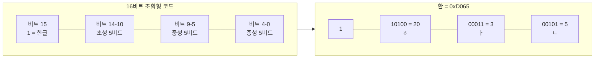

채움 값과 빈 자리는 johab-fonts `notes/msx.md`("CPC-300 ... jamo-set font": 초성 1..20, 1 = 채움; 중성 2..29, 빈 자리 8, 9, 16,
17, 24, 25; 종성 1..29, 18은 빈 자리)와 `notes/mac.md`("Format 1": L 2..20, V 3..7, 10..15, 18..23, 26..29, T 1 = 없음, 2..17,
19..29)에 있다. 중성 번호는 [tools/jamoset.py](../tools/jamoset.py)의 `JUNG_FIELD`(71행)와도 같다. 위 표의 자모 배정은 Python `johab` 코덱으로
11,172자를 모두 부호화해 확인했다. 중성 필드에서 현대 모음이 쓰지 않는 값은 0, 1, 2(채움),
8, 9, 16, 17, 24, 25, 30, 31이다. 32개 값을 8개씩 네 묶음으로 보면 각 묶음의 앞 두 자리가 비어 있다. 이것은 위 값에서 읽히는 배치일
뿐이며, 그렇게 정한 이유는 노트에 없다.

### 1.3 유니코드 공식과 조합형과의 관계

유니코드는 음절을 산술로 배치한다([docs/recipes.ko.md](recipes.ko.md) "인코딩"). 초성 `L`(0..18), 중성 `V`(0..20), 종성 `T`(0..27, 0 = 없음)는
모두 0부터 세는 번호이다.

```
U = 0xAC00 + (L x 21 + V) x 28 + T
s = U - 0xAC00;   L = s / 588;   V = (s / 28) % 21;   T = s % 28
```

**보기: 한.** 초성 ㅎ = 18, 중성 ㅏ = 0, 종성 ㄴ = 4이다.

| 단계 | 값 |
|---|---|
| (L x 21 + V) x 28 + T | (18 x 21 + 0) x 28 + 4 = 10,588 |
| 유니코드 | 0xAC00 + 10,588 = **U+D55C** |
| 조합형 코드 | 1 10100 00011 00101 = **0xD065** (초성 20 = ㅎ, 중성 3 = ㅏ, 종성 5 = ㄴ) |
| 완성형 (EUC-KR, CP949) | 0xC7D1 |

U+AC00 블록은 초성마다 588자(= 21 x 28)의 묶음이고, 그 안이 중성마다 28자의 줄이며, 줄 안의 칸이 종성이다.

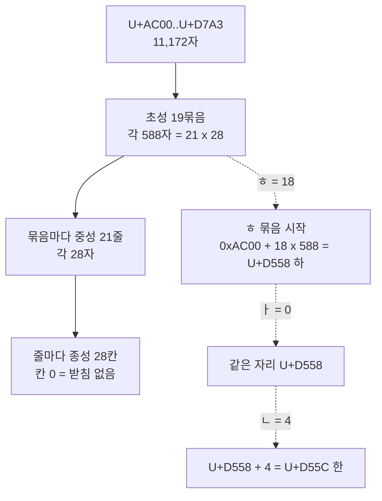

조합형 코드를 유니코드로 바꾸는 한 방법은 필드마다 표를 거치는 것이다(필드 값에 빈 자리가 있기 때문이다).

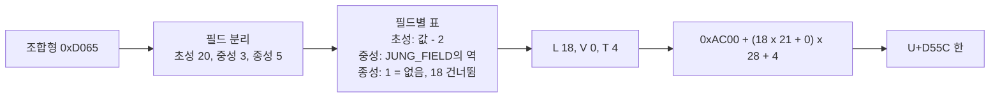

두 번째 보기 **쀍**(KS에 없는 음절)은 U+C00D, s = 5,133 = (8 x 21 + 15) x 28 + 9이다(ㅃ 8, ㅞ 15, ㄺ 9). 조합형으로는 0xAACA
(초성 10, 중성 22, 종성 10)이고, CP949로는 확장 영역의 0x97CD이다. 완성형(EUC-KR)으로는 쓸 수 없다.

조합형과 유니코드는 **같은 순서**이다. 11,172자를 유니코드 순서로 조합형 부호화하면 코드가 단조 증가한다(0x8861 = 가부터
0xD3BD = 힣까지, Python 코덱으로 확인). 필드 값에 빈 자리가 있으므로 고정 오프셋 하나로 변환할 수는 없다.
[tools/jamoset.py](../tools/jamoset.py)의 `JUNG_FIELD` 같은 필드별 표나 그와 같은 결과를 내는 조건부 산술식을 쓸 수 있다.

### 1.4 왜 완성형이 남았는가 (배경)

1980년대 한국의 PC 소프트웨어에는 조합형 코드와 글꼴이 널리 쓰였고, 국가 표준은 2,350자 완성형을 정했다 [12][13][14]. Microsoft는 기존 바이트를 보존하면서 CP949에 나머지 음절을 추가했다. 매핑 표를 세면 추가 8,822자, 전체 11,172자이다 [16].

아래는 주요 시스템과 표준의 연표이며, CP949와 유니코드 음절 블록은 관련 인코딩으로 함께 표시한다 [12].

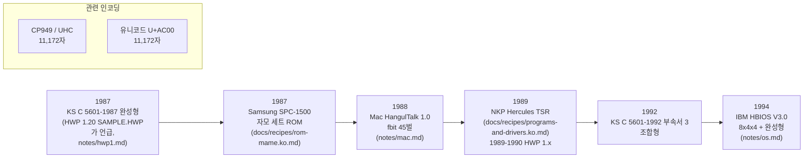

연구 노트에 남은 자료가 보여 주는 것은 이렇다. 코드가 무엇이든 1980-90년대 한국어 시스템의 상당수는 **조합형 글꼴**로 음절을
그렸다. MS-DOS 6.22 한국어판의 `HFONT.SYS`에도 한글 음절이 없다. 기호 1,128자와 한자 4,888자뿐이고,
"HBIOS.SYS/COM composes Hangul from its own jamo set"(johab-fonts `notes/os.md`)라고 적혀 있다.


### 1.4.1 상용 조합형과 KS 완성형의 갈등

삼보는 삼보 조합형·KSSM·상용 조합형으로 불린 공개 산업 규격을 주도했다 [12]. 1980년대를 다룬 자료는 삼보·금성·삼성 등의 조합형을 구별한다 [13].

상용 조합형은 최상위 플래그 1 뒤에 초성·중성·종성 5비트를 배치한다. 채움 값은 초성 1, 중성 2, 종성 없음 1이다 [12]. 1980년대를 다룬 자료는 하드웨어 한글 카드, NKP와 한글 도깨비 II BIOS에서 실행한 보석글, 도스판 한글의 한컴 2바이트 조합형 확장을 설명한다 [13].

1987년 KS C 5601 완성형은 행정전산망 워크스테이션과 교육용 PC에서 정보 교환을 위해 채택되었으며, 표준의 개정일은 1987-08-31이다 [14]. 2바이트 문자표는 한자를 포함한 공통 문자 목록을 제공했지만 현대 한글 음절 다수를 담지 못했다 [14]. 완성형과 조합형의 논쟁이 이어졌고, 1992년 KS C 5601 부속서 3은 상용 조합형을 수용했다 [12].

| 시기 | 사건 | 근거 |
|---|---|---|
| 1980년대 | PC 소프트웨어와 한글 표시 장치에서 상용 조합형과 여러 변형 사용 | [12][13] |
| 1987-08-31 | KS C 5601 완성형 개정, 행정전산망 정보 교환 | [14] |
| 1987–1991 | 행정전산망 주전산기 I·II 개발 | [15] |
| 1992 | KS C 5601 부속서 3 조합형 수용 | [12] |
| 1995 이후 | 한국어 Windows 95에서 상용 조합형 지원 중단 | [12] |

## 2. 글꼴 기법으로서의 조합형: 벌

### 2.1 왜 조각으로 그렸나: 메모리

16x16 1 bpp 글리프 하나는 32바이트이다. 11,172자를 모두 그려 두면 357,504바이트가 들고, KS 2,350자만 그려도 75,200바이트가
든다. 8x4x4 조합형 글꼴은 **360 조각 x 32바이트 = 11,520바이트**이다(`notes/dos.md` "Format findings": "11520 B = 8x4x4 (360*32)
16x16"). 이것으로 11,172자를 모두 그린다. 같은 노트의 다른 크기는 다음과 같다.

| 셀 | 8x4x4 조각 파일 | 2,350자 완성형 (계산) | 11,172자 완성형 (계산) |
|---|---:|---:|---:|
| 16x16 | 11,520 | 75,200 | 357,504 |
| 24x24 | 25,920 | 169,200 | 804,384 |
| 40x40 | 72,000 | 470,000 | 2,234,400 |
| 48x48 | 103,680 | 676,800 | 3,217,536 |

조각 파일 크기는 `notes/dos.md`에 있고, 완성형 열은 "음절 수 x 셀 바이트"로 계산했다. SVF에서도 같은 일이 일어난다. Neo둥근모의 완성형 `NEODG16.SVF`는 133,720바이트(2,905 글리프: ASCII 95자, KS X 1001 문자 2,803자, KS 밖 음절
7자 갷 닏 떄 섥 슺 텊 햝. KS 문자에는 KS 행 A1의 U+212B Å가 들어 있는데, 원본 TTF에는 없는 글자이다: `tools/build/faces.tsv`)이고, iolo SANS8J 8x4x4 자모 세트
`SANS8J.SVF`는 **15,740바이트**(439 글리프 중 조각 344개)로 11,172자를 모두 그린다(`tools/doc_figures_jamo.py`와 같은 방식으로
`jamoset.parse_svfn`에서 읽은 값).

### 2.1.1 IoU: 조합 품질

1비트 셀의 IoU(intersection over union)는 조합 음절 A와 글꼴 자체의 완성형 글리프 B가 가진 잉크 픽셀에 대한 `|A ∩ B| / |A ∪ B|`이다. `tools/jamofit.py`의 `iou()`는 둘 다 비어 있으면 1.0으로 센다. 아래 예는 교집합 2픽셀, 합집합 5픽셀이므로 IoU = 2/5 = 0.4이다.

```
A  ##..    B  .##.
   .#..       .##.
교집합 2개, 합집합 5개 → IoU = 2/5 = 0.4
```

`quality_report()`는 음절별 IoU 평균을 내며 `exact`는 동일한 셀(IoU 1.0)의 수이다. `svf/jamo-extra/FACES.TSV`의 `ks2350`은 KS 2,350자, `all`은 글꼴이 그리는 전체 음절, `freq`는 말뭉치 빈도 가중 평균, `top500`은 빈도가 가장 높은 500자 평균이다. 2비트에서 `tools/jamoaa.py`의 `aa_quality()`는 평균 절대 레벨 차이 원값(0..3)을 보고하고, `maker/quality.py`가 FACES.TSV 품질 점수로 쓸 때 그 값을 3으로 나눈다(0이 최선). IoU는 빈 셀 영역을 무시하고 빠진 획과 덧붙은 획을 모두 벌점으로 준다. 16픽셀에서는 한 픽셀의 획 이동도 큰 비용이 들 수 있으며 가독성은 재지 않는다.

### 2.2 벌: 자모의 모양은 놓인 자리에 따라 달라진다

같은 ㄱ이라도 "가"의 ㄱ은 왼쪽에 세로로 길고, "고"의 ㄱ은 위에 가로로 넓다. "각"의 ㄱ은 받침에 자리를 내주어 위로 짧아진다.
조합형 글꼴은 각 자모를 자리별로 몇 가지씩 그려 둔다. 이 변형 한 묶음을 **세트(set)**라 하며, 전통적으로 **벌**이라고도 한다([용어집](../spec/SVF.ko.md#term-set)). "8x4x4"는 초성 8벌, 중성 4벌,
종성 4벌이라는 뜻이다. 한 음절을 그릴 때는 다른 자모를 보고 각 자모의 벌을 고른다.

- **초성의 벌**은 중성의 모양(세로 모음, 가로 모음, 섞인 모음)과 받침 유무로 고른다.
- **중성의 벌**은 초성이 ㄱ/ㅋ인지와 받침 유무로 고른다.
- **종성의 벌**은 중성의 모양으로 고른다.

음절은 고른 조각 2-3개를 같은 셀에 겹친 **OR**(1 bpp)이다. 조각은 셀 전체 크기로 저장되어 있고 자기 자리에 이미 그려져 있으므로
위치를 옮기지 않는다.

DOS 한글 드라이버가 글자 하나를 그리는 경로를 Dokkaebi 드라이버 소스(`DKBB.ASM`의 `han_disp`, johab-fonts
`notes/hanme-dokkaebi.md` 2절)에 맞춰 그리면 다음과 같다. 다른 드라이버(NKP, HWP 1.x, MSX Hangul BASIC)도 표의 모양만 다를 뿐
같은 단계를 밟는다(3장).

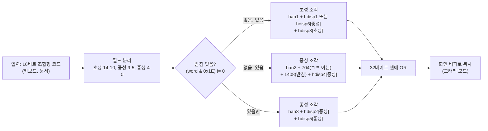

벌 한 개는 초성 640바이트(20 x 32), 중성 704바이트(22 x 32), 종성 896바이트(28 x 32)이다(같은 노트). 이렇게 조합한 셀을 그래픽 모드의 화면 버퍼로 복사할 수 있다.

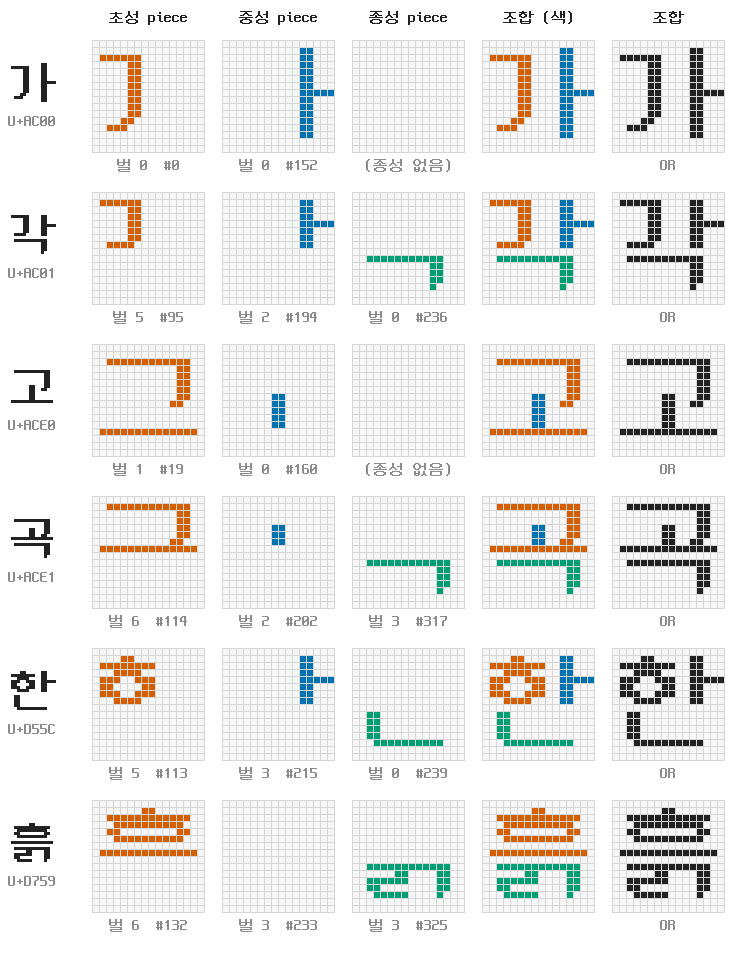

*그림 1. SANS8J의 조각과 조합. "벌 n #p"는 그 조각의 벌 번호와 SVF 조각 번호이다(4장). 가와 각의 ㄱ(벌 0과 5),
고와 곡의 ㄱ(벌 1과 6)이 받침에 따라 바뀐다. 고와 곡의 ㅗ도 조각이 다르다(중성 벌 0과 2: 받침 없음과 있음). 이 변환된 페이스의 중성 ㅡ 조각은 비어 있지 않다.*

16x16 셀 하나를 조각으로 나누면 다음과 같다(SANS8J의 "한": `I` 초성 조각 113, `M` 중성 조각 215, `F` 종성 조각 239,
`.` 빈 픽셀; 겹치는 픽셀은 없다).

```
     0123456789abcdef
  0  ................
  1  ....II.....MM...
  2  .IIIIIIII..MM...
  3  ...IIII....MM...
  4  .III..III..MMMMM
  5  .II....II..MM...
  6  .III..III..MM...
  7  ...IIII....MM...
  8  ................
  9  ..FF............
 10  ..FF............
 11  ..FF............
 12  ..FF............
 13  ..FFFFFFFFFFF...
 14  ................
 15  ................
```

### 2.3 8x4x4의 선택 규칙

DOS의 표준이라 할 8x4x4 파일(`HANGUL.FNT` 류, 11,520바이트)의 규칙은 [tools/jamoset.py](../tools/jamoset.py)의 표 `I844_NOFIN`, `I844_FIN`, `F844`와
`KK`(72-77행), 그리고 `_844` 레이아웃(350행)에 있다. Dokkaebi 드라이버 소스에서 읽은 같은 규칙이 johab-fonts
`notes/hanme-dokkaebi.md` 2절(`han_disp`)에 있다. 중성은 유니코드 순서(ㅏ=0 .. ㅣ=20)이다.

| 중성 | ㅏ | ㅐ | ㅑ | ㅒ | ㅓ | ㅔ | ㅕ | ㅖ | ㅗ | ㅘ | ㅙ | ㅚ | ㅛ | ㅜ | ㅝ | ㅞ | ㅟ | ㅠ | ㅡ | ㅢ | ㅣ |
|---|---|---|---|---|---|---|---|---|---|---|---|---|---|---|---|---|---|---|---|---|---|
| 초성 벌, 받침 없음 (`I844_NOFIN`) | 0 | 0 | 0 | 0 | 0 | 0 | 0 | 0 | 1 | 3 | 3 | 3 | 1 | 2 | 4 | 4 | 4 | 2 | 1 | 3 | 0 |
| 초성 벌, 받침 있음 (`I844_FIN`) | 5 | 5 | 5 | 5 | 5 | 5 | 5 | 5 | 6 | 7 | 7 | 7 | 6 | 6 | 7 | 7 | 7 | 6 | 6 | 7 | 5 |
| 종성 벌 (`F844`) | 0 | 2 | 0 | 2 | 1 | 2 | 1 | 2 | 3 | 0 | 2 | 1 | 3 | 3 | 1 | 2 | 1 | 3 | 3 | 1 | 1 |

같은 표를 벌 기준으로 묶으면 다음과 같다.

| 자모 | 벌 | 쓰이는 경우 | 보기 |
|---|---:|---|---|
| 초성 | 0 | 받침 없음, 세로 모음 ㅏ ㅐ ㅑ ㅒ ㅓ ㅔ ㅕ ㅖ ㅣ | 가 |
| 초성 | 1 | 받침 없음, ㅗ ㅛ ㅡ | 고 |
| 초성 | 2 | 받침 없음, ㅜ ㅠ | 구 |
| 초성 | 3 | 받침 없음, ㅘ ㅙ ㅚ ㅢ | 과 |
| 초성 | 4 | 받침 없음, ㅝ ㅞ ㅟ | 궈 |
| 초성 | 5 | 받침 있음, 세로 모음 | 각 |
| 초성 | 6 | 받침 있음, ㅗ ㅛ ㅜ ㅠ ㅡ | 곡 |
| 초성 | 7 | 받침 있음, 섞인 모음 ㅘ ㅙ ㅚ ㅝ ㅞ ㅟ ㅢ | 곽 |
| 중성 | 0 | 받침 없음, 초성 ㄱ 또는 ㅋ | 가 |
| 중성 | 1 | 받침 없음, 그 밖의 초성 | 나 |
| 중성 | 2 | 받침 있음, 초성 ㄱ 또는 ㅋ | 각 |
| 중성 | 3 | 받침 있음, 그 밖의 초성 | 낙 |
| 종성 | 0 | ㅏ ㅑ ㅘ | 악 |
| 종성 | 1 | ㅓ ㅕ ㅚ ㅝ ㅟ ㅢ ㅣ | 억 |
| 종성 | 2 | ㅐ ㅒ ㅔ ㅖ ㅙ ㅞ | 액 |
| 종성 | 3 | ㅗ ㅛ ㅜ ㅠ ㅡ | 옥 |

같은 규칙을 결정 나무로 그리면 다음과 같다(초성 벌, 중성 벌, 종성 벌 순).

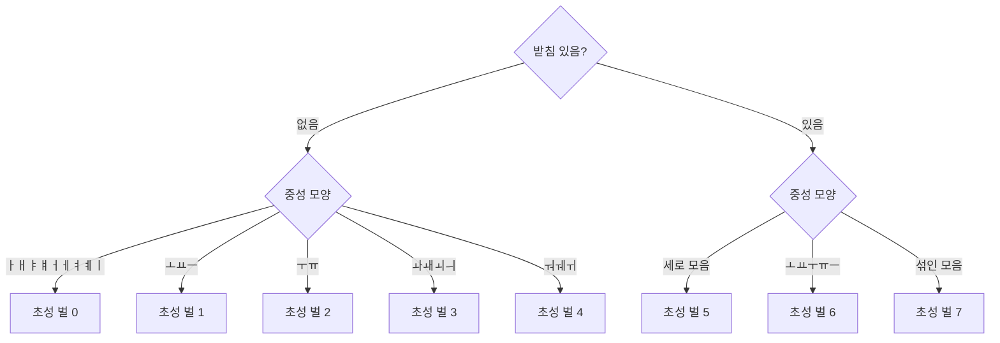

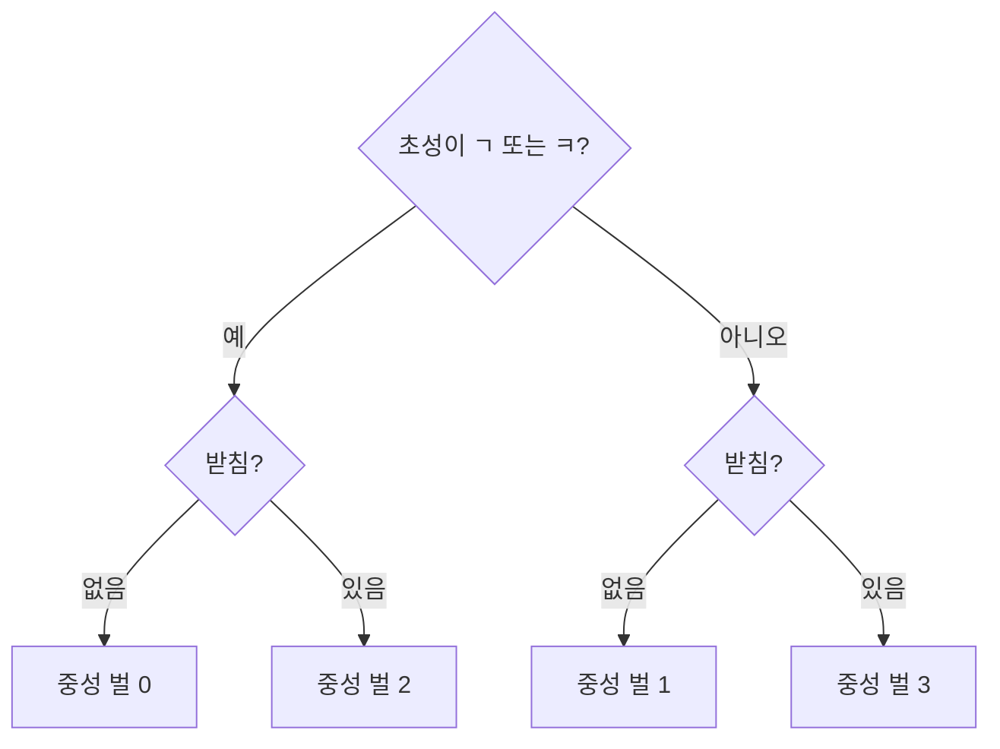

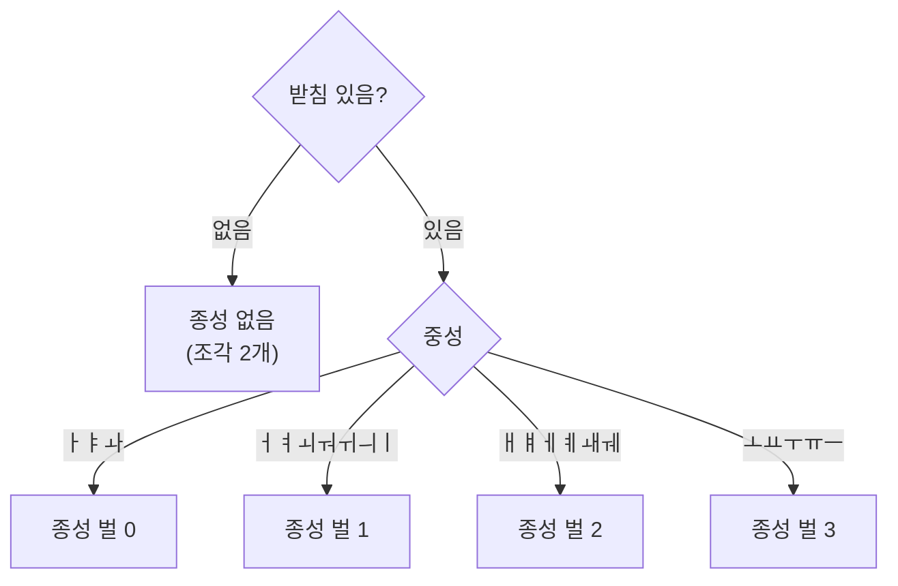

중성 벌의 "ㄱ 또는 ㅋ"는 `KK = (0, 15)`이다. 주석이 "gg is NOT in the group"이라고 적고 있듯 ㄲ은 이 묶음에 들지 않는다.
보기 열의 음절은 `tools/doc_figures_jamo.py`가 그림 2를 그리면서 SANS8J의 표로 실제 그 벌을 쓰는지 확인한다.

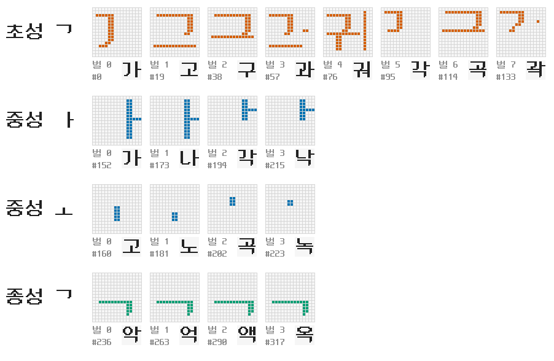

*그림 2. SANS8J의 벌. 초성 ㄱ은 8벌에서 7가지 비트맵을 쓴다. 중성 ㅏ는 받침이 있으면(벌 2, 3) 짧아진다. 이 글꼴에서 ㅏ는 ㄱ/ㅋ
뒤(벌 0, 2)와 그 밖(벌 1, 3)의 비트맵이 같고, ㅗ는 다르다. 종성 ㄱ은 벌 1과 3이 같은 비트맵이다. 같은 비트맵이어도 조각 번호는
따로이며, 344 조각 중 서로 다른 비트맵은 283개이다(`jamoset.unpack`으로 비교).*

8x4x4 파일 안의 배치(`notes/hanme-dokkaebi.md` 2절, [docs/recipes/dos-fonts.ko.md](recipes/dos-fonts.ko.md#그-밖의-dos-시대-한글-폰트) "그 밖의 DOS 시대 한글 폰트"): 360 슬롯이며,
각 벌의 0번 슬롯은 빈 칸이다.

```
슬롯   0         20        40   ...  140       160      182  ...  226      248      276  ...  332     359
       | 초성 벌 0 | 초성 벌 1 | ... | 초성 벌 7 | 중성 벌 0 | ... | 중성 벌 3 | 종성 벌 0 | ... | 종성 벌 3 |
       | 20칸     | 20칸     |     | 20칸     | 22칸     |     | 22칸     | 28칸     |     | 28칸     |
초성 = s x 20 + L + 1     중성 = 160 + s x 22 + V + 1     종성 = 248 + s x 28 + T      (tools/jamoset.py _844)
```

### 2.4 벌 체계의 비교

| 체계 | 초성 / 중성 / 종성 벌 | 조각(파일 슬롯) | 파일 크기 (바이트) | 선택에 쓰는 것 | 출처 |
|---|---|---:|---:|---|---|
| 8x4x4 (DOS 원시 `HANGUL.FNT`, 태백 `GOTHIC16.FNT`, Dokkaebi `DKBBG`, HBIOS `$KGOZN16`) | 8 / 4 / 4 | 360 | 11,520 (16 px) | 초성: 모음 5종(받침 없음) 또는 3종(받침 있음); 중성: ㄱㅋ x 받침; 종성: 모음 4종 | `notes/dos.md`, `notes/hanme-dokkaebi.md` 2절, `jamoset.py` `_844` |
| 8x4x4 IHNM | 8 / 4 / 4 | 360 | 11,520 | ㄱㅋ 중성 벌이 뒤바뀜 | [docs/recipes/dos-fonts.ko.md](recipes/dos-fonts.ko.md#그-밖의-dos-시대-한글-폰트) `844-ihnm` |
| 10x4x4 (san 1.0) | 10 / 4 / 4 | 400 | 12,800 | 초성: 받침 없을 때의 5벌을 받침 있을 때도 따로 | `notes/dos.md`, `jamoset.py` `_san1044` |
| 6x2x1 (Apple II 시대) | 6 / 2 / 1 | 192 | 6,144 | 초성: 모음 3종(세로, 가로, 섞임) x 받침; 중성: 받침; 종성 1벌 | `notes/apple2.md`, `jamoset.py` `_621` |
| hanterm johab | 10 / (3 또는 4) / 4 | 529 글리프 | BDF | 종성 클래스 셋(없음, ㄴ, 그 밖) | [docs/recipes/bitmap-fonts.ko.md](recipes/bitmap-fonts.ko.md#hanterm) "hanterm", `jamoset.py` `_hanterm` |
| Dokkaebi 프린터 16/24 px | 7 / 2 / 2 | 240 (한 글자체) | 15,360 (두 글자체) | 초성: 모음 x 받침 | `notes/hanme-dokkaebi.md` 3절 |
| Dokkaebi 프린터 40/48 px | 12 / 4 / 4 | 440 (한 글자체) | 176,000 (40 px), 253,440 (48 px), 파일마다 두 글자체 | | 같은 곳 |
| 한메 한글 3.11 `HANME.FNT` | 5 / 2 / 3 | 218 | 6,976 (한 글자체) | 초성: 모음 5종; 중성: 받침; 종성: 모음 3종 | `notes/hanme-dokkaebi.md` 1절 |
| Kyrandia `MK15.BIT` | 10 / 4 / 4 (자모 순 배치) | 385 | 11,550 (15x15) | 8x4x4 규칙, 초성 벌 = 2 x 모음 종류 + 받침 | [docs/recipes/dos-fonts.ko.md](recipes/dos-fonts.ko.md#그-밖의-dos-시대-한글-폰트) `kyra-lok`, `jamoset.py` `_kyra` |
| HWP 1.x `HANGUL.SFT` | 10/4/4, 7/2/2, 6/2/2 (글자체별) | 1,193 (세 글자체) | | 초성 클래스(ㄱㅋ/그 밖), 받침, 모음 모양 15종 | `notes/hwp1.md` |
| Daewoo MSX CPC-300 | 6 / 2 / 2 | 234 (210 사용) | 9,280 (SUB-ROM 안) | 초성: 모음 3종 x 받침; 종성: 모음 | [docs/recipes/rom-msx.ko.md](recipes/rom-msx.ko.md#한국-msx-폰트-msx2와-msx1) "한국 MSX 폰트" |
| Samsung SPC-1500 | 6 / 2 / 2 (ROM에는 초성 8벌) | 210 | ROM 4개 | 초성: 모음 3종 x 받침 | [docs/recipes/rom-mame.ko.md](recipes/rom-mame.ko.md#삼성-spc-1500-반전된-rom-네-개의-자모-세트정확) "삼성 SPC-1500" |
| NKP (Hercules TSR) | 8 / 2 (모양별로 넷으로 자름) / 1 | 잘린 조각 | | 초성: 모음 4종 x 받침 | [docs/recipes/programs-and-drivers.ko.md](recipes/programs-and-drivers.ko.md#nkp-조각을-잘라-저장한-허큘리스-한글-tsr) "NKP: 조각을 잘라 저장한 허큘리스 한글 TSR" |
| Mac HangulTalk 1.0 `fbit` | 45개 글리프 set; SVF로는 20 / 15 / 4, 8 x 4 클래스 | 688 (12 px) | | 'fdef' 코드의 18개 표 | `notes/mac.md` "Format 1", [docs/recipes/classic-mac.ko.md](recipes/classic-mac.ko.md#클래식-mac-한글-비트맵-폰트) "클래식 Mac 한글 비트맵 폰트" |
| Mac HangulTalk 7.1.x `fbit` 유형 3 | 규칙 없음: 음절마다 표 항목 | 482 (2 뱅크 x 241) | 8,760 (`fbit`) | KS 2,350자 각각의 4바이트 항목 | `notes/mac.md` "HangulTalk 7.1.x" |

벌의 수가 같아도 규칙은 시스템마다 다르다. NKP는 받침 있는 초성을 모음 모양 4종으로 나누는데 8x4x4는 3종으로 나눈다. 그래서
NKP 글꼴을 8x4x4로 맞추면 IoU가 0.998에 그친다([docs/recipes/programs-and-drivers.ko.md](recipes/programs-and-drivers.ko.md#nkp-조각을-잘라-저장한-허큘리스-한글-tsr) "NKP: 조각을 잘라 저장한 허큘리스 한글 TSR"). SPC-1500은 받침 없는 초성을 모음 모양 3종으로
나누는데 8x4x4는 5종으로 나눈다. 그래서 그 완성형을 8x4x4로 맞춘 결과는 IoU 0.987이다([docs/recipes/rom-mame.ko.md](recipes/rom-mame.ko.md#삼성-spc-1500-반전된-rom-네-개의-자모-세트정확) "삼성 SPC-1500").
SVF의 JSET이 어느 체계든 "자기 규칙 그대로" 담도록 만들어진 이유가 이것이다(4장).

## 3. 실제 시스템들: 연구가 읽어 낸 것

### 3.1 DOS 한글 프로그램과 게임

- **원시 8x4x4 파일**은 머리말 없이 360 x 32바이트이다. 도구는 이런 파일을 크기로 알아본다. 11,520바이트(2바이트
  머리말이 붙은 11,522), 24/40/48 px는 25,920 / 72,000 / 103,680바이트이다([docs/recipes/dos-fonts.ko.md](recipes/dos-fonts.ko.md#그-밖의-dos-시대-한글-폰트) "그 밖의 DOS 시대 한글
  폰트"). 한국 인디 DOS 게임도 대부분 같은 11,520바이트 8x4x4를 쓴다(`notes/games.md`).
- **HWP 3.0 DOS**의 `HAN16_*.FNT`는 완성형 2,350자 뒤에 360 글리프 8x4x4 자모 세트를 붙였다. 24/40/96 px 파일은 완성형뿐이다
  (`notes/printer.md` 1).
- **IBM PC DOS HBIOS V3.0**의 `$KGOZN16`/`$KMYZN16`는 360 x 32바이트 8x4x4이고, `$KMYZN24`는 360 자모 세트에 완성형 2,350자를
  더했다(`notes/os.md`).
- **Dokkaebi**: `DKBBG.FNT`(15,584바이트)는 8x4x4 11,520바이트에 기호 127자를 붙였고, 드라이버 `DKBB.COM`의 오프셋 96에 같은
  바이트가 들어 있다(`notes/hanme-dokkaebi.md` 2절). 드라이버 안에서 글꼴을 직접 찾아 자모 세트로 만든다
  ([docs/recipes/programs-and-drivers.ko.md](recipes/programs-and-drivers.ko.md#도깨비-드라이버-안의-폰트) "도깨비: 드라이버 안의 폰트"). DKB3 형식(912 글리프)은 초성+중성 쌍을 미리 합쳐 두고 종성만 따로 OR한다. 조각을 덜 겹치는
  대신 글리프 수가 는다(같은 노트 2.1절).
- **NKP**(Hercules TSR, 1989)의 조각은 셀 전체가 아니라 필요한 행만 잘라 저장한다. 그만큼 바이트를 아끼고, 조각마다 레코드에
  "셀의 몇째 바이트부터"를 적어 둔다([docs/recipes/programs-and-drivers.ko.md](recipes/programs-and-drivers.ko.md#nkp-조각을-잘라-저장한-허큘리스-한글-tsr) "NKP: 조각을 잘라 저장한 허큘리스 한글 TSR").

### 3.2 한글 카드와 VGA BIOS ROM

86Box ROM 모음의 한국어 VGA 카드 셋(Trigem, Kasan, ATI)은 각각 512 KB KS C 5601 글꼴 ROM을 갖는다. ROM은 32바이트 슬롯
16,384개, 128 x 128 격자이다. 조합형이 아니라 **완성형 격자**이고 "가"는 슬롯 0x1821에 있다([docs/recipes/rom-86box.ko.md](recipes/rom-86box.ko.md#한글-vga-폰트-rom-86box) "한글 VGA 폰트
ROM (86Box)"). 이 프로젝트는 그 완성형을 8x4x4로 맞춰 자모 세트를 만들 수 있다. 하지만 조각의 OR와 다르게 그린 음절이 많아 IoU가
0.968 / 0.872 / 0.919에 그친다. MS-DOS 6.22 한국어판은 반대다. 글꼴 파일 `HFONT.SYS`에 음절이 없고 HBIOS가 자기 자모 세트로
조합한다(1.4절).

### 3.3 Mac: 규칙(HangulTalk 1.0)과 표(HangulTalk 7.1.x)

- **HangulTalk 1.0**(System 4.1)의 `fbit` 글꼴(Gotic12, Munjo12/16/24)은 45개 글리프 set을 담는다. 조합 규칙은 68k 'fdef' 드라이버의
  선택 표 18개이다(`notes/mac.md` "Format 1"). 이것은 규칙형이다. 이 프로젝트의 `--layout mac-fbit-45sets`는 그 규칙을 그대로
  JSET으로 옮긴다. Munjo24는 653 조각, 8 lead x 4 tail 클래스, 20/15/4 벌, 36,660바이트이고 11,172자가 모두 그 규칙과 같다
  ([docs/recipes/classic-mac.ko.md](recipes/classic-mac.ko.md#클래식-mac-한글-비트맵-폰트) "클래식 Mac 한글 비트맵 폰트").
- **HangulTalk 7.1.x**의 Seoul12, AppleGothic12/24, AppleMyungjo12/24는 `fbit` 유형 3이다. 글리프 482개(2 뱅크 x 241)가 있고
  **규칙이 없다**. `InputBackSupport`의 'HTBL' 1 자원에 KS 2,350자마다 4바이트 항목 `[bank][g1][g2][g3]`이 있다(`notes/mac.md`
  "HangulTalk 7.1.x"). 그래서 KS 밖의 8,822자는 이 글꼴로 조합할 수 없다. 벌 구조를 표에서 거꾸로 읽으면 초성 13벌(모음 종류 x
  받침, KS에 쓰이는 초성만 남김), 종성 3벌이고, 중성은 초성 묶음과 받침 폭에 따라 더 잘게 나뉜다. 482 중 473 슬롯을 쓴다.
  노트는 이를 "not an 8/4/4 or HangulTalk 1.0 45-set layout"이라고 적는다. 6.4절이 이 글꼴을 SVF로 옮긴 두 방식을 비교한다.

두 세대의 조합 경로를 나란히 놓으면 차이가 보인다. 1.0은 조합형 코드를 받아 규칙 표로 벌을 고르고, 7.1.x는 완성형 코드를 받아
음절마다 정해진 항목을 그대로 읽는다(`notes/mac.md` "Format 1"과 "HangulTalk 7.1.x").

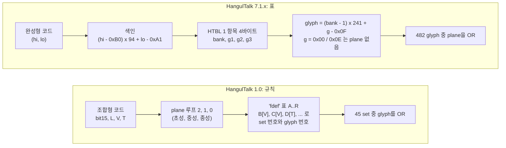

7.1.x의 표에는 KS 2,350자와 호환 자모 51자의 항목만 있다. 그 밖의 음절은 색인 자체가 없으므로 조합할 수 없다.

### 3.4 그 밖

- **Samsung SPC-1500**(1987, MAME `spc1500`): 초성, 중성, 종성 조각이 ROM 세 개에 있고, MAME 드라이버가 세 조각을 **AND**한다.
  ROM은 반전되어 있다(0 비트가 잉크). 쓰이는 벌은 초성 6, 중성 2, 종성 2이고, JSET 하나(lead 클래스 1개, 6/2/2 벌)로 정확히
  표현된다. 결과는 10,652바이트, 조각 210개이며 11,172자가 모두 MAME의 AND와 같다([docs/recipes/rom-mame.ko.md](recipes/rom-mame.ko.md#삼성-spc-1500-반전된-rom-네-개의-자모-세트정확) "삼성 SPC-1500").
- **Daewoo MSX CPC-300/400S**: MSX2 SUB-ROM의 위쪽 16 KB에 초성 6벌 x 20, 중성 2벌 x 28, 종성 2벌 x 29 조각이 있다. 선택 규칙은
  한글 BASIC ROM의 루틴 4DC4h에서 읽었다. compose 명세 `tools/specs/msx2-daewoo.json`이 그 규칙이고, JSET 하나(lead 클래스 1개,
  6/2/2 벌)로 정확히 표현된다. 결과는 10,584바이트, 조각 210개다([docs/recipes/rom-msx.ko.md](recipes/rom-msx.ko.md#한국-msx-폰트-msx2와-msx1) "한국 MSX 폰트").
  CPC-400S에는 256 KB 완성형 폰트 ROM도 있고, 한국 MSX1 기종은 실행 중인 기계에서 읽어 낸 배치 규칙으로 BIOS의 8x8 셀을 모아 음절을
  만든다(같은 절).
- **OS/2 Warp 4 한국어판**의 시스템 DBCS 글꼴은 완성형(KS X 1001 전체)을 Huffman과 예측 부호로 압축해 담는다(`notes/os2-dbcs.md`).
  이를 풀어 완성형 페이스로 만들고, 거기에 자모 세트를 맞춘다([docs/recipes/os2.ko.md](recipes/os2.ko.md#os2-한글-폰트완성형에서-완성형-페이스와-자모-세트-만들기) "OS/2 한글 폰트(완성형)에서 완성형 페이스와 자모 세트 만들기").

## 4. SVF의 자모 세트: JSET 버전 1

### 4.1 생각의 틀

SVF는 모든 체계를 한 형식으로 담는다. 체계의 "규칙"을 표로 바꾸어 담기 때문이다([spec/SVF.ko.md](../spec/SVF.ko.md) "자모 세트 폰트"). 그 표는 다음
세 가지로 이루어진다.

1. **클래스.** 초성 19개를 lead 클래스(LC개)로, 종성 28가지(없음 포함)를 tail 클래스(TC개)로 묶는다. 8x4x4는 lead 클래스가
   {ㄱ, ㅋ}과 나머지의 둘이고, tail 클래스가 받침 없음과 있음의 둘이다.
2. **벌 표.** (lead 클래스, 중성, tail 클래스)의 칸마다 초성, 중성, 종성의 벌 번호가 하나씩 있다. 칸의 번호는
   `(leadClass x 21 + vowel) x TC + tailClass`이다. 규칙이 "중성과 받침 유무로 초성 벌을 고른다"이면, 표는 그 규칙을 펼쳐 놓은
   것이다.
3. **조각 표.** (벌, 자모)마다 조각 번호가 하나씩 있다. 조각은 코드 포인트 **U+F0000 + 조각 번호**(15번 평면, 사용자 정의
   영역)의 글리프이다. 그래서 조각은 보통의 글리프처럼 저장되고 보통의 조회로 읽힌다. 0xFFFF는 빈 조각이다.

음절은 세 조각의 **최댓값 coverage**로 조합된다. 1 bpp에서는 OR이고, 2 bpp와 8 bpp에서도 같은 규칙이다(2비트 단계마다의
최댓값이며 바이트의 OR가 아니다. OR는 단계 1과 2를 3으로 만든다. 실제 음절의 예는
[안티앨리어싱 3장](anti-aliasing.ko.md#3-자모-세트-단계에서는-or가-아니라-최댓값)). 호환 자모 U+3131..U+3163
51자는 `compatPiece`가 가리키는 조각 하나로 그린다.

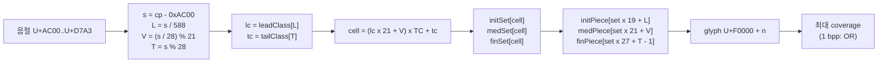

### 4.2 블록 배치

JSET 블록은 SVFN 헤더 바이트 36(오프셋)과 40(크기)이 가리키는 곳에 있고, 헤더 플래그 비트 1(0x2)이 그 존재를 알린다. 모든 값은
little-endian이다([spec/SVF.ko.md](../spec/SVF.ko.md) "자모 세트 폰트").

SVFN 파일 전체에서 JSET이 놓이는 자리는 다음과 같다. 헤더의 오프셋 필드가 각 표를 가리키며, 표의 순서는 파일마다 다를 수 있다.
괄호 안은 SANS8J(15,740바이트)의 실제 값이다([spec/SVF.ko.md](../spec/SVF.ko.md) "셀, 레이아웃 바이트, 예약 바이트"; 헤더는 `jamoset.py`의
`HEADER3`로 읽었다).

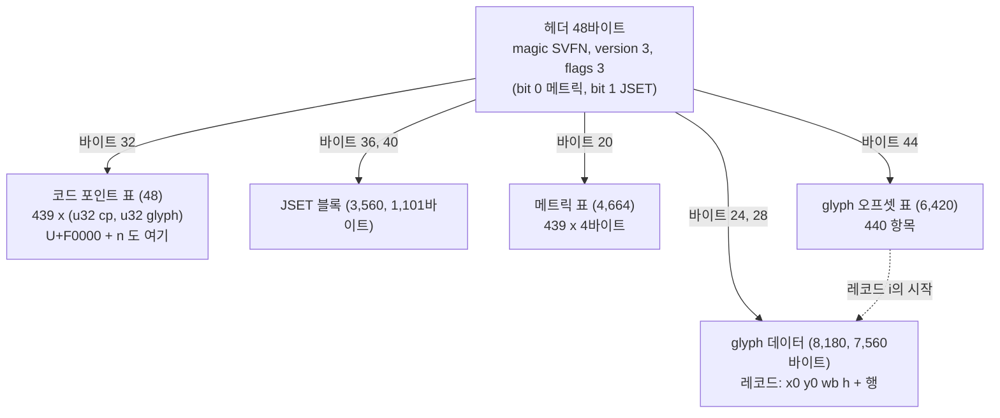

블록 안의 필드 순서(버전 1):

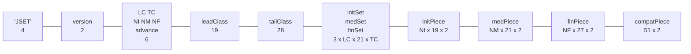

| 필드 | 크기 (바이트) | 뜻 | 한도 (표준; BIG) |
|---|---|---|---|
| `"JSET"` | 4 | magic | |
| version | 2 | 1 | |
| LC | 1 | lead 클래스 수 | 1..12; 1..19 |
| TC | 1 | tail 클래스 수 | 1..12; 1..28 |
| NI | 1 | 초성 벌 수 | 1..32; 1..128 |
| NM | 1 | 중성 벌 수 | 1..24; 1..128 |
| NF | 1 | 종성 벌 수 | 1..16; 1..64 |
| advance | 1 | 음절 advance(px), 0 = 셀 폭 | |
| leadClass[19] | 19 | 초성 ㄱ..ㅎ의 클래스 | < LC |
| tailClass[28] | 28 | 종성(0 = 없음)의 클래스 | < TC |
| initSet | LC x 21 x TC | 칸마다 초성 벌 | < NI |
| medSet | LC x 21 x TC | 칸마다 중성 벌 | < NM |
| finSet | LC x 21 x TC | 칸마다 종성 벌(받침이 있을 때만 읽음) | < NF |
| initPiece | NI x 19 x u16 | (벌, 초성)의 조각 | 0xFFFF = 빈 조각 |
| medPiece | NM x 21 x u16 | (벌, 중성)의 조각 | |
| finPiece | NF x 27 x u16 | (벌, 종성 1..27)의 조각 | |
| compatPiece | 51 x u16 | U+3131..U+3163의 조각 | 0xFFFF = 조각으로 그리지 않음 |

크기는 `12 + 19 + 28 + 3 x LC x 21 x TC + 2 x (NI x 19 + NM x 21 + NF x 27 + 51)`바이트이다([spec/SVF.ko.md](../spec/SVF.ko.md)). 몇 가지 값은
다음과 같다(공식으로 계산했고, 실제 페이스에서 잰 값과 맞음을 확인했다).

| 체계 | LC x TC | NI / NM / NF | v1 블록 | 실제 페이스 |
|---|---|---|---:|---|
| 6x2x1 | 1 x 2 | 6 / 2 / 1 | 653 | `svf/dos/NEODG16G.SVF`의 JSET 653 |
| 8x4x4 | 2 x 2 | 8 / 4 / 4 | 1,101 | `svf/iolo/SANS8J.SVF`의 JSET 1,101 |
| SEOUL12J (6.4절) | 8 x 4 | 9 / 6 / 3 | 2,933 | 측정값 2,933 |
| 8 x 8, 24/16/16 | 8 x 8 | 24 / 16 / 16 | 6,641 | `svf/jamo-extra/SGDAY16.SVF` 6,641 |
| 12 x 12, 24/16/16 | 12 x 12 | 24 / 16 / 16 | 11,681 | `svf/jamo-extra/GOTHA16.SVF` 등 11,681 |
| 표준 최대 | 12 x 12 | 32 / 24 / 16 | 12,321 | ([spec/SVF.ko.md](../spec/SVF.ko.md)의 최대) |
| BIG 최대 | 19 x 28 | 128 / 128 / 64 | 47,373 | (같은 곳) |

실제 페이스 열은 `svf/dos`와 `svf/jamo-extra`의 모든 페이스를 `jamoset.unpack`으로 읽어 얻었다. `svf/`의 자모 페이스는 모두
버전 1이다([spec/SVF.ko.md](../spec/SVF.ko.md) "버전 2를 쓸 때").

### 4.3 실제 페이스로 따라가기: SANS8J의 "한"

`svf/iolo/SANS8J.SVF`(15,740바이트, 16x16 1 bpp, 글리프 439개)의 JSET 블록은 파일 오프셋 3,560에 있고 길이는 1,101바이트이다.
[tools/jamoset.py](../tools/jamoset.py)의 `parse_svfn`과 `unpack`으로 읽었다(`python3 -I`).

**머리 12바이트:** `4a 53 45 54 | 01 00 | 02 | 02 | 08 | 04 | 04 | 00` = "JSET", 버전 1, LC 2, TC 2, NI 8, NM 4, NF 4,
advance 0(16픽셀 셀 폭 사용).

**블록 안 오프셋**(위 배치에서 계산): leadClass 12, tailClass 31, initSet 59, medSet 143, finSet 227(각 2 x 21 x 2 = 84바이트),
initPiece 311(8 x 19 x 2 = 304), medPiece 615(168), finPiece 783(216), compatPiece 999(102), 끝 1,101.

**클래스 표:**

```
leadClass  ㄱ ㄲ ㄴ ㄷ ㄸ ㄹ ㅁ ㅂ ㅃ ㅅ ㅆ ㅇ ㅈ ㅉ ㅊ ㅋ ㅌ ㅍ ㅎ
            0  1  1  1  1  1  1  1  1  1  1  1  1  1  1  0  1  1  1
tailClass  없음=0, 그 밖의 27가지 = 1
```

**벌 표**(가로 = 중성 ㅏ..ㅣ; 4.1절의 공식으로 칸 번호를 매긴다):

| 행 (lc, tc) | 표 | ㅏ | ㅐ | ㅑ | ㅒ | ㅓ | ㅔ | ㅕ | ㅖ | ㅗ | ㅘ | ㅙ | ㅚ | ㅛ | ㅜ | ㅝ | ㅞ | ㅟ | ㅠ | ㅡ | ㅢ | ㅣ |
|---|---|---|---|---|---|---|---|---|---|---|---|---|---|---|---|---|---|---|---|---|---|---|
| lc0 tc0 (ㄱㅋ, 받침 없음) | init | 0 | 0 | 0 | 0 | 0 | 0 | 0 | 0 | 1 | 3 | 3 | 3 | 1 | 2 | 4 | 4 | 4 | 2 | 1 | 3 | 0 |
| | med | 0 | 0 | 0 | 0 | 0 | 0 | 0 | 0 | 0 | 0 | 0 | 0 | 0 | 0 | 0 | 0 | 0 | 0 | 0 | 0 | 0 |
| lc0 tc1 (ㄱㅋ, 받침 있음) | init | 5 | 5 | 5 | 5 | 5 | 5 | 5 | 5 | 6 | 7 | 7 | 7 | 6 | 6 | 7 | 7 | 7 | 6 | 6 | 7 | 5 |
| | med | 2 | 2 | 2 | 2 | 2 | 2 | 2 | 2 | 2 | 2 | 2 | 2 | 2 | 2 | 2 | 2 | 2 | 2 | 2 | 2 | 2 |
| | fin | 0 | 2 | 0 | 2 | 1 | 2 | 1 | 2 | 3 | 0 | 2 | 1 | 3 | 3 | 1 | 2 | 1 | 3 | 3 | 1 | 1 |
| lc1 tc0 (그 밖, 받침 없음) | init | 0 | 0 | 0 | 0 | 0 | 0 | 0 | 0 | 1 | 3 | 3 | 3 | 1 | 2 | 4 | 4 | 4 | 2 | 1 | 3 | 0 |
| | med | 1 | 1 | 1 | 1 | 1 | 1 | 1 | 1 | 1 | 1 | 1 | 1 | 1 | 1 | 1 | 1 | 1 | 1 | 1 | 1 | 1 |
| lc1 tc1 (그 밖, 받침 있음) | init | 5 | 5 | 5 | 5 | 5 | 5 | 5 | 5 | 6 | 7 | 7 | 7 | 6 | 6 | 7 | 7 | 7 | 6 | 6 | 7 | 5 |
| | med | 3 | 3 | 3 | 3 | 3 | 3 | 3 | 3 | 3 | 3 | 3 | 3 | 3 | 3 | 3 | 3 | 3 | 3 | 3 | 3 | 3 |
| | fin | 0 | 2 | 0 | 2 | 1 | 2 | 1 | 2 | 3 | 0 | 2 | 1 | 3 | 3 | 1 | 2 | 1 | 3 | 3 | 1 | 1 |

받침 없는 행(tc0)의 fin 값은 모두 0이며 읽히지 않으므로 생략했다. 이 표는 2.3절의 8x4x4 규칙을 그대로 펼친 것이다.

**조각 표**는 이 페이스에서 단순하다. 초성 벌 s의 자모 L은 조각 `19s + L`(0..151), 중성은 `152 + 21s + V`(152..235), 종성은 `236 + 27s + T - 1`(236..343)이다. 조각 표의 344칸 중 빈 조각 표시(0xFFFF)는 하나도 없고, 변환된 페이스의 중성 ㅡ 네 조각(170, 191, 212, 233)도 모두 비어 있지 않다. compatPiece는 첫 벌을 가리킨다(ㄱ → 0, ㄳ → 238, ㅏ → 152).

**"한"(U+D55C) 따라가기:**

| 단계 | 계산 | 값 | 블록 오프셋 (파일 오프셋) |
|---|---|---|---|
| 1. 분해 | s = 0xD55C - 0xAC00 = 10,588 | L = 18 (ㅎ), V = 0 (ㅏ), T = 4 (ㄴ) | |
| 2. 클래스 | leadClass[18], tailClass[4] | lc = 1, tc = 1 | 30 (3,590), 35 (3,595) |
| 3. 칸 | (1 x 21 + 0) x 2 + 1 | cell = 43 | |
| 4. 벌 | initSet[43], medSet[43], finSet[43] | 5, 3, 0 | 102 (3,662), 186 (3,746), 270 (3,830) |
| 5. 조각 | initPiece[5 x 19 + 18 = 113], medPiece[3 x 21 + 0 = 63], finPiece[0 x 27 + 4 - 1 = 3] | 113, 215, 239 | 537 (4,097), 741 (4,301), 789 (4,349) |
| 6. 글리프 | U+F0000 + n | U+F0071, U+F00D7, U+F00EF | 코드 포인트 표에서 찾음 |
| 7. 조합 | 세 셀의 OR | 2.2절의 16x16 그림 | |

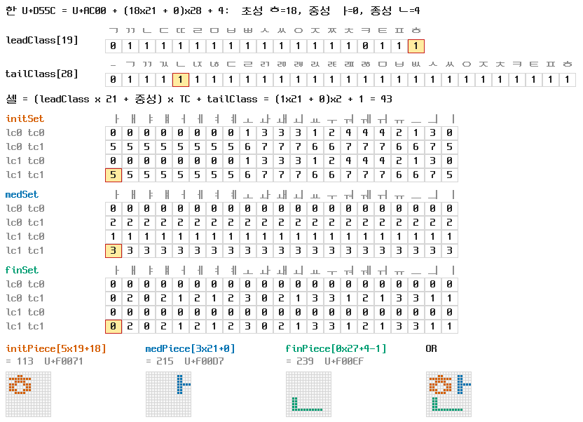

*그림 3. SANS8J에서 "한"을 조회하는 과정. 노란 칸이 읽는 자리이다.*

**"쀍"(U+C00D, KS 밖):** L = 8 (ㅃ), V = 15 (ㅞ), T = 9 (ㄺ); lc = 1, tc = 1; cell = (21 + 15) x 2 + 1 = 73; 벌 7, 3, 2;
조각 `initPiece[7 x 19 + 8 = 141]` = 141, `medPiece[3 x 21 + 15 = 78]` = 230, `finPiece[2 x 27 + 9 - 1 = 62]` = 298. 완성형 코드에는
없는 음절이지만 조합형 글꼴은 "한"과 같은 표 읽기 여덟 번(클래스 2, 벌 3, 조각 3; 받침이 없으면 여섯 번)으로 그린다.

버전 1 조회를 색인 공식과 함께 순서도로 그리면 다음과 같다([c/src/svf_jamo.c](../c/src/svf_jamo.c)의 `pieces_v1`, 호환 자모 분기 포함). 버전 2
리더도 함께 컴파일된 빌드에서는 나눗셈 대신 곱셈과 shift 두 번(`s x 14267 >> 23`, `tail x 2341 >> 16`)으로 같은 L, V, T를 얻는다.
버전 1 리더만 있는 빌드는 나눗셈을 쓴다.

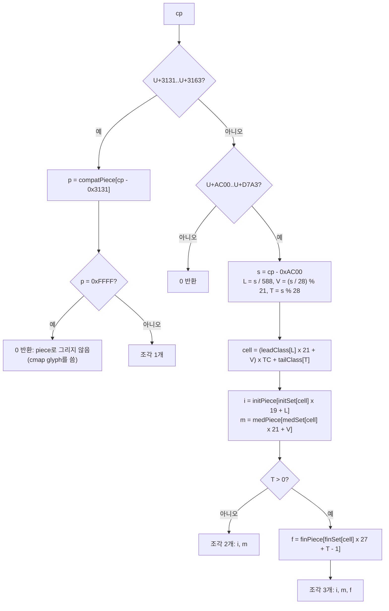

C 렌더러에서는 `svf_jamo_pieces(&face, 0xD55C, pieces)`가 3을 돌려주고 `pieces`에 113, 215, 239를 넣는다. `svf_glyph`는
조합된 셀을 돌려준다([docs/c-renderer-guide.ko.md](c-renderer-guide.ko.md) 10장).

### 4.4 완성형과 같은가

SANS8J는 iolo가 변환한 레거시 8x4x4 비트맵 글꼴을 SANS .fnt에서 `jamoset.py --layout 844 --check`로 변환한 것이다.
다른 글꼴인 완성형 `NEODG16`과의 비교는 **글꼴 간 그림 예시**이다. KS 2,350자 중 274자가 정확히 같고 평균 IoU는 0.9498이다. 이는 SANS8J 변환 충실도를 측정한 값이 아니며 SANS8J와 같은 글꼴의 완성형 쌍은 제공되지 않는다. 아웃라인 글꼴의 8x4x4 맞춤은 원본과 다를 수 있다. NanumGothic Bold 16 px를
8x4x4로 맞추면 IoU 0.795, 정확한 음절 126자였다([docs/recipes/sets.ko.md](recipes/sets.ko.md#벌-수-정하기) "세트 수(벌 수) 정하기").

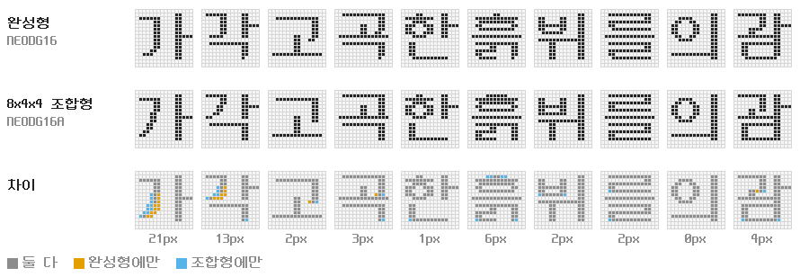

*그림 4. 위: 비교용 완성형. 가운데: SANS8J 조합. 아래: 차이(회색 = 둘 다, 주황 = 비교용에만, 하늘색 = SANS8J에만). 원본이 다르므로 품질 수치가 아니라 그림 예시이다.*

### 4.5 검증

위치 검사 두 가지(첫 두 행)는 파일 전체의 문제이므로 열기가 실패한다(`c/src/svf_face.c` 124-131행). 블록 내용 검사(나머지 행)를
어기면 페이스는 오류가 아니라 **일반 페이스**로 열린다. 한글은 조합하지 않으며, C 렌더러는 `SVF_FACE_JSET_BAD`를 세운다
([spec/SVF.ko.md](../spec/SVF.ko.md) "자모 세트 폰트", "검증").

| 검사 | 어기면 |
|---|---|
| 크기가 0이 아닌 영역이 바이트 48 이상이고 파일 안 | `SVF_E_RANGE`(열기 실패) |
| 오프셋이 표 단위(2^TAB)의 배수 | `SVF_E_LAYOUT`(열기 실패) |
| 크기가 개수에서 나온 공식 값과 같음, 0이 아님 | `JSET_BAD`, 일반 페이스 |
| 개수가 빌드의 한도 안(표준 또는 BIG) | `JSET_BAD` |
| 클래스 < LC, TC; 벌 < NI, NM, NF(종성 벌은 받침 있는 클래스에서만) | `JSET_BAD` |
| 빈 조각 0xFFFF를 제외한 모든 조각 번호에 글리프 U+F0000 + n이 있음 | `JSET_BAD` |

## 5. JSET 버전 2와 BIG

### 5.1 버전 2: 같은 표를 비트로

버전 2는 버전 1과 **같은 표**를 더 적은 바이트로 담는다. 비트맵, 글리프 레코드, 셀, 조합 규칙, 한도는 하나도 바꾸지 않는다
([spec/SVF.ko.md](../spec/SVF.ko.md) "JSET 블록 버전 2").

| 부분 | 버전 1 | 버전 2 |
|---|---|---|
| 머리 | 12바이트 | 16바이트(NA = alias 수, 예약 u16 포함) |
| 클래스 표 | 19 + 28바이트 | 같음 |
| 벌 표 | 칸마다 1바이트 x 3 | 칸마다 W = WI + WM + WF 비트. `width(n) = ceil(log2 n)`, n = 1이면 0 |
| 조각 표 | 슬롯마다 u16 | 벌마다 한 행: u16 base + presence 비트(초성, 중성 3바이트, 종성 4바이트). 조각 번호는 base부터 차례로 셈 |
| 공유 조각 | 아무 번호나 | alias 표(NA x u16)와 행마다 alias 비트 |
| compat | 51 x u16 | 51 x 1바이트(벌 번호 + 표 전환 비트) |

8x4x4(NI 8, NM 4, NF 4)의 칸은 3 + 2 + 2 = 7비트이다. 버전 1은 칸마다 3바이트를 쓴다. 크기 예(NA = 0, [spec/SVF.ko.md](../spec/SVF.ko.md)):

| 체계 | v1 | v2 |
|---|---:|---:|
| 6 / 2 / 1, 1 x 2 클래스 | 653 | 181 |
| 8 / 4 / 4, 2 x 2 클래스 | 1,101 | 272 |
| 32 / 24 / 12, 8 x 8 클래스 | 7,065 | 2,818 |
| 24 / 16 / 16, 12 x 12 클래스 | 11,681 | 5,324 + alias |
| 표준 최대 | 12,321 | 5,782(NA 0), 9,246(모든 슬롯 alias) |
| BIG 최대 | 47,373 | 29,708(NA 0), 45,068(모든 슬롯 alias) |

버전 2로 조각 하나를 푸는 과정([c/src/svf_jamo.c](../c/src/svf_jamo.c)의 `pieces_v2`, `cell_set`, `slot_piece`; [spec/SVF.ko.md](../spec/SVF.ko.md) "JSET 블록 버전 2"):

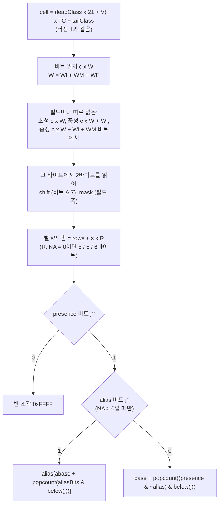

j는 초성 0..18, 중성 0..20, 종성 `T - 1`이다. 한 칸은 최대 14비트(BIG 20비트)이고 바이트 중간에서 시작할 수 있으므로, 칸 전체를
한 번에 읽지 않고 필드 하나마다 2바이트를 읽는다(필드는 최대 5비트, BIG 7비트라 2바이트에 들어간다; `cell_set`).

**왜 느린가.** 버전 1은 칸 하나를 바이트 하나로 읽고 조각을 u16 하나로 읽는다. 버전 2는 벌 번호마다 2바이트를 가져와 shift와
mask를 하고, 조각마다 presence 비트의 popcount를 센다(`popcount(presenceBits & ~aliasBits & below(j))`). Pico에서 잰 비용은
5.3절에 있다. 이 공개 프로젝트의 `svf/`에 있는 자모 페이스 67개(모두 버전 1)를 모두 버전 2로 바꾸면 JSET 바이트가 622,413에서
302,039이 된다. `--jset-version auto`는 1,024바이트 이상 줄 때만 버전 2를 쓰며(`jamoset.choose_jset_version`), 그러면 57개
페이스가 바뀌고 309,972이 된다(2026-11-26에 `jamoset.unpack`과 `pack_jset`으로 메모리에서 측정). [spec/SVF.ko.md](../spec/SVF.ko.md) "버전 2를 쓸 때"의
95개 / 652,431 / 310,160 / 58개 / 337,695는 이전 95개 페이스 집계이며, 현재 67개 페이스 집계와 구별해야 한다.

### 5.2 BIG: 한도만 넓힌다

`SVF_JSET_BIG`은 버전 1과 2의 **한도**만 넓힌다. 새 버전 번호는 없다. lead 클래스 19개(초성마다 하나), tail 클래스 28개(종성마다
하나), 벌 128 / 128 / 64가 된다. 가장 큰 블록은 버전 1이 47,373바이트, 버전 2가 29,708바이트(NA 0)이다. BIG 없이 빌드한 리더는
12 x 12 / 32 / 24 / 16을 넘는 개수를 `JSET_BAD`로 본다. 쓰는 도구는 요청(`--jset-big`)이 없으면 표준 한도를 넘는 표를 거부하고,
표준 한도 안의 출력은 어느 쪽이든 바이트가 같다([spec/SVF.ko.md](../spec/SVF.ko.md), [c/include/svf.h](../c/include/svf.h)의 `SVF_JSET_BIG` 주석).

클래스 한도는 2026-10까지 8과 8이었고(최대 블록 6,641바이트) 그 뒤 12와 12가 되었다. 벌 한도는 2026-10(v3)에 24 / 16 / 16에서
32 / 24 / 16으로 올랐다([spec/SVF.ko.md](../spec/SVF.ko.md)).

### 5.3 버전 2의 속도 (Pico)

[c/bench/MEASUREMENTS.md](../c/bench/MEASUREMENTS.md) "Before -> after JSET v1 + v2", rp2040js 125 MHz, MONO_PAGE `-Os`, 반복당 사이클이다. BASE는 변경 전
main의 버전 1 리더이고, "v1 face"는 현재 빌드의 버전 1 페이스, "v2 copy"는 같은 페이스의 버전 2 사본이다. 페이스는 HGKEY6J
(6x2x1, 공개판에 없음)이다. 8x4x4 SANS8J를 버전 2로 바꾸면 JSET이 1,101에서 272바이트로, 파일이 15,740에서 14,911바이트로
준다([docs/recipes/svf-and-ttf.ko.md](recipes/svf-and-ttf.ko.md#기존-svf) "기존 SVF").

| 경우 | BASE | v1 face | v2 copy | v2 vs BASE | v2 vs v1 face |
|---|---:|---:|---:|---:|---:|
| `syl_ga` (가, 조각 2개) | 6,143 | 6,091 | 6,458 | +5.1 % | +6.0 % |
| `syl_bwelk` (뷁, 조각 3개) | 7,500 | 7,321 | 8,027 | +7.0 % | +9.6 % |
| `screen32` (한 화면) | 194,583 | 188,251 | 206,545 | +6.1 % | +9.7 % |

spec이 말하는 "5-7 %"는 BASE에 대한 값이다. 같은 빌드에서 버전 1 페이스와 비교하면 버전 2 사본은 6-10 % 느리다(마지막 열,
표의 숫자로 계산). 이 표는 2026-10-26의 측정이다. 그 뒤 2026-10-27에 `svf_is_jamo`가 바뀌어 버전 1 페이스의 `syl_ga`는 6,049,
`syl_bwelk`는 7,279 사이클이 되었다([c/bench/MEASUREMENTS.md](../c/bench/MEASUREMENTS.md) 125-129행). 버전 2 사본은 그때 다시 재지 않았다.

## 6. 버전 3: JMAP, LIST, 그리고 규칙형과 표형의 비교

### 6.1 규칙이 클래스의 함수가 아닐 때

JSET 버전 1과 2는 "벌은 (클래스, 중성, 클래스)의 함수"라는 가정 위에 있다. 이 가정이 맞지 않는 글꼴도 있다. Mac HangulTalk
7.1.x처럼 음절마다 조각을 표로 고르는 글꼴이 그렇고, 몇몇 음절만 예외로 그리고 싶은 글꼴도 그렇다. 버전 3의 **JMAP**은 벌 표 대신
"음절 → 조각" 사상을 직접 담는다([spec/SVF.ko.md](../spec/SVF.ko.md) "버전 3: 매핑 테이블 (JMAP)").

| 오프셋 | 크기 | 필드 |
|---|---|---|
| 0 | 4 | `"JSET"` |
| 4 | u16 | version = 3 |
| 6 | u8 | flags: 0x01 4B(항목 4바이트, 아니면 3), 0x02 SPARSE, 0x04 FALLBACK, 0x08 LIST |
| 7 | u8 | advance |
| 8 | u16 | NS 항목 수(dense = 11,172; LIST 1..255) |
| 10, 12, 14 | u16 x 3 | PI, PM, PF: plane별 조각 수(LIST는 0) |
| 16 | u16[51] | compat 조각 |
| 118 | u16[44] | SPARSE: rank 표(256비트마다 앞의 1 비트 수) |
| 206 | u8[1397] | SPARSE: U+AC00..U+D7A3 존재 비트맵 |
| 1603 | u8 | SPARSE: 채움 0 |
| E | NS x 3, 4 또는 8 | 항목. E = 1,604(SPARSE) 또는 118(dense, LIST) |
| F | 나머지 | FALLBACK: JSET 버전 1 또는 2 블록 |

| 형태 | 항목 | 크기 | 쓰임 |
|---|---|---|---|
| dense 3B | 11,172 x 3 | 33,634 | 모든 음절에 표 항목, plane별 조각 ≤ 255 |
| dense 4B | 11,172 x 4 | 44,806 | 조각이 더 많을 때(PI, PM ≤ 2,047, PF ≤ 1,023) |
| SPARSE 3B, KS 2,350자, 대체 없음 | 1,604 + 2,350 x 3 | 8,654 | Mac 7.1.x 원본 구조 |
| SPARSE 4B, 11,172자 | | 46,292 | |
| LIST | 118 + 8 x NS(≤ 255) | ≤ 2,158 (NS 36이면 406) | 예외 목록 + 대체 JSET |

크기는 모두 [spec/SVF.ko.md](../spec/SVF.ko.md)의 값이다. 영역은 최대 65,534바이트이다.

**조회.** dense는 `idx = s`이다. SPARSE는 비트 s가 있으면 `idx = rank[s >> 8] +`(그 블록 앞부분 바이트들의 popcount) `+`(같은
바이트 아래 비트의 popcount)이다. 항목 `[i, m, f]`에서 0은 그 plane이 없다는 뜻이고 k는 plane의 k번째 조각이다(초성 `i - 1`,
중성 `PI + m - 1`, 종성 `PI + PM + f - 1`). 3 조각인지 2 조각인지는 음절의 받침이 아니라 **항목이 정한다**. LIST는 키(`cp - 0xAC00`)를
이진 탐색하며, 필드는 공유 pool의 조각 번호 그대로이다(0xFFFF = 빈 칸). 키가 없거나 비트가 0이면 FALLBACK의 JSET 버전 1 또는 2가
답한다. FALLBACK이 없으면 그 음절은 조합하지 않는다.

dense, SPARSE, LIST의 색인 방식만 따로 떼면 다음과 같다.

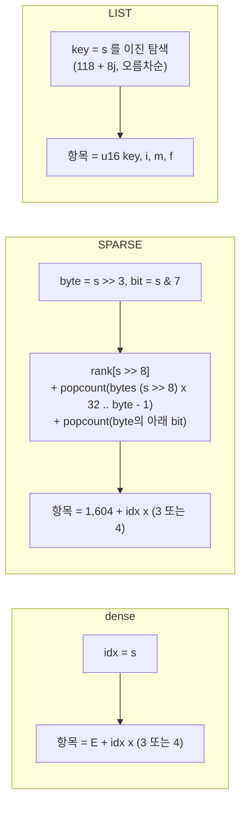

조회 전체(대체 블록 포함):

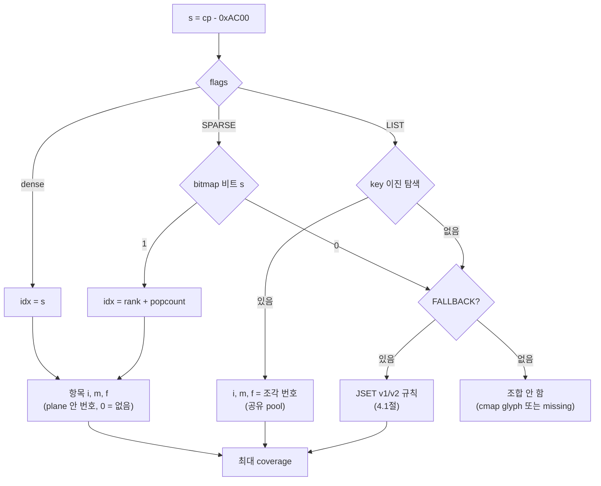

**통째 글리프와 예외.** LIST 항목의 `i`가 어떤 조각이고 `m = f = 0xFFFF`이면 그 조각 하나가 음절 전체이다. 완성형 셀을 그대로
넣는 셈이다. `tools/jamoexc.py`는 자모 세트 페이스에 이런 예외(통째 글리프 `"whole"`, 또는 다른 조각 조합 `"pieces"`)를 최대
255개 더한 LIST 페이스를 쓴다. 원래 JSET은 그대로 대체 블록이 된다(`tools/jamoexc.py` docstring). [docs/recipes/sets.ko.md](recipes/sets.ko.md#벌-수-정하기) "세트 수(벌 수)
정하기"는 아웃라인 래스터처럼 8x4x4가 잘 맞지 않는 글꼴이라면 벌을 늘리기보다 "8x4x4 위에 LIST 예외 몇 개"를 고려하라고 권한다.

`jamoexc.py build`가 하는 일(`tools/jamoexc.py`의 docstring과 `build`):

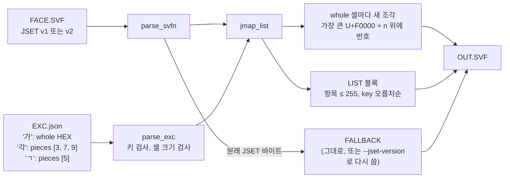

호환 자모(U+3131..U+3163)의 경로는 음절과 다르다([spec/SVF.ko.md](../spec/SVF.ko.md) "버전 3"의 "Compat"):

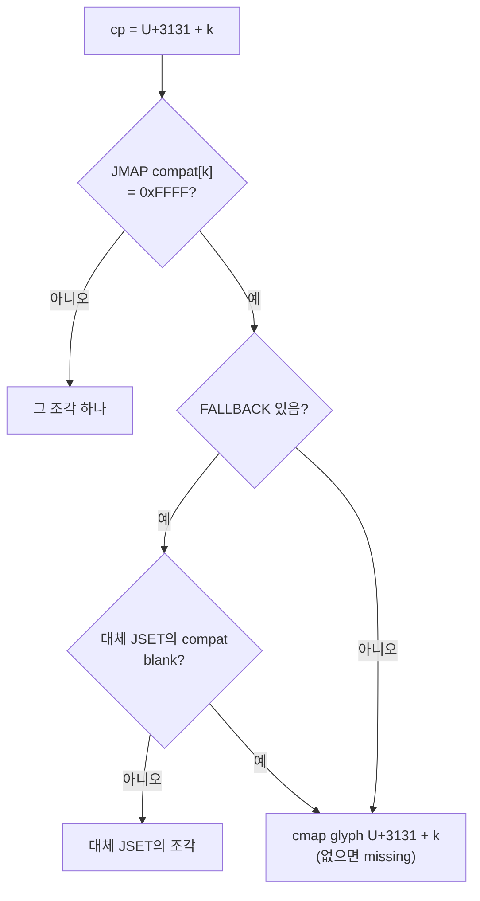

Mac의 여러 plane짜리 호환 자모처럼 조각 하나로 그릴 수 없는 것은 U+3131 + k의 통째 글리프로 두고 JMAP compat을 blank로 둔다.

### 6.2 검증과 상태 비트

그 형태를 읽는 빌드(dense와 SPARSE는 `SVF_JMAP`, LIST는 거기에 `SVF_JMAP_LIST`)에서는 JMAP의 규칙(R1-R8, LIST는 R1', L2, L3,
R4, L5-L7)을 하나라도 어기면 블록 전체가 `SVF_FACE_JMAP_BAD`이고 페이스는 일반 페이스로 열린다("한 블록에 한 판정"). 읽지 않는 빌드는
검사를 줄인다. `SVF_JMAP_LIST=0`은 LIST의 머리 규칙(R1', L2, L3, R4)만 보므로, 키가 정렬되지 않은 LIST도 `JMAP_UNREAD`가 되고 대체
JSET이 쓰인다. `SVF_JMAP_RECOG` 빌드는 머리 규칙(플래그와 NS, 대체 블록의 advance, 정확히 65,535바이트인 영역; 7.1 참고)만 보고 `JMAP_UNREAD`를 세우며, 대체 블록의 판정은 `JSET_BAD`나 `JSET_UNREAD`로
따로 나온다. `SVF_JSET_TRUSTED`이면 R5-R8(LIST는 L5-L7)도 건너뛴다([spec/SVF.ko.md](../spec/SVF.ko.md) "리더 상태"와 그 표). 상태 비트는 다음과 같다
([spec/SVF.ko.md](../spec/SVF.ko.md) "리더 상태", [c/include/svf.h](../c/include/svf.h) 75-86행).

| 비트 | 값 | 뜻 |
|---|---|---|
| `SVF_FACE_JSET_BAD` | 0x0008 | JSET 부분이 잘못됨, 또는 버전 0이나 4 이상. 빌드가 버전 3을 모르면 버전 3도 여기 |
| `SVF_FACE_JSET_UNREAD` | 0x0010 | 버전 1 또는 2 머리는 바르지만 그 리더가 컴파일되지 않음 |
| `SVF_FACE_JMAP_BAD` | 0x0020 | 버전 3 블록(대체 블록 포함)이 규칙을 어김 |
| `SVF_FACE_JMAP_UNREAD` | 0x0040 | `SVF_JMAP` 없이 `SVF_JMAP_RECOG`로 알아보기만 함, 또는 `SVF_JMAP_LIST=0`에서 LIST 블록 |

### 6.3 규칙형과 표형

| 측면 | 규칙형 (JSET v1/v2) | 표형 (JMAP dense/SPARSE) | 예외형 (LIST + 대체 JSET) |
|---|---|---|---|
| 담는 것 | 클래스, 벌 표, 조각 표 | 음절마다 조각 세 개 | 예외 ≤ 255개 + 규칙 |
| 덮는 음절 | 11,172 모두 | 항목이 있는 음절(SPARSE는 일부) | 11,172(대체가 있으면) |
| 쓰지 않은 음절 | 규칙으로 저절로 그림 | 그리지 않음(대체가 없으면) | 규칙으로 그림 |
| 표 크기 | v1 예: 653 ~ 12,321(BIG 47,373); v2는 5.1절 | 8,654(SPARSE 3B, KS 2,350) ~ 46,292(SPARSE 4B, 11,172), 대체 포함 영역 ≤ 65,534 | 118 + 8 NS + 대체 |
| 조회 비용 | 표 읽기 8번(받침 없으면 6번) | dense: 1번; SPARSE: popcount | 이진 탐색 + (miss면) 규칙 |
| 리더 코드 | v1은 모든 기본 빌드(KS 전용 빌드 `SVF_JSET_V1=0`만 제외) | 데스크톱 기본; MCU 기본 꺼짐 | 데스크톱 기본; MCU 기본 꺼짐 |
| 맞는 글꼴 | DOS 글꼴, ROM, 픽셀 글꼴 | 규칙이 없는 글꼴(Mac 7.1.x) | 거의 맞는 규칙 + 몇 자의 손질 |

### 6.4 Seoul12: 같은 글꼴, 두 구조

Mac HangulTalk 7.1.x의 Seoul12(12 px)는 같은 글리프 데이터를 두 방식으로 SVF에 담아 비교할 수 있는 예이다. 아래 파일 크기는 [docs/recipes/classic-mac.ko.md](recipes/classic-mac.ko.md#클래식-mac-한글-비트맵-폰트)의 "클래식 Mac 한글 비트맵 폰트"에 설명되어 있으며 프리셋 크기는 Uno 변환의 값이다.

**이름 주의.** 이 절의 "SEOUL12J"는 Uno 프리셋의 **derived** 모드(규칙형, Latin 포함,
12,624바이트) 페이스를 가리킨다. [docs/recipes/classic-mac.ko.md](recipes/classic-mac.ko.md#클래식-mac-한글-비트맵-폰트) "클래식 Mac 한글 비트맵 폰트"의 명령 예는 같은 이름 `SEOUL12J.SVF`를
**direct** 출력(JMAP)에, `SEOUL12D.SVF`를 derived 출력에 붙인다. 아래 표는 "원본 구조"(direct)와 "SEOUL12J"(derived)로 나누어
부르며, 크기는 Latin 유무를 맞추어 비교한다.

| 항목 | 원본 구조 (direct, 표형) | SEOUL12J (derived, 규칙형) |
|---|---|---|
| 블록 | JMAP SPARSE 3B, NS 2,350, 대체 없음 | JSET 버전 1 |
| 클래스 | (없음) | lead 8 x tail 4 |
| 벌 | (없음) | 초성 9, 중성 6, 종성 3 |
| 조각 | 90 / 64 / 53 = 207 (Mac plane 그대로) | 219 (다시 계산) |
| JSET 바이트 | 8,654 | 2,933 |
| 파일 바이트, Latin 없이 | 15,016 | 9,716 |
| 파일 바이트, Latin(`--latin`) 포함 | 17,924 | 12,624 |
| 조합하는 음절 | KS 2,350자만 | 11,172자: KS 2,350 정확 + 4,630 regular + 4,192 추정(guessed) |
| 만드는 도구 | `tools/macfbit_svf.py build` | `tools/macfbit_svf.py build --mode derived` |

Latin 없는 두 크기와 Latin 포함 두 크기(15,016 / 9,716 / 17,924 / 12,624)는 [docs/recipes/classic-mac.ko.md](recipes/classic-mac.ko.md#클래식-mac-한글-비트맵-폰트) "클래식 Mac 한글 비트맵 폰트"의 실행
결과이다. 구조 항목은 해당 변환의 블록 형태, 클래스, 벌, 조각 수, JSET 바이트와 regular / guessed 수를 나타낸다.

**왜 규칙형으로 Mac 조각을 그대로 쓸 수 없었나.** Mac 표는 중성(과 종성 ㄱ ㄹ ㅇ)을 초성에 따라 아주 잘게 고른다. Mac 슬롯 하나하나를
조각으로 삼으면, 같은 중성과 받침에서 다른 중성 또는 종성 글리프를 쓰는 초성 쌍은 같은 lead 클래스에 들 수 없다. 초성 쌍은 모두
171개이다(`tools/macfbit_svf.py`의 `slot_conflicts` docstring). Seoul12에서는 그중 **130쌍**이 이렇게 충돌한다. 이 쌍의 개수만으로 필요한 lead 클래스의 최솟값을 정할 수는 없다. 이는 `macfbit_svf.py analyse`가 출력하는 `slot_conflict_pairs` 값이다. 그래서 `derived` 모드는 조각을 다시 계산한다(`tools/macfbit_svf.py` 머리 docstring).

- 칸의 중성 조각 = 그 칸에 드는 KS 음절들의 Mac 중성 글리프의 **AND**
- 칸의 종성 조각 = 같은 방식의 **AND**
- 칸의 초성 조각 = 그 칸 음절마다 (음절 - 중성 조각 - 종성 조각)를 구해 **OR**한 것(잔여)

```mermaid
flowchart TD
  M["Mac 입력<br/>fbit 482 glyph + HTBL 1<br/>(KS 2,350자의 plane)"] --> C["클래스 탐색 search_classes<br/>lead ≤ 12, tail ≤ 12<br/>결과: 8 x 4"]
  C --> K["칸마다 KS 음절 모으기"]
  K --> MD["중성 조각<br/>= 칸의 Mac 중성 glyph AND"]
  K --> FN["종성 조각<br/>= 칸의 Mac 종성 glyph AND"]
  MD --> IN["초성 조각<br/>= OR(음절 - 중성 조각 - 종성 조각)"]
  FN --> IN
  IN --> V{"OR가 칸의 모든 음절 안에 있나?"}
  V -->|예| KS["KS 2,350자 정확"]
  KS --> EX{"KS 밖 8,822자:<br/>세 칸 모두 KS 음절이 있나?"}
  EX -->|예| RG["regular 4,630"]
  EX -->|아니오| GS["guessed 4,192<br/>가까운 문맥의 Mac glyph"]
  RG --> J["SEOUL12J: JSET v1, 9/6/3 벌, 219 조각"]
  GS --> J
```

그 결과 KS 2,350자는 모두 Mac과 같다. 나머지 8,822자는 regular(세 칸이 모두 KS 음절에서 관측된 조각을 씀) 4,630자와
guessed(관측이 없는 칸을 가장 가까운 문맥의 Mac 글리프로 채움) 4,192자이다. 이 둘은 Mac의 출력이 아니라 외삽이다.

**BIG이면?** `SVF_JSET_BIG`의 lead 클래스 19개는 초성마다 클래스 하나이므로, 위의 초성 쌍 충돌은 생기지 않는다. 그러면 Mac 슬롯을
조각으로 그대로 쓰는 규칙형 블록이 가능할 수도 있다. **이것은 아직 재 보지 않았다.** 블록 크기, 조합 결과, KS 밖 음절의 처리는
측정 전이다.

**MCU용 축소.** Seoul12의 Uno 프리셋은 SEOUL12J에서 `tools/jamomerge.py merge`로 줄인 것이다(Uno 프리셋 기록). 모두 SVFN v3 `mcu-strict`, JSET 버전 1, ASCII 포함이다.

```mermaid
flowchart LR
  J["SEOUL12J<br/>12,624"] -->|"merge --points 8192"| R1["rec1/SM8K<br/>= S8K0 8,136"]
  R1 -->|"merge 42번 되돌림"| S8["S8K 8,160"]
  R1 -->|"merge --start-soft<br/>--points 7168 6144 4096"| S7["S7K 7,012"]
  R1 --> S6["S6K 6,144"]
  R1 --> S5["S5K 5,548<br/>(더 줄일 수 없어 멈춘 지점)"]
```

두 번째 merge는 `--start-soft --points 7168 6144 4096`으로 한 번에 S7K·S6K·S5K를 만든다. S8K0은 8,136바이트 중간 페이스이고 S8K는 merge 42번을 되돌린 8,160바이트 변형이다.

| 프리셋 | 바이트 | Uno flash (측정값) |
|---|---:|---:|
| S8K | 8,160 | 21,730 |
| S7K | 7,012 | 20,582 |
| S6K | 6,144 | 19,714 |
| S5K | 5,548 | 19,118 |
| (입력) SEOUL12J | 12,624 | |

이 Apple 데이터에서 나온 페이스는 배포하지 않으며 이름·크기·sha256 값으로 측정한 변형을 식별한다(`docs/STATUS.md` "공개판 주").

## 7. MCU의 제약

### 7.1 빌드마다 읽는 것

리더는 컴파일 시점 스위치로 넣고 뺀다([c/include/svf.h](../c/include/svf.h) "Size switches", 375-462행). 기본값은 다음과 같다.

| 스위치 | 기본값 | 끄거나 켜면 |
|---|---|---|
| `SVF_JSET_V1` | 1 | 0이면 버전 1 페이스가 `JSET_UNREAD` |
| `SVF_JSET_V2` | 1, **AVR은 0**(CH582 포트도 0으로 고정: 버전 1 페이스를 담음) | 0이면 버전 2 페이스가 `JSET_UNREAD` |
| `SVF_JSET_BIG` | 데스크톱, DOS, WASM(`__unix__ _WIN32 __APPLE__ __DJGPP__ __EMSCRIPTEN__`)에서 1, **모든 MCU에서 0**, `SVF_SMALL`이면 0 | 0이면 표준 한도를 넘는 블록이 `JSET_BAD` |
| `SVF_JMAP` | BIG과 같은 목록에서 1, **모든 MCU에서 0** | 0이면 버전 3이 `JSET_BAD`(RECOG가 없을 때) |
| `SVF_JMAP_LIST` | `SVF_JMAP`의 값 | 0이면 LIST 블록이 `JMAP_UNREAD`, 대체 JSET을 읽음 |
| `SVF_JMAP_RECOG` | BIG과 같은 목록에서 1, MCU 0 | 1이면 `SVF_JMAP` 없이도 버전 3을 알아보고 그 대체 JSET을 읽음 |
| `SVF_JSET_POP4` | 1, AVR과 `SVF_SMALL`은 0 | 버전 2의 popcount를 16칸 표로 셈 |
| `SVF_JSET_TRUSTED` | 0 | 1이면 표 내용 검증을 건너뜀. **개발자가 flash에 넣은 페이스에만 써야 한다** |

이 기본값이 어떻게 정해지는지([c/include/svf.h](../c/include/svf.h) 104-109행, 424-481행):

```mermaid
flowchart TD
  S{"-DSVF_X=0/1을<br/>직접 주었나?"} -->|예| E["그 값이 이김"]
  S -->|아니오| A{"__AVR__?"}
  A -->|예| AV["V1 1, V2 0, POP4 0<br/>JMAP 0, LIST 0, RECOG 0, BIG 0"]
  A -->|아니오| SM{"SVF_SMALL?"}
  SM -->|예| SS["V1 1, V2 1, POP4 0<br/>JMAP 0, LIST 0, RECOG 0, BIG 0"]
  SM -->|아니오| D{"__unix__ / _WIN32 / __APPLE__<br/>/ __DJGPP__ / __EMSCRIPTEN__?"}
  D -->|예| DT["V1 1, V2 1, POP4 1<br/>JMAP 1, LIST 1, RECOG 1, BIG 1"]
  D -->|"아니오 (MCU)"| MC["V1 1, V2 1, POP4 1<br/>JMAP 0, LIST 0, RECOG 0, BIG 0"]
```

`SVF_JMAP_LIST`의 기본값은 언제나 최종 `SVF_JMAP` 값을 따른다. 그래서 MCU에서 `-DSVF_JMAP=1`만 주면 LIST도 켜진다.
`SVF_JMAP=1`인 빌드에서는 RECOG가 컴파일되지 않는다(쓸 일이 없다).

`SVF_JSET_V1`, `SVF_JSET_V2`, `SVF_JMAP`이 모두 0이면 `#error`이다. `SVF_JMAP`은 `svf_face`의 크기를 바꾸는(AVR +9 B, Cortex-M
+12 B) 유일한 스위치이므로, 모든 번역 단위가 같은 값으로 빌드되어야 한다.

결과로 나오는 매트릭스([c/README.ko.md](../c/README.ko.md) "자모 세트: 각 빌드가 읽는 것"; v2 초과 행은 [c/src/svf_jamo.c](../c/src/svf_jamo.c)의 `jset_part`로 나누었다.
리더가 없는 버전은 개수를 검사하기 전에 `JSET_UNREAD`가 된다):

| 페이스가 담은 것 | 기본 host / DOS / WASM / SDL | AVR 기본 | 그 밖의 MCU 기본 |
|---|---|---|---|
| v1, 표준 한도 | 조합 | 조합 | 조합 |
| v2, 표준 한도 | 조합 | 일반, `JSET_UNREAD` | 조합 |
| v1, 표준 한도 초과 | 조합(BIG) | 일반, `JSET_BAD` | 일반, `JSET_BAD` |
| v2, 표준 한도 초과 | 조합(BIG) | 일반, `JSET_UNREAD`(v2 리더가 없어 개수를 보지 않음) | 일반, `JSET_BAD` |
| v3 JMAP dense 또는 SPARSE | 조합 | 일반, `JSET_BAD`(모르는 버전) | 일반, `JSET_BAD` |
| v3 JMAP LIST | 조합 | 일반, `JSET_BAD` | 일반, `JSET_BAD` |

```mermaid
flowchart TD
  O["svf_open_*: 헤더 플래그 비트 1"] --> V{"JSET 버전"}
  V -->|1| A{"SVF_JSET_V1?"}
  A -->|예| A2{"개수가 빌드 한도 안?<br/>(BIG 여부)"}
  A2 -->|예| A3{"표 내용 검증 통과?"}
  A3 -->|예| OK["자모 페이스: 조합"]
  A3 -->|아니오| BAD
  A2 -->|아니오| BAD["일반: JSET_BAD"]
  A -->|아니오| UN["일반: JSET_UNREAD"]
  V -->|2| B{"SVF_JSET_V2?"}
  B -->|예| A2
  B -->|아니오| UN
  V -->|3| C{"SVF_JMAP?"}
  C -->|예| C2{"LIST이고 SVF_JMAP_LIST=0?"}
  C2 -->|아니오| C3{"R1-R8 또는<br/>R1', L2, L3, R4, L5-L7 통과?"}
  C3 -->|예| OK2["JMAP으로 조합<br/>(miss는 대체 JSET)"]
  C3 -->|아니오| JB["일반: JMAP_BAD"]
  C2 -->|예| H{"머리 규칙 통과?"}
  C -->|아니오| D{"SVF_JMAP_RECOG?"}
  D -->|예| H
  D -->|아니오| BAD
  H -->|예| UNR["JMAP_UNREAD:<br/>대체 JSET이 있으면 그것을<br/>위의 버전 1/2 경로로 판정"]
  H -->|아니오| JB
  V -->|0 또는 4 이상| BAD
```

RECOG 빌드의 "머리 규칙"은 플래그와 NS(R1 또는 R1', R3 또는 L3), 대체 블록의 advance 비교, 정확히 65,535바이트인 영역 검사뿐이다
([spec/SVF.ko.md](../spec/SVF.ko.md)의 표). `SVF_JMAP_LIST=0` 빌드는 R1', L2, L3, R4를 본다.

지원하지 않는 블록 버전 자체는 열기 오류가 아니다. 저장된 한글 음절을 포함하여 저장 글리프는 계속 쓸 수 있다.
읽지 못하는 JMAP도 읽을 수 있는 폴백이 있으면 그것을 쓰며, 그렇지 않으면 한글 조합을 할 수 없다.
상태 비트로 이 경우들을 구별한다. 응용은 열 때 `svf_status`를 확인해야 한다([docs/c-renderer-guide.ko.md](c-renderer-guide.ko.md) 10.1).
`SVF_SMALL`은 데스크톱에서도 `SVF_JMAP`, `SVF_JMAP_LIST`, `SVF_JMAP_RECOG`, `SVF_JSET_BIG`의 **기본값**을 0으로 바꾼다. 그래서
`SVF_SMALL` 빌드는 JMAP이나 BIG 페이스를 일반 페이스로 연다(같은 안내서 12장).

### 7.2 코드 크기

리더별 코드 크기(text 바이트, `-Os`; [c/cross/SIZES.md](../c/cross/SIZES.md) "JSET v1 + v2 readers", "Size switches", 기능 게이트 절과
[c/include/svf.h](../c/include/svf.h) 주석):

| 구성 | Cortex-M0+ (P1) | AVR (P1) | 출처 |
|---|---:|---:|---|
| 버전 1 리더만 (`SVF_JSET_V2=0`, AVR 기본) | 6,146 (BASE 대비 -48) | 12,910 (-4) | SIZES.md "JSET v1 + v2 readers" |
| 버전 2 리더만 | 6,729 (+535) | 13,404 (+490) | 같은 곳 |
| 둘 다 (M0+ 기본, POP4 켬) | 7,441 (+1,247) | 15,332 (+2,418) | 같은 곳 |
| 둘 다, `SVF_JSET_TRUSTED=1` | 6,764 (+570) | 12,354 (-560, v1만) | 같은 곳 |
| `SVF_JSET_POP4` 표 | +28 | (AVR은 0) | `svf.h` |
| BIG | v1: -4, v1+v2: -12 | v1: +26, v1+v2: +72 | SIZES.md Task 17, `svf.h` |
| `SVF_JMAP_RECOG` (`minimal+RECOG`) | 6,358 (+196) | 13,238 (+308) | `docs/STATUS.md`, SIZES.md 기능 게이트 (`svf.h` 주석의 추정 +164 / +280은 이전 값) |
| `minimal` (Uno flag) → `minimal+JMAP` (LIST 포함) | 6,162 → 7,646 | 12,930 → 15,370 | `docs/STATUS.md` 크기 표 |
| `ksonly` (JMAP만, v1/v2 없음) | 6,822 | 13,460 | 같은 곳 |

SIZES.md는 측정 시점마다 표를 다시 쟀으므로 행에 따라 기준값이 조금씩 다르다(예: 버전 1 리더만 6,146과 6,162). 위 표는 각
행의 출처에 적힌 값 그대로이다. Arduino Uno 예제의 README는 버전 2 리더를 더하면 flash가 "about 2.4 KB" 늘어난다고 적는다
(`c/ports/arduino/README.md`). 모든 리더를 켠 빌드(`SVF_TARGETS=0x1FF -DSVF_JSET_V2=1 -DSVF_JMAP=1 -DSVF_JSET_BIG=1`)는 ATmega328P의
32 KB에 들어가지 않는다. ATmega2560(Mega)에서는 40,508바이트로 링크된다(`c/ports/arduino/README.md` "Mega 2560").

### 7.3 표 크기와 로드 한도

| 블록 | 크기 공식 또는 값 | 최대 |
|---|---|---:|
| JSET v1 | `59 + 63 x LC x TC + 2 x (19 NI + 21 NM + 27 NF + 51)` | 12,321 (BIG 47,373) |
| JSET v2 | `63 + S + NI x RI + NM x RM + NF x RF + 2 NA + 51` | NA 0: 5,782 (BIG 29,708); 모든 슬롯 alias: 9,246 (BIG 45,068) |
| JMAP SPARSE 3B, KS 2,350자 | 8,654 | |
| JMAP dense 3B / 4B | 33,634 / 44,806 | |
| JMAP LIST | 118 + 8 NS | 2,158 + 대체 블록 |
| JMAP 영역 | | 65,534 |

스트리밍에서는 빌드의 적재 한도보다 큰 영역을 16바이트 헤더까지만 읽고 조합에 쓰지 않는다.
이것만으로 페이스 열기가 실패하지는 않는다. `SVF__JSET_LOAD_MAX`는 `SVF_JMAP`이면 65,534,
`SVF_JSET_V1`과 BIG이면 47,373, BIG 없이 `SVF_JSET_V1`이면 12,321, 버전 1 리더가 없는 버전 2 전용 빌드이면 버전 2의 최대
블록 9,246(BIG 45,068)이다(`c/src/svf_internal.h` 33, 50-51, 58-66행). 그래서 스트리밍 페이스도 자기 영역 이상은
메모리에 올리지 않는다.

### 7.4 스트리밍과 음절 캐시

매핑 페이스(`svf_open_mapped`)는 파일을 제자리에서 읽는다. 글꼴 바이트를 플래시나 AVR PROGMEM에 놓으면 RAM 복사가 필요 없다.
AVR에서는 `const` 선언만으로 플래시에만 저장된다고 보장할 수 없다
([docs/c-renderer-guide.ko.md](c-renderer-guide.ko.md) 11장).
스트리밍 페이스(`svf_open_stream`)는 열 때 표를 한 번 읽어 호출자가 준 버퍼에 담는다. 그 버퍼(`svf_stream_tables_size`)에는 코드
포인트 표, 메트릭 표, **읽을 수 있는 JSET 영역 전체**, 글리프 오프셋 표가 들어간다([c/include/svf.h](../c/include/svf.h) 229-230행). 그래서 JSET 블록 크기가 곧 RAM
비용이다. 이 경우 8x4x4 v1(1,101)과 v2(272)의 차이, 12 x 12 v1(11,681)과 v2(5,324 + alias)의 차이가 바로 RAM 차이가 된다.

조합에는 조각 2-3개를 읽어야 한다. 블록 캐시가 없는 스트리밍 페이스는 셀 두 개 크기의 scratch가 필요하다(조합 중인 셀, 읽는
조각; `svf.h`의 `svf_compose`). 반복되는 글자에는 **음절 캐시**를 준다. 슬롯 크기는 `8 + 가장 큰 셀 바이트`이다.

```c
static uint8_t syl[4096];
svf_chain_cache(&chain, syl, sizeof syl);
```

`svf_draw_utf8`이 음절 하나를 그리는 경로(`c/src/svf_draw.c` 1275-1336행, [c/src/svf_jamo.c](../c/src/svf_jamo.c)의 `svf_compose`):

```mermaid
flowchart TD
  A["UTF-8 해독, 체인에서 face 고르기"] --> B{"셀이 클립 밖?"}
  B -->|예| N["읽지 않고 건너뜀"]
  B -->|아니오| C{"체인 캐시 있음<br/>+ 조합되는 cp?"}
  C -->|예| D{"cache_find(face, cp)"}
  D -->|hit| M["캐시 셀을 scratch로 복사"]
  D -->|miss| G
  C -->|아니오| G["svf_glyph → svf_compose<br/>svf_jamo_pieces로 조각 2-3개"]
  G --> P["조각마다 svf__expand:<br/>mapped면 메모리에서,<br/>streamed면 블록 캐시 또는 rd()"]
  P --> R{"읽기 실패?"}
  R -->|예| IO["이 글자만 건너뜀<br/>끝에 SVF_E_IO"]
  R -->|아니오| PUT["캐시가 있으면 cache_put"]
  PUT --> SC
  M --> SC{"배율 1/1?"}
  SC -->|아니오| SL["svf__scale_cell"]
  SC -->|예| BL["blit → 타깃"]
  SL --> BL
```

블록 캐시 없이 스트리밍한 페이스가 음절 하나를 조합할 때의 호출 순서([c/include/svf.h](../c/include/svf.h)의 `svf_open_stream` 주석: 레코드가 셀에
맞으면 글리프 하나에 읽기 한 번, 아니면 머리와 행으로 두 번):

```mermaid
sequenceDiagram
  participant App as 응용
  participant D as svf_draw_utf8
  participant J as svf_compose
  participant T as tables 버퍼 (RAM)
  participant Rd as rd() (SD, 플래시, 네트워크)
  App->>D: "한"
  D->>J: svf_glyph(U+D55C)
  J->>T: JSET 표 읽기 (열 때 이미 적재)
  T-->>J: 조각 113, 215, 239
  loop 조각마다
    J->>T: 코드 포인트 표, 오프셋 표에서 레코드 위치
    J->>Rd: 레코드 읽기 (호출자 셀 버퍼의 둘째 절반으로)
    Rd-->>J: 바이트
    J->>J: 첫째 셀에 최대 coverage로 합침
  end
  J-->>D: 조합된 셀
  D->>App: 타깃에 blit
```

캐시가 있으면 둘째 그림의 `rd()` 호출이 블록 캐시에 맞는 만큼 사라지고, 음절 캐시에 맞으면 `svf_compose` 전체가 사라진다.

픽셀은 캐시가 있든 없든 같다. 스트리밍된 16x16 페이스에서 "한글 ab"를 3/2 배율로 처음 그릴 때 읽기 호출이 10번 있었고, 캐시에서
다시 그릴 때는 더 없었다. 캐시는 라운드 로빈이고 찾기는 선형이므로 작은 대상에는 수십 칸이 맞다([docs/c-renderer-guide.ko.md](c-renderer-guide.ko.md) 10.2).

### 7.5 조합 속도

Pico(RP2040, rp2040js 125 MHz) MONO_PAGE `-Os`에서 버전 1 페이스로 가(조각 2개)는 6,049 사이클, 뷁(조각 3개)은 7,279 사이클이다
(2026-10-27 재측정, [c/bench/MEASUREMENTS.md](../c/bench/MEASUREMENTS.md) 125-129행). 시간으로는 `syl_ga` 48.39 µs, `syl_bwelk` 58.23 µs이며, `docs/STATUS.md`에
따르면 앞은 50 µs 예산을 충족하고, 뒤는 `-Os`에서 미달하지만 `-O2`(47.18 µs)에서는 충족한다. 버전 2 사본은 그보다 앞선
2026-10-26 측정에서 같은 빌드의 버전 1 페이스보다 6-10 % 더 걸렸다(5.3절의 6,091 / 7,321 사이클과 비교). 이 측정들의 페이스는 공개판에 없는 HGKEY6J(6x2x1)이며
NEODG16G로 다시 재지 않았다(`docs/STATUS.md`). 이 측정은 에뮬레이터 값이고, 실제 하드웨어의 XIP 캐시는 모델링하지 않았다
([docs/c-renderer-guide.ko.md](c-renderer-guide.ko.md) 13.5).

### 7.6 Seoul12: 페이스 크기와 펌웨어 크기

6.4절의 직접 변환과 파생 변환 파일은 Latin이 없을 때(`15,016 - 9,716`)와 있을 때(`17,924 - 12,624`)
모두 5,300바이트 차이가 난다. 이는 **페이스 파일**의 차이이다. 펌웨어 크기는 컴파일된 리더, 레이아웃 프로파일,
링커, 응용 코드에도 달려 있으므로 사용할 빌드로 측정해야 한다. 직접 변환한 JMAP은 MCU에서 `SVF_JMAP=1`이 필요하며
KS 2,350자만 지원한다. 파생 JSET은 나머지 8,822자도 외삽한다.

### 7.7 MCU 빌드에서 리더를 켜는 법

- **CMake(Pico SDK, ESP-IDF):** 대상(target)에 `target_compile_definitions`로 준다. Pico 예제가 그렇게 한다
  (`c/ports/pico/CMakeLists.txt` 75행; 안내서 13.5).

  ```cmake
  target_compile_definitions(app PRIVATE SVF_NO_SCALE SVF_TARGETS=0x02 SVF_JMAP=1)
  ```

  `CMAKE_C_FLAGS`는 SDK 컴파일에도 넓게 적용된다. 포트 예제처럼 응용 프로그램과 렌더러 소스를
  컴파일하는 대상에 글꼴 리더 스위치를 지정한다.
- **모든 번역 단위에 같은 값.** 스위치는 라이브러리 소스와 그것을 include하는 모든 파일에 같이 준다(안내서 2장, 12장). 특히
  `SVF_JMAP`은 `svf_face`의 배치를 바꾼다.
- **Arduino(arduino-cli):** `compiler.c.extra_flags`와 `compiler.cpp.extra_flags`에 준다. `build.extra_flags`는 어셈블러 소스에도
  가므로 쓰지 않는다(`c/ports/arduino/README.md`).
- **확인:** 열고 나서 `svf_status`의 `SVF_FACE_JSET_BAD`, `JSET_UNREAD`, `JMAP_BAD`, `JMAP_UNREAD`를 본다. 원하는 형태가 정말
  읽히는지는 `gcc -dM -E`로 기본값을 확인할 수 있다(안내서 12장).

## 8. 고르는 법: 메모리 예산별 권장

| 예산 (페이스에 줄 flash) | 권장 형태 | 리더 | 예 |
|---|---|---|---|
| 약 6-11 KB, RAM 2 KB (Uno급) | 작은 벌의 JSET v1(6x2x1, 또는 축소한 8x4x4) | v1만(AVR 기본) | `NEODG16G` 6x2x1: 파일 10,684, `mcu-strict` 10,124, Uno 이미지 23,676 text (`c/ports/arduino/README.md`); Seoul S5K-S8K 5,548-8,160 |
| 약 16-20 KB | 8x4x4 JSET v1 | v1 | `SANS8J` 15,740. DOS 원시 글꼴, ROM, OS/2에서 만든 16 px 8x4x4는 15,556-18,576 ([docs/recipes/dos-fonts.ko.md](recipes/dos-fonts.ko.md#그-밖의-dos-시대-한글-폰트), [rom-86box](recipes/rom-86box.ko.md), [rom-mame](recipes/rom-mame.ko.md), [os2](recipes/os2.ko.md)) |
| 표가 큰 페이스(12 x 12 클래스)를 flash/RAM에 | 같은 페이스의 JSET v2 | v2 (+535 B M0+) | 11,681 → 5,324 + alias; 조합 6-10 % 느림(5.3절) |
| 스트리밍(SD 등), RAM이 빠듯함 | v2 + 음절 캐시 | v2 | JSET 영역이 tables 버퍼에 들어감 |
| 큰 MCU(수백 KB flash) | 적응형(adaptive) JSET v1, 필요하면 BIG | v1 (+BIG) | `svf/jamo-extra/GOTHA16.SVF` 60,992 |
| 규칙이 없는 글꼴(Mac 7.1.x), KS만 필요 | JMAP SPARSE | `SVF_JMAP=1` 명시 | Seoul12 원본 구조 15,016(Latin 없이); 파생 JSET보다 페이스 파일 +5,300 B (7.6절) |
| 거의 맞는 규칙 + 몇 자 손질 | 8x4x4 + LIST 예외 | `SVF_JMAP=1` (LIST 포함) | LIST 118 + 8 NS |
| 품질이 먼저, 메모리 여유 | 완성형 | (자모 리더 불필요) | `NEODG16` 133,720 |

같은 표를 결정 나무로:

```mermaid
flowchart TD
  A{"완성형이<br/>flash에 들어가나?<br/>(NEODG16: 133,720바이트)"} -->|"예, 품질 우선"| PC["완성형<br/>(필요하면 글자 subset)"]
  A -->|아니오| B{"원본이 조각 글꼴인가?<br/>(DOS, ROM, 픽셀)"}
  B -->|예| C{"그 체계가<br/>12 x 12 / 32 / 24 / 16 안?"}
  C -->|예| V1["JSET v1, 원래 체계"]
  C -->|아니오| BG["JSET v1 + BIG<br/>(MCU는 -DSVF_JSET_BIG=1)"]
  B -->|"아니오: 규칙이 없음 (Mac 7.1.x)"| JM["JMAP SPARSE<br/>(-DSVF_JMAP=1)<br/>또는 derived JSET v1"]
  B -->|"아니오: 완성형에서 맞춤"| D{"8x4x4 IoU ≥ 약 0.98?"}
  D -->|예| V1b["8x4x4 JSET v1"]
  D -->|아니오| E["adaptive 또는<br/>8x4x4 + LIST 예외<br/>(-DSVF_JMAP=1)"]
  V1 --> F{"RAM이나 flash가 빠듯하고<br/>표가 큼?"}
  V1b --> F
  E --> F
  F -->|예| V2["같은 표를 JSET v2로<br/>(+535 B 리더, 6-10 % 느림)"]
  F -->|아니오| K["그대로"]
  K --> G{"예산을 넘나?"}
  V2 --> G
  G -->|예| MG["jamomerge.py merge --points"]
  G -->|아니오| OK["끝: 열고 svf_status 확인"]
  MG --> OK
```

판단 순서:

1. 원본이 조각으로 그린 글꼴(DOS, ROM, 픽셀 글꼴)이면 **그 원래 체계 그대로** JSET v1로 옮긴다. 정확하고 표가 작다
   (SPC-1500 10,652바이트, 11,172자 모두 정확).
2. 완성형에서 만든다면 먼저 8x4x4로 맞추고 IoU를 본다. 약 0.98 이상이면 8x4x4를 쓴다. 그보다 낮으면 `adaptive:12,8,6`을 시도하고,
   아웃라인 래스터라면 완성형이나 LIST 예외가 대개 바이트를 더 잘 쓴다([docs/recipes/sets.ko.md](recipes/sets.ko.md#벌-수-정하기) "세트 수(벌 수) 정하기").
   맞춤이 동작하는 방식, 원본 종류별 결과, 잘 못하는 부분은 [자모 분리](jamo-split.ko.md)에 있다.
3. 목표 예산이 정해져 있으면 넉넉하게 맞춘 뒤 `tools/jamomerge.py merge --points`로 예산까지 줄인다(Seoul 프리셋이 그렇게 만들어졌다).
4. 대상 빌드가 그 형태를 읽는지 7.1절의 매트릭스로 확인한다. MCU에서 JMAP, LIST, BIG은 **기본으로 꺼져 있다.**
5. 페이스를 열고 `svf_status`를 확인한다. 일반 페이스는 음절을 조합하지 못하지만 저장된 한글 글리프는 그릴 수 있다.

## 9. 참고 파일

| 파일 | 내용 |
|---|---|
| [spec/SVF.ko.md](../spec/SVF.ko.md) "자모 세트 폰트", "JSET 블록 버전 2", "버전 3" | 형식의 원본 |
| [c/include/svf.h](../c/include/svf.h), [c/src/svf_jamo.c](../c/src/svf_jamo.c) | C 리더, 스위치, 상태 비트 |
| [c/README.ko.md](../c/README.ko.md) "자모 세트: 각 빌드가 읽는 것" | 빌드 매트릭스 |
| [docs/c-renderer-guide.ko.md](c-renderer-guide.ko.md) 10-13장 | 한글, 메모리, 스위치, 플랫폼 |
| [c/cross/SIZES.md](../c/cross/SIZES.md), [c/bench/MEASUREMENTS.md](../c/bench/MEASUREMENTS.md) | 크기와 속도 측정 |
| [docs/recipes.ko.md](recipes.ko.md) | 글꼴별 레시피([레시피 문서](recipes.ko.md#레시피-문서) 색인)와 [벌 수 정하기](recipes/sets.ko.md) |
| [docs/jamo-split.ko.md](jamo-split.ko.md) | 자모 분리: 완성형 글꼴에서 자모 세트 만들기(맞춤, 경우별 처리, 약점, 시도의 역사) |
| [docs/tools.ko.md](tools.ko.md) | `jamoset.py`, `macfbit_svf.py`, `jamoexc.py`, `jamomerge.py`, `doc_figures_jamo.py` |
| [tools/jamoset.py](../tools/jamoset.py) | 벌 체계 표(`I844_*`, `F844`, `_844` 등), `pack`, `unpack`, `pieces_of` |
| [렌더러 설계](../spec/renderer-design.ko.md) | 배치, 스케일링, 메모리 모델 |
| [웹 렌더러 가이드](web-renderer-guide.ko.md) | 브라우저에서 조합과 coverage 확인 |
| [데스크톱 앱](desktop-app.ko.md), [maker 데스크톱](maker-desktop.ko.md) | 페이스 생성과 미리보기 비교 |
| [README](../README.ko.md) | 문서와 응용 프로그램 진입점 |

## 참고 문헌 / References

[1] [Wikipedia: Extended Unix Code](https://en.wikipedia.org/wiki/Extended_Unix_Code)
[2] [The Open Group, XBD chapter 6: Character Set](https://pubs.opengroup.org/onlinepubs/9699919799/basedefs/V1_chap06.html)
[3] [Wikipedia: EUC-KR](https://en.wikipedia.org/wiki/EUC-KR)
[4] [Unicode: archived KS X 1001 mapping table](https://www.unicode.org/Public/MAPPINGS/OBSOLETE/EASTASIA/KSC/KSX1001.TXT)
[5] [RFC 1557, ISO-2022-KR](https://www.rfc-editor.org/rfc/rfc1557.html)
[6] [Microsoft Learn: Code page identifiers](https://learn.microsoft.com/en-us/windows/win32/intl/code-page-identifiers)
[7] [Unicode Standard, Hangul syllables](https://www.unicode.org/versions/Unicode16.0.0/core-spec/chapter-3/#G24646)
[8] [Unicode Standard, Chapter 3.12 Conjoining Jamo Behavior](https://www.unicode.org/versions/Unicode16.0.0/core-spec/chapter-3/#G24646)
[9] [Unicode Standard, Chapter 2.5 Encoding Forms](https://www.unicode.org/versions/Unicode16.0.0/core-spec/chapter-2/#G13708)
[10] [Unicode Standard, Chapter 2.6 Encoding Schemes](https://www.unicode.org/versions/Unicode16.0.0/core-spec/chapter-2/#G19273)
[11] [iolo 8x4x4-fonts](https://github.com/iolo/8x4x4-fonts)
[12] [한글 상용 조합형 인코딩](https://ko.wikipedia.org/wiki/한글_상용_조합형_인코딩)
[13] [1980년대 한글 표현 방식](https://pat.im/1150)
[14] [국립국어원, 완성형 한글 부호의 제정 배경](https://www.korean.go.kr/nkview/nklife/1990_2/21_9.html)
[15] [전자신문, 주전산기 역사](https://www.etnews.com/201209110614)
[16] [Unicode CP949 mapping table](https://www.unicode.org/Public/MAPPINGS/VENDORS/MICSFT/WINDOWS/CP949.TXT)


[18] [CPython: Korean codecs, EUC-KR Hangul composition](https://github.com/python/cpython/blob/3.12/Modules/cjkcodecs/_codecs_kr.c)
