**English** | [한국어](jamo-sets.ko.md)

# Johab: the character set, the font technique, and SVF's jamo sets

"Johab" (조합형, "composed form") has two related uses. One is a **character set (encoding)**: the code of a syllable holds the
numbers of its initial, medial and final. The other is a **font technique**: the font does not draw syllables whole; it
stores positional jamo pieces in a few sets (벌) and, for each syllable, overlays the pieces of the right sets. The two often went
together but are independent. A johab font does not need a johab code, nor the other way round. For example, the font file
of Korean MS-DOS 6.22 holds no Hangul syllables; HBIOS composes them from its own jamo set (sections 1.4 and 3.2). Korean
VGA cards, the other way round, hold their syllables in a precomposed grid in ROM (section 3.2).

This document covers, in order:

1. Johab as a character set: the bit layout, its relation to the precomposed (완성형) set, the Unicode syllable formula
   (chapter 1).
2. Johab as a font technique: the idea of sets, the DOS-era set systems (8x4x4 and others) and their selection rules, and
   systems read from historical files (chapters 2-3).
3. The structure implemented here: SVF's JSET block versions 1 and 2, BIG, version 3 (JMAP) and LIST. One
   syllable is followed through a real face (chapters 4-6).
4. The constraints on small-memory targets (MCUs): readers per build, code size, table size, blocks a build cannot read,
   streaming, speed, and how to choose (chapters 7-8).

**Figure faces.** Every pixel figure is drawn from `svf/iolo/SANS8J.SVF` (iolo SANS8J Gothic, 16x16 1 bpp, a converted legacy 8x4x4 jamo set,
JSET version 1) and `svf/dos/NEODG16.SVF` (a different font used only for comparison). SANS8J comes from iolo 8x4x4-fonts [11]; the font licence is interpreted as OFL-1.1 (`svf/iolo/IOLO.TXT`). `python3 -I tools/doc_figures_jamo.py` makes them; it writes the same bytes on every
run, and `--check` verifies that.

## Contents

1. [Johab as a character set](#1-johab-as-a-character-set)
2. [Johab as a font technique: sets](#2-johab-as-a-font-technique-sets)
3. [Real systems: what the research read](#3-real-systems-what-the-research-read)
4. [Jamo sets in SVF: JSET version 1](#4-jamo-sets-in-svf-jset-version-1)
5. [JSET version 2 and BIG](#5-jset-version-2-and-big)
6. [Version 3: JMAP, LIST, and rules against tables](#6-version-3-jmap-list-and-rules-against-tables)
7. [MCU constraints](#7-mcu-constraints)
8. [Choosing: recommendations by memory budget](#8-choosing-recommendations-by-memory-budget)
9. [Reference files](#9-reference-files)

The EUC-KR count of 2,350 here means syllables with **two-byte precomposed assignments**. Python's `euc_kr`
codec can also encode other modern syllables as an eight-byte sequence of a filler and compatibility jamo.
For example, `"쀍".encode("euc_kr").hex(" ")` gives `a4 d4 a4 b3 a4 ce a4 aa`.
This does not give 쀍 its own two-byte code [18].

## 1. Johab as a character set

### 1.1 Two ways: 2,350 and 11,172 syllables

Modern Hangul has 19 initials, 21 medials and 28 finals (no final included): 19 x 21 x 28 = **11,172 syllables**. The
precomposed set of KS X 1001 (formerly KS C 5601) gives a code to only **2,350** of them, 94 per row in the 25 rows
0xB0-0xC8 ([docs/recipes.md](recipes.md) "KS X 1001"). The others have no code and cannot be written in it.

A johab code is one 16-bit word per syllable whose three fields are the initial, medial and final numbers, so all
11,172 can be written. This document calls it "KS X 1001 annex 3" (the Python `johab` codec;
[docs/recipes.md](recipes.md) "Encodings"). KS C 5601-1992 annex 3 is the Johab form assigned to
Windows code page 1361; in Python `codecs.lookup('cp1361')` returns the `johab` codec (checked 2026-11-26).

| Form | Syllables | Code | Syllable order | Name here |
|---|---:|---|---|---|
| KS X 1001 precomposed (EUC-KR) | 2,350 | 2 bytes, each 0xA1-0xFE | dictionary order, 0xB0A1 (가) to 0xC8FE (힝) | `euc_kr`, `ksx1001-hangul` |
| Johab (KS X 1001 annex 3, CP1361) | 11,172 | 16 bits, top bit 1 | by initial, medial, final field | `johab` |
| Unicode Hangul syllables | 11,172 | U+AC00..U+D7A3 | (initial x 21 + medial) x 28 + final | `hangul`, `cp949-hangul` |
| CP949 (Unified Hangul Code, UHC) | 11,172 | 2 bytes | the KS 2,350 at their precomposed codes, the other 8,822 at extension codes (before and between the precomposed rows) | `cp949` |

The CP949 figures were measured with the Python codec: all 11,172 encode to two bytes, the KS 2,350 to the same bytes as
EUC-KR, and the other **8,822** fall in 0x8141..0xC652 (first byte 0x81..0xC6). Of those, 5,696 have a first byte
0x81..0xA0 (second byte 0x41..0xFE) and 3,126 a first byte 0xA1..0xC6 with a second byte 0x41..0xA0. So the extension codes
are not only before the precomposed rows: they are interleaved with them, in the low second bytes of the same first bytes
(0xB0..0xC6) as the precomposed syllables.

How the four forms relate (syllable counts and how to convert; dates in 1.4):

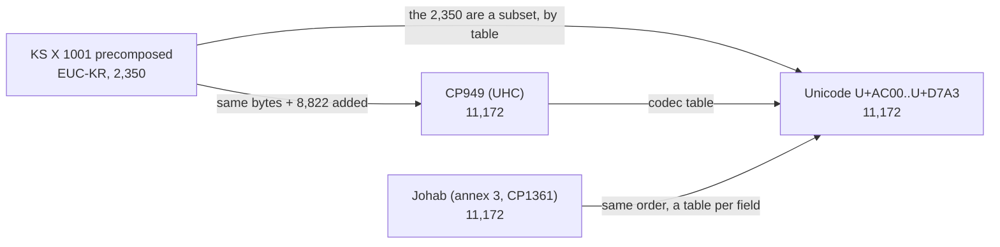

### 1.1.1 EUC-KR and CP949

**EUC (Extended Unix Code)** is a family of multibyte encodings built on ISO 2022's G0–G3 code sets for Unix systems, including EUC-JP, EUC-KR, EUC-CN and EUC-TW. Its multibyte character bytes have the high bit set (normally 0xA1–0xFE), so they do not collide with ASCII or C0 controls [1]. In particular, character bytes contain neither NUL nor the path separator `/`, consistent with the Unix character-set requirements [2]. This helps byte-oriented C strings, shells and terminals distinguish ASCII syntax from text [1].

ISO 2022's primary set is G0; auxiliary sets are G1–G3. EUC uses SS2 (0x8E) and SS3 (0x8F) to invoke G2 and G3 for one character, with the assignment of sets defined by each encoding [1]. EUC-KR places the 94×94 character table of KS C 5601 (now KS X 1001) in G1. It adds 0x80 to each row and cell byte (0x21–0x7E), so row r and cell c become `(0xA0+r, 0xA0+c)`. Hangul syllables occupy only 25 rows (2,350 characters), which is why EUC-KR encodes only those 2,350 precomposed syllables [3][4]. RFC 1557's ISO-2022-KR defines the ASCII/KS X 1001 switching used for mail; it carries the same character repertoire with a different escape-based transport convention [5].

**CP949 (Unified Hangul Code, UHC, or extended Wansung)** is Microsoft's Korean Windows code page, listed as ANSI/OEM Korean [6]. Counting the Hangul entries outside EUC-KR in the CP949 mapping table gives **8,822 extension syllables**, with leads 0x81–0xC6 and trails in 0x41–0x5A, 0x61–0x7A or 0x81–0xFE; the EUC-KR assignments remain unchanged [16]. These trail bytes include ASCII letters, unlike ISO 2022's separation of ASCII and multibyte bytes [1][16]. Retaining the original KS assignments also means CP949 byte order is not syllable order [16]. Johab (Windows code page 1361) is a separate encoding [6][12]. Unicode independently defines the U+AC00..U+D7A3 syllable block [7].

| Bytes/code | Use | Note |
|---|---|---|
| ASCII 0x00–0x7F | ASCII and C0 | no collision with EUC multibyte bytes |
| EUC-KR 0xA1–0xFE × 0xA1–0xFE | KS X 1001 94×94 table | 2,350 Hangul syllables |
| CP949 extension 0x81–0xC6 × (0x41–0x5A, 0x61–0x7A, 0x81–0xFE) | additional 8,822 syllables | outside EUC-KR pairs |
| Johab (CP1361) | composed-form fields | not an ISO 2022/EUC encoding |

### 1.1.2 Unicode and encoding forms

Unicode defines code points U+0000..U+10FFFF. Its 17 planes are numbered 0..16: plane 0 is the BMP (U+0000..U+FFFF), and planes 1..16 are supplementary planes. ISO/IEC 10646 (UCS) standardizes the same characters and code points; Unicode and UCS maintain that repertoire jointly. Planes 15 and 16 contain private-use areas. SVF jamo pieces use private-use code points U+F0000+n in plane 15 as font-specific piece identifiers [9].

Hangul has both models. Precomposed syllables occupy U+AC00..U+D7A3 (11,172), laid out by the arithmetic formula in section 1.3. Modern syllables use an initial and medial, plus an optional final, from Hangul Jamo U+1100..U+11FF: 한 is U+1112 U+1161 U+11AB. Hangul Compatibility Jamo U+3131..U+318E are standalone compatibility letters, as used by KS X 1001; Hangul Jamo Extended-A and Extended-B contain Old Hangul jamo. A modern L·V or L·V·T sequence and its precomposed syllable are canonically equivalent. NFC composes L·V·T and NFD decomposes the syllable [8].

An SVF syllable face is keyed by U+AC00..U+D7A3. A conjoining sequence arriving in UTF-8 must be normalized to NFC or shaped before lookup; otherwise three code points do not select one syllable glyph.

Encoding forms turn code points into bytes. UCS-2 stores only the BMP in 16 bits; UTF-16 uses surrogate pairs for planes 1..16 (U+F0000 therefore needs a pair). UCS-4/UTF-32 stores every code point in 32 bits. UTF-8 uses 1–4 self-synchronizing bytes and remains ASCII-compatible. UTF-16LE/BE and UTF-32LE/BE specify byte order explicitly; the unsuffixed UTF-16 and UTF-32 schemes can use a BOM (U+FEFF) to signal it [9][10].

| Character | EUC-KR | CP949 | Johab | UTF-8 | UTF-16LE | UTF-16BE | UTF-32LE | Cannot represent |
|---|---|---|---|---|---|---|---|---|
| A U+0041 | 41 | 41 | 41 | 41 | 41 00 | 00 41 | 41 00 00 00 | — |
| 한 U+D55C | C7 D1 | C7 D1 | D0 65 | ED 95 9C | 5C D5 | D5 5C | 5C D5 00 00 | — |
| ㄱ U+3131 | A4 A1 | A4 A1 | 88 41 | E3 84 B1 | 31 31 | 31 31 | 31 31 00 00 | — |
| 한 (LVT) U+1112 U+1161 U+11AB | — | — | — | E1 84 92 E1 85 A1 E1 86 AB | 12 11 61 11 AB 11 | 11 12 11 61 11 AB | 12 11 00 00 61 11 00 00 AB 11 00 00 | EUC-KR, CP949, Johab |
| U+F0000 | — | — | — | F3 B0 80 80 | 80 DB 00 DC | DB 80 DC 00 | 00 00 0F 00 | EUC-KR, CP949, Johab |

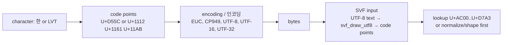

### 1.2 The bit layout of the 16-bit johab code

```
 bit  15 | 14 13 12 11 10 | 9 8 7 6 5   | 4 3 2 1 0
      1  |  initial (5)   | medial (5)  | final (5)
```

| Bits | Width | Meaning | Values |
|---|---:|---|---|
| 15 | 1 | Hangul flag | 1 |
| 14-10 | 5 | initial | 1 = fill (no initial), 2..20 = ㄱ ㄲ ㄴ ㄷ ㄸ ㄹ ㅁ ㅂ ㅃ ㅅ ㅆ ㅇ ㅈ ㅉ ㅊ ㅋ ㅌ ㅍ ㅎ |
| 9-5 | 5 | medial | 2 = fill, 3..7 = ㅏ ㅐ ㅑ ㅒ ㅓ, 10..15 = ㅔ ㅕ ㅖ ㅗ ㅘ ㅙ, 18..23 = ㅚ ㅛ ㅜ ㅝ ㅞ ㅟ, 26..29 = ㅠ ㅡ ㅢ ㅣ |
| 4-0 | 5 | final | 1 = none, 2..17 = ㄱ ㄲ ㄳ ㄴ ㄵ ㄶ ㄷ ㄹ ㄺ ㄻ ㄼ ㄽ ㄾ ㄿ ㅀ ㅁ, 18 = unused, 19..29 = ㅂ ㅄ ㅅ ㅆ ㅇ ㅈ ㅊ ㅋ ㅌ ㅍ ㅎ |

The same layout as blocks; the lower row is 한 (0xD065):

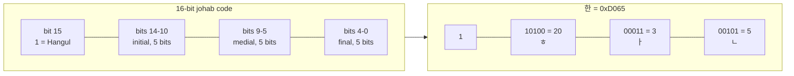

The fill values and gaps are in johab-fonts `notes/msx.md` ("CPC-300 ... jamo-set font": initial 1..20, 1 = fill; medial
2..29, gaps 8, 9, 16, 17, 24, 25; final 1..29, 18 a gap) and `notes/mac.md` ("Format 1": L 2..20, V 3..7, 10..15,
18..23, 26..29, T 1 = none, 2..17, 19..29). The medial values equal `JUNG_FIELD` in [tools/jamoset.py](../tools/jamoset.py). The jamo
assignment of the table was checked by encoding all 11,172 syllables with the Python `johab` codec. The medial values no
modern vowel uses are 0, 1, 2 (fill), 8, 9, 16, 17, 24, 25, 30, 31: split into four groups of eight, the first two of each
group are empty. This describes the field-value pattern.

### 1.3 The Unicode formula and its relation to johab

Unicode lays syllables out by arithmetic ([docs/recipes.md](recipes.md) "Encodings"), with the initial `L` (0..18), medial `V` (0..20)
and final `T` (0..27, 0 = none) counted from 0:

```
U = 0xAC00 + (L x 21 + V) x 28 + T
s = U - 0xAC00;   L = s / 588;   V = (s / 28) % 21;   T = s % 28
```

**Example: 한.** Initial ㅎ = 18, medial ㅏ = 0, final ㄴ = 4.

| Step | Value |
|---|---|
| (L x 21 + V) x 28 + T | (18 x 21 + 0) x 28 + 4 = 10,588 |
| Unicode | 0xAC00 + 10,588 = **U+D55C** |
| Johab | 1 10100 00011 00101 = **0xD065** (initial 20 = ㅎ, medial 3 = ㅏ, final 5 = ㄴ) |
| Precomposed (EUC-KR, CP949) | 0xC7D1 |

The U+AC00 block is one group of 588 (= 21 x 28) per initial; inside it, one row of 28 per medial; inside a row, one
column per final.

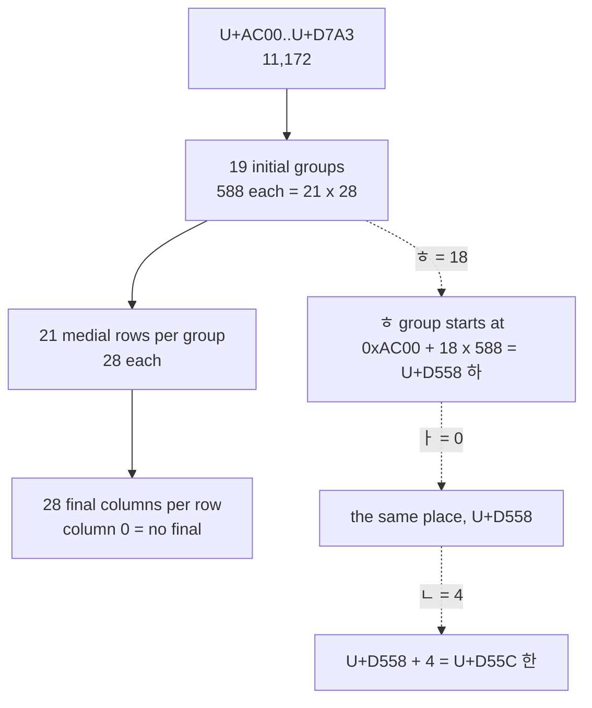

One way to convert a johab code to Unicode is a table per field (the field values have gaps):

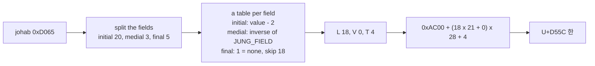

A second example, **쀍** (not in KS): U+C00D, s = 5,133 = (8 x 21 + 15) x 28 + 9 (ㅃ 8, ㅞ 15, ㄺ 9); johab 0xAACA
(initial 10, medial 22, final 10); CP949 0x97CD in the extension area; no EUC-KR code.

Johab and Unicode have **the same order**: encoding the 11,172 syllables in Unicode order gives increasing johab codes
(0x8861 = 가 to 0xD3BD = 힣; checked with the Python codec). A fixed offset does not convert one code to the other: the fields have gaps.
A converter can map each field with tables such as `JUNG_FIELD` in [tools/jamoset.py](../tools/jamoset.py) or equivalent conditional arithmetic.

### 1.4 Why the precomposed set stayed (background)

Korean PC software used johab codes and fonts widely in the 1980s, while the national standard selected a 2,350-syllable precomposed set [12][13][14]. Microsoft preserved that set's byte assignments and added the remaining syllables in CP949; counting its mapping table gives 8,822 additional syllables and 11,172 in total [16].

The timeline shows selected systems and standards; CP949 and the Unicode syllable block appear alongside them as related encodings [12].

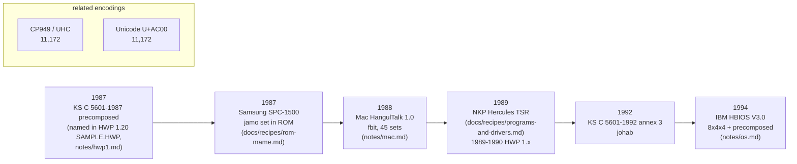

What the research material does show is that, whatever the code, many Korean systems of the 1980s and 1990s drew their
syllables with **johab fonts**. Even Korean MS-DOS 6.22's `HFONT.SYS` holds no syllables, only 1,128 symbols and 4,888
Hanja, with the note "HBIOS.SYS/COM composes Hangul from its own jamo set" (johab-fonts `notes/os.md`).


### 1.4.1 Commercial johab and the KS precomposed-code dispute

Sambo led the open industrial convention called Sambo johab, KSSM or commercial johab [12]. Accounts of the 1980s also distinguish Sambo, Goldstar and Samsung variants [13].

Commercial johab uses a top flag bit of 1 followed by 5-bit initial, medial and final fields. Its fill values are initial 1, medial 2 and final 1 for no final [12]. The 1980s account describes hardware Hangul cards, Bosuk-geul running under NKP and Hangul Dokkaebi II BIOSes, and DOS Hangeul’s Hancom two-byte johab extension [13].

The 1987 KS C 5601 precomposed code was adopted for information interchange in administrative-network workstations and educational PCs; the standard was revised on 1987-08-31 [14]. Its two-byte character table provided a common repertoire including Hanja, but omitted many modern Hangul syllables [14]. The precomposed-versus-composed dispute continued; in 1992, annex 3 of KS C 5601 accepted the commercial composed form [12].

| Period | Event | Sources |
|---|---|---|
| 1980s | Commercial johab and other variants used in PC software and Hangul display systems | [12][13] |
| 1987-08-31 | KS C 5601 precomposed code revised; used for administrative-network interchange | [14] |
| 1987–1991 | Administrative-network mainframes I and II developed | [15] |
| 1992 | KS C 5601 annex 3 accepted a composed form | [12] |
| 1995 onward | Korean Windows 95 dropped commercial johab support | [12] |

## 2. Johab as a font technique: sets

### 2.1 Why pieces: memory

A 16x16 1 bpp glyph is 32 bytes. All 11,172 syllables drawn whole take 357,504 bytes; the KS 2,350 alone 75,200. An 8x4x4
johab font is **360 pieces x 32 bytes = 11,520 bytes** (`notes/dos.md` "Format findings": "11520 B = 8x4x4 (360*32)
16x16") and draws all 11,172. The other sizes of the same note:

| Cell | 8x4x4 piece file | 2,350 precomposed (computed) | 11,172 precomposed (computed) |
|---|---:|---:|---:|
| 16x16 | 11,520 | 75,200 | 357,504 |
| 24x24 | 25,920 | 169,200 | 804,384 |
| 40x40 | 72,000 | 470,000 | 2,234,400 |
| 48x48 | 103,680 | 676,800 | 3,217,536 |

The piece file sizes are in `notes/dos.md`; the precomposed columns are syllables x cell bytes. SVF shows the same thing:
the precomposed Neo Dunggeunmo `NEODG16.SVF` is 133,720 bytes (2,905 glyphs: 95 ASCII, 2,803 KS X 1001
characters, and 7 syllables outside KS, 갷 닏 떄 섥 슺 텊 햝; the KS characters include U+212B Å of KS row A1, which the
source TTF lacks: `tools/build/faces.tsv`), while the iolo SANS8J 8x4x4 jamo set `SANS8J.SVF` is **15,740 bytes** (439 glyphs, 344 pieces) and
draws all 11,172 (read with `jamoset.parse_svfn`, as `tools/doc_figures_jamo.py` does).

### 2.1.1 IoU: composition quality

For 1 bpp cells, IoU (intersection over union) is `|A ∩ B| / |A ∪ B|` over inked pixels in composed syllable A and the font's own precomposed glyph B. `tools/jamofit.py`'s `iou()` returns 1.0 when both are blank. In the example below, intersection 2 and union 5 give IoU = 2/5 = 0.4.

```
A  ##..    B  .##.
   .#..       .##.
intersection 2, union 5 → IoU = 2/5 = 0.4
```

`quality_report()` averages IoU over syllables; `exact` counts identical cells (IoU 1.0). In `svf/jamo-extra/FACES.TSV`, `ks2350` covers the KS 2,350, `all` every syllable the font draws, `freq` weights by corpus frequency, and `top500` averages the 500 most frequent syllables. For 2 bpp, `tools/jamoaa.py`'s `aa_quality()` reports the raw mean absolute level difference (0..3); `maker/quality.py` divides it by 3 for the FACES.TSV quality score (0 is best). IoU ignores blank-cell area and penalizes both missing and extra ink. A one-pixel stroke shift can cost heavily at 16 px, and the metric does not measure legibility.

### 2.2 Sets: a jamo's shape depends on where it sits

The ㄱ of 가 is tall on the left, the ㄱ of 고 wide on top, and the ㄱ of 각 shorter, making room for the final. A johab font
draws each jamo several times, once per position; one bundle of variants is a **set** (벌; see the [glossary](../spec/SVF.md#term-set)). "8x4x4" means 8 initial sets,
4 medial sets and 4 final sets. For each syllable the set of every jamo is chosen from the other jamo:

- the **initial's set** from the medial's shape (vertical, horizontal or compound vowel) and whether there is a final;
- the **medial's set** from whether the initial is ㄱ/ㅋ and whether there is a final;
- the **final's set** from the medial's shape.

The syllable is the **OR** (1 bpp) of the two or three chosen pieces in one cell. Each piece is stored at full cell size,
already drawn at its place, so nothing is moved.

How a DOS Hangul driver draws one character, following the Dokkaebi driver source (`han_disp` in `DKBB.ASM`, johab-fonts
`notes/hanme-dokkaebi.md` section 2). Other drivers (NKP, HWP 1.x, MSX Hangul BASIC) take the same steps with differently
shaped tables (chapter 3).

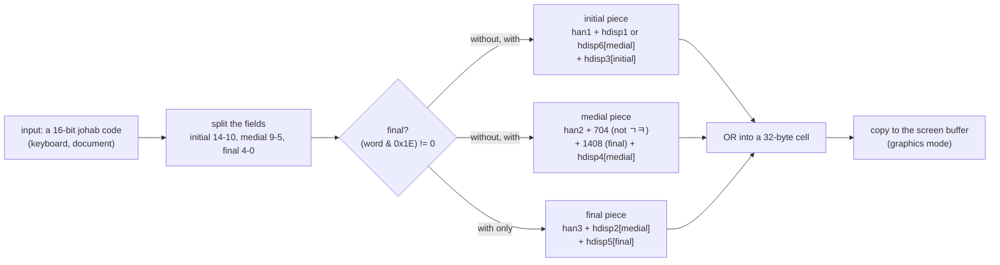

One set is 640 bytes of initials (20 x 32), 704 of medials (22 x 32), 896 of finals (28 x 32) (the same note). The composed cell is then ready to copy into a graphics-mode screen buffer.

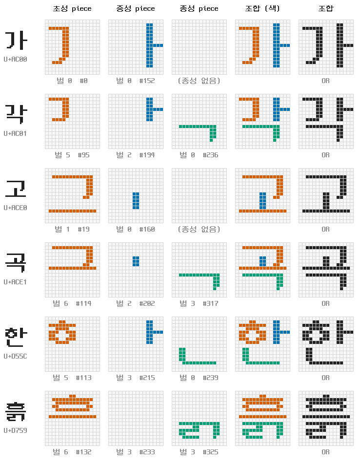

*Figure 1. Pieces and composition in SANS8J. "벌 n #p" is the piece's set and its SVF piece number (chapter 4). The ㄱ of
가 and 각 (sets 0 and 5) and of 고 and 곡 (sets 1 and 6) changes with the final; the ㅗ of 고 and 곡 is a different piece
too (medial sets 0 and 2: without and with a final). The medial ㅡ pieces are non-empty in this converted face. Column headings: 초성 = initial, 중성 = medial, 종성 = final, 조합 (색) =
composed (in colour), 조합 = composed; "벌 n" = set n, "(종성 없음)" = no final.*

One 16x16 cell split into its pieces (SANS8J's 한: `I` initial 조각 113, `M` medial piece 215, `F` final piece 239,
`.` blank; no pixel is shared):

```
     0123456789abcdef
  0  ................
  1  ....II.....MM...
  2  .IIIIIIII..MM...
  3  ...IIII....MM...
  4  .III..III..MMMMM
  5  .II....II..MM...
  6  .III..III..MM...
  7  ...IIII....MM...
  8  ................
  9  ..FF............
 10  ..FF............
 11  ..FF............
 12  ..FF............
 13  ..FFFFFFFFFFF...
 14  ................
 15  ................
```

### 2.3 The selection rule of 8x4x4

The rule of the DOS 8x4x4 file (`HANGUL.FNT` and its kin, 11,520 bytes) is in [tools/jamoset.py](../tools/jamoset.py): the tables `I844_NOFIN`,
`I844_FIN`, `F844` and `KK` (lines 72-77) and the `_844` layout (line 350). The same rule, read from the Dokkaebi driver
source, is in johab-fonts `notes/hanme-dokkaebi.md` section 2 (`han_disp`). Medials are in Unicode order (ㅏ = 0 .. ㅣ = 20).

| Medial | ㅏ | ㅐ | ㅑ | ㅒ | ㅓ | ㅔ | ㅕ | ㅖ | ㅗ | ㅘ | ㅙ | ㅚ | ㅛ | ㅜ | ㅝ | ㅞ | ㅟ | ㅠ | ㅡ | ㅢ | ㅣ |
|---|---|---|---|---|---|---|---|---|---|---|---|---|---|---|---|---|---|---|---|---|---|
| initial set, no final (`I844_NOFIN`) | 0 | 0 | 0 | 0 | 0 | 0 | 0 | 0 | 1 | 3 | 3 | 3 | 1 | 2 | 4 | 4 | 4 | 2 | 1 | 3 | 0 |
| initial set, final (`I844_FIN`) | 5 | 5 | 5 | 5 | 5 | 5 | 5 | 5 | 6 | 7 | 7 | 7 | 6 | 6 | 7 | 7 | 7 | 6 | 6 | 7 | 5 |
| final set (`F844`) | 0 | 2 | 0 | 2 | 1 | 2 | 1 | 2 | 3 | 0 | 2 | 1 | 3 | 3 | 1 | 2 | 1 | 3 | 3 | 1 | 1 |

The same rule by set:

| Jamo | Set | Used for | Example |
|---|---:|---|---|
| initial | 0 | no final, vertical vowels ㅏ ㅐ ㅑ ㅒ ㅓ ㅔ ㅕ ㅖ ㅣ | 가 |
| initial | 1 | no final, ㅗ ㅛ ㅡ | 고 |
| initial | 2 | no final, ㅜ ㅠ | 구 |
| initial | 3 | no final, ㅘ ㅙ ㅚ ㅢ | 과 |
| initial | 4 | no final, ㅝ ㅞ ㅟ | 궈 |
| initial | 5 | final, vertical vowels | 각 |
| initial | 6 | final, ㅗ ㅛ ㅜ ㅠ ㅡ | 곡 |
| initial | 7 | final, compound vowels ㅘ ㅙ ㅚ ㅝ ㅞ ㅟ ㅢ | 곽 |
| medial | 0 | no final, initial ㄱ or ㅋ | 가 |
| medial | 1 | no final, any other initial | 나 |
| medial | 2 | final, initial ㄱ or ㅋ | 각 |
| medial | 3 | final, any other initial | 낙 |
| final | 0 | ㅏ ㅑ ㅘ | 악 |
| final | 1 | ㅓ ㅕ ㅚ ㅝ ㅟ ㅢ ㅣ | 억 |
| final | 2 | ㅐ ㅒ ㅔ ㅖ ㅙ ㅞ | 액 |
| final | 3 | ㅗ ㅛ ㅜ ㅠ ㅡ | 옥 |

The same rule as decision trees (initial, medial, final set):

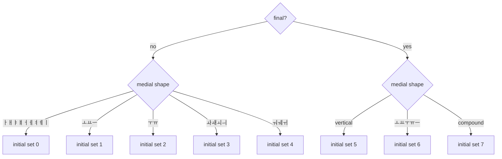

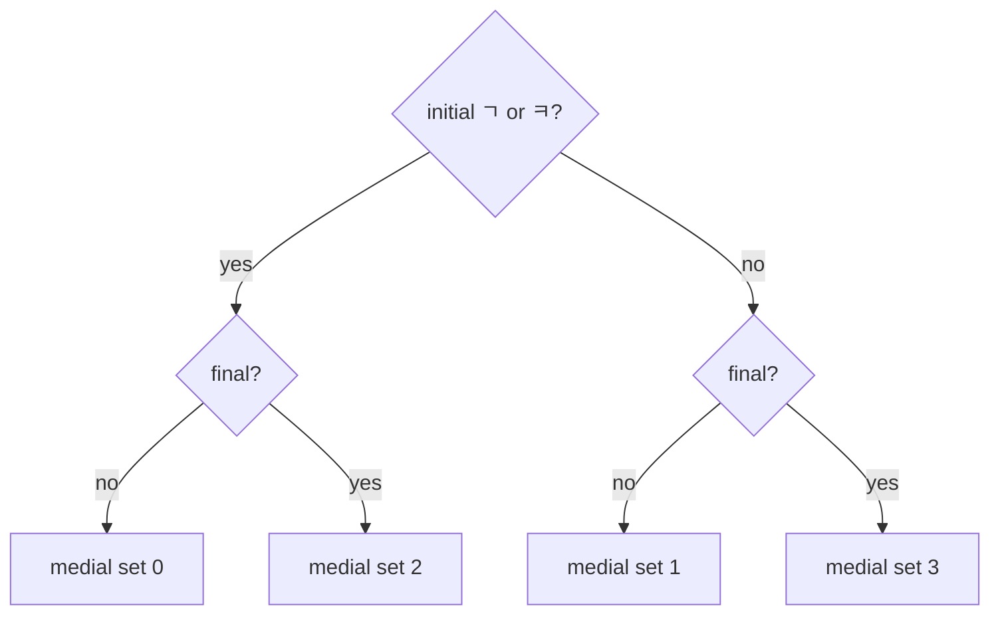

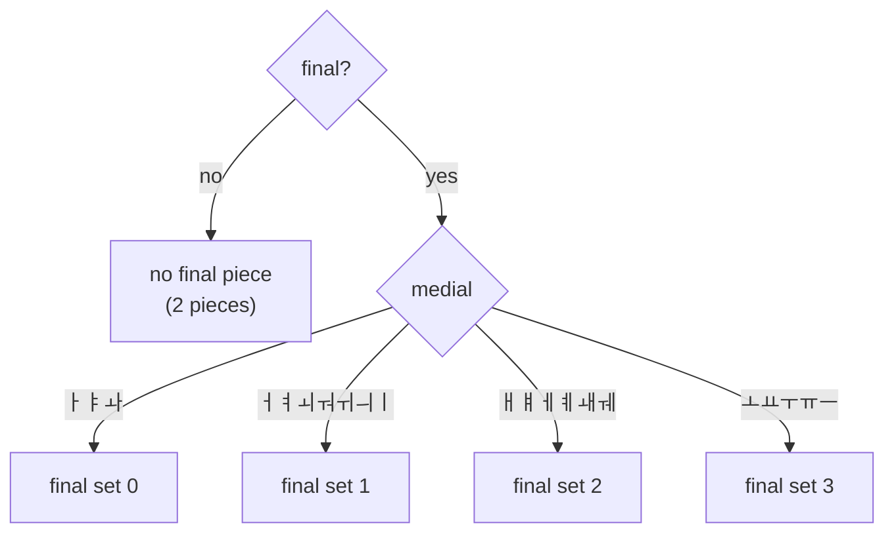

"ㄱ or ㅋ" is `KK = (0, 15)`; as its comment says, "gg is NOT in the group" (ㄲ is not). `tools/doc_figures_jamo.py` checks,
while drawing figure 2, that each example syllable really uses that set in SANS8J's tables.

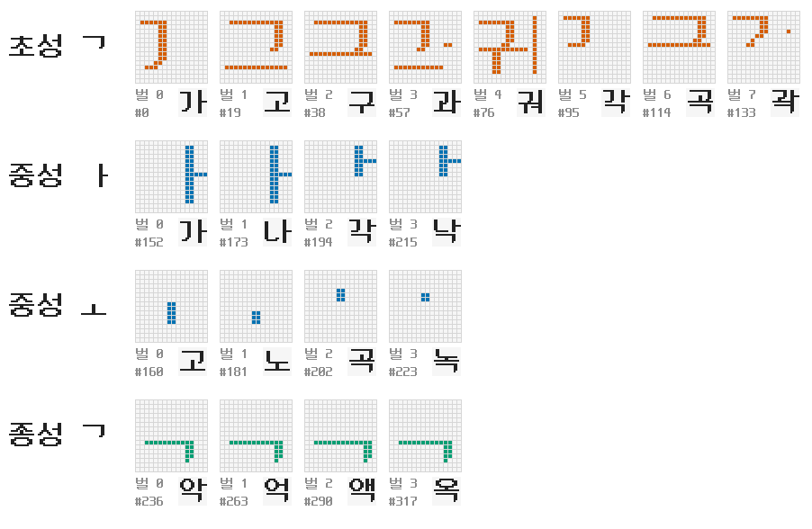

*Figure 2. SANS8J's sets. The initial ㄱ has 7 distinct bitmaps across 8 sets. The medial ㅏ is shorter with a final (sets 2, 3); in this
font ㅏ has the same bitmap after ㄱ/ㅋ (sets 0, 2) as after the others (1, 3), and ㅗ does not. The final ㄱ has the same
bitmap in sets 1 and 3. Labels: 초성 = initial, 중성 = medial, 종성 = final, 벌 = set. Equal bitmaps still have their own
piece numbers: of the 344 pieces, 283 bitmaps are distinct
(compared through `jamoset.unpack`).*

Inside the 8x4x4 file (`notes/hanme-dokkaebi.md` section 2, [docs/recipes/dos-fonts.md](recipes/dos-fonts.md#other-dos-era-korean-fonts) "Other DOS-era Korean fonts"): 360 slots,
slot 0 of every set blank.

```
slot  0          20         40   ...  140        160        182  ...  226        248        276  ...  332       359
      | init set 0 | init set 1 | ... | init set 7 | med set 0  | ... | med set 3  | fin set 0  | ... | fin set 3 |
      | 20 slots   | 20 slots   |     | 20 slots   | 22 slots   |     | 22 slots   | 28 slots   |     | 28 slots  |
initial = s x 20 + L + 1     medial = 160 + s x 22 + V + 1     final = 248 + s x 28 + T      (tools/jamoset.py _844)
```

### 2.4 Set systems compared

| System | Initial / medial / final sets | Pieces (file slots) | File bytes | What selects | Source |
|---|---|---:|---:|---|---|
| 8x4x4 (DOS raw `HANGUL.FNT`, Taebaek `GOTHIC16.FNT`, Dokkaebi `DKBBG`, HBIOS `$KGOZN16`) | 8 / 4 / 4 | 360 | 11,520 (16 px) | initial: 5 vowel kinds (no final) or 3 (final); medial: ㄱㅋ x final; final: 4 vowel kinds | `notes/dos.md`, `notes/hanme-dokkaebi.md` 2, `jamoset.py` `_844` |
| 8x4x4 IHNM | 8 / 4 / 4 | 360 | 11,520 | medial sets of ㄱㅋ swapped | [docs/recipes/dos-fonts.md](recipes/dos-fonts.md#other-dos-era-korean-fonts) `844-ihnm` |
| 10x4x4 (san 1.0) | 10 / 4 / 4 | 400 | 12,800 | initial: the 5 no-final sets kept apart with a final too | `notes/dos.md`, `jamoset.py` `_san1044` |
| 6x2x1 (Apple II era) | 6 / 2 / 1 | 192 | 6,144 | initial: 3 vowel kinds (vertical, horizontal, compound) x final; medial: final; one final set | `notes/apple2.md`, `jamoset.py` `_621` |
| hanterm johab | 10 / (3 or 4) / 4 | 529 glyphs | BDF | three tail classes (none, ㄴ, other) | [docs/recipes/bitmap-fonts.md](recipes/bitmap-fonts.md#hanterm) "hanterm", `jamoset.py` `_hanterm` |
| Dokkaebi printer 16/24 px | 7 / 2 / 2 | 240 (one face) | 15,360 (two faces) | initial: vowel x final | `notes/hanme-dokkaebi.md` 3 |
| Dokkaebi printer 40/48 px | 12 / 4 / 4 | 440 (one face) | 176,000 (40 px) and 253,440 (48 px), each file two faces | | the same |
| Hanme Hangul 3.11 `HANME.FNT` | 5 / 2 / 3 | 218 | 6,976 (one face) | initial: 5 vowel kinds; medial: final; final: 3 vowel kinds | `notes/hanme-dokkaebi.md` 1 |
| Kyrandia `MK15.BIT` | 10 / 4 / 4 (jamo-major order) | 385 | 11,550 (15x15) | the 8x4x4 rule, initial set = 2 x vowel kind + final | [docs/recipes/dos-fonts.md](recipes/dos-fonts.md#other-dos-era-korean-fonts) `kyra-lok`, `jamoset.py` `_kyra` |
| HWP 1.x `HANGUL.SFT` | 10/4/4, 7/2/2, 6/2/2 (per face) | 1,193 (three faces) | | initial class (ㄱㅋ / other), final, 15 vowel shape classes | `notes/hwp1.md` |
| Daewoo MSX CPC-300 | 6 / 2 / 2 | 234 (210 used) | 9,280 (in the SUB-ROM) | initial: 3 vowel kinds x final; final: vowel | [docs/recipes/rom-msx.md](recipes/rom-msx.md#korean-msx-fonts-msx2-and-msx1) "Korean MSX fonts" |
| Samsung SPC-1500 | 6 / 2 / 2 (8 initial sets in ROM) | 210 | four ROMs | initial: 3 vowel kinds x final | [docs/recipes/rom-mame.md](recipes/rom-mame.md#samsung-spc-1500-a-jamo-set-in-four-inverted-roms-exact) "Samsung SPC-1500" |
| NKP (Hercules TSR) | 8 / 2 (each cut in four by shape) / 1 | cropped pieces | | initial: 4 vowel kinds x final | [docs/recipes/programs-and-drivers.md](recipes/programs-and-drivers.md#nkp-a-hercules-hangul-tsr-with-cropped-pieces) "NKP: a Hercules Hangul TSR with cropped pieces" |
| Mac HangulTalk 1.0 `fbit` | 45 glyph sets; as SVF 20 / 15 / 4 in 8 x 4 classes | 688 (12 px) | | the 18 tables of the 'fdef' code | `notes/mac.md` "Format 1", [docs/recipes/classic-mac.md](recipes/classic-mac.md#classic-mac-korean-bitmap-fonts) "Classic Mac Korean bitmap fonts" |
| Mac HangulTalk 7.1.x `fbit` type 3 | no rule: a table entry per syllable | 482 (2 banks x 241) | 8,760 (`fbit`) | a 4-byte entry per KS syllable | `notes/mac.md` "HangulTalk 7.1.x" |

The same number of sets does not mean the same rule. NKP splits the with-final initials into 4 vowel shapes where 8x4x4
has 3, so an NKP font fitted to 8x4x4 reaches IoU 0.998 only ([docs/recipes/programs-and-drivers.md](recipes/programs-and-drivers.md#nkp-a-hercules-hangul-tsr-with-cropped-pieces) "NKP: a Hercules Hangul TSR with cropped
pieces"). The SPC-1500 splits the no-final initials into 3 vowel shapes where 8x4x4 has 5; its precomposed face fitted to
8x4x4 reaches IoU 0.987 (the same document, "Samsung SPC-1500"). That is why SVF's JSET is made to hold any of these
systems by its own rule (chapter 4).

## 3. Real systems: what the research read

### 3.1 DOS Hangul programs and games

- **Raw 8x4x4 files** are 360 x 32 bytes with no header. The tools here know them by size: 11,520 bytes (11,522 with a
  2-byte header), and 25,920 / 72,000 / 103,680 bytes at 24 / 40 / 48 px ([docs/recipes/dos-fonts.md](recipes/dos-fonts.md#other-dos-era-korean-fonts) "Other DOS-era Korean
  fonts"). Most Korean indie DOS games use the same 11,520-byte 8x4x4 (`notes/games.md`).
- **HWP 3.0 for DOS**: `HAN16_*.FNT` holds the 2,350 precomposed syllables followed by a 360-glyph 8x4x4 jamo set; the
  24/40/96 px files are precomposed only (`notes/printer.md` 1).
- **IBM PC DOS HBIOS V3.0**: `$KGOZN16`/`$KMYZN16` are 360 x 32-byte 8x4x4 sets; `$KMYZN24` is a 360-piece set plus the
  2,350 precomposed syllables (`notes/os.md`).
- **Dokkaebi**: `DKBBG.FNT` (15,584 bytes) is an 11,520-byte 8x4x4 set plus 127 symbols, and the driver `DKBB.COM` holds
  the same bytes at offset 96 (`notes/hanme-dokkaebi.md` section 2). Driver analysis finds the font inside the driver and
  makes a jamo set of it ([docs/recipes/programs-and-drivers.md](recipes/programs-and-drivers.md#dokkaebi-the-font-inside-the-driver) "Dokkaebi: the font inside the driver"). The DKB3 form (912 glyphs) stores the
  initial+medial pairs precomposed and ORs only the final: fewer overlays, more glyphs (the same note, 2.1).
- **NKP** (a Hercules TSR, 1989) stores only the rows a piece needs, not the full cell, saving bytes; each piece record
  says from which cell byte it is drawn ([docs/recipes/programs-and-drivers.md](recipes/programs-and-drivers.md#nkp-a-hercules-hangul-tsr-with-cropped-pieces) "NKP: a Hercules Hangul TSR with cropped pieces").

### 3.2 Hangul cards and VGA BIOS ROMs

The three Korean VGA cards of the 86Box ROM set (Trigem, Kasan, ATI) each have a 512 KB KS C 5601 font ROM of 16,384
32-byte slots, a 128 x 128 grid: **a precomposed grid**, not a johab font; 가 is slot 0x1821 ([docs/recipes/rom-86box.md](recipes/rom-86box.md#korean-vga-font-roms-86box) "Korean VGA
font ROMs (86Box)"). The tools can fit an 8x4x4 jamo set to that precomposed face, but many syllables are not drawn
as an OR of pieces, and the IoU stays at 0.968 / 0.872 / 0.919. Korean MS-DOS 6.22 is the opposite case: its font file
`HFONT.SYS` has no syllables and HBIOS composes them from its own jamo set (section 1.4).

### 3.3 Mac: rules (HangulTalk 1.0) and a table (HangulTalk 7.1.x)

- **HangulTalk 1.0** (System 4.1) `fbit` fonts (Gotic12, Munjo12/16/24) hold 45 glyph sets; the composition rule is the
  18 selection tables of the 68k 'fdef' driver (`notes/mac.md` "Format 1"). That is a rule. The project's
  `--layout mac-fbit-45sets` moves it into a JSET as it is: Munjo24 gives 653 pieces, 8 lead x 4 tail classes, 20/15/4
  sets, 36,660 bytes, and all 11,172 syllables equal that rule ([docs/recipes/classic-mac.md](recipes/classic-mac.md#classic-mac-korean-bitmap-fonts) "Classic Mac Korean bitmap fonts").
- **HangulTalk 7.1.x** Seoul12, AppleGothic12/24 and AppleMyungjo12/24 are `fbit` type 3: 482 glyphs (2 banks x 241) and
  **no rule**. `InputBackSupport`'s 'HTBL' 1 resource has a 4-byte entry `[bank][g1][g2][g3]` for each of the 2,350 KS
  syllables (`notes/mac.md` "HangulTalk 7.1.x"), so the 8,822 syllables outside KS cannot be composed with these fonts.
  Read back from the table, the sets are 13 initial sets (vowel kind x final, trimmed to the initials KS uses), 3 final
  sets, and medials split finer by initial group and final width; 473 of the 482 slots are used. The note calls it "not
  an 8/4/4 or HangulTalk 1.0 45-set layout". Section 6.4 compares the two ways this font was put into SVF.

The two generations side by side: 1.0 takes a johab code and picks sets by rule tables; 7.1.x takes a precomposed code and
reads the syllable's fixed entry (`notes/mac.md` "Format 1" and "HangulTalk 7.1.x").

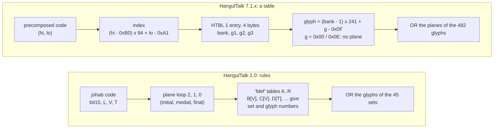

The 7.1.x table has entries for the KS 2,350 and the 51 compatibility jamo only; any other syllable has no index at all and
cannot be composed.

### 3.4 Others

- **Samsung SPC-1500** (1987, MAME `spc1500`): initial, medial and final pieces in three ROMs; the MAME driver **ANDs** the
  three pieces, the ROMs being inverted (0 bits are ink). The sets used are 6 initial, 2 medial and 2 final, and one JSET
  (one lead class, 6/2/2 sets) expresses the rule exactly: 10,652 bytes, 210 pieces, all 11,172 syllables equal to MAME's
  AND ([docs/recipes/rom-mame.md](recipes/rom-mame.md#samsung-spc-1500-a-jamo-set-in-four-inverted-roms-exact) "Samsung SPC-1500").
- **Daewoo MSX CPC-300/400S**: the upper 16 KB of the MSX2 SUB-ROM hold 6 initial sets x 20, 2 medial sets x 28 and
  2 final sets x 29 pieces, the selection read from the Hangul BASIC ROM routine 4DC4h. The compose spec
  `tools/specs/msx2-daewoo.json` holds the rule and one JSET (one lead class, 6/2/2 sets) expresses it exactly: 10,584
  bytes, 210 pieces ([docs/recipes/rom-msx.md](recipes/rom-msx.md#korean-msx-fonts-msx2-and-msx1) "Korean MSX fonts"). The CPC-400S also
  has a 256 KB precomposed font ROM, and the Korean MSX1 machines compose syllables from 8x8 BIOS cells by a layout rule
  read off the running machine (the same section).
- **OS/2 Warp 4 Korean** system DBCS fonts hold the precomposed set (all of KS X 1001), compressed with a Huffman code and
  a prediction (`notes/os2-dbcs.md`); the tools decode them into a precomposed face and fits jamo sets to it
  ([docs/recipes/os2.md](recipes/os2.md#os2-korean-fonts-완성형-to-a-precomposed-face-and-a-jamo-set) "OS/2 Korean fonts (완성형) to a precomposed face and a jamo set").

## 4. Jamo sets in SVF: JSET version 1

### 4.1 The model

SVF holds every one of these systems in one format by turning the system's rule into tables ([spec/SVF.md](../spec/SVF.md) "Jamo-set
fonts"). There are three:

1. **Classes.** The 19 initials are grouped into LC lead classes and the 28 finals (none included) into TC tail classes.
   8x4x4 has two lead classes ({ㄱ, ㅋ} and the rest) and two tail classes (no final, a final).
2. **Set tables.** Each cell (lead class, medial, tail class) holds one initial, one medial and one final set number; the
   cell's number is `(leadClass x 21 + vowel) x TC + tailClass`. A rule "the medial and the final choose the initial's set"
   is the table written out.
3. **Piece tables.** Each (set, jamo) holds a piece number. A piece is the glyph at code point **U+F0000 + piece number**
   (plane 15, private use), so pieces are stored and looked up like any glyph. 0xFFFF is a blank piece.

A syllable is composed by the **maximum coverage** of its pieces: the OR at 1 bpp, the same rule at 2 and 8 bpp (per
2-bit level, not the OR of the bytes, which would turn levels 1 and 2 into 3: [Anti-aliasing, section
3](anti-aliasing.md#3-jamo-sets-the-maximum-not-or-at-levels) shows it on real syllables). A
compatibility jamo U+3131..U+3163 (51) is drawn from the one piece its `compatPiece` names.

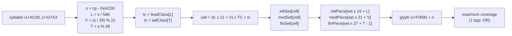

### 4.2 Block layout

The JSET block is where the SVFN header's bytes 36 (offset) and 40 (size) say; header flag bit 1 (0x2) announces it. All
values are little-endian ([spec/SVF.md](../spec/SVF.md) "Jamo-set fonts").

Where the JSET sits in a whole SVFN file. The header's offset fields point at each table; their order may differ between
files. The numbers in brackets are SANS8J's (15,740 bytes; [spec/SVF.md](../spec/SVF.md) "Cells, layout bytes and reserved bytes"; the
header read with `HEADER3` of `jamoset.py`).

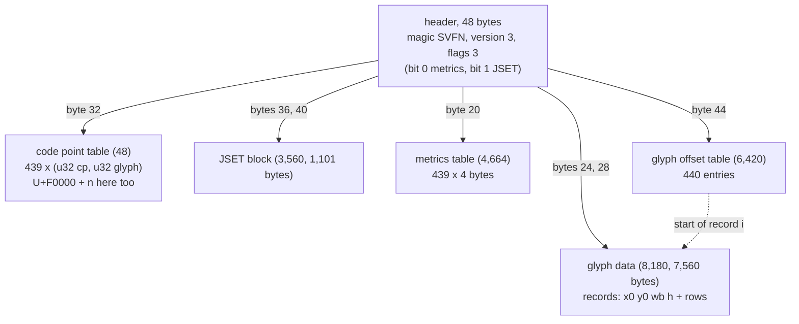

The field order inside the block (version 1):

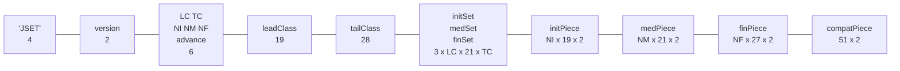

| Field | Bytes | Meaning | Limit (standard; BIG) |
|---|---|---|---|
| `"JSET"` | 4 | magic | |
| version | 2 | 1 | |
| LC | 1 | lead classes | 1..12; 1..19 |
| TC | 1 | tail classes | 1..12; 1..28 |
| NI | 1 | initial sets | 1..32; 1..128 |
| NM | 1 | medial sets | 1..24; 1..128 |
| NF | 1 | final sets | 1..16; 1..64 |
| advance | 1 | syllable advance (px), 0 = the cell width | |
| leadClass[19] | 19 | class of each initial ㄱ..ㅎ | < LC |
| tailClass[28] | 28 | class of each final (0 = none) | < TC |
| initSet | LC x 21 x TC | initial set per cell | < NI |
| medSet | LC x 21 x TC | medial set per cell | < NM |
| finSet | LC x 21 x TC | final set per cell (read only with a final) | < NF |
| initPiece | NI x 19 x u16 | piece per (set, initial) | 0xFFFF = blank |
| medPiece | NM x 21 x u16 | piece per (set, medial) | |
| finPiece | NF x 27 x u16 | piece per (set, final 1..27) | |
| compatPiece | 51 x u16 | piece of U+3131..U+3163 | 0xFFFF = not by piece |

The size is `12 + 19 + 28 + 3 x LC x 21 x TC + 2 x (NI x 19 + NM x 21 + NF x 27 + 51)` bytes ([spec/SVF.md](../spec/SVF.md)). Some values
(computed by the formula and checked against real faces):

| System | LC x TC | NI / NM / NF | v1 block | Real face |
|---|---|---|---:|---|
| 6x2x1 | 1 x 2 | 6 / 2 / 1 | 653 | JSET of `svf/dos/NEODG16G.SVF`: 653 |
| 8x4x4 | 2 x 2 | 8 / 4 / 4 | 1,101 | JSET of `svf/iolo/SANS8J.SVF`: 1,101 |
| SEOUL12J (section 6.4) | 8 x 4 | 9 / 6 / 3 | 2,933 | 2,933 |
| 8 x 8, 24/16/16 | 8 x 8 | 24 / 16 / 16 | 6,641 | `svf/jamo-extra/SGDAY16.SVF`: 6,641 |
| 12 x 12, 24/16/16 | 12 x 12 | 24 / 16 / 16 | 11,681 | `svf/jamo-extra/GOTHA16.SVF` and others: 11,681 |
| standard maximum | 12 x 12 | 32 / 24 / 16 | 12,321 | (the maximum of [spec/SVF.md](../spec/SVF.md)) |
| BIG maximum | 19 x 28 | 128 / 128 / 64 | 47,373 | (the same) |

The real-face column comes from reading every face of `svf/dos` and `svf/jamo-extra` with `jamoset.unpack`. Every jamo
face of `svf/` is version 1 ([spec/SVF.md](../spec/SVF.md) "When to use version 2").

### 4.3 Following one syllable through a real face: 한 in SANS8J

`svf/iolo/SANS8J.SVF` (15,740 bytes, 16x16 1 bpp, 439 glyphs) has its JSET block at file offset 3,560, 1,101 bytes long,
read with `parse_svfn` and `unpack` of [tools/jamoset.py](../tools/jamoset.py) (`python3 -I`).

**First 12 bytes:** `4a 53 45 54 | 01 00 | 02 | 02 | 08 | 04 | 04 | 00` = "JSET", version 1, LC 2, TC 2, NI 8, NM 4, NF 4,
advance 0 (use the 16-pixel cell width).

**Offsets inside the block** (from the layout): leadClass 12, tailClass 31, initSet 59, medSet 143, finSet 227 (each
2 x 21 x 2 = 84 bytes), initPiece 311 (8 x 19 x 2 = 304), medPiece 615 (168), finPiece 783 (216), compatPiece 999 (102),
end 1,101.

**Class tables:**

```
leadClass  ㄱ ㄲ ㄴ ㄷ ㄸ ㄹ ㅁ ㅂ ㅃ ㅅ ㅆ ㅇ ㅈ ㅉ ㅊ ㅋ ㅌ ㅍ ㅎ
            0  1  1  1  1  1  1  1  1  1  1  1  1  1  1  0  1  1  1
tailClass  none = 0, the other 27 = 1
```

**Set tables** (across: medial ㅏ..ㅣ; cell numbers by the formula of 4.1):

| Row (lc, tc) | Table | ㅏ | ㅐ | ㅑ | ㅒ | ㅓ | ㅔ | ㅕ | ㅖ | ㅗ | ㅘ | ㅙ | ㅚ | ㅛ | ㅜ | ㅝ | ㅞ | ㅟ | ㅠ | ㅡ | ㅢ | ㅣ |
|---|---|---|---|---|---|---|---|---|---|---|---|---|---|---|---|---|---|---|---|---|---|---|
| lc0 tc0 (ㄱㅋ, no final) | init | 0 | 0 | 0 | 0 | 0 | 0 | 0 | 0 | 1 | 3 | 3 | 3 | 1 | 2 | 4 | 4 | 4 | 2 | 1 | 3 | 0 |
| | med | 0 | 0 | 0 | 0 | 0 | 0 | 0 | 0 | 0 | 0 | 0 | 0 | 0 | 0 | 0 | 0 | 0 | 0 | 0 | 0 | 0 |
| lc0 tc1 (ㄱㅋ, final) | init | 5 | 5 | 5 | 5 | 5 | 5 | 5 | 5 | 6 | 7 | 7 | 7 | 6 | 6 | 7 | 7 | 7 | 6 | 6 | 7 | 5 |
| | med | 2 | 2 | 2 | 2 | 2 | 2 | 2 | 2 | 2 | 2 | 2 | 2 | 2 | 2 | 2 | 2 | 2 | 2 | 2 | 2 | 2 |
| | fin | 0 | 2 | 0 | 2 | 1 | 2 | 1 | 2 | 3 | 0 | 2 | 1 | 3 | 3 | 1 | 2 | 1 | 3 | 3 | 1 | 1 |
| lc1 tc0 (other, no final) | init | 0 | 0 | 0 | 0 | 0 | 0 | 0 | 0 | 1 | 3 | 3 | 3 | 1 | 2 | 4 | 4 | 4 | 2 | 1 | 3 | 0 |
| | med | 1 | 1 | 1 | 1 | 1 | 1 | 1 | 1 | 1 | 1 | 1 | 1 | 1 | 1 | 1 | 1 | 1 | 1 | 1 | 1 | 1 |
| lc1 tc1 (other, final) | init | 5 | 5 | 5 | 5 | 5 | 5 | 5 | 5 | 6 | 7 | 7 | 7 | 6 | 6 | 7 | 7 | 7 | 6 | 6 | 7 | 5 |
| | med | 3 | 3 | 3 | 3 | 3 | 3 | 3 | 3 | 3 | 3 | 3 | 3 | 3 | 3 | 3 | 3 | 3 | 3 | 3 | 3 | 3 |
| | fin | 0 | 2 | 0 | 2 | 1 | 2 | 1 | 2 | 3 | 0 | 2 | 1 | 3 | 3 | 1 | 2 | 1 | 3 | 3 | 1 | 1 |

The fin rows of the no-final classes (tc0) are all 0 and never read, so they are left out. The table is the 8x4x4 rule
of section 2.3 written out.

**The piece tables** are simple in this face: initial set s, jamo L is piece `19s + L` (0..151); medial `152 + 21s + V` (152..235); final `236 + 27s + T - 1` (236..343). None of the 344 piece-table slots is the blank sentinel 0xFFFF, and all four medial ㅡ pieces (170, 191, 212, 233) are non-empty in this converted face. compatPiece names the first set, e.g. ㄱ -> 0, ㄳ -> 238 (final set 0), ㅏ -> 152.

**Following 한 (U+D55C):**

| Step | Computation | Value | Block offset (file offset) |
|---|---|---|---|
| 1. decompose | s = 0xD55C - 0xAC00 = 10,588 | L = 18 (ㅎ), V = 0 (ㅏ), T = 4 (ㄴ) | |
| 2. classes | leadClass[18], tailClass[4] | lc = 1, tc = 1 | 30 (3,590), 35 (3,595) |
| 3. cell | (1 x 21 + 0) x 2 + 1 | cell = 43 | |
| 4. sets | initSet[43], medSet[43], finSet[43] | 5, 3, 0 | 102 (3,662), 186 (3,746), 270 (3,830) |
| 5. pieces | initPiece[5 x 19 + 18 = 113], medPiece[3 x 21 + 0 = 63], finPiece[0 x 27 + 4 - 1 = 3] | 113, 215, 239 | 537 (4,097), 741 (4,301), 789 (4,349) |
| 6. glyphs | U+F0000 + n | U+F0071, U+F00D7, U+F00EF | looked up in the code point table |
| 7. compose | OR of the three cells | the 16x16 picture of 2.2 | |

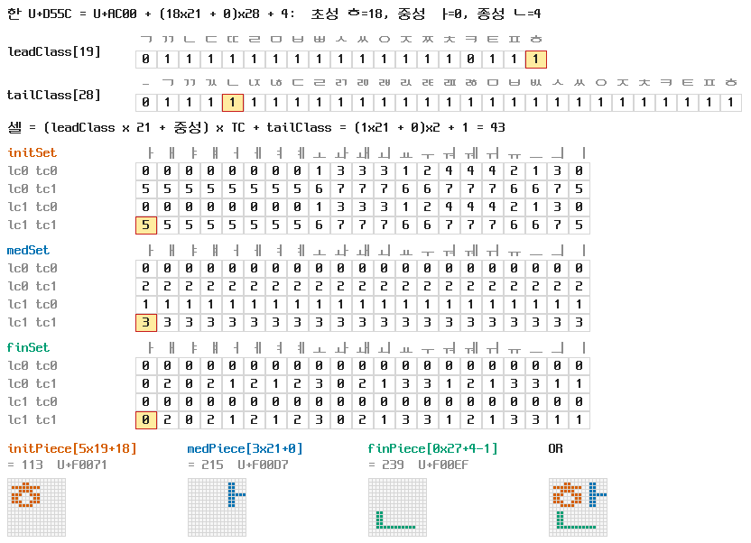

*Figure 3. Looking up 한 in SANS8J. The yellow cells are the ones read. Labels: 초성 = initial, 중성 = medial, 종성 = final,
셀 = cell; the first line reads "initial ㅎ = 18, medial ㅏ = 0, final ㄴ = 4".*

**쀍 (U+C00D, not in KS):** L = 8 (ㅃ), V = 15 (ㅞ), T = 9 (ㄺ); lc = 1, tc = 1; cell = (21 + 15) x 2 + 1 = 73; sets 7, 3, 2;
pieces `initPiece[7 x 19 + 8 = 141]` = 141, `medPiece[3 x 21 + 15 = 78]` = 230, `finPiece[2 x 27 + 9 - 1 = 62]` = 298. The
precomposed code has no such syllable; the johab font draws it with the same eight table reads as 한 (2 class, 3 set,
3 piece reads; six without a final).

The version 1 lookup as a flowchart with its index formulas (`pieces_v1` in [c/src/svf_jamo.c](../c/src/svf_jamo.c), compat branch included).
In a build that also compiles the version 2 reader, two multiply-shifts (`s x 14267 >> 23`, `tail x 2341 >> 16`) give the
same L, V, T without a division; the version 1 reader alone divides.

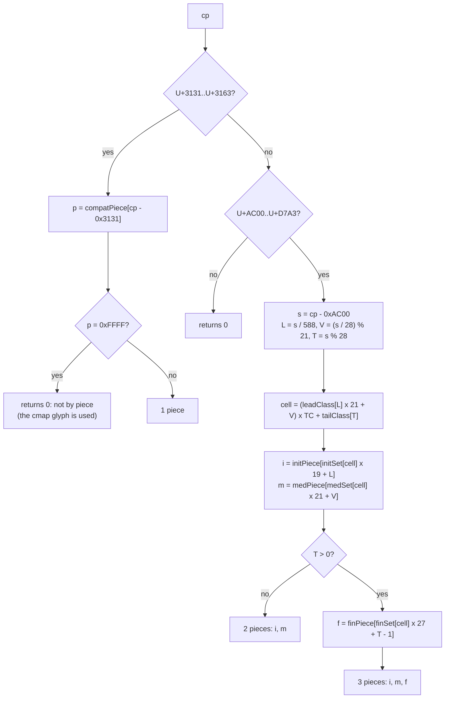

In the C renderer `svf_jamo_pieces(&face, 0xD55C, pieces)` returns 3 with 113, 215, 239 in `pieces`, and `svf_glyph`
returns the composed cell ([docs/c-renderer-guide.md](c-renderer-guide.md) chapter 10).

### 4.4 Is it the same as the precomposed face?

SANS8J is an iolo conversion of a legacy 8x4x4 bitmap face, converted from its SANS .fnt source with `jamoset.py --layout 844 --check`.
The figure script compares it with the unrelated precomposed `NEODG16` only as a cross-font illustration: 274 of the KS 2,350 syllables match exactly, with mean IoU 0.9498. This does not measure SANS8J conversion fidelity; no precomposed SANS8J twin is distributed. A rasterised outline font fitted to 8x4x4 can lose fidelity: NanumGothic Bold at 16 px gave IoU 0.795 and 126 exact syllables ([docs/recipes/sets.md](recipes/sets.md#choosing-the-number-of-sets-벌-수) "Choosing the number of sets (벌 수)").

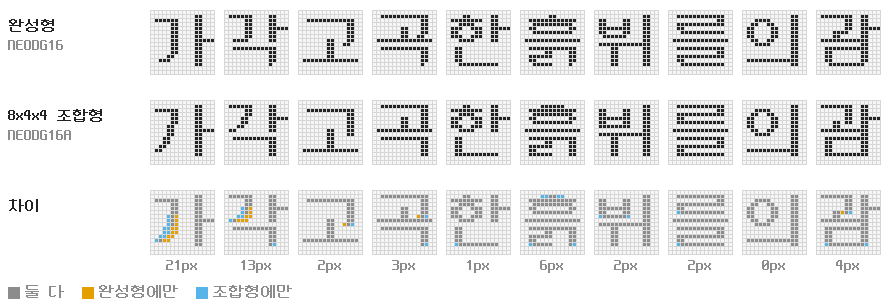

*Figure 4. Top: the comparison precomposed face. Middle: SANS8J composition. Bottom: their difference (grey = both,
orange = comparison only, sky blue = SANS8J only). Because the sources differ, this is an illustration rather than a
quality claim. Labels: 완성형 = precomposed, 조합형 = jamo set, 차이 = difference.*

### 4.5 Validation

The two placement checks (the first two rows) concern the whole file and fail the open (`c/src/svf_face.c` lines
124-131). A block that breaks a content check (the other rows) does not fail the open: the face opens as a **plain face**
that composes no Hangul, and the C renderer sets `SVF_FACE_JSET_BAD` ([spec/SVF.md](../spec/SVF.md) "Jamo-set fonts", "Validation").

| Check | When it fails |
|---|---|
| a nonempty region at or after byte 48 and inside the file | `SVF_E_RANGE` (the open fails) |
| the offset a multiple of the table unit (2^TAB) | `SVF_E_LAYOUT` (the open fails) |
| size equal to the formula of the counts, not 0 | `JSET_BAD`, plain face |
| counts within the build's limits (standard or BIG) | `JSET_BAD` |
| classes < LC, TC; sets < NI, NM, NF (final sets only in classes with a final) | `JSET_BAD` |
| every named piece other than blank 0xFFFF has a glyph U+F0000 + n | `JSET_BAD` |

## 5. JSET version 2 and BIG

### 5.1 Version 2: the same tables in bits

Version 2 holds **the same tables** as version 1 in fewer bytes and changes no bitmap, glyph record, cell, composition
rule or limit ([spec/SVF.md](../spec/SVF.md) "JSET block version 2").

| Part | Version 1 | Version 2 |
|---|---|---|
| header | 12 bytes | 16 bytes (NA = alias count, a reserved u16) |
| class tables | 19 + 28 bytes | the same |
| set tables | 1 byte x 3 per cell | W = WI + WM + WF bits per cell, `width(n) = ceil(log2 n)`, 0 for n = 1 |
| piece tables | u16 per slot | one row per set: u16 base + presence bits (3 bytes initial and medial, 4 final); pieces numbered from base in order |
| shared pieces | any number | an alias table (NA x u16) and alias bits per row |
| compat | 51 x u16 | 51 x 1 byte (set number + table switch bit) |

An 8x4x4 cell (NI 8, NM 4, NF 4) is 3 + 2 + 2 = 7 bits, where version 1 spends 3 bytes. Sizes (NA = 0, [spec/SVF.md](../spec/SVF.md)):

| System | v1 | v2 |
|---|---:|---:|
| 6 / 2 / 1, 1 x 2 classes | 653 | 181 |
| 8 / 4 / 4, 2 x 2 classes | 1,101 | 272 |
| 32 / 24 / 12, 8 x 8 classes | 7,065 | 2,818 |
| 24 / 16 / 16, 12 x 12 classes | 11,681 | 5,324 + aliases |
| standard maximum | 12,321 | 5,782 (NA 0), 9,246 (every slot an alias) |
| BIG maximum | 47,373 | 29,708 (NA 0), 45,068 (every slot an alias) |

Decoding one piece from version 2 (`pieces_v2`, `cell_set`, `slot_piece` in [c/src/svf_jamo.c](../c/src/svf_jamo.c); [spec/SVF.md](../spec/SVF.md) "JSET block
version 2"):

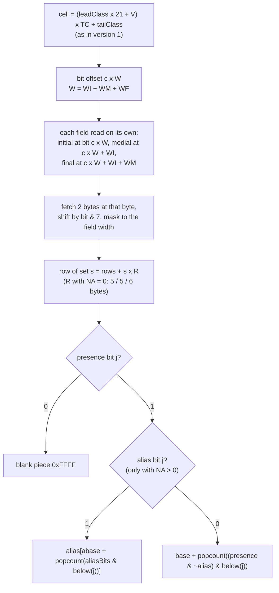

j is 0..18 for an initial, 0..20 for a medial, `T - 1` for a final. A cell is up to 14 bits (BIG 20) and may start inside
a byte, so it is not read in one go: each field gets its own two-byte fetch (a field is at most 5 bits, BIG 7, which two
bytes always hold; `cell_set`).

**Why it is slower.** Version 1 reads a cell as a byte and a piece as a u16. Version 2 fetches two bytes, shifts and masks
for each set number, and counts the presence bits below a slot for each piece (`popcount(presenceBits & ~aliasBits & below(j))`);
the Pico cost is in 5.3. The 67 jamo faces of `svf/` (all version 1) in version 2
would take the JSET bytes from 622,413 to 302,039; `--jset-version auto`, which writes version 2 only when it saves at least
1,024 bytes (`jamoset.choose_jset_version`), changes 57 faces and gives 309,972 (measured in memory with `jamoset.unpack`
and `pack_jset`). The 95 faces / 652,431 / 310,160 / 58 faces / 337,695 of [spec/SVF.md](../spec/SVF.md) "When to use
version 2" are an older 95-face inventory and must be distinguished from the current 67-face inventory.

### 5.2 BIG: only the limits

`SVF_JSET_BIG` widens only the **limits** of versions 1 and 2, with no new version word: 19 lead classes (one per
initial), 28 tail classes (one per final), and 128 / 128 / 64 sets. The largest blocks are 47,373 bytes (version 1) and
29,708 bytes (version 2, NA 0). A reader built without it treats counts over 12 x 12 / 32 / 24 / 16 as `JSET_BAD`. Writers
refuse a table over the standard limits unless asked (`--jset-big`), and output within them is byte-identical either way
([spec/SVF.md](../spec/SVF.md), the `SVF_JSET_BIG` comment of [c/include/svf.h](../c/include/svf.h)).

The class limits were 8 and 8 until 2026-10 (largest block 6,641 bytes) and 12 and 12 after; the set limits rose in
2026-10 (v3) from 24 / 16 / 16 to 32 / 24 / 16 ([spec/SVF.md](../spec/SVF.md)).

### 5.3 The speed of version 2 (Pico)

From [c/bench/MEASUREMENTS.md](../c/bench/MEASUREMENTS.md) "Before -> after JSET v1 + v2", rp2040js at 125 MHz, MONO_PAGE `-Os`, cycles per
iteration. BASE is the version 1 reader of main before the change, "v1 face" the version 1 face in the current build,
"v2 copy" a version 2 copy of the same face. The face is HGKEY6J (6x2x1, not in the project). Converting the 8x4x4
SANS8J to version 2 takes its JSET from 1,101 to 272 bytes and the file from 15,740 to 14,911 bytes ([docs/recipes/svf-and-ttf.md](recipes/svf-and-ttf.md#an-existing-svf)
"An existing SVF").

| Case | BASE | v1 face | v2 copy | v2 vs BASE | v2 vs v1 face |
|---|---:|---:|---:|---:|---:|
| `syl_ga` (가, 2 pieces) | 6,143 | 6,091 | 6,458 | +5.1 % | +6.0 % |
| `syl_bwelk` (뷁, 3 pieces) | 7,500 | 7,321 | 8,027 | +7.0 % | +9.6 % |
| `screen32` (one screen) | 194,583 | 188,251 | 206,545 | +6.1 % | +9.7 % |

The spec's "5-7 %" is against BASE. Against the version 1 face of the same build, the version 2 copy is 6-10 % slower (the
last column, computed from the table). This table is the 2026-10-26 run; on 2026-10-27 a change to `svf_is_jamo` brought the
version 1 face to 6,049 (`syl_ga`) and 7,279 (`syl_bwelk`) cycles ([c/bench/MEASUREMENTS.md](../c/bench/MEASUREMENTS.md) lines 125-129). The version 2
copy was not re-measured then.

## 6. Version 3: JMAP, LIST, and rules against tables

### 6.1 When the selection is not a function of the classes

JSET versions 1 and 2 rest on one assumption: the sets are a function of (class, medial, class). Some fonts break it: a
font that picks its pieces per syllable from a table, as Mac HangulTalk 7.1.x does, or one that wants a few syllables
drawn as exceptions. Version 3's **JMAP** holds the map from a syllable to its pieces directly, in place of the set tables
([spec/SVF.md](../spec/SVF.md) "Version 3: mapping table (JMAP)").

| Offset | Size | Field |
|---|---|---|
| 0 | 4 | `"JSET"` |
| 4 | u16 | version = 3 |
| 6 | u8 | flags: 0x01 4B (4-byte entries, else 3), 0x02 SPARSE, 0x04 FALLBACK, 0x08 LIST |
| 7 | u8 | advance |
| 8 | u16 | NS entries (dense = 11,172; LIST 1..255) |
| 10, 12, 14 | u16 x 3 | PI, PM, PF: pieces per plane (LIST: 0) |
| 16 | u16[51] | compat pieces |
| 118 | u16[44] | SPARSE: rank table (set bits before each 256-bit block) |
| 206 | u8[1397] | SPARSE: presence bitmap over U+AC00..U+D7A3 |
| 1603 | u8 | SPARSE: pad, 0 |
| E | NS x 3, 4 or 8 | entries; E = 1,604 (SPARSE) or 118 (dense, LIST) |
| F | rest | FALLBACK: a JSET version 1 or 2 block |

| Form | Entries | Bytes | Use |
|---|---|---|---|
| dense 3B | 11,172 x 3 | 33,634 | an entry for every syllable, up to 255 pieces a plane |
| dense 4B | 11,172 x 4 | 44,806 | more pieces (PI, PM <= 2,047, PF <= 1,023) |
| SPARSE 3B, KS 2,350, no fallback | 1,604 + 2,350 x 3 | 8,654 | the original Mac 7.1.x structure |
| SPARSE 4B, 11,172 | | 46,292 | |
| LIST | 118 + 8 x NS (<= 255) | <= 2,158 (NS 36: 406) | an exception list over a fallback JSET |

All sizes are [spec/SVF.md](../spec/SVF.md)'s. The region is at most 65,534 bytes.

**Lookup.** Dense: `idx = s`. SPARSE: when bit s is set, `idx = rank[s >> 8] +` (popcount of the block's earlier bytes)
`+` (popcount of the lower bits of the same byte). In an entry `[i, m, f]` a 0 means no piece of that plane and k the k-th
piece of the plane (initial `i - 1`, medial `PI + m - 1`, final `PI + PM + f - 1`); **the entry decides** whether there
are 3 pieces or 2, not the syllable's final. LIST binary-searches the key (`cp - 0xAC00`); its fields are piece numbers of
the shared pool as they are (0xFFFF blank). A miss (no key, or a 0 bit) goes to the FALLBACK's JSET version 1 or 2; with
no fallback the syllable is not composed.

The indexing of dense, SPARSE and LIST on their own:

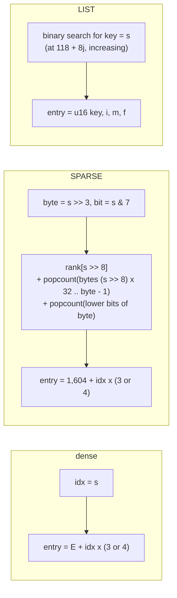

The whole lookup, fallback included:

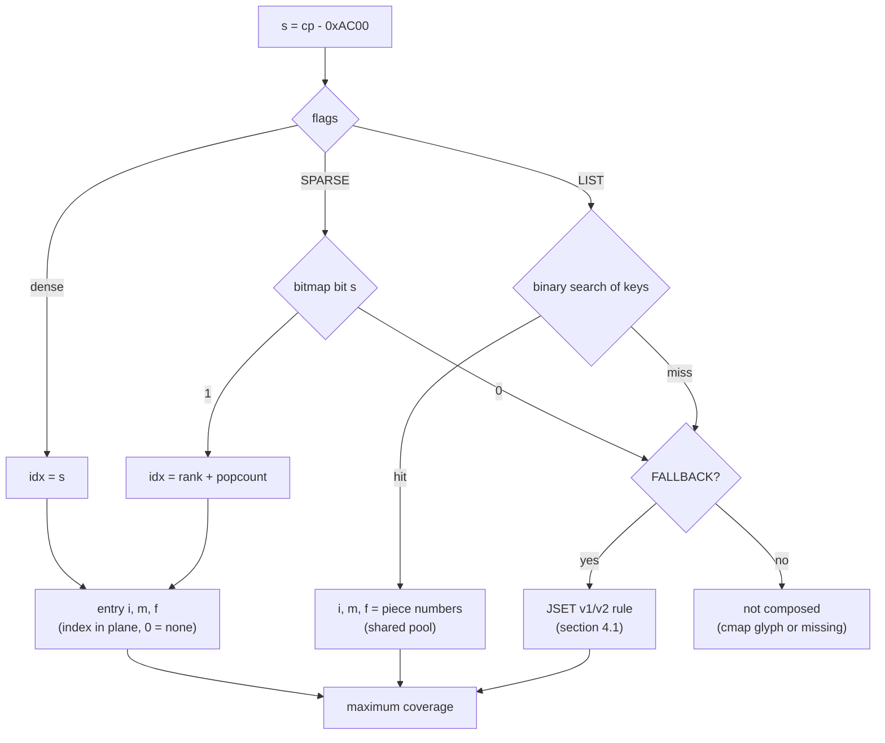

**Whole glyphs and exceptions.** A LIST entry whose `i` is a piece and `m = f = 0xFFFF` draws that one piece as the whole
syllable: a precomposed cell, kept as it is. `tools/jamoexc.py` writes such LIST faces: a jamo-set face plus up to 255
exceptions (a whole glyph, `"whole"`, or another combination of pieces, `"pieces"`), the face's own JSET kept as the
fallback (the `tools/jamoexc.py` docstring). [docs/recipes/sets.md](recipes/sets.md#choosing-the-number-of-sets-벌-수) "Choosing the number of sets (벌 수)" recommends, for a font
8x4x4 fits poorly (an outline raster), "a few LIST exceptions on an 844 set" rather than more sets.

What `jamoexc.py build` does (the docstring and `build` of `tools/jamoexc.py`):

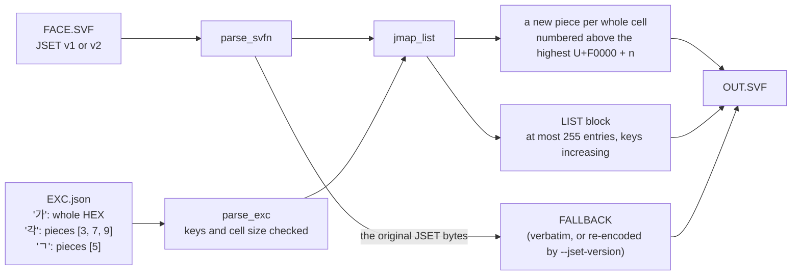

A compatibility jamo (U+3131..U+3163) takes another path than a syllable ([spec/SVF.md](../spec/SVF.md) "Version 3", "Compat"):

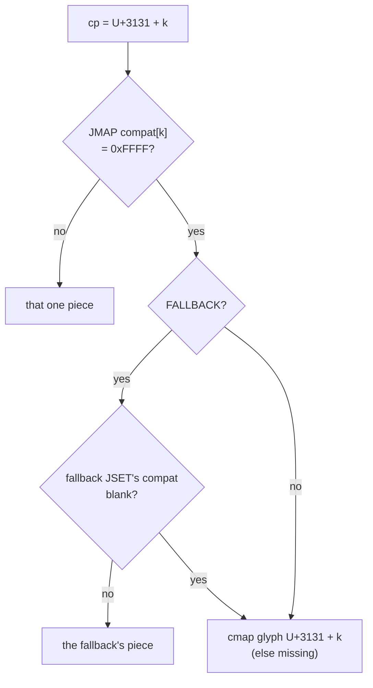

A jamo no single piece can draw (a Mac compatibility jamo of several planes) is a whole glyph at U+3131 + k with a blank
JMAP compat entry.

### 6.2 Validation and status bits

In a build that reads the form (`SVF_JMAP` for dense and SPARSE, and `SVF_JMAP_LIST` too for LIST), a JMAP that breaks
any of its rules (R1-R8; for LIST R1', L2, L3, R4, L5-L7) is `SVF_FACE_JMAP_BAD` as a whole and the face opens plain ("one
block, one verdict"). A build that does not read it checks less. `SVF_JMAP_LIST=0` applies only the LIST header rules
(R1', L2, L3, R4), so a LIST with unsorted keys is `JMAP_UNREAD` there and its fallback JSET is used. A `SVF_JMAP_RECOG`
build checks only the header rules (flags and NS, the fallback's advance, a region of exactly 65,535 bytes; see 7.1) and sets `JMAP_UNREAD`, the fallback getting its own `JSET_BAD` or `JSET_UNREAD`
verdict. `SVF_JSET_TRUSTED` skips R5-R8 (L5-L7 for a LIST) too ([spec/SVF.md](../spec/SVF.md) "Reader statuses" and its table). The
status bits ([spec/SVF.md](../spec/SVF.md) "Reader statuses", [c/include/svf.h](../c/include/svf.h) lines 75-86):

| Bit | Value | Meaning |
|---|---|---|
| `SVF_FACE_JSET_BAD` | 0x0008 | the JSET part is malformed, or of version 0 or >= 4; version 3 too in a build that does not know it |
| `SVF_FACE_JSET_UNREAD` | 0x0010 | a well-formed version 1 or 2 header whose reader is not compiled |
| `SVF_FACE_JMAP_BAD` | 0x0020 | a version 3 block (its fallback included) breaks a rule |
| `SVF_FACE_JMAP_UNREAD` | 0x0040 | recognised only, by `SVF_JMAP_RECOG` without `SVF_JMAP`, or a LIST block with `SVF_JMAP_LIST=0` |

### 6.3 Rules against tables

| Aspect | Rule form (JSET v1/v2) | Table form (JMAP dense/SPARSE) | Exception form (LIST + fallback JSET) |
|---|---|---|---|
| Holds | classes, set tables, piece tables | three pieces per syllable | <= 255 exceptions + a rule |
| Syllables covered | all 11,172 | those with an entry (SPARSE: some) | 11,172 (with a fallback) |
| Syllables never seen | drawn by the rule | not drawn (without a fallback) | drawn by the rule |
| Table bytes | v1 examples: 653 to 12,321 (BIG 47,373); v2 in section 5.1 | 8,654 (SPARSE 3B, KS 2,350) to 46,292 (SPARSE 4B, 11,172); a region with a fallback up to 65,534 | 118 + 8 NS + fallback |
| Lookup cost | eight table reads (six without a final) | dense: one; SPARSE: popcounts | binary search + the rule on a miss |
| Reader code | v1 in every default build (only the KS-only build sets `SVF_JSET_V1=0`) | desktop default; off by default on MCUs | desktop default; off by default on MCUs |
| Suits | DOS fonts, ROMs, pixel fonts | fonts without a rule (Mac 7.1.x) | a rule that nearly fits + a few fixes |

### 6.4 Seoul12: one font, two structures

Seoul12 (12 px) of Mac HangulTalk 7.1.x can be put into SVF both ways, which makes it a good comparison. The file sizes below are documented in [docs/recipes/classic-mac.md](recipes/classic-mac.md#classic-mac-korean-bitmap-fonts), "Classic Mac Korean bitmap fonts"; the preset sizes describe the Uno conversions.

**A note on the name.** "SEOUL12J" here names the Uno preset's
**derived** face (rule form, with Latin, 12,624 bytes). The command examples of [docs/recipes/classic-mac.md](recipes/classic-mac.md#classic-mac-korean-bitmap-fonts) "Classic Mac Korean bitmap
fonts" give the same name `SEOUL12J.SVF` to the **direct** output (JMAP) and `SEOUL12D.SVF` to the derived one. The table
calls them "original structure" (direct) and "SEOUL12J" (derived), and compares sizes with and without Latin alike.

| Item | Original structure (direct, table form) | SEOUL12J (derived, rule form) |
|---|---|---|
| Block | JMAP SPARSE 3B, NS 2,350, no fallback | JSET version 1 |
| Classes | (none) | 8 lead x 4 tail |
| Sets | (none) | 9 initial, 6 medial, 3 final |
| Pieces | 90 / 64 / 53 = 207 (the Mac planes as they are) | 219 (recomputed) |
| JSET bytes | 8,654 | 2,933 |
| File bytes, no Latin | 15,016 | 9,716 |
| File bytes, with Latin (`--latin`) | 17,924 | 12,624 |
| Syllables composed | the KS 2,350 only | 11,172: KS 2,350 exact + 4,630 regular + 4,192 guessed |
| Tool | `tools/macfbit_svf.py build` | `tools/macfbit_svf.py build --mode derived` |

The four file sizes (15,016 / 9,716 / 17,924 / 12,624) are the runs of [docs/recipes/classic-mac.md](recipes/classic-mac.md#classic-mac-korean-bitmap-fonts) "Classic Mac Korean bitmap fonts".
The structure rows give the block form, classes, sets, pieces, JSET bytes and regular / guessed counts for those conversions.

**Why the rule form could not use the Mac pieces as they are.** The Mac table picks the medial (and the finals ㄱ ㄹ ㅇ)
very finely by initial. With every Mac slot a piece, two initials that use a different medial or final glyph with the same
medial and final cannot share a lead class. Of the 171 initial pairs (the `slot_conflicts` docstring of
`tools/macfbit_svf.py`), Seoul12 has **130** that conflict that way. This count alone does not establish the minimum number of lead classes. This is the `slot_conflict_pairs` value printed by `macfbit_svf.py analyse`. So the `derived` mode recomputes
the pieces (the module docstring of `tools/macfbit_svf.py`):

- medial piece of a cell = **AND** of the Mac medial glyphs of the cell's KS syllables;
- final piece of a cell = **AND** in the same way;
- initial piece of a cell = **OR** over the cell's syllables of (syllable - medial piece - final piece), the residual.

```mermaid
flowchart TD
  M["Mac input<br/>fbit 482 glyphs + HTBL 1<br/>(the planes of the KS 2,350)"] --> C["class search, search_classes<br/>lead <= 12, tail <= 12<br/>result: 8 x 4"]
  C --> K["collect the KS syllables per cell"]
  K --> MD["medial piece<br/>= AND of the cell's Mac medials"]
  K --> FN["final piece<br/>= AND of the cell's Mac finals"]
  MD --> IN["initial piece<br/>= OR(syllable - medial piece - final piece)"]
  FN --> IN
  IN --> V{"OR inside every syllable of the cell?"}
  V -->|yes| KS["KS 2,350 exact"]
  KS --> EX{"8,822 outside KS:<br/>all three cells hold a KS syllable?"}
  EX -->|yes| RG["regular 4,630"]
  EX -->|no| GS["guessed 4,192<br/>Mac glyph of the nearest context"]
  RG --> J["SEOUL12J: JSET v1, 9/6/3 sets, 219 조각s"]
  GS --> J
```

All 2,350 KS syllables then equal the Mac's. Of the other 8,822, 4,630 are regular (each of the three cells uses a piece
seen in a KS syllable) and 4,192 guessed (a cell with no KS syllable, filled from the nearest context with a Mac glyph);
both are extrapolation, not Mac output.

**With BIG?** `SVF_JSET_BIG`'s 19 lead classes are one class per initial, so the initial-pair conflict above cannot occur,
and a rule-form block that uses the Mac slots as pieces directly may be possible. **This has not been measured yet**:
its block size, its composition and what it does with the syllables outside KS are all open.

**Shrunk for MCUs.** The Uno presets of Seoul12 are SEOUL12J shrunk with `tools/jamomerge.py merge` (the Uno preset record); all are SVFN v3 `mcu-strict`, JSET
version 1, ASCII included.

```mermaid
flowchart LR
  J["SEOUL12J<br/>12,624"] -->|"merge --points 8192"| R1["rec1/SM8K<br/>= S8K0 8,136"]
  R1 -->|"merge 42 reverted"| S8["S8K 8,160"]
  R1 -->|"merge --start-soft<br/>--points 7168 6144 4096"| S7["S7K 7,012"]
  R1 --> S6["S6K 6,144"]
  R1 --> S5["S5K 5,548<br/>(where no move was left)"]
```

The second merge produces S7K, S6K and S5K in one run with `--start-soft --points 7168 6144 4096`. S8K0 is the 8,136-byte intermediate face; S8K is the 8,160-byte variant with merge 42 reverted.

| Preset | Bytes | Uno flash ([c/cross/SIZES.md](../c/cross/SIZES.md) "Uno presets" of the measurement source) |
|---|---:|---:|
| S8K | 8,160 | 21,730 |
| S7K | 7,012 | 20,582 |
| S6K | 6,144 | 19,714 |
| S5K | 5,548 | 19,118 |
| (input) SEOUL12J | 12,624 | |

These Apple-derived faces are not distributed; their names, sizes and sha256 values identify the measured variants (`docs/STATUS.md`, the note on the open edition).

## 7. MCU constraints

### 7.1 What each build reads

The readers are compiled in or out by switches ([c/include/svf.h](../c/include/svf.h) "Size switches", lines 375-462). Defaults:

| Switch | Default | Off or on |
|---|---|---|
| `SVF_JSET_V1` | 1 | 0: a version 1 face is `JSET_UNREAD` |
| `SVF_JSET_V2` | 1, **0 on AVR** (the CH582 port pins it to 0 too: it embeds a version 1 face) | 0: a version 2 face is `JSET_UNREAD` |
| `SVF_JSET_BIG` | 1 on desktop, DOS, WASM (`__unix__ _WIN32 __APPLE__ __DJGPP__ __EMSCRIPTEN__`), **0 on every MCU**, 0 under `SVF_SMALL` | 0: a block over the standard limits is `JSET_BAD` |
| `SVF_JMAP` | 1 on the same list as BIG, **0 on every MCU** | 0: version 3 is `JSET_BAD` (without RECOG) |
| `SVF_JMAP_LIST` | the value of `SVF_JMAP` | 0: a LIST block is `JMAP_UNREAD` and its fallback JSET is read |
| `SVF_JMAP_RECOG` | 1 on the same list as BIG, 0 on MCUs | 1: recognises version 3 without `SVF_JMAP` and reads its fallback JSET |
| `SVF_JSET_POP4` | 1, 0 on AVR and under `SVF_SMALL` | version 2 popcount by a 16-entry table |
| `SVF_JSET_TRUSTED` | 0 | 1: skips the table content checks. **Only for faces the developer builds into flash** |

How those defaults are decided ([c/include/svf.h](../c/include/svf.h) lines 104-109, 424-481):

```mermaid
flowchart TD
  S{"-DSVF_X=0/1<br/>given explicitly?"} -->|yes| E["that value wins"]
  S -->|no| A{"__AVR__?"}
  A -->|yes| AV["V1 1, V2 0, POP4 0<br/>JMAP 0, LIST 0, RECOG 0, BIG 0"]
  A -->|no| SM{"SVF_SMALL?"}
  SM -->|yes| SS["V1 1, V2 1, POP4 0<br/>JMAP 0, LIST 0, RECOG 0, BIG 0"]
  SM -->|no| D{"__unix__ / _WIN32 / __APPLE__<br/>/ __DJGPP__ / __EMSCRIPTEN__?"}
  D -->|yes| DT["V1 1, V2 1, POP4 1<br/>JMAP 1, LIST 1, RECOG 1, BIG 1"]
  D -->|"no (MCU)"| MC["V1 1, V2 1, POP4 1<br/>JMAP 0, LIST 0, RECOG 0, BIG 0"]
```

The default of `SVF_JMAP_LIST` always follows the final `SVF_JMAP`, so `-DSVF_JMAP=1` alone on an MCU turns LIST on too. A
build with `SVF_JMAP=1` does not compile RECOG (it has no use there).

`SVF_JSET_V1`, `SVF_JSET_V2` and `SVF_JMAP` all 0 is an `#error`. `SVF_JMAP` is the one switch that changes the size of
`svf_face` (+9 B on AVR, +12 B on Cortex-M), so every translation unit must be built with the same value.

The resulting matrix ([c/README.md](../c/README.md) "Jamo sets: what each build reads"; the over-limits row split by version after
`jset_part` in [c/src/svf_jamo.c](../c/src/svf_jamo.c): a version without its reader is `JSET_UNREAD` before its counts are checked):

| Face carries | default host / DOS / WASM / SDL | AVR default | other MCU default |
|---|---|---|---|
| v1, standard limits | composed | composed | composed |
| v2, standard limits | composed | plain, `JSET_UNREAD` | composed |
| v1 over the standard limits | composed (BIG) | plain, `JSET_BAD` | plain, `JSET_BAD` |
| v2 over the standard limits | composed (BIG) | plain, `JSET_UNREAD` (no v2 reader, counts not checked) | plain, `JSET_BAD` |
| v3 JMAP, dense or SPARSE | composed | plain, `JSET_BAD` (unknown version) | plain, `JSET_BAD` |
| v3 JMAP LIST | composed | plain, `JSET_BAD` | plain, `JSET_BAD` |

```mermaid
flowchart TD
  O["svf_open_*: header flag bit 1"] --> V{"JSET version"}
  V -->|1| A{"SVF_JSET_V1?"}
  A -->|yes| A2{"counts within the build's limits?<br/>(BIG or not)"}
  A2 -->|yes| A3{"table contents valid?"}
  A3 -->|yes| OK["jamo face: composed"]
  A3 -->|no| BAD
  A2 -->|no| BAD["plain: JSET_BAD"]
  A -->|no| UN["plain: JSET_UNREAD"]
  V -->|2| B{"SVF_JSET_V2?"}
  B -->|yes| A2
  B -->|no| UN
  V -->|3| C{"SVF_JMAP?"}
  C -->|yes| C2{"LIST and SVF_JMAP_LIST=0?"}
  C2 -->|no| C3{"R1-R8, or<br/>R1', L2, L3, R4, L5-L7 pass?"}
  C3 -->|yes| OK2["composed by the JMAP<br/>(a miss: fallback JSET)"]
  C3 -->|no| JB["plain: JMAP_BAD"]
  C2 -->|yes| H{"header rules pass?"}
  C -->|no| D{"SVF_JMAP_RECOG?"}
  D -->|yes| H
  D -->|no| BAD
  H -->|yes| UNR["JMAP_UNREAD:<br/>a fallback JSET, if any, judged<br/>by the version 1/2 path above"]
  H -->|no| JB
  V -->|0 or 4 and up| BAD
```

The "header rules" of a RECOG build are only the flags and NS (R1 or R1', R3 or L3), the fallback's advance comparison
and the check for a region of exactly 65,535 bytes (the table of [spec/SVF.md](../spec/SVF.md)); a `SVF_JMAP_LIST=0` build applies R1', L2,
L3 and R4.

An unsupported block version does not itself fail the open. Stored glyphs, including any stored Hangul syllables,
remain available. An unread JMAP can still use a readable fallback; otherwise Hangul composition is unavailable.
The status bits distinguish these cases. Check `svf_status` at open ([docs/c-renderer-guide.md](c-renderer-guide.md) 10.1).
`SVF_SMALL` turns the **defaults** of `SVF_JMAP`, `SVF_JMAP_LIST`, `SVF_JMAP_RECOG` and `SVF_JSET_BIG` to 0 even on a
desktop, so a `SVF_SMALL` build opens a JMAP or BIG face plain (the same guide, chapter 12).

### 7.2 Code size

Reader code size (text bytes, `-Os`; [c/cross/SIZES.md](../c/cross/SIZES.md) "JSET v1 + v2 readers", "Size switches", the feature-gate
sections, and the comments of [c/include/svf.h](../c/include/svf.h)):

| Configuration | Cortex-M0+ (P1) | AVR (P1) | Source |
|---|---:|---:|---|
| version 1 reader alone (`SVF_JSET_V2=0`, the AVR default) | 6,146 (-48 against BASE) | 12,910 (-4) | SIZES.md "JSET v1 + v2 readers" |
| version 2 reader alone | 6,729 (+535) | 13,404 (+490) | the same |
| both (M0+ default, POP4 on) | 7,441 (+1,247) | 15,332 (+2,418) | the same |
| both, `SVF_JSET_TRUSTED=1` | 6,764 (+570) | 12,354 (-560, v1 only) | the same |
| the `SVF_JSET_POP4` table | +28 | (0 on AVR) | `svf.h` |
| BIG | v1: -4, v1+v2: -12 | v1: +26, v1+v2: +72 | SIZES.md Task 17, `svf.h` |
| `SVF_JMAP_RECOG` (`minimal+RECOG`) | 6,358 (+196) | 13,238 (+308) | `docs/STATUS.md`, the SIZES.md feature gate (the `svf.h` comment's estimate +164 / +280 is older) |
| `minimal` (Uno flags) -> `minimal+JMAP` (LIST included) | 6,162 -> 7,646 | 12,930 -> 15,370 | the size table of `docs/STATUS.md` |
| `ksonly` (JMAP only, no v1/v2) | 6,822 | 13,460 | the same |

SIZES.md re-took its tables at several points, so the baselines differ a little between rows (the version 1 reader
alone is 6,146 in one and 6,162 in another); each row above is the value of its source. The Arduino Uno example's README
says the version 2 reader would add "about 2.4 KB" of flash (`c/ports/arduino/README.md`). A build with every reader
(`SVF_TARGETS=0x1FF -DSVF_JSET_V2=1 -DSVF_JMAP=1 -DSVF_JSET_BIG=1`) does not fit the ATmega328P's 32 KB; it links at 40,508
bytes on the ATmega2560 (Mega) (`c/ports/arduino/README.md` "Mega 2560").

### 7.3 Table sizes and the load limit

| Block | Formula or value | Maximum |
|---|---|---:|
| JSET v1 | `59 + 63 x LC x TC + 2 x (19 NI + 21 NM + 27 NF + 51)` | 12,321 (BIG 47,373) |
| JSET v2 | `63 + S + NI x RI + NM x RM + NF x RF + 2 NA + 51` | NA 0: 5,782 (BIG 29,708); every slot an alias: 9,246 (BIG 45,068) |
| JMAP SPARSE 3B, KS 2,350 | 8,654 | |
| JMAP dense 3B / 4B | 33,634 / 44,806 | |
| JMAP LIST | 118 + 8 NS | 2,158 + the fallback block |
| JMAP region | | 65,534 |

For streaming, a region larger than the build's load limit is read only to its 16-byte header and cannot be used for composition.
This does not itself fail the face open. The limit `SVF__JSET_LOAD_MAX` is
65,534 with `SVF_JMAP`, 47,373 with `SVF_JSET_V1` and BIG, 12,321 with the version 1 reader (`c/src/svf_internal.h`
lines 33, 50-51, 58-66; a version 2-only build, without the version 1 reader, takes the largest version 2 block, 9,246, or
45,068 with BIG). A streamed face therefore never loads more than its region.

### 7.4 Streaming and the syllable cache

A mapped face (`svf_open_mapped`) is read in place. Font bytes placed in flash or AVR PROGMEM need no RAM copy;
a plain `const` declaration alone does not guarantee flash-only storage on AVR
([docs/c-renderer-guide.md](c-renderer-guide.md) chapter 11). A streamed face (`svf_open_stream`) reads its tables once, at open, into a buffer
the caller gives; that buffer (`svf_stream_tables_size`) holds the code point table, the metrics table, **the whole readable JSET
region** and the glyph offset table ([c/include/svf.h](../c/include/svf.h) lines 229-230). The JSET block size is then RAM: the gap between
8x4x4 v1 (1,101) and v2 (272), or 12 x 12 v1 (11,681) and v2 (5,324 + aliases), is a RAM gap.

Composing reads 2 or 3 pieces. A streamed face without a block cache needs scratch of two cells (the cell being composed
and the piece being read; `svf_compose` in `svf.h`). For repeated text give the chain a **syllable cache**, slots of
`8 + the largest cell bytes`:

```c
static uint8_t syl[4096];
svf_chain_cache(&chain, syl, sizeof syl);
```

The path of one syllable through `svf_draw_utf8` (`c/src/svf_draw.c` lines 1275-1336, `svf_compose` in
[c/src/svf_jamo.c](../c/src/svf_jamo.c)):

```mermaid
flowchart TD
  A["decode UTF-8, pick the face of the chain"] --> B{"cell outside the clip?"}
  B -->|yes| N["skipped, not read"]
  B -->|no| C{"chain cache<br/>and a composed cp?"}
  C -->|yes| D{"cache_find(face, cp)"}
  D -->|hit| M["copy the cached cell to scratch"]
  D -->|miss| G
  C -->|no| G["svf_glyph -> svf_compose<br/>2 or 3 pieces from svf_jamo_pieces"]
  G --> P["svf__expand per piece:<br/>mapped from memory,<br/>streamed through the block cache or rd()"]
  P --> R{"read failed?"}
  R -->|yes| IO["this glyph skipped<br/>SVF_E_IO at the end"]
  R -->|no| PUT["cache_put when there is a cache"]
  PUT --> SC
  M --> SC{"ratio 1/1?"}
  SC -->|no| SL["svf__scale_cell"]
  SC -->|yes| BL["blit -> target"]
  SL --> BL
```

The calls when a streamed face without a block cache composes one syllable (the `svf_open_stream` comment of
[c/include/svf.h](../c/include/svf.h): one read a glyph when its record fits the cell, else two, header and rows):

```mermaid
sequenceDiagram
  participant App as application
  participant D as svf_draw_utf8
  participant J as svf_compose
  participant T as tables buffer (RAM)
  participant Rd as rd() (SD, flash, network)
  App->>D: "한"
  D->>J: svf_glyph(U+D55C)
  J->>T: read the JSET tables (loaded at open)
  T-->>J: pieces 113, 215, 239
  loop each piece
    J->>T: record position from the code point and offset tables
    J->>Rd: read the record (into the second half of the caller's cell buffer)
    Rd-->>J: bytes
    J->>J: merge into the first cell by maximum coverage
  end
  J-->>D: the composed cell
  D->>App: blit to the target
```

With a block cache, the `rd()` calls of the second picture go away as far as the blocks hit; with a syllable-cache hit
all of `svf_compose` does.

Pixels are the same with or without it. On a streamed 16x16 face a first draw of "한글 ab" at 3/2 made 10 read calls and
the cached redraw none. The cache is round robin with a linear lookup, so tens of slots suit small targets
([docs/c-renderer-guide.md](c-renderer-guide.md) 10.2).

### 7.5 Composition speed

On the Pico (RP2040, rp2040js at 125 MHz), MONO_PAGE `-Os`, a version 1 face takes 6,049 cycles for 가 (2 pieces) and
7,279 for 뷁 (3 pieces) (re-measured 2026-10-27, [c/bench/MEASUREMENTS.md](../c/bench/MEASUREMENTS.md) lines 125-129). In time that is `syl_ga`
48.39 µs and `syl_bwelk` 58.23 µs; by `docs/STATUS.md` the first meets its 50 µs budget, the second misses it at `-Os` and
meets it at `-O2` (47.18 µs). A version 2 copy took 6-10 % more than the version 1 face of the same build in the earlier
2026-10-26 run (against 5.3's 6,091 / 7,321 cycles). The face of these
measurements is HGKEY6J (6x2x1), which the measurement set does not include, not re-measured with NEODG16G (`docs/STATUS.md`).
These are emulated figures; the hardware's XIP cache is not modelled ([docs/c-renderer-guide.md](c-renderer-guide.md) 13.5).

### 7.6 Seoul12: separating face size from firmware size

The direct and derived files of section 6.4 differ by 5,300 bytes both without Latin
(`15,016 - 9,716`) and with Latin (`17,924 - 12,624`). This is a **face-file** difference.
Firmware size also depends on the compiled readers, layout profile, linker and application code; measure it
with the intended build. The direct JMAP needs `SVF_JMAP=1` on an MCU and covers only the KS 2,350 syllables.
The derived JSET also extrapolates the other 8,822 syllables.

### 7.7 Turning readers on in an MCU build

- **CMake (Pico SDK, ESP-IDF):** give the switches to the target with `target_compile_definitions`, as the Pico example
  does (`c/ports/pico/CMakeLists.txt` line 75; the guide, 13.5):

  ```cmake
  target_compile_definitions(app PRIVATE SVF_NO_SCALE SVF_TARGETS=0x02 SVF_JMAP=1)
  ```

  `CMAKE_C_FLAGS` applies broadly, including to SDK compilation. Keep font-reader switches on the target that
  compiles the application and renderer sources, as in the port example.
- **The same value in every translation unit.** Give the switches to the library sources and to every file that
  includes `svf.h` (the guide, chapters 2 and 12); `SVF_JMAP` in particular changes the layout of `svf_face`.
- **Arduino (arduino-cli):** use `compiler.c.extra_flags` and `compiler.cpp.extra_flags`, not `build.extra_flags`, which
  also reaches the assembler sources (`c/ports/arduino/README.md`).
- **Check:** after opening, look at `SVF_FACE_JSET_BAD`, `JSET_UNREAD`, `JMAP_BAD` and `JMAP_UNREAD` in `svf_status`;
  `gcc -dM -E` shows the defaults a toolchain gets (the guide, chapter 12).

## 8. Choosing: recommendations by memory budget

| Budget (flash for the face) | Recommended form | Reader | Example |
|---|---|---|---|
| about 6-11 KB, 2 KB of RAM (Uno class) | a JSET v1 with few sets (6x2x1, or a shrunk 8x4x4) | v1 only (the AVR default) | `NEODG16G` 6x2x1: file 10,684, 10,124 in `mcu-strict`, Uno image 23,676 text (`c/ports/arduino/README.md`); Seoul S5K-S8K 5,548-8,160 |
| about 16-20 KB | 8x4x4 JSET v1 | v1 | `SANS8J` 15,740; 16 px 8x4x4 sets made from DOS raw fonts, ROMs and OS/2: 15,556-18,576 ([docs/recipes.md](recipes.md)) |
| a face with big tables (12 x 12 classes) in flash or RAM | the same face as JSET v2 | v2 (+535 B on M0+) | 11,681 -> 5,324 + aliases; composition 6-10 % slower (5.3) |
| streaming (SD and the like), tight RAM | v2 + a syllable cache | v2 | the JSET region sits in the tables buffer |
| a large MCU (hundreds of KB of flash) | an adaptive JSET v1, BIG if needed | v1 (+BIG) | `svf/jamo-extra/GOTHA16.SVF` 60,992 |
| a font without a rule (Mac 7.1.x), KS only | JMAP SPARSE | `SVF_JMAP=1` explicitly | Seoul12 original structure 15,016 (no Latin); face file +5,300 B against the derived JSET (7.6) |
| a rule that nearly fits + a few fixes | 8x4x4 + LIST exceptions | `SVF_JMAP=1` (LIST included) | LIST 118 + 8 NS |
| quality first, memory to spare | precomposed | (no jamo reader needed) | `NEODG16` 133,720 |

The same as a decision tree:

```mermaid
flowchart TD
  A{"does the precomposed face<br/>fit the flash?<br/>(NEODG16: 133,720 bytes)"} -->|"yes, quality first"| PC["precomposed<br/>(a character subset if needed)"]
  A -->|no| B{"was the original drawn as pieces?<br/>(DOS, ROM, pixel font)"}
  B -->|yes| C{"its system within<br/>12 x 12 / 32 / 24 / 16?"}
  C -->|yes| V1["JSET v1, its own system"]
  C -->|no| BG["JSET v1 + BIG<br/>(on an MCU -DSVF_JSET_BIG=1)"]
  B -->|"no: no rule (Mac 7.1.x)"| JM["JMAP SPARSE<br/>(-DSVF_JMAP=1)<br/>or a derived JSET v1"]
  B -->|"no: fitted to a precomposed face"| D{"8x4x4 IoU >= about 0.98?"}
  D -->|yes| V1b["8x4x4 JSET v1"]
  D -->|no| E["adaptive, or<br/>8x4x4 + LIST exceptions<br/>(-DSVF_JMAP=1)"]
  V1 --> F{"tight RAM or flash<br/>and big tables?"}
  V1b --> F
  E --> F
  F -->|yes| V2["the same tables as JSET v2<br/>(+535 B reader, 6-10 % slower)"]
  F -->|no| K["keep"]
  K --> G{"over the budget?"}
  V2 --> G
  G -->|yes| MG["jamomerge.py merge --points"]
  G -->|no| OK["done: open, check svf_status"]
  MG --> OK
```

In order:

1. A font drawn as pieces (DOS, ROM, pixel fonts): carry **its own system as it is** into a JSET v1; it is exact and its
   tables are small (SPC-1500: 10,652 bytes, all 11,172 exact).
2. From a precomposed face: fit 8x4x4 first and read the IoU. At about 0.98 or more keep 8x4x4; below, try
   `adaptive:12,8,6`; for an outline raster the precomposed face or a few LIST exceptions usually use the bytes better
   ([docs/recipes/sets.md](recipes/sets.md#choosing-the-number-of-sets-벌-수) "Choosing the number of sets (벌 수)").
3. With a fixed budget, fit generously and let `tools/jamomerge.py merge --points` cut down to it (as the Seoul presets
   were made).
4. Check with the matrix of 7.1 that the target build reads that form: on MCUs JMAP, LIST and BIG are **off by default**.
5. Open the face and check `svf_status`: a plain face cannot compose syllables, but can still draw any stored Hangul glyphs.

## 9. Reference files

| File | What |
|---|---|
| [spec/SVF.md](../spec/SVF.md) "Jamo-set fonts", "JSET block version 2", "Version 3" | the format itself |
| [c/include/svf.h](../c/include/svf.h), [c/src/svf_jamo.c](../c/src/svf_jamo.c) | the C readers, switches, status bits |
| [c/README.md](../c/README.md) "Jamo sets: what each build reads" | the build matrix |
| [docs/c-renderer-guide.md](c-renderer-guide.md) chapters 10-13 | Hangul, memory, switches, platforms |
| [c/cross/SIZES.md](../c/cross/SIZES.md), [c/bench/MEASUREMENTS.md](../c/bench/MEASUREMENTS.md) | size and speed measurements |
| [docs/recipes.md](recipes.md) | recipes per font (the index of the [recipe documents](recipes.md#recipe-documents)) and [Choosing the number of sets (벌 수)](recipes/sets.md) |
| [docs/tools.md](tools.md) | `jamoset.py`, `macfbit_svf.py`, `jamoexc.py`, `jamomerge.py`, `doc_figures_jamo.py` |
| [tools/jamoset.py](../tools/jamoset.py) | the set system tables (`I844_*`, `F844`, `_844` and others), `pack`, `unpack`, `pieces_of` |
| [Renderer design](../spec/renderer-design.md) | layout, scaling and memory model |
| [Web renderer guide](web-renderer-guide.md) | inspect composition and coverage in the browser |
| [Desktop app](desktop-app.md), [maker desktop](maker-desktop.md) | generate faces and compare previews |
| [README](../README.md) | document and application entry points |

## References

[1] [Wikipedia: Extended Unix Code](https://en.wikipedia.org/wiki/Extended_Unix_Code)
[2] [The Open Group, XBD chapter 6: Character Set](https://pubs.opengroup.org/onlinepubs/9699919799/basedefs/V1_chap06.html)
[3] [Wikipedia: EUC-KR](https://en.wikipedia.org/wiki/EUC-KR)
[4] [Unicode: archived KS X 1001 mapping table](https://www.unicode.org/Public/MAPPINGS/OBSOLETE/EASTASIA/KSC/KSX1001.TXT)
[5] [RFC 1557, ISO-2022-KR](https://www.rfc-editor.org/rfc/rfc1557.html)
[6] [Microsoft Learn: Code page identifiers](https://learn.microsoft.com/en-us/windows/win32/intl/code-page-identifiers)
[7] [Unicode Standard, Hangul syllables](https://www.unicode.org/versions/Unicode16.0.0/core-spec/chapter-3/#G24646)
[8] [Unicode Standard, Chapter 3.12 Conjoining Jamo Behavior](https://www.unicode.org/versions/Unicode16.0.0/core-spec/chapter-3/#G24646)
[9] [Unicode Standard, Chapter 2.5 Encoding Forms](https://www.unicode.org/versions/Unicode16.0.0/core-spec/chapter-2/#G13708)
[10] [Unicode Standard, Chapter 2.6 Encoding Schemes](https://www.unicode.org/versions/Unicode16.0.0/core-spec/chapter-2/#G19273)
[11] [iolo 8x4x4-fonts](https://github.com/iolo/8x4x4-fonts)
[12] [Korean commercial johab encoding](https://ko.wikipedia.org/wiki/한글_상용_조합형_인코딩)
[13] [Hangul representations in the 1980s](https://pat.im/1150)
[14] [National Institute of Korean Language, background of the precomposed code](https://www.korean.go.kr/nkview/nklife/1990_2/21_9.html)
[15] [ET News, administrative mainframe history](https://www.etnews.com/201209110614)
[16] [Unicode CP949 mapping table](https://www.unicode.org/Public/MAPPINGS/VENDORS/MICSFT/WINDOWS/CP949.TXT)


[18] [CPython: Korean codecs, EUC-KR Hangul composition](https://github.com/python/cpython/blob/3.12/Modules/cjkcodecs/_codecs_kr.c)
