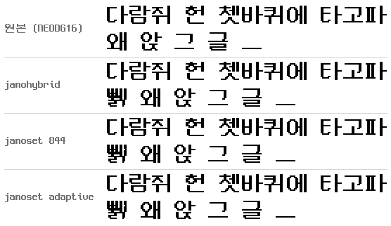
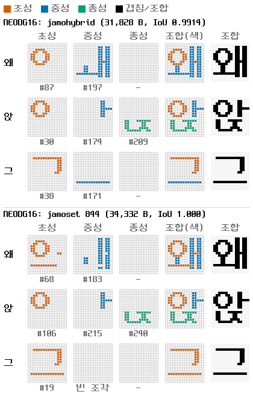
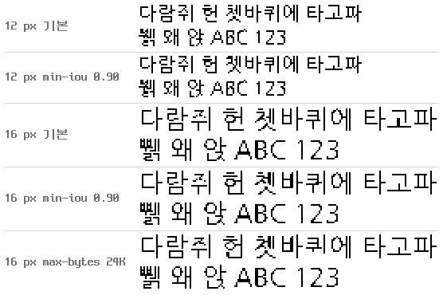
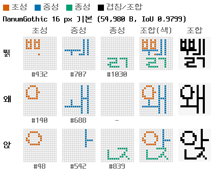
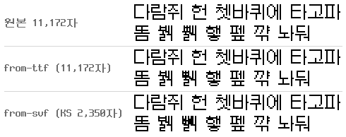
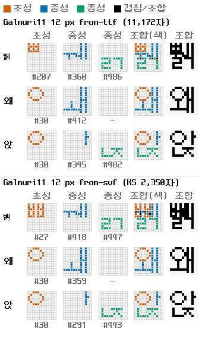

[English](jamo-split-guide.md) | **한국어**

# 자모 분리 실습 가이드

완성형 폰트에서 조합형(자모 세트) SVF 페이스를 직접 만드는 실습 문서다.
원리와 설계 배경은 [자모 분리](jamo-split.ko.md)와 [자모 세트](jamo-sets.ko.md)에, 벌 수 선택 기준은 [벌 수 정하기](recipes/sets.ko.md)에 있다.
이 문서는 성격이 다른 세 가지 OFL 폰트로 실제 명령을 실행하고, 결과 수치와 그림을 보며 옵션을 고르는 과정을 다룬다.

## 차례

1. [준비와 실행 환경](#1-준비와-실행-환경)
2. [출력과 리포트 읽는 법](#2-출력과-리포트-읽는-법)
3. [사례 1: 비트맵 조합형 친화 페이스 — Neo둥근모 16 (NEODG16.SVF)](#3-사례-1-비트맵-조합형-친화-페이스--neo둥근모-16-neodg16svf)
4. [사례 2: 작은 크기의 아웃라인 폰트 — 나눔고딕 12 / 16 px](#4-사례-2-작은-크기의-아웃라인-폰트--나눔고딕-12--16-px)
5. [사례 3: 픽셀 스타일 폰트와 KS 전용의 한계 — Galmuri11 12 px](#5-사례-3-픽셀-스타일-폰트와-ks-전용의-한계--galmuri11-12-px)
6. [빠른 선택 기준](#6-빠른-선택-기준)
7. [관련 문서](#7-관련-문서)

## 1. 준비와 실행 환경

모든 명령은 저장소 루트에서 실행한다. 출력 디렉터리 `$OUT`을 먼저 정한다.

```sh
OUT=/tmp/jamo-guide-out
mkdir -p "$OUT"
```

도구별 실행 요구 사항은 [도구 설명서](tools.ko.md)를 따른다.

- `tools/jamohybrid.py`: `numpy`가 필요하다(`torch`는 필요 없다). `--from-ttf`에는 `freetype-py`도 필요하다.
  코어가 많은 기계에서는 `OMP_NUM_THREADS=4`를 설정하면 `numpy` 스레드 경합을 줄여 더 빠르다.
- `tools/jamoset.py`: `--from-svf`는 표준 라이브러리만으로 동작한다. `--from-ttf`(1 bpp `mono`)에는 `freetype-py`가 필요하다(GSUB 마스크에는 `uharfbuzz`, `--bpp 2` 또는 `--binarize threshold|ridge`에는 `fontTools`).
- `tools/mkfont.py`: `Pillow`(FreeType 지원 포함)가 필요하다(`fontTools`는 선택).
- `tools/svfline.py`: 표준 라이브러리만으로 동작한다.
- 사례 3의 음절 수 확인 한 줄 명령(`python3 -I -c 'import freetype…'`)에는 `freetype-py`가 필요하다.
- `--pylib DIR`과 `JAMOSET_PYLIB=DIR`은 `jamohybrid.py`와 `jamoset.py`에만 적용되며, `mkfont.py`나 단독 `python3 -I -c` 명령에는 닿지 않는다.
  가장 간단한 방법은 `numpy`, `freetype-py`, `Pillow`를 모두 설치한 Python 3 환경 하나로 이 가이드의 모든 명령을 실행하는 것이다.
- 내려받은 폰트는 신뢰하지 않는 데이터로 다루며, 모든 도구는 격리 모드(`-I`)로 실행한다.

```sh
# jamohybrid.py / jamoset.py에 별도 site-packages 경로를 지정할 때
export JAMOSET_PYLIB=/path/to/site-packages
export OMP_NUM_THREADS=4
```

이 문서의 모든 그림은 `tools/doc_figures_jamoguide.py`가 세 사례의 OFL 폰트(Neo둥근모 16, 나눔고딕, Galmuri11)만으로 생성하며, `--check`로 바이트 단위 재현을 검증한다.

## 2. 출력과 리포트 읽는 법

`tools/jamohybrid.py`는 후보별 진행 줄을 표준 오류로, 최종 요약과 `--check` 결과를 표준 출력으로 낸다.

```text
$OUT/ng16-default.svf: 54980 bytes, composed IoU 0.9799, KS 0.9518 (6735 of 11172 exact), 1137 pieces, sets 32/23/16, classes 12x12, 0 pieces fail a gate; the smallest class cap within 0.005 IoU of the most accurate
check: composed 11172 syllables from 1232 glyphs, JSET 12279 bytes
```

각 항목의 뜻은 다음과 같다.

| 항목 | 의미 | 볼 기준 |
|---|---|---|
| `bytes` | 완성된 SVF 파일 전체 크기(ASCII·JSET 포함) | 대상 메모리 예산 안인지 확인한다 |
| `composed IoU` / `KS` | 원본 음절과 조합 음절의 평균 IoU. 원본이 KS 2,350자와 다르면 KS IoU를 함께 적는다 | 0.98 이상이면 원본에 매우 가깝다. MCU 실용선은 약 0.90이다 |
| `exact` | 원본과 픽셀이 1비트도 다르지 않은 음절 수 | 조합형 기반 폰트일수록 높다 |
| `pieces`, `sets`, `classes` | 저장된 조각 수, 초성/중성/종성 벌 수, 초성x종성 갈래 수 | 표준 JSET 한도는 32/24/16벌, 12x12 갈래다 |
| `pieces fail a gate` | 정체 관문(잉크량·구멍·획·꺾임)을 통과하지 못한 조각 수 | v2에서는 보통 0이다. 0이 아니면 해당 자모를 눈으로 확인한다 |
| `;` 뒤의 선택 규칙 문구 | 이 페이스를 고른 종료 규칙(`the smallest class cap within 0.005 IoU…`, `smallest with IoU >= X`, `most accurate within N B`, `fixed limits`) | `--min-iou` / `--max-bytes` 목표를 만족했는지, 가장 가까운 후보로 대체됐는지 확인한다 |
| `jset=v1 v1=… v2=…` (`jamoset.py`) | 기록한 JSET 블록 버전과 v1·v2 블록의 바이트 크기 | `v1 - v2` 차이가 크면(예: adaptive 12x12) `--jset-version 2`나 `auto`로 수 KB 줄일 수 있다 |
| `check:` | `--check`가 11,172음절을 모두 조합해 테이블 무결성을 확인한 결과 | 항상 실행한다. 단, 화질이 아니라 구조 정상 여부만 보장한다 |

`--report OUT.json`을 주면 선택한 지점, 시도한 사다리, 갈래·벌·관문 수치, `blank_jamo` 목록이 JSON으로 저장된다.
원본에 한 번도 등장하지 않은 자모가 있으면 표준 오류에 경고가 뜬다.

```text
warning: no source syllable shows ...: drawn blank where the face uses them
```

이 경고가 나오면 해당 자모가 들어간 음절은 빈 조각으로 그려진다. 더 많은 음절이 들어 있는 원본(가능하면 11,172자를 모두 가진 TTF)을 주어야 해결된다.

숫자만 믿지 말고 `tools/svfline.py`나 `web/` 피커로 실제 문장을 렌더링해 눈으로 확인한다(예: 저장소에 동봉된 페이스 측정).

```sh
python3 -I tools/svfline.py measure "다람쥐 헌 쳇바퀴에 타고파" svf/dos/NEODG16.SVF
```

## 3. 사례 1: 비트맵 조합형 친화 페이스 — Neo둥근모 16 (NEODG16.SVF)

### 폰트와 선택 이유

`svf/dos/NEODG16.SVF`는 이 저장소에 이미 들어 있는 16x16 1 bpp 완성형 비트맵 페이스다(Neo둥근모 1.601, SIL OFL 1.1, 라이선스 [svf/dos/NEODGM.TXT](../svf/dos/NEODGM.TXT)).
ASCII, KS X 1001 기호와 한글 2,350자, 추가 음절 7자를 합쳐 2,905글리프(한글 음절 2,357자)이며 파일 크기는 133,720 B다.
원본 자체가 8x4x4 조합형 규칙과 매우 가깝게 설계된 픽셀 폰트이므로, 학습 기반 분리(`jamohybrid.py`)와 픽셀 맞춤(`jamoset.py`)의 차이를 비교하기에 가장 좋은 첫 사례다.

### 입력과 명령

입력 파일은 `svf/dos/NEODG16.SVF`다.
`jamohybrid.py` 기본값, `jamoset.py --layout 844`, `jamoset.py --layout adaptive` 세 가지를 같은 원본에 실행하고 `--check`로 검증한다.

```sh
OMP_NUM_THREADS=4 python3 -I tools/jamohybrid.py \
  --from-svf svf/dos/NEODG16.SVF \
  -o "$OUT/neodg16-hybrid.svf" \
  --report "$OUT/neodg16-hybrid.json" \
  --check

python3 -I tools/jamoset.py --layout 844 \
  --from-svf svf/dos/NEODG16.SVF --mask-font none --check \
  -o "$OUT/neodg16-844.svf"

python3 -I tools/jamoset.py --layout adaptive \
  --from-svf svf/dos/NEODG16.SVF --mask-font none --check \
  -o "$OUT/neodg16-adapt.svf"
```

### 실제 출력

```text
# jamohybrid.py
limits (32, 24, 16), tolerance 1.33 px: 40092 bytes, IoU 0.9937, 262 pieces, sets 14/4/4, classes 12x12
limits (32, 24, 16), tolerance 1.33 px: 35484 bytes, IoU 0.9915, 261 pieces, sets 13/4/4, classes 12x6
limits (32, 24, 16), tolerance 1.33 px: 34972 bytes, IoU 0.9937, 259 pieces, sets 13/4/5, classes 8x8
limits (32, 24, 16), tolerance 1.33 px: 33280 bytes, IoU 0.9915, 262 pieces, sets 14/4/4, classes 6x6
limits (32, 24, 16), tolerance 1.33 px: 31828 bytes, IoU 0.9914, 260 pieces, sets 12/4/3, classes 4x4
$OUT/neodg16-hybrid.svf: 31828 bytes, composed IoU 0.9914, KS 0.9914 (2116 of 2357 exact), 260 pieces, sets 12/4/3, classes 4x4, 0 pieces fail a gate; the smallest class cap within 0.005 IoU of the most accurate
check: composed 11172 syllables from 808 glyphs, JSET 1955 bytes

# jamoset.py --layout 844
$OUT/neodg16-844.svf: 34332 bytes, 344 pieces of 16x16 fitted from svf/dos/NEODG16.SVF in 0.2 s; jset=v1 v1=1101 v2=272
fit: 2357 syllables, IoU 1.000 (p5 1.000), F1 tol1 1.000 (p5 1.000), exact 2357, blobs merged 0 split 0
check: composed 11172 syllables from 892 glyphs, JSET 1101 bytes

# jamoset.py --layout adaptive
$OUT/neodg16-adapt.svf: 43152 bytes, 344 pieces of 16x16 fitted from svf/dos/NEODG16.SVF in 2.0 s; jset=v1 v1=9921 v2=2844
fit: 2357 syllables, IoU 1.000 (p5 1.000), F1 tol1 1.000 (p5 1.000), exact 2357, blobs merged 0 split 0
adaptive: 8/4/4 sets, 12 lead and 12 tail classes
check: composed 11172 syllables from 892 glyphs, JSET 9921 bytes; tables are the adaptive layout's (8/4/4 sets, 12x12 classes)
```

### 결과 비교

| 방법 | 바이트 | 조합 IoU | 정확 음절 | 조각 수 | 벌 (초/중/종) | 갈래 | 관문 실패 | JSET 크기 |
|---|---:|---:|---:|---:|---|---|---:|---:|
| 원본 (`NEODG16.SVF`) | 133,720 | — | 2,357 | — | — | — | — | — |
| `jamohybrid.py` | 31,828 | 0.9914 | 2,116 / 2,357 | 260 | 12 / 4 / 3 | 4x4 | 0 | 1,955 B |
| `jamoset.py --layout 844` | 34,332 | 1.000 | 2,357 / 2,357 | 344 | 8 / 4 / 4 | 2x2 | — | 1,101 B |
| `jamoset.py --layout adaptive` | 43,152 | 1.000 | 2,357 / 2,357 | 344 | 8 / 4 / 4 | 12x12 | — | 9,921 B |

세 결과 모두 원본의 비한글 글리프 548개(ASCII, 기호, 호환 자모)를 그대로 유지한다.

### 샘플 그림과 조각 보기



*그림 1. `NEODG16.SVF` 원본과 `jamohybrid.py`, `jamoset.py 844`, `jamoset.py adaptive`의 렌더링 비교(2배 확대, 흰 바탕 검정 글자). 원본에는 없는 `쀍`도 자모 세트는 모두 조합한다.*



*그림 2. `왜`, `앉`, `그`의 초성(주황)·중성(파랑)·종성(초록) 조각 비교. 위쪽은 `jamohybrid.py`, 아래쪽은 `jamoset.py 844`다.*

### 무엇을 볼 것인가

- `jamoset 844`는 0.2초 만에 2,357자 전부를 IoU 1.000으로 정확히 재현한다.
- 그러나 그림 2의 `그`를 보면 `jamoset 844`는 `ㅡ` 가로획을 초성 조각에 몰아넣고 중성 `ㅡ` 조각을 **빈 조각**으로 남겼다.
  `jamohybrid.py`는 정체 관문 덕분에 `ㅡ` 가로획을 중성 조각에 제자리로 분리한다.
- `jamoset adaptive`는 8x4x4에서 이미 오차가 0이므로 벌을 더 나누지 않고(8/4/4), 12x12 갈래 표 크기 8,820 B만 더 차지했다.

### 흔한 문제와 해결

- **호환 자모 `ㅡ`(U+3161): 호환 자모가 없는 원본에서는 빈칸으로 그려진다**: `NEODG16.SVF`는 U+3161 통째 글리프를 이미 갖고 있어 세 결과 모두 정상 출력한다.
  만약 호환 자모가 없는 원본을 `jamoset 844`로 분리하면 중성 `ㅡ`가 빈 조각이어서 U+3161도 비어 나온다([자모 분리 4.3](jamo-split.ko.md#43-작은-픽셀-글꼴-비어-있는-중성-ㅡ)).
  원본을 만들 때 `mkfont.py --unicode ascii,ksx1001-hangul,3131-3163`으로 호환 자모를 포함하거나 `jamohybrid.py`를 쓰면 막을 수 있다.
- **adaptive 표가 클 때**: `--jset-version 2`(또는 `auto`)를 주면 `neodg16-adapt.svf`의 JSET 블록이 9,921 B에서 2,844 B로 줄어든다.

### 다른 방법을 고를 때

- Neo둥근모처럼 원래 8x4x4 규칙으로 만든 비트맵 폰트라면 `jamoset.py --layout 844`가 가장 빠르고 정확(IoU 1.000)하다.
- Arduino Uno처럼 12 KB 이하의 MCU가 필요하면 `621` 레이아웃(`svf/dos/NEODG16G.SVF`, 10,684 B)이나 `jamomerge.py`로 줄인다.
- 조각의 자모 정체성이 중요하다면(예: 비KS 음절을 깔끔하게 외삽해야 할 때) `jamohybrid.py`를 쓴다.

## 4. 사례 2: 작은 크기의 아웃라인 폰트 — 나눔고딕 12 / 16 px

### 폰트와 선택 이유

나눔고딕(NanumGothic, SIL OFL 1.1)은 음절마다 따로 설계된 현대 아웃라인 폰트이며 11,172음절을 모두 그린다.
12~16 px 작은 크기에서는 자모 획이 서로 닿고 힌팅이 음절마다 획 위치를 옮기므로, 기존 `jamoset.py --layout 844`는 IoU 0.71~0.73에 그친다([자모 분리 4.6](jamo-split.ko.md#46-12-16-px-윤곽선-글꼴)).
`tools/jamohybrid.py --from-ttf`로 크기와 정확도 사이를 어떻게 고르는지 본다.

### 입력과 명령

내려받은 `NanumGothic.ttf` 경로를 `$FONT`에 넣는다.

```sh
FONT=/path/to/NanumGothic.ttf

# 12 px: 기본값과 MCU용(--min-iou 0.90)
OMP_NUM_THREADS=4 python3 -I tools/jamohybrid.py \
  --from-ttf "$FONT" --size 12 \
  -o "$OUT/ng12-default.svf" --report "$OUT/ng12-default.json" --check

OMP_NUM_THREADS=4 python3 -I tools/jamohybrid.py \
  --from-ttf "$FONT" --size 12 --min-iou 0.90 \
  -o "$OUT/ng12-iou90.svf" --report "$OUT/ng12-iou90.json" --check

# 16 px: 기본값, --min-iou 0.90, --max-bytes 24576
OMP_NUM_THREADS=4 python3 -I tools/jamohybrid.py \
  --from-ttf "$FONT" --size 16 \
  -o "$OUT/ng16-default.svf" --report "$OUT/ng16-default.json" --check

OMP_NUM_THREADS=4 python3 -I tools/jamohybrid.py \
  --from-ttf "$FONT" --size 16 --min-iou 0.90 \
  -o "$OUT/ng16-iou90.svf" --report "$OUT/ng16-iou90.json" --check

OMP_NUM_THREADS=4 python3 -I tools/jamohybrid.py \
  --from-ttf "$FONT" --size 16 --max-bytes 24576 \
  -o "$OUT/ng16-24k.svf" --report "$OUT/ng16-24k.json" --check

# 수동 지정(--tol, --classes)과 BIG(--big)
OMP_NUM_THREADS=4 python3 -I tools/jamohybrid.py \
  --from-ttf "$FONT" --size 16 --tol 3 --classes 6,6 \
  -o "$OUT/ng16-tol3.svf" --check

OMP_NUM_THREADS=4 python3 -I tools/jamohybrid.py \
  --from-ttf "$FONT" --size 16 --big \
  -o "$OUT/ng16-big.svf" --check
```

### 실제 출력

```text
# 12 px 기본
$OUT/ng12-default.svf: 39508 bytes, composed IoU 0.9757, KS 0.9464 (6358 of 11172 exact), 957 pieces, sets 31/20/15, classes 12x6, 0 pieces fail a gate; the smallest class cap within 0.005 IoU of the most accurate
check: composed 11172 syllables from 1052 glyphs, JSET 7525 bytes

# 12 px --min-iou 0.90
$OUT/ng12-iou90.svf: 22892 bytes, composed IoU 0.9069, KS 0.8861 (2041 of 11172 exact), 571 pieces, sets 22/9/8, classes 4x4, 0 pieces fail a gate; smallest with IoU >= 0.9
check: composed 11172 syllables from 666 glyphs, JSET 2815 bytes

# 16 px 기본
$OUT/ng16-default.svf: 54980 bytes, composed IoU 0.9799, KS 0.9518 (6735 of 11172 exact), 1137 pieces, sets 32/23/16, classes 12x12, 0 pieces fail a gate; the smallest class cap within 0.005 IoU of the most accurate
check: composed 11172 syllables from 1232 glyphs, JSET 12279 bytes

# 16 px --min-iou 0.90
$OUT/ng16-iou90.svf: 30940 bytes, composed IoU 0.906, KS 0.8724 (1960 of 11172 exact), 698 pieces, sets 28/11/9, classes 4x4, 0 pieces fail a gate; smallest with IoU >= 0.9
check: composed 11172 syllables from 793 glyphs, JSET 3181 bytes

# 16 px --max-bytes 24576
$OUT/ng16-24k.svf: 24488 bytes, composed IoU 0.8594, KS 0.8366 (840 of 11172 exact), 490 pieces, sets 21/9/4, classes 6x6, 0 pieces fail a gate; most accurate within 24576 B
check: composed 11172 syllables from 585 glyphs, JSET 3821 bytes

# 16 px --tol 3 --classes 6,6
$OUT/ng16-tol3.svf: 40036 bytes, composed IoU 0.9489, KS 0.9039 (4280 of 11172 exact), 917 pieces, sets 31/14/14, classes 6x6, 0 pieces fail a gate; fixed limits
check: composed 11172 syllables from 1012 glyphs, JSET 4951 bytes

# 16 px --big
$OUT/ng16-big.svf: 82568 bytes, composed IoU 0.9907, KS 0.9783 (7369 of 11172 exact), 1626 pieces, sets 55/45/29, classes 19x14, BIG, 0 pieces fail a gate; the smallest class cap within 0.005 IoU of the most accurate
check: composed 11172 syllables from 1721 glyphs, JSET 22465 bytes
```

### 결과 비교

비교 기준인 완성형 11,172자(`mkfont.py --bpp 1 --mono-hint --unicode ascii,hangul`)는 12 px에서 493,888 B, 16 px에서 567,324 B다.

| 설정 | 바이트 | 전체 IoU | KS IoU | 정확 음절 | 조각 수 | 벌 (초/중/종) | 갈래 | 관문 실패 |
|---|---:|---:|---:|---:|---:|---|---|---:|
| 12 px 기본 | 39,508 | 0.9757 | 0.9464 | 6,358 | 957 | 31 / 20 / 15 | 12x6 | 0 |
| 12 px `--min-iou 0.90` | 22,892 | 0.9069 | 0.8861 | 2,041 | 571 | 22 / 9 / 8 | 4x4 | 0 |
| 16 px 기본 | 54,980 | 0.9799 | 0.9518 | 6,735 | 1,137 | 32 / 23 / 16 | 12x12 | 0 |
| 16 px `--min-iou 0.90` | 30,940 | 0.9060 | 0.8724 | 1,960 | 698 | 28 / 11 / 9 | 4x4 | 0 |
| 16 px `--max-bytes 24576` | 24,488 | 0.8594 | 0.8366 | 840 | 490 | 21 / 9 / 4 | 6x6 | 0 |
| 16 px `--tol 3 --classes 6,6` | 40,036 | 0.9489 | 0.9039 | 4,280 | 917 | 31 / 14 / 14 | 6x6 | 0 |
| 16 px `--big` | 82,568 | 0.9907 | 0.9783 | 7,369 | 1,626 | 55 / 45 / 29 | 19x14 | 0 |

### 옵션 설명: `--tol`, `--classes`, `--big`

- `--tol PX`: 병합 허용치(음절당 불일치 픽셀 수, 기본은 셀 높이 / 12). 값을 키우면 조각이 더 많이 합쳐져 파일이 작아지고, `0`을 주면 한도까지 합치지 않는다. `--max-bytes` / `--min-iou`는 이 허용치 사다리를 자동으로 탐색한다.
- `--classes LC,TC`: 초성·종성 갈래 상한을 직접 고정한다. 갈래 쌍 하나가 JSET v1 표 63 B를 차지하므로 `6,6`처럼 줄이면 표 크기와 빌드 시간이 함께 줄어든다(위 16 px에서 12x12 표는 12,279 B, 6x6 표는 4,951 B).
- `--big`: JSET BIG 한도(기본 64/48/32벌, 19x28 갈래)를 열어 1픽셀 밀림을 크게 줄인다(16 px에서 0.9799 → 0.9907). 단, 렌더러를 `SVF_JSET_BIG`으로 빌드해야 읽을 수 있다.

### 샘플 그림과 조각 보기



*그림 3. 나눔고딕 12 px(기본, `--min-iou 0.90`)와 16 px(기본, `--min-iou 0.90`, `--max-bytes 24576`)의 렌더링 비교(2배 확대, 흰 바탕 검정 글자).*



*그림 4. 나눔고딕 16 px 기본 페이스의 `쀍`, `왜`, `앉` 조각 분해. 초성(주황), 중성(파랑), 종성(초록)이 겹침 없이 각자 획을 유지한다.*

### 무엇을 볼 것인가

- 16 px 기본(55 KB)은 11,172자 완성형(567 KB)의 **10분의 1 이하** 크기에서 IoU 0.980을 낸다.
- `--min-iou 0.90`은 12 px에서 22.9 KB, 16 px에서 30.9 KB로 줄면서도 관문 실패가 0이다.
- `--max-bytes 24576`(24.5 KB)처럼 예산을 더 조이면 IoU가 0.859로 내려가고, `ㅗ/ㅜ/ㅡ` 주변이나 겹받침의 미세한 위치가 조금씩 어긋나기 시작한다. 그림 3에서 `쳇`, `쀍`, `앉`을 비교해 본다.

### 흔한 문제와 해결

- **표 크기가 부담될 때**: 16 px 기본의 JSET v1 블록은 12,279 B다. `--jset-version 2`(또는 `auto`)를 붙이면 화질 손실 없이 표 크기를 수 KB 줄일 수 있다.
- **사다리 실행 시간이 길 때**: `--min-iou` / `--max-bytes`는 30개 조합을 시험해 30~90초 걸린다. 이미 감이 잡혔다면 `--tol`과 `--classes`로 한 지점만 바로 빌드하면 몇 초로 끝난다.
- **KS IoU가 전체 IoU보다 낮게 나올 때**: 나눔고딕은 KS 2,350자는 직접 그린 윤곽선이고 나머지 8,822자는 합성 글리프인 경우가 많아, KS 쪽 변형이 더 다양하다. 최종 판단은 항상 KS 문장과 비KS 음절을 함께 렌더링해 눈으로 한다.

### 다른 방법을 고를 때

- 데스크톱·웹처럼 메모리가 넉넉하고 KS 2,350자만 필요하다면 완성형(`mkfont.py`)이 100% 정확하다.
- 2 bpp 안티앨리어싱 자모 세트가 필요하면 `jamoset.py --from-ttf --bpp 2` 또는 `jamovec.py`를 쓴다(`jamohybrid.py`는 1 bpp 전용이다).
- 자주 쓰는 몇 글자만 어긋나면 벌을 늘리는 대신 `tools/jamoexc.py`로 최대 255자까지 LIST 예외를 얹는 편이 바이트 효율이 높다.

## 5. 사례 3: 픽셀 스타일 폰트와 KS 전용의 한계 — Galmuri11 12 px

### 폰트와 선택 이유

Galmuri11(SIL OFL 1.1)은 12 px 격자에 맞춰 설계된 픽셀 스타일 TrueType 폰트다.
먼저 이 폰트가 현대 한글 11,172자를 모두 갖고 있는지 측정한다.

```sh
python3 -I -c '
import freetype, sys; sys.path.insert(0, "tools"); import jamoset as J
f = freetype.Face("/path/to/Galmuri11.ttf")
present = [cp for cp in range(0xAC00, 0xD7A4) if f.get_char_index(cp)]
ks = {0xAC00 + s for s in J.ks_x_1001_syllables()}
print("total:", len(present), "KS:", sum(c in ks for c in present), "non-KS:", sum(c not in ks for c in present))
'
```

측정 결과 `Galmuri11.ttf`는 **11,172자 전부**(KS 2,350 + 비KS 8,822)를 갖고 있다.
이 사례에서는 같은 폰트를 (1) 11,172자 전체가 있는 TTF로 바로 분리했을 때와 (2) KS 2,350자만 담긴 완성형 SVF로 분리했을 때의 차이를 직접 측정한다([자모 분리 7.8](jamo-split.ko.md#78-쓸-수-있는-도구)의 KS 전용 약점).

### 입력과 명령

내려받은 `Galmuri11.ttf` 경로를 `$GAL`에 넣는다.

```sh
GAL=/path/to/Galmuri11.ttf

# 1) TTF에서 11,172자 전체로 분리
OMP_NUM_THREADS=4 python3 -I tools/jamohybrid.py \
  --from-ttf "$GAL" --size 12 \
  -o "$OUT/gal12-ttf.svf" --report "$OUT/gal12-ttf.json" --check

# 2) KS 2,350자만 담은 완성형 SVF를 만든 뒤 --from-svf로 분리
python3 -I tools/mkfont.py "$GAL" "$OUT/gal12-ks-pre.svf" \
  --size 12 --bpp 1 --mono-hint --unicode ascii,ksx1001-hangul

OMP_NUM_THREADS=4 python3 -I tools/jamohybrid.py \
  --from-svf "$OUT/gal12-ks-pre.svf" \
  -o "$OUT/gal12-ks-hybrid.svf" --report "$OUT/gal12-ks-hybrid.json" --check

# 3) 비교 기준: 11,172자 전체 완성형 SVF
python3 -I tools/mkfont.py "$GAL" "$OUT/gal12-all-pre.svf" \
  --size 12 --bpp 1 --mono-hint --unicode ascii,hangul
```

### 실제 출력

```text
# --from-ttf (11,172자 전체)
$OUT/gal12-ttf.svf: 26176 bytes, composed IoU 0.9867, KS 0.9876 (8112 of 11172 exact), 539 pieces, sets 28/15/5, classes 12x6, 0 pieces fail a gate; the smallest class cap within 0.005 IoU of the most accurate
check: composed 11172 syllables from 634 glyphs, JSET 6661 bytes

# --from-svf (KS 2,350자만)
$OUT/gal12-ks-hybrid.svf: 24576 bytes, composed IoU 0.9838 (1767 of 2350 exact), 473 pieces, sets 30/15/4, classes 12x6, 0 pieces fail a gate; the smallest class cap within 0.005 IoU of the most accurate
check: composed 11172 syllables from 569 glyphs, JSET 6683 bytes
```

### 결과 비교 (KS 2,350자 대 비KS 8,822자)

두 결과 페이스를 11,172자 전체 완성형(`gal12-all-pre.svf`, 494,364 B)과 대조 측정했다.

| 방법 | 바이트 | KS IoU (정확 / 2,350) | 비KS IoU (정확 / 8,822) | 조각 수 | 벌 (초/중/종) | 갈래 | 관문 실패 |
|---|---:|---|---|---:|---|---|---:|
| 완성형 11,172자 | 494,364 | 1.0000 (2,350) | 1.0000 (8,822) | — | — | — | — |
| 완성형 KS 2,350자 | 106,204 | 1.0000 (2,350) | 미지원 | — | — | — | — |
| `--from-ttf` (11,172자) | 26,176 | 0.9876 (1,730) | **0.9864 (6,382)** | 539 | 28 / 15 / 5 | 12x6 | 0 |
| `--from-svf` (KS 2,350자) | 24,576 | 0.9838 (1,767) | **0.8565 (2,754)** | 473 | 30 / 15 / 4 | 12x6 | 0 |

비KS 테스트 음절 `똠 뷁 쀍 햏 펲 꺆 놔둬`의 개별 IoU는 다음과 같다.

| 음절 | `똠` | `뷁` | `쀍` | `햏` | `펲` | `꺆` | `놔` | `둬` |
|---|---:|---:|---:|---:|---:|---:|---:|---:|
| `--from-ttf` (11,172자) | 1.000 | 1.000 | 0.731 | 1.000 | 1.000 | 1.000 | 0.558 | 1.000 |
| `--from-svf` (KS 2,350자) | 1.000 | 0.845 | 0.640 | 1.000 | 0.982 | 1.000 | 1.000 | 1.000 |

### 샘플 그림과 조각 보기



*그림 5. Galmuri11 12 px의 원본(11,172자), `--from-ttf`(11,172자), `--from-svf`(KS 2,350자) 비교(2배 확대, 흰 바탕 검정 글자). 둘째 줄이 비KS 포함 샘플 `똠 뷁 쀍 햏 펲 꺆 놔둬`다.*



*그림 6. Galmuri11 12 px의 `쀍`, `왜`, `앉` 조각 분해. 위쪽은 11,172자 전체(`--from-ttf`), 아래쪽은 KS 2,350자만(`--from-svf`)으로 만든 결과다.*

### 무엇을 볼 것인가

- KS 2,350자만 보고 만든 페이스는 도구 요약에 `composed IoU 0.9838`만 찍히므로 겉보기에는 완벽해 보인다.
- 그러나 실제로는 KS 밖 8,822자에 대한 데이터가 전혀 없어 빈 문맥을 외삽하며, 비KS 평균 IoU가 **0.9864에서 0.8565로 0.13 떨어지고** 정확 음절도 6,382자에서 2,754자로 절반 이하가 된다.
- 그림 5와 6의 `뷁`, `쀍`에서 KS 전용 쪽은 복합 모음(`ㅞ`)과 겹받침(`ㄺ`)의 위치가 어긋나거나 획이 뭉친다.
- 반대로 11,172자 전체로 분리한 `gal12-ttf.svf`는 1,600 B만 더 쓰고도(26,176 B) KS와 비KS 모두 0.986 이상을 유지한다.

### 흔한 문제와 해결

- **KS 전용 BDF·ROM·SVF밖에 없을 때**: `jamohybrid.py`는 있는 음절로만 학습하므로 비KS 외삽 오차를 피할 수 없다. 같은 패밀리의 11,172자 TTF가 있으면 반드시 `--from-ttf`를 쓴다.
- **`blank_jamo` 경고가 뜰 때**: 음절 수가 더 적은 부분집합 SVF(예: 게임 대사 추출본)를 넣으면 아예 등장하지 않은 초성·중성·종성이 생겨 빈 조각이 된다. 이 경우 부분집합 SVF가 아니라 원본 TTF나 전체 음절 페이스에서 분리해야 한다.
- **특정 1~2음절의 1픽셀 밀림**: 위 표에서 `gal12-ttf.svf`의 `놔`(0.558)처럼 병합 허용치 안에서 한 글자가 1픽셀 밀릴 수 있다. `--tol 0.5`로 허용치를 낮추거나 `jamoexc.py`로 그 글자만 예외 처리한다.

### 다른 방법을 고를 때

- 픽셀 폰트가 애초에 KS 2,350자만 필요하고 플래시가 110 KB 이상 남으면 완성형(`106,204 B`)을 그대로 쓴다.
- 11,172자가 필요하고 26 KB 안팎 예산이라면 `jamohybrid.py --from-ttf`가 완성형(494 KB)의 5.3% 크기에서 IoU 0.9867을 낸다.

## 6. 빠른 선택 기준

| 상황 | 권장 명령 | 참고 사례 |
|---|---|---|
| 8x4x4 규칙으로 만든 비트맵/DOS/ROM 페이스 | `jamoset.py --layout 844 --from-svf ... --mask-font none --check` | 사례 1 |
| 아웃라인 또는 픽셀 TTF, 11,172자, 1 bpp, 품질 우선 | `jamohybrid.py --from-ttf FONT --size N --check` | 사례 2, 3 |
| 아웃라인 TTF, MCU 예산(약 20~35 KB) | `jamohybrid.py --from-ttf FONT --size N --min-iou 0.90 --check` 또는 `--max-bytes N` | 사례 2 |
| JSET 표 크기를 줄이고 싶을 때 | 위 명령에 `--jset-version 2`(또는 `auto`) 추가 | 사례 1, 2 |
| 1픽셀 밀림까지 줄여야 하고 `SVF_JSET_BIG` 렌더러가 있을 때 | `jamohybrid.py ... --big --check` | 사례 2 |
| 2 bpp 안티앨리어싱 자모 세트 | `jamoset.py --from-ttf FONT --size N --bpp 2 --layout adaptive --check` | [자모 분리 2.5](jamo-split.ko.md#25-2-bpp-jamoaapy) |
| KS 2,350자만 필요하고 메모리 여유가 있을 때 | 완성형 유지(`mkfont.py`) | 사례 2, 3 |

## 7. 관련 문서

- [자모 분리](jamo-split.ko.md): 맞춤 알고리즘, 정체 관문, v2 평가와 약점(7.8장).
- [자모 세트](jamo-sets.ko.md): 조합형 인코딩, 벌 체계, JSET v1/v2/BIG/JMAP/LIST 구조.
- [벌 수 정하기](recipes/sets.ko.md): 레이아웃별 바이트·IoU 곡선과 크기·정확도 선택.
- [도구 설명서](tools.ko.md): `jamohybrid.py`, `jamoset.py`, `mkfont.py`, `svfline.py`, `doc_figures_jamoguide.py` 옵션 전체.
