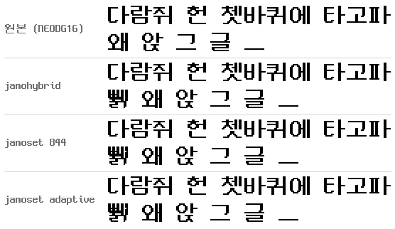
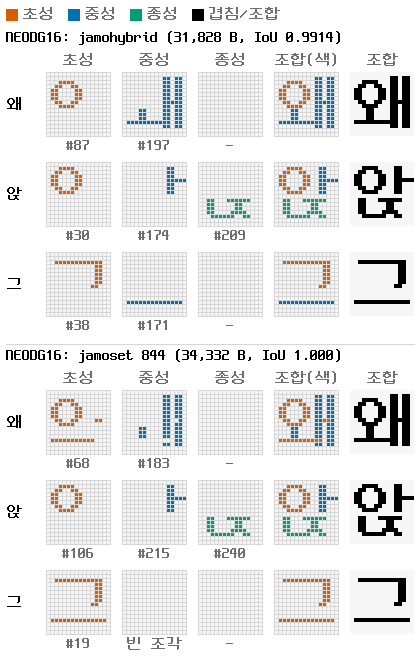
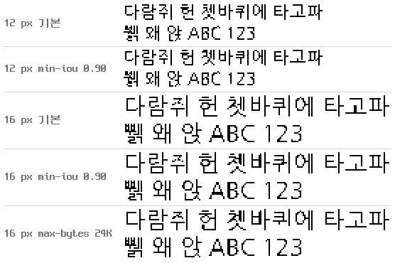
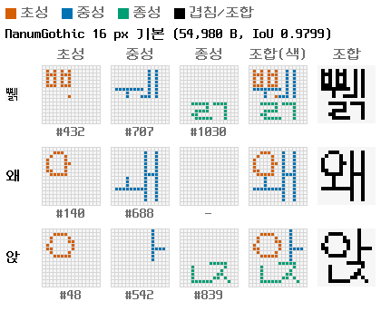
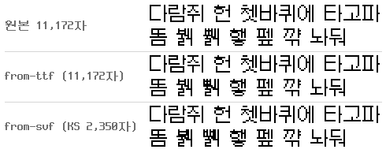
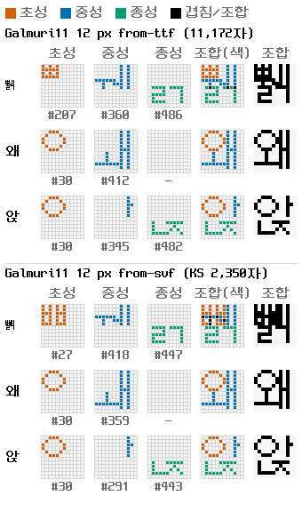

**English** | [한국어](jamo-split-guide.ko.md)

# Hands-on guide to jamo splitting

A walkthrough for turning a precomposed Korean font into a jamo-set SVF face.
For the theory and design background see [Jamo splitting](jamo-split.md) and [Jamo sets](jamo-sets.md); for choosing set counts see [Choosing the number of sets](recipes/sets.md).
This guide works through three OFL fonts with real commands, measured outputs, sample images and piece breakdowns.

## Contents

1. [Setup and environment](#1-setup-and-environment)
2. [Reading the output and report](#2-reading-the-output-and-report)
3. [Case 1: a bitmap jamo-friendly face — Neo Dunggeunmo 16 (NEODG16.SVF)](#3-case-1-a-bitmap-jamo-friendly-face--neo-dunggeunmo-16-neodg16svf)
4. [Case 2: an outline font at small sizes — NanumGothic 12 / 16 px](#4-case-2-an-outline-font-at-small-sizes--nanumgothic-12--16-px)
5. [Case 3: a pixel-style font and the KS-only weakness — Galmuri11 12 px](#5-case-3-a-pixel-style-font-and-the-ks-only-weakness--galmuri11-12-px)
6. [Quick decision table](#6-quick-decision-table)
7. [Related documents](#7-related-documents)

## 1. Setup and environment

Run every command from the repository root with `$OUT` set.

```sh
OUT=/tmp/jamo-guide-out
mkdir -p "$OUT"
```

Tool requirements follow [Tools](tools.md).

- `tools/jamohybrid.py`: needs Python 3 with `numpy`, plus `freetype-py` for `--from-ttf` (`torch` is not needed).
  Either invoke a Python environment that has them, or point the tool at their directory with `--pylib DIR` or `JAMOSET_PYLIB=DIR`.
  On a many-core machine, set `OMP_NUM_THREADS=4` to avoid `numpy` thread contention.
- `tools/jamoset.py`, `tools/mkfont.py`, `tools/svfline.py`: run with `python3 -I` (`mkfont.py` needs Pillow).
- Treat downloaded fonts as untrusted data and always pass `-I` (isolated mode).

```sh
# When numpy and freetype-py are outside the default Python path
export JAMOSET_PYLIB=/path/to/site-packages
export OMP_NUM_THREADS=4
```

All figures in this guide are generated by `tools/doc_figures_jamoguide.py`; `--check` regenerates them and compares byte for byte.

## 2. Reading the output and report

`tools/jamohybrid.py` writes progress lines per candidate to stderr and the final summary plus `--check` line to stdout.

```text
$OUT/ng16-default.svf: 54980 bytes, composed IoU 0.9799, KS 0.9518 (6735 of 11172 exact), 1137 pieces, sets 32/23/16, classes 12x12, 0 pieces fail a gate; the smallest class cap within 0.005 IoU of the most accurate
check: composed 11172 syllables from 1232 glyphs, JSET 12279 bytes
```

What each field means:

| Field | Meaning | What to check |
|---|---|---|
| `bytes` | total SVF file size (including ASCII and JSET) | fits the target memory budget |
| `composed IoU` / `KS` | mean IoU between composed and source syllables (KS IoU added when the source differs from KS 2,350) | >= 0.98 is very close to the source; ~0.90 is a practical MCU floor |
| `exact` | syllables identical bit for bit to the source | higher on piece-built fonts |
| `pieces`, `sets`, `classes` | stored piece count, initial/medial/final set counts, lead x tail classes | standard JSET limits are 32/24/16 sets and 12x12 classes |
| `pieces fail a gate` | stored pieces that failed an identity gate (mass, holes, ticks, stubs, slant) | normally 0 in v2; if non-zero, inspect those jamo by eye |
| `check:` | `--check` composed all 11,172 syllables from the written file | always run it; it verifies table integrity, not visual quality |

With `--report OUT.json`, the tool writes the chosen point, the tried ladder, class/set/gate counts and `blank_jamo`.
If a jamo never appears in any source syllable, stderr prints a warning:

```text
warning: no source syllable shows ...: drawn blank where the face uses them
```

Any syllable using such a jamo draws blank on that slot. Give the tool a source with broader syllable coverage (ideally a TTF with all 11,172 syllables).

Never judge by IoU alone. Render sample lines with `tools/svfline.py` or the `web/` picker and inspect them by eye.

```sh
python3 -I tools/svfline.py measure "다람쥐 헌 쳇바퀴에 타고파" "$OUT/neodg16-hybrid.svf"
```

## 3. Case 1: a bitmap jamo-friendly face — Neo Dunggeunmo 16 (NEODG16.SVF)

### Font and why this case

`svf/dos/NEODG16.SVF` is a 16x16 1 bpp precomposed bitmap face already in the repository (Neo Dunggeunmo 1.601, SIL OFL 1.1, licence in [svf/dos/NEODGM.TXT](../svf/dos/NEODGM.TXT)).
It holds 2,905 glyphs (ASCII, KS X 1001 symbols, 2,350 KS syllables and 7 extra syllables = 2,357 Hangul syllables) in 133,720 bytes.
Because the font itself was designed close to an 8x4x4 jamo system, it is the cleanest starting point for comparing learned splitting (`jamohybrid.py`) against pixel fitting (`jamoset.py`).

### Input and commands

Input: `svf/dos/NEODG16.SVF`.
Run `jamohybrid.py` (default), `jamoset.py --layout 844` and `jamoset.py --layout adaptive` on the same source, each with `--check`.

```sh
OMP_NUM_THREADS=4 python3 -I tools/jamohybrid.py \
  --from-svf svf/dos/NEODG16.SVF \
  -o "$OUT/neodg16-hybrid.svf" \
  --report "$OUT/neodg16-hybrid.json" \
  --check

python3 -I tools/jamoset.py --layout 844 \
  --from-svf svf/dos/NEODG16.SVF --mask-font none --check \
  -o "$OUT/neodg16-844.svf"

python3 -I tools/jamoset.py --layout adaptive \
  --from-svf svf/dos/NEODG16.SVF --mask-font none --check \
  -o "$OUT/neodg16-adapt.svf"
```

### Real output

```text
# jamohybrid.py
limits (32, 24, 16), tolerance 1.33 px: 40092 bytes, IoU 0.9937, 262 pieces, sets 14/4/4, classes 12x12
limits (32, 24, 16), tolerance 1.33 px: 35484 bytes, IoU 0.9915, 261 pieces, sets 13/4/4, classes 12x6
limits (32, 24, 16), tolerance 1.33 px: 34972 bytes, IoU 0.9937, 259 pieces, sets 13/4/5, classes 8x8
limits (32, 24, 16), tolerance 1.33 px: 33280 bytes, IoU 0.9915, 262 pieces, sets 14/4/4, classes 6x6
limits (32, 24, 16), tolerance 1.33 px: 31828 bytes, IoU 0.9914, 260 pieces, sets 12/4/3, classes 4x4
$OUT/neodg16-hybrid.svf: 31828 bytes, composed IoU 0.9914, KS 0.9914 (2116 of 2357 exact), 260 pieces, sets 12/4/3, classes 4x4, 0 pieces fail a gate; the smallest class cap within 0.005 IoU of the most accurate
check: composed 11172 syllables from 808 glyphs, JSET 1955 bytes

# jamoset.py --layout 844
$OUT/neodg16-844.svf: 34332 bytes, 344 pieces of 16x16 fitted from svf/dos/NEODG16.SVF in 0.2 s; jset=v1 v1=1101 v2=272
fit: 2357 syllables, IoU 1.000 (p5 1.000), F1 tol1 1.000 (p5 1.000), exact 2357, blobs merged 0 split 0
check: composed 11172 syllables from 892 glyphs, JSET 1101 bytes

# jamoset.py --layout adaptive
$OUT/neodg16-adapt.svf: 43152 bytes, 344 pieces of 16x16 fitted from svf/dos/NEODG16.SVF in 2.0 s; jset=v1 v1=9921 v2=2844
fit: 2357 syllables, IoU 1.000 (p5 1.000), F1 tol1 1.000 (p5 1.000), exact 2357, blobs merged 0 split 0
adaptive: 8/4/4 sets, 12 lead and 12 tail classes
check: composed 11172 syllables from 892 glyphs, JSET 9921 bytes; tables are the adaptive layout's (8/4/4 sets, 12x12 classes)
```

### Results

| Method | Bytes | Composed IoU | Exact syllables | Pieces | Sets (I/M/F) | Classes | Gates failing | JSET bytes |
|---|---:|---:|---:|---:|---|---|---:|---:|
| Original (`NEODG16.SVF`) | 133,720 | — | 2,357 | — | — | — | — | — |
| `jamohybrid.py` | 31,828 | 0.9914 | 2,116 / 2,357 | 260 | 12 / 4 / 3 | 4x4 | 0 | 1,955 B |
| `jamoset.py --layout 844` | 34,332 | 1.000 | 2,357 / 2,357 | 344 | 8 / 4 / 4 | 2x2 | — | 1,101 B |
| `jamoset.py --layout adaptive` | 43,152 | 1.000 | 2,357 / 2,357 | 344 | 8 / 4 / 4 | 12x12 | — | 9,921 B |

All three outputs keep the 548 non-Hangul glyphs (ASCII, symbols, compatibility jamo) from `NEODG16.SVF`.

### Sample images and pieces



*Figure 1. `NEODG16.SVF` precomposed against `jamohybrid.py`, `jamoset.py 844` and `jamoset.py adaptive` (2x, black on white). All three jamo sets also compose `쀍`, which the precomposed face lacks.*



*Figure 2. Initial (vermillion), medial (blue) and final (green) pieces of `왜`, `앉` and `그`. Top: `jamohybrid.py`; bottom: `jamoset.py 844`.*

### What to look at

- `jamoset 844` reproduces all 2,357 syllables exactly (IoU 1.000) in 0.2 s.
- In figure 2, look at `그`: `jamoset 844` puts the horizontal `ㅡ` bar into the initial piece and leaves the medial `ㅡ` piece **blank** (`빈 조각`).
  `jamohybrid.py` keeps the `ㅡ` bar in the medial slot thanks to its identity gates.
- `jamoset adaptive` does not split beyond 8/4/4 because error is already zero, so its 12x12 class tables only add 8,820 bytes.

### What can go wrong and how to fix it

- **Blank compatibility jamo `ㅡ` (U+3161)**: `NEODG16.SVF` already carries a whole glyph for U+3161, so all three outputs draw it.
  If your precomposed source lacks compatibility jamo, `jamoset 844` draws U+3161 blank because medial `ㅡ` is empty ([Jamo splitting 4.3](jamo-split.md#43-small-pixel-fonts-the-blank-medial-ㅡ)).
  Bake compatibility jamo into the source (`mkfont.py --unicode ascii,ksx1001-hangul,3131-3163`) or use `jamohybrid.py`.
- **Large adaptive tables**: add `--jset-version 2` (or `auto`) to shrink the adaptive JSET block from 9,921 B to 2,844 B.

### When to choose another option

- For a bitmap font built on an 8x4x4 rule, `jamoset.py --layout 844` is exact (1.000) and instant (0.2 s).
- For an MCU under 12 KB, use `621` (`svf/dos/NEODG16G.SVF`, 10,684 B) or shrink with `jamomerge.py`.
- When piece identity matters (for example, extrapolating non-KS syllables cleanly), use `jamohybrid.py`.

## 4. Case 2: an outline font at small sizes — NanumGothic 12 / 16 px

### Font and why this case

NanumGothic (SIL OFL 1.1) is a modern outline font drawn syllable by syllable, covering all 11,172 modern Hangul syllables.
At 12–16 px, strokes touch and hinting shifts strokes per glyph, so `jamoset.py --layout 844` only reaches IoU 0.71–0.73 ([Jamo splitting 4.6](jamo-split.md#46-outline-fonts-at-12-and-16-px)).
This case shows how `tools/jamohybrid.py --from-ttf` trades bytes for accuracy at 12 and 16 px.

### Input and commands

Point `$FONT` at your downloaded `NanumGothic.ttf`.

```sh
FONT=/path/to/NanumGothic.ttf

# 12 px: default and MCU (--min-iou 0.90)
OMP_NUM_THREADS=4 python3 -I tools/jamohybrid.py \
  --from-ttf "$FONT" --size 12 \
  -o "$OUT/ng12-default.svf" --report "$OUT/ng12-default.json" --check

OMP_NUM_THREADS=4 python3 -I tools/jamohybrid.py \
  --from-ttf "$FONT" --size 12 --min-iou 0.90 \
  -o "$OUT/ng12-iou90.svf" --report "$OUT/ng12-iou90.json" --check

# 16 px: default, --min-iou 0.90, --max-bytes 24576
OMP_NUM_THREADS=4 python3 -I tools/jamohybrid.py \
  --from-ttf "$FONT" --size 16 \
  -o "$OUT/ng16-default.svf" --report "$OUT/ng16-default.json" --check

OMP_NUM_THREADS=4 python3 -I tools/jamohybrid.py \
  --from-ttf "$FONT" --size 16 --min-iou 0.90 \
  -o "$OUT/ng16-iou90.svf" --report "$OUT/ng16-iou90.json" --check

OMP_NUM_THREADS=4 python3 -I tools/jamohybrid.py \
  --from-ttf "$FONT" --size 16 --max-bytes 24576 \
  -o "$OUT/ng16-24k.svf" --report "$OUT/ng16-24k.json" --check

# Manual point (--tol, --classes) and BIG (--big)
OMP_NUM_THREADS=4 python3 -I tools/jamohybrid.py \
  --from-ttf "$FONT" --size 16 --tol 3 --classes 6,6 \
  -o "$OUT/ng16-tol3.svf" --check

OMP_NUM_THREADS=4 python3 -I tools/jamohybrid.py \
  --from-ttf "$FONT" --size 16 --big \
  -o "$OUT/ng16-big.svf" --check
```

### Real output

```text
# 12 px default
$OUT/ng12-default.svf: 39508 bytes, composed IoU 0.9757, KS 0.9464 (6358 of 11172 exact), 957 pieces, sets 31/20/15, classes 12x6, 0 pieces fail a gate; the smallest class cap within 0.005 IoU of the most accurate
check: composed 11172 syllables from 1052 glyphs, JSET 7525 bytes

# 12 px --min-iou 0.90
$OUT/ng12-iou90.svf: 22892 bytes, composed IoU 0.9069, KS 0.8861 (2041 of 11172 exact), 571 pieces, sets 22/9/8, classes 4x4, 0 pieces fail a gate; smallest with IoU >= 0.9
check: composed 11172 syllables from 666 glyphs, JSET 2815 bytes

# 16 px default
$OUT/ng16-default.svf: 54980 bytes, composed IoU 0.9799, KS 0.9518 (6735 of 11172 exact), 1137 pieces, sets 32/23/16, classes 12x12, 0 pieces fail a gate; the smallest class cap within 0.005 IoU of the most accurate
check: composed 11172 syllables from 1232 glyphs, JSET 12279 bytes

# 16 px --min-iou 0.90
$OUT/ng16-iou90.svf: 30940 bytes, composed IoU 0.906, KS 0.8724 (1960 of 11172 exact), 698 pieces, sets 28/11/9, classes 4x4, 0 pieces fail a gate; smallest with IoU >= 0.9
check: composed 11172 syllables from 793 glyphs, JSET 3181 bytes

# 16 px --max-bytes 24576
$OUT/ng16-24k.svf: 24488 bytes, composed IoU 0.8594, KS 0.8366 (840 of 11172 exact), 490 pieces, sets 21/9/4, classes 6x6, 0 pieces fail a gate; most accurate within 24576 B
check: composed 11172 syllables from 585 glyphs, JSET 3821 bytes

# 16 px --tol 3 --classes 6,6
$OUT/ng16-tol3.svf: 40036 bytes, composed IoU 0.9489, KS 0.9039 (4280 of 11172 exact), 917 pieces, sets 31/14/14, classes 6x6, 0 pieces fail a gate; fixed limits
check: composed 11172 syllables from 1012 glyphs, JSET 4951 bytes

# 16 px --big
$OUT/ng16-big.svf: 82568 bytes, composed IoU 0.9907, KS 0.9783 (7369 of 11172 exact), 1626 pieces, sets 55/45/29, classes 19x14, BIG, 0 pieces fail a gate; the smallest class cap within 0.005 IoU of the most accurate
check: composed 11172 syllables from 1721 glyphs, JSET 22465 bytes
```

### Results

For reference, a precomposed 11,172-syllable face (`mkfont.py --bpp 1 --mono-hint --unicode ascii,hangul`) is 493,888 bytes at 12 px and 567,324 bytes at 16 px.

| Configuration | Bytes | All IoU | KS IoU | Exact | Pieces | Sets (I/M/F) | Classes | Gates failing |
|---|---:|---:|---:|---:|---:|---|---|---:|
| 12 px default | 39,508 | 0.9757 | 0.9464 | 6,358 | 957 | 31 / 20 / 15 | 12x6 | 0 |
| 12 px `--min-iou 0.90` | 22,892 | 0.9069 | 0.8861 | 2,041 | 571 | 22 / 9 / 8 | 4x4 | 0 |
| 16 px default | 54,980 | 0.9799 | 0.9518 | 6,735 | 1,137 | 32 / 23 / 16 | 12x12 | 0 |
| 16 px `--min-iou 0.90` | 30,940 | 0.9060 | 0.8724 | 1,960 | 698 | 28 / 11 / 9 | 4x4 | 0 |
| 16 px `--max-bytes 24576` | 24,488 | 0.8594 | 0.8366 | 840 | 490 | 21 / 9 / 4 | 6x6 | 0 |
| 16 px `--tol 3 --classes 6,6` | 40,036 | 0.9489 | 0.9039 | 4,280 | 917 | 31 / 14 / 14 | 6x6 | 0 |
| 16 px `--big` | 82,568 | 0.9907 | 0.9783 | 7,369 | 1,626 | 55 / 45 / 29 | 19x14 | 0 |

### Options: `--tol`, `--classes`, `--big`

- `--tol PX`: merge tolerance in disagreeing pixels per syllable (default cell height / 12). Larger values merge more pieces and shrink the file; `0` keeps every group up to the set limit. `--max-bytes` and `--min-iou` walk a ladder of tolerances automatically.
- `--classes LC,TC`: fixes lead and tail class caps directly. Each class pair costs 63 bytes in a JSET v1 table, so `6,6` shrinks both the table and build time (above at 16 px: 12,279 B for 12x12 vs 4,951 B for 6x6).
- `--big`: raises limits to JSET BIG (default 64/48/32 sets, 19x28 classes) and removes most 1 px shifts (16 px IoU 0.9799 → 0.9907). Requires a renderer built with `SVF_JSET_BIG`.

### Sample images and pieces



*Figure 3. NanumGothic at 12 px (default, `--min-iou 0.90`) and 16 px (default, `--min-iou 0.90`, `--max-bytes 24576`), 2x, black on white.*



*Figure 4. NanumGothic 16 px default pieces for `쀍`, `왜` and `앉`. Initial (vermillion), medial (blue) and final (green) keep their own strokes.*

### What to look at

- 16 px default (55 KB) reaches IoU 0.980 in **under one-tenth** the size of the 11,172-syllable precomposed face (567 KB).
- `--min-iou 0.90` drops the size to 22.9 KB (12 px) or 30.9 KB (16 px) with 0 gate failures.
- Pushing down to `--max-bytes 24576` (24.5 KB) lowers IoU to 0.859; small 1 px shifts appear around `ㅗ/ㅜ/ㅡ` and complex finals (compare `쳇`, `쀍`, `앉` in figure 3).

### What can go wrong and how to fix it

- **Large JSET tables**: the 16 px default JSET v1 block is 12,279 bytes. Add `--jset-version 2` (or `auto`) to cut several kilobytes with identical pixels.
- **Slow ladder runs**: `--min-iou` and `--max-bytes` evaluate 30 points (30–90 s). Once you know the range you want, pass `--tol` and `--classes` directly for a single-point build in a few seconds.
- **KS IoU lower than overall IoU**: in NanumGothic, the 2,350 KS syllables are individually drawn outlines while many of the 8,822 non-KS syllables are composite glyphs, so KS glyphs vary more. Always inspect both KS prose and non-KS syllables by eye.

### When to choose another option

- On desktop or web where memory is ample and 2,350 KS syllables suffice, keep the precomposed face (`mkfont.py`) for 100% fidelity.
- For a 2 bpp anti-aliased jamo set, use `jamoset.py --from-ttf --bpp 2` or `jamovec.py` (`jamohybrid.py` is 1 bpp only).
- If only a few frequent syllables look slightly off, add a LIST exception table (`tools/jamoexc.py`, up to 255 entries) instead of raising set counts.

## 5. Case 3: a pixel-style font and the KS-only weakness — Galmuri11 12 px

### Font and why this case

Galmuri11 (SIL OFL 1.1) is a pixel-style TrueType font designed on a 12 px grid.
First measure how many of the 11,172 modern Hangul syllables the font draws:

```sh
python3 -I -c '
import freetype, sys; sys.path.insert(0, "tools"); import jamoset as J
f = freetype.Face("/path/to/Galmuri11.ttf")
present = [cp for cp in range(0xAC00, 0xD7A4) if f.get_char_index(cp)]
ks = {0xAC00 + s for s in J.ks_x_1001_syllables()}
print("total:", len(present), "KS:", sum(c in ks for c in present), "non-KS:", sum(c not in ks for c in present))
'
```

`Galmuri11.ttf` draws **all 11,172 syllables** (2,350 KS + 8,822 non-KS).
This case compares splitting directly from the full TTF (`--from-ttf`, 11,172 syllables) against splitting from a KS-only precomposed SVF (`--from-svf`, 2,350 syllables), demonstrating the KS-only weakness noted in [Jamo splitting 7.8](jamo-split.md#78-availability).

### Input and commands

Point `$GAL` at your downloaded `Galmuri11.ttf`.

```sh
GAL=/path/to/Galmuri11.ttf

# 1) Split directly from TTF (all 11,172 syllables)
OMP_NUM_THREADS=4 python3 -I tools/jamohybrid.py \
  --from-ttf "$GAL" --size 12 \
  -o "$OUT/gal12-ttf.svf" --report "$OUT/gal12-ttf.json" --check

# 2) Bake a KS-only (2,350) precomposed SVF, then split with --from-svf
python3 -I tools/mkfont.py "$GAL" "$OUT/gal12-ks-pre.svf" \
  --size 12 --bpp 1 --mono-hint --unicode ascii,ksx1001-hangul

OMP_NUM_THREADS=4 python3 -I tools/jamohybrid.py \
  --from-svf "$OUT/gal12-ks-pre.svf" \
  -o "$OUT/gal12-ks-hybrid.svf" --report "$OUT/gal12-ks-hybrid.json" --check

# 3) Reference: precomposed face with all 11,172 syllables
python3 -I tools/mkfont.py "$GAL" "$OUT/gal12-all-pre.svf" \
  --size 12 --bpp 1 --mono-hint --unicode ascii,hangul
```

### Real output

```text
# --from-ttf (all 11,172 syllables)
$OUT/gal12-ttf.svf: 26176 bytes, composed IoU 0.9867, KS 0.9876 (8112 of 11172 exact), 539 pieces, sets 28/15/5, classes 12x6, 0 pieces fail a gate; the smallest class cap within 0.005 IoU of the most accurate
check: composed 11172 syllables from 634 glyphs, JSET 6661 bytes

# --from-svf (KS 2,350 only)
$OUT/gal12-ks-hybrid.svf: 24576 bytes, composed IoU 0.9838 (1767 of 2350 exact), 473 pieces, sets 30/15/4, classes 12x6, 0 pieces fail a gate; the smallest class cap within 0.005 IoU of the most accurate
check: composed 11172 syllables from 569 glyphs, JSET 6683 bytes
```

### Results (KS 2,350 vs non-KS 8,822)

Both faces were scored against the full 11,172-syllable precomposed reference (`gal12-all-pre.svf`, 494,364 B).

| Method | Bytes | KS IoU (exact / 2,350) | Non-KS IoU (exact / 8,822) | Pieces | Sets (I/M/F) | Classes | Gates failing |
|---|---:|---|---|---:|---|---|---:|
| Precomposed all 11,172 | 494,364 | 1.0000 (2,350) | 1.0000 (8,822) | — | — | — | — |
| Precomposed KS 2,350 | 106,204 | 1.0000 (2,350) | not present | — | — | — | — |
| `--from-ttf` (11,172) | 26,176 | 0.9876 (1,730) | **0.9864 (6,382)** | 539 | 28 / 15 / 5 | 12x6 | 0 |
| `--from-svf` (KS 2,350) | 24,576 | 0.9838 (1,767) | **0.8565 (2,754)** | 473 | 30 / 15 / 4 | 12x6 | 0 |

Per-syllable IoU on the non-KS sample `똠 뷁 쀍 햏 펲 꺆 놔둬`:

| Syllable | `똠` | `뷁` | `쀍` | `햏` | `펲` | `꺆` | `놔` | `둬` |
|---|---:|---:|---:|---:|---:|---:|---:|---:|
| `--from-ttf` (11,172) | 1.000 | 1.000 | 0.731 | 1.000 | 1.000 | 1.000 | 0.558 | 1.000 |
| `--from-svf` (KS 2,350) | 1.000 | 0.845 | 0.640 | 1.000 | 0.982 | 1.000 | 1.000 | 1.000 |

### Sample images and pieces



*Figure 5. Galmuri11 12 px: precomposed (11,172), `--from-ttf` (11,172) and `--from-svf` (KS 2,350 only), 2x, black on white. The second line is the non-KS sample `똠 뷁 쀍 햏 펲 꺆 놔둬`.*



*Figure 6. Galmuri11 12 px pieces for `쀍`, `왜` and `앉`. Top: built from all 11,172 syllables (`--from-ttf`); bottom: built from KS 2,350 only (`--from-svf`).*

### What to look at

- The KS-only build prints `composed IoU 0.9838` because the tool can only score the 2,350 syllables it was given.
- Against the real 8,822 non-KS syllables, its IoU drops by **0.130** (from 0.9864 to 0.8565) and exact syllables fall from 6,382 to 2,754, because unseen contexts must be extrapolated.
- In figures 5 and 6 (`뷁`, `쀍`), the KS-only face misaligns or crowds the compound vowel (`ㅞ`) and double final (`ㄺ`).
- Feeding all 11,172 syllables (`gal12-ttf.svf`) costs only 1,600 bytes more (26,176 B) and keeps both KS and non-KS above 0.986.

### What can go wrong and how to fix it

- **Only a KS-only BDF, ROM or SVF is available**: extrapolation error on non-KS syllables is unavoidable. Whenever an 11,172-syllable TTF of the same family exists, pass it with `--from-ttf`.
- **`blank_jamo` warning**: if you feed a small subset SVF (for example, characters extracted from one game script), some jamo may never appear and will draw blank. Split from the full font instead.
- **Single-syllable 1 px shift**: in `gal12-ttf.svf`, `놔` scored 0.558 due to a 1 px shift allowed by the default merge tolerance. Lower `--tol` (e.g. `--tol 0.5`) or override that syllable with `jamoexc.py`.

### When to choose another option

- If you only need the 2,350 KS syllables and have 110 KB of storage, keep the precomposed KS face (106,204 B).
- If you need all 11,172 syllables in ~26 KB, `jamohybrid.py --from-ttf` delivers 0.987 IoU at 5.3% of the precomposed size (494 KB).

## 6. Quick decision table

| Goal | Recommended command | See |
|---|---|---|
| Bitmap / DOS / ROM face built on 8x4x4 pieces | `jamoset.py --layout 844 --from-svf ... --mask-font none --check` | Case 1 |
| Outline or pixel TTF, all 11,172 syllables, 1 bpp, quality first | `jamohybrid.py --from-ttf FONT --size N --check` | Cases 2, 3 |
| Outline TTF, MCU budget (~20–35 KB) | `jamohybrid.py --from-ttf FONT --size N --min-iou 0.90 --check` or `--max-bytes N` | Case 2 |
| Smaller JSET tables without losing pixels | add `--jset-version 2` (or `auto`) | Cases 1, 2 |
| Remove remaining 1 px shifts (`SVF_JSET_BIG` renderer available) | `jamohybrid.py ... --big --check` | Case 2 |
| 2 bpp anti-aliased jamo set | `jamoset.py --from-ttf FONT --size N --bpp 2 --layout adaptive --check` | [Jamo splitting 2.5](jamo-split.md#25-2-bpp-jamoaapy) |
| KS 2,350 only and memory is not tight | keep the precomposed face (`mkfont.py`) | Cases 2, 3 |

## 7. Related documents

- [Jamo splitting](jamo-split.md): fitting methods, identity gates, v2 evaluation and weaknesses (section 7.8).
- [Jamo sets](jamo-sets.md): johab encoding, set systems, JSET v1/v2/BIG/JMAP/LIST.
- [Choosing the number of sets](recipes/sets.md): byte/IoU curves and size-vs-accuracy trade-offs.
- [Tools](tools.md): full reference for `jamohybrid.py`, `jamoset.py`, `mkfont.py`, `svfline.py` and `doc_figures_jamoguide.py`.
