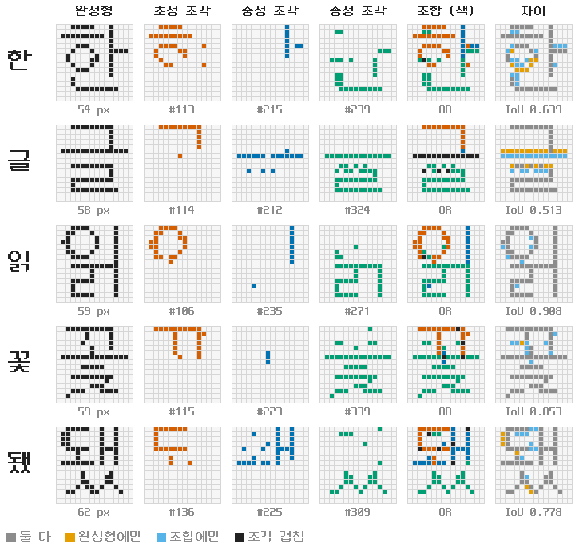
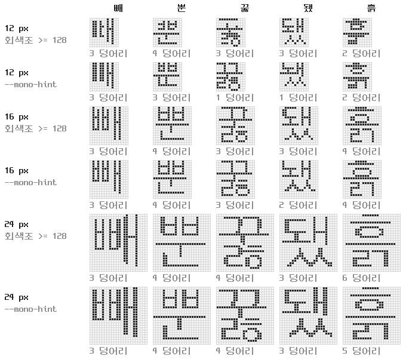
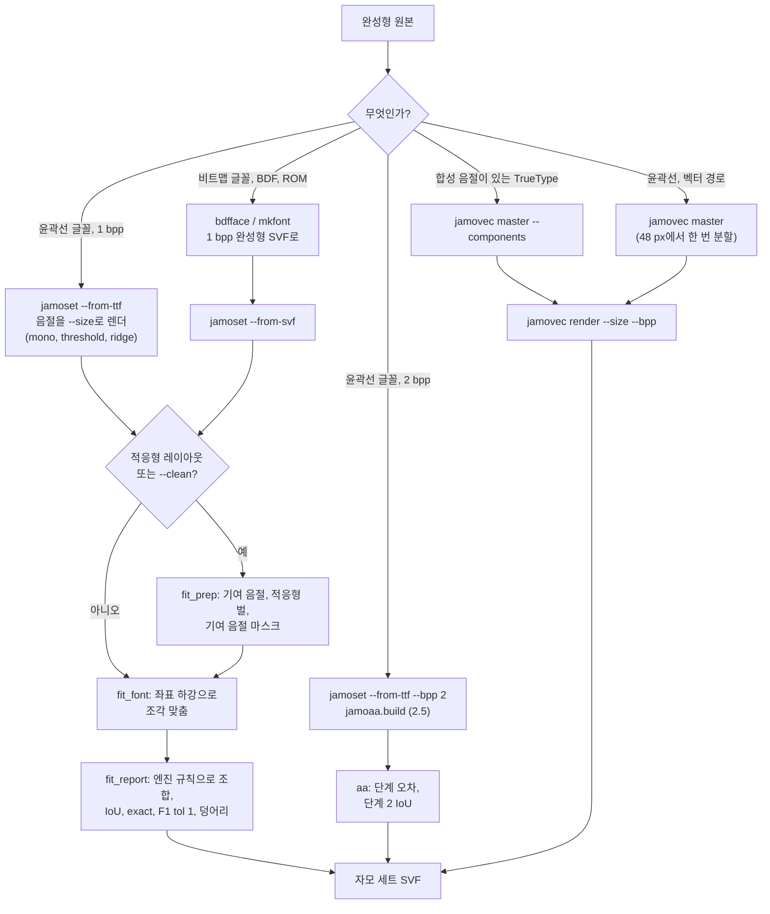
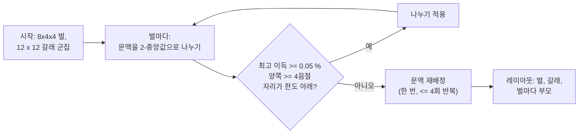
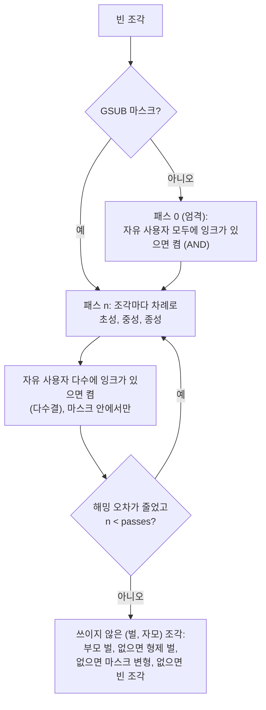
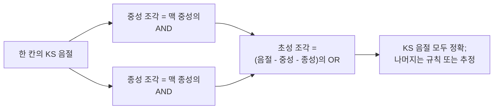
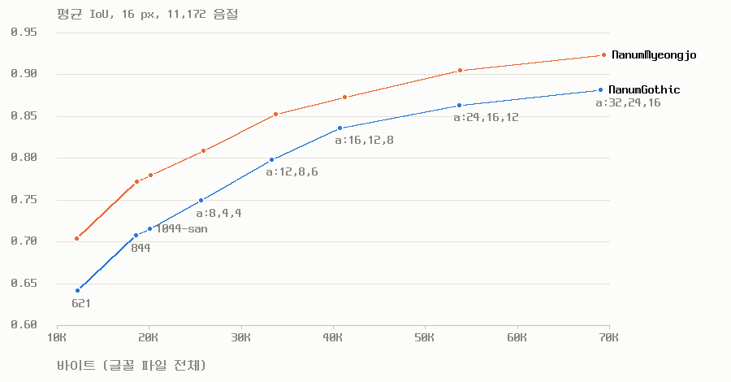
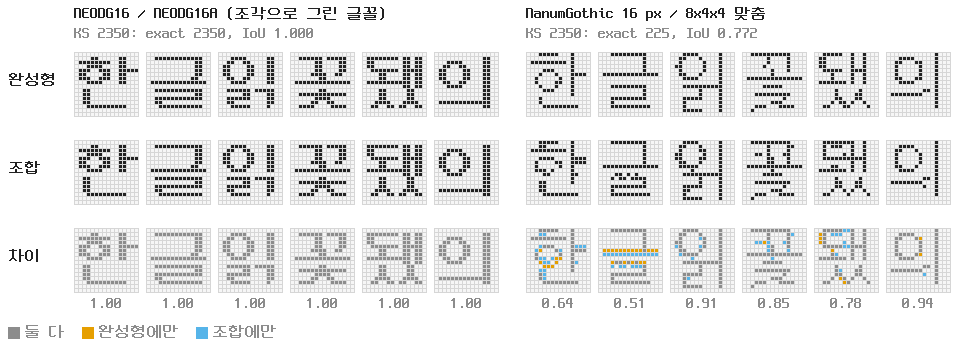
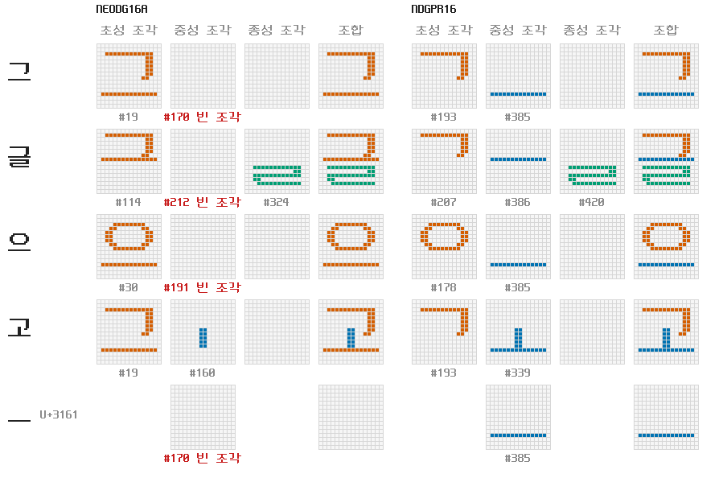
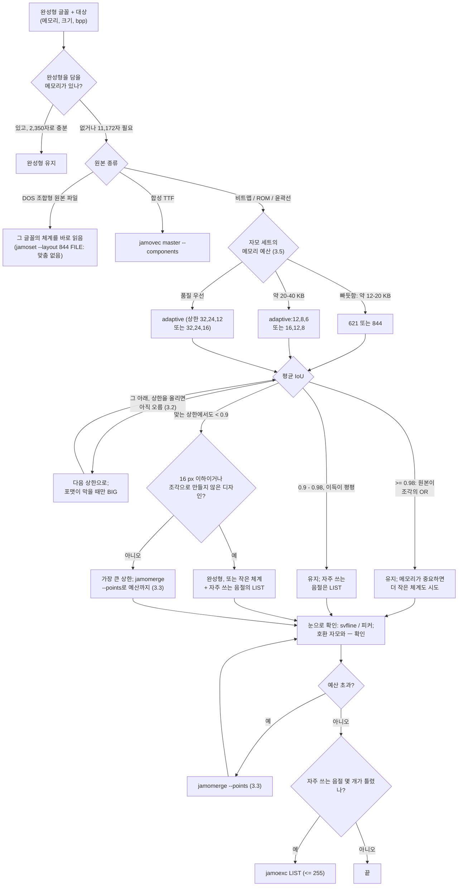

[English](jamo-split.md) | **한국어**

# 자모 분리: 완성형 글꼴에서 조합형 만들기

완성형 글꼴은 음절마다 글자 전체를 그린다. 조합형(자모 세트)은 초성·중성·종성 **조각**을 몇 **벌**로 저장하고, 음절마다
그중 두세 개를 겹쳐 그린다([자모 세트](jamo-sets.ko.md)). 완성형 글꼴에서 조합형을 만드는 일, 곧 **자모 분리**는 글꼴이
저장한 적 없는 조각을 되찾는 일이다. 이 문서는 이 저장소의 도구가 그 일을 어떻게 하는지, 원본 종류마다 결과가 어떤지,
무엇을 잘 못하는지, 그리고 앞선 시도에서 무엇을 배웠는지를 적는다.

1-4장과 7장의 수치는 저장소의 도구로 측정했거나(명령이나 출처 문서를 밝혔다), 각자의 실행 결과를 기록한 레시피 문서에서
인용했다. 6장과, 3-5장에서 "연구에서"라고 밝힌 수치는 일부 독점 글꼴로 한 앞선 연구 실행에서 나온 것이다. 발견으로서
적을 뿐 이 저장소로는 재현할 수 없다. 그림은 `python3 -I tools/doc_figures_split.py`가 이 저장소의 OFL 글꼴(나눔고딕 Regular, Neo둥근모,
Neo둥근모 Pro)만으로 그리며, `--check`는 다시 그려 바이트 단위로 비교한다.

## 차례

1. [문제가 무엇인가](#1-문제가-무엇인가)
2. [맞춤이 동작하는 방식](#2-맞춤이-동작하는-방식)
3. [벌 수 정하기와 조정](#3-벌-수-정하기와-조정)
4. [경우별 처리](#4-경우별-처리)
5. [우리가 잘 못하는 부분](#5-우리가-잘-못하는-부분)
6. [겪은 문제와 배운 점](#6-겪은-문제와-배운-점)
7. [실무 지침](#7-실무-지침)
8. [참고 자료와 링크](#8-참고-자료와-링크)

## 1. 문제가 무엇인가

### 1.1 할 일

글꼴의 완성형 음절이 주어지면 다음을 찾는다.

- **조각**: 벌마다, 자모마다 비트맵 하나(1 bpp) 또는 단계 지도 하나(2 bpp).
- **표**: 초성 갈래와 종성 갈래, 그리고 (초성 갈래, 중성, 종성 갈래) 칸마다 초성·중성·종성의 벌
  ([JSET](jamo-sets.ko.md#41-생각의-틀)).

목표는 고른 조각을 합쳤을 때 음절마다 원래 글자가 나오는 것이다. 합치는 규칙은 포맷이 정한다. 1 bpp에서는 조각들의
**OR**이고, 2 bpp에서는 픽셀마다 단계의 **최댓값**이다([안티앨리어싱 3장](anti-aliasing.ko.md#3-자모-세트-단계에서는-or가-아니라-최댓값)).
맞춤은 조각과 표를 바꿀 수 있을 뿐 규칙은 바꾸지 못한다.

모든 음절이 글꼴의 글자 그대로 합쳐지면 **정확한** 결과이고, 그렇지 않으면 **근사**다. 정확한 결과는 글꼴 자체가 조각의
OR로 그려졌고, 그 벌 체계를 레이아웃이 표현할 수 있을 때만 나온다. 음절 하나하나 따로 디자인한 글꼴은 근사할 수밖에 없다.
여러 음절이 함께 쓰는 조각은 그 음절들 사이의 타협이기 때문이다.

*그림 1. 나눔고딕 Regular를 16 px로 구워(`mkfont.py` 렌더, 1 bpp) 8x4x4에 맞췄다(`jamoset.fit_font`, 자유 조각).
열은 차례로 완성형 글자, 초성·중성·종성 조각(# = 조각 번호), 조합 (색) = 조각을 겹친 것(두 조각이 겹친 곳은 검정),
차이(회색 = 둘 다, 주황 = 완성형에만, 하늘색 = 조합에만)다. KS X 1001 음절 2,350개 기준으로 이 맞춤은 15,336바이트이고,
225개가 정확하며 평균 IoU는 0.772다. 글을 보면 중성 ㅡ 조각(#212, 잡티 점 포함)과 종성 조각(#324)이 모두 글자 본래의
가로획보다 한 줄 아래에 가로획을 갖고 있다. 그래서 조합은 틀린 줄에 가로획을 두 번 그리고 본래 줄은 놓친다(IoU 0.513).
꽃에서는 중성 ㅗ 조각(#223)에 짧은 기둥만 남고 가로획은 종성 조각이 그린다.*

### 1.2 왜 어려운가

- **획이 겹치고 닿는다.** 완성형 글자에서는 자모들이 픽셀을 함께 쓰므로, 어느 픽셀이 어느 자모의 것인지가 어디에도
  적혀 있지 않다. 초성의 끝이 모음의 가로획에 닿으면 그 획을 어느 조각에 넣어도 합친 결과는 같다. 맞춤은 오차를 줄이는
  곳에 획을 놓을 뿐이고, 그것이 원래 그 획을 그린 자모라는 보장은 없다(그림 1: 글의 ㅡ 가로획이 중성과 종성 조각 양쪽에,
  꽃의 ㅗ 가로획이 종성 조각에 들어갔다).
- **같은 자모도 놓인 자리에 따라 모양이 바뀐다.** 가, 고, 각의 ㄱ은 서로 다르다. 벌이 적은 레이아웃에서는 자모를 다르게
  그린 음절들도 조각 하나를 함께 써야 한다. 디자이너가 문맥을 어떻게 묶었는지는 글꼴에 들어 있지 않다
  ([Glyphs 포럼: 서로 다른 한글 조합 설정](https://forum.glyphsapp.com/t/divergent-hangeul-composition-setups/29856)).
- **작은 크기에서는 닿은 획이 한 덩어리로 붙는다.** 12-16 px에서는 두 자모 사이 틈이 0픽셀인 경우가 많다. `mkfont.py`가
  굽는 대로(FreeType 회색조 렌더링을 128에서 자름) 나눔고딕 Regular의 KS 음절 하나는 8-연결 잉크 덩어리가 평균
  32 px에서 3.13개, 16 px에서 2.87개, 12 px에서 2.60개다. 2,350개 가운데 32 px보다 덩어리가 적은 음절은 16 px에서 557개,
  12 px에서 1,059개다(`doc_figures_split.bake`와 `components`로 측정).
- **힌팅이 획을 옮긴다.** 힌팅은 윤곽선을 픽셀 격자에 맞추고
  ([FreeType: 가벼운 힌팅](https://freetype.org/freetype2/docs/hinting/text-rendering-general.html)), 그 일을 글자마다
  따로 한다. 그래서 같은 자모라도 음절마다 다른 픽셀에 놓인다. FreeType의 흑백 렌더러(`mkfont.py --mono-hint`)를 쓰면
  12 px에서 덩어리 수가 음절당 2.03개로 떨어지고(32 px보다 적은 음절 1,561개), 16 px에서는 2.68개(839개)다.
- **픽셀이 맞는다고 자모가 맞는 것은 아니다.** 픽셀 IoU로 점수를 매긴 맞춤은 평균이 좋아도 한 자모의 획을 다른 조각에
  넘기거나, 읽는 데 필요한 획을 잃을 수 있다(5장).

*그림 2. `mkfont.py`가 굽는 대로 그린 나눔고딕 Regular 12, 16, 24 px. 회색조 >= 128(기본값)과 흑백 렌더러
(`--mono-hint`)를 함께 보였다. "N 덩어리"는 8-연결 잉크 덩어리가 N개라는 뜻이다. 12 px에 `--mono-hint`를 쓰면 꿇과 됐은
모든 획이 서로 닿아 한 덩어리가 된다.*

## 2. 맞춤이 동작하는 방식

### 2.1 도구와 경로

| 도구 | 역할 |
|---|---|
| `tools/jamoset.py` | 명령줄 도구. `--from-ttf FONT --size N` 또는 `--from-svf FACE.SVF`, `--layout`, `--bpp 1\|2`를 받아 자모 세트를 쓰고 맞춤 결과를 보고한다 |
| `tools/jamofit.py` | 1 bpp 맞춤(`fit_pieces`), GSUB 마스크(`mask_pieces`), 측도(`iou`, `f1_tol1`, `quality_report`) |
| `tools/jamoadapt.py` | 적응형 벌 체계. 갈래는 군집화로 묶고, 한 조각을 쓰는 음절들의 모양이 서로 다르면 벌을 나눈다 |
| `tools/jamoaa.py` | 2 bpp. 정확 면적 래스터라이저, 윤곽선을 자모에 배정, 중앙값 합의, 최댓값 조합을 전제로 한 단계 다듬기 |
| `tools/jamoseg.py` | 경로 자르기로 음절 윤곽선을 자모별 윤곽선으로 나누는 라이브러리(어느 도구도 가져다 쓰지 않고 `tools/test_jamoaa.py`만 쓴다. `jamoaa.py`에는 따로 윤곽선 배정이 있고 `jamovec.py`가 그것을 쓴다) |
| `tools/jamovec.py` | 벡터 맞춤. 결정 크기에서 한 번 고른 윤곽선 조각을 어떤 크기로든 그린다 |
| `tools/jamomerge.py` | 조각 변형, 벌, 갈래를 합쳐 맞춘 글꼴을 바이트 예산까지 줄인다 |
| `tools/jamofill.py` | 연구용 빌더. 스트라이크의 AND 핵을 키워 조각을 만들고, 가중 오차를 좌표 하강으로 줄인다 |
| `tools/jamoexc.py` | LIST 예외. 최대 255개 음절을 통째로(또는 다른 조각 조합으로) 자모 세트 위에 얹는다 |
| `tools/macfbit_svf.py` | 맥 HangulTalk 7.1.x 글꼴. 맥의 판을 그대로 쓰는 JMAP, 또는 파생 규칙형(중성·종성은 AND, 초성은 나머지) |

메이커는 이 도구들을 **경로**로 실행한다(`maker/routes.py`).

- *bdfface + from-svf fit*: `bdfface.py`로 BDF에서 완성형 글꼴을 만든 뒤 `jamoset.py --from-svf`로 맞춘다.
- *experimental fit*: `--from-ttf --binarize threshold --mask-font none`, 또는 `--bpp 2`.
- *mask fit*: `--mask-font`로 그 글꼴 자신을 쓰고 `--no-clean`을 붙인다. 글꼴에 GSUB `ljmo` / `vjmo` / `tjmo` 기능이
  있고 freetype-py와 uharfbuzz를 불러올 수 있을 때만 나온다.
- *vector fit*: `jamovec.py master` 다음에 `render`.
- *composite*: `jamovec.py master --components`.

경로 표는 [데스크톱 경로](recipes/desktop-routes.ko.md)에 있다.

### 2.2 목표 글자

`--from-ttf`는 글꼴이 그리는 모든 음절(`--present-only`, 기본값)을 `--size` 픽셀 셀에 렌더한다. 모든 음절의 잉크
상자를 합친 상자가 셀 가운데에 오도록 자리를 잡는다. 이 일은 `ttf_targets`가 하고, `--binarize threshold|ridge`이면
`jamoaa.outline_targets`가 한다. 후자는 정확 면적 래스터라이저를 쓰므로 TrueType과 CFF를 똑같이 다룬다.
`--from-svf`는 1 bpp 완성형 SVF에서 비어 있지 않은 음절을 가져오고, 그 글꼴의 다른 글자, 셀, 어센트, 음절 진행폭을
그대로 둔다.

### 2.3 레이아웃: 무엇을 맞추는가

레이아웃은 맞춤 전에 갈래와 문맥별 벌을 정한다. 맞춤은 픽셀만 고른다.

| 레이아웃 | 벌 (초성 / 중성 / 종성) | 갈래 | 선택 |
|---|---|---|---|
| `844` | 8 / 4 / 4 | 초성 {ㄱ ㅋ} / 그 밖, 종성 없음 / 있음 | 초성 벌은 모음 모양과 받침으로, 중성은 초성 갈래와 받침으로, 종성은 모음으로 고른다 |
| `1044-san`, `hanterm-johab` | 10 / 4 / 4 | 844와 같음(hanterm은 종성 갈래 3개) | 받침 없는 초성 벌을 받침 있을 때도 따로 둔다 |
| `621` | 6 / 2 / 1 | | 애플 II 시절 체계 |
| `adaptive[:NI,NM,NF]` | 8 / 4 / 4에서 최대 32 / 24 / 12(기본값)까지 | 최대 12 x 12 | `jamoadapt.py`가 글꼴을 보고 벌을 나누고 갈래를 묶는다 |

DOS 선택 규칙은 [자모 세트 2.3절](jamo-sets.ko.md#23-8x4x4의-선택-규칙)에 그림으로 있다. 벌 수와 그 비용은
[벌 수 정하기](recipes/sets.ko.md#벌-수-정하기)에서 비교한다.

**적응형**(`jamoadapt.adapt`)은 8x4x4에서 시작하고, 기여 음절(donor)을 재료로 쓴다. 기여 음절이란 각 음절에서 한
자모가 차지한 영역을 온도계 판(1 bpp에서 판 하나, 2 bpp에서 판 셋)으로 나타낸 것이다.

1. **갈래.** ㄱ과 ㅋ은 각자 초성 갈래가 된다. 나머지 초성 17개는 곁에 오는 중성의 모양을 기준으로 평균 연결 군집화해,
   최대 10개 갈래로 더 묶는다. 종성도 같은 방법으로 "받침 없음" 외에 최대 11개 갈래로 묶는다.
2. **나누기.** 벌마다 그 문맥들을 2-중앙값으로 나눠 본다. 가장 큰 항목과 그것에서 가장 먼 항목으로 시작해 Lloyd 반복을
   최대 8번 한다. 이득은 (벌, 자모) 중앙값까지 기여 음절들의 L1 거리 합이 줄어든 양이다. 모든 자리 가운데 가장 좋은
   나누기를 적용하되, 조건이 셋 있다. 그 자리가 한도 아래여야 하고, 양쪽에 음절이 4개 이상이어야 하며, 이득이 시작
   비용의 0.05 % 이상이어야 한다. 조건을 채우는 나누기가 없으면 반복을 끝내고, 재배정을 한 번(최대 4회 반복) 해서 문맥을
   가장 잘 맞는 벌로 옮긴다.
3. 음절이 하나도 없는 문맥은, 8x4x4에서 같은 벌에 들던 문맥 가운데 쓰이는 가장 가까운 것을 따른다.

### 2.4 1 bpp 맞춤 (`jamofit.fit_pieces`)

글자 하나는 파이썬 정수 하나(비트 `y*(w+1)+x`)이므로, 셀 전체의 AND, OR, 비트 세기가 연산 한 번이다. 맞춤은 초성,
중성, 종성 순서로 조각을 도는 **좌표 하강**이다.

- 각 음절의 나머지 두 조각을 고정한다. 조각 k를 쓰는 음절 가운데 그 픽셀이 다른 조각으로 아직 칠해지지 않은 음절들을
  본다. 그중 목표에 잉크가 있는 음절이 **없는 음절보다 많으면** 조각 k의 그 픽셀을 켠다(다수결, 동수면 끈다).
- 자유 조각과 기여 음절 마스크에서는 **첫 번째 패스가 엄격하다.** 그런 음절 *모두*에 잉크가 있을 때만 켠다(AND).
  처음부터 단순 다수결로 하면 초성이 모음의 잉크를 삼키고 오차가 줄지 않는다(`fit_pieces`의 주석). GSUB 마스크로 맞출
  때는 다수결로 시작한다. 마스크가 이미 각 조각을 제 자모 자리에 묶어 두기 때문이다.
- 조각에 마스크가 있으면 그 안의 픽셀만 쓸 수 있다(아래).
- `--passes`(12)번을 돌거나 해밍 오차 합이 더 줄지 않으면 멈춘다. 결과는 결정적이다.

**마스크.** 조각이 잉크를 가질 수 있는 곳을 세 가지 방법으로 제한한다.

- **GSUB 마스크**(`--mask-font FONT`). 완성형 글자를 숨긴 채 HarfBuzz로 각 음절을 첫가끝 자모 U+1100..으로 셰이핑한다.
  한 (벌, 자모)의 음절 대부분이 셰이핑되는 위치 변형을 래스터해 `--mask-radius`만큼 넓힌 것이 조각의 경계가 된다
  (16 px까지 1, 24 px까지 2, 그 위로 3). `--mask-font`를 주지 않으면 자유 맞춤의 평균 IoU가 0.995(`AUTO_EXACT`)
  미만일 때만 마스크 글꼴(`$JAMOSET_MASK_FONT`)을 쓴다.
- **기여 음절 마스크**(`--clean`, 적응형과 2 bpp에서 기본으로 켜짐). 그 자모의 기여 음절 25 % 이상에 잉크가 있는 픽셀을
  한 픽셀 넓힌 것이다. 둘 다 주면 마스크 글꼴 대신 이것을 쓴다. 맞춤 뒤에는 1 px(16 px 초과에서는 2 px) 이하의 덩어리를,
  지워도 그 조각을 쓰는 음절들의 해밍 오차 합이 늘지 않으면 지운다(그 음절 가운데 소수에는 그 자리에 잉크가 있을 수 있다).
- 없음(`--mask-font none --no-clean`). 자유 조각이다.

**쓰이지 않은 조각.** 맞춘 음절이 하나도 쓰지 않는 (벌, 자모)가 있다. 글꼴이 그리지 않는 문맥으로, 2,350자 원본이라면
KS X 1001 밖에서 흔하다. 이런 조각은 차례로 다음에서 가져온다. 그 벌이 갈라져 나온 벌의 조각, 같은 자모 가운데 사용자가
가장 많은 벌의 조각, 마스크 변형. 셋 다 없으면 빈 조각으로 남는다(`fit_font`, 보고서의 `unseen_pieces`). 이런 음절은
맞춘 것이 아니라 추정한 것이다.

### 2.5 2 bpp (`jamoaa.py`)

임계값으로 자른 커버리지를 1 bpp로 맞춘 결과는 단계로 다듬을 수 없다. 그래서 2 bpp는 윤곽선에서 맞춘다
(`jamoset.py --from-ttf --bpp 2`).

1. **영역 맞춤.** 커버리지 >= 0.5를 자유 1 bpp로 맞춰 각 자모의 자리를 찾는다. 종성 갈래마다 중성 벌을 하나씩 둔다.
2. **윤곽선을 자모에.** 음절의 윤곽선을 포함 관계로 묶는다. 묶음마다 **다른 음절이 먼저 정한다.** 이 음절과 자모를
   함께 쓰는 음절들이 같은 윤곽선의 자리를 뚜렷하게 합의하면 그리로 준다(영역 맞춤이 모음과 따로 두는 ㅗ / ㅜ / ㅡ
   가로획을 모음에 붙여 두려는 것이다). 다른 음절들이 정하지 못한 묶음 가운데 두 영역에 걸쳐 있으면서 어느 한쪽에도
   85 % 이상 들어가지 않는 것은 다른 음절의 픽셀에 따라 픽셀 단위로 나눈다. 나머지 정해지지 않은 묶음도 다른 음절의
   픽셀로 나눈다. 다른 음절의 픽셀이 없을 때만 묶음을 가장 많이 겹치는 영역에 통째로 준다.
3. **벌**(`--layout adaptive`일 때): 이 기여 음절로 `jamoadapt.adapt`를 돌린다(2.3).
4. **합의.** 조각은 기여 음절 커버리지의 픽셀별 중앙값을 0..3 단계로 양자화한 것이다. 기여 음절이 5개 이상이면,
   중앙값 + 3 x 1.4826 x MAD보다 먼 기여 음절은 뺀다.
5. **다듬기.** 단계에 대한 좌표 하강이다. 픽셀마다 {현재, 0, 1, 2, 3} 가운데 그 픽셀을 쓰는 음절들의
   |max(단계, 다른 조각) - 목표| 합을 가장 작게 하는 단계를 고른다. `--aa-refine`(2)번 돈다. `--clean`(2 bpp의 기본값)이면
   기여 음절 마스크 안에서만 고른다.
6. **정리.** 단계 1 픽셀은 기여 음절 절반에 잉크가 있는 곳에만 남긴다. 단계 3 픽셀이 없는 작은 덩어리는 지운다.

최댓값에는 어떤 조각 세트로도 없앨 수 없는 바닥이 있다. 두 자모가 한 픽셀의 서로 다른 절반을 덮으면 완성형 글자의
커버리지는 둘이 더해지지만, 조각의 최댓값은 더해지지 않는다(`join_loss`).

### 2.6 벡터 맞춤 (`jamovec.py`)

`master`는 다음 순서로 조각을 정한다.

1. 글꼴을 `--decision-px`(48)에서 한 번 렌더한다.
2. 기여 음절을 찾는다. 2.5의 윤곽선 배정을 쓰거나, `--components`이면 glyf 합성 구성 요소를 쓴다.
3. 8x4x4 또는 적응형 벌을 배치한다.
4. 조각마다 **메도이드 기여 음절의 윤곽선 그 자체**를 남긴다. 메도이드란 픽셀별 중앙값에 가장 가까운 깨끗한 기여
   음절이다.

`render`는 이 윤곽선을 맞춤 없이 어떤 크기로든 래스터한다. 그래서 조각은 오차를 줄이려고 고른 픽셀이 아니라 글꼴 자신의
모양이고, 마스터 하나로 모든 크기를 만든다. 대가는 시간이다. `master`는 부하가 큰 기계에서 나눔고딕에 172초 걸렸고
([메이커 기능 점검](maker-audit.ko.md)), Neo둥근모에서 `--components`로 25초 걸렸다
([윤곽선 글꼴](recipes/outline-fonts.ko.md#truetype와-opentype-폰트에서-만드는-자모-세트)).

### 2.7 맞춤 뒤: 줄이기와 예외

- `jamomerge.py merge --points BYTES ...`는 조각 변형, 벌, 갈래를 탐욕적으로 합친다. 기준은 아낀 바이트당 목적 함수의
  증가량(`2 x 잃은 픽셀 + 남는 픽셀 + 겹침`, KS 밖 음절 가중치 0.1)이다. 꼭지, 중성, 획, 새어 나감에는 반드시 지켜야
  하는 관문이 있다. `--recog`를 주면 상위 후보를 외부 인식기로 다시 채점한다.
- `jamoexc.py build FACE EXC.json OUT`은 LIST 모드 JMAP 블록을 더한다. 최대 **255**개 음절을 통째로(`"whole"`) 그리거나
  이미 있는 조각으로 다시 조합하고(`"pieces"`), 나머지는 모두 글꼴의 JSET이 대체로 그린다
  ([자모 세트 6장](jamo-sets.ko.md#6-버전-3-jmap-list-그리고-규칙형과-표형의-비교)).

### 2.8 맥 HangulTalk 7.1.x (`macfbit_svf.py`)

맥 글꼴은 글자 칸 482개와 표 하나를 저장한다. 표는 KS 음절 2,350개마다 OR로 겹칠 칸을 최대 셋 적는다. 모든 칸을 그대로
조각으로 삼아 JSET 표에 넣으면 맞지 않는다. 모음과 받침이 같은데 중성이나 종성 칸이 다른 두 초성은 초성 갈래를 함께
쓸 수 없는데, 서울12에는 그런 쌍이 171쌍 가운데 130쌍 있다
([자모 세트 6.4절](jamo-sets.ko.md#64-seoul12-같은-글꼴-두-구조)). 그래서 두 가지 형태를 둔다.

- **직접형**(기본값). 맥 칸을 조각으로 쓰는 JMAP 블록으로, KS 2,350자만 그린다. `--with-jset`을 주면 나머지 음절을 위한
  파생 JSET을 대체 블록으로 더한다.
- **파생형**(`--mode derived`). 갈래는 19 x 28에서 한도까지 응집형 탐색으로 줄여 찾는다. 칸마다 **중성 조각은 그 칸 KS
  음절들의 맥 중성 글자의 AND**, **종성 조각도 같은 방식의 AND**, **초성 조각은 나머지(`음절 - 중성 - 종성`)의 OR**다
  (나머지 이전). KS 음절은 모두 정확하게 남는다. 나머지 8,822자는 "규칙"(모든 칸이 KS 음절에서 쓰임)이거나
  "추정"(가장 가까운 문맥으로 채움)이다.

### 2.9 결과 재기

| 측도 | 위치 | 말해 주는 것 | 놓치는 것 |
|---|---|---|---|
| 평균 IoU, p5 | `fit:` 줄, `quality_report` | 조합한 잉크와 목표 잉크의 교집합 / 합집합([자카드 지수](https://en.wikipedia.org/wiki/Jaccard_index)). 1.0이면 같다 | 1 px 밀림도 획이 빠진 만큼 깎인다. 자모가 바뀐 것은 모른다 |
| exact | `fit:` 줄 | 글꼴과 똑같은 음절 수 | 나머지가 얼마나 다른지 |
| F1 tol 1 | `fit:` 줄 | 1 px 밀림을 허용한 잉크 일치 | 밀려서 붙은 획 |
| 덩어리 합쳐짐 / 쪼개짐 | `fit:` 줄 | 8-연결 덩어리 수가 줄거나 는 음절 수 | 어느 자모끼리 붙었는지 |
| 단계 오차, 단계 2 IoU | `aa:` 줄 | 2 bpp의 평균 절대 단계 차(0..3). FACES.TSV는 이 값을 3으로 나눈다 | IoU와 같다 |
| `--check` | `check:` 줄 | 표가 11,172자를 모두 조합하고 모든 조각에 글자가 있다 | 품질. 나쁜 맞춤도 통과한다 |
| 정체성 검사 | 메이커, `maker/recog_score.py` | 조각마다, 그 조각을 쓰는 음절을 자모 인식기가 그 자리에서 맞게 읽는 비율(통과 >= 0.95, 경고 >= 0.80) | `SVF_RECOG_DIR`가 사용자 자신의 `recog.py`를 가리켜야 한다. 함께 배포되는 것은 없다 |

이 문서를 쓰면서 정체성 검사는 실행하지 않았다. 저장소에 인식기가 없고 `SVF_RECOG_DIR`도 설정되어 있지 않았다. 결과는
반드시 눈으로도 보라(`svfline.py line`, `web/` 피커). 어떤 수치도 어느 음절이 틀렸는지는 보여 주지 않는다.

## 3. 벌 수 정하기와 조정

8x4x4는 DOS의 표준일 뿐, 기본 답이 아니다. 벌 수는 한 자모를 몇 가지 문맥에서 다르게 그릴 수 있는지를 정하고, 벌 하나는
그 벌이 쓰이는 자모마다 조각 하나씩의 비용이 든다. 원본과 대상에 맞춰 고르고, 재고, 그다음 늘리거나 줄인다. 레이아웃 전체
표와 16 px 글꼴 두 개에서의 비용은 [벌 수 정하기](recipes/sets.ko.md#벌-수-정하기)에 있다. 이 장은 결정하는 데 필요한
것을 적는다.

### 3.1 벌 체계와 한도

| 체계 (`jamoset.py --layout`) | 벌 초성 / 중성 / 종성 | 갈래 (초성 x 종성) | 언제 |
|---|---|---|---|
| `621` | 6 / 2 / 1 | 1 x 2 | 가장 작다. 애플 II 시절 글꼴, 자모 모양이 거의 바뀌지 않는 픽셀 글꼴 |
| `844` (`844-ihnm`, `844-hbios24`) | 8 / 4 / 4 | 2 x 2 | DOS 표준. 이 체계로 그린 글꼴은 정확하게 맞는다 |
| `1044-san`, `hanterm-johab` | 10 / 4 / 4 | 2 x 2 (hanterm 2 x 3) | 844와 같되 받침 없는 초성 벌을 따로 둔다 |
| `adaptive:NI,NM,NF` | 8-32 / 4-24 / 4-16, 상한 안에서 글꼴이 정한다(기본 32 / 24 / 12) | 최대 12 x 12 | 완성형 디자인. 한 조각을 쓰는 음절들의 모양이 다르면 벌을 나눈다(2.3) |
| BIG (`--jset-big`, `SVF_JSET_BIG`로 빌드한 엔진) | 최대 128 / 128 / 64 | 최대 19 x 28 | 원본 자신의 더 큰 표(맥 글꼴, `jamovec.py render --jset-big`). `jamoset.py --layout adaptive`는 여전히 32 / 24 / 16, 12 x 12에서 멈춘다 |

표준 JSET 블록은 32 / 24 / 16벌과 12 x 12 갈래까지 허용한다(`tools/jamoset.py`의 `JSET_LIMITS`). 그보다 큰 글꼴에는
BIG이 필요한데, 대부분의 MCU 빌드는 BIG을 빼 둔다([자모 세트 5장](jamo-sets.ko.md#5-jset-버전-2와-big)). 2026-10 전에
빌드한 엔진은 8 x 8 갈래보다 많으면 거부한다.

### 3.2 벌을 늘리면 얻는 것: 측정한 곡선

OFL 윤곽선 글꼴 두 개를 16 px에서 `jamoset.py --layout L --from-ttf FONT --size 16 --binarize threshold --mask-font none
--check`로 맞추고, 글꼴이 그리는 모든 음절로 쟀다. `--binarize threshold`는 그리는 음절만 맞추는데(`--present-only`),
`ttf/`의 두 글꼴은 11,172자를 모두 그린다(cmap과 각 실행의 `fit: 11172 syllables` 줄로 확인. 2,350자는 윤곽선으로,
8,822자는 합성 글리프로 그리며 합성 글리프도 그린 것으로 센다). 이 문서를 위해 측정했다. 바이트는 ASCII를 포함한 글꼴 전체,
JSET 버전 1, 시간은 코어 하나 기준이다.

| 레이아웃 | 쓴 벌 | 나눔고딕 Regular: 바이트 | IoU (p5) | 정확 | 시간 | 나눔명조 Bold: 바이트 | IoU (p5) | 정확 | 시간 |
|---|---|---:|---|---:|---:|---:|---|---:|---:|
| `621` | 6 / 2 / 1 | 12,232 | 0.641 (0.349) | 31 | 12.2초 | 12,156 | 0.704 (0.537) | 0 | 15.6초 |
| `844` | 8 / 4 / 4 | 18,616 | 0.707 (0.406) | 133 | 12.5초 | 18,652 | 0.772 (0.609) | 46 | 15.9초 |
| `1044-san` | 10 / 4 / 4 | 20,092 | 0.715 (0.404) | 154 | 12.3초 | 20,192 | 0.779 (0.611) | 42 | 15.4초 |
| `adaptive:8,4,4` | 8 / 4 / 4 | 25,704 | 0.749 (0.408) | 274 | 67.1초 | 25,956 | 0.809 (0.628) | 58 | 69.4초 |
| `adaptive:12,8,6` | 12 / 8 / 6 | 33,316 | 0.798 (0.449) | 854 | 66.3초 | 33,752 | 0.852 (0.671) | 189 | 71.6초 |
| `adaptive:16,12,8` | 16 / 12 / 8 | 40,784 | 0.836 (0.471) | 1,432 | 67.4초 | 41,320 | 0.873 (0.700) | 357 | 71.9초 |
| `adaptive:24,16,12` | 24 / 16 / 12 | 53,688 | 0.863 (0.508) | 1,994 | 67.9초 | 53,804 | 0.905 (0.750) | 866 | 72.2초 |
| `adaptive:32,24,16` | 32 / 24 / 16 | 69,084 | 0.881 (0.531) | 2,769 | 69.2초 | 69,428 | 0.923 (0.783) | 1,542 | 72.9초 |

모든 적응형 맞춤이 예산을 다 쓰고 12 x 12 갈래를 썼다. 적응형 JSET 블록은 버전 1로 9,921-12,321바이트, 버전 2
(`--jset-version 2`)로 2,844-5,782바이트로, 844의 1,101 / 272바이트와 비교된다. `adaptive:8,4,4`는 844와 벌 수가 같고,
7 KB가 더 들어 12 x 12 갈래를 산다. 갈래만으로 IoU가 0.04 오른다(0.707 → 0.749).

*그림 5. 위 표를 그린 것. 글꼴 바이트에 대한 평균 IoU다(a: = `adaptive:`). 파랑은 나눔고딕 Regular, 주황은 나눔명조
Bold.*

**읽는 법.** 곡선은 휜다. 844에서 `adaptive:12,8,6`까지는 15 KB로 IoU +0.09를 얻고, `24,16,12`에서 `32,24,16`까지는 다시
15 KB로 +0.02를 얻는다. 두 윤곽선 글꼴 모두 상한에서도 16 px에서 정확한 맞춤에 가까이 가지 못한다. 이득이 포맷의 한도
전에 평평해지므로, 이런 원본에서는 BIG으로 32 / 24 / 16을 넘겨도 얻는 것이 적다. 조각으로 그린 원본은 반대다.
[레시피](recipes/sets.ko.md#벌-수-정하기)의 OS/2 비트맵 글꼴은 `adaptive:12,8,6`에서 0.999에 이르고, 상한 32 / 24 / 12
아래서 14 / 12 / 9에서 나누기를 멈춘다.

### 3.3 줄이기: 메모리 예산에 맞추기

`tools/jamomerge.py merge --face FACE --points BYTES ...`는 이미 만든 글꼴을 바이트 예산까지 줄인다. 새 조각은 그리지 않고,
세 가지 움직임으로 조각을 덜 쓰게 만든다.

- **묶기(tie)**: 한 자모가 변형 x를 그리던 모든 자리에서 변형 y를 그린다.
- **벌 합치기**: 두 벌이 하나가 된다. 자모마다 합친 자리는 목적 함수가 더 좋게 보는 변형을 남긴다.
- **갈래 합치기**: 두 초성(또는 종성) 갈래가 하나가 된다.

매 단계 모든 움직임을 픽셀 비용으로 매기되 **아낀 바이트당**으로 나누고, 가장 싼 것을 적용한다. 픽셀 비용은 합치기 전
글꼴의 조합을 기준으로, 잃은 픽셀 2, 남는 픽셀 1, 두 조각이 겹치는 픽셀 1이며 KS 밖 음절은 가중치 0.1이다. 반드시 지켜야
하는 관문이 있어서, ㅗ ㅛ ㅜ ㅠ ㅡ의 꼭지를 지우거나, 같은 중성 무리(ㅗ ㅜ ㅡ)의 KS 음절 두 개를 전보다 가깝게 만들거나,
KS 음절의 획을 빠뜨리거나, (기준 판이 있을 때) 다른 자모로 잉크가 새는 움직임은 거부한다. 인식기가 있으면 `--recog`가
인식기 검사를 더한다.

3.2의 나눔고딕 Regular 844 글꼴로 잰 결과다(`merge --points 17408 16384`, 36단계, 약 6분). 같은 16 px 목표에 대해 쟀다.
마지막 두 열은 조합한 글자의 8-연결 잉크 덩어리가 목표보다 적은(붙은) 음절과 많은(쪼개진) 음절의 수다.

| 글꼴 | 바이트 | 조각 | 평균 IoU (p5) | 정확 | 덩어리 붙음 | 덩어리 쪼개짐 |
|---|---:|---:|---|---:|---:|---:|
| 844 맞춤 | 18,616 | 344 | 0.7074 (0.406) | 133 | 3,356 | 2,938 |
| 17 K로 합침 | 17,408 | 335 | 0.7069 (0.406) | 130 | 3,338 | 2,976 |
| 16 K로 합침 | 16,380 | 308 | 0.698 (0.402) | 125 | 3,226 | 3,358 |

첫 움직임들은 거의 공짜다(드문 변형을 거의 같은 짝에 묶는다). 단계가 갈수록 바이트당 비용이 오르고, 쪼개진 음절(획이
끊기거나 떨어진 음절)이 16 K까지 420개 는다. 관문은 획을 잃는 것은 막지만 끊기는 것은 막지 않는다. 같은 도구로 아두이노
Uno용 12 px 서울12 프리셋을 12,624바이트 파생형 글꼴에서 만들었다. S8K 8,160, S7K 7,012, S6K 6,144, S5K 5,548바이트이고,
마지막은 허용되는 움직임이 더 없던 지점이다([자모 세트 6.4절](jamo-sets.ko.md#64-seoul12-같은-글꼴-두-구조)). 연구에서
자모 인식기는 합치기 전 글꼴(11,936바이트 빌드)의 KS 음절 67.9 %에서, 8,136바이트 글꼴에서는 67.2 %에서 세 자모를 모두
맞게 읽었다. 바이트를 3분의 1 줄이는 데 1점이 채 들지 않았다.

**합치기가 해로울 때.** 관문은 획과 ㅗ ㅜ ㅡ의 구별을 지킬 뿐, 모든 조각의 정체를 지키지는 않는다. 묶기는 다른 문맥을 위해
그린 변형을 한 자모에 줄 수 있고, 그러면 잃는 픽셀은 적어도 읽을 때 어색하다. 처음부터 나쁜 맞춤은 합치기로 고칠 수 없고,
큰 글꼴에서는 느리다. 4.6의 65,136바이트 적응형 글꼴에서는 첫 단계가 몇 분 걸려 34바이트를 아꼈다(이 문서를 위해 측정,
그 단계 뒤에 멈춤). 예산 가까이에서 맞춘 뒤 마지막 몇 KB만 합치고, 결과를 눈으로
본다.

### 3.4 늘리기: 적응형, BIG, 또는 예외

- **첫 맞춤이 정확하거나 가깝다(IoU 0.98 이상)**: 그대로 두거나 더 작은 체계를 시도한다. 벌을 늘려도 얻는 것이 거의 없다.
- **첫 맞춤이 약 0.9에서 0.98 사이**: 단계마다 아직 얻는 것이 있는 동안 상한을 올린다(844나 621에서는 `adaptive:12,8,6`).
- **KB당 이득이 평평해진다**(3.2의 마지막 줄들): 벌을 그만 늘린다. 자주 쓰는 음절 몇 개에 오차가 몰려 있으면, 통째 음절
  LIST(`jamoexc.py`, 최대 255)가 KB당 더 싸다(4.8).
- **원본이 아니라 포맷이 맞춤을 막는다**(나누기당 이득이 아직 큰데 적응형이 상한에서 멈추거나, 원본 자신의 표가
  32 / 24 / 16벌보다 크다): 대상 엔진이 BIG으로 빌드되었다면 BIG.
- **상한에서도 약 0.9 미만**: 완성형, 또는 예산에 맞는 벌 체계에 LIST 예외. 벌을 늘린다고 디자인이 조각의 OR이 되지는
  않는다.

### 3.5 어림 규칙

| 대상과 쓰임 | 시작 | 그다음 확인 |
|---|---|---|
| 작은 MCU, 한글 전체 약 16 KB 미만 | `621` 또는 `844`, 그다음 `jamomerge.py --points`로 예산까지 | 관문이 거부한 것, 표본 줄의 ㅗ ㅜ ㅡ와 ㄲ |
| 조각으로 그린 글꼴(DOS, ROM, 픽셀 글꼴) | `844`(또는 그 글꼴의 체계를 바로 읽음) | IoU가 1.0에 가까운지. 아니면 작은 상한의 `adaptive` |
| 윤곽선이나 완성형 디자인, 20-40 KB | `adaptive:12,8,6` 또는 `16,12,8` | IoU와 한 단계 아래 상한보다 얻은 것, JSET v2로 6-7 KB 절약 |
| 윤곽선이나 완성형 디자인, 품질 우선 | `adaptive`(32,24,12 또는 32,24,16) | 마지막 단계가 아직 얻었는지, 자주 쓰는 음절의 LIST |
| 12-16 px 윤곽선 글꼴 | 메모리에 맞는 상한의 `adaptive` | 자주 쓰는 음절의 자모 정체를 눈으로, 완성형이 들어가면 완성형 |
| 데스크톱이나 웹, 메모리 여유 | 완성형 | |

## 4. 경우별 처리

| 원본 | 예 | 8x4x4 | 적응형 또는 그 밖 | 남길 것 |
|---|---|---|---|---|
| 조각으로 그린 글꼴(DOS 조합형, 자모 세트로 만든 스프라이트 글꼴) | Neo둥근모, Date Quiz Go Go, NKP | IoU 1.000 / 1.000 (2,347 정확) / 0.998 (2,324) | NKP 적응형 1.000 | 자모 세트 |
| 손으로 그린 비트맵 글꼴 | OS/2 `$korZN16.FNT` | 0.984 (1,753 정확) | `adaptive:12,8,6` 0.999 | 자모 세트 |
| ROM 완성형 | 86Box Trigem / ATI / Kasan | 0.968 / 0.919 / 0.872 | | Trigem은 자모 세트, Kasan은 완성형 |
| 조각으로 그리지 않은 ROM | CPC-400S, Quiz King of Fighters | 0.794, 0.835 | Quiz KOF 적응형 0.975 (62,084 B) | 완성형 |
| 윤곽선 디자인, 16-24 px | Gothic A1, 나눔스퀘어라운드, Single Day | | 12 x 12 갈래, 24/16/16: 0.94-0.97, Single Day 0.998 | 메모리가 중요하면 자모 세트 |
| 12-16 px 윤곽선 | 나눔고딕 Regular 12 / 16 px | 0.733 / 0.707 | 16 px 적응형 0.877 | 완성형, 또는 LIST 예외를 더한 자모 세트 |
| 맥 HangulTalk 표 글꼴 | 서울12 | | 파생형 9/6/3벌, KS 정확 | 직접형 JMAP, 작은 대상에는 파생형 |
| 2 bpp | Gothic A1 16 px | | 단계 차 / 3: 0.026 (KS) | 18 px 이상이면 자모 세트 |

### 4.1 조각으로 그린 글꼴

8x4x4와 비슷한 규칙으로 조각을 OR해 음절을 만든 글꼴은 정확하게 맞는다.

- **Neo둥근모.** 완성형 `NEODG16.SVF`와 맞춘 `NEODG16A.SVF`는 KS 음절 2,350개 모두에서 같다(IoU 1.0000,
  `doc_figures_split.py`).
- **Date Quiz Go Go.** 스프라이트 글꼴이 IoU 1.000, 2,350개 가운데 2,347개 정확으로 맞는다. "알려진 DOS 글꼴 어디에도 없는
  디자인"의 조각으로 그린 글꼴이다([MAME ROM](recipes/rom-mame.ko.md#date-quiz-go-go-음절-2350자의-스프라이트-폰트)).
- **NKP.** 허큘리스 드라이버의 글꼴은 8x4x4에 0.998(2,324개 정확), 적응형에 1.000으로 맞는다. 받침 있는 초성 벌을 NKP는
  모음 모양에 따라 네 벌 가운데서 고르는데, 8x4x4에는 세 벌뿐이라서 8x4x4가 조금 모자란다
  ([프로그램과 드라이버](recipes/programs-and-drivers.ko.md#nkp-조각을-잘라-저장한-허큘리스-한글-tsr)).
- **DOS 조합형 원본 파일**은 맞출 필요가 없다. `jamoset.py --layout 844 FILE`이 조각을 바로 읽는다.

*그림 3. 왼쪽은 조각으로 그린 글꼴인 Neo둥근모다. 자모 세트가 KS 음절을 모두 정확하게 조합한다. 오른쪽은 그림 1의
나눔고딕 맞춤이다. KS 2,350개 가운데 225개가 정확하고 IoU는 0.772이며, 음절별 IoU를 차이 그림 아래에 적었다.*

### 4.2 진짜 완성형 디자인

음절마다 그린 디자인은 결코 정확하게 맞지 않고, 벌을 늘릴수록 계속 나아진다. `svf/jamo-extra/`의 글꼴은 12 x 12 갈래와
24/16/16벌로 맞췄다([FACES.TSV](../svf/jamo-extra/FACES.TSV)). 16 px에서 글꼴이 그리는 모든 음절 기준 평균 IoU는 다음과 같다.

| 글꼴 | 그리는 음절 | 평균 IoU | 비고 |
|---|---:|---:|---|
| Gothic A1 Regular | 11,172 | 0.9411 | KS 0.9521, 말뭉치 가중 0.9769 |
| Gothic A1 Bold | 11,172 | 0.9595 | |
| 나눔스퀘어라운드 Regular | 2,479 | 0.9716 | |
| 나눔스퀘어라운드 Bold | 2,479 | 0.9760 | |
| Single Day | 11,172 | 0.9977 | 8 x 8 갈래. 조각의 OR에 가까운 손글씨 디자인 |

나눔스퀘어라운드는 음절을 2,479개만 그리므로, 그 점수는 Gothic A1보다 적고 대부분 흔한 음절에 대한 것이다. 말뭉치 가중 열이 더 높은 것은 조각을 사용 빈도 가중치로 골랐기 때문이다. 자주 쓰는 음절일수록 원본에 가깝게 그려진다.
크기는 16 px에서 69,797바이트(Gothic A1)로, 16x16 글자 11,172개를 통째로 담는 약 357,504바이트와 비교된다.

### 4.3 작은 픽셀 글꼴: 비어 있는 중성 ㅡ

맞춤은 자모의 정체를 전혀 고려하지 않는다. `NEODG16A`에서는 ㅡ의 가로획이 **초성** 조각에 들어 있다. 중성이 ㅡ인 음절
532개가 모두 잉크 없는 중성 조각(170, 191, 212, 233번)을 쓰는데도 조합 결과는 정확하다. ㅡ와 함께 쓰이는 초성 벌이
언제나 가로획을 갖고 있기 때문이다.

문제는 호환 자모다. 호환 자모 ㅡ(U+3161)는 첫 벌의 중성 조각(JSET의 `compat`)으로 그리므로, `NEODG16A`, `NEODG16B`,
`NEODG16D`, `NEODG32`에서는 **빈 칸**으로 그려진다. `NEODG16C`에는 U+3161 글자가 통째로 들어 있어 제대로 그려진다.
`NEODG16G`(6x2x1)와 Neo둥근모 Pro `NDGPR16`에는 잉크 14 px짜리 중성 ㅡ가 있다.

*그림 4. 그 글 으 고와 호환 자모 ㅡ(U+3161). 왼쪽이 `NEODG16A`, 오른쪽이 `NDGPR16`이다. "빈 조각"은 잉크 없는 조각이다.
조합 결과는 같지만 조각은 다르다.*

해결책은 호환 자모에 글자를 통째로 주는 것이다. 완성형 원본을 구울 때 호환 자모를 넣으면
(`mkfont.py ... --unicode ascii,ksx1001-hangul,3131-3163`), `jamoset.py --from-svf`는 원본이 그리는 호환 자모마다 글자를
통째로 남기고 JSET 항목이 조각 대신 그 글자를 가리키게 한다(확인함: 그렇게 구운 Neo둥근모를 8x4x4에 맞추면 2,350자가
정확하고 U+3161은 14 px 가로획을 그린다). 이미 만든 글꼴에는 `jamoexc.py`로 `"ㅡ": {"whole": "HEX"}`를 더할 수 있다.
`NEODG16A`에는 가로획만 가진 조각이 없으므로 `"pieces"` 항목으로는 그릴 수 없고, LIST에는 호환 자모 외에 음절 항목이
적어도 하나 있어야 한다.

### 4.4 ROM 글꼴

ROM 글꼴은 16x16 완성형 격자다. 맞는지 여부는 매체가 아니라 그려진 방식에 달려 있다.

| ROM | 8x4x4 IoU (정확) | 비고 | 출처 |
|---|---|---|---|
| 86Box Trigem | 0.968 (1,576) | | [86Box ROM](recipes/rom-86box.ko.md) |
| 86Box ATI | 0.919 (644) | | [86Box ROM](recipes/rom-86box.ko.md) |
| 86Box Kasan | 0.872 (290) | | [86Box ROM](recipes/rom-86box.ko.md) |
| MSX CPC-400S 256 KB | 0.794 (83) | | [MSX ROM](recipes/rom-msx.ko.md) |
| Quiz King of Fighters | 0.835 | 적응형 0.975 (62,084바이트, 완성형 123,640바이트). 레시피는 완성형을 남긴다 | [MAME ROM](recipes/rom-mame.ko.md#quiz-king-of-fighters한국판-외곽선-펜이-있는-음절-2350자-폰트) |

이 ROM들 대부분에는 KS 2,350자만 있다. CPC-400S에는 음절 2,591자가 있다. KS 2,350자 가운데 2,217자(133자가 없다)와,
드라이버 목록이 이름을 대는 KS 밖 음절 374자다. ROM에 없는 음절은 모두 추정이다.

### 4.5 맥 HangulTalk 표 글꼴

서울12가 실제 예다([자모 세트 6.4절](jamo-sets.ko.md#64-seoul12-같은-글꼴-두-구조),
[클래식 맥](recipes/classic-mac.ko.md#클래식-mac-hangultalk-71)).

- **직접형 JMAP.** 맥 조각 207개를 그대로 두고 KS 2,350자만 그린다(라틴 없이 15,016바이트).
- **파생형 JSET.** 8 x 4 갈래, 9/6/3벌, 조각 219개, 9,716바이트로 11,172자를 모두 그린다. KS 2,350자는 정확하고, 4,630자는
  규칙, **4,192자는 추정**이다.

BIG의 초성 갈래 19개를 쓰면 맥 칸을 그대로 조각으로 쓸 수 있는지는 아직 측정하지 않았다. 이 애플 글꼴들은 배포하지 않는다.

### 4.6 12, 16 px 윤곽선 글꼴

작은 크기가 어려운 경우다(5장). 나눔고딕 Regular를 `jamoset.py --layout 844 --from-ttf ... --binarize threshold
--mask-font none --check`로 맞춘 결과다(이 문서를 위해 측정).

| 크기 | 바이트 | 평균 IoU (p5) | F1 tol 1 | 11,172자 중 정확 | 시간 |
|---|---:|---|---:|---:|---:|
| 12 px | 15,932 | 0.733 (0.404) | 0.981 | 190 | 10.9초 |
| 16 px | 18,616 | 0.707 (0.406) | 0.991 | 133 | 12.1초 |
| 24 px | 27,832 | 0.694 (0.414) | 0.990 | 69 | 15.2초 |
| 16 px 적응형 (32/24/12, 12 x 12) | 65,136 | 0.877 (0.513) | 0.995 | 2,734 | 66.8초 |

여기서는 크기가 커져도 IoU가 오르지 않는다. 1 px 허용 F1이 0.98-0.99이므로 오차 대부분은 1 px 밀림이고, 밀림은 가는
획에서 IoU를 더 많이 깎는다. 픽셀을 늘리는 것보다 벌을 늘리는 쪽이 효과가 크다. 같은 글꼴을 `mkfont.py`로 구워
(FreeType 힌팅 켬) SVF에서 맞추면 KS 기준 0.772다(그림 1). 나눔고딕 Bold 16 px는 0.817이다
([윤곽선 글꼴](recipes/outline-fonts.ko.md#truetype와-opentype-폰트에서-만드는-자모-세트)).

### 4.7 2 bpp 글꼴

2 bpp는 윤곽선에서 맞추고(2.5) 최댓값으로 조합한다. 나눔고딕 Regular 16 px를 8x4x4, 2 bpp로 맞춘 측정 결과는 다음과 같다.

- 23,180바이트, 72.7초
- 단계 오차 0.2377(잉크 픽셀에서 0.522)
- 단계 2 IoU 0.695
- 정확한 음절 8개

배포하는 적응형 글꼴은 훨씬 가깝다. 단계 차 / 3 기준으로 Gothic A1 16 px 2 bpp는 0.0297, Single Day는 0.0012다
([FACES.TSV](../svf/jamo-extra/FACES.TSV)).

### 4.8 LIST 예외

자주 쓰는 음절 몇 개만 틀렸다면 `jamoexc.py`로 그 음절을 통째로 저장한다. 최대 255개이고, 항목에 118 + 8 x N바이트와
통째 글자 칸이 든다. 독점 12 px 글꼴 두 개로 한 연구에서, 통째 음절 LIST는 고른 벌을 더하는 것보다 KB당 사용 가중 IoU를
약 세 배 더 얻었고(0.134 대 0.045), 시험한 모든 개수에서 같은 음절을 갈래를 늘려 따로 떼어 내는 것보다 작았다(6장).
같은 연구에서, 한국어 게임 번역 말뭉치의 가장 자주 쓰는 음절 100개가 본문의 68 %, 300개가 88 %를 차지했다.

### 4.9 완성형을 남길 때

대상이 완성형을 담을 수 있고 맞춤이 근사라면 완성형을 남긴다. 16x16 1 bpp 2,350자 완성형 글꼴은 약 120 KB이고, 위의
자모 세트가 그 크기에 이르는 것은 적응형 예산을 다 쓸 때뿐이다. 레시피는 CPC-400S, Kasan, Quiz King of Fighters에서
완성형을 남긴다. 자모 세트가 이득인 때는 둘이다. 메모리가 빠듯할 때, 그리고 11,172자가 필요하면서 원본이 조각의 OR에
가까울 때다.

## 5. 우리가 잘 못하는 부분

1. **작은 크기.** 12-16 px에서는 모든 측도가 떨어진다. 나눔고딕 Regular는 8x4x4로 12 / 16 px에서 평균 IoU 0.733 /
   0.707에 그치고, 5번째 백분위는 0.40이다(4.6).
   - 원인은 두 가지다. 획이 닿고(1.2: 평균 덩어리 수는 32 px에서 3.13, 12 px 흑백 힌팅에서 2.03이다. 예는 그림 2), 힌팅이 음절마다
     획을 다르게 옮긴다. 그래서 조각 하나로 모든 음절을 감당할 수 없다.
   - 연구에서, 독점 글꼴의 첫가끝 조각만으로 만든 12 px 글꼴은 힌팅한 완성형 글자에 대해 평균 IoU 0.58이었고 2,350자
     가운데 822자가 0.5 미만이었다.
2. **픽셀 IoU는 자모 정체를 재지 않는다.** IoU는 픽셀을 세지만, 읽는 사람에게 필요한 것은 획이다.
   - 점수가 좋아도 ㅡ 가로획을 초성 조각에 주거나(4.3), 초성이 모음 획을 삼키게 두거나, ㄲ의 가로획을 잃을 수 있다.
   - 연구에서 12 px 정확 분리의 조각은 평균 28-41 %가 다른 자모의 픽셀이었는데, 모든 음절은 정확하게 조합되었다.
   - `--check`는 표가 조합된다는 것만 증명하고, 조각이 그 자모라는 것은 증명하지 않는다. 정체성 검사에는 외부 인식기가
     필요한데, 저장소는 인식기를 함께 배포하지 않고 실제 모델로 이 검사를 돌린 적도 없다.
3. **비거나 퇴화한 조각.** 어느 음절도 잉크를 요구하지 않는 조각은 비어 있다(4.3). 원본이 그리지 않는 문맥의 조각은
   다른 벌에서 복사하거나 빈 채로 둔다(`unseen_pieces`). 그러면 호환 자모가 빈 칸으로 그려지거나 틀리게 그려진다.
4. **조각으로 만들지 않은 디자인.** 8x4x4로 Kasan 0.872, CPC-400S 0.794, Quiz King of Fighters 0.835다. 결과는 원본과
   닮은 다른 글꼴이 된다. 벌을 늘리면 차이가 일부 줄지만 메모리 절약분 대부분을 쓴다(Quiz KOF 적응형은 완성형의 절반
   크기다).
5. **겹모음과 겹받침.** ㅘ ㅙ ㅚ ㅝ ㅞ ㅟ ㅢ와 ㄳ ㄵ ... ㅄ은 넓고 빽빽한 조각이라 초성, 종성과 닿는다. 게다가 맞출 재료가
   되는 음절이 적고, 2,350자 원본에는 여러 문맥에서 아예 없다. 연구용 인식기는 ㅚ를 39-51 %만 맞게 읽었고, ㅜ를 703번
   가운데 111번 ㅡ로 읽었다.
6. **2 bpp 단계.** 최댓값 조합으로는 두 자모가 가장자리 픽셀을 나눠 가지는 곳의 커버리지를 재현할 수 없다(2.5). 윤곽선
   글꼴을 16 px에서 8x4x4 2 bpp로 맞추면 11,172자 가운데 정확한 것은 8자다(4.7). 정체성 검사는 2 bpp 글꼴을 단계 2에서
   잘라 읽는다.
7. **추정한 음절.** 2,350자 원본은 나머지 8,822자에 대한 자료가 없다. 서울12 파생형은 그중 4,192자를 가장 가까운 문맥으로
   추정하고, ROM 글꼴과 KS 전용 글꼴은 모두 추정한다. 이 음절들을 재는 측도는 없다. IoU는 글꼴이 그리는 음절에 대해서만
   계산한다.
8. **벌 수와 갈래 한도.** 표준 JSET은 32 / 24 / 16벌과 12 x 12 갈래까지 허용한다(BIG은 128 / 128 / 64, 19 x 28).
   연구에서 12 px 픽셀 글꼴을 정확하게 나누는 데는 훨씬 많이 필요했다. 114 / 37 / 33벌, 조각을 정직하게 하면 65 / 91 / 41벌에
   19 x 27 갈래였다(6장). 12 px 고딕 글꼴의 다듬기 반복에서는 한도 때문에 나누기가 73-376번 거부되었다.
9. **속도.** 고정 레이아웃 맞춤은 윤곽선 글꼴에서 10-15초, 적응형은 약 1분(16 px에서 66.8초, 고운바탕 Bold 20 px
   89초), 2 bpp는 1분 이상(72.7초), 벡터 마스터는 몇 분(부하가 큰 기계에서 172초)이 걸린다. 메이커의 mask fit은 메이커 안에서 한 번도
   실행된 적이 없다.
10. **이름이 같은 두 경로가 다르게 동작한다.** 메이커 페이지의 *bdfface + from-svf fit*은 `--mask-font`를 넘기지 않는다.
   그래서 마스크 글꼴과 라이브러리가 있는 기계에서는 IoU 0.995 미만의 맞춤에 마스크가 적용된다. 같은 이름의 내장
   레시피는 `--mask-font none`을 넘긴다. 결과가 기계에 따라 달라질 수 있다.

## 6. 겪은 문제와 배운 점

2026년 10월과 11월에 한 시도를 차례로 적는다. 대부분 독점 글꼴(윈도와 맥의 시스템 글꼴)을 기준으로 삼았으므로, 여기에는
그 자료 없이 발견만 적는다.

| 때 | 목표 | 방법 | 결과 | 결정 |
|---|---|---|---|---|
| 2026-10-15 ~ 10-22 | 어떤 완성형 글꼴에서든 자모 세트 | 8x4x4 고정 픽셀 맞춤. 이어서 윤곽선을 128-256 px에서 경로 연산으로 한 번 나누고, 애매한 자르기는 비전 모델이 정하는 계획 | 픽셀 맞춤은 "IoU가 좋아도 가 / 고에서 틀려 보였다". 모델이 고른 것과 고정 규칙은 12-40 px에서 음절당 1 px 미만 차이였다. 오차는 묶는 방법과 어느 기여 음절을 조각으로 삼는지에 있었다 | 적응형 벌과 벡터 분할을 남겼다(`jamoadapt.py`, `jamoseg.py`, `jamovec.py`). 정확한 맞춤은 목표에서 뺐다("너무 딱 맞출 생각은 하지 않는다") |
| 2026-10-23 ~ 10-26 | 표 줄이기 | JSET 버전 2: 같은 표를 비트로 저장 | 가장 큰 블록 12,321 → 9,246바이트. 글꼴 95개 합계 652,431 → 310,160바이트(47.5 %) | 남겼다. 버전 1이 표준이고, 이득이 있으면 버전 2 |
| 2026-10-24 | 작은 크기(12-16 px) 조각, "접근 P" | 자모마다 원래부터 조각이었던 원형(비트맵 스트라이크와 맥 판에서 가져오고, 작은 음절에서 오려 내지 않음)을 ±1 px 안에 놓는다. 특징 228개의 표를 따른다 | 사라진 획을 세는 자동 점수로는 이기는 듯했다 | 다시 만들었다. 관리자가 정한 원칙: 자모는 기본 꼴을 지키고, 겹침은 괜찮지만 획을 잃으면 안 되며, 작은 크기에서는 자모를 나누지 않는다 |
| 2026-10-25 | 같은 목표, 다시 만든 P | 특징을 등급(정체 / 구조 / 마감)으로 나누고 정체를 반드시 지킬 조건으로 | 획 전체를 잃은 경우는 시험 칸 여섯 곳 모두 0. 그러나 옛 점수는 올랐다(예: 284 → 601) | 옛 점수를 잣대에서 뺐다. 항목의 78-89 %는 획이 밀린 것이었고, 정체를 잃은 자리의 86-100 %를 놓쳤다 |
| 2026-10-26 | 사람과 일치하는 판정기 | 판정기 v2(100 x 정체 + 10 x 구조 + 마감), 이어서 v2.1 / v2.2는 어떤 획이 닿아도 되는지를 여러 디자인 계열에서 학습 | v2는 12 px에서 손으로 만든 스트라이크를 가장 높게 매겼다. 60음절 블라인드 확인에서 평균 순위는 손 1.25 < P 2.18 < 단순 축소 2.57. P를 v2에 맞춰 조정하자 판정기의 허점을 이용했다(합쳐짐 28 → 163). 16 px에서는 모든 버전이 P를 손 스트라이크보다 높게 매겼다 | 12 px만. 후보 자신의 조각으로 만든 판정기는 순환 논리다 |
| 2026-10-26 | OFL 고딕 글꼴 세 개의 12 px 글꼴과 다듬기 반복 | 32 / 22-24 / 12-15벌, 판정기 v2.2로 반복 | 반복이 자기 점수를 약 30 % 낮췄다. 벌 한도가 나누기를 73 / 376 / 139번 거부했다. 2,350자 가운데 835-1,018자가 적어도 한 측도에서 나빠졌다 | 멈췄다. 독립적인 확인 수단이 없다 |
| 2026-10-26 | 손으로 만든 픽셀 글꼴(갈무리)의 정확한 분리 | 픽셀을 하나도 바꾸지 않고 나누기, 벌 수 무제한 | 21 px: 32 / 23 / 10벌로 11,172자 모두 정확, 60,284바이트(완성형 543,904바이트). 12 px: 114 / 37 / 33벌이었고 조각의 28-41 %가 다른 자모 픽셀. 조각을 정직하게 하면 65 / 91 / 41벌, 19 x 27 갈래 | 포기했다. 12 px에서 변형이 이렇게 많은 구조는 조합형의 바탕으로 맞지 않는다 |
| 2026-10-26 | SVF로 옮긴 맥 글꼴 | 원래 표를 JMAP으로, 그리고 파생 JSET(2.8) | 서울12는 두 방식 모두 KS에서 정확. 파생형은 KS 밖을 추정해야 한다 | 원래 구조가 정본. 파생형은 작은 대상에만 |
| 2026-10-26 ~ 10-27 | 작은 MCU를 위한 8 KB짜리 12 px 글꼴 | 다른 글꼴의 조각 사용, `jamomerge.py`로 서울12 줄이기 | 다른 디자인에서 가져온 조각은 원본보다 읽기 어려웠다. 잡티 점이 생겼고, ㅡ ㅜ ㅗ를 구별할 수 없었으며, ㄲ의 가로획이 빠졌다. 서울12는 8,160 / 7,012 / 6,144 / 5,548바이트로 줄었다 | 서울12를 작은 프리셋으로 남겼다. 한 글꼴만을 위한 하드코딩 조합(0.5-1 KB 이득)은 포기하고 표 기반을 유지했다 |
| 2026-10-27 ~ 10-28 | 글꼴 자신의 첫가끝(GSUB) 조각으로 12 px 글꼴 | 글꼴의 위치 변형을 조각으로, 벌 늘리기, 통째 음절 LIST | 힌팅한 글자에 대해 평균 IoU 0.58(배치가 달라서이고, ±1 px 밀어도 0.64까지만 오른다). 획 필터는 IoU를 약 0.03 깎는다. LIST는 모든 크기에서 갈래 늘리기보다 나았고, KB당 IoU 0.134를 얻었다(벌은 0.045). 절반 나눔 확인 0.812 / 0.813(과적합 없음) | 12 px에서 완성형 글자 전체를 분해하는 것은 뺐다. 포맷의 표현력은 충분하다고 판단했다. 남은 차이는 조각과 평가기에 있다 |
| 2026-11-01 | | | | 후속 글꼴 품질 연구(평가 함수 기반 조각 탐색, 레이아웃 보정, 평가기 신뢰도)를 취소했다. 발견은 연구 노트에 남겼다 |
| 2026-11-09 | | | | 자모 분할 연구를 일단 멈췄다. 도구는 그대로 둔다 |

**배운 점**

- **눈으로 보고, 자모 정체를 확인하라.** 픽셀 IoU와 잃은 픽셀 수는 사람이 본 것을 놓쳤다. 조각의 모든 변형은 그것이
  나타내는 자모로 읽히는지 확인해야 한다. 혼자 있을 때와, 중립적인 짝과 합쳤을 때 모두다. 분리기 자신의 레이블에 대해
  0이 나왔다는 것은 아무것도 증명하지 않는다.
- **자모의 꼴을 지키고, 겹침은 허용하라.** 합쳐짐은 비용이지만 획을 잃는 것은 실패다. 닿음이 해로운 것은 ㅗ ㅜ ㅡ(ㅛ ㅠ)를
  구별할 수 없게 만들 때다. ㄲ의 두 부분이나 ㅎ의 꼭지는 닿아도 된다.
- **작은 크기에서 나누지 마라.** 12 px 음절에서 오려 낸 조각에는 이웃 자모의 획이 묻어 있다. 크게(윤곽선이나 결정
  크기에서) 나눠서 줄여 그리거나, 글꼴이 스스로 저장한 조각을 써라.
- **판정기는 후보와 독립이어야 한다.** P 자신의 조각으로 학습한 판정기는 P를 손 스트라이크보다 높게 매겼다.
- **마지막 몇 퍼센트는 벌보다 예외가 낫다.** 사용 빈도는 몇몇 음절에 몰려 있다. 자주 쓰는 음절의 LIST가 가장 싸게 얻는
  개선이다.
- **포맷은 병목이 아니다.** JSET v1/v2, BIG, JMAP, LIST는 원본들이 필요로 하는 것을 표현한다. 남은 일은 조각과, 조각을
  재는 방법이다.

비트맵 압축에 관한 문헌도 같은 방향을 가리킨다. TrueType에 내장된 비트맵을 연구한 논문은 완성형 한글에서 약 35 %,
조합형 글자 자료에서 7 %를 절약했다
([Hangul Bitmap Data Compression Embedded in TrueType Font, 2006](https://koreascience.kr/article/JAKO200629734288886.pub?lang=en)).
Unifont는 6/3/1 벌 체계에서 조각을 겹쳐 한글을 만든다
([Unifoundry: 한글 음절 생성](https://unifoundry.com/hangul/hangul-generation.html)). 비트맵 글꼴의 벌 수를 정하는
방법에 관한 공개 자료는 찾지 못했다.

## 7. 실무 지침

- **어느 레이아웃을 쓰나.** 844가 아니라 메모리 예산과 원본에서 시작해(3.5의 어림 규칙) IoU를 읽는다.
  - 0.98 이상: 원본이 조각의 OR에 가깝다. 벌을 늘려도 얻는 것이 거의 없고, 더 작은 체계로도 될 수 있다.
  - 그 아래: 단계마다 아직 얻는 것이 있는 동안 상한을 올리고(3.2), `jamomerge.py`로 예산까지 줄인다(3.3).
  - 맞는 상한에서도 0.9 미만: 디자인이 조각의 OR이 아니다. 완성형을 남기거나 LIST 예외를 더한다
    (레이아웃 표는 [벌 수 정하기](recipes/sets.ko.md#벌-수-정하기)).
- **어느 품질이면 받아들이나.**
  - 원본처럼 보여야 하는 글꼴: 0.98 이상. 조각으로 그린 글꼴이면 적응형으로 0.995 이상.
  - 원본 디자인과 다르더라도 쓸 만한 글꼴: `jamo-extra` 글꼴처럼 16-24 px에서 모든 음절 기준 약 0.94-0.97, 말뭉치 가중
    IoU 0.98 안팎.
  - 0.9 미만: 결정하기 전에 눈으로 본다. IoU는 어느 음절이 틀렸는지 말해 주지 않는다.
- **언제 LIST 예외를 더하나.** 자주 쓰는 음절에 오차가 몰려 있을 때다. 음절을 사용 빈도 x (1 - IoU)로 정렬해 위쪽부터
  통째 글자를 준다. 255개에 이르거나, 다음 항목이 벌 하나를 더할 때보다 적게 얻으면 멈춘다.
- **2 bpp.** 1 bpp 맞춤을 줄이지 말고 윤곽선에서 2 bpp로 맞춘다. 단계 오차를 읽고, 완성형 디자인을 8x4x4 2 bpp로 맞추면
  눈에 띄게 근사라는 점을 예상한다. 적응형 벌을 쓴다.
- **언제나.** `--check`를 돌린다. `svfline.py line`이나 피커로 한 줄을 본다. 호환 자모를 확인한다(빈 ㅡ, 4.3).

## 8. 참고 자료와 링크

**이 저장소**

- [자모 세트](jamo-sets.ko.md): 포맷(JSET v1/v2, BIG, JMAP, LIST), 벌 체계, IoU([2.1.1](jamo-sets.ko.md#211-iou-조합-품질)), 서울12([6.4](jamo-sets.ko.md#64-seoul12-같은-글꼴-두-구조)).
- [안티앨리어싱](anti-aliasing.ko.md): 최댓값 조합과 2 bpp 측도.
- 레시피: [윤곽선 글꼴](recipes/outline-fonts.ko.md)(TrueType/OpenType 글꼴에서 조각을 얻는 세 방법), [svf/의 글꼴](recipes/svf-faces.ko.md), [벌 수 정하기](recipes/sets.ko.md), [86Box ROM](recipes/rom-86box.ko.md), [MAME ROM](recipes/rom-mame.ko.md), [MSX ROM](recipes/rom-msx.ko.md), [프로그램과 드라이버](recipes/programs-and-drivers.ko.md), [클래식 맥](recipes/classic-mac.ko.md), [데스크톱 경로](recipes/desktop-routes.ko.md).
- [도구](tools.ko.md): `jamoset.py`, `jamovec.py`, `jamomerge.py`, `jamofill.py`, `jamoexc.py`, `macfbit_svf.py`, `doc_figures_split.py`와 라이브러리.
- [SVF 명세](../spec/SVF.md): JSET, JMAP 블록과 그 한도.
- [`svf/jamo-extra/FACES.TSV`](../svf/jamo-extra/FACES.TSV): 배포하는 맞춤 글꼴의 품질.

**외부**

- [Wikipedia: Jaccard index](https://en.wikipedia.org/wiki/Jaccard_index)(교집합 / 합집합).
- [FreeType: 텍스트 렌더링과 힌팅](https://freetype.org/freetype2/docs/hinting/text-rendering-general.html).
- [Glyphs 포럼: 서로 다른 한글 조합 설정](https://forum.glyphsapp.com/t/divergent-hangeul-composition-setups/29856).
- [Unifoundry: 한글 음절 생성 (조합형 6/3/1)](https://unifoundry.com/hangul/hangul-generation.html).
- [Hangul Bitmap Data Compression Embedded in TrueType Font (정보과학회, 2006)](https://koreascience.kr/article/JAKO200629734288886.pub?lang=en).
