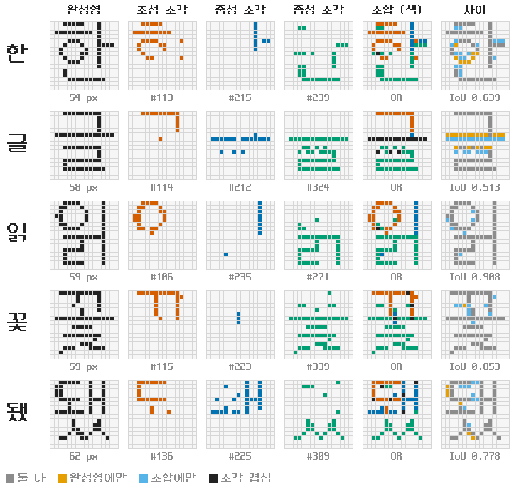
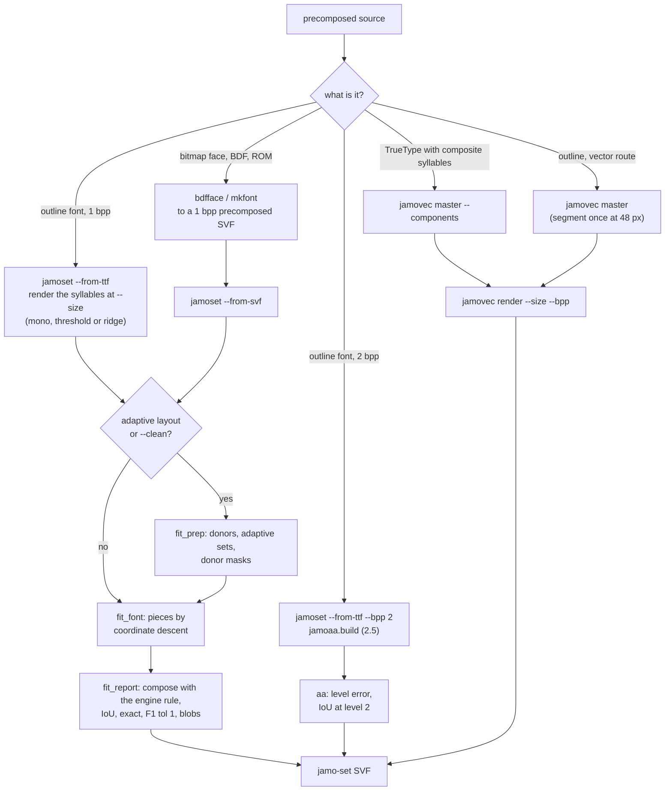
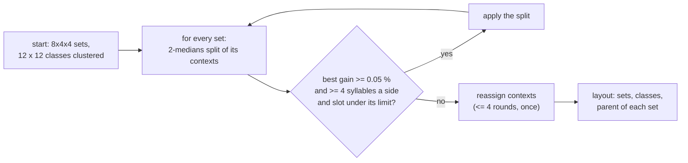
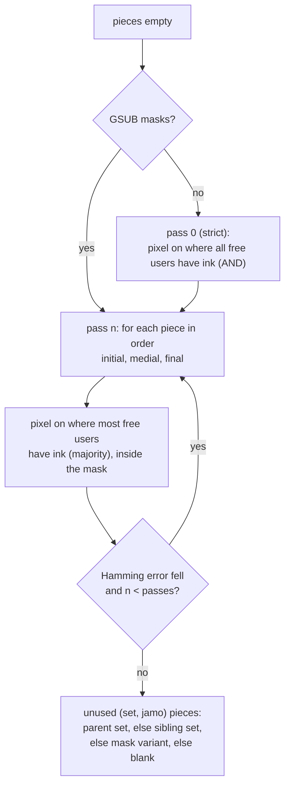
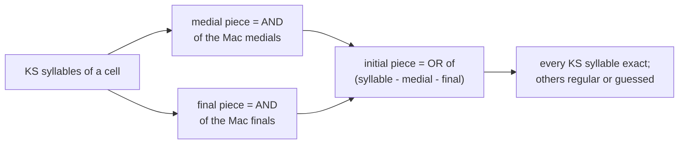
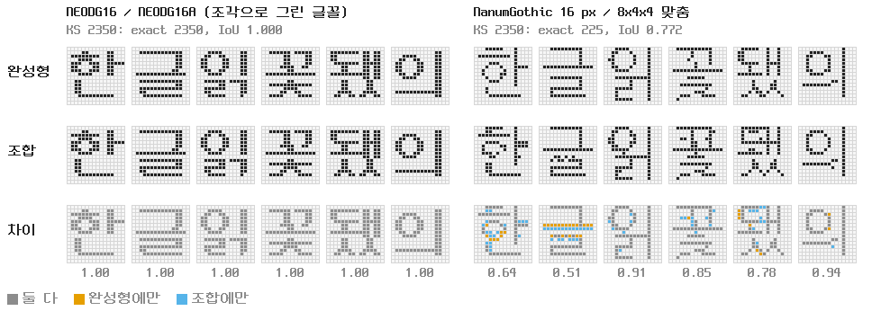
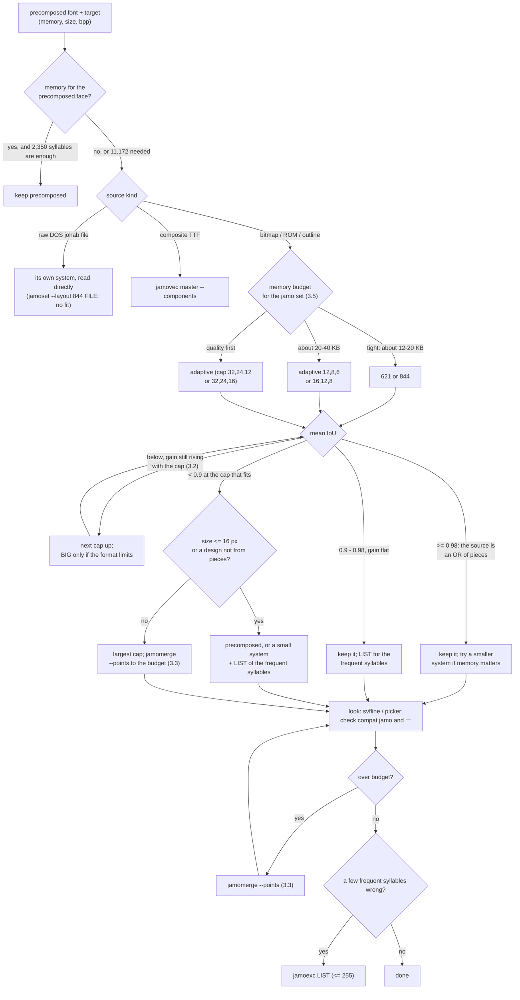

**English** | [한국어](jamo-split.ko.md)

# Jamo splitting: a jamo set from a precomposed font

A precomposed (완성형) font draws every syllable whole. A jamo set (조합형) stores initial, medial and final **pieces** in
a few **sets** (벌) and composes each syllable from two or three of them ([Jamo sets](jamo-sets.md)). Making a jamo set
from a precomposed font, **jamo splitting** (자모 분리), means recovering pieces that the font never stored. This document
describes how the tools of this repository do it, how each kind of source fares, what they do poorly, and what earlier
attempts taught.

Chapters 1 to 4 and 8 use numbers measured with the repository's tools (the command or the document it comes from is
named) or cited from the recipe documents, which record their own runs. Chapter 6 and the numbers marked "in research" in
chapters 3 to 5 come from earlier research runs, partly on proprietary fonts. Chapter 7 reports the learned split of
2026-11 in the same way. These are findings; they cannot be reproduced from this repository. The figures are drawn by `python3 -I tools/doc_figures_split.py`
from OFL fonts of this repository only (NanumGothic Regular, Neo Dunggeunmo, Neo Dunggeunmo Pro); `--check` re-renders them
and compares byte for byte.

## Contents

1. [What the problem is](#1-what-the-problem-is)
2. [How the fit works](#2-how-the-fit-works)
3. [Choosing and adjusting the number of sets](#3-choosing-and-adjusting-the-number-of-sets)
4. [Case by case](#4-case-by-case)
5. [What we do poorly](#5-what-we-do-poorly)
6. [Problems met and what was learned](#6-problems-met-and-what-was-learned)
7. [A learned split (research, 2026-11)](#7-a-learned-split-research-2026-11)
8. [Practical guidance](#8-practical-guidance)
9. [References and links](#9-references-and-links)

## 1. What the problem is

### 1.1 The task

Given the precomposed syllables of a font, find:

- **pieces**: for each set and each jamo, a bitmap (1 bpp) or a level map (2 bpp);
- **tables**: lead and tail classes, and for each (lead class, medial, tail class) cell the initial, medial and final set
  ([JSET](jamo-sets.md#41-the-model));

so that composing the chosen pieces reproduces each syllable. Composition is fixed by the format: the **OR** of the pieces
at 1 bpp, the **per-pixel maximum** of their levels at 2 bpp
([Anti-aliasing, chapter 3](anti-aliasing.md#3-jamo-sets-the-maximum-not-or-at-levels)). The fit can change the pieces
and the tables, never the rule.

A result is **exact** when every syllable composes to the font's own glyph, and **approximate** otherwise. Exactness is
possible only when the font was itself drawn as an OR of pieces under a set system the layout can express. A font designed
syllable by syllable is approximated: a shared piece is a compromise between the syllables that use it.

*Figure 1. NanumGothic Regular baked at 16 px (`mkfont.py` render, 1 bpp) and fitted to 8x4x4 (`jamoset.fit_font`, free
pieces). Columns: 완성형 = the precomposed glyph; 초성 / 중성 / 종성 조각 = the initial / medial / final piece (# = piece
number); 조합 (색) = the pieces overlaid (black where two pieces overlap); 차이 = the difference (grey both, orange only in
the precomposed glyph, sky blue only in the composition). Over the 2,350 KS X 1001 syllables this fit is 15,336 bytes,
225 syllables exact, mean IoU 0.772. Note 글: both the medial ㅡ piece (#212, with stray dots) and the final piece
(#324) carry a bar one row below the glyph's own bar, so the composition draws the bar twice in the same wrong row and misses
the glyph's row (IoU 0.513). In 꽃 the medial ㅗ piece (#223) keeps only a short stem; the final piece draws the bar.*

### 1.2 Why it is hard

- **Strokes overlap and touch.** In the precomposed glyph the jamo share pixels, so a pixel's owner is not written
  anywhere. Where an initial's foot touches the vowel's bar, the bar can be fitted to either piece and the composition is the
  same: the fit puts a stroke wherever it lowers the error, which need not be the jamo the stroke belongs to (figure 1:
  the ㅡ bar of 글 in both the medial and the final piece, the ㅗ bar of 꽃 in the final piece).
- **The same jamo changes shape by context.** The ㄱ of 가, 고 and 각 differ. A layout with few sets forces syllables
  that drew the jamo differently to share a piece. The designer's own grouping of contexts is not in the font
  ([Glyphs forum on divergent Hangul composition setups](https://forum.glyphsapp.com/t/divergent-hangeul-composition-setups/29856)).
- **Touching strokes merge at small sizes.** At 12-16 px the gap between two jamo is often zero pixels. NanumGothic
  Regular as `mkfont.py` bakes it (FreeType's grey rendering cut at 128) has on average 3.13 8-connected ink components per
  KS syllable at 32 px, 2.87 at 16 px and 2.60 at 12 px; 557 of the 2,350 syllables have fewer components at 16 px than at
  32 px, 1,059 at 12 px (measured with `doc_figures_split.bake` and `components`).
- **Hinting moves strokes.** Hinting snaps outlines to the pixel grid
  ([FreeType: on slight hinting](https://freetype.org/freetype2/docs/hinting/text-rendering-general.html)), and it does so
  per glyph: the same jamo lands on different pixels in different syllables. With FreeType's monochrome renderer
  (`mkfont.py --mono-hint`) the 12 px components fall to 2.03 a syllable (1,561 syllables merged against 32 px); at 16 px
  2.68 (839).
- **Pixel agreement is not identity.** A fit scored by pixel IoU can be good on average and still give a piece the
  stroke of another jamo, or lose a stroke a reader needs (chapter 5).

*Figure 2. NanumGothic Regular as `mkfont.py` bakes it at 12, 16 and 24 px: FreeType's grey rendering cut at 128
(회색조 >= 128, the default) and the monochrome renderer (`--mono-hint`). "N 덩어리" = N 8-connected ink components. At
12 px with `--mono-hint` 꿇 and 됐 become one component: every stroke touches another.*

## 2. How the fit works

### 2.1 The tools and the routes

| Tool | Role |
|---|---|
| `tools/jamoset.py` | the command line: `--from-ttf FONT --size N` or `--from-svf FACE.SVF`, a `--layout`, `--bpp 1\|2`; writes the jamo set and reports the fit |
| `tools/jamofit.py` | the 1 bpp fit (`fit_pieces`), the GSUB mask (`mask_pieces`), the metrics (`iou`, `f1_tol1`, `quality_report`) |
| `tools/jamoadapt.py` | the adaptive set system: classes by clustering, sets split where the syllables sharing a piece disagree |
| `tools/jamoaa.py` | 2 bpp: exact-area rasteriser, contours assigned to jamo, median consensus, level refinement under the maximum |
| `tools/jamoseg.py` | outline segmentation of a syllable into its jamo with path clipping (library; imported by no tool, only by `tools/test_jamoaa.py`; `jamoaa.py` has its own contour assignment, which `jamovec.py` uses) |
| `tools/jamovec.py` | vector fit: pieces as outlines chosen once at a decision size, rendered to any size |
| `tools/jamomerge.py` | shrinks a fitted face to a byte budget by merging piece variants, sets and classes |
| `tools/jamofill.py` | research builder: AND cores of a strike grown into pieces, coordinate descent on a weighted error |
| `tools/jamoexc.py` | LIST exceptions: up to 255 syllables drawn whole (or recombined) over the jamo set |
| `tools/macfbit_svf.py` | Mac HangulTalk 7.1.x fonts: the Mac's own planes (JMAP) or a derived rule form (AND medials and finals, residual initials) |

The maker runs these as **routes** (`maker/routes.py`): *bdfface + from-svf fit* (`bdfface.py` makes a precomposed face
from BDF files, then `jamoset.py --from-svf`), *experimental fit* (`--from-ttf --binarize threshold --mask-font none`, or
`--bpp 2`), *mask fit* (`--mask-font` the font itself with `--no-clean`, offered only when the font has the GSUB
`ljmo` / `vjmo` / `tjmo` features and freetype-py and uharfbuzz load), *vector fit*
(`jamovec.py master` then `render`) and *composite* (`jamovec.py master --components`). The route table is in
[Desktop routes](recipes/desktop-routes.md).

### 2.2 Targets

`--from-ttf` renders every syllable the font draws (`--present-only`, the default) into a cell of `--size` pixels. The
frame puts the union ink box of all syllables in the middle of the cell (`ttf_targets`, or `jamoaa.outline_targets` for
`--binarize threshold|ridge`, which use the exact-area rasteriser so TrueType and CFF are treated alike). `--from-svf` takes
the non-blank syllables of a 1 bpp precomposed SVF and keeps its other glyphs, cell, ascent and syllable advance.

### 2.3 Layouts: what is fitted

The layout fixes the classes and the set of each context before the fit; the fit only chooses pixels.

| Layout | Sets (initial / medial / final) | Classes | Selection |
|---|---|---|---|
| `844` | 8 / 4 / 4 | lead {ㄱ ㅋ} / other, tail none / final | initial set by vowel shape and final; medial by lead class and final; final by vowel |
| `1044-san`, `hanterm-johab` | 10 / 4 / 4 | as 844 (hanterm: 3 tail classes) | the no-final initial sets kept apart with a final |
| `621` | 6 / 2 / 1 | | the Apple II era system |
| `adaptive[:NI,NM,NF]` | from 8 / 4 / 4 up to 32 / 24 / 12 (default) | up to 12 x 12 | `jamoadapt.py` splits sets and clusters classes from the font |

The DOS selection rules are drawn in [Jamo sets, section 2.3](jamo-sets.md#23-the-selection-rule-of-8x4x4); the set
counts and their cost are compared in [Choosing the number of sets](recipes/sets.md#choosing-the-number-of-sets-벌-수).

**Adaptive** (`jamoadapt.adapt`) starts from 8x4x4 and works on donors: each syllable's region of each jamo, as
thermometer planes (one plane at 1 bpp, three at 2 bpp).

1. **Classes.** ㄱ and ㅋ are lead classes of their own; the other 17 initials are clustered by average linkage on how
   the medials beside them look, into at most 10 more classes. Finals are clustered likewise into at most 11 classes
   beside "no final".
2. **Splits.** For each set, a 2-medians split of its contexts (seeded by the largest item and the item farthest from
   it, up to 8 Lloyd passes). The gain is the drop in summed L1 distance of donors to their (set, jamo) median. The best
   split of all slots is applied while the slot is under its limit, each side has at least 4 syllables and the gain is at
   least 0.05 % of the starting cost. When no split qualifies, the loop ends and up to 4 reassignment rounds run once,
   moving contexts to the set that fits them best.
3. Contexts with no syllable follow the nearest used context that 8x4x4 puts in the same set.

### 2.4 The 1 bpp fit (`jamofit.fit_pieces`)

A glyph is one Python integer (bit `y*(w+1)+x`), so ANDs, ORs and popcounts over a whole cell are single operations. The fit
is **coordinate descent** over pieces in the order initial, medial, final:

- With the other two pieces of every syllable fixed, a pixel of piece k is set when, among the syllables that use k and
  are not already inked there by their other pieces, **more have target ink than not** (a majority; ties stay off).
- For free pieces and donor masks the **first pass is strict**: a pixel is set only if *every* such syllable has ink there
  (the AND). With a plain majority from the start, the initial would swallow the vowel's ink and the error never falls
  (the comment in `fit_pieces`). A GSUB-masked fit starts with the majority: its masks already keep each piece in its
  jamo's place.
- A piece may only use pixels inside its mask, if it has one (below).
- The fit stops after `--passes` (12) passes or when the summed Hamming error stops falling. It is deterministic.

**Masks.** Three kinds confine where a piece may have ink:

- **GSUB masks** (`--mask-font FONT`): HarfBuzz shapes each syllable as conjoining jamo U+1100.. with the precomposed
  glyphs hidden; the positional variant most syllables of a (set, jamo) shape to, rasterised and dilated by
  `--mask-radius` (1 up to 16 px, 2 up to 24 px, else 3), bounds the piece. Without `--mask-font` the tool tries a mask
  font (`$JAMOSET_MASK_FONT`) only when the free fit's mean IoU is below 0.995 (`AUTO_EXACT`).
- **Donor masks** (`--clean`, on for adaptive and 2 bpp): pixels where at least 25 % of the jamo's donors have coverage,
  dilated by one pixel. They take the place of a mask font when both are given. After the fit, components of up to 1 px
  (2 px above 16 px) are removed when removing them does not raise the summed Hamming error of the syllables using the
  piece (a minority of those syllables may still have ink there).
- None (`--mask-font none --no-clean`): free pieces.

**Unused pieces.** A (set, jamo) no fitted syllable uses (a context the font never draws, often outside KS X 1001 for a
2,350-syllable source) takes the piece of the set it was split from, else the same jamo's piece in the set with the most
users, else the mask variant, else stays blank (`fit_font`, `unseen_pieces` in the report). These syllables are
extrapolated, not fitted.

### 2.5 2 bpp (`jamoaa.py`)

A 1 bpp fit of thresholded coverage cannot be refined into levels, so 2 bpp is fitted on outlines
(`jamoset.py --from-ttf --bpp 2`):

1. **Region fit**: a free 1 bpp fit on coverage >= 0.5 with one medial set per tail class, to find where each jamo is.
2. **Contours to jamo**: each syllable's contours are grouped by containment. For each group, **peer syllables decide
   first**: when the syllables that share a jamo with this one agree clearly on where the same contour belongs, the group
   goes there (this keeps the ㅗ / ㅜ / ㅡ bars that the region fit misplaces with their vowel). A group the peers do not
   settle and that straddles two regions (not 85 % inside one) is split pixel by pixel, the peers' pixels deciding; the
   other unsettled groups are also split by the peers' pixels. Only where no peer pixels exist does a group go whole to
   the region it overlaps most.
3. **Sets** (with `--layout adaptive`): `jamoadapt.adapt` runs on these donors (2.3).
4. **Consensus**: each piece is the per-pixel median of its donors' coverage, quantised to levels 0..3; donors further
   than median + 3 x 1.4826 x MAD (with at least 5 donors) are dropped.
5. **Refinement**: coordinate descent on levels: each pixel takes the level in {current, 0, 1, 2, 3} that minimises the sum
   over its syllables of |max(level, other pieces) - target|, for `--aa-refine` passes (2); with `--clean` (the 2 bpp
   default) only inside the donor masks.
6. **Clean**: level-1 pixels stay only where half the donors have ink; small components without a level-3 pixel go.

The maximum has a floor no piece set removes: where two jamo cover disjoint halves of one pixel, the precomposed glyph's
coverage adds up and the maximum of the pieces does not (`join_loss`).

### 2.6 Vector fit (`jamovec.py`)

`master` renders the font once at `--decision-px` (48), finds donors (the contour assignment of 2.5, or the glyf composite
components with `--components`), lays out 8x4x4 or adaptive sets, and keeps for each piece the **medoid donor's own
contours** (the clean donor closest to the per-pixel median). `render` rasterises those outlines at any size with no
fitting. The pieces are therefore the font's own shapes, not pixels chosen to minimise an error, and the same master gives
every size. The cost is time: `master` took 172 s on NanumGothic on a heavily loaded machine
([Maker capability audit](maker-audit.md)) and 25 s on
Neo Dunggeunmo with `--components` ([Outline fonts](recipes/outline-fonts.md#jamo-sets-from-truetype-and-opentype-fonts)).

### 2.7 After the fit: shrinking and exceptions

- `jamomerge.py merge --points BYTES ...` merges piece variants, sets and classes greedily, by objective increase per byte
  saved (`2 x lost + extra + overlap`, syllables outside KS weighted 0.1), with hard gates on ticks, medials, strokes and
  leaks; with `--recog` it re-scores the best moves with an external recogniser.
- `jamoexc.py build FACE EXC.json OUT` adds a JMAP block in LIST mode: up to **255** syllables drawn whole (`"whole"`) or
  recombined from existing pieces (`"pieces"`), the face's JSET kept as the fallback for everything else
  ([Jamo sets, chapter 6](jamo-sets.md#6-version-3-jmap-list-and-rules-against-tables)).

### 2.8 Mac HangulTalk 7.1.x (`macfbit_svf.py`)

The Mac fonts store 482 glyph slots and a table that names, for each of the 2,350 KS syllables, up to three slots ORed
together. Taking every slot as a piece under JSET tables fails: two initials that use a different medial or final slot
with the same vowel and final cannot share a lead class, and Seoul12 has 130 such pairs of 171
([Jamo sets, section 6.4](jamo-sets.md#64-seoul12-one-font-two-structures)). So there are two forms:

- **direct** (default): a JMAP block whose pieces are the Mac slots, covering the KS 2,350 only (`--with-jset` adds a
  derived JSET as the fallback for the other syllables);
- **derived** (`--mode derived`): classes found by agglomerative search from 19 x 28 down to the limits; for each cell the
  **medial piece is the AND** of the Mac medial glyphs of its KS syllables, the **final piece the AND** likewise, and the
  **initial piece the OR of the residuals** `syllable - medial - final` (residual transfer). Every KS syllable stays
  exact; the 8,822 others are "regular" (every cell seen in a KS syllable) or "guessed" (filled from the nearest context).

### 2.9 Measuring the result

| Measure | Where | What it says | What it misses |
|---|---|---|---|
| mean IoU, p5 | `fit:` line, `quality_report` | intersection over union of composed and target ink ([Jaccard index](https://en.wikipedia.org/wiki/Jaccard_index)); 1.0 = identical | a 1 px shift costs as much as a missing stroke; lost identity |
| exact | `fit:` line | syllables identical to the font | how far the others are |
| F1 tol 1 | `fit:` line | ink agreement allowing a 1 px shift | strokes merged by a shift |
| blobs merged / split | `fit:` line | syllables whose 8-connected component count fell / rose | which jamo merged |
| level error, IoU at level 2 | `aa:` line | 2 bpp: mean absolute level difference (0..3); FACES.TSV divides it by 3 | the same as IoU |
| `--check` | `check:` line | the tables compose all 11,172 syllables, every piece has a glyph | quality: it passes on a poor fit |
| identity check | maker, `maker/recog_score.py` | per piece: the share of its syllables a jamo recogniser reads correctly on that slot (pass >= 0.95, warn >= 0.80) | needs `SVF_RECOG_DIR` naming the user's own `recog.py`; none ships |

The identity check was not run for this document: no recogniser is in the repository and `SVF_RECOG_DIR` was not set.
Look at every result too (`svfline.py line`, the `web/` picker): no number shows which syllables went wrong.

## 3. Choosing and adjusting the number of sets

8x4x4 is the DOS standard, not the default answer. The number of sets (벌) decides how many contexts can draw a jamo
differently, and each set costs a piece for every jamo it serves. Choose it for the source and the target, measure, then
go up or down. The full layout table and its cost on two 16 px faces are in
[Choosing the number of sets](recipes/sets.md#choosing-the-number-of-sets-벌-수); this chapter gives what is needed to
decide.

### 3.1 The set systems and their limits

| System (`jamoset.py --layout`) | Sets I / M / F | Classes (lead x tail) | When |
|---|---|---|---|
| `621` | 6 / 2 / 1 | 1 x 2 | the smallest; Apple II era fonts; a pixel font whose jamo hardly change shape |
| `844` (`844-ihnm`, `844-hbios24`) | 8 / 4 / 4 | 2 x 2 | the DOS standard; fonts drawn on it fit exactly |
| `1044-san`, `hanterm-johab` | 10 / 4 / 4 | 2 x 2 (hanterm 2 x 3) | as 844, with separate no-final initial sets |
| `adaptive:NI,NM,NF` | 8-32 / 4-24 / 4-16, chosen by the font up to the cap (default 32 / 24 / 12) | up to 12 x 12 | precomposed designs: sets are split where the syllables that share a piece disagree (2.3) |
| BIG (`--jset-big`, an engine built with `SVF_JSET_BIG`) | up to 128 / 128 / 64 | up to 19 x 28 | a source's own larger tables (Mac fonts, `jamovec.py render --jset-big`); `jamoset.py --layout adaptive` still stops at 32 / 24 / 16 and 12 x 12 |

The standard JSET block allows 32 / 24 / 16 sets and 12 x 12 classes (`JSET_LIMITS` in `tools/jamoset.py`); a face above
those needs BIG, which most MCU builds leave out ([Jamo sets, chapter 5](jamo-sets.md#5-jset-version-2-and-big)).
Engines built before 2026-10 reject more than 8 x 8 classes.

### 3.2 What more sets buy: a measured curve

Two OFL outline fonts at 16 px, `jamoset.py --layout L --from-ttf FONT --size 16 --binarize threshold --mask-font none
--check`, scored over every syllable the font draws: `--binarize threshold` fits the drawn syllables only
(`--present-only`), and both fonts in `ttf/` draw all 11,172 (their cmaps and the `fit: 11172 syllables` line of each run:
2,350 drawn as outlines and 8,822 as composite glyphs, which count as drawn). Measured for this document; bytes are the whole face with ASCII, JSET
version 1; time on one core:

| Layout | Sets used | NanumGothic Regular: bytes | IoU (p5) | Exact | Time | NanumMyeongjo Bold: bytes | IoU (p5) | Exact | Time |
|---|---|---:|---|---:|---:|---:|---|---:|---:|
| `621` | 6 / 2 / 1 | 12,232 | 0.641 (0.349) | 31 | 12.2 s | 12,156 | 0.704 (0.537) | 0 | 15.6 s |
| `844` | 8 / 4 / 4 | 18,616 | 0.707 (0.406) | 133 | 12.5 s | 18,652 | 0.772 (0.609) | 46 | 15.9 s |
| `1044-san` | 10 / 4 / 4 | 20,092 | 0.715 (0.404) | 154 | 12.3 s | 20,192 | 0.779 (0.611) | 42 | 15.4 s |
| `adaptive:8,4,4` | 8 / 4 / 4 | 25,704 | 0.749 (0.408) | 274 | 67.1 s | 25,956 | 0.809 (0.628) | 58 | 69.4 s |
| `adaptive:12,8,6` | 12 / 8 / 6 | 33,316 | 0.798 (0.449) | 854 | 66.3 s | 33,752 | 0.852 (0.671) | 189 | 71.6 s |
| `adaptive:16,12,8` | 16 / 12 / 8 | 40,784 | 0.836 (0.471) | 1,432 | 67.4 s | 41,320 | 0.873 (0.700) | 357 | 71.9 s |
| `adaptive:24,16,12` | 24 / 16 / 12 | 53,688 | 0.863 (0.508) | 1,994 | 67.9 s | 53,804 | 0.905 (0.750) | 866 | 72.2 s |
| `adaptive:32,24,16` | 32 / 24 / 16 | 69,084 | 0.881 (0.531) | 2,769 | 69.2 s | 69,428 | 0.923 (0.783) | 1,542 | 72.9 s |

Every adaptive fit used its whole budget and 12 x 12 classes. The adaptive JSET block is 9,921-12,321 bytes as version 1
and 2,844-5,782 as version 2 (`--jset-version 2`), against 1,101 / 272 for 844: `adaptive:8,4,4` has the 844 set counts,
and its 7 KB more buy 12 x 12 classes, which alone raise the IoU by 0.04 (0.707 → 0.749).

*Figure 5. The table above as a chart: mean IoU against the bytes of the face (a: = `adaptive:`). Blue: NanumGothic
Regular; orange: NanumMyeongjo Bold.*

**Reading it.** The curve bends: from 844 to `adaptive:12,8,6` costs 15 KB for +0.09 IoU, from `24,16,12` to `32,24,16`
another 15 KB for +0.02. Neither outline font comes near an exact fit at 16 px even at the cap: the gain flattens before
the format's limit, so going past 32 / 24 / 16 with BIG would buy little on such a source. A source drawn from pieces
behaves the other way: the OS/2 bitmap face of the [recipe](recipes/sets.md#choosing-the-number-of-sets-벌-수) reaches
0.999 at `adaptive:12,8,6` and stops splitting at 14 / 12 / 9 under a 32 / 24 / 12 cap.

### 3.3 Going down: fitting a memory budget

`tools/jamomerge.py merge --face FACE --points BYTES ...` shrinks an existing face to byte budgets. It never draws a new
piece; it makes the face use fewer of them by three kinds of move: a **tie** (every slot of a jamo that draws variant x
draws variant y instead), a **set** merge (two sets become one; per jamo the merged slot keeps the variant the objective
prefers), and a **class** merge (two lead or tail classes become one). Each round scores every move by its pixel cost
(against the unmerged face's own composition: 2 per lost pixel, 1 per extra, 1 per pixel two pieces share; syllables
outside KS weighted 0.1) **per byte saved**, and applies the cheapest. Hard gates refuse a move that would remove a
ㅗ ㅛ ㅜ ㅠ ㅡ tick, bring two KS syllables of one medial group (ㅗ ㅜ ㅡ) closer than they were, drop a stroke from a KS
syllable, or (with reference planes) leak ink into another jamo; `--recog` adds a recogniser check when one is available.

Measured on the NanumGothic Regular 844 face of 3.2 (`merge --points 17408 16384`, 36 steps, about 6 minutes), scored
against the same 16 px targets. The last two columns count syllables whose composition has fewer (merged) or more (split)
8-connected ink components than the target:

| Face | Bytes | Pieces | Mean IoU (p5) | Exact | Blobs merged | Blobs split |
|---|---:|---:|---|---:|---:|---:|
| 844 fit | 18,616 | 344 | 0.7074 (0.406) | 133 | 3,356 | 2,938 |
| merged to 17 K | 17,408 | 335 | 0.7069 (0.406) | 130 | 3,338 | 2,976 |
| merged to 16 K | 16,380 | 308 | 0.698 (0.402) | 125 | 3,226 | 3,358 |

The first moves are almost free (rare variants tied to a near twin); the cost per byte rises with every step, and the
split syllables (a stroke broken or detached) grow by 420 to 16 K: the gates stop lost strokes, not broken ones. The same
tool made the 12 px Seoul12 presets for the Arduino Uno from the 12,624-byte derived face: S8K 8,160, S7K 7,012, S6K 6,144
and S5K 5,548 bytes, the last where no allowed move was left
([Jamo sets, section 6.4](jamo-sets.md#64-seoul12-one-font-two-structures)). In research, a jamo recogniser read all three jamo
correctly in 67.9 % of the KS syllables of the unmerged face (an 11,936-byte build) and in 67.2 % of the 8,136-byte one:
cutting a third of the bytes cost less than one point there.

**When merging hurts.** The gates protect strokes and the ㅗ ㅜ ㅡ distinction, not the identity of every piece: a tie
can give a jamo the variant drawn for another context, which composes with few lost pixels and still reads oddly. Merging
cannot fix a fit that was poor to begin with, and it is slow on a large face: on the 65,136-byte adaptive face of 4.6
the first step took several minutes and saved 34 bytes (measured for this document; stopped after that step). Fit near the budget first, then merge the last few kilobytes, and look at the result.

### 3.4 Going up: adaptive, BIG or exceptions

- **The first fit is exact or close (IoU 0.98 or more)**: stay, or try a smaller system; more sets buy almost nothing.
- **The first fit is between about 0.9 and 0.98**: raise the cap (from 844 or 621: `adaptive:12,8,6`) while each step
  still gains.
- **The gain per kilobyte flattens** (the last rows of 3.2): stop adding sets. If a few frequent syllables carry the
  errors, a LIST of whole syllables (`jamoexc.py`, up to 255) is cheaper per kilobyte (4.8).
- **The fit is limited by the format, not the source** (adaptive stops at its cap while the gain per split is still large,
  or a source's own tables have more than 32 / 24 / 16 sets): BIG, if the target engine is built with it.
- **Below about 0.9 at the cap**: the precomposed face, or a set system for the budget with LIST exceptions; more sets will
  not make the design an OR of pieces.

### 3.5 Rule of thumb

| Target and use | Start with | Then check |
|---|---|---|
| Small MCU, under about 16 KB for all Hangul | `621` or `844`, then `jamomerge.py --points` to the budget | the gates' refusals; ㅗ ㅜ ㅡ and ㄲ in a sample line |
| A font drawn from pieces (DOS, ROM, pixel font) | `844` (or the font's own system, read directly) | IoU near 1.0; if not, `adaptive` with a small cap |
| Outline or precomposed design, 20-40 KB | `adaptive:12,8,6` or `16,12,8` | IoU and the gain over the cap below it; JSET v2 to save 6-7 KB |
| Outline or precomposed design, quality first | `adaptive` (32,24,12 or 32,24,16) | whether the last step still gained; LIST for the frequent syllables |
| 12-16 px outline font | `adaptive` with a cap that fits the memory | the identity of the frequent syllables by eye; the precomposed face if it fits |
| Desktop or web, memory not tight | the precomposed face | |

## 4. Case by case

| Source | Example | 8x4x4 | Adaptive or other | Keep |
|---|---|---|---|---|
| drawn from pieces (DOS johab, sprite fonts made from a jamo set) | Neo Dunggeunmo, Date Quiz Go Go, NKP | IoU 1.000 / 1.000 (2,347 exact) / 0.998 (2,324) | NKP adaptive 1.000 | the jamo set |
| hand-drawn bitmap face | OS/2 `$korZN16.FNT` | 0.984 (1,753 exact) | `adaptive:12,8,6` 0.999 | the jamo set |
| ROM precomposed | 86Box Trigem / ATI / Kasan | 0.968 / 0.919 / 0.872 | | Trigem jamo set; Kasan precomposed |
| ROM, not from pieces | CPC-400S; Quiz King of Fighters | 0.794; 0.835 | Quiz KOF adaptive 0.975 (62,084 B) | precomposed |
| outline design, 16-24 px | Gothic A1, NanumSquareRound, Single Day | | 12 x 12 classes, 24/16/16: 0.94-0.97; Single Day 0.998 | the jamo set when memory matters |
| outline at 12-16 px | NanumGothic Regular 12 / 16 px | 0.733 / 0.707 | 16 px adaptive 0.877 | precomposed, or a jamo set with LIST exceptions |
| Mac HangulTalk table font | Seoul12 | | derived 9/6/3 sets, KS exact | direct JMAP, or derived for small targets |
| 2 bpp | Gothic A1 16 px | | level difference / 3: 0.026 (KS) | the jamo set at 18 px and up |

### 4.1 Fonts drawn from pieces

A font whose syllables were themselves made by ORing pieces under an 8x4x4-like rule fits exactly. Neo Dunggeunmo's
precomposed `NEODG16.SVF` and its fitted `NEODG16A.SVF` agree on all 2,350 KS syllables (IoU 1.0000; `doc_figures_split.py`).
Date Quiz Go Go's sprite font fits to IoU 1.000 with 2,347 of 2,350 exact, drawn from pieces "of a design none of the known
DOS fonts has" ([MAME ROMs](recipes/rom-mame.md#date-quiz-go-go-a-2350-syllable-sprite-font)). The NKP Hercules driver's
face fits 8x4x4 to 0.998 (2,324 exact) and adaptive to 1.000, because NKP chooses a with-final initial set by vowel shape
among four sets where 8x4x4 has three ([Programs and drivers](recipes/programs-and-drivers.md#nkp-a-hercules-hangul-tsr-with-cropped-pieces)).
A raw DOS johab file needs no fit: `jamoset.py --layout 844 FILE` reads its pieces directly.

*Figure 3. Left: Neo Dunggeunmo, a font drawn from pieces: the jamo set composes every KS syllable exactly. Right: the
NanumGothic fit of figure 1: KS 2,350, 225 exact, IoU 0.772; the per-syllable IoU is under each difference.*

### 4.2 Real precomposed designs

Designs drawn syllable by syllable never fit exactly, and more sets keep helping. The faces in `svf/jamo-extra/` are fitted
with 12 x 12 classes and 24/16/16 sets ([FACES.TSV](../svf/jamo-extra/FACES.TSV)). Mean IoU at 16 px over every syllable
the font draws:

| Font | Syllables drawn | Mean IoU | Note |
|---|---:|---:|---|
| Gothic A1 Regular | 11,172 | 0.9411 | KS 0.9521, corpus-weighted 0.9769 |
| Gothic A1 Bold | 11,172 | 0.9595 | |
| NanumSquareRound Regular | 2,479 | 0.9716 | |
| NanumSquareRound Bold | 2,479 | 0.9760 | |
| Single Day | 11,172 | 0.9977 | 8 x 8 classes; a hand-lettered design close to an OR of pieces |

NanumSquareRound draws only 2,479 syllables, so its score covers fewer and mostly common syllables than Gothic A1's. The
corpus-weighted column is higher because the pieces were chosen with usage weights, so frequent syllables are drawn
closest. Bytes at 16 px: 69,797 (Gothic A1) against about 357,504 for 11,172 whole 16x16 cells.

### 4.3 Small pixel fonts: the blank medial ㅡ

The fit owes nothing to jamo identity. In `NEODG16A` the ㅡ bar is in the **initial** pieces: all 532 syllables with the
medial ㅡ use an inkless medial piece (pieces 170, 191, 212, 233), and the composition is still exact, since the initial set
used with ㅡ always carries the bar. The compatibility jamo ㅡ (U+3161) is drawn from the medial piece of the first set
(`compat` in the JSET), so it draws **blank** in `NEODG16A`, `NEODG16B`, `NEODG16D` and `NEODG32`. `NEODG16C` has a whole
glyph for U+3161 and draws it; `NEODG16G` (6x2x1) and Neo Dunggeunmo Pro `NDGPR16` have a medial ㅡ with 14 px of ink.

*Figure 4. 그 글 으 고 and the compatibility jamo ㅡ (U+3161) in `NEODG16A` (left) and `NDGPR16` (right). "빈 조각" = an
inkless piece. The compositions agree; the pieces do not.*

The way out is to give the compatibility jamo whole glyphs. Bake them into the precomposed source
(`mkfont.py ... --unicode ascii,ksx1001-hangul,3131-3163`); `jamoset.py --from-svf` keeps a whole glyph for every
compatibility jamo the source draws and points the JSET entry at it instead of at a piece (checked: Neo Dunggeunmo baked
that way and fitted to 8x4x4 is exact on the 2,350 syllables, and U+3161 draws its 14 px bar). For an existing face,
`jamoexc.py` can add `"ㅡ": {"whole": "HEX"}`: no piece of `NEODG16A` holds the bar alone, so a `"pieces"` entry cannot
draw it, and a LIST needs at least one syllable entry besides compatibility jamo.

### 4.4 ROM fonts

The ROM fonts are 16x16 precomposed grids. Whether they fit depends on how they were drawn, not on the medium:

| ROM | 8x4x4 IoU (exact) | Note | Source |
|---|---|---|---|
| 86Box Trigem | 0.968 (1,576) | | [86Box ROMs](recipes/rom-86box.md) |
| 86Box ATI | 0.919 (644) | | [86Box ROMs](recipes/rom-86box.md) |
| 86Box Kasan | 0.872 (290) | | [86Box ROMs](recipes/rom-86box.md) |
| MSX CPC-400S 256 KB | 0.794 (83) | | [MSX ROMs](recipes/rom-msx.md) |
| Quiz King of Fighters | 0.835 | adaptive 0.975 (62,084 bytes against 123,640 precomposed); the recipe keeps the precomposed face | [MAME ROMs](recipes/rom-mame.md#quiz-king-of-fighters-korea-a-2350-syllable-font-with-an-outline-pen) |

Most of these ROMs hold the KS 2,350 and nothing else. CPC-400S holds 2,591 syllables: 2,217 of the KS 2,350 (133 are
missing) and 374 outside KS that its driver's lists name. Every syllable the ROM lacks is extrapolated.

### 4.5 Mac HangulTalk table fonts

Seoul12 is the worked case ([Jamo sets, section 6.4](jamo-sets.md#64-seoul12-one-font-two-structures);
[Classic Mac](recipes/classic-mac.md#classic-mac-hangultalk-71)): the direct JMAP keeps the 207 Mac pieces and draws
the KS 2,350 only (15,016 bytes without Latin); the derived JSET (8 x 4 classes, 9/6/3 sets, 219 pieces, 9,716 bytes) draws
all 11,172, with the KS 2,350 exact, 4,630 regular and **4,192 guessed**. Whether BIG's 19 lead classes would let the Mac
slots be used directly as pieces has not been measured. These Apple faces are not distributed.

### 4.6 Outline fonts at 12 and 16 px

Small sizes are the hard case (chapter 5). NanumGothic Regular, `jamoset.py --layout 844 --from-ttf ... --binarize threshold
--mask-font none --check` (measured for this document):

| Size | Bytes | Mean IoU (p5) | F1 tol 1 | Exact of 11,172 | Time |
|---|---:|---|---:|---:|---:|
| 12 px | 15,932 | 0.733 (0.404) | 0.981 | 190 | 10.9 s |
| 16 px | 18,616 | 0.707 (0.406) | 0.991 | 133 | 12.1 s |
| 24 px | 27,832 | 0.694 (0.414) | 0.990 | 69 | 15.2 s |
| 16 px adaptive (32/24/12, 12 x 12) | 65,136 | 0.877 (0.513) | 0.995 | 2,734 | 66.8 s |

IoU does not rise with size here: the F1 with 1 px tolerance is 0.98-0.99, so most of the error is one-pixel shifts, which
cost more IoU on thin strokes. More sets help more than more pixels. The same font baked by `mkfont.py` (FreeType hinting
on) and fitted from the SVF gives 0.772 over KS (figure 1). NanumGothic Bold at 16 px is 0.817
([Outline fonts](recipes/outline-fonts.md#jamo-sets-from-truetype-and-opentype-fonts)).

### 4.7 2 bpp faces

2 bpp is fitted on outlines (2.5) and composed by the maximum. NanumGothic Regular 16 px 8x4x4 at 2 bpp: 23,180 bytes,
level error 0.2377 (0.522 on inked pixels), IoU at level 2 0.695, 8 syllables exact, 72.7 s (measured). The shipped
adaptive faces are much closer: Gothic A1 16 px 2 bpp 0.0297 (level difference / 3), Single Day 0.0012
([FACES.TSV](../svf/jamo-extra/FACES.TSV)).

### 4.8 Exceptions with LIST

When a few frequent syllables are wrong, `jamoexc.py` stores them whole: at most 255 entries, 118 + 8 x N bytes of entries
plus the whole cells. In the research on two proprietary 12 px fonts, adding a LIST of whole syllables gained about three
times as much usage-weighted IoU per KB as adding uniform sets (0.134 against 0.045) and was smaller than isolating those
syllables with extra classes at every count tried (section 6). In the same research, the 100 most frequent syllables of a
corpus of Korean game translations covered 68 % of the text, the 300 most frequent 88 %.

### 4.9 When to keep the precomposed face

Keep the precomposed face when the target can hold it and the fit is approximate: a 2,350-syllable precomposed 16x16 1 bpp
face is about 120 KB, and the jamo sets above reach that size only at the full adaptive budget. The recipes keep the
precomposed face for CPC-400S, Kasan and Quiz King of Fighters. A jamo set pays off when memory is tight, or when 11,172
syllables are needed and the source is close to an OR of pieces.

## 5. What we do poorly

1. **Small sizes.** At 12-16 px every measure falls. NanumGothic Regular reaches only 0.733 / 0.707 mean IoU in 8x4x4 at
   12 / 16 px, with the 5th percentile at 0.40 (4.6). Strokes touch (1.2: the mean component count is 3.13 at 32 px and
   2.03 at 12 px with monochrome hinting; figure 2 shows examples) and hinting moves each syllable's strokes differently, so no single piece can
   serve all the syllables. In research, 12 px faces built from a proprietary font's own conjoining pieces reached a mean
   IoU of 0.58 against its hinted precomposed glyphs, with 822 of 2,350 syllables below 0.5.
2. **Pixel IoU is not identity.** IoU counts pixels; a reader needs strokes. A fit can score well and still give the ㅡ
   bar to the initial piece (4.3), let an initial swallow a vowel stroke, or drop the bar of ㄲ. In research, pieces of a
   12 px exact split carried 28-41 % pixels of other jamo on average, while every syllable composed exactly. `--check`
   proves the tables compose, not that the pieces are the jamo; the identity check needs an external recogniser that the
   repository does not ship and that was never run here on a real model. In research, a per-pixel model put 98-99.5 % of the
   pixels in the right slot, against 66-92 % for pixel fitting (7.2, 7.3). Faces built from it with hard identity gates kept
   95.5-99.7 % on the Apple and Gulim ground-truth faces (7.4, 7.6). `tools/jamohybrid.py` now builds such faces (7.8).
3. **Blank or degenerate pieces.** A piece no syllable needs ink in stays blank (4.3); a piece of a context the source
   never draws is copied from another set or left blank (`unseen_pieces`). The compatibility jamo then draw blank or wrong.
4. **Designs not built from pieces.** Kasan 0.872, CPC-400S 0.794, Quiz King of Fighters 0.835 with 8x4x4: the result is a
   different font that looks like the source. More sets close part of the gap at the cost of most of the memory saving
   (Quiz KOF adaptive is half the precomposed size).
5. **Compound vowels and double finals.** ㅘ ㅙ ㅚ ㅝ ㅞ ㅟ ㅢ and ㄳ ㄵ ... ㅄ are wide, crowded pieces that touch the
   initial and the final, and they have few syllables to fit from (a 2,350-syllable source has none at all for many of
   their contexts). The research recogniser read ㅚ correctly in only 39-51 % of cases and took ㅜ for ㅡ in 111 of 703.
6. **2 bpp levels.** Composition by maximum cannot reproduce the coverage where two jamo share an edge pixel (2.5), and an
   8x4x4 2 bpp fit of an outline font at 16 px gets 8 syllables exact of 11,172 (4.7). The identity check reads 2 bpp
   faces thresholded at level 2.
7. **Guessed syllables.** A source with 2,350 syllables gives no data for the other 8,822. Seoul12's derived face guesses
   4,192 of them from the nearest context; ROM fonts and KS-only faces extrapolate every one. No measure exists for them:
   the IoU is over the syllables the font draws.
8. **Set-count and class limits.** The standard JSET allows 32 / 24 / 16 sets and 12 x 12 classes (BIG 128 / 128 / 64,
   19 x 28). In research, an exact split of a 12 px pixel font needed far more (114 / 37 / 33 sets, or 65 / 91 / 41 with honest pieces
   and a 19 x 27 class grid, section 6); a refinement loop on 12 px gothic faces was refused a split 73-376 times by the
   limits. The 2026-11 hybrid is still rising at the standard limits on 9-16 px strikes (7.6, 7.9).
9. **Speed.** A fixed-layout fit takes 10-15 s on an outline font, adaptive about a minute (66.8 s at 16 px; Gowun Batang
   Bold 20 px 89 s), 2 bpp over a minute (72.7 s), and a vector master minutes (172 s on a heavily loaded machine). The maker's mask fit has never been
   run in the maker.
10. **Two routes of one name differ.** The maker page's *bdfface + from-svf fit* passes no `--mask-font`, so where a mask font
   and the libraries are present a fit below IoU 0.995 is masked; the built-in recipe of the same name passes
   `--mask-font none`. Results can depend on the machine.

## 6. Problems met and what was learned

These are the attempts of 2026-10 and 2026-11 in order. Most used proprietary fonts (Windows and Mac system fonts) as
references; only the findings are reported here, no data from them.

| When | Goal | Method | Result | Decision |
|---|---|---|---|---|
| 2026-10-15 to 10-22 | jamo sets from any precomposed font | pixel fits with a fixed 8x4x4, then a plan to split outlines once at 128-256 px with path booleans and decide ambiguous cuts by a vision model | pixel fits "looked wrong on 가 / 고 even with good IoU"; picks by a model and a fixed rule differed by less than 1 px a syllable at 12-40 px, so the error was in grouping and in which donor became the piece | adaptive sets and vector segmentation kept (`jamoadapt.py`, `jamoseg.py`, `jamovec.py`); exact fitting given up as a goal ("don't try to fit it exactly") |
| 2026-10-23 to 10-26 | smaller tables | JSET version 2: the same tables in bits | the largest block 12,321 → 9,246 bytes; 95 faces 652,431 → 310,160 bytes (47.5 %) | kept: version 1 the standard, version 2 where it pays |
| 2026-10-24 | small-size (12-16 px) pieces, "approach P" | for each jamo a native prototype piece (from bitmap strikes and Mac planes, never cut from small syllables) placed within ±1 px, under a table of 228 features | judged by an automatic count of vanished strokes, it seemed to win | rebuilt: the maintainer decided that each jamo keeps its base form, overlap is acceptable and a lost stroke is not, and that jamo are never split at a small size |
| 2026-10-25 | the same, rebuilt | features in tiers (identity / structure / finish), identity a hard constraint | whole-stroke losses 0 in all six test cells, but the old count rose (e.g. 284 → 601) | the old count dropped as a yardstick: 78-89 % of its entries were displaced strokes, and it missed 86-100 % of the slots that lost identity |
| 2026-10-26 | a judge that agrees with people | judge v2 (100 x identity + 10 x structure + finish), then v2.1 / v2.2 learning which strokes may touch from many design families | v2 ranked hand-made strikes best at 12 px; a blind check of 60 syllables ranked hand 1.25 < P 2.18 < plain 2.57; tuning P against v2 gamed it (merges 28 → 163); at 16 px every version ranked P above the hand strike | 12 px only; a judge built from the candidate's own pieces is circular |
| 2026-10-26 | 12 px faces of three OFL gothic fonts with a refinement loop | 32 / 22-24 / 12-15 sets, loop on judge v2.2 | the loop lowered its own score by about 30 %; the set limits refused a split 73 / 376 / 139 times; 835-1,018 of 2,350 syllables got worse on at least one measure | paused: no independent check |
| 2026-10-26 | an exact split of a hand-made pixel font (Galmuri) | split without changing a pixel, sets unlimited | 21 px: exact for all 11,172 with 32 / 23 / 10 sets, 60,284 bytes against 543,904 precomposed; 12 px: 114 / 37 / 33 sets, and pieces with 28-41 % pixels of other jamo; with honest pieces 65 / 91 / 41 sets, 19 x 27 classes | abandoned: at 12 px a many-variant structure is not a sensible jamo-set base |
| 2026-10-26 | Mac fonts in SVF | the original table as JMAP; a derived JSET (2.8) | Seoul12 exact on KS in both; derived needs guesses outside KS | the original structure is canonical; derived faces only for small targets |
| 2026-10-26 to 10-27 | a 12 px face in 8 KB for a small MCU | pieces from other faces; Seoul12 shrunk by `jamomerge.py` | pieces taken from another design read worse than the source and showed noise dots, ㅡ ㅜ ㅗ that could not be told apart and a ㄲ without its bar; Seoul12 shrunk to 8,160 / 7,012 / 6,144 / 5,548 bytes | Seoul12 kept as the small preset; a hard-coded composition for one font (0.5-1 KB gain) abandoned for the table-driven form |
| 2026-10-27 to 10-28 | 12 px faces from fonts' own conjoining (GSUB) pieces | the font's positional variants as pieces; more sets; LIST of whole syllables | mean IoU 0.58 against the hinted glyphs (layout differs, ±1 px shift only reaches 0.64); a stroke filter costs about 0.03 IoU; LIST beat extra classes at every size and gained 0.134 IoU per KB against 0.045 for sets; split-half check 0.812 / 0.813 (no overfitting) | decomposing whole precomposed glyphs dropped at 12 px; the format judged expressive enough: the gaps are in pieces and evaluators |
| 2026-11-01 | | | | the follow-up face-quality research (evaluation-driven piece search, layout correction, evaluator reliability) cancelled; the findings kept in the research notes |
| 2026-11-09 | | | | jamo segmentation research stopped for now; the tools stay as they are |
| 2026-11-27 | a split checked against real pieces | ground-truth pairs (Mac 7.1.2 planes = 7.5.3 strikes; Windows 95 Gulim component strikes); a per-pixel model; structural sets with voting and identity gates (chapter 7) | pixel fitting puts 66-92 % of pixels in the right slot, the model 98-99.5 %; the hybrid beats `adaptive` at equal bytes on every face measured | the standard JSET face stays the default, BIG an option |
| 2026-11-28 | the learned split as a tool | `tools/jamohybrid.py` with a numpy model (`tools/jamonet.py`, weights trained on the ground truth and the open faces) | held-out faces: label accuracy 0.988-0.998 for the model; built faces as in research (7.8) | shipped; maker integration is a follow-up |
| 2026-11-28 | `jamohybrid.py` v2 | bottom-up merging inside the exact JSET structure (set limits per lead class, vowel, tail class), merge tolerance and class caps as the stopping rule | at v1's bytes +0.03 to +0.09 composed IoU on four of five TrueType fonts; no stored piece fails a gate (v1: font means 2.7-17.2) (7.8) | the default; KS-only sources still weak |

**What was learned.**

- **Look, and check identity.** Pixel IoU and counts of lost pixels missed what people saw. Every piece variant should be
  checked as the jamo it stands for, alone and with a neutral partner; a zero against the splitter's own labels proves
  nothing.
- **Keep each jamo's form; allow overlap.** A merge is a cost, a lost stroke is a failure. Touching is harmful when it
  makes ㅗ ㅜ ㅡ (ㅛ ㅠ) indistinguishable; the two halves of ㄲ or the cap of ㅎ may touch.
- **Do not split at small sizes.** Pieces cut from 12 px syllables carry their neighbours' strokes. Split large (outlines
  or a decision size) and render down, or use pieces the font itself stores.
- **A judge must be independent of the candidate.** A judge learned from P's own pieces ranked P above hand-made strikes.
- **Exceptions beat sets for the last few percent.** Usage is concentrated; a LIST of frequent syllables is the cheapest
  gain.
- **Check against real pieces.** Fonts that store pieces and also ship precomposed bitmaps give exact labels; they showed
  that IoU and correct pieces are different targets (7.2).
- **The format is not the bottleneck.** JSET v1/v2, BIG, JMAP and LIST express what the sources need; the work is in the
  pieces and in measuring them.

The literature on bitmap compression points the same way: a TrueType study measured embedded-bitmap savings of about 35 %
for precomposed Hangul and 7 % for johab glyph data ([Hangul Bitmap Data Compression Embedded in TrueType Font, 2006](https://koreascience.kr/article/JAKO200629734288886.pub?lang=en)),
and Unifont builds its Hangul from a 6/3/1 set system by superimposing pieces
([Unifoundry: Hangul syllable generation](https://unifoundry.com/hangul/hangul-generation.html)). No public source was found
on choosing set counts for bitmap faces.

## 7. A learned split (research, 2026-11)

- Source: a research run of 2026-11 in a private research repository.
- Data: mostly bitmaps of proprietary fonts (Apple, Microsoft, IBM). Only numbers are given. Rows of those fonts cannot
  be re-run from this repository.
- Tools: the research code; since 2026-11-28 the builder ships as `tools/jamohybrid.py` (7.8).

### 7.1 Ground truth

A split is checked against fonts that store their syllables as pieces and also exist as precomposed bitmaps.

| Pair | Syllables with exact pieces | Note |
|---|---|---|
| Mac HangulTalk 7.1.2 jamo planes vs System 7.5.3 strikes (Seoul 12, AppleMyungjo 12 / 24, AppleGothic 24) | 2,350 / 2,350 each; AppleGothic 24: 2,349 (the strike of 몰 has 2 extra pixels) | the strikes are pixel-identical to the composed planes |
| Windows 95 Gulim, bitmap strikes at 12 and 16 ppem (`EBDT` format 9 composites) | 1,928 / 2,350 KS syllables | built from 2 or 3 component bitmaps (initial, medial, final); the other 422 are whole bitmaps |
| AppleGothic 12 (7.1.2 planes vs the 7.5.3 strike) | none | the strike was redrawn (IoU 0.567); used as a held-out face |

The Gulim strikes are the second, independent source: a different designer, and component order gives the slots.

### 7.2 Why pixel fitting splits wrongly

`jamoset.py --from-svf` fits pieces that compose the syllables. It does not care which piece owns a pixel. Run on the
four Apple faces as if no ground truth existed:

| Method | Composed IoU | Pixels in the right slot (label accuracy) | Syllables with all pieces right |
|---|---|---|---|
| `844` with the mask font | 0.82-0.90 | 0.78-0.92 | 0-764 |
| `adaptive` | 0.99-1.00 | 0.66-0.73 | 0-46 |

Where a piece serves one or two syllables, adaptive gives it the whole syllable (ㅞ syllables end up all "initial").
Elsewhere a vowel bar or a final goes to whichever slot is cheaper. A high IoU says nothing about the split (5, item 2).

### 7.3 A per-pixel model

A small U-Net (1.9 M parameters) reads the precomposed bitmap, scaled by a whole factor to a 32 x 32 canvas. It outputs
one sigmoid plane per slot, so a shared joint pixel can belong to two slots. The syllable's initial, medial and final
are always known and are given as conditioning (L / V / T). Training takes about 35 s on a desktop GPU.

Leave-one-font-out (train on the other faces and on synthetic compositions, test on the held-out one):

| Test face | Label accuracy | Syllables with all pieces right |
|---|---|---|
| Seoul 12 | 0.991 | 2,058 |
| AppleMyungjo 12 | 0.988 | 1,639 |
| AppleMyungjo 24 | 0.992 | 1,341 |
| AppleGothic 24 | 0.995 | 1,632 (1,726 without L / V / T) |
| Seoul 12, trained on synthetic faces only (DOS 8x4x4, HangulTalk 1.0) | 0.975 | 1,636 |
| Gulim 12 / 16 (unseen designer, 1,928 syllables) | 0.989 / 0.986 | 1,339 / 999 |

Conditioning helps on three of four faces. The remaining errors are joint pixels at 24 px, and stroke swaps at 12 px
(Seoul's ㄱ before ㅑ ㅕ ㅐ: 갸 겨 갼 컸 캔).

### 7.4 Grouping into sets

The designers' own rules, read from their tables (the smallest set of context features that decides each variant):

| Rule | Initial | Medial | Final |
|---|---|---|---|
| Apple 7.1.2 | final present x 8 vowel groups | initial group x final kind (none / ㄴㅅ / other) | vowel class or group |
| HangulTalk 1.0 | vowel x final kind | final kind (x initial group for ㅓ ㅔ ㅕ) | vowel class (x initial) |
| DOS 8x4x4 | final present x 5 vowel groups | ㄱㅋ or not x final present | vowel |

A **hybrid** builds the sets in two directions:
1. **Top-down, structural sets:** initial = vowel group x final present, medial = initial class x final kind, final =
   vowel group. Then greedy splits, by one initial, vowel or final, up to the JSET limits.
2. **Bottom-up, shapes:** each piece is a per-pixel vote of the model over the syllables that share it. Pieces of one
   jamo merge when the merged piece passes the identity gates (7.5) and no syllable's error grows past 1-2 px.
3. **Re-fit:** `jamofit` refits the pieces to the precomposed syllables, but a pixel may only go to a slot the model
   gave it.

This is the research builder and `tools/jamohybrid.py` v1. v2 (7.8) drops the top-down sets: it merges bottom-up inside
the exact JSET structure, where the set limits hold per lead class, per vowel and per tail class.

Grouping agreement with the designer's own (adjusted Rand index, initial / medial / final):

| Face | Hybrid, standard limits | `adaptive` |
|---|---|---|
| Seoul 12 | 0.95 / 0.85 / 0.90 | 0.59 / 0.22 / 0.51 |
| AppleMyungjo 12 | 0.99 / 0.70 / 0.92 | 0.54 / 0.22 / 0.47 |
| AppleMyungjo 24 | 0.96 / 0.81 / 0.94 | 0.54 / 0.24 / 0.52 |
| AppleGothic 24 | 0.97 / 0.84 / 0.97 | 0.55 / 0.14 / 0.45 |
| Gulim 12 (vs its components) | 0.84 / 0.51 / 0.75 (BIG: 0.91 / 0.73 / 0.64) | 0.56 / 0.29 / 0.16 |
| Gulim 16 (vs its components) | 0.80 / 0.65 / 0.68 (BIG: 0.92 / 0.73 / 0.72) | 0.59 / 0.43 / 0.49 |

The medial agrees least. Apple chooses it by initial more finely than 12 lead classes allow.

### 7.5 Identity gates

A piece must keep its jamo's form. The gates are hard:
- a voted piece that fails one is replaced by the nearest user proposal that passes;
- a merge whose piece would fail is not made;
- a re-fitted piece that fails keeps its vote.

| Gate | Check |
|---|---|
| mass, extent | at least half the median ink and 60 % of the median ink box of that jamo |
| holes | ㅁ ㅂ ㅇ ㅎ ㅃ have a closed counter; ㄱ ㄴ ㄷ ㄹ ㅅ ㅈ ㅋ have none |
| ticks | ㅏ ㅓ: 1, ㅑ ㅕ: 2, ㅣ: 0, on the side the vowel opens to (right for ㅏ ㅑ, left for ㅓ ㅕ), none on the other side |
| stubs | ㅗ ㅜ: 1, ㅛ ㅠ: 2, ㅡ: 0, above the bar (ㅗ ㅛ) or below it (ㅜ ㅠ) |
| slant | ㅅ: an apex, wider at the bottom; ㅈ: a bar over a ㅅ |

Serifs break a naive tick count: a Myungjo hook at the top of ㅏ counts as a tick. The check therefore ignores side ink
within a share of the stroke length at each end. The share is set per face:

| Face | Calibrated on | Share |
|---|---|---|
| a GT face | its own GT pieces | AppleMyungjo 0.2; Seoul 12 0 (at 0.2 its upper ㅑ ㅕ ticks would be ignored) |
| another size of a GT family | that family's GT face | as the family |
| any other face | its own model proposals | 0-0.25 |

Separately, each check is turned on only where at least 90 % of the reference pieces pass it.

### 7.6 Size and accuracy

Bytes are the jamo face without ASCII, and IoU is composed against precomposed over the 2,350 KS syllables. The table
gives the hybrid at the standard limits (32 / 24 / 16 sets, 12 x 12 classes) and with BIG (64 / 48 / 32, 19 x 28), next
to `adaptive` at a similar size and at its default.

| Face | Precomposed | Hybrid standard | Hybrid BIG | `adaptive`, similar size | `adaptive` default |
|---|---|---|---|---|---|
| Galmuri11 16 px (open) | 103,452 | 22,112: 0.962 | 36,688: 0.988 | 22,300: 0.913 | 58,844: 0.985 |
| Baekmuk Gulim 16 (open) | 121,836 | 35,708: 0.894 | 56,908: 0.943 | 37,912: 0.876 | 66,516: 0.931 |
| Neo Dunggeunmo 16 (open; built from pieces) | 112,516 | 15,592: 0.999 | 29,540: 0.999 | 22,284: 1.000 | 22,284: 1.000 |
| Daewoo Gothic 16 | 121,796 | 32,836: 0.904 | 51,308: 0.958 | 30,712: 0.863 | 66,436: 0.953 |
| Seoul 10 | 83,660 | 18,000: 0.923 | 34,432: 0.957 | 19,956: 0.893 | 49,824: 0.954 |
| AppleGothic 10 | 93,860 | 19,172: 0.959 | 40,968: 0.981 | 21,272: 0.902 | 53,760: 0.976 |
| Gulim 12 | 103,232 | 23,196: 0.946 | 35,688: 0.982 | 22,284: 0.871 | 59,584: 0.985 |
| Gulim 16 | 121,836 | 26,108: 0.937 | 42,244: 0.978 | 23,596: 0.861 | 64,724: 0.973 |
| IBM HBIOS Myeongjo 24 | 215,088 | 50,552: 0.831 | 81,916: 0.899 | 46,628: 0.785 | 105,324: 0.883 |

- **At a similar size, the hybrid is above adaptive on every face except Neo Dunggeunmo.** That face is built from
  pieces, and `844` is already exact at 13,464 bytes.
- **The BIG hybrid reaches adaptive's default IoU with 62-86 % of adaptive's bytes.** The exceptions are Gulim 12 (0.982
  against 0.985, at 60 %) and Neo Dunggeunmo.
- **It keeps the pieces right.** Label accuracy on Gulim is 0.957 / 0.955 standard and 0.983 / 0.982 BIG; adaptive
  gets 0.680 / 0.700.
- **The standard curve is still rising at 32 / 24 / 16.** The standard face is limited by its set budget, not by the
  model.

The research builder makes the trade-off a choice. It walks a ladder of set limits and picks:
- `--max-bytes N`: the most accurate face within N bytes;
- `--min-iou X`: the smallest face that reaches IoU X.

| Use | Point |
|---|---|
| MCU | the smallest standard face with IoU ≥ 0.90: 12.3-32.8 KB on the faces above (Daewoo needs the full 32.8 KB). Baekmuk and HBIOS Myeongjo do not reach it. |
| Desktop / web | the top of the standard ladder (32 / 24 / 16); with BIG, near the knee (40 / 30 / 20 to 96 / 72 / 48) |

### 7.7 The JSET BIG option

The standard JSET face is the default output. BIG is an option: an engine built with `SVF_JSET_BIG` reads it
([Jamo sets](jamo-sets.md)). Results are reported for both. BIG fixes the one-pixel shifts the standard budget cannot
afford (wrong pixels with standard limits, fixed / derived groups: Seoul 10 써 20 / 24 and 호 12 / 25, AppleGothic 10 왜
38 / 40; with BIG 0).

### 7.8 Availability

The builder ships as `tools/jamohybrid.py` ([tools](tools.md#toolsjamohybridpy)). It needs numpy, not torch.
- Model: `tools/models/jamohybrid-v1.npz`, 0.9 MB, MIT. It was trained on the Apple and Gulim ground truth, the
  HangulTalk 1.0 faces and the open jamo-set faces of `svf/`. [Its notes](../tools/models/jamohybrid-v1.md) list every
  source with its hash, and the held-out folds.
- Held-out label accuracy of the model: 0.988-0.998 on the Apple faces, 0.991 / 0.986 on Gulim, and on the open
  families SANS8J, Neo Dunggeunmo Pro and Single Day (0.95-0.997).
- Faces built with a fold model (standard limits): 14-30 KB, composed IoU 0.93-0.995, label accuracy 0.95-0.996.
- Options: `--max-bytes`, `--min-iou`, `--tol`, `--classes`, `--big` (off by default).
- Speed (4 threads, 11,172 syllables, cells up to about 24 px): the model about 15 s, the default face 7-15 s more,
  the ladder 30-90 s. At a 48 px cell the default took about 2 min and 1.4 GB peak memory (v1: about 1 min, 1.6 GB).

`tools/train_jamohybrid.py` (torch) trains new weights from a manifest of sources.

**v2 (2026-11-28).** The builder groups inside the exact JSET structure ([tools](tools.md#toolsjamohybridpy), Method):
contexts merge bottom-up per lead class, vowel and tail class, under the identity gates, while a merge adds at most a
tolerance of pixels per syllable; the default tries five class caps and keeps the smallest face within 0.005 IoU of the
best. Measured with the same weights for v1 and v2, faces built from every syllable of four open TrueType fonts and a
Windows Gulim outline (not redistributable), 12 / 16 / 24 px mono and grey; font means of bytes and composed IoU over all
syllables (NanumGothic: its 8,822). The weights saw Gothic A1, Single Day and the Windows 95 Gulim strikes in training,
so those are not held out; the comparison is fair because v1 and v2 share them.

| Font | v1 | v2 at v1's bytes | v2 default | Pieces failing a gate, v1 / v2 |
|---|---|---|---|---|
| NanumGothic | 35.1 K, 0.895 | 33.8 K, 0.969 | 40.6 K, 0.984 | 4.0 / 0 |
| Single Day | 26.6 K, 0.998 | 25.2 K, 0.997 | 20.9 K, 0.993 | 5.7 / 0 |
| Gothic A1 | 49.9 K, 0.845 | 48.1 K, 0.938 | 57.3 K, 0.953 | 2.7 / 0 |
| Windows Gulim | 38.1 K, 0.924 | 36.9 K, 0.972 | 42.6 K, 0.985 | 10.3 / 0 |
| UnBatang | 43.4 K, 0.922 | 41.6 K, 0.952 | 48.0 K, 0.967 | 17.2 / 0 |

- At equal bytes v2 gains 0.03-0.09 IoU (Single Day: -0.001, both near 1). On the Apple and Gulim bitmap faces (KS
  2,350) it gains 0.013-0.039: Seoul 9 15.6 K 0.952 against 16.9 K 0.914.
- The gates cost 0.001-0.009 IoU against no gates, and no stored piece fails one in any v2 face measured. Pieces with
  under half their true ink: 0-1 per font (v1 0-19), UnBatang 13 (v1 71), mostly at 12 px where its unhinted render
  is itself broken.
- v2's default is larger than v1's on four of the five fonts, because it keeps accuracy; `--max-bytes` gives v1's size.
- Open: a face built from the KS 2,350 only draws the other 8,822 syllables no better than v1 (IoU 0.72-0.84 against
  0.68-0.88; Single Day 0.04 worse), so give the tool every syllable, for example a TrueType font. The tolerance (cell
  height / 12 px), the 0.005 slack and the class caps were chosen on the four open fonts, mono only. `--big` has had one
  smoke run and no evaluation.

### 7.9 Open problems

| Problem | Measured |
|---|---|
| The final set budget at 9-16 px | final placement depends on the initial; the best split the budget refuses is worth 69-203 px per face |
| A complex final moves the medial | 흙 at 10 px: the ㅡ bar sits one row higher above ㄺ; 13 wrong pixels even with BIG |
| Faces below 0.90 at the standard limits | Baekmuk Gulim 16 (0.894) and HBIOS Myeongjo 24 (0.831); their precomposed glyphs vary more than sets can follow |
| Medial grouping | ARI against Apple 0.70-0.85; Apple's medial needs more initial classes than 12 |

## 8. Practical guidance

- **Which layout.** Start from the memory budget and the source (the rule of thumb in 3.5), not from 844, and read the
  IoU. At 0.98 and above the source is close to an OR of pieces: more sets buy almost nothing, and a smaller system may
  do. Below that, raise the cap while each step still gains (3.2), and cut back to the budget with `jamomerge.py` (3.3).
  Below 0.9 even at the cap that fits, the design is not an OR of pieces: keep the precomposed face or add LIST
  exceptions ([Choosing the number of sets](recipes/sets.md#choosing-the-number-of-sets-벌-수) has the layout table).
- **Which quality to accept.** For a face that must look like its source, 0.98 or more (or adaptive at 0.995+ for a face
  drawn from pieces). For a usable face of a different source design, about 0.94-0.97 over all syllables at 16-24 px with a
  corpus-weighted IoU near 0.98, as the `jamo-extra` faces. Below 0.9, look before deciding: the IoU does not say which
  syllables are wrong.
- **When to add LIST exceptions.** When the frequent syllables carry the errors: sort the syllables by usage x (1 - IoU),
  give the top ones whole cells, stop at 255 or when the next entry gains less than a set would.
- **2 bpp.** Fit 2 bpp from the outline, not by downscaling a 1 bpp fit; read the level error, and expect an 8x4x4 2 bpp
  face of a precomposed design to be visibly approximate; use adaptive sets.
- **Always.** Run `--check`; look at a line in `svfline.py line` or the picker; check the compatibility jamo (a blank ㅡ, 4.3).

## 9. References and links

**In this repository**

- [Jamo sets](jamo-sets.md): the format (JSET v1/v2, BIG, JMAP, LIST), the set systems, IoU ([2.1.1](jamo-sets.md#211-iou-composition-quality)), Seoul12 ([6.4](jamo-sets.md#64-seoul12-one-font-two-structures)).
- [Anti-aliasing](anti-aliasing.md): composition by the maximum and the 2 bpp measures.
- Recipes: [Outline fonts](recipes/outline-fonts.md) (the three ways to get pieces from a TrueType/OpenType font), [Faces of svf/](recipes/svf-faces.md), [Choosing the number of sets](recipes/sets.md), [86Box ROMs](recipes/rom-86box.md), [MAME ROMs](recipes/rom-mame.md), [MSX ROMs](recipes/rom-msx.md), [Programs and drivers](recipes/programs-and-drivers.md), [Classic Mac](recipes/classic-mac.md), [Desktop routes](recipes/desktop-routes.md).
- [Tools](tools.md): `jamoset.py`, `jamovec.py`, `jamomerge.py`, `jamofill.py`, `jamoexc.py`, `macfbit_svf.py`, `doc_figures_split.py` and the libraries.
- [SVF specification](../spec/SVF.md): the JSET and JMAP blocks and their limits.
- [`svf/jamo-extra/FACES.TSV`](../svf/jamo-extra/FACES.TSV): quality of the shipped fitted faces.

**External**

- [Wikipedia: Jaccard index](https://en.wikipedia.org/wiki/Jaccard_index) (intersection over union).
- [FreeType: text rendering and hinting](https://freetype.org/freetype2/docs/hinting/text-rendering-general.html).
- [Glyphs forum: divergent Hangeul composition setups](https://forum.glyphsapp.com/t/divergent-hangeul-composition-setups/29856).
- [Unifoundry: Hangul syllable generation (Johab 6/3/1)](https://unifoundry.com/hangul/hangul-generation.html).
- [Hangul Bitmap Data Compression Embedded in TrueType Font (KIISE, 2006)](https://koreascience.kr/article/JAKO200629734288886.pub?lang=en).
