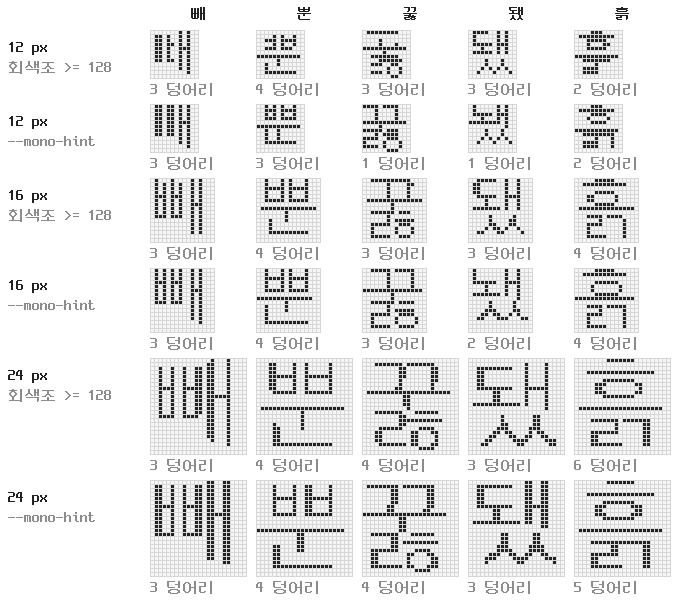
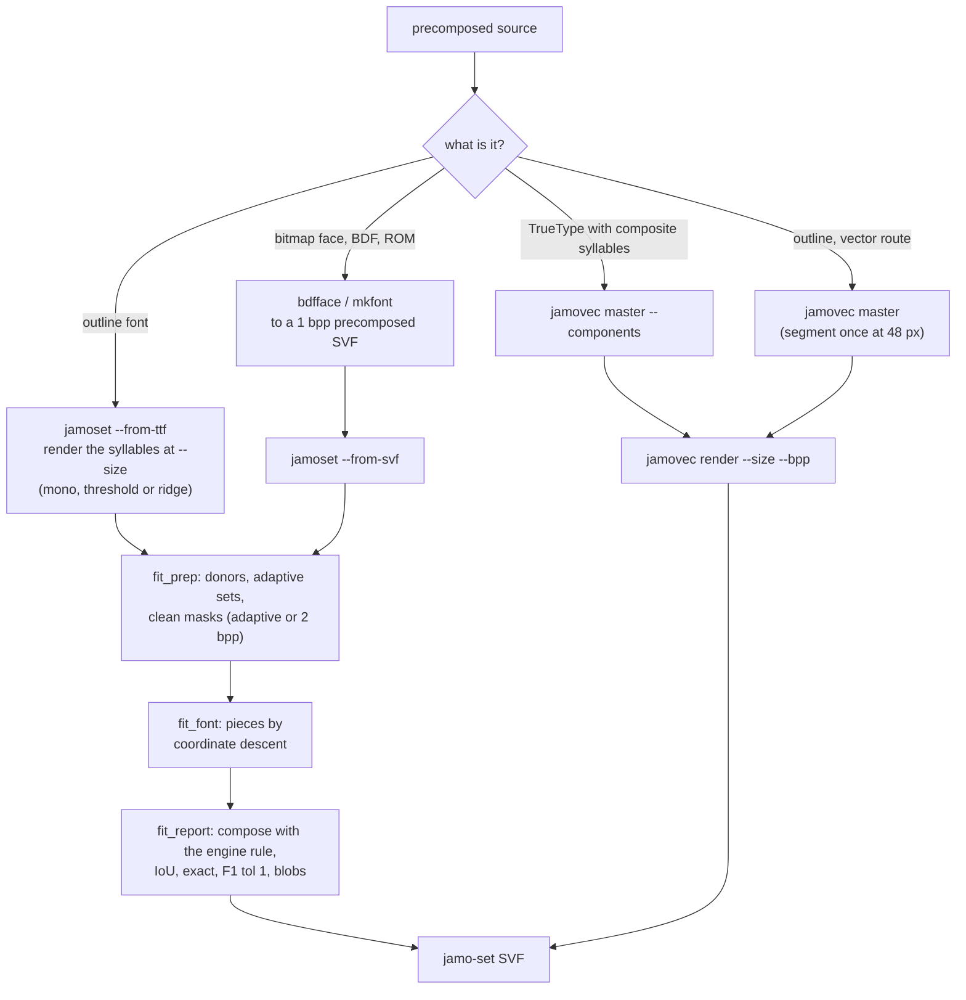
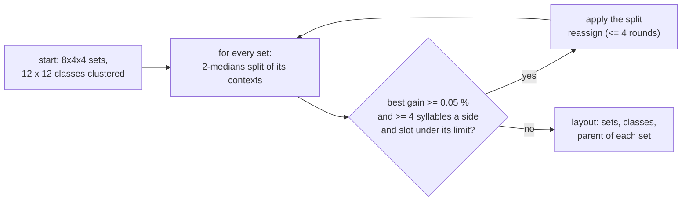
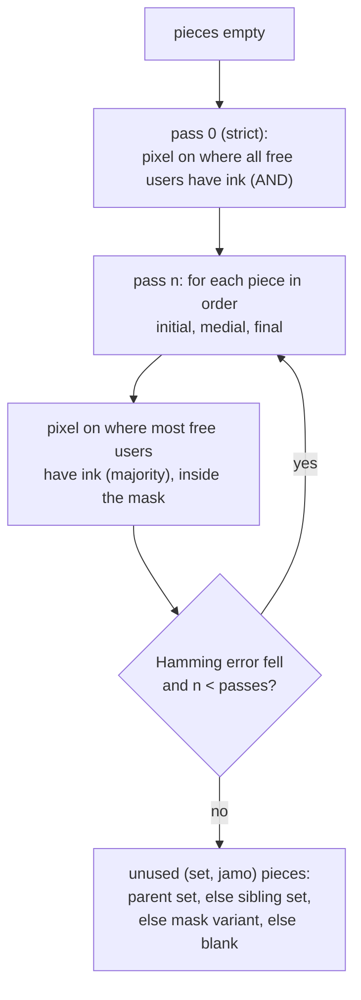
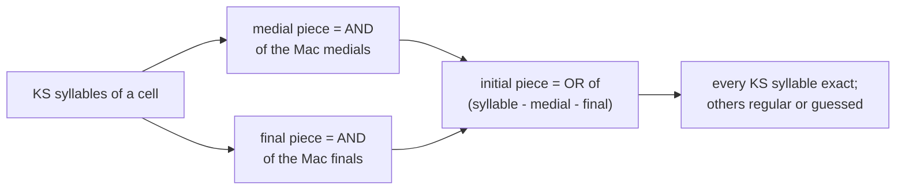
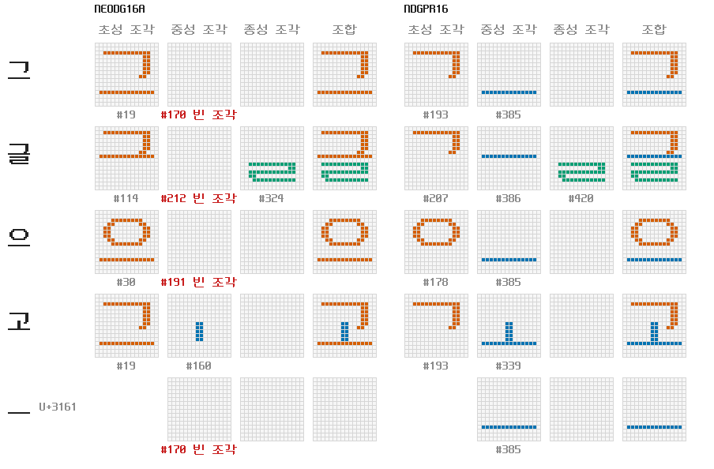
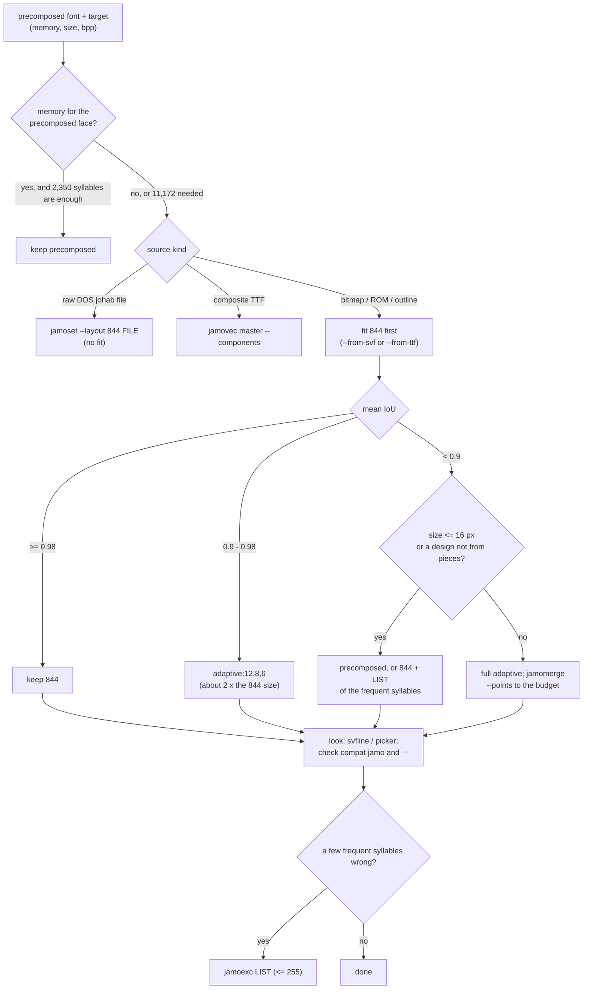

**English** | [한국어](jamo-split.ko.md)

# Jamo splitting: a jamo set from a precomposed font

A precomposed (완성형) font draws every syllable whole. A jamo set (조합형) stores initial, medial and final **pieces** in
a few **sets** (벌) and composes each syllable from two or three of them ([Jamo sets](jamo-sets.md)). Making a jamo set
from a precomposed font, **jamo splitting** (자모 분리), means recovering pieces that the font never stored. This document
describes how the tools of this repository do it, how each kind of source fares, what they do poorly, and what earlier
attempts taught.

Every number below is measured with the repository's tools (the command or the document it comes from is named) or cited
from the recipe documents, which record their own runs. The figures are drawn by `python3 -I tools/doc_figures_split.py`
from OFL fonts of this repository only (NanumGothic Regular, Neo Dunggeunmo, Neo Dunggeunmo Pro); `--check` re-renders them
and compares byte for byte.

## Contents

1. [What the problem is](#1-what-the-problem-is)
2. [How the fit works](#2-how-the-fit-works)
3. [Case by case](#3-case-by-case)
4. [What we do poorly](#4-what-we-do-poorly)
5. [Problems met and what was learned](#5-problems-met-and-what-was-learned)
6. [Practical guidance](#6-practical-guidance)
7. [References and links](#7-references-and-links)

## 1. What the problem is

### 1.1 The task

Given the precomposed syllables of a font, find:

- **pieces**: for each set and each jamo, a bitmap (1 bpp) or a level map (2 bpp);
- **tables**: lead and tail classes, and for each (lead class, medial, tail class) cell the initial, medial and final set
  ([JSET](jamo-sets.md#41-the-model));

so that composing the chosen pieces reproduces each syllable. Composition is fixed by the format: the **OR** of the pieces
at 1 bpp, the **per-pixel maximum** of their levels at 2 bpp
([Anti-aliasing, chapter 3](anti-aliasing.md#3-jamo-sets-the-maximum-not-or-at-levels)). The fit can change the pieces
and the tables, never the rule.

A result is **exact** when every syllable composes to the font's own glyph, and **approximate** otherwise. Exactness is
possible only when the font was itself drawn as an OR of pieces under a set system the layout can express. A font designed
syllable by syllable is approximated: a shared piece is a compromise between the syllables that use it.

*Figure 1. NanumGothic Regular baked at 16 px (`mkfont.py` render, 1 bpp) and fitted to 8x4x4 (`jamoset.fit_font`, free
pieces). Columns: 완성형 = the precomposed glyph; 초성 / 중성 / 종성 조각 = the initial / medial / final piece (# = piece
number); 조합 (색) = the pieces overlaid (black where two pieces overlap); 차이 = the difference (grey both, orange only in
the precomposed glyph, sky blue only in the composition). Over the 2,350 KS X 1001 syllables this fit is 15,336 bytes,
225 syllables exact, mean IoU 0.772. Note 글: the medial ㅡ piece has only stray dots and the bar sits in the final piece.*

### 1.2 Why it is hard

- **Strokes overlap and touch.** In the precomposed glyph the jamo share pixels, so a pixel's owner is not written
  anywhere. Where an initial's foot touches the vowel's bar, the bar can be fitted to either piece and the composition is the
  same: the fit picks whatever reduces the error, which need not be the jamo the pixel belongs to (figure 1, 글).
- **The same jamo changes shape by context.** The ㄱ of 가, 고 and 각 differ. A layout with few sets forces syllables
  that drew the jamo differently to share a piece. The designer's own grouping of contexts is not in the font
  ([Glyphs forum on divergent Hangul composition setups](https://forum.glyphsapp.com/t/divergent-hangeul-composition-setups/29856)).
- **Touching strokes merge at small sizes.** At 12-16 px the gap between two jamo is often zero pixels. NanumGothic
  Regular as `mkfont.py` bakes it (FreeType's grey rendering cut at 128) has on average 3.13 8-connected ink components per
  KS syllable at 32 px, 2.87 at 16 px and 2.60 at 12 px; 557 of the 2,350 syllables have fewer components at 16 px than at
  32 px, 1,059 at 12 px (measured with `doc_figures_split.bake` and `components`).
- **Hinting moves strokes.** Hinting snaps outlines to the pixel grid
  ([FreeType: on slight hinting](https://freetype.org/freetype2/docs/hinting/text-rendering-general.html)), and it does so
  per glyph: the same jamo lands on different pixels in different syllables. With FreeType's monochrome renderer
  (`mkfont.py --mono-hint`) the 12 px components fall to 2.03 a syllable (1,561 syllables merged against 32 px); at 16 px
  2.68 (839).
- **Pixel agreement is not identity.** A fit scored by pixel IoU can be good on average and still give a piece the
  stroke of another jamo, or lose a stroke a reader needs (chapter 4).

*Figure 2. NanumGothic Regular as `mkfont.py` bakes it at 12, 16 and 24 px: FreeType's grey rendering cut at 128
(회색조 >= 128, the default) and the monochrome renderer (`--mono-hint`). "N 덩어리" = N 8-connected ink components. At
12 px with `--mono-hint` 꿇 and 됐 become one component: every stroke touches another.*

## 2. How the fit works

### 2.1 The tools and the routes

| Tool | Role |
|---|---|
| `tools/jamoset.py` | the command line: `--from-ttf FONT --size N` or `--from-svf FACE.SVF`, a `--layout`, `--bpp 1\|2`; writes the jamo set and reports the fit |
| `tools/jamofit.py` | the 1 bpp fit (`fit_pieces`), the GSUB mask (`mask_pieces`), the metrics (`iou`, `f1_tol1`, `quality_report`) |
| `tools/jamoadapt.py` | the adaptive set system: classes by clustering, sets split where the syllables sharing a piece disagree |
| `tools/jamoaa.py` | 2 bpp: exact-area rasteriser, contours assigned to jamo, median consensus, level refinement under the maximum |
| `tools/jamoseg.py` | outline segmentation of a syllable into its jamo (library, used by `jamoaa.py` and `jamovec.py`) |
| `tools/jamovec.py` | vector fit: pieces as outlines chosen once at a decision size, rendered to any size |
| `tools/jamomerge.py` | shrinks a fitted face to a byte budget by merging piece variants, sets and classes |
| `tools/jamofill.py` | research builder: AND cores of a strike grown into pieces, coordinate descent on a weighted error |
| `tools/jamoexc.py` | LIST exceptions: up to 255 syllables drawn whole (or recombined) over the jamo set |
| `tools/macfbit_svf.py` | Mac HangulTalk 7.1.x fonts: the Mac's own planes (JMAP) or a derived rule form (AND medials and finals, residual initials) |

The maker runs these as **routes** (`maker/routes.py`): *bdfface + from-svf fit* (`bdfface.py` makes a precomposed face
from BDF files, then `jamoset.py --from-svf`), *experimental fit* (`--from-ttf --binarize threshold --mask-font none`, or
`--bpp 2`), *mask fit* (`--mask-font` the font itself, only when freetype-py and uharfbuzz are present), *vector fit*
(`jamovec.py master` then `render`) and *composite* (`jamovec.py master --components`). The route table is in
[Desktop routes](recipes/desktop-routes.md).

### 2.2 Targets

`--from-ttf` renders every syllable the font draws (`--present-only`, the default) into a cell of `--size` pixels. The
frame puts the union ink box of all syllables in the middle of the cell (`ttf_targets`, or `jamoaa.outline_targets` for
`--binarize threshold|ridge`, which use the exact-area rasteriser so TrueType and CFF are treated alike). `--from-svf` takes
the non-blank syllables of a 1 bpp precomposed SVF and keeps its other glyphs, cell, ascent and syllable advance.

### 2.3 Layouts: what is fitted

The layout fixes the classes and the set of each context before the fit; the fit only chooses pixels.

| Layout | Sets (initial / medial / final) | Classes | Selection |
|---|---|---|---|
| `844` | 8 / 4 / 4 | lead {ㄱ ㅋ} / other, tail none / final | initial set by vowel shape and final; medial by lead class and final; final by vowel |
| `1044-san`, `hanterm-johab` | 10 / 4 / 4 | as 844 (hanterm: 3 tail classes) | the no-final initial sets kept apart with a final |
| `621` | 6 / 2 / 1 | | the Apple II era system |
| `adaptive[:NI,NM,NF]` | from 8 / 4 / 4 up to 32 / 24 / 12 (default) | up to 12 x 12 | `jamoadapt.py` splits sets and clusters classes from the font |

The DOS selection rules are drawn in [Jamo sets, section 2.3](jamo-sets.md#23-the-selection-rule-of-8x4x4); the set
counts and their cost are compared in [Choosing the number of sets](recipes/sets.md#choosing-the-number-of-sets-벌-수).

**Adaptive** (`jamoadapt.adapt`) starts from 8x4x4 and works on donors: each syllable's region of each jamo, as
thermometer planes (one plane at 1 bpp, three at 2 bpp).

1. **Classes.** ㄱ and ㅋ are lead classes of their own; the other 17 initials are clustered by average linkage on how
   the medials beside them look, into at most 10 more classes. Finals are clustered likewise into at most 11 classes
   beside "no final".
2. **Splits.** For each set, a 2-medians split of its contexts (seeded by the largest item and the item farthest from
   it, up to 8 Lloyd passes). The gain is the drop in summed L1 distance of donors to their (set, jamo) median. The best
   split of all slots is applied while the slot is under its limit, each side has at least 4 syllables and the gain is at
   least 0.05 % of the starting cost; then up to 4 reassignment rounds.
3. Contexts with no syllable follow the nearest used context that 8x4x4 puts in the same set.

### 2.4 The 1 bpp fit (`jamofit.fit_pieces`)

A glyph is one Python integer (bit `y*(w+1)+x`), so ANDs, ORs and popcounts over a whole cell are single operations. The fit
is **coordinate descent** over pieces in the order initial, medial, final:

- With the other two pieces of every syllable fixed, a pixel of piece k is set when, among the syllables that use k and
  are not already inked there by their other pieces, **more have target ink than not** (a majority; ties stay off).
- The **first pass is strict**: a pixel is set only if *every* such syllable has ink there (the AND). With a plain majority
  from the start, the initial would swallow the vowel's ink and the error never falls (the comment in `fit_pieces`).
- A piece may only use pixels inside its mask, if it has one (below).
- The fit stops after `--passes` (12) passes or when the summed Hamming error stops falling. It is deterministic.

**Masks.** Three kinds confine where a piece may have ink:

- **GSUB masks** (`--mask-font FONT`): HarfBuzz shapes each syllable as conjoining jamo U+1100.. with the precomposed
  glyphs hidden; the positional variant most syllables of a (set, jamo) shape to, rasterised and dilated by
  `--mask-radius` (1 up to 16 px, 2 up to 24 px, else 3), bounds the piece. Without `--mask-font` the tool tries a mask
  font (`$JAMOSET_MASK_FONT`) only when the free fit's mean IoU is below 0.995 (`AUTO_EXACT`).
- **Donor masks** (`--clean`, on for adaptive and 2 bpp): pixels where at least 25 % of the jamo's donors have coverage,
  dilated by one pixel; specks of 1 px (2 px above 16 px) that no syllable needs are removed after the fit.
- None (`--mask-font none --no-clean`): free pieces.

**Unused pieces.** A (set, jamo) no fitted syllable uses (a context the font never draws, often outside KS X 1001 for a
2,350-syllable source) takes the piece of the set it was split from, else the same jamo's piece in the set with the most
users, else the mask variant, else stays blank (`fit_font`, `unseen_pieces` in the report). These syllables are
extrapolated, not fitted.

### 2.5 2 bpp (`jamoaa.py`)

A 1 bpp fit of thresholded coverage cannot be refined into levels, so 2 bpp is fitted on outlines
(`jamoset.py --from-ttf --bpp 2`):

1. **Region fit**: a free 1 bpp fit on coverage >= 0.5 with one medial set per tail class, to find where each jamo is.
2. **Contours to jamo**: each syllable's contours are grouped by containment, and each group goes to the jamo whose region
   it covers most. A group that straddles two regions and is not 85 % inside one is split pixel by pixel; the same contour
   in peer syllables decides ambiguous cases.
3. **Consensus**: each piece is the per-pixel median of its donors' coverage, quantised to levels 0..3; donors further
   than median + 3 x 1.4826 x MAD (with at least 5 donors) are dropped.
4. **Refinement**: coordinate descent on levels: each pixel takes the level in {current, 0, 1, 2, 3} that minimises the sum
   over its syllables of |max(level, other pieces) - target|, for `--aa-refine` passes (2).
5. **Clean**: level-1 pixels stay only where half the donors have ink; small components without a level-3 pixel go.

The maximum has a floor no piece set removes: where two jamo cover disjoint halves of one pixel, the precomposed glyph's
coverage adds up and the maximum of the pieces does not (`join_loss`).

### 2.6 Vector fit (`jamovec.py`)

`master` renders the font once at `--decision-px` (48), finds donors (the contour assignment of 2.5, or the glyf composite
components with `--components`), lays out 8x4x4 or adaptive sets, and keeps for each piece the **medoid donor's own
contours** (the clean donor closest to the per-pixel median). `render` rasterises those outlines at any size with no
fitting. The pieces are therefore the font's own shapes, not pixels chosen to minimise an error, and the same master gives
every size. The cost is time: `master` took 172 s on NanumGothic ([Maker capability audit](maker-audit.md)) and 25 s on
Neo Dunggeunmo with `--components` ([Outline fonts](recipes/outline-fonts.md#jamo-sets-from-truetype-and-opentype-fonts)).

### 2.7 After the fit: shrinking and exceptions

- `jamomerge.py merge --points BYTES ...` merges piece variants, sets and classes greedily, by objective increase per byte
  saved (`2 x lost + extra + overlap`, syllables outside KS weighted 0.1), with hard gates on ticks, medials, strokes and
  leaks; with `--recog` it re-scores the best moves with an external recogniser.
- `jamoexc.py build FACE EXC.json OUT` adds a JMAP block in LIST mode: up to **255** syllables drawn whole (`"whole"`) or
  recombined from existing pieces (`"pieces"`), the face's JSET kept as the fallback for everything else
  ([Jamo sets, chapter 6](jamo-sets.md#6-version-3-jmap-list-and-rules-against-tables)).

### 2.8 Mac HangulTalk 7.1.x (`macfbit_svf.py`)

The Mac fonts store 482 glyph slots and a table that names, for each of the 2,350 KS syllables, up to three slots ORed
together. Taking every slot as a piece under JSET tables fails: two initials that use a different medial or final slot
with the same vowel and final cannot share a lead class, and Seoul12 has 130 such pairs of 171
([Jamo sets, section 6.4](jamo-sets.md#64-seoul12-one-font-two-structures)). So there are two forms:

- **direct** (default): a JMAP block whose pieces are the Mac slots, covering the KS 2,350 only (`--with-jset` adds a
  derived JSET as the fallback for the other syllables);
- **derived** (`--mode derived`): classes found by agglomerative search from 19 x 28 down to the limits; for each cell the
  **medial piece is the AND** of the Mac medial glyphs of its KS syllables, the **final piece the AND** likewise, and the
  **initial piece the OR of the residuals** `syllable - medial - final` (residual transfer). Every KS syllable stays
  exact; the 8,822 others are "regular" (every cell seen in a KS syllable) or "guessed" (filled from the nearest context).

### 2.9 Measuring the result

| Measure | Where | What it says | What it misses |
|---|---|---|---|
| mean IoU, p5 | `fit:` line, `quality_report` | intersection over union of composed and target ink ([Jaccard index](https://en.wikipedia.org/wiki/Jaccard_index)); 1.0 = identical | a 1 px shift costs as much as a missing stroke; lost identity |
| exact | `fit:` line | syllables identical to the font | how far the others are |
| F1 tol 1 | `fit:` line | ink agreement allowing a 1 px shift | strokes merged by a shift |
| blobs merged / split | `fit:` line | syllables whose 8-connected component count fell / rose | which jamo merged |
| level error, IoU at level 2 | `aa:` line | 2 bpp: mean absolute level difference (0..3); FACES.TSV divides it by 3 | the same as IoU |
| `--check` | `check:` line | the tables compose all 11,172 syllables, every piece has a glyph | quality: it passes on a poor fit |
| identity check | maker, `maker/recog_score.py` | per piece: the share of its syllables a jamo recogniser reads correctly on that slot (pass >= 0.95, warn >= 0.80) | needs `SVF_RECOG_DIR` naming the user's own `recog.py`; none ships |

The identity check was not run for this document: no recogniser is in the repository and `SVF_RECOG_DIR` was not set.
Look at every result too (`svfline.py line`, the `web/` picker): no number shows which syllables went wrong.

## 3. Case by case

| Source | Example | 8x4x4 | Adaptive or other | Keep |
|---|---|---|---|---|
| drawn from pieces (DOS johab, sprite fonts made from a jamo set) | Neo Dunggeunmo, Date Quiz Go Go, NKP | IoU 1.000 / 1.000 (2,347 exact) / 0.998 (2,324) | NKP adaptive 1.000 | the jamo set |
| hand-drawn bitmap face | OS/2 `$korZN16.FNT` | 0.984 (1,753 exact) | `adaptive:12,8,6` 0.999 | the jamo set |
| ROM precomposed | 86Box Trigem / ATI / Kasan | 0.968 / 0.919 / 0.872 | | Trigem jamo set; Kasan precomposed |
| ROM, not from pieces | CPC-400S; Quiz King of Fighters | 0.794; 0.835 | Quiz KOF adaptive 0.975 (62,084 B) | precomposed |
| outline design, 16-24 px | Gothic A1, NanumSquareRound, Single Day | | 12 x 12 classes, 24/16/16: 0.94-0.97; Single Day 0.998 | the jamo set when memory matters |
| outline at 12-16 px | NanumGothic Regular 12 / 16 px | 0.733 / 0.707 | 16 px adaptive 0.877 | precomposed, or a jamo set with LIST exceptions |
| Mac HangulTalk table font | Seoul12 | | derived 9/6/3 sets, KS exact | direct JMAP, or derived for small targets |
| 2 bpp | Gothic A1 16 px | | level difference / 3: 0.026 (KS) | the jamo set at 18 px and up |

### 3.1 Fonts drawn from pieces

A font whose syllables were themselves made by ORing pieces under an 8x4x4-like rule fits exactly. Neo Dunggeunmo's
precomposed `NEODG16.SVF` and its fitted `NEODG16A.SVF` agree on all 2,350 KS syllables (IoU 1.0000; `doc_figures_split.py`).
Date Quiz Go Go's sprite font fits to IoU 1.000 with 2,347 of 2,350 exact, drawn from pieces "of a design none of the known
DOS fonts has" ([MAME ROMs](recipes/rom-mame.md#date-quiz-go-go-a-2350-syllable-sprite-font)). The NKP Hercules driver's
face fits 8x4x4 to 0.998 (2,324 exact) and adaptive to 1.000, because NKP chooses a with-final initial set by vowel shape
among four sets where 8x4x4 has three ([Programs and drivers](recipes/programs-and-drivers.md#nkp-a-hercules-hangul-tsr-with-cropped-pieces)).
A raw DOS johab file needs no fit: `jamoset.py --layout 844 FILE` reads its pieces directly.

*Figure 3. Left: Neo Dunggeunmo, a font drawn from pieces: the jamo set composes every KS syllable exactly. Right: the
NanumGothic fit of figure 1: KS 2,350, 225 exact, IoU 0.772; the per-syllable IoU is under each difference.*

### 3.2 Real precomposed designs

Designs drawn syllable by syllable never fit exactly, and more sets keep helping. The faces in `svf/jamo-extra/` are fitted
with 12 x 12 classes and 24/16/16 sets ([FACES.TSV](../svf/jamo-extra/FACES.TSV)); mean IoU over all syllables at 16 px:
Gothic A1 Regular 0.9411 (KS 0.9521, corpus-weighted 0.9769), Gothic A1 Bold 0.9595, NanumSquareRound Regular 0.9716,
Bold 0.9760, and Single Day 0.9977 (8 x 8 classes; a hand-lettered design close to an OR of pieces). The corpus-weighted
column is higher because the pieces were chosen with usage weights, so frequent syllables are drawn closest. Bytes at 16 px:
69,797 (Gothic A1) against about 357,504 for 11,172 whole 16x16 cells.

### 3.3 Small pixel fonts: the blank medial ㅡ

The fit owes nothing to jamo identity. In `NEODG16A` the ㅡ bar is in the **initial** pieces: all 532 syllables with the
medial ㅡ use an inkless medial piece (pieces 170, 191, 212, 233), and the composition is still exact, since the initial set
used with ㅡ always carries the bar. The compatibility jamo ㅡ (U+3161) is drawn from the medial piece of the first set
(`compat` in the JSET), so it draws **blank** in `NEODG16A`, `NEODG16B`, `NEODG16D` and `NEODG32`. `NEODG16C` has a whole
glyph for U+3161 and draws it; `NEODG16G` (6x2x1) and Neo Dunggeunmo Pro `NDGPR16` have a medial ㅡ with 14 px of ink.

*Figure 4. 그 글 으 고 and the compatibility jamo ㅡ (U+3161) in `NEODG16A` (left) and `NDGPR16` (right). "빈 조각" = an
inkless piece. The compositions agree; the pieces do not.*

The way out is to give the compatibility jamo a whole glyph (`--chars` with the compatibility jamo, as `NEODG16C`) or a
LIST entry with a piece that has the bar (`jamoexc.py`, `"ㅡ": {"pieces": [n]}`).

### 3.4 ROM fonts

The ROM fonts are 16x16 precomposed grids. Whether they fit depends on how they were drawn, not on the medium: the three
86Box Korean VGA ROMs fit 8x4x4 to 0.968 (Trigem, 1,576 exact), 0.919 (ATI, 644) and 0.872 (Kasan, 290)
([86Box ROMs](recipes/rom-86box.md)); the MSX CPC-400S 256 KB font to 0.794 (83 exact; [MSX ROMs](recipes/rom-msx.md));
Quiz King of Fighters to 0.835 with 8x4x4 and 0.975 adaptive (62,084 bytes against 123,640 precomposed), and the recipe keeps
the precomposed face ([MAME ROMs](recipes/rom-mame.md#quiz-king-of-fighters-korea-a-2350-syllable-font-with-an-outline-pen)).
A ROM holds only the KS 2,350 (CPC-400S lacks 133 of them), so every other syllable is extrapolated.

### 3.5 Mac HangulTalk table fonts

Seoul12 is the worked case ([Jamo sets, section 6.4](jamo-sets.md#64-seoul12-one-font-two-structures);
[Classic Mac](recipes/classic-mac.md#classic-mac-korean-bitmap-fonts)): the direct JMAP keeps the 207 Mac pieces and draws
the KS 2,350 only (15,016 bytes without Latin); the derived JSET (8 x 4 classes, 9/6/3 sets, 219 pieces, 9,716 bytes) draws
all 11,172, with the KS 2,350 exact, 4,630 regular and **4,192 guessed**. Whether BIG's 19 lead classes would let the Mac
slots be used directly as pieces has not been measured. These Apple faces are not distributed.

### 3.6 Outline fonts at 12 and 16 px

Small sizes are the hard case (chapter 4). NanumGothic Regular, `jamoset.py --layout 844 --from-ttf ... --binarize threshold
--mask-font none --check` (measured for this document):

| Size | Bytes | Mean IoU (p5) | F1 tol 1 | Exact of 11,172 | Time |
|---|---:|---|---:|---:|---:|
| 12 px | 15,932 | 0.733 (0.404) | 0.981 | 190 | 10.9 s |
| 16 px | 18,616 | 0.707 (0.406) | 0.991 | 133 | 12.1 s |
| 24 px | 27,832 | 0.694 (0.414) | 0.990 | 69 | 15.2 s |
| 16 px adaptive (32/24/12, 12 x 12) | 65,136 | 0.877 (0.513) | 0.995 | 2,734 | 66.8 s |

IoU does not rise with size here: the F1 with 1 px tolerance is 0.98-0.99, so most of the error is one-pixel shifts, which
cost more IoU on thin strokes. More sets help more than more pixels. The same font baked by `mkfont.py` (FreeType hinting
on) and fitted from the SVF gives 0.772 over KS (figure 1). NanumGothic Bold at 16 px is 0.817
([Outline fonts](recipes/outline-fonts.md#jamo-sets-from-truetype-and-opentype-fonts)).

### 3.7 2 bpp faces

2 bpp is fitted on outlines (2.5) and composed by the maximum. NanumGothic Regular 16 px 8x4x4 at 2 bpp: 23,180 bytes,
level error 0.2377 (0.522 on inked pixels), IoU at level 2 0.695, 8 syllables exact, 72.7 s (measured). The shipped
adaptive faces are much closer: Gothic A1 16 px 2 bpp 0.0297 (level difference / 3), Single Day 0.0012
([FACES.TSV](../svf/jamo-extra/FACES.TSV)).

### 3.8 Exceptions with LIST

When a few frequent syllables are wrong, `jamoexc.py` stores them whole: at most 255 entries, 118 + 8 x N bytes of entries
plus the whole cells. In the research on two proprietary 12 px fonts, adding a LIST of whole syllables gained about three
times as much usage-weighted IoU per KB as adding uniform sets (0.134 against 0.045) and was smaller than isolating those
syllables with extra classes at every count tried (section 5). The 100 most frequent syllables of a corpus of Korean game
translations cover 68 % of the text, the 300 most frequent 88 %.

### 3.9 When to keep the precomposed face

Keep the precomposed face when the target can hold it and the fit is approximate: a 2,350-syllable precomposed 16x16 1 bpp
face is about 120 KB, and the jamo sets above reach that size only at the full adaptive budget. The recipes keep the
precomposed face for CPC-400S, Kasan and Quiz King of Fighters. A jamo set pays off when memory is tight, or when 11,172
syllables are needed and the source is close to an OR of pieces.

## 4. What we do poorly

1. **Small sizes.** At 12-16 px every measure falls. NanumGothic Regular reaches only 0.733 / 0.707 mean IoU in 8x4x4 at
   12 / 16 px, with the 5th percentile at 0.40 (3.6). Strokes touch (figure 2: at 12 px with monochrome hinting the mean
   component count drops from 3.13 to 2.03) and hinting moves each syllable's strokes differently, so no single piece can
   serve all the syllables. In research, 12 px faces built from a proprietary font's own conjoining pieces reached a mean
   IoU of 0.58 against its hinted precomposed glyphs, with 822 of 2,350 syllables below 0.5.
2. **Pixel IoU is not identity.** IoU counts pixels; a reader needs strokes. A fit can score well and still give the ㅡ
   bar to the initial piece (3.3), let an initial swallow a vowel stroke, or drop the bar of ㄲ. In research, pieces of a
   12 px exact split carried 28-41 % pixels of other jamo on average, while every syllable composed exactly. `--check`
   proves the tables compose, not that the pieces are the jamo; the identity check needs an external recogniser that the
   repository does not ship and that was never run here on a real model.
3. **Blank or degenerate pieces.** A piece no syllable needs ink in stays blank (3.3); a piece of a context the source
   never draws is copied from another set or left blank (`unseen_pieces`). The compatibility jamo then draw blank or wrong.
4. **Designs not built from pieces.** Kasan 0.872, CPC-400S 0.794, Quiz King of Fighters 0.835 with 8x4x4: the result is a
   different font that looks like the source. More sets close part of the gap at the cost of most of the memory saving
   (Quiz KOF adaptive is half the precomposed size).
5. **Compound vowels and double finals.** ㅘ ㅙ ㅚ ㅝ ㅞ ㅟ ㅢ and ㄳ ㄵ ... ㅄ are wide, crowded pieces that touch the
   initial and the final, and they have few syllables to fit from (a 2,350-syllable source has none at all for many of
   their contexts). The research recogniser read ㅚ correctly in only 39-51 % of cases and took ㅜ for ㅡ in 111 of 703.
6. **2 bpp levels.** Composition by maximum cannot reproduce the coverage where two jamo share an edge pixel (2.5), and an
   8x4x4 2 bpp fit of an outline font at 16 px gets 8 syllables exact of 11,172 (3.7). The identity check reads 2 bpp
   faces thresholded at level 2.
7. **Guessed syllables.** A source with 2,350 syllables gives no data for the other 8,822. Seoul12's derived face guesses
   4,192 of them from the nearest context; ROM fonts and KS-only faces extrapolate every one. No measure exists for them:
   the IoU is over the syllables the font draws.
8. **Set-count and class limits.** The standard JSET allows 32 / 24 / 16 sets and 12 x 12 classes (BIG 128 / 128 / 64,
   19 x 28). An exact split of a 12 px pixel font needed far more (114 / 37 / 33 sets, or 65 / 91 / 41 with honest pieces
   and a 19 x 27 class grid, section 5); a refinement loop on 12 px gothic faces was refused a split 73-376 times by the
   limits.
9. **Speed.** A fixed-layout fit takes 10-15 s on an outline font, adaptive about a minute (66.8 s at 16 px; Gowun Batang
   Bold 20 px 89 s), 2 bpp over a minute (72.7 s), and a vector master minutes (172 s). The maker's mask fit has never been
   run in the maker.
10. **Two routes of one name differ.** The maker page's *bdfface + from-svf fit* passes no `--mask-font`, so where a mask font
   and the libraries are present a fit below IoU 0.995 is masked; the built-in recipe of the same name passes
   `--mask-font none`. Results can depend on the machine.

## 5. Problems met and what was learned

These are the attempts of 2026-10 and 2026-11 in order. Most used proprietary fonts (Windows and Mac system fonts) as
references; only the findings are reported here, no data from them.

| When | Goal | Method | Result | Decision |
|---|---|---|---|---|
| 2026-10-15 to 10-22 | jamo sets from any precomposed font | pixel fits with a fixed 8x4x4, then a plan to split outlines once at 128-256 px with path booleans and decide ambiguous cuts by a vision model | pixel fits "looked wrong on 가 / 고 even with good IoU"; picks by a model and a fixed rule differed by less than 1 px a syllable at 12-40 px, so the error was in grouping and in which donor became the piece | adaptive sets and vector segmentation kept (`jamoadapt.py`, `jamoseg.py`, `jamovec.py`); exact fitting given up as a goal ("don't try to fit it exactly") |
| 2026-10-23 to 10-26 | smaller tables | JSET version 2: the same tables in bits | the largest block 12,321 → 9,246 bytes; 95 faces 652,431 → 310,160 bytes (47.5 %) | kept: version 1 the standard, version 2 where it pays |
| 2026-10-24 | small-size (12-16 px) pieces, "approach P" | for each jamo a native prototype piece (from bitmap strikes and Mac planes, never cut from small syllables) placed within ±1 px, under a table of 228 features | judged by an automatic count of vanished strokes, it seemed to win | rebuilt: the user ruled that each jamo keeps its base form, overlap is acceptable and a lost stroke is not, and that jamo are never split at a small size |
| 2026-10-25 | the same, rebuilt | features in tiers (identity / structure / finish), identity a hard constraint | whole-stroke losses 0 in all six test cells, but the old count rose (e.g. 284 → 601) | the old count dropped as a yardstick: 78-89 % of its entries were displaced strokes, and it missed 86-100 % of the slots that lost identity |
| 2026-10-26 | a judge that agrees with people | judge v2 (100 x identity + 10 x structure + finish), then v2.1 / v2.2 learning which strokes may touch from many design families | v2 ranked hand-made strikes best at 12 px; a blind check of 60 syllables ranked hand 1.25 < P 2.18 < plain 2.57; tuning P against v2 gamed it (merges 28 → 163); at 16 px every version ranked P above the hand strike | 12 px only; a judge built from the candidate's own pieces is circular |
| 2026-10-26 | 12 px faces of three OFL gothic fonts with a refinement loop | 32 / 22-24 / 12-15 sets, loop on judge v2.2 | the loop lowered its own score by about 30 %; the set limits refused a split 73 / 376 / 139 times; 835-1,018 of 2,350 syllables got worse on at least one measure | paused: no independent check |
| 2026-10-26 | an exact split of a hand-made pixel font (Galmuri) | split without changing a pixel, sets unlimited | 21 px: exact for all 11,172 with 32 / 23 / 10 sets, 60,284 bytes against 543,904 precomposed; 12 px: 114 / 37 / 33 sets, and pieces with 28-41 % pixels of other jamo; with honest pieces 65 / 91 / 41 sets, 19 x 27 classes | abandoned: at 12 px a many-variant structure is not a sensible jamo-set base |
| 2026-10-26 | Mac fonts in SVF | the original table as JMAP; a derived JSET (2.8) | Seoul12 exact on KS in both; derived needs guesses outside KS | the original structure is canonical; derived faces only for small targets |
| 2026-10-26 to 10-27 | a 12 px face in 8 KB for a small MCU | pieces from other faces; Seoul12 shrunk by `jamomerge.py` | pieces taken from another design read worse than the source and showed noise dots, ㅡ ㅜ ㅗ that could not be told apart and a ㄲ without its bar; Seoul12 shrunk to 8,160 / 7,012 / 6,144 / 5,548 bytes | Seoul12 kept as the small preset; a hard-coded composition for one font (0.5-1 KB gain) abandoned for the table-driven form |
| 2026-10-27 to 10-28 | 12 px faces from fonts' own conjoining (GSUB) pieces | the font's positional variants as pieces; more sets; LIST of whole syllables | mean IoU 0.58 against the hinted glyphs (layout differs, ±1 px shift only reaches 0.64); a stroke filter costs about 0.03 IoU; LIST beat extra classes at every size and gained 0.134 IoU per KB against 0.045 for sets; split-half check 0.812 / 0.813 (no overfitting) | decomposing whole precomposed glyphs dropped at 12 px; the format judged expressive enough: the gaps are in pieces and evaluators |
| 2026-11-09 | | | | segmentation research stopped for now; the tools stay as they are |

**What was learned.**

- **Look, and check identity.** Pixel IoU and counts of lost pixels missed what people saw. Every piece variant should be
  checked as the jamo it stands for, alone and with a neutral partner; a zero against the splitter's own labels proves
  nothing.
- **Keep each jamo's form; allow overlap.** A merge is a cost, a lost stroke is a failure. Touching is harmful when it
  makes ㅗ ㅜ ㅡ (ㅛ ㅠ) indistinguishable; the two halves of ㄲ or the cap of ㅎ may touch.
- **Do not split at small sizes.** Pieces cut from 12 px syllables carry their neighbours' strokes. Split large (outlines
  or a decision size) and render down, or use pieces the font itself stores.
- **A judge must be independent of the candidate.** A judge learned from P's own pieces ranked P above hand-made strikes.
- **Exceptions beat sets for the last few percent.** Usage is concentrated; a LIST of frequent syllables is the cheapest
  gain.
- **The format is not the bottleneck.** JSET v1/v2, BIG, JMAP and LIST express what the sources need; the work is in the
  pieces and in measuring them.

The literature on bitmap compression points the same way: a TrueType study measured embedded-bitmap savings of about 35 %
for precomposed Hangul and 7 % for johab glyph data ([Hangul Bitmap Data Compression Embedded in TrueType Font, 2006](https://koreascience.kr/article/JAKO200629734288886.pub?lang=en)),
and Unifont builds its Hangul from a 6/3/1 set system by superimposing pieces
([Unifoundry: Hangul syllable generation](https://unifoundry.com/hangul/hangul-generation.html)). No public source was found
on choosing set counts for bitmap faces.

## 6. Practical guidance

- **Which layout.** Fit `844` first and read the IoU ([Choosing the number of sets](recipes/sets.md#choosing-the-number-of-sets-벌-수)).
  At 0.98 and above the source is close to an OR of pieces: more sets buy almost nothing. Between 0.9 and 0.98 try
  `adaptive:12,8,6`. Below 0.9 the full adaptive budget is needed and costs over half the precomposed size.
- **Which quality to accept.** For a face that must look like its source, 0.98 or more (or adaptive at 0.995+ for a face
  drawn from pieces). For a usable face of a different source design, about 0.94-0.97 over all syllables at 16-24 px with a
  corpus-weighted IoU near 0.98, as the `jamo-extra` faces. Below 0.9, look before deciding: the IoU does not say which
  syllables are wrong.
- **When to add LIST exceptions.** When the frequent syllables carry the errors: sort the syllables by usage x (1 - IoU),
  give the top ones whole cells, stop at 255 or when the next entry gains less than a set would.
- **2 bpp.** Fit 2 bpp from the outline, not by downscaling a 1 bpp fit; read the level error, and expect an 8x4x4 2 bpp
  face of a precomposed design to be visibly approximate; use adaptive sets.
- **Always.** Run `--check`; look at a line in `svfline.py line` or the picker; check the compatibility jamo (a blank ㅡ, 3.3).

## 7. References and links

**In this repository**

- [Jamo sets](jamo-sets.md): the format (JSET v1/v2, BIG, JMAP, LIST), the set systems, IoU ([2.1.1](jamo-sets.md#211-iou-composition-quality)), Seoul12 ([6.4](jamo-sets.md#64-seoul12-one-font-two-structures)).
- [Anti-aliasing](anti-aliasing.md): composition by the maximum and the 2 bpp measures.
- Recipes: [Outline fonts](recipes/outline-fonts.md) (the three ways to get pieces from a TrueType/OpenType font), [Faces of svf/](recipes/svf-faces.md), [Choosing the number of sets](recipes/sets.md), [86Box ROMs](recipes/rom-86box.md), [MAME ROMs](recipes/rom-mame.md), [MSX ROMs](recipes/rom-msx.md), [Programs and drivers](recipes/programs-and-drivers.md), [Classic Mac](recipes/classic-mac.md), [Desktop routes](recipes/desktop-routes.md).
- [Tools](tools.md): `jamoset.py`, `jamovec.py`, `jamomerge.py`, `jamofill.py`, `jamoexc.py`, `macfbit_svf.py`, `doc_figures_split.py` and the libraries.
- [SVF specification](../spec/SVF.md): the JSET and JMAP blocks and their limits.
- [`svf/jamo-extra/FACES.TSV`](../svf/jamo-extra/FACES.TSV): quality of the shipped fitted faces.

**External**

- [Wikipedia: Jaccard index](https://en.wikipedia.org/wiki/Jaccard_index) (intersection over union).
- [FreeType: text rendering and hinting](https://freetype.org/freetype2/docs/hinting/text-rendering-general.html).
- [Glyphs forum: divergent Hangeul composition setups](https://forum.glyphsapp.com/t/divergent-hangeul-composition-setups/29856).
- [Unifoundry: Hangul syllable generation (Johab 6/3/1)](https://unifoundry.com/hangul/hangul-generation.html).
- [Hangul Bitmap Data Compression Embedded in TrueType Font (KIISE, 2006)](https://koreascience.kr/article/JAKO200629734288886.pub?lang=en).
