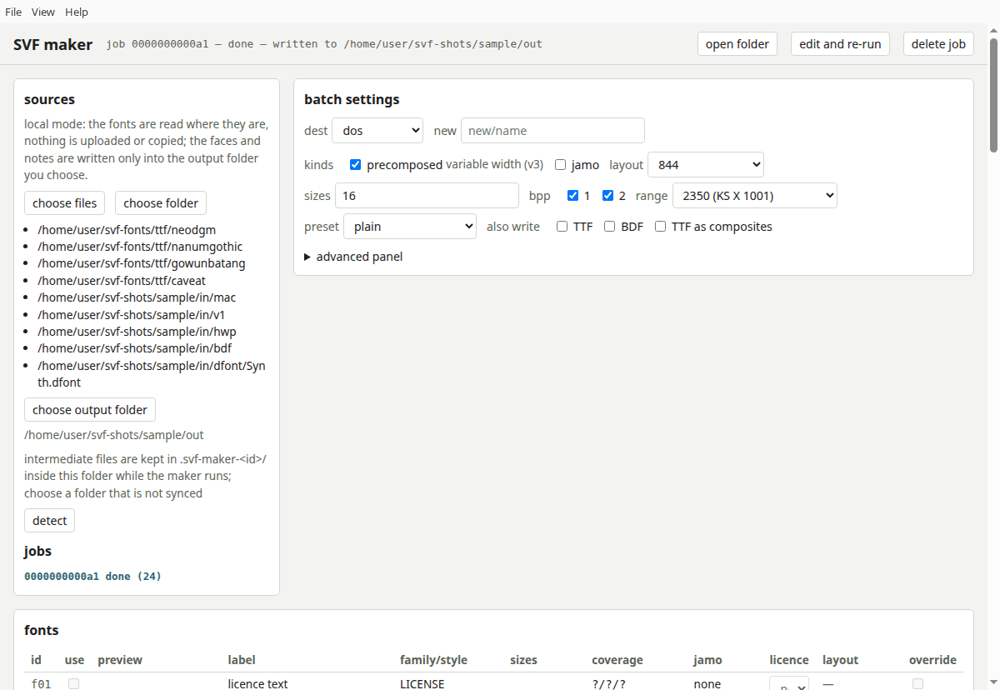
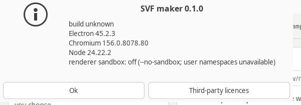

[English](maker-desktop.md) | **한국어**

# SVF maker 데스크톱 구현과 패키징

SVF maker는 Electron 셸, Python HTTP 서버(사이드카), 서버가 제공하는 웹 페이지로 구성된다.
Linux x86_64 AppImage를 빌드한다. 설치와 사용법은 [데스크톱 앱](desktop-app.ko.md),
서버 실행과 HTTP API는 [maker 안내](../maker/README.ko.md), 변환 기능은 [기능 점검](maker-audit.ko.md)을 참고한다.
[설계](superpowers/specs/2026-11-05-maker-desktop-design.md)와
[구현 계획](superpowers/plans/2026-11-05-maker-desktop.md)도 있다.

## 1. 실행 구조

| 구성 요소 | 동작 | 구현 |
|---|---|---|
| Electron 셸 | 단일 인스턴스 잠금, 창·메뉴·네이티브 대화상자, 사이드카 시작·종료 | `desktop/main.js`, `desktop/preload.js`, `desktop/lib/` |
| 사이드카 | `serve --exit-with-parent=<pid>`로 실행하는 PyInstaller one-dir 번들 | `maker/sidecar.py`, `maker/sidecar.spec` |
| 도구 실행 | 소스 모드에서는 `python3 -P tools/<name>.py`, 동결 모드에서는 `svf-maker-sidecar run-tool <name>` | `maker/toolrun.py` |
| 미리 보기 | C 렌더러를 WebAssembly로 빌드하여 페이지에서 실행 | `maker/build-wasm.sh`, `maker/static/svfview.js`, `c/ports/web/` |

셸은 실행마다 16바이트 난수를 32자리 16진 토큰으로 만들고, `127.0.0.1:0`으로 서버를 시작한다.
최대 75초 동안 `svf-maker listening on 127.0.0.1:<port>`를 기다린다.
2초 안에 준비되지 않으면 시작 안내 페이지를 표시한다. 포트를 받으면 해당 루프백 HTTP 페이지를 로드하며,
`/api/` 요청에는 셸이 `X-Maker-Token`을 붙인다. 토큰은 페이지에 전달하지 않는다.


*사이드카가 2초 안에 준비되지 않을 때 표시하는 `desktop/starting.html`.*



*셸의 창: 네이티브 메뉴(File, View, Help)는 셸의 것이고, 그 아래는 모두 사이드카의 페이지이다. 창 관리자 없는 Xvfb에서
찍었다(5.2절).*

페이지의 `window.svfMaker`는 `pickFiles()`, `pickFolder()`, `pickOutputDir()`,
`openOutputFolder()`와 `platform`을 제공한다. 마지막 함수는 인자를 받지 않는다. 셸이 현재 작업의 출력 폴더를
조회하고, 사용자가 대화상자에서 고른 최근 32개 실제 경로 중 하나인지 확인한 뒤 파일 관리자에 표시한다.

데이터는 Electron의 `userData` 아래 `maker/`, 개발 실행에서는 `maker-dev/`에 둔다.
Linux 기본 경로는 `~/.config/svf-maker/`이며, `--user-data-dir`로 바꿀 수 있다.
서버의 `instance.lock`은 같은 데이터 폴더의 동시 사용을 막는다.
각 도구는 별도 세션에서 실행되어 `tools.pids`에 등록된다. 정상 종료 때 중지하며, 비정상 종료 후에는 다음 시작 때
식별 가능한 잔여 프로세스를 정리한다. 셸의 정상 종료 대기는 45초이며 이후 강제 종료 대기는 5초이다.

## 2. Linux 빌드

빠른 시작의 [필수 도구와 설치 명령](desktop-app.ko.md#0-빠른-시작)을 먼저 따른다.
필수 조건은 git 체크아웃, pip가 있는 Python 3.12, 시스템 Python용 Pillow·fontTools,
Node.js 22.12 이상과 npm, emsdk, `xvfb-run`, `flock`이다.
고정 wheel은 Linux x86_64 CPython 3.12용이다. emsdk 기본 경로는 `~/opt/emsdk`이며 `$EMSDK`로 바꾼다.

체크아웃 루트에서 실행한다.

```sh
mkdir -p "$HOME/work/tmp"
cd desktop
npm ci
node node_modules/electron/install.js
cd ..
bash desktop/build/build-appimage.sh
```

Electron 설치 스크립트를 명시적으로 실행하므로 npm이 설치 스크립트를 차단하는 설정에서도 바이너리를 받는다.
버전은 `desktop/package-lock.json`과 `desktop/build/requirements.lock`에서 고정한다.

| 구성 요소 | 고정 버전 |
|---|---|
| Electron | 45.2.3 |
| electron-builder | 26.18.0 |
| PyInstaller | 6.22.3 |
| Pillow | 10.2.0 |
| fontTools | 4.66.1 |
| AppImage 도구 세트 | appimage@1.0.3 |

`maker/build-sidecar.sh`가 WASM 빌드, 해시를 검사하는 `pip --target` 설치, PyInstaller 빌드,
`env -i` 자체 점검과 동결 테스트를 수행한다. `build-appimage.sh`에서는 동결 테스트를 건너뛰지 않는다.
고지 파일을 생성한 뒤 electron-builder가 `desktop/dist/svf-maker-0.1.0.AppImage`를 만든다.
버전은 `desktop/package.json`에서 가져온다.

스크래치는 `$SVF_DESKTOP_TMP`(기본 `$HOME/work/tmp/svf-desktop-build`)에 둔다.
빌드와 릴리스 점검 스크립트는 스모크 검사 때 `$HOME/work/tmp/svf-browser.lock`을 직접 잠근다.
같은 잠금의 `flock`으로 감싸면 교착된다. `desktop/test/run-e2e.sh`는 잠금을 직접 얻지 않으므로,
별도로 실행할 때는 호출자가 잠금을 관리한다. 이 테스트는 짧은 스크래치 경로를 `TMP_DIR`로 받아 `TMPDIR`에 전달한다.

### 2.1. 릴리스 점검

`desktop/build/release-check.sh APPIMAGE [--release]`가 다음을 검사한다.

| 점검 | 조건 |
|---|---|
| `size`, `size-sidecar` | AppImage ≤ 170 MiB, 사이드카는 `du -sm` 결과 ≤ 60 |
| `extract`, `layout` | 추출 성공, 필수 자원 존재, 스테이징한 소스에 테스트·캐시 없음 |
| `apprun`, `desktop-entry` | `unshare` 검사와 `--no-sandbox` 분기 존재, 실행 항목이 `AppRun` 사용 |
| `runtime` | ELF 인터프리터·동적 의존성·`libfuse.so.2` 문자열 없음, HOME·PATH만 남긴 환경에서 버전 출력과 종료 코드 확인 |
| `frozen` | 추출한 사이드카의 동결 테스트 통과, 건너뛴 테스트 없음 |
| `wasm` | 새로 빌드한 WASM과 바이트 단위 일치 |
| `licences`, `notices`, `sources` | 라이선스 매핑·고지 재생성·동봉 Python 소스 검증 |
| `smoke` | Xvfb에서 추출한 `AppRun` 시작, API 응답, 정상 종료와 프로세스 종료 확인 |
| `sources` (`--release`) | LGPL 대응 소스 보관 조건 충족 |
| `contents` | 빌드 식별자·AppImage 해시별 파일 목록 저장 |

`--release`가 없으면 대응 소스 보관 점검은 `CHECK sources skipped`이다.
두 종류의 소스 점검은 같은 `sources` 이름을 쓰므로 줄 이름만으로 구별하지 말고 세부 내용을 읽는다.
실패가 있으면 종료 코드는 1이다. 스모크 검사는 잠금을 얻은 뒤 Electron 실행에 90초를 허용한다.
추출 실행을 검사하므로 FUSE 마운트 성공까지 증명하지는 않는다.

## 3. AppImage 런타임과 샌드박스

`desktop/build/appimage-toolset.json`은 도구 세트 아카이브, 런타임, 제거할 라이브러리의 SHA-256을 고정한다.
선택한 런타임은 type2-runtime 20251108이며 정적으로 링크된 FUSE 3 코드를 포함한다.
호스트의 `libfuse.so.2`는 필요 없지만 `fusermount` 또는 `fusermount3`와 마운트 권한은 필요하다.
마운트할 수 없으면 `--appimage-extract` 후 추출한 `AppRun`을 실행한다.

`AppRun`은 `unshare -Ur true`에 실패하면 `--no-sandbox`를 추가한다.
Ubuntu의 사용자 네임스페이스 제한은 시스템 정책에 따라 달라지므로 배포판 이름만으로 샌드박스 상태를 단정하지 않는다.
셸은 `sandbox: true`, `contextIsolation: true`, `nodeIntegration: false`를 요청하지만,
`--no-sandbox` 실행에서 Chromium 프로세스 샌드박스가 켜지는 것은 아니다.
실제 감지 결과는 셸 로그와 Help > About에 표시한다.



*사용자 네임스페이스를 막는 호스트의 Help > About: 마지막 줄이 감지한 샌드박스 상태이다.*

셸은 원격 요청, 새 창, 다운로드와 권한 요청을 차단한다. 페이지와 사이드카는 루프백 HTTP로 통신한다.
이 제어는 선택적 인식기 등 하위 프로세스의 운영체제 수준 네트워크 격리가 아니다.
보안 설정의 의미는 Electron 보안 안내와 Ubuntu 사용자 네임스페이스 설명을 참고한다(7절).

## 4. 라이선스와 대응 소스

`desktop/build/third-party.mjs`가 `THIRD-PARTY.txt`를 생성한다. 공유 라이브러리는
`third-party-map.json`에 매핑되어야 하며, 사이드카 라이브러리는 빌드 출처와 일치해야 한다.
일반 GPL 라이브러리는 거부한다. PyInstaller 부트로더는 GPL과 별도 부트로더 예외로 분류한다.
LGPL 구성 요소는 배포 기록이 필요하며, `svf/`에는 허용 목록의 OFL 페이스만 둔다.

AppImage 도구 세트의 `libindicator`는 GPL-3.0이므로 `prune-appimage-toolset.py`가 이를 제거한다.
이에 의존하는 `libappindicator`도 제거한다. 앱은 트레이 아이콘을 제공하지 않는다.
런타임에 포함된 구성 요소의 라이선스 본문은 `desktop/build/licences/appimage-runtime.txt`에 있다.

공개 릴리스에는 `desktop/build/out/sources/MANIFEST.json`과 대응 소스 아카이브를 준비하고
`bash desktop/build/build-appimage.sh --release`를 실행한다. 각 LGPL 구성 요소의 `component`와
`version`이 매핑과 같은 `source` 항목을 요구하며, AppImage 런타임은 `recipe` 항목도 요구한다.
각 항목에는 `archive`와 `sha256`이 있어야 한다. 예시는 다음과 같다.

```json
[
  {"component": "appimage-runtime", "version": "20251108", "kind": "source", "archive": "runtime-src.tar.gz", "sha256": "<hex>"},
  {"component": "appimage-runtime", "version": "20251108", "kind": "recipe", "archive": "runtime-recipe.txt", "sha256": "<hex>"}
]
```

이 예시는 런타임 항목만 보여 준다. Electron의 ffmpeg 등 매핑의 다른 LGPL 구성 요소도 필요하다.
생성기가 `corresponding sources archived: YES`를 출력해야 릴리스 소스 점검을 통과한다.

## 5. 자동 검증과 기록된 실행

`npm test --prefix desktop`는 Electron 창 없이 셸 유틸리티, 라이선스 생성기, 추출 검증,
런타임 검사기의 Node 테스트를 실행한다. `maker/test/test_frozen.py`는 빌드된 사이드카가 필요하다.
`desktop/test/run-e2e.sh`는 Xvfb와 Electron이 필요하며 대화상자를 스텁으로 바꾸고 GPU를 끈다.
패키지 경로의 두 번째 패스에는 `SVF_MAKER_SIDECAR`와 `SVF_MAKER_STAGED_REPO`가 필요하다.

샘플 변환은 `maker/test/uisample.py`가 입력과 기대 출력을 정의한다.
OFL 폰트 네 개와 합성 Mac·HWP·BDF 입력을 사용하여 페이스 10개와 TTF/BDF 내보내기 3개를 검사한다.
예상 파일 목록, 입력 불변성, 페이스 검사와 실제 그리기, 순수 Python 경로의 개발·패키지 결과 일치를 확인한다.
윤곽선 결과는 호스트와 고정 wheel의 FreeType 차이 때문에 일부 바이트 차이를 허용한다.
TTF 비교는 `head` 타임스탬프를 맞춘다. 자세한 검증은 `maker/test/test_uisample.py`에 있다.

기록된 2026-11-22 실행에서는 Ubuntu 24.04 x86_64에서 만든 커밋 `3d40de8`의 AppImage가
140,426,554바이트였으며, 깨끗한 Ubuntu 24.04.5 호스트에서도 Xvfb 아래 창과 로컬 변환이 동작했다.
이 값은 현재 빌드의 크기나 실행 시간을 보장하지 않는다.

### 5.1. Linux 호스트 측정 기록 (2026-11-09~24)

Ubuntu 24.04 x86_64, glibc 2.39 호스트에서 기록한 값이다. 11-22 크기·빌드 시간과 11-24 샘플 실행은 아래에 날짜와 커밋을 명시했다. 나머지는 해당 기간의 기록이며 개별 실행일은 남아 있지 않다. 현재 테스트 개수·시간의 기준으로 사용하지 않는다.

| 항목 | 값 |
|---|---|
| 사이드카 one-dir | 47 MB; 빌드 8-9 초(동결 테스트 포함 약 30 초); 시작 후 포트 줄까지 2 초 훨씬 미만 |
| AppImage | 140 MB (133.9 MiB, 커밋 3d40de8, 2026-11-22. 정적 runtime과 zstd 이전에는 149.7 MB); `linux-unpacked` 335 MB; electron-builder 약 50 초; 캐시가 따뜻할 때 스크립트 전체 1분 26초 |
| 동결 테스트 | 테스트 28개, 건너뜀 0: `env -i`에서 고정된 wheel과 바이트 단위로 같음(svf2ttf와 rawcarve도), 번들된 레시피 7개, 동결된 작업과 노트가 소스 모드와 같음 |
| Electron 태스크 수 (xvfb 아래 `--no-sandbox --disable-gpu`) | 인스턴스 하나 87, 두 번째 인스턴스 경우 114 (계획 단계 측정, GPU 포함 143과 170); 수명 주기 테스트의 최대값은 79-80 |
| Debian Pillow 비교 | 같음 |
| `sample set` e2e 단계 | dev 12.6 초, 패키지 14.9 초 (17단계: 페이스 10개와 TTF / BDF 내보내기 3개; 2026-11-24, 커밋 8c10dc1); 내보내기 이전 dev 10.4 초, 패키지 15.0 초 (14단계) |

### 5.2. 문서 화면

`desktop/test/doc-shots.js`가 [desktop-app.ko.md](desktop-app.ko.md)와 이 문서의 화면을 찍어 `docs/images/maker/`에 쓴다.
e2e 드라이버처럼 대화상자를 스텁으로 바꾸고 새 사용자 데이터 폴더로 실제 `main.js`를 실행한 뒤, 페이지를 세 작업으로
조작한다.

| 작업 | 입력 | 화면 |
|---|---|---|
| 1 | `maker/test/uisample.py`의 샘플(`ttf/`의 OFL 폰트 폴더 넷, 합성 Mac·HWP·BDF·dfont 입력)과 그 폰트별 설정 | 시작, 확인 동의, 소스, 폰트 표, 일괄·고급 설정, override 패널, 라이선스 선택, 실행 중, 완료, 미리보기, 내보내기, 글리프 격자, 작업 목록, 창, View 메뉴, About |
| 2 | `svf/`의 OFL SVF 둘, `maker/test/fixtures.py`의 합성 DOS raw 폰트, `maker/test/test_recipe.py`의 합성 86Box Trigem ROM 쌍(`NEODG16.SVF`로 그림), 알 수 없는 파일 | 다른 종류, DOS 배치, `svf2ttf` 경로, 2 bpp 자모 세트, 알려진 ROM 페이스 |
| 3 | `ttf/neodgm` | 거부된 dest, 실패한 단계(6 px 셀의 `fit cell`) |

사이드카는 `test_recipe.py`가 프로세스 안에서 하듯 내장 86Box 레시피의 해시를 합성 쌍의 해시로 바꾼 채 시작한다. ROM이나
Apple 데이터는 쓰지 않는다. 페이지에는 언어 전환이 없으므로 모든 화면은 영어 레이블이다. 드라이버는 캡처마다 페이지의
스크래치·체크아웃 경로(`/home/user/svf-shots`, `/home/user/svf-fonts`), 작업 id(`0000000000a1`...), 단계 시간(`·.· s`)을
바꾸고, 1280 x 1024 Xvfb 화면에서 고정 창 크기(1200 x 800, 배율 1)로 찍는다. 끝에 Pillow로 모든 PNG를 256색으로 줄인다.

체크아웃 루트에서, `desktop/node_modules`를 설치하고 `maker/static/wasm/`을 빌드(`bash maker/build-wasm.sh`)한 뒤 실행한다.

```sh
bash desktop/test/run-doc-shots.sh
# 같은 실행을 직접:
xvfb-run -a -s "-screen 0 1280x1024x24" desktop/node_modules/.bin/electron --no-sandbox --disable-gpu desktop/test/doc-shots.js
```

`TMP_DIR`은 스크래치 폴더(기본 `~/work/tmp/svf-doc-shots`. `uisample.py`가 거부하므로 `/tmp` 아래는 안 된다), `SHOT_DIR`은
다른 출력 폴더이다. 그림마다 `SHOT <name> <width>x<height>`, 끝에 `SHOTS DONE <n> files, <bytes> bytes`를 출력하며, 실패한
그림이 있으면 종료 코드 1이다. 실행에는 몇 분이 걸린다.

## 6. 지원 범위와 남은 검증

현재 체크아웃의 패키징은 Linux x86_64를 대상으로 한다. Windows의 별도 브랜치 상태는 6.5절을 참고한다.

### 6.1. glibc 하한

기록된 Linux 패키지의 지원 하한은 빌드 호스트와 같은 glibc 2.39(Ubuntu 24.04)로 잡았다.
PyInstaller는 수집한 시스템 라이브러리를 담지만 glibc를 함께 배포하지 않는다. 정확한 최소 심벌 버전을
산출한 기록은 없으므로 2.39보다 오래된 시스템에서 동작한다고 보장하지 않는다.
Ubuntu 22.04(glibc 2.35) 컨테이너에서 다시 빌드하여 지원 범위를 넓히는 방안은 당시 계획이며 실행하지 않았다.

### 6.2. 사람이 실제 데스크톱에서 확인할 항목

- 실제 화면에서 네이티브 파일·폴더·출력 폴더 대화상자를 열고 취소와 선택을 확인한다. 자동 테스트는 이를 스텁으로 바꾼다.
- **open folder**가 선택한 출력 폴더를 파일 관리자에 표시하는지 확인한다.
- 창 관리자가 있는 세션에서 `./svf-maker-0.1.0.AppImage`로 FUSE 마운트와 창 표시를 함께 확인한다.
- GPU를 끄지 않은 실행을 확인한다. 자동 검사는 `--disable-gpu`를 사용한다.
- 사용자 네임스페이스가 허용된 호스트에서 샌드박스 실행과 Help > About의 감지 결과를 확인한다.

### 6.3. 깨끗한 머신 시작 기록 (2026-11-20)

호스트 `pc`는 Ubuntu 24.04.5이며 `libfuse2t64`와 `libfuse.so.2`가 없고,
`fusermount`·`fusermount3`는 있었다. 디스플레이는 없었으며 검사를 위해 추가 패키지를 설치하지 않았다.
당시 AppImage(약 133 MB, zstd squashfs)를 `~/work/tmp/svf-clean`에 복사하여
`env -i HOME="$HOME" PATH=/usr/bin:/bin` 환경에서 실행했다.

```text
$ ./svf-maker-0.1.0.AppImage --appimage-version
AppImage runtime version: https://github.com/AppImage/type2-runtime/commit/dd6cebe
# exit 0
$ ./svf-maker-0.1.0.AppImage
ERROR:ui/ozone/platform/x11/ozone_platform_x11.cc:257] Missing X server or $DISPLAY
# exit 1
$ ./svf-maker-0.1.0.AppImage --appimage-mount
# AppRun, chrome_100_percent.pak 등을 포함한 squashfs 마운트 확인
```

이전 런타임의 `dlopen(): error loading libfuse.so.2` 오류는 사라졌고,
마운트된 이미지에서 Electron이 시작하여 디스플레이 부재로 종료했다. 창 표시는 이 실행에서 검증하지 않았다.

### 6.4. Xvfb 창 실행 기록 (2026-11-22)

같은 `pc` 호스트에서 커밋 `3d40de8`의 AppImage를 Xvfb 아래 시작했다. 창이 그려졌고 로컬 모드 변환이
패키지된 사이드카를 통해 실행되었다. 같은 커밋의 깨끗한 체크아웃에서 빠른 시작대로 빌드한 기록은
따뜻한 캐시에서 1분 26초, AppImage 140,426,554바이트이며 당시 모든 `CHECK`가 성공했다.
추출한 `AppRun`과 AppImage 자체가 Xvfb 아래 `svf-maker smoke ok SVF maker`를 출력했다.
`desktop/`의 개발 실행 `node_modules/.bin/electron --no-sandbox .`도 Xvfb에서
`sidecar start mode=dev`와 포트 줄을 기록했다. 실제 창 관리자와 GPU의 검증으로 확대 해석하지 않는다.

### 6.5. Windows와 macOS (2026-11-27 상태)

**Windows:** `windows-build` 브랜치에 x64 NSIS 설치 프로그램과 portable 실행 파일 빌드가 있다.
[GitHub Actions 실행 45350084767](https://github.com/TaehyunKimLL/svf-fonts-open/actions/runs/45350084767)은
2026-11-24 커밋 `edd8a6d`에서 성공했다. 2026-11-27 현재 main에 병합되지 않았다.
브랜치의 `desktop/package.json`은 `nsis`·`portable` 타깃을 지정하며 `.github/workflows/windows.yml`은
Windows 테스트, 동결 사이드카, 패키징·e2e·스모크 검사를 실행한다. 이 성공을 현재 main의 Windows 지원으로 해석하면 안 된다.
main의 POSIX 잠금·프로세스 그룹·파일 링크 호출에 관한 이전 이식 과제는 아래의 과거 기록에 남아 있다.

**macOS:** 패키지는 아직 빌드하거나 실행하지 않았다. 당시 계획은 arm64·x86_64별 PyInstaller one-dir와
`dmg`·`zip` 패키지였으며 universal2에는 범용 wheel이 필요하다. 현재 Linux cp312 wheel 잠금은 그대로 쓸 수 없다.
Developer ID 서명, hardened runtime·entitlements, 사이드카의 개별 바이너리 서명, `notarytool` 공증·stapling은
계획이며 검증된 빌드 절차가 아니다. `ps -o lstart=` 기반 프로세스 식별과 실제 리소스 포크도 macOS에서 검증하지 않았다.

### 6.6. 나머지 미검증 항목

- 외부 인식기의 실제 모델은 검증되지 않았다. 선택적 라이브러리는 번들에 포함하지 않는다.
- AppImage의 비트 단위 재현성은 보장하지 않으며 자동 업데이트는 없다.

출력 페이스를 사용하는 방법은 [C 렌더러](c-renderer-guide.ko.md),
[웹 렌더러](web-renderer-guide.ko.md), [렌더러 설계](../spec/renderer-design.ko.md)를 참고한다.

## 7. 참고 문헌 / References

- Electron: 보안 권고 — <https://www.electronjs.org/docs/latest/tutorial/security>
- Electron: 프로세스 샌드박스 — <https://www.electronjs.org/docs/latest/tutorial/sandbox>
- Ubuntu 24.04: 비특권 사용자 네임스페이스 제한 — <https://discourse.ubuntu.com/t/ubuntu-24-04-lts-noble-numbat-release-notes/39890>
- AppImage type2-runtime 20251108 — <https://github.com/AppImage/type2-runtime/releases/tag/20251108>
- AppImage 런타임 라이선스 — <https://github.com/AppImage/type2-runtime/blob/20251108/LICENSE>
- PyInstaller 부트로더 예외 — <https://pyinstaller.org/en/stable/license.html>
- GNU LGPL 2.1 — <https://www.gnu.org/licenses/old-licenses/lgpl-2.1.html>
- Windows build, 2026-11-24 — <https://github.com/TaehyunKimLL/svf-fonts-open/actions/runs/45350084767>

## 8. 기록 / Records

### 8.1. 이전 플랫폼 계획과 미검증 범위 (2026-11-22~24)

다음은 당시 기록이다. Windows의 “미빌드” 상태는 6.5절의 2026-11-27 상태로 대체되었다.
아래의 이식·서명 명령과 외부 동작 설명은 당시 계획 그대로이며 실행 성공을 뜻하지 않는다.

> ### Windows와 macOS (UNVERIFIED)
>
> 아래의 어느 것도 실행하지 않았다. 이 호스트들의 빌더가 따를 계획과 그것을 막는 것이다. 빌드도 검증도 하지 않았다.
>
> - **macOS.** PyInstaller one-dir은 macOS에서 같은 spec을 빌드한다(arm64와 x86_64는 별개의 빌드이고, universal2 빌드에는 Pillow와
>   fontTools의 universal wheel이 필요하다. `desktop/build/requirements.lock`은 Linux cp312 wheel만 고정한다). 서버는 이미 macOS
>   (POSIX)에서 동작하지만, 레지스트리의 macOS 시작 시각(`ps -o lstart=`)은 테스트하지 않았다. electron-builder 대상은 `dmg` + `zip`이고,
>   `extraResources`는 같으며, AppImage의 `--no-sandbox` 문제는 없다. 서명: Developer ID Application 인증서, `mac.hardenedRuntime:
>   true`, `com.apple.security.cs.allow-unsigned-executable-memory`(Chromium) 외에는 아무것도 허용하지 않는 entitlements 파일 - 그리고
>   `resources/sidecar/` 아래의 모든 바이너리도 서명해야 한다(`codesign --deep`은 `_internal/*.so`에 확실히 닿지 않는다. 각각
>   `--options runtime`으로 개별 서명한다). 그다음 `notarytool submit`과 `stapler`. 서명하지 않으면 Gatekeeper가 첫 실행에서 앱을
>   막는다(오른쪽 클릭으로 열기는 된다).
> - **Windows.** **서버는 Windows용이 아니다**(`os.killpg`, `start_new_session`, 그룹에 대한 `signal.SIGTERM`, `os.umask(0o077)`의
>   의미, 덮어쓰기 없는 쓰기를 위한 `os.link`, 레지스트리와 데이터 루트 락의 `fcntl` 락). 포팅에는 그룹 kill을 위한 Job Objects(또는
>   `CREATE_NEW_PROCESS_GROUP` + `GenerateConsoleCtrlEvent`), `run_command`/`run_bounded`의 `CreateProcess` 플래그, NTFS에서 로컬 모드
>   설계의 모든 `realpath`/inode 규칙에 대한 검토가 필요하다. 이는 별도의 카드이며, 이것이 끝나기 전에는 Windows 빌드를 시도하지
>   않는다. 그다음: 같은 PyInstaller spec(`console=True`와 셸의 `windowsHide`를 유지), electron-builder 대상 `nsis` 또는 `portable`,
>   Job Object를 쓰는 Electron spawn, 코드 서명 인증서로 서명.
>
> ### 여기서 검증하지 않은 것
>
> Windows와 macOS 전체; 실제 데스크톱(창 관리자, GPU)에서의 AppImage 시작(위의 Xvfb 창 실행은 했음); 샌드박스된 렌더러; 2.39보다 오래된 glibc; 동결된 프로세스에서 3.12
> wheel을 쓰는 `JAMOSET_PYLIB`과 실제 인식기(테스트는 스텁 인터프리터를 쓴다); 디스플레이가 있는 네이티브 대화상자; AppImage runtime의
> 바이너리가 밝히는 것 이상의 구성(내장된 라이선스 목록과 버전 문자열: type2-runtime, musl libc, libfuse 3.15.0, squashfuse 0.5.2,
> libzstd 1.5.6, zlib 1.3.1; musl 자체의 버전은 내장되어 있지 않으므로 그 COPYRIGHT는 v1.2.5의 것을 가져왔다); AppImage의
> `SOURCE_DATE_EPOCH` 결정성(사이드카는 비트 단위로 재현되지 않는다: `base_library.zip` 멤버 순서가 빌드마다 바뀐다); 향후 Pillow
> wheel의 2.13.2가 아닌 FreeType; 기록된 소스의 정확한 URL(기록만 했고 가져오지 않았다).

### 8.2. 샘플 변환 검증 세부 기록 (2026-11-20~24)


`desktop/test/e2e.js`에는 단계가 하나 있다. 패스마다 `sample set`이라는 단계로, 고정된 샘플을 로컬 모드에서 **페이지를 통해**
변환한다(입력은 제자리에서 읽고 페이스는 고른 출력 폴더에 씀). dev 패스와 패키지 패스에서 모두 한다. 샘플은
`maker/test/uisample.py`가 정의한다(테스트 시점에 합성 입력을 만들고, 폰트별 설정 표, 기대하는 36개 파일 트리, 점검을 소유한다).
`ttf/`의 OFL 폰트 넷을 제자리에서 읽고(neodgm, NanumGothic-Bold, `dos-u-2bpp` preset을 쓰는 GowunBatang-Bold, Bold 인스턴스의
Caveat-VF), 저장소의 fixture 빌더가 만든 합성 파일을 쓴다: HTBL 표와 suitcase가 있는 Mac 7.1 fbit, HangulTalk 1.0 폰트, Mac
dfont, `ASCII.PFT`가 있는 HWP DOS 844 폰트(`HANGUL24.PFT`는 읽지 않음으로 표시), KSC / johab BDF. KSC 페이스는 `KSC16.ttf`와 `KSC16.bdf`로도, johab 자모 세트는 `--composite`로 `JOHA16J.ttf`로도 쓴다(각 override의 "also write" 선택, t_97acecf9). 이 단계는 스텁 대화상자로 루트 9개와
출력 폴더를 고르고, 활성화된 컨트롤만 바꾸고(경로가 없는 행은 비활성에 체크 해제로 남으며 이를 assert한다), 저장하고, 저장된 설정을
다시 읽고, 실행한 다음 `uisample.py check`가 검증한다: 기대한 파일만 정확히 있고 다른 것은 없음(남은 `.svf-maker-*` 없음), 쓰인
트리에 대한 `facecheck.py`와 `web/mkindex.py --check`, 모든 페이스가 잉크를 그림, `GOWUN17A.SVF`가 `svf/dos/GBATB17.SVF`와 바이트
단위로 같음, 각 내보낸 파일이 그 페이스의 문자를 정확히 담음(`quality.export_facts`), 입력이 바뀌지 않음. 그런 다음에야 결과 캔버스 10개를 센다(`data-drawn="1"`, `Number(dataset.ink) > 0`). 패키지
패스에서는 `--same-as`가 페이스를 dev 패스와 비교한다. 순수 Python 페이스(SEOU12J, HAN224J, JOHA16J, KSC16, MUNJ16J)는 바이트
동일이 필요하다. 윤곽선 페이스(NEODU16, NANUM17A, GOWUN17A, CAVEA16, SYNTH16)의 차이는 실패가 아니라 `E2E NOTE`로 출력된다(dev
패스는 호스트의 Pillow/FreeType으로, 패키지 패스는 고정된 wheel로 렌더하기 때문). `KSC16.bdf`는 바이트 동일, `KSC16.ttf`와 `JOHA16J.ttf`는 `head`의
타임스탬프를 같게 맞췄을 때 동일해야 한다(svf2ttf.py는 실행 시각을 찍는다). `maker/test/test_uisample.py`는 같은 표를 HTTP
API로 실행하고 각 점검이 변이에서 실패함을 증명한다.
