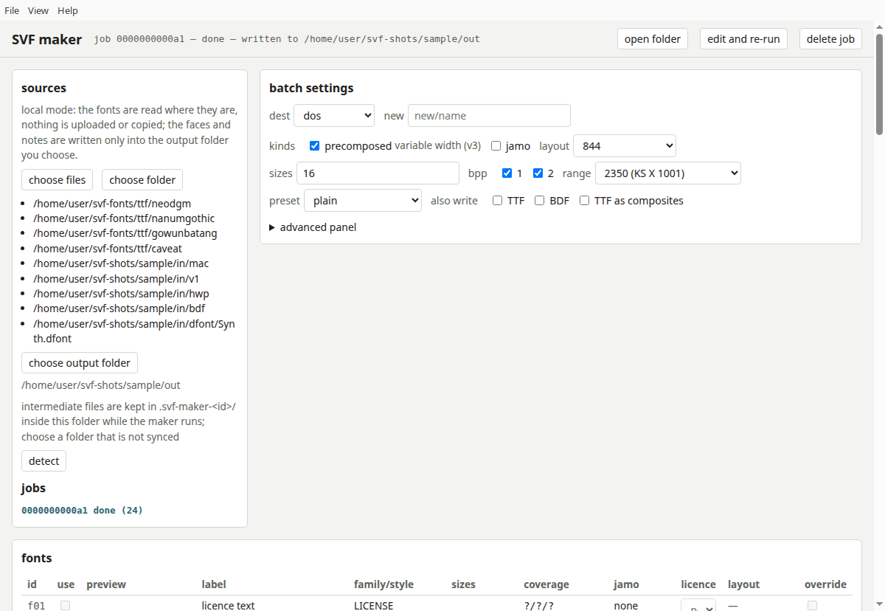
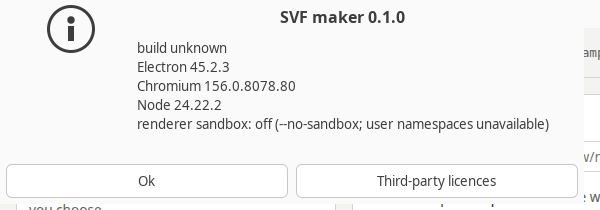

**English** | [한국어](maker-desktop.ko.md)

# SVF maker desktop implementation and packaging

SVF maker consists of an Electron shell, a Python HTTP server (sidecar), and a page served by that server.
It builds a Linux x86_64 AppImage. See the [desktop app](desktop-app.md) for installation and use,
the [maker guide](../maker/README.md) for the server and HTTP API, and the [capability audit](maker-audit.md)
for conversion features. The [design](superpowers/specs/2026-11-05-maker-desktop-design.md) and
[implementation plan](superpowers/plans/2026-11-05-maker-desktop.md) describe the architecture.

## 1. Runtime structure

| Component | Behaviour | Implementation |
|---|---|---|
| Electron shell | Single-instance lock, window, menus, native dialogs, sidecar lifecycle | `desktop/main.js`, `desktop/preload.js`, `desktop/lib/` |
| Sidecar | PyInstaller one-dir bundle started with `serve --exit-with-parent=<pid>` | `maker/sidecar.py`, `maker/sidecar.spec` |
| Tool launch | `python3 -P tools/<name>.py` in source mode; `svf-maker-sidecar run-tool <name>` when frozen | `maker/toolrun.py` |
| Preview | C renderer compiled to WebAssembly and run in the page | `maker/build-wasm.sh`, `maker/static/svfview.js`, `c/ports/web/` |

The shell creates a fresh 16-byte random token encoded as 32 hexadecimal characters and starts the server on
`127.0.0.1:0`. It waits up to 75 seconds for `svf-maker listening on 127.0.0.1:<port>`.
After 2 seconds without readiness it displays a starting page. Once the port is known it loads the loopback HTTP
page and adds `X-Maker-Token` to `/api/` requests. The token is not passed to the page.


*`desktop/starting.html`, shown while the sidecar is not ready after 2 seconds.*



*The shell's window: the native menu (File, View, Help) belongs to the shell; everything below it is the sidecar's page.
Captured under Xvfb without a window manager (section 5.2).*

The page's `window.svfMaker` exposes `pickFiles()`, `pickFolder()`, `pickOutputDir()`,
`openOutputFolder()` and `platform`. The last function takes no argument. The shell looks up the current job's
output folder and checks it against the last 32 real paths chosen through its dialog before showing it in the file manager.

Data lives in `maker/` under Electron's `userData`, or `maker-dev/` for development runs.
The Linux default is `~/.config/svf-maker/`; `--user-data-dir` can override it.
The server's `instance.lock` prevents concurrent use of one data folder.
Each tool runs in a separate session registered in `tools.pids`. Normal shutdown stops it; after an abnormal exit,
the next start reaps identifiable leftovers. The shell allows 45 seconds for shutdown, then 5 seconds after a forced kill.

## 2. Linux build

Follow the Quick start's [prerequisites and installation commands](desktop-app.md#0-quick-start) first.
The requirements are a git checkout, Python 3.12 with pip, Pillow and fontTools for the system Python,
Node.js 22.12 or newer with npm, emsdk, `xvfb-run` and `flock`.
The pinned wheels target Linux x86_64 CPython 3.12. emsdk defaults to `~/opt/emsdk`, overridden by `$EMSDK`.

Run from the checkout root:

```sh
mkdir -p "$HOME/work/tmp"
cd desktop
npm ci
node node_modules/electron/install.js
cd ..
bash desktop/build/build-appimage.sh
```

Running Electron's installation script explicitly fetches the binary even when npm blocks install scripts.
Versions are pinned in `desktop/package-lock.json` and `desktop/build/requirements.lock`.

| Component | Pinned version |
|---|---|
| Electron | 45.2.3 |
| electron-builder | 26.18.0 |
| PyInstaller | 6.22.3 |
| Pillow | 10.2.0 |
| fontTools | 4.66.1 |
| AppImage toolset | appimage@1.0.3 |

`maker/build-sidecar.sh` builds WASM, installs hash-checked wheels with `pip --target`, runs PyInstaller,
and performs an `env -i` self-check and frozen tests. `build-appimage.sh` does not skip the frozen tests.
After generating notices, electron-builder creates `desktop/dist/svf-maker-0.1.0.AppImage`.
The version comes from `desktop/package.json`.

Scratch lives under `$SVF_DESKTOP_TMP` (default `$HOME/work/tmp/svf-desktop-build`).
The build and release-check scripts acquire `$HOME/work/tmp/svf-browser.lock` themselves for the smoke test.
Wrapping either in `flock` on that same lock deadlocks. `desktop/test/run-e2e.sh` does not acquire the lock itself;
its caller manages the lock when running it separately. That test takes a short scratch path through `TMP_DIR`
and forwards it as `TMPDIR`.

### 2.1. Release checks

`desktop/build/release-check.sh APPIMAGE [--release]` checks the following:

| Check | Condition |
|---|---|
| `size`, `size-sidecar` | AppImage ≤ 170 MiB; sidecar `du -sm` result ≤ 60 |
| `extract`, `layout` | Successful extraction, required resources present, no tests or caches in staged sources |
| `apprun`, `desktop-entry` | `unshare` probe and `--no-sandbox` branch present; entry uses `AppRun` |
| `runtime` | No ELF interpreter, dynamic dependencies or `libfuse.so.2` string; version output and exit status checked with only HOME and PATH in the environment |
| `frozen` | Extracted sidecar passes frozen tests with no skips |
| `wasm` | Byte-equal to a fresh WASM build |
| `licences`, `notices`, `sources` | Licence mapping, regenerated notices and bundled Python sources verified |
| `smoke` | Extracted `AppRun` starts under Xvfb, API responds, normal exit and process termination checked |
| `sources` (`--release`) | LGPL corresponding-source archive gate satisfied |
| `contents` | File inventory saved per build identifier and AppImage hash |

Without `--release`, the corresponding-source gate prints `CHECK sources skipped`.
Both source checks use the name `sources`; read their details to distinguish them.
Any failure produces exit status 1. The smoke test allows 90 seconds for Electron after acquiring the lock.
It tests extracted execution, so it does not also prove FUSE mounting works.

## 3. AppImage runtime and sandbox

`desktop/build/appimage-toolset.json` pins the SHA-256 hashes of the toolset archive, runtime and removed libraries.
The selected runtime is type2-runtime 20251108 with statically linked FUSE 3 code.
It does not need the host's `libfuse.so.2`, but does need `fusermount` or `fusermount3` and permission to mount.
When mounting is unavailable, use `--appimage-extract` and run the extracted `AppRun`.

`AppRun` adds `--no-sandbox` if `unshare -Ur true` fails.
Ubuntu's user-namespace restrictions depend on system policy; the distribution name alone does not establish sandbox status.
The shell requests `sandbox: true`, `contextIsolation: true` and `nodeIntegration: false`, but these do not enable
Chromium's process sandbox when running with `--no-sandbox`.
The shell log and Help > About show the detected state.



*Help > About on a host that denies user namespaces: the last line is the detected sandbox state.*

The shell blocks remote requests, new windows, downloads and permission requests. The page and sidecar communicate
over loopback HTTP. These controls do not provide operating-system network isolation for subprocesses such as an
optional recogniser. See Electron's security guide and Ubuntu's user-namespace notes in section 7.

## 4. Licences and corresponding sources

`desktop/build/third-party.mjs` generates `THIRD-PARTY.txt`. Shared libraries must match
`third-party-map.json`; sidecar libraries must match their build provenance.
Ordinary GPL libraries are rejected. The PyInstaller bootloader is classified separately as GPL with its bootloader exception.
LGPL components need a distribution record, and `svf/` may contain only allow-listed OFL faces.

`prune-appimage-toolset.py` removes the toolset's GPL-3.0 `libindicator` and its dependent `libappindicator`.
The app has no tray icon. Licence texts for the runtime's embedded components are in
`desktop/build/licences/appimage-runtime.txt`.

For a public release, prepare `desktop/build/out/sources/MANIFEST.json` and corresponding-source archives, then run
`bash desktop/build/build-appimage.sh --release`. Each LGPL component requires a `source` entry whose
`component` and `version` match the map; the AppImage runtime also requires a `recipe` entry.
Every entry needs `archive` and `sha256`. For example:

```json
[
  {"component": "appimage-runtime", "version": "20251108", "kind": "source", "archive": "runtime-src.tar.gz", "sha256": "<hex>"},
  {"component": "appimage-runtime", "version": "20251108", "kind": "recipe", "archive": "runtime-recipe.txt", "sha256": "<hex>"}
]
```

This example shows only runtime entries. Other mapped LGPL components, including Electron's ffmpeg, are also required.
The generator must print `corresponding sources archived: YES` to pass the release source check.

## 5. Automated checks and recorded runs

`npm test --prefix desktop` runs Node tests for shell utilities, notice generation, extraction verification and the
runtime checker without an Electron window. `maker/test/test_frozen.py` needs a built sidecar.
`desktop/test/run-e2e.sh` needs Xvfb and Electron; it stubs dialogs and disables the GPU.
Its second pass against the packaged layout needs `SVF_MAKER_SIDECAR` and `SVF_MAKER_STAGED_REPO`.

`maker/test/uisample.py` defines the sample conversion's inputs and expected outputs.
It uses four OFL fonts and synthetic Mac, HWP and BDF inputs to check 10 faces and 3 TTF/BDF exports.
It checks the expected file tree, unchanged inputs, face validation and actual drawing, and equality between
development and packaged results for pure-Python routes. Some outline byte differences are allowed because the
host and pinned wheels may use different FreeType versions. TTF comparisons normalise `head` timestamps.
`maker/test/test_uisample.py` exercises the checks in detail.

A recorded run on 2026-11-22 built a 140,426,554-byte AppImage from commit `3d40de8` on Ubuntu 24.04 x86_64.
The window and a local conversion also worked under Xvfb on a clean Ubuntu 24.04.5 host.
These measurements do not guarantee the size or time of a current build.

### 5.1. Linux host measurements (2026-11-09–24)

Recorded on Ubuntu 24.04 x86_64 with glibc 2.39. The size/build run on November 22 and sample run on November 24 retain their dates and commits below; the other observations have no separate execution date. These are historical measurements, not current test counts or timing guarantees.

| Item | Value |
|---|---|
| Sidecar one-dir | 47 MB; build 8-9 s (about 30 s with the frozen test); startup port line well under 2 s |
| AppImage | 140 MB (133.9 MiB, commit 3d40de8, 2026-11-22; 149.7 MB before the static runtime and zstd); `linux-unpacked` 335 MB; electron-builder about 50 s; the whole script 1 min 26 s with warm caches |
| Frozen test | 28 tests, 0 skipped: byte-equal to the pinned wheels under `env -i` (svf2ttf and rawcarve too), the 7 bundled recipes, frozen jobs and notes equal source mode |
| Electron task counts (`--no-sandbox --disable-gpu` under xvfb) | one instance 87, second-instance case 114 (planning measurements, with the GPU 143 and 170); the lifecycle test's peak was 79-80 |
| Debian Pillow comparison | equal |
| `sample set` e2e step | dev 12.6 s, packaged 14.9 s (17 steps: 10 faces and 3 TTF / BDF exports; 2026-11-24, commit 8c10dc1); before the exports dev 10.4 s, packaged 15.0 s (14 steps) |

### 5.2. Documentation screenshots

`desktop/test/doc-shots.js` takes the screenshots in [desktop-app.md](desktop-app.md) and this page and writes them to
`docs/images/maker/`. Like the e2e driver it runs the real `main.js` with stubbed dialogs and a fresh user-data folder,
then drives the page through three jobs:

| Job | Inputs | Pictures |
|---|---|---|
| 1 | The `maker/test/uisample.py` sample (four OFL font folders of `ttf/`, synthetic Mac, HWP, BDF and dfont inputs) with its per-font settings | start, acknowledgement, sources, fonts table, batch and advanced settings, override panels, licence picker, running, done, previews, exports, glyph grid, jobs list, window, View menu, About |
| 2 | Two OFL SVF files from `svf/`, the synthetic DOS raw font of `maker/test/fixtures.py`, the synthetic 86Box Trigem ROM pair of `maker/test/test_recipe.py` (drawn from `NEODG16.SVF`) and an unknown file | other kinds, DOS layout, `svf2ttf` route, 2 bpp jamo set, known ROM face |
| 3 | `ttf/neodgm` | a refused dest, a failed step (`fit cell` with a 6 px cell) |

The sidecar is started with the built-in 86Box recipe set to the synthetic pair's hashes, as `test_recipe.py` does
in-process; no ROM or Apple data is used. The page has no language switch, so every picture shows its English labels.
Before each capture the driver replaces the scratch and checkout paths (`/home/user/svf-shots`, `/home/user/svf-fonts`),
the job ids (`0000000000a1`...) and the step seconds (`·.· s`) in the page, and it captures at a fixed window size
(1200 x 800, scale factor 1) on a 1280 x 1024 Xvfb screen. At the end it reduces every PNG to 256 colours with Pillow.

From the checkout root, with `desktop/node_modules` installed and `maker/static/wasm/` built (`bash maker/build-wasm.sh`):

```sh
bash desktop/test/run-doc-shots.sh
# the same, by hand:
xvfb-run -a -s "-screen 0 1280x1024x24" desktop/node_modules/.bin/electron --no-sandbox --disable-gpu desktop/test/doc-shots.js
```

`TMP_DIR` names the scratch folder (default `~/work/tmp/svf-doc-shots`; not under `/tmp`, which `uisample.py` refuses),
`SHOT_DIR` another output folder. It prints `SHOT <name> <width>x<height>` per picture and
`SHOTS DONE <n> files, <bytes> bytes`, and exits 1 if a picture failed. A run takes a few minutes.

## 6. Support and remaining verification

Packaging in this checkout targets Linux x86_64. Section 6.5 describes the separate Windows branch.

### 6.1. glibc floor

The recorded Linux package uses glibc 2.39 (Ubuntu 24.04), the build host's version, as its supported floor.
PyInstaller bundles collected system libraries but does not ship glibc. No exact minimum required-symbol audit
was recorded, so compatibility with older glibc is not promised. Rebuilding in an Ubuntu 22.04 (glibc 2.35)
container to widen compatibility was a plan, not a completed build.

### 6.2. Manual checks for a human on a real desktop

- Open native file, folder and output-folder dialogs on a real display; check selection and cancellation. Automated tests stub them.
- Check that **open folder** shows the selected output folder in the desktop file manager.
- Run `./svf-maker-0.1.0.AppImage` in a session with a window manager to check FUSE mounting and window display together.
- Run with the GPU enabled; automated checks use `--disable-gpu`.
- On a host allowing user namespaces, verify sandboxed execution and the detected state in Help > About.

### 6.3. Clean-machine start record (2026-11-20)

Host `pc` ran Ubuntu 24.04.5 without `libfuse2t64` or `libfuse.so.2`; `fusermount` and `fusermount3` were present.
There was no display and no package was installed for the test. The then-current AppImage (about 133 MB,
zstd squashfs) was copied to `~/work/tmp/svf-clean` and run with `env -i HOME="$HOME" PATH=/usr/bin:/bin`.

```text
$ ./svf-maker-0.1.0.AppImage --appimage-version
AppImage runtime version: https://github.com/AppImage/type2-runtime/commit/dd6cebe
# exit 0
$ ./svf-maker-0.1.0.AppImage
ERROR:ui/ozone/platform/x11/ozone_platform_x11.cc:257] Missing X server or $DISPLAY
# exit 1
$ ./svf-maker-0.1.0.AppImage --appimage-mount
# squashfs mounted, including AppRun, chrome_100_percent.pak, ...
```

The old runtime's `dlopen(): error loading libfuse.so.2` failure was gone. Electron started from the mounted
image and exited for lack of a display. This run did not verify a window.

### 6.4. Xvfb window record (2026-11-22)

On the same `pc` host, the AppImage from commit `3d40de8` started under Xvfb: the window rendered and a local-mode
conversion ran through the packaged sidecar. A clean checkout of that commit built following the Quick start in
1 minute 26 seconds with warm caches, producing a 140,426,554-byte AppImage; all `CHECK` results in that run succeeded.
Both the extracted `AppRun` and the AppImage printed `svf-maker smoke ok SVF maker` under Xvfb.
The development launch `node_modules/.bin/electron --no-sandbox .` from `desktop/`, also under Xvfb, logged
`sidecar start mode=dev` and the port line. These results do not establish real window-manager or GPU behaviour.

### 6.5. Windows and macOS (status on 2026-11-27)

**Windows** (t_9b8f56f0): the x64 NSIS installer and portable executable are built and tested on GitHub Actions (`windows-latest`, workflow `.github/workflows/windows.yml`), never on a
desktop machine. One run does, in this order: the WASM preview module on an Ubuntu runner (emsdk 6.0.13, the pin of
`c/cross/install-toolchains.sh`; `maker/build-wasm.sh` is bash and emcc is not set up on the Windows runner), handed to the
Windows job as an artifact; on Windows the maker suite and the tools suite through `desktop/build/run-suite.py` (it prints
`SUITE ... ran= skipped=` and one `SKIP <n> <reason>` line per skip reason), the desktop unit tests, the frozen sidecar
(`desktop/build/build-sidecar-win.py`, frozen test included with `SVF_MAKER_FROZEN_REQUIRED=1`), `THIRD-PARTY.txt`
(`third-party.mjs --platform win32`, fail closed), the desktop e2e (development pass, then the packaged sidecar), the
installer and the portable `.exe` (electron-builder `--win nsis portable`, unsigned), and the smoke of the unpacked app, the
installed app and the portable app (`desktop/build/smoke-win.py`). The two `.exe` files and `THIRD-PARTY.txt` are the
run's artifact `svf-maker-windows`. pip and npm downloads are cached.

#### Build it yourself (Windows)

Not tried outside the runner; the steps are the workflow's. A git checkout (`.gitattributes` keeps every file byte for byte:
no CRLF conversion), Python 3.12 (3.12.3 used) on `PATH` as `python`, node 22 with npm, and the WASM module built
elsewhere (Linux or WSL: `bash maker/build-wasm.sh`) and copied to `maker/static/wasm/`:

    # in the checkout root, PowerShell
    python -m pip install --require-hashes "--only-binary=:all:" --no-deps -r desktop/build/requirements-win.lock
    cd desktop; npm ci; cd ..
    python desktop/build/fetch-fribidi-win.py $env:USERPROFILE\work\tmp\fribidi   # and put that folder on PATH (below)
    $env:PATH = "$env:USERPROFILE\work\tmp\fribidi;$env:PATH"
    python desktop/build/build-sidecar-win.py          # wheels, icon.ico, FriBiDi, PyInstaller, provenance, staged repo, selfcheck, frozen test
    $lic = python -c "import os, sys; print(os.path.join(sys.base_prefix, 'LICENSE.txt'))"
    node desktop/build/third-party.mjs --platform win32 --sidecar desktop/build/out/sidecar/svf-maker-sidecar `
      --provenance desktop/build/out/sidecar-provenance.json --electron desktop/node_modules/electron/dist `
      --pysite "$env:USERPROFILE\work\tmp\svf-desktop-build\pysite" --repo desktop/build/out/repo --meta . `
      --python-licence $lic --out desktop/build/out/THIRD-PARTY.txt
    cd desktop; npx electron-builder --win nsis portable --x64 --publish never; cd ..
    python desktop/build/smoke-win.py desktop/dist

**FriBiDi.** Pillow's Windows wheel carries libraqm and HarfBuzz but loads FriBiDi at run time, and does not ship it;
without it Pillow falls back to its basic layout, and a face made on Windows is not the bytes the same face made on Linux
is (measured: GowunBatang-Bold 17 px 2 bpp gained U+00AD and drew U+2116 differently; a combining mark kept its
advance). `desktop/build/fetch-fribidi-win.py` downloads conda-forge's MSVC build of FriBiDi 1.0.10 (archive and DLL
sha256-pinned) and the build bundles `fribidi-0.dll` in the sidecar's `_internal/` (the spec refuses to build without
it); a development run or the test suites on Windows need that folder on `PATH`. FriBiDi is LGPL-2.1-or-later: a
separate, replaceable DLL, listed with a distribution record, and under the D8 release gate like `ffmpeg.dll`.

`desktop/build/requirements-win.lock` pins the win_amd64 cp312 wheels with hashes (the same Pillow 10.2.0, fontTools
4.66.1 and PyInstaller 6.22.3 as Linux, plus PyInstaller's Windows-only `pefile` and `pywin32-ctypes`). The spec
(`maker/sidecar.spec`) is the Linux one; on Windows it adds UTF-8 mode (`X utf8_mode=1`: a frozen program ignores
`PYTHONUTF8`) and the icon. `desktop/package.json` `build.win`: targets `nsis` (one-click, per user, no elevation,
Start-menu shortcut "SVF maker", installs to `%LOCALAPPDATA%\Programs\svf-maker`) and `portable`; icon
`build/out/icon.ico`, made from `build/icon.png` by `make-icon.py --ico` (not committed).

Notices: `desktop/build/third-party-map-win.json` attributes every `*.dll` and `*.pyd` of the sidecar's `_internal/` and of
Electron's folder (case-blind). The DLLs and extension modules of the python.org interpreter (CPython, OpenSSL, libffi, ...)
take their text from that interpreter's `LICENSE.txt` (`--python-licence`), which carries the licences of the libraries the
Windows build bundles. Microsoft binaries that come with the interpreter or with Electron (`VCRUNTIME140*.dll`,
`d3dcompiler_47.dll`, `dxil.dll`) are class `ms-redist`: redistributed unmodified under Microsoft's terms
(`desktop/build/licences/ms-distributable.txt` says so; it is not their licence text), and so is the app-local Universal
CRT the python.org build carries (`ucrtbase.dll`, `api-ms-win-*.dll`). ANGLE (`libEGL.dll`, `libGLESv2.dll`)
and the DirectX Shader Compiler point at `LICENSES.chromium.html`. The copyleft parts are the same as on Linux minus the
AppImage runtime, plus FriBiDi: `ffmpeg.dll` and `fribidi-0.dll` (LGPL-2.1; the D8 release gate applies to both the same
way) and the PyInstaller bootloader.

#### What differs on Windows (the server)

`maker/oscompat.py` holds every primitive that POSIX and Windows spell differently; on POSIX each function is exactly the
call the maker made before, so Linux behaviour is unchanged. One reader change applies everywhere: a BDF or HBF saved
with CRLF line ends reads as its LF form (before, its glyphs were dropped on Linux), so a file parses the same on every
platform.

| What | POSIX | Windows |
|---|---|---|
| A tool's process tree | new session; `killpg` SIGTERM, then SIGKILL after 5 s | started suspended in a new process group with no console, put into its own Job Object (`KILL_ON_JOB_CLOSE`), then resumed; a stop terminates the job at once (no grace period: no SIGTERM exists for it). A job that cannot be made or assigned refuses the tool. The sidecar itself runs in a job of its own (`contain_children`), so a tool still suspended between its creation and its assignment dies with a killed sidecar too. |
| A dead sidecar's tools | `PR_SET_PDEATHSIG` + the next start's reap | the kernel kills them when the sidecar's job handles close; the reap kills a recorded pid and every process below it (snapshot parent links, creation time checked) |
| Stopping the sidecar | the shell sends SIGTERM to its group | the shell closes the sidecar's stdin (`serve --stop-on-eof`): the same clean stop as SIGTERM; after 45 s it kills it (TerminateProcess) |
| The parent watch (`--exit-with-parent`) | `getppid()` polled | the parent's process handle, opened at start and waited on |
| Data-root and registry locks | `flock` | `msvcrt.locking` of one byte far past the end of the lock file (the file stays readable) |
| A replace or read racing another thread | atomic, never fails | a sharing violation is retried for up to 2 s (`retry_sharing`) |
| Links | `S_ISLNK` | a symlink **or any name-surrogate reparse point** (junction, mount point); `lstat` reports a junction as a folder, so it is checked by its reparse tag |
| No-follow open | `O_NOFOLLOW` | opened with `FILE_FLAG_OPEN_REPARSE_POINT` (the open never follows or contacts a link: a dangling link makes a create fail) and refused when the handle's reparse tag is a name surrogate; a deduplicated or cloud placeholder file is opened again normally and must be the same file (volume serial + file index) |
| The output tree | directory descriptors and `*at()` calls | the output folder and every folder written through are held open without delete sharing and without following a reparse point; each folder below the output folder is made and held relative to its parent's handle (`hold_dir_at`, no path walked), and each file is made and read relative to its folder's handle (`NtCreateFile`, `OBJ_DONT_REPARSE`). None of them, nor a folder above them, can be renamed or removed while the write runs; a held folder turned into a junction in place (possible only while it is empty) is refused before the landing. The path -> identity checks before and after each landing are the same as on POSIX |
| New-name claim | `link()`, else `O_EXCL` + replace + read-back | the same (`CreateHardLink`; FAT/exFAT and shares without hard links take the second way) |
| Output names | as the naming rules say | also refused: a device name (`CON`, `NUL.TXT`, `COM1`, ...), a trailing dot or space, the characters `<` `>` `:` `"` `/` `\` `?` `*` and the vertical bar (`TreeRefused`; an upload archive member too). A face, licence or note name or a destination that is a device name (`CON.SVF`, `new/con`) is a settings error; suggestions add a `0` (`CON0.TXT`) |
| Archive members | an exact duplicate name stops the unpack | names that differ only in case are duplicates, and each member file is created new only, so an 8.3 alias of an earlier member (`LONGNA~1.TTF`) stops as a duplicate too and is never written over |
| A local job's tool temp folder | `TMPDIR` | `TMPDIR`, `TEMP` and `TMP` (native code reads only the last two) |
| Picked paths | absolute | absolute with a drive or a UNC share; a device path (`\\.\`), an extended-length path (`\\?\`), a drive root and an alternate data stream (`name:stream`) are refused; a relative path inside a source may hold no drive and no colon |
| `SVF_MAKER_ROOTS` | `:`-separated | `;`-separated; an entry may be a drive root (`D:\`); case is ignored |
| Permission bits | `umask 077`, folders 0700, files 0600 | no mode bits: the data folder's privacy is its ACL, inherited from the user's profile (`%APPDATA%`); a local job's `.svf-maker-<id>/` (in the user-picked output folder) is made with a protected ACL that grants the current user and SYSTEM only |
| Bare program names | `PATH` | `PATH` only: the sidecar sets `NoDefaultCurrentDirectoryInExePath`, and the shell's development mode resolves `python.exe` on `PATH`'s absolute folders (a bare name would be looked up in the current folder first) |
| Text written by the maker and the tools | LF | LF (`newline="\n"` on every text write; a tool's CRLF stdout is read as LF) |

Not the same guarantee: on POSIX a folder swapped between two landings is detected and the write stops (`OutputGone`); on
Windows the swap itself is impossible while the folders are held, so the write completes into the folder that was checked.
A swap of a folder the tree has not reached yet is still caught by `lstat` + identity before the folder is held.

#### Measured (GitHub Actions windows-latest)

Windows Server 2025 (build 26100) runners, Python 3.12.3, node 22, 2026-11-24.

| Item | Value |
|---|---|
| Sidecar one-dir | about 30 MB; `build-sidecar-win.py` 55 s including the frozen test (28 tests, 0 failed, 2 skipped: the fork race and the `PR_SET_PDEATHSIG` knob, POSIX by nature; on Windows the Job Object covers both) |
| Installer | `svf-maker-0.1.0-setup.exe` 138,366,326 bytes; silent per-user install and uninstall checked |
| Portable | `svf-maker-0.1.0-portable.exe` 125,605,175 bytes |
| Smoke start to the clean stop | unpacked 1.3 s, installed 1.5 s, portable 12.5 s (it unpacks itself first); Help > About's line: "renderer sandbox: on" |
| Desktop e2e | 33 steps pass (development pass and packaged pass, the sample set included; `sample set` dev 20.9 s, packaged 20.2 s). The `sh` stub's stderr canary is POSIX only. |
| Maker suite | 1,277 tests in two shards (13 and 27 min; the Chrome page tests are the slow part), 0 failed, 62 skipped: 30 POSIX by nature (permission bits, signals, FIFOs, zombies, `/proc` and `PR_SET_PDEATHSIG`, `/dev/zero`, the `resource` module, Chrome's Unix socket path, a namespace), 1 the U+2116 pin below, 31 the same environment skips as on Linux (your real fonts and ROMs, optional libraries, the slow fit, the frozen classes, which run in the package job) |
| Tools suite | 980 tests (6.5 min), 0 failed, 642 skipped: 609 POSIX by nature (the C renderer's host build with gcc sanitizers and its bench and VESA shell scripts: on Windows the renderer runs as the WASM module; a mode-000 folder; the bash build scripts), 33 environment skips as on Linux |
| Desktop unit tests | 43 pass (`unit.test.js`, `third-party.test.js`, a win32 notices case included) |
| Notices | `THIRD-PARTY.txt` 15 components, no unattributed DLL |

**Not byte-equal on Windows.** With FriBiDi in place every face of the test suites is the Linux bytes except one measured
glyph: GowunBatang-Bold at 17 px 2 bpp (`dos-u-2bpp`, the shipped `svf/dos/GBATB17.SVF`) draws U+2116 differently with
Pillow's Windows build, so on Windows that face is written as a new face rather than recognised as the shipped one. The
tests pin exactly that glyph (`maker/test/wincompat.py`, `WINDOWS_RENDER_DIFFERS`): every other glyph and metric must
be equal. The cause is not established (FreeType 2.13.2 and raqm 0.10.1 on both sides).

**macOS:** no package has been built or run. The plan was separate arm64/x86_64 PyInstaller one-dir builds and
`dmg`/`zip` packages; universal2 would need universal wheels. The Linux cp312 wheel lock cannot be reused unchanged.
Developer ID signing, hardened runtime/entitlements, individual sidecar binary signing, `notarytool` notarisation
and stapling remain plans, not a verified build procedure. Process identity using `ps -o lstart=` and native
resource forks have not been verified on macOS either.

### 6.6. Other unverified items

- An external recogniser's real model is unverified. Optional libraries are not bundled.
- Bit-for-bit AppImage reproducibility is not guaranteed, and there is no automatic update.

See the [C renderer](c-renderer-guide.md), [web renderer](web-renderer-guide.md) and
[renderer design](../spec/renderer-design.md) to use the output faces.

## 7. 참고 문헌 / References

- Electron: security recommendations — <https://www.electronjs.org/docs/latest/tutorial/security>
- Electron: process sandbox — <https://www.electronjs.org/docs/latest/tutorial/sandbox>
- Ubuntu 24.04: unprivileged user-namespace restrictions — <https://discourse.ubuntu.com/t/ubuntu-24-04-lts-noble-numbat-release-notes/39890>
- AppImage type2-runtime 20251108 — <https://github.com/AppImage/type2-runtime/releases/tag/20251108>
- AppImage runtime licence — <https://github.com/AppImage/type2-runtime/blob/20251108/LICENSE>
- PyInstaller bootloader exception — <https://pyinstaller.org/en/stable/license.html>
- GNU LGPL 2.1 — <https://www.gnu.org/licenses/old-licenses/lgpl-2.1.html>
- Windows build, 2026-11-24 — <https://github.com/TaehyunKimLL/svf-fonts-open/actions/runs/45350084767>

## 8. 기록 / Records

### 8.1. Earlier platform plan and verification limits (2026-11-22–24)

The following is the historical record. Its Windows “not built” status is superseded by section 6.5.
Porting/signing commands and external platform descriptions below remain the plan as recorded, not successful execution evidence.

> ### Windows and macOS (UNVERIFIED)
>
> Nothing below was run. It is the plan a builder on those hosts follows, and what blocks it. Not built or verified.
>
> - **macOS.** PyInstaller one-dir builds the same spec on macOS (arm64 and x86_64 are separate builds; a universal2
>   build needs universal wheels of Pillow and fontTools; `desktop/build/requirements.lock` pins Linux cp312 wheels only).
>   The server already runs on macOS (POSIX), but the registry's macOS start time (`ps -o lstart=`) is untested. electron-builder
>   target `dmg` + `zip`; `extraResources` the same; the AppImage's `--no-sandbox` question does not exist. Signing: a
>   Developer ID Application certificate, `mac.hardenedRuntime: true`, an entitlements file allowing nothing beyond
>   `com.apple.security.cs.allow-unsigned-executable-memory` (Chromium) - and every binary under `resources/sidecar/` must be
>   signed too (`codesign --deep` does not reach `_internal/*.so` reliably; sign them individually with `--options runtime`),
>   then `notarytool submit` and `stapler`. Without signing, Gatekeeper blocks the app on first run (right-click Open works).
> - **Windows.** The **server is not Windows-ready** (`os.killpg`, `start_new_session`, `signal.SIGTERM` to a group,
>   `os.umask(0o077)` semantics, `os.link` for the no-replace write, `fcntl` locks in the registry and the data-root lock): a
>   port needs Job Objects (or `CREATE_NEW_PROCESS_GROUP` + `GenerateConsoleCtrlEvent`) for the group kill, `CreateProcess`
>   flags in `run_command`/`run_bounded`, and a review of every `realpath`/inode rule of the local-mode design on NTFS. That is
>   a card of its own; until it is done the Windows build is not attempted. Then: the same PyInstaller spec (keep
>   `console=True` and the shell's `windowsHide`), electron-builder target `nsis` or `portable`, the Electron spawn with a Job
>   Object, signing with a code-signing certificate.
>
> ### Not verified here
>
> Windows and macOS entirely; an AppImage start on a real desktop (window manager, GPU; the Xvfb window run above is done); a sandboxed renderer; glibc older than 2.39; `JAMOSET_PYLIB` with
> 3.12 wheels in the frozen process and any real recogniser (the tests use a stub interpreter); native dialogs with a display;
> the composition of the AppImage runtime beyond what its binary states (its embedded licence list and version strings: type2-runtime, musl libc, libfuse 3.15.0, squashfuse 0.5.2, libzstd 1.5.6, zlib 1.3.1; musl's own version is not embedded, so its COPYRIGHT is taken from v1.2.5);
> `SOURCE_DATE_EPOCH` determinism of the AppImage (the sidecar is not bit-reproducible: `base_library.zip` member order
> changes per build); a FreeType other than 2.13.2 in a future Pillow wheel; the exact URLs of the recorded sources
> (recorded, not fetched).

### 8.2. Sample-conversion verification details (2026-11-20–24)


`desktop/test/e2e.js` has one step per pass, `sample set`, that converts a fixed sample **through the page** in local mode
(inputs read in place, faces written into the chosen output folder), in the dev pass and in the packaged pass. The sample is
defined by `maker/test/uisample.py` (it builds the synthetic inputs at test time and owns the per-font settings table, the
expected 36-file tree and the checks): four OFL fonts of `ttf/` read in place (neodgm, NanumGothic-Bold, GowunBatang-Bold with
the `dos-u-2bpp` preset, Caveat-VF at its Bold instance), and synthetic files from the repository's fixture builders: a Mac 7.1
fbit with its HTBL table and suitcase, a HangulTalk 1.0 font, a Mac dfont, an HWP DOS 844 font with `ASCII.PFT` (`HANGUL24.PFT`
shown as not read), and KSC / johab BDFs; the KSC face is also written as `KSC16.ttf` and `KSC16.bdf` and the johab jamo set
as `JOHA16J.ttf` with `--composite` (their overrides' "also write" selects, t_97acecf9). The step picks the 9 roots and the output folder with the stubbed dialogs, changes only
enabled controls (the rows with no route stay disabled and unchecked, asserted), saves, reads the saved settings back, runs, and
then `uisample.py check` verifies: exactly the expected files and no others (no leftover `.svf-maker-*`), `facecheck.py` and
`web/mkindex.py --check` on the written tree, every face draws ink, `GOWUN17A.SVF` byte-equal to `svf/dos/GBATB17.SVF`, each
export holding exactly its face's characters (`quality.export_facts`), and the inputs unchanged. Only then are the 10 result canvases counted (`data-drawn="1"`, `Number(dataset.ink) > 0`). In the packaged
pass `--same-as` compares the faces with the dev pass: byte equality is required for the pure-Python faces (SEOU12J, HAN224J,
JOHA16J, KSC16, MUNJ16J); a difference in an outline face (NEODU16, NANUM17A, GOWUN17A, CAVEA16, SYNTH16) is printed as an
`E2E NOTE` (the dev pass renders with the host's Pillow/FreeType, the packaged one with the pinned wheels), not a failure.
`KSC16.bdf` must be byte-equal and `KSC16.ttf` and `JOHA16J.ttf` equal once its `head` timestamps are set equal (svf2ttf.py stamps the time
of the run).
`maker/test/test_uisample.py` runs the same table through the HTTP API and proves each check fails on a mutation.
