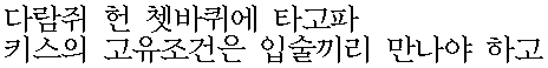
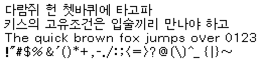
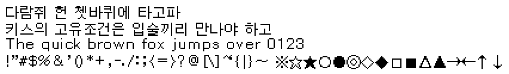

[English](classic-mac.md) | **한국어**

# 레시피: 클래식 Mac 한글 비트맵 폰트

HangulTalk 1.0 `fbit` 폰트(글리프 set 45개와 `fdef` 규칙: 정확한 자모 세트)와 HTBL 1을 쓰는 HangulTalk 7.1 type-3 `fbit` 폰트(완성형 페이스와 자모 세트). maker의 로컬 모드가 이들을 제자리에서 읽는다. System 7.5.3부터 Mac OS 8.5까지의 TrueType 비트맵 스트라이크와 페이스마다의 샘플 그림이 이어진다.

**시작 전에.** 명령은 [색인](../recipes.ko.md)에서처럼 `$OUT`을 정하고 프로젝트 루트에서 실행한다. 모든 페이스는 [페이스 점검](../recipes.ko.md#페이스-점검)의 점검으로 끝난다. 원본 파일은 독점 파일이라 따로 마련한다. Mac 형식 TrueType(`.dfont`, 슈트케이스)은 [아웃라인 폰트](outline-fonts.ko.md#mac-형식-truetype)에 있다.

위로: [레시피 색인](../recipes.ko.md) · 관련 문서: [아웃라인 폰트](outline-fonts.ko.md), [벌 수 정하기](sets.ko.md), [자모 세트](../jamo-sets.ko.md).

## 클래식 Mac 한글 비트맵 폰트

원본 파일은 직접 마련한다. maker의 로컬 모드([maker 데스크톱 안내서](../maker-desktop.ko.md))는 이
폰트를 디스크의 제자리에서 같은 도구로 읽고, 페이스는 고른 폴더에만 쓴다([Apple 폰트 표와 리소스 포크](../recipes.ko.md#ref-apple) 참고).

**HangulTalk 1.0 'fbit' 폰트** (한글 System 4.1: Gotic12/16, Munjo12/16/24). 입력: 폰트의 리소스 포크를 파일로 한 것(Mac 볼륨에서
복사했거나 아카이브의 포크; `tools/macsfnt.py list`가 그 'fbit' 리소스를 보여 준다). 포크에는 글리프 벌 45개의 'fbit' 리소스와
18개의 조회 표를 가진 'fdef' 드라이버 리소스가 있다. 벌 체계는 폰트 자신의 규칙에서 유도하므로, 모든 음절이 Mac이 그리는 대로
조합된다.

    python3 tools/jamoset.py --layout mac-fbit-45sets Munjo24.rsrc --symbols --check -o $OUT/MUNJO24J.SVF

출력: 음절 11,172개 전체의 1 bpp 자모 세트(이 폰트들은 초성 클래스 8개, 종성 클래스 4개, 초성 벌 20개), 셀 = 폰트의 크기.
`--check`는 모든 것을 조합해 jamoset 자체의 'fdef' 규칙 사본과 비교한다. 직접 만들면 골든 파일(`tools/testdata/mac-fbit-golden.json`,
배포하지 않음: Apple 비트맵이 들어가기 때문)이 독립적인 비교를 더한다. 실제 파일에 대한 테스트는 `JOHAB_FONTS`가
`mac/extracted/kh10_system_disk/System Folder/*.rsrc`와 참조 렌더러를 담은 트리를 가리킬 때 실행되고, 아니면 건너뛴다.

한글 시스템 4.1 / HangulTalk 1.0(1988년 1월, Apple Korea / Elex Computer; 독점)의 시스템 디스크로 실행했다. `System Folder`에 네 폰트가 리소스 포크
파일로 있다. `Munjo24`(24 px 문조. `list`는 `fbit` 17409, 47,714 바이트와 그 `fdef` 3, 2,398 바이트를 보여 준다): `36,660 바이트`, 24x24 조각 653개,
초성 클래스 8개 x 종성 클래스 4개, 벌 20/15/4, `check: composed 11172 syllables from 655 glyphs`, 그리고 jamoset 자체의 `fdef` 규칙 사본에 대한 자기
일관성 줄 `IoU 1.000, exact 11172`(골든 파일 없음), 1.0초. 샘플 줄은 `width=120 ascent=24 descent=0`(이 폰트들에는 라틴이 없어 음절 다섯 개만
그려진다), 잉크 591. `Gotic12`(12 px 고딕): `23,368 바이트`, 같은 벌, `width=60 ascent=12 descent=0`. maker의 로컬 모드(`detect.scan(..., local=True)`, 네
폰트의 사본에서)는 이들을 "HangulTalk 1.0 fbit (45 sets), 24 x 24"(Munjo24. Munjo12, Gotic12는 12 x 12, Munjo16은 16 x 16), 소스 종류
`mac-fbit1`, 커버리지 KS 2,350 / 음절 11,172와 호환 자모 51로 읽고, 위 명령을 실행하는 `mac fbit 1.0` 경로를 제공한다. 업로드 모드는
"Mac bitmap font (NFNT/fbit): not converted here (local-only mode)"라고 한다.

이 장의 그림은 각 페이스가 샘플 네 줄(한국어 팬그램 두 줄, 영어 한 줄, ASCII 기호와 KS X 1001 기호 `※☆★○●◎◇◆□■△▲→←↑↓`)을
어떻게 그리는지 흰 바탕에 검은 글자로, 픽셀마다 2배로 보여 준다. 페이스에 없는 문자는 그 줄에서 뺀다([샘플 만들기](#샘플-만들기)).
HangulTalk 1.0 페이스는 위 명령에서 `--symbols`를 빼고 만든다(이 옵션은 폰트가 아니라 `jamoset.py`가 그린 상자와 점 세 개를 더한다).

*한글 시스템 4.1 / HangulTalk 1.0 시스템 디스크(1988)의 `Gotic12`를 12x12 자모 세트로, ascent 12, descent 0(`23,304 바이트`). 폰트에
한글만 있어 한국어 두 줄만 그리고, 공백은 반 셀의 빈 칸이다(폰트에 공백 글리프가 없다). 2배*

*같은 디스크(1988)의 `Munjo24`를 24x24 자모 세트로, ascent 24, descent 0(`36,564 바이트`). 위와 같이 한글만. 2배*

**HangulTalk 7.1.x type-3 'fbit' 폰트** (Seoul12, AppleGothic12/24, AppleMyungjo12/24): 평면은 표, InputBackSupport 'HTBL' 1로
조합되며, KS X 1001 음절 2,350자와 호환 자모 51개만 있다.

    python3 maker/srcprep.py mac-htbl "InputBackSupport[INIT].rsrc" $OUT/HTBL1.bin     # the HTBL 1 of the extension (7.1.2 CD), 9,816 bytes
    python3 tools/macfbit3.py unpack Seoul12.splt.data $OUT/Seoul12.rsrc     # the 7.1.2 Installer's 'splt' "JM" archive
    python3 tools/macfbit3.py fbit $OUT/Seoul12.rsrc $OUT/Seoul12.fbit
    python3 tools/macfbit3.py bdf $OUT/Seoul12.fbit $OUT/HTBL1.bin Seoul12 $OUT/seoul12.bdf          # 2,401 glyphs, Unicode BDF
    python3 tools/macfbit_svf.py build $OUT/Seoul12.fbit $OUT/HTBL1.bin -o $OUT/SEOUL12J.SVF         # direct: the Mac structure (JMAP)
    python3 tools/macfbit_svf.py build $OUT/Seoul12.fbit $OUT/HTBL1.bin --mode derived -o $OUT/SEOUL12D.SVF   # a JSET face, all 11,172
    python3 tools/macfbit_svf.py verify $OUT/SEOUL12J.SVF $OUT/Seoul12.fbit $OUT/HTBL1.bin

`direct`는 Mac 평면을 조각으로 유지하고 KS 음절만 정확히 조합한다. `derived`는 JSET을 맞추는데, 그 JSET의 추가 음절 8,822개는
외삽한 것이다(Mac 출력이 아님). 라틴 문자를 포함한 완성형 페이스를 만들려면 BDF를 `bdfface.py --hangul`로 주고 별도 `--ascii` 폰트와
`--cell 12x12 --chars-from $OUT/ks.txt`를 지정한다. 아래의 `mkfont.py` 경로에는 라틴 짝 파일이 필요 없다. 변형이 많은 페이스를 MCU 예산에 맞게 줄이려면:

    python3 tools/jamomerge.py merge --face $OUT/SEOUL12D.SVF --points 8192 7168 --prefix SM -o $OUT/SMALL

(모든 조각을 그려진 그대로 유지하고, 픽셀 목적 함수로 변형, 벌, 클래스를 병합한다). 테스트: `tools/test_macfbit3.py`와
`tools/test_macfbit_svf.py`는 테스트 안에서 만든 합성 fbit / HTBL / NFNT 데이터로 실행된다. `MACFBIT3_CD712=<CD tree>`와
`SVF_MAC71_INPUTS=<dir of Name.fbit and Name.htbl1>`은 직접 가진 파일에 대한 점검을 더한다. 윤곽선 Mac TrueType 폰트는
[Mac 형식 TrueType](outline-fonts.ko.md#mac-형식-truetype)을 참고한다. 이 폰트들에 대한 maker의 경로는 [경로 표](desktop-routes.ko.md#데스크톱-앱과-maker-경로)에 있다.

한글 시스템 7.1.2 / HangulTalk 7.1.2(Apple Korea / Elex Computer; 독점)의 Seoul12로 실행했다. CD의 `More Additions` 폴더에 있는
`Seoul12[splt]`(HangulTalk 7.5.1 설치 디스크의 `Seoul12[fbit]` 포크도 같은 8,760 바이트 `fbit`를 주며 `cmp`로 동일하다)와, 그 CD의
`InputBackSupport` 확장의 HTBL 1이다. HTBL은 위 명령이 보여 주지 않았던 단계로, 이제 위 블록의 첫 줄이다(`srcprep.py mac-htbl`, 9,816 바이트). 확장의 7.5.1 사본은 압축되어 있어 `srcprep.py`가 "not an HTBL 1
table"이라고 답한다. 이 `$OUT/HTBL1.bin`으로 위 명령은 적힌 그대로 돈다. `unpack`은 `JM 1843 -> 9673 bytes`, `fbit`는 8,760 바이트, `bdf`는 글리프 2,401개. `direct`는 `15,016 바이트`,
조각 207개, `verify`는 ks_bad 0, compat_bad 0, non_ks_present 0. `derived`는 `9,716 바이트`, 조각 219개, 8 x 4 클래스, 벌 9/6/3(JSET v2로는 `7,928 바이트`),
KS 음절과 호환 자모 검증. 둘 다 샘플 줄의 음절 다섯 개를 `width=60 ascent=10 descent=2`, 잉크 142로 그린다. BDF 경로(`macfbit3.py bdf`, 그다음 `srcprep.py bdf-pixel-size
seoul12.bdf seoul12-sized.bdf --size 12`, 그다음 `mkfont.py ... --size 12 --bpp 1 --unicode ascii,ksx1001-hangul`과 정규 단계)는 `103,012 바이트`,
글리프 2,350개, 같은 `width=60 ascent=10 descent=2`, 잉크 142를 준다. 라틴 글자를 패밀리 suitcase로 넣으면(`--latin "Seoul[FFIL].rsrc"`: 같은 CD의 `FOND`와
9, 12 pt `NFNT` 스트라이크 둘) `direct`는 `17,924 바이트`(라틴 1,388), `derived`는 `12,624 바이트`이고 둘 다 `width=111 ascent=10 descent=2`, 잉크 253,
`verify` 이상 없음. `jamomerge.py merge --points 8192 7168`(약 2분)은 `SM8K.SVF` `7,964 바이트`와 `SM7K.SVF` `7,032 바이트`(조각 191개, 벌 7/6/3)를
쓰고 검증된다. maker의 로컬 모드가 파일을 읽는다(`detect.scan(..., local=True)`): `Seoul12` 포크, `splt` 파일, 원시 포크는 "HangulTalk 7.1 type-3 fbit, 12 px,
482 planes (needs HTBL 1)"이고 경로 `mac fbit 7.1 direct`, `derived`, `bdf + mkfont`를 얻는다. 확장은 "HangulTalk 7.1 HTBL 1 (InputBackSupport): the
composition table", `Seoul[FFIL]`은 "Mac bitmap suitcase (FOND + NFNT): Latin strikes at 9, 12 pt"이다.

같은 명령을 위의 HTBL 1과 라틴 글자용 패밀리 suitcase로 CD의 다른 type-3 폰트에 돌렸다. `AppleGothic12[splt]`에
`--latin "AppleGothic[FFIL].rsrc"`는 `22,860 바이트`, `AppleMyungjo24[splt]`에 `AppleMyungjo[FFIL]`의 24 pt `NFNT`는 `37,244 바이트`
(`latin_notes`: `j`를 셀 안으로 1 px 옮김)이고, 둘 다 `verify` 이상 없음(ks_bad 0, compat_bad 0, non_ks_present 0). 폰트에도
suitcase에도 KS X 1001 기호가 없어(기호는 이 도구들이 읽지 않는 별도의 `KSSymbol12` / `KSSymbol24Disk` 아카이브에 있다) 기호 줄에는
ASCII 기호만 있다.

*한글 시스템 7.1.2 / HangulTalk 7.1.2 CD(1994)의 `Seoul12`, `Seoul[FFIL]`의 12 pt `NFNT`를 더한 `direct` 페이스(`17,924 바이트`),
12x12, ascent 10, descent 2. KS X 1001 기호 없음. 2배*

*같은 CD(1994)의 `AppleGothic12`, `AppleGothic[FFIL]`의 12 pt `NFNT`를 더한 `direct` 페이스(`22,860 바이트`), 12x12, ascent 10,
descent 2. KS X 1001 기호 없음. 2배*

*같은 CD(1994)의 `AppleMyungjo24`, `AppleMyungjo[FFIL]`의 24 pt `NFNT`를 더한 `direct` 페이스(`37,244 바이트`), 24x24, ascent 20,
descent 4. KS X 1001 기호가 없고, 24 pt `NFNT`의 백틱은 비어 있다. 2배*

### TrueType 비트맵 스트라이크 (System 7.5.3부터 Mac OS 8.5까지)

한글 System 7.5.3부터(살펴본 것 중 가장 이른 판. 7.5.1에는 아직 `fbit` Seoul12가 들어 있다) 한글 폰트는 패밀리
suitcase(`FFIL`)에 든 TrueType이고, Apple의 `bloc`/`bdat` 표에 9, 10, 12, 14, 16, 18, 20, 24
ppem의 1 bpp 스트라이크가 있다. CD의 `Bitmap 서체 설치` 폴더에는 비트맵 전용 사본(스트라이크만 있고 윤곽선 없음)이 있다. 이 장의 도구는
이들을 읽지 않는다. [Mac 형식 TrueType](outline-fonts.ko.md#mac-형식-truetype) 경로를 쓰며, 스트라이크 크기에서는
FreeType이 스트라이크의 픽셀을 그린다([내장 비트맵 스트라이크](bitmap-fonts.ko.md#내장-비트맵-스트라이크)).

    python3 tools/macsfnt.py extract "AppleGothic[FFIL].rsrc" $OUT/AppleGothic.ttf
    python3 tools/macsfnt.py unicode $OUT/AppleGothic.ttf $OUT/AppleGothicU.ttf     # only the Mac Korean cmap: add a Unicode one
    python3 tools/mkfont.py $OUT/AppleGothicU.ttf $OUT/agothic16.svf --size 16 --bpp 1 --unicode ascii,ksx1001-hangul

7.5.3의 비트맵 전용 AppleGothic에서 `123,360 바이트`, 글리프 2,446개. `--size`는 스트라이크 크기 중 하나여야 한다(그 사이
크기에서는 FreeType이 윤곽선을 래스터화하고, 비트맵 전용 사본은 열리지 않는다). 결과는 완성형 페이스다. 스트라이크에는 폰트의 KS X 1001
기호와, 대부분의 페이스에서 한자도 있어 더 넓은 `--unicode` 집합으로 가져올 수 있다. 비트맵 전용 사본에는 `head` 표가 없어
`mkfont.py`가 글리프마다 전진 폭을 fontTools로 스트라이크의 메트릭에서 가져온다.

한글 시스템 7.5.3(Power Macintosh 7220용 CD, 1996. 폰트는 "1994-1995 Elex Computer")의 비트맵 전용 사본과, Mac OS 8.5 한글
CD(1998)의 한강체로 실행했다. 한강체는 전체 폰트(윤곽선과 같은 여덟 크기의 스트라이크)이고 유니코드 cmap이 이미 있어 `unicode`가
필요 없다. 아래 페이스는 샘플의 문자(네 줄의 `--unicode file:`)를 담는다.

| 폰트(스트라이크) | 셀 | ascent / descent | 페이스 | 페이스에 없는 문자 |
| --- | --- | --- | --- | --- |
| AppleGothic 12 | 12x12 | 9 / 3 | 4,828 바이트 | `_`(스트라이크의 `_`가 셀 아래에 있다) |
| AppleGothic 16 | 16x16 | 13 / 3 | 5,596 바이트 | 없음 |
| AppleMyungjo 16 | 16x16 | 13 / 3 | 5,844 바이트 | 없음 |
| AppleMyungjo 24 | 24x24 | 19 / 5 | 8,824 바이트 | 없음 |
| Seoul 12 | 12x12 | 10 / 2 | 4,772 바이트 | 없음 |
| Seoul 16 | 16x16 | 13 / 3 | 5,536 바이트 | 없음 |
| #신명조 16 | 16x16 | 12 / 4 | 5,368 바이트 | 없음 |
| #궁서체 16 | 16x16 | 12 / 4 | 5,228 바이트 | 없음 |
| 한강체 16, Mac OS 8.5 | 16x16 | 13 / 3 | 5,748 바이트 | 없음 |

*한글 시스템 7.5.3(1996) AppleGothic의 12 ppem 스트라이크, 비트맵 전용 사본. `_`는 12x12 셀 아래에 있어 빠졌다. 2배*

*한글 시스템 7.5.3(1996) AppleGothic의 16 ppem 스트라이크. 2배*

*한글 시스템 7.5.3(1996) AppleMyungjo의 16 ppem 스트라이크. 2배*

*한글 시스템 7.5.3(1996) AppleMyungjo의 24 ppem 스트라이크. 2배*

*한글 시스템 7.5.3(1996) Seoul의 12 ppem 스트라이크. 2배*

*한글 시스템 7.5.3(1996) Seoul의 16 ppem 스트라이크. 2배*

*한글 시스템 7.5.3(1996) #신명조의 16 ppem 스트라이크. 2배*

*한글 시스템 7.5.3(1996) #궁서체의 16 ppem 스트라이크. 2배*

*Mac OS 8.5 한글(1998) 한강체의 16 ppem 스트라이크. 2배*

### 샘플 만들기

이 장의 그림은 `tools/doc_figures_mac.py`가 위 명령으로 파일 자체에서 그린다. 폴더만 있으면 되고 저장소에 폰트 사본을 둘 필요가
없다.

    python3 -I tools/doc_figures_mac.py --ht10 "$SRC/HT10/System Folder" --ht712 "$SRC/HT712/More Additions" \
        --htbl "$SRC/HT712/InputBackSupport[INIT].rsrc" --kh753 "$SRC/KH753/Bitmap 서체 설치" \
        --kh85 "$SRC/KH85/한글 시스템/자형 폴더" [--check]

그림 14개, 모두 33,924바이트. `--check`는 바이트 단위로 비교하고, 건너뛴 페이스가 있으면 실패한다([도구 설명서](../tools.ko.md#toolsdoc_figures_macpy)).
스트라이크 그림은 Pillow와 그 FreeType에 달려 있고(Pillow 10.2.0, FreeType 2.13.2로 만들었다), `fbit` 그림은 폰트 파일에만 달려 있다.

[레시피 색인](../recipes.ko.md) · [도구 설명서](../tools.ko.md)
