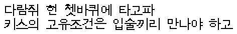
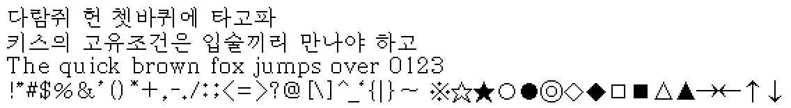
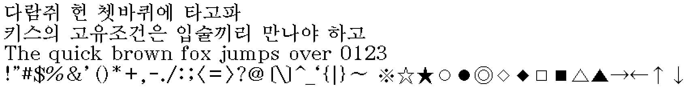
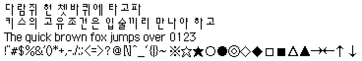
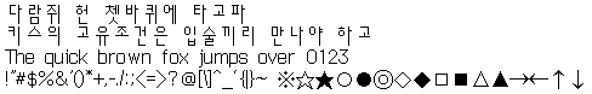
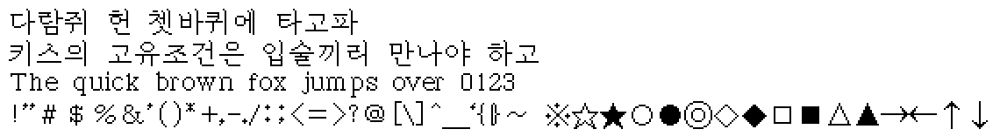
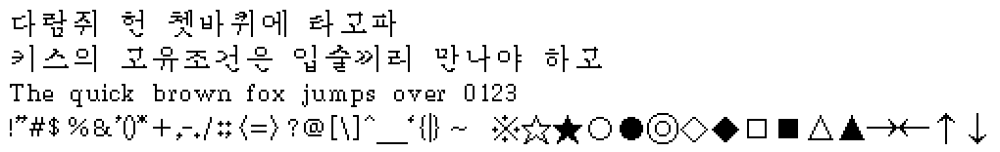
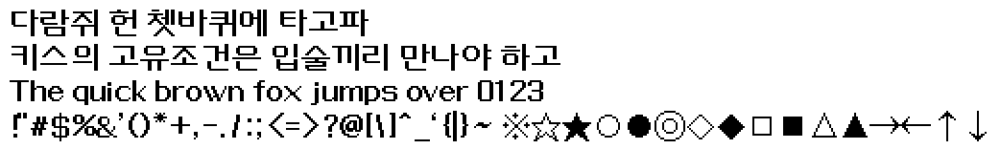

[English](classic-mac.md) | **한국어**

# 레시피: 클래식 Mac 한글 비트맵 폰트

HangulTalk 1.0 `fbit`, HangulTalk 7.1.x type-3 `fbit`, System 7.5.3–Mac OS 8.5 TrueType 비트맵 스트라이크를 SVF로 변환하는 레시피다.

**시작 전에.** 프로젝트 루트에서 `$OUT`을 정하고 실행한다([레시피 색인](../recipes.ko.md)). 원본 폰트는 독점 파일이므로 직접 준비한다. 모든 페이스는 [페이스 점검](../recipes.ko.md#페이스-점검)의 샘플 줄(`안녕하세요 ABC 123`)로 확인한다.

위로: [레시피 색인](../recipes.ko.md) · 관련 문서: [아웃라인 폰트](outline-fonts.ko.md), [벌 수 정하기](sets.ko.md), [자모 세트](../jamo-sets.ko.md).

<a id="클래식-mac-한글-비트맵-폰트"></a>

## HangulTalk 1.0 `fbit` 폰트

한글 System 4.1 / HangulTalk 1.0(1988, Apple Korea / Elex Computer)의 비트맵 폰트다. 리소스 포크에 글리프 벌 45개의 `fbit`와 18개 조회 표를 담은 `fdef` 드라이버가 들어 있어 11,172음절을 Mac과 똑같이 조합한다. 폰트에는 한글만 있고 공백과 라틴 문자는 없다.

**입력:** 리소스 포크 파일(`Gotic12.rsrc`, `Munjo12.rsrc`, `Munjo16.rsrc`, `Munjo24.rsrc`).

```sh
python3 tools/jamoset.py --layout mac-fbit-45sets Munjo24.rsrc --symbols --check -o $OUT/MUNJO24J.SVF
```

`--symbols`를 빼면 `jamoset.py`가 그리는 `…`와 `□` 없이 순수 폰트 글리프만 담긴다.

| 폰트 | 크기 | 글리프 / 조각 | 셀 | ascent / descent | 점검 줄 (`안녕하세요 ABC 123`) |
| --- | --- | --- | --- | --- | --- |
| `Munjo24` (`--symbols`) | 36,660 B | 조각 653개 (20/15/4벌, 8x4 클래스, 11,172음절) | 24x24 | 24 / 0 | `width=120`, 잉크 591, `IoU 1.000` |
| `Gotic12` (`--symbols`) | 23,368 B | 조각 653개 (20/15/4벌, 8x4 클래스, 11,172음절) | 12x12 | 12 / 0 | `width=60`, 잉크 175, `IoU 1.000` |



*한글 System 4.1 / HangulTalk 1.0(1988) `Gotic12`, `--symbols` 없이 생성(`23,304 B`, 12x12, ascent 12, descent 0). 한글만 있어 한국어 두 줄만 그려지고, 공백 글리프가 없어 공백은 반 셀 너비다. 2배.*


*같은 디스크(1988)의 `Munjo24`, `--symbols` 없이 생성(`36,564 B`, 24x24, ascent 24, descent 0). 한글만 있고 라틴·공백·기호가 없다. 2배.*

## HangulTalk 7.1.x type-3 `fbit` 폰트

한글 System 7.1.2 / HangulTalk 7.1.2(1994, Apple Korea / Elex Computer)의 type-3 `fbit` 폰트(`Seoul12`, `AppleGothic12/24`, `AppleMyungjo12/24`)다. `InputBackSupport` 확장의 `HTBL` 1 표로 KS X 1001 음절 2,350자와 호환 자모 51개를 조합한다. KS X 1001 기호는 별도 아카이브(`KSSymbol12`, `KSSymbol24Disk`)에 있어 이 도구들이 읽지 못한다.

**입력:** `InputBackSupport[INIT].rsrc`, 폰트 `[splt]` 데이터 포크(예: `Seoul12[splt].data`), 라틴 문자를 넣으려면 패밀리 suitcase(`Seoul[FFIL].rsrc` 등).

```sh
python3 maker/srcprep.py mac-htbl "InputBackSupport[INIT].rsrc" $OUT/HTBL1.bin
python3 tools/macfbit3.py unpack "Seoul12[splt].data" $OUT/Seoul12.rsrc
python3 tools/macfbit3.py fbit $OUT/Seoul12.rsrc $OUT/Seoul12.fbit
python3 tools/macfbit3.py bdf $OUT/Seoul12.fbit $OUT/HTBL1.bin Seoul12 $OUT/seoul12.bdf
python3 tools/macfbit_svf.py build $OUT/Seoul12.fbit $OUT/HTBL1.bin -o $OUT/SEOUL12J.SVF
python3 tools/macfbit_svf.py build $OUT/Seoul12.fbit $OUT/HTBL1.bin --mode derived -o $OUT/SEOUL12D.SVF
python3 tools/macfbit_svf.py verify $OUT/SEOUL12J.SVF $OUT/Seoul12.fbit $OUT/HTBL1.bin
```

- `direct`(기본값)는 Mac 구조를 JMAP으로 그대로 담아 KS 음절 2,350자만 정확히 조합한다.
- `derived`는 JSET을 맞춰 11,172음절을 모두 조합하지만, KS 밖 8,822자는 외삽 결과이며 Mac 출력이 아니다.
- 라틴 문자를 더하려면 `macfbit_svf.py build`에 `--latin "Seoul[FFIL].rsrc"`를 붙인다.
- 완성형 페이스가 필요하면 위 BDF에 `srcprep.py bdf-pixel-size`와 `mkfont.py`를 쓰거나, `bdfface.py --hangul`에 별도 `--ascii` 폰트와 `--cell 12x12 --chars-from $OUT/ks.txt`를 준다.

```sh
# 완성형 BDF 경로 (라틴 짝 파일 불필요)
python3 maker/srcprep.py bdf-pixel-size $OUT/seoul12.bdf $OUT/seoul12-sized.bdf --size 12
python3 tools/mkfont.py $OUT/seoul12-sized.bdf $OUT/seoul12.svf --size 12 --bpp 1 --unicode ascii,ksx1001-hangul

# MCU 예산에 맞게 derived 페이스 축소 (약 2분 소요)
python3 tools/jamomerge.py merge --face $OUT/SEOUL12D.SVF --points 8192 7168 --prefix SM -o $OUT/SMALL
```

| 폰트 / 모드 | 크기 | 글리프 / 조각 | 셀 | ascent / descent | 점검 줄 (`안녕하세요 ABC 123`) |
| --- | --- | --- | --- | --- | --- |
| `Seoul12` direct | 15,016 B | 조각 207개 (KS 2,350 + 자모 51) | 12x12 | 10 / 2 | `width=60`, 잉크 142, `ks_bad 0` |
| `Seoul12` derived | 9,716 B (v2: 7,928 B) | 조각 219개 (9/6/3벌, 8x4, 11,172음절) | 12x12 | 10 / 2 | `width=60`, 잉크 142, `ks_bad 0` |
| `Seoul12` direct + Latin | 17,924 B | 조각 207개 + ASCII | 12x12 | 10 / 2 | `width=111`, 잉크 253, `ks_bad 0` |
| `Seoul12` derived + Latin | 12,624 B | 조각 219개 + ASCII | 12x12 | 10 / 2 | `width=111`, 잉크 253, `ks_bad 0` |
| `Seoul12` BDF + `mkfont.py` | 103,012 B | 글리프 2,350개 | 12x12 | 10 / 2 | `width=60`, 잉크 142 |
| `Seoul12` `jamomerge` 8K / 7K | 7,964 B / 7,032 B | 조각 191개 (7K, 7/6/3벌) | 12x12 | 10 / 2 | 검증 통과 |
| `AppleGothic12` direct + Latin | 22,860 B | 조각 364개 + ASCII | 12x12 | 10 / 2 | `width=122`, 잉크 285, `ks_bad 0` |
| `AppleMyungjo24` direct + Latin | 37,244 B | 조각 465개 + ASCII | 24x24 | 20 / 4 | `width=242`, 잉크 944, `ks_bad 0` |


*한글 System 7.1.2 / HangulTalk 7.1.2 CD(1994) `Seoul12`, `Seoul[FFIL]` 12 pt `NFNT` 포함(`17,924 B`, 12x12, ascent 10, descent 2). KS X 1001 기호 없음. 2배.*


*같은 CD(1994)의 `AppleGothic12`, `AppleGothic[FFIL]` 12 pt `NFNT` 포함(`22,860 B`, 12x12, ascent 10, descent 2). KS X 1001 기호 없음. 2배.*


*같은 CD(1994)의 `AppleMyungjo24`, `AppleMyungjo[FFIL]` 24 pt `NFNT` 포함(`37,244 B`, 24x24, ascent 20, descent 4). KS X 1001 기호가 없고 24 pt `NFNT`의 백틱(`` ` ``)이 비어 있다. 2배.*

<a id="truetype-비트맵-스트라이크-system-753부터-mac-os-85까지"></a>

## TrueType 비트맵 스트라이크 (System 7.5.3–Mac OS 8.5)

한글 System 7.5.3(1996, 살펴본 가장 이른 판이며 7.5.1은 아직 `fbit` Seoul12를 쓴다)부터 Mac OS 8.5(1998)까지 한글 폰트는 `FFIL` suitcase에 든 TrueType이다. `bloc`/`bdat` 표에 9, 10, 12, 14, 16, 18, 20, 24 ppem의 1 bpp 비트맵 스트라이크가 들어 있으며, [Mac 형식 TrueType](outline-fonts.ko.md#mac-형식-truetype) 경로로 변환한다([내장 비트맵 스트라이크](bitmap-fonts.ko.md#내장-비트맵-스트라이크)).

**입력:** `FFIL` 리소스 포크(7.5.3 CD의 `Bitmap 서체 설치` 비트맵 전용 사본, 또는 Mac OS 8.5 `자형 폴더`의 `한강체[FFIL].rsrc`).

```sh
python3 tools/macsfnt.py extract "AppleGothic[FFIL].rsrc" $OUT/AppleGothic.ttf
python3 tools/macsfnt.py unicode $OUT/AppleGothic.ttf $OUT/AppleGothicU.ttf
python3 tools/mkfont.py $OUT/AppleGothicU.ttf $OUT/agothic16.svf --size 16 --bpp 1 --unicode ascii,ksx1001-hangul
```

- `--size`는 위 여덟 스트라이크 크기 중 하나여야 한다.
- Mac OS 8.5 `한강체`는 유니코드 cmap이 이미 있어 `macsfnt.py unicode` 단계가 필요 없다.
- 스트라이크에는 KS X 1001 기호와 대부분 한자도 들어 있으므로 더 넓은 `--unicode` 집합으로 꺼낼 수 있다.

7.5.3 비트맵 전용 `AppleGothic` 16 px에 위 명령을 실행하면 완성형 페이스 `123,360 B`, 글리프 2,446개가 나온다. 아래 표는 샘플 네 줄 문자(`--unicode file:`)만 담은 페이스 결과다.

| 폰트 (스트라이크) | 크기 | 셀 | ascent / descent | 빠진 문자 |
| --- | --- | --- | --- | --- |
| AppleGothic 12 (7.5.3) | 4,828 B | 12x12 | 9 / 3 | `_` (셀 아래로 벗어남) |
| AppleGothic 16 (7.5.3) | 5,596 B | 16x16 | 13 / 3 | 없음 |
| AppleMyungjo 16 (7.5.3) | 5,844 B | 16x16 | 13 / 3 | 없음 |
| AppleMyungjo 24 (7.5.3) | 8,824 B | 24x24 | 19 / 5 | 없음 |
| Seoul 12 (7.5.3) | 4,772 B | 12x12 | 10 / 2 | 없음 |
| Seoul 16 (7.5.3) | 5,536 B | 16x16 | 13 / 3 | 없음 |
| #신명조 16 (7.5.3) | 5,368 B | 16x16 | 12 / 4 | 없음 |
| #궁서체 16 (7.5.3) | 5,228 B | 16x16 | 12 / 4 | 없음 |
| 한강체 16 (Mac OS 8.5) | 5,748 B | 16x16 | 13 / 3 | 없음 |


*한글 System 7.5.3(1996) AppleGothic 12 ppem 비트맵 전용 스트라이크. `_`가 12x12 셀 아래에 있어 빠졌다. 2배.*


*한글 System 7.5.3(1996) AppleGothic 16 ppem 스트라이크. 2배.*



*한글 System 7.5.3(1996) AppleMyungjo 16 ppem 스트라이크. 2배.*



*한글 System 7.5.3(1996) AppleMyungjo 24 ppem 스트라이크. 2배.*



*한글 System 7.5.3(1996) Seoul 12 ppem 스트라이크. 2배.*



*한글 System 7.5.3(1996) Seoul 16 ppem 스트라이크. 2배.*



*한글 System 7.5.3(1996) #신명조 16 ppem 스트라이크. 2배.*



*한글 System 7.5.3(1996) #궁서체 16 ppem 스트라이크. 2배.*



*Mac OS 8.5 한글(1998) 한강체 16 ppem 스트라이크. 2배.*

<a id="샘플-만들기"></a>

## 샘플 만들기

위 그림 14개(총 33,924 B)는 한국어 팬그램 두 줄, 영어 한 줄, ASCII·KS X 1001 기호(`※☆★○●◎◇◆□■△▲→←↑↓`)를 2배로 그린 것이다. 페이스에 없는 문자는 뺀다. 저장소에 폰트 사본을 두지 않고 `tools/doc_figures_mac.py`로 원본 폴더에서 직접 생성한다.

```sh
python3 -I tools/doc_figures_mac.py --ht10 "$SRC/HT10/System Folder" --ht712 "$SRC/HT712/More Additions" \
    --htbl "$SRC/HT712/InputBackSupport[INIT].rsrc" --kh753 "$SRC/KH753/Bitmap 서체 설치" \
    --kh85 "$SRC/KH85/한글 시스템/자형 폴더" [--check]
```

`--check`는 기존 PNG와 바이트 단위로 비교하며, 건너뛴 페이스가 있으면 실패한다([도구 설명서](../tools.ko.md#toolsdoc_figures_macpy)).

## 참고

- **maker 로컬 모드:** 데스크톱 앱은 이 폰트들을 제자리에서 읽고 고른 폴더에만 페이스를 쓴다. 자세한 경로와 인식 표시는 [maker 데스크톱 안내서](../maker-desktop.ko.md), [데스크톱 경로 표](desktop-routes.ko.md#데스크톱-앱과-maker-경로), [Apple 폰트 표와 리소스 포크](../recipes.ko.md#ref-apple)에 있다.
- **HangulTalk 7.5.1 차이:** 7.5.1 설치 디스크의 `Seoul12[fbit]`은 7.1.2와 바이트 단위로 같다(8,760 B). 반면 7.5.1의 `InputBackSupport`는 압축되어 있어 `srcprep.py mac-htbl`이 읽지 못한다.
- **비트맵 전용 TrueType:** 7.5.3의 `Bitmap 서체 설치` 사본은 윤곽선과 `head` 표가 없다. `mkfont.py`가 fontTools로 스트라이크 메트릭에서 전진 폭을 읽으며, 스트라이크 밖 크기는 열리지 않는다.
- **NFNT 위치 보정:** `macfbit_svf.py`는 셀을 벗어나는 라틴 글리프를 셀 안으로 옮긴다(`AppleGothic12` `W` -1 px, `AppleMyungjo24` `j` +1 px).
- **실제 파일 테스트:** 합성 테스트는 기본으로 돈다. 보유한 원본 파일로 검증하려면 `JOHAB_FONTS`(1.0), `MACFBIT3_CD712` / `SVF_MAC71_INPUTS`(7.1.2) 환경 변수를 지정한다. 1.0 독립 비교용 골든 파일(`tools/testdata/mac-fbit-golden.json`)은 배포하지 않는다.
- **샘플 재현 환경:** `fbit` 그림은 폰트 파일에만 달려 있고, 스트라이크 그림은 Pillow와 FreeType 버전에 영향을 받는다(Pillow 10.2.0, FreeType 2.13.2로 생성).

[레시피 색인](../recipes.ko.md) · [도구 설명서](../tools.ko.md)
