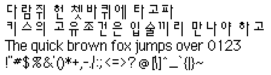
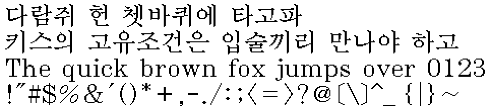
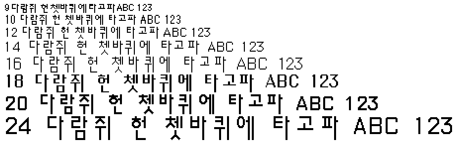
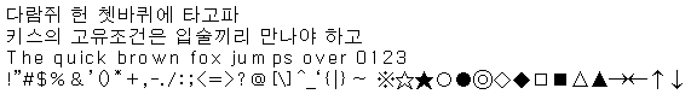

[English](classic-mac.md) | **한국어**

# 레시피: 클래식 Mac 한글 비트맵 폰트

HangulTalk 1.0 `fbit`, HangulTalk 7.1.x type-3 `fbit`, System 7.5.3–Mac OS 8.5 TrueType 비트맵 스트라이크를 SVF로 변환하는 레시피다.

**시작 전에.** 프로젝트 루트에서 `$OUT`을 정하고 실행한다([레시피 색인](../recipes.ko.md)). 원본 폰트는 독점 파일이므로 직접 준비한다. 모든 페이스는 [페이스 점검](../recipes.ko.md#페이스-점검)의 점검(`measure`, `line`, `fontmetrics.py`, `svf2to3.py --check`, `facecheck.py`)으로 끝난다. 아래 점검 줄은 그 샘플 줄 `안녕하세요 ABC 123`을 쓴다.

위로: [레시피 색인](../recipes.ko.md) · 관련 문서: [아웃라인 폰트](outline-fonts.ko.md), [벌 수 정하기](sets.ko.md), [자모 세트](../jamo-sets.ko.md).

<a id="폰트-목록"></a>

## 폰트 목록

각 디스크와 CD의 폰트 suitcase, 폰트 파일, System 파일에서 찾은 한글 폰트 전부와, 그와 짝을 이루는 라틴 비트맵 폰트를 파일에서 직접 쟀다. 크기는 픽셀이다(Mac의 1 pt는 72 dpi에서 1픽셀).

**기호.** **J** 조합형 `fbit`(조각을 음절로 조합). **P** 완성형 `bloc`/`bdat` 스트라이크(글리프마다 비트맵 하나). **O** 스트라이크 없는 TrueType 윤곽선. **L** 라틴 전용 비트맵(`NFNT` 또는 `FONT`): 그 크기에 한글은 없다. **X** 도구가 변환하지 않는 아카이브. **=** 앞 판과 폰트 리소스가 같다. **—** 디스크나 CD에 없다.

<a id="개요"></a>

### 개요

| 패밀리 | HangulTalk 1.0 (1988) | 7.1.2 (1994) | 7.5.3 (1996) | 7.6.1 (1997) | 8.5 (1998) | 8.6 (1999) |
| --- | --- | --- | --- | --- | --- | --- |
| Gotic | J 12; L 12 | — | — | — | — | — |
| Munjo | J 12, 16, 24; L 12, 18, 24 | — | — | — | — | — |
| Seoul | — | J 12; L 9, 12 | P 9, 10, 12, 14, 16, 18, 20, 24; L 9, 10, 12, 14, 16, 18, 20, 24; J 12 (설치 디스크, = 7.1.2) | = (J 12 없음) | P 9, 10, 12, 14, 16, 18, 20, 24 (새로 그림); L 9, 10, 12, 14, 16, 18, 20, 24 (새것) | = |
| AppleGothic | — | J 12, 24; O; L 12, 24 | P 9, 10, 12, 14, 16, 18, 20, 24; L 9, 10, 12, 14, 16, 18, 20, 24 | = | P = (cmap 바뀜); L = | — |
| AppleMyungjo | — | J 12, 24; O; L 9, 12, 24 | P 9, 10, 12, 14, 16, 18, 20, 24; L 9, 10, 12, 14, 16, 18, 20, 24 | = | P = (cmap 바뀜); L = | — |
| #PC명조, #신명조, #궁서체, #중고딕, #필기체, #공작체, #태그래픽 | — | — | P 9, 10, 12, 14, 16, 18, 20, 24; L 9, 10, 12, 14, 16, 18, 20, 24 | = | — | — |
| #헤드라인A | — | — | P 18, 20, 24; L 18, 20, 24 | = | — | — |
| 한강체 | — | — | — | — | P 9, 10, 12, 14, 16, 18, 20, 24; L 9, 10, 12, 14, 16, 18, 20, 24 | — |
| KSSymbol | — | 12 (`fbit` type 0, 읽지 않음); X 24 | — | — | — | — |
| Hanja24, GHanja24, GSymbol24 | — | X 24 | — | — | — | — |

<a id="픽셀-크기"></a>

### 픽셀 크기

"패밀리 F에 N px가 있는가?"는 칸 하나로 답한다. 한글 크기는 J 또는 P이고, L만 있으면 라틴 전용 비트맵이다. 7.5.3–8.5의 suitcase는 P 크기마다 L도 담는다(아래에는 되풀이하지 않는다).

| px | Gotic | Munjo | Seoul | AppleGothic | AppleMyungjo | #PC명조, #신명조, #궁서체, #중고딕, #필기체, #공작체, #태그래픽 | #헤드라인A | 한강체 | KSSymbol, 한자 |
| --- | --- | --- | --- | --- | --- | --- | --- | --- | --- |
| 9 | — | — | 7.5.3 P, 7.6.1 =, 8.5 P (새로 그림), 8.6 =; 7.1.2 L만 | 7.5.3 P, 7.6.1 =, 8.5 = | 7.5.3 P, 7.6.1 =, 8.5 =; 7.1.2 L만 | 7.5.3 P, 7.6.1 = | — | 8.5 P | — |
| 10 | — | — | 7.5.3 P, 7.6.1 =, 8.5 P (새로 그림), 8.6 = | 7.5.3 P, 7.6.1 =, 8.5 = | 7.5.3 P, 7.6.1 =, 8.5 = | 7.5.3 P, 7.6.1 = | — | 8.5 P | — |
| 12 | 1.0 J와 L | 1.0 J와 L | 7.1.2 J (7.5.3 설치 디스크 =); 7.5.3 P, 7.6.1 =, 8.5 P (새로 그림), 8.6 =; 7.1.2 L | 7.1.2 J와 L; 7.5.3 P, 7.6.1 =, 8.5 = | 7.1.2 J와 L; 7.5.3 P, 7.6.1 =, 8.5 = | 7.5.3 P, 7.6.1 = | — | 8.5 P | KSSymbol12 7.1.2 (읽지 않음) |
| 14 | — | — | 7.5.3 P, 7.6.1 =, 8.5 P (새로 그림), 8.6 = | 7.5.3 P, 7.6.1 =, 8.5 = | 7.5.3 P, 7.6.1 =, 8.5 = | 7.5.3 P, 7.6.1 = | — | 8.5 P | — |
| 16 | — | 1.0 J | 7.5.3 P, 7.6.1 =, 8.5 P (새로 그림), 8.6 = | 7.5.3 P, 7.6.1 =, 8.5 = | 7.5.3 P, 7.6.1 =, 8.5 = | 7.5.3 P, 7.6.1 = | — | 8.5 P | — |
| 18 | — | 1.0 L만 | 7.5.3 P, 7.6.1 =, 8.5 P (새로 그림), 8.6 = | 7.5.3 P, 7.6.1 =, 8.5 = | 7.5.3 P, 7.6.1 =, 8.5 = | 7.5.3 P, 7.6.1 = | 7.5.3 P, 7.6.1 = | 8.5 P | — |
| 20 | — | — | 7.5.3 P, 7.6.1 =, 8.5 P (새로 그림), 8.6 = | 7.5.3 P, 7.6.1 =, 8.5 = | 7.5.3 P, 7.6.1 =, 8.5 = | 7.5.3 P, 7.6.1 = | 7.5.3 P, 7.6.1 = | 8.5 P | — |
| 24 | — | 1.0 J와 L | 7.5.3 P, 7.6.1 =, 8.5 P (새로 그림), 8.6 = | 7.1.2 J와 L; 7.5.3 P, 7.6.1 =, 8.5 = | 7.1.2 J와 L; 7.5.3 P, 7.6.1 =, 8.5 = | 7.5.3 P, 7.6.1 = | 7.5.3 P, 7.6.1 = | 8.5 P | 7.1.2 X (KSSymbol24Disk, Hanja24Disk, GHanja24Disk, GSymbol24Disk) |

**측정 방법.** `fbit` 폰트는 아래 변환 명령(`jamoset.py --check`, `macfbit3.py info`, `macfbit_svf.py build`와 `verify`)으로 쟀다. TrueType 폰트는 fontTools로 `maxp`, `bloc` 스트라이크(ppem, 스트라이크마다의 글리프 수), `bdat` 이미지 형식을 읽었다. 형식은 2, 5, 6(글리프 전체 비트맵)뿐이고 조각 형식 8, 9는 없으므로 모든 스트라이크가 완성형이다. 음절, 자모, 한자 수는 cmap에서 셌다: Mac Korean (1,3) 하위 표를 `macsfnt.py unicode`처럼 KS X 1001로 풀거나, 폰트 자체의 유니코드 하위 표를 썼다. `FOND`, `NFNT`, `FONT`는 리소스 포크에서 읽었다. "="는 폰트 리소스(`FOND`, `NFNT`, `FONT`, `sfnt`, `fbit`, `fdef`)를 바이트 단위로 비교한 것이다.

### HangulTalk 1.0 (한글 System 4.1, 1988)

위치: 시스템 디스크의 `System Folder`.

| 파일 | 리소스 | 담은 것 | 바이트 |
| --- | --- | --- | --- |
| `Gotic12` | `fbit` 17408 (12,380 B), `fdef` 3 (2,398 B) | J 12 | 15,587 |
| `Munjo12` | `fbit` 17409 (12,380 B), `fdef` 3 (2,398 B) | J 12 | 15,587 |
| `Munjo16` | `fbit` 17409 (21,554 B), `fdef` 3 (2,398 B) | J 16 | 24,761 |
| `Munjo24` | `fbit` 17409 (47,714 B), `fdef` 3 (2,398 B) | J 24 | 50,921 |
| `System` | `FOND` 17408 Gotic: 12 pt `FONT` 23052(글리프 236개, 코드 0–255); `FOND` 17409 Munjo: 12, 18, 24 pt `FONT` 14220, 14226, 14232(각 231개) | L 12 (Gotic); L 12, 18, 24 (Munjo) | 319,117 |
| 확장 파일 두 개 | 76–232 B `fbit` 레코드; `fdef` 0, 1, 2(첫 파일) | 글리프 없음 | 33,392; 13,694 |

| 폰트 | 글리프 | 한글 | 한자 |
| --- | --- | --- | --- |
| `Gotic12`, `Munjo12`, `Munjo16`, `Munjo24` | 각 조각 653개, 벌 20/15/4 (`fdef` 규칙) | 음절 11,172 + 자모 51 | 0 |

- `fbit` 폰트에는 한자도 라틴도 없다. Utilities 디스크의 `Fonts` suitcase에는 라틴 폰트만 있다.

### HangulTalk 7.1.2 CD (1994)

| 파일 | 폴더 | 리소스 | 담은 것 | 바이트 |
| --- | --- | --- | --- | --- |
| `Seoul12` | `Hangul System Install/Disk Tools/한글 시스템/자형 폴더` | `fbit` 17408 (8,760 B) | J 12 | 9,669 |
| `Seoul12`, `AppleGothic12`, `AppleGothic24`, `AppleMyungjo12`, `AppleMyungjo24` `[splt]` | More Additions 폰트 파일 | `fbit`의 `JM` 아카이브(12 px 8,760 B, 24 px 34,788 B). `Seoul12`는 설치된 것과 같다 | J 12, 12, 24, 12, 24 | 1,843; 2,707; 5,095; 3,194; 6,464 (데이터 포크) |
| `Seoul` suitcase | More Additions | `FOND` 17408; `NFNT` 1025(9 pt, 글리프 231개), 1026(12 pt, 232개) | L 9, 12 | 5,824 |
| `AppleGothic` suitcase | More Additions | `FOND` 17410; `NFNT` 1025(12 pt), 1026(24 pt), 각 231개 | L 12, 24 | 13,014 |
| `AppleMyungjo` suitcase | More Additions | `FOND` 17409; `NFNT` 1025(9 pt), 1026(12 pt), 1027(24 pt), 각 231개 | L 9, 12, 24 | 16,617 |
| `System` | `Disk Tools/한글 시스템`, `InstallMeFirst` | `FOND` 17408 Seoul: `NFNT` 7545(9 pt, 231개, = suitcase 1025), 5828(12 pt, 232개) | L 9, 12 | 722,913; 881,097 |
| `InputBackSupport` | `More Additions/Extensions`, `Disk Tools/한글 시스템/확장 파일` | `HTBL` 1(9,816 B, 둘 다 같다), 40–232 B `fbit` 레코드 | 조합 표 | 107,626; 80,180 |
| AppleGothic, AppleMyungjo TrueType | 설치 프로그램 `part` 리소스(이어 붙임) | `sfnt`, `bloc`/`bdat` 없음 | O | 3,233,432; 4,767,960 |
| `KSSymbol12` `[splt]` | More Additions | `fbit` 핸들러 type 0, 12 px, 코드 A141–ADFE | 읽지 않음 | 22,640 |
| `KSSymbol24Disk`, `Hanja24Disk`, `GHanja24Disk`, `GSymbol24Disk` `[splt]` | More Additions | `JM` 아카이브 | X 24 | 51,504; 231,388; 211,152; 51,510 |

| 폰트 | 글리프 | 한글 | 한자 |
| --- | --- | --- | --- |
| `Seoul12` | 평면 482개, 조각 207개 | 음절 2,350 + 자모 51 | 0 |
| `AppleGothic12` | 평면 482개, 조각 364개 | 2,350 + 51 | 0 |
| `AppleGothic24` | 평면 482개, 조각 455개 | 2,350 + 51 | 0 |
| `AppleMyungjo12` | 평면 482개, 조각 395개 | 2,350 + 51 | 0 |
| `AppleMyungjo24` | 평면 482개, 조각 465개 | 2,350 + 51 | 0 |
| AppleGothic (O) | 9,924 | 음절 2,350 | 4,888 |
| AppleMyungjo (O) | 9,926 | 음절 2,350 | 4,888 |

- 조각은 `direct` 페이스의 서로 다른 비트맵 수다. `verify`는 2,350 + 51자를 모두 정확히 조합한다. 이 CD의 J 폰트는 모두 type 3이고 `HTBL` 1이 필요하다.
- 아카이브: `KSSymbol24Disk`는 풀면 176,091바이트이지만 리소스 포크가 아니다. `Hanja24Disk`, `GHanja24Disk`, `GSymbol24Disk`는 `JM` 디코더에서 실패한다. 두 한자 아카이브의 헤더는 풀린 크기를 353,300바이트로 적는다(이름으로 보아 24 px 한자). CD에 12 px 한자 아카이브는 없다.
- TrueType 한자는 정확히 KS X 1001 한자 4,888자(CA–FD 행)다.

### 한글 System 7.5.3 CD (1996)

| 파일 | 폴더 | 리소스 | 담은 것 |
| --- | --- | --- | --- |
| `NAME[FFIL]`(패밀리 11개) | `Bitmap 서체 설치/NAME` | `FOND`; 스트라이크 크기마다 `NFNT`(글리프 232개. AppleGothic 24 pt와 #궁서체 20 pt는 233개); `bloc`/`bdat`가 있고 `glyf`는 없는 `sfnt` | P와 L |
| `NAME [fbit]`(11개) | `Bitmap 서체 설치/NAME` | 401–1,463 B `fbit` 레코드 8개(#헤드라인A는 3개), `fdef` 42(6,418 B) | 스트라이크 설명, 글리프 없음 |
| `NAME[FFIL]`, `NAME [fbit]`(11개) | `한글 시스템 설치/Font Folder` | 위와 같고, `sfnt`에 `glyf`와 같은 `bdat` | P, O, L |
| AppleGothic, AppleMyungjo, Seoul `[FFIL]`과 `[fbit]` | `한글 시스템/자형 폴더` | = Font Folder 사본 | P, O, L |
| `Seoul12` | `한글 시스템 설치/Install Disk 1/자형 폴더` | `fbit` 17408, = 7.1.2 | J 12 |
| `InputBackSupport` | `한글 시스템/확장 파일`, `Install Disk 1/확장 파일` | 40–232 B `fbit` 레코드 | 글리프 없음 |
| `빛한글` | `한글 시스템/확장 파일` | `fdef` 42(6,418 B) | 글리프 없음 |

`System` 파일에는 한글 `FOND`나 `sfnt`가 없다.

| 폰트 | 스트라이크 (ppem) | 글리프 | 한글 음절 | 한자 | KS X 1001 코드 | 비트맵 전용 sfnt | Font Folder sfnt |
| --- | --- | --- | --- | --- | --- | --- | --- |
| AppleGothic | 9, 10, 12, 14, 16, 18, 20, 24 | 10,553 | 2,350 | 4,888 | 8,329 | 4,081,028 B | 8,475,352 B |
| AppleMyungjo | 9, 10, 12, 14, 16, 18, 20, 24 | 10,553 | 2,350 | 4,888 | 8,329 | 4,081,884 B | 10,353,128 B |
| Seoul | 9, 10, 12, 14, 16, 18, 20, 24 | 9,889 | 2,350 | 4,888 | 8,329 | 2,626,404 B | 6,159,836 B |
| #PC명조 | 9, 10, 12, 14, 16, 18, 20, 24 | 9,889 | 2,350 | 4,888 | 8,329 | 2,624,600 B | 7,789,420 B |
| #신명조 | 9, 10, 12, 14, 16, 18, 20, 24 | 9,889 | 2,350 | 4,888 | 8,329 | 2,627,040 B | 7,799,156 B |
| #궁서체 | 9, 10, 12, 14, 16, 18, 20, 24 | 9,889 | 2,350 | 4,888 | 8,329 | 2,624,992 B | 8,925,292 B |
| #중고딕 | 9, 10, 12, 14, 16, 18, 20, 24 | 9,889 | 2,350 | 4,888 | 8,329 | 2,625,516 B | 6,316,044 B |
| #필기체 | 9, 10, 12, 14, 16, 18, 20, 24 | 5,001 | 2,350 | 0 | 3,441 | 1,316,028 B | 3,005,080 B |
| #공작체 | 9, 10, 12, 14, 16, 18, 20, 24 | 5,001 | 2,350 | 0 | 3,441 | 1,315,032 B | 2,553,292 B |
| #태그래픽 | 9, 10, 12, 14, 16, 18, 20, 24 | 5,001 | 2,350 | 0 | 3,441 | 1,315,024 B | 2,572,344 B |
| #헤드라인A | 18, 20, 24 | 2,768 | 2,350 | 0 | 2,547 | 448,400 B | 1,091,116 B |

- 모든 스트라이크가 모든 글리프를 담는다. Font Folder의 `bdat`, `bloc`은 비트맵 전용 사본과 바이트까지 같다.
- KS X 1001 코드는 Mac Korean (1,3) 항목 중 KS X 1001로 풀리는 것이다(Seoul: 9,799개 중 8,329개). 모든 폰트에 호환 자모 93개가 있다. KS X 1001 밖의 코드(Apple 추가분): 한자가 있는 폰트 1,470개, #필기체, #공작체, #태그래픽 1,522개, #헤드라인A 195개.
- 한자는 정확히 KS X 1001 한자 4,888자(CA–FD 행)이고, 다른 코드는 한자로 풀리지 않는다. #필기체, #공작체, #태그래픽, #헤드라인A에는 한자가 없다.

Seoul의 글리프가 9,889개인 까닭:

| 글리프 | 수 |
| --- | --- |
| 한글 음절 | 2,350 |
| 한자 | 4,888 |
| KS X 1001 기호 | 894 |
| 호환 자모 | 93 |
| ASCII (코드 104개) | 103 |
| Apple 확장 기호 (앞 바이트 A1–AD, 뒤 바이트 41–A0) | 1,197 |
| 유니코드 대응이 없는 KS 영역 코드 | 235 |
| 1바이트 Mac 문자 | 38 |
| 빈 글리프, 어느 코드도 가리키지 않음 | 91 |
| **합계** | **9,889** |

AppleGothic, AppleMyungjo(10,553)는 코드가 있는 글리프가 같고, 어느 코드도 가리키지 않는 글리프가 755개다: 비례폭 글리프 664개와 나머지 91개. 나머지는 AppleGothic의 글리프 198 하나를 빼면 비어 있다.

비례폭 글리프(`mort` 표는 AppleGothic, AppleMyungjo에만 있고, 나머지 페이스 아홉 개에는 `feat`만 있다):

| 항목 | AppleGothic | AppleMyungjo |
| --- | --- | --- |
| `feat` | Vertical Substitution; Text Spacing Type → Proportional Text | 같음 |
| `mort` 플래그 0x1 (비례폭) | 비문맥 하위 표 2개, 각 664개 치환 | 같음 |
| `mort` 플래그 0x2 (세로쓰기) | 하위 표 1개, 83개 치환 | 같음 |
| 전각보다 좁은 비례폭 글리프 | 572 | 525 |
| 예 | A1A4: 전진 폭 1,024 → 244 (단위 1,024) | 같음 |

| KS 앞 바이트 행 | A1 | A2 | A3 (전각 ASCII) | A5 (로마 숫자, 그리스 문자) | A7 (단위) | A8 | A9 | AA (히라가나) | AB (가타카나) | AC (키릴 문자) | AD |
| --- | --- | --- | --- | --- | --- | --- | --- | --- | --- | --- | --- |
| 비례폭 글리프 | 85 | 75 | 89 | 70 | 79 | 9 | 9 | 80 | 86 | 66 | 16 |

- A4(자모), A6(괘선) 행과 음절, 한자에는 없다. 어느 코드도 가리키지 않으므로 cmap으로 글리프를 가져오는 도구들은 이들을 빼며, 이를 위한 도구 옵션을 계획하고 있다.
- 세로쓰기: 42개는 A1, A2, A3, A5 행의 코드를 Apple 확장 코드로 닿는 세로 글리프로 바꾸고(A1A2 → A250), 41개는 비례폭 글리프를 비례폭 세로 글리프로 바꾼다.

### Mac OS 7.6.1 (1997), 8.5 (1998), 8.6 (1999)

| 판 | 파일 | 폴더 | 리소스 | 앞 판과 비교 |
| --- | --- | --- | --- | --- |
| 7.6.1 | `NAME[FFIL]`, `NAME [fbit]` 11개 | `CD Extras/Bitmap 서체 설치/NAME` | 7.5.3과 같음 | = (`fwst`, `movp`, `vers`만 다름) |
| 7.6.1 | `NAME[FFIL]`, `NAME [fbit]` 11개 | `소프트웨어 설치/Mac OS 7.6/Font Folder` | 7.5.3과 같음 | = |
| 7.6.1 | AppleGothic, AppleMyungjo, Seoul, #신명조, #궁서체, #필기체 | `한글 시스템/자형 폴더` | Font Folder와 같음 | = |
| 8.5 | `AppleGothic[FFIL]` (8,555,706 B) | `한글 시스템/자형 폴더` | `sfnt` 8,522,116 B; `NFNT` = 7.5.3 (10 pt 번호 1030 → 32763) | `bdat`, `bloc` =; `cmap`(유니코드 하위 표 추가), `head`, `hhea` 바뀜 |
| 8.5 | `AppleMyungjo[FFIL]` (10,435,418 B) | `한글 시스템/자형 폴더` | `sfnt` 10,399,888 B; `NFNT` = | `bdat`, `bloc` =; `cmap`, `head`, `hhea` 바뀜 |
| 8.5 | `Seoul[FFIL]` (6,254,122 B) | `한글 시스템/자형 폴더` | `sfnt` 6,216,700 B; `NFNT` 32698–32705(글리프 255개) | 새로 그림: 글리프 9,912개, 새 `bdat`. 표 13개가 다름 |
| 8.5 | `한강체[FFIL]` (7,303,606 B) | `한글 시스템/자형 폴더` | `sfnt` 7,263,828 B; `NFNT` 32747–32754(글리프 255개) | 새것 |
| 8.5 | `AppleGothic [fbit]`, `AppleMyungjo [fbit]`, `Seoul [fbit]`, `한강체 [fbit]` (18,821; 18,833; 16,358; 18,017 B) | `한글 시스템/자형 폴더` | 1,367–1,966 B `fbit` 레코드 8개; Seoul을 뺀 나머지에 `fdef` 42 `Main`(6,418 B) | 스트라이크 설명, 글리프 없음 |
| 8.5 | `.Last Resort` | `한글 시스템/System`, `한글 소프트웨어 설치/시스템 소프트웨어/Mac OS 8.5/System Extras` | `sfnt` −4 (262,500 B), 글리프 247개 | 한글 페이스 아님: 11,172음절 모두를 대체 글리프에 대응시킨다 |
| 8.6 | `Seoul[FFIL]`, `Seoul [fbit]` | `한글 시스템/자형 폴더` | 8.5와 같음 | = |
| 8.6 | `.Last Resort` | `한글 시스템/System`, `한글 소프트웨어 설치/시스템 소프트웨어/Mac OS 8.6/System Morsels` | `sfnt` −4 (262,500 B) | 크기는 같고 바이트는 다름. 한글 페이스 아님 |

- 8.5의 `NFNT` 번호 32698–32705(Seoul)와 32747–32754(한강체)는 9, 10, 12, 14, 16, 18, 20, 24 pt 스트라이크다.
- 한강체: 완성형, 스트라이크 9, 10, 12, 14, 16, 18, 20, 24. 글리프 9,914개, 음절 2,350, 자모 94, 한자 4,888(KS X 1001 집합), 유니코드 코드 8,474개. Mac cmap에는 한자 행 안이지만 KS X 1001 밖인 코드 DBA0, E162 두 개도 있다. 글리프 `uniDBA0`/`uniE162`이고 유니코드 cmap이 가리키지 않으므로 한자가 더 있는 것이 아니다.
- 8.5, 8.6: 폰트 suitcase와 System 파일 중 한글 페이스는 위의 것뿐이다. 8.6에는 AppleGothic, AppleMyungjo, 한강체가 없다.

<a id="클래식-mac-한글-비트맵-폰트"></a>

## HangulTalk 1.0 `fbit` 폰트

한글 System 4.1 / HangulTalk 1.0(1988, Apple Korea / Elex Computer)의 비트맵 폰트다. 리소스 포크에 글리프 벌 45개의 `fbit`와 18개 조회 표를 담은 `fdef` 드라이버가 들어 있어 11,172음절을 Mac과 똑같이 조합한다. 폰트에는 한글만 있고 공백과 라틴 문자는 없다.

**입력:** 리소스 포크 파일(`Gotic12.rsrc`, `Munjo12.rsrc`, `Munjo16.rsrc`, `Munjo24.rsrc`).

```sh
python3 tools/jamoset.py --layout mac-fbit-45sets Munjo24.rsrc --symbols --check -o $OUT/MUNJO24J.SVF
```

`--symbols`를 빼면 `jamoset.py`가 그리는 `…`와 `□` 없이 순수 폰트 글리프만 담긴다.

- `Munjo24.rsrc`: `macsfnt.py list`는 `fbit` 17409(47,714 B)와 `fdef` 3(2,398 B)을 보여 준다. `--symbols`를 주면 `--check`가 `composed 11172 syllables from 655 glyphs`를 출력하고, 약 1.0초 걸린다.
- maker 로컬 모드(`detect.scan(..., local=True)`): "HangulTalk 1.0 fbit (45 sets), 24 x 24"(Munjo24. Gotic12, Munjo12는 12 x 12, Munjo16은 16 x 16), 소스 종류 `mac-fbit1`, 커버리지 KS 2,350 / 음절 11,172 + 자모 51, 경로 `mac fbit 1.0`. 업로드 모드: "Mac bitmap font (NFNT/fbit): not converted here (local-only mode)".

| 폰트 | 크기 | 글리프 / 조각 | 셀 | ascent / descent | 점검 줄 (`안녕하세요 ABC 123`) |
| --- | --- | --- | --- | --- | --- |
| `Munjo24` (`--symbols`) | 36,660 B | 조각 653개 (20/15/4벌, 8x4 클래스, 11,172음절) | 24x24 | 24 / 0 | `width=120`, 잉크 591, `IoU 1.000` |
| `Gotic12` (`--symbols`) | 23,368 B | 조각 653개 (20/15/4벌, 8x4 클래스, 11,172음절) | 12x12 | 12 / 0 | `width=60`, 잉크 175, `IoU 1.000` |


*한글 System 4.1 / HangulTalk 1.0(1988) `Gotic12`, `--symbols` 없이 생성(`23,304 B`, 12x12, ascent 12, descent 0). 한글만 있어 한국어 두 줄만 그려지고, 공백 글리프가 없어 공백은 반 셀 너비다. 2배.*


*같은 디스크(1988)의 `Munjo24`, `--symbols` 없이 생성(`36,564 B`, 24x24, ascent 24, descent 0). 한글만 있고 라틴·공백·기호가 없다. 2배.*

<a id="클래식-mac-hangultalk-71"></a>

## HangulTalk 7.1.x type-3 `fbit` 폰트

한글 System 7.1.2 / HangulTalk 7.1.2(1994, Apple Korea / Elex Computer)의 type-3 `fbit` 폰트(`Seoul12`, `AppleGothic12/24`, `AppleMyungjo12/24`)다. `InputBackSupport` 확장의 `HTBL` 1 표로 KS X 1001 음절 2,350자와 호환 자모 51개를 조합한다. KS X 1001 기호는 별도 아카이브(`KSSymbol12`, `KSSymbol24Disk`)에 있어 이 도구들이 읽지 못한다.

**입력:** `InputBackSupport[INIT].rsrc`, 폰트 `[splt]` 데이터 포크(예: `Seoul12[splt].data`), 라틴 문자를 넣으려면 패밀리 suitcase(`Seoul[FFIL].rsrc` 등).

```sh
python3 maker/srcprep.py mac-htbl "InputBackSupport[INIT].rsrc" $OUT/HTBL1.bin
python3 tools/macfbit3.py unpack "Seoul12[splt].data" $OUT/Seoul12.rsrc
python3 tools/macfbit3.py fbit $OUT/Seoul12.rsrc $OUT/Seoul12.fbit
python3 tools/macfbit3.py bdf $OUT/Seoul12.fbit $OUT/HTBL1.bin Seoul12 $OUT/seoul12.bdf
python3 tools/macfbit_svf.py build $OUT/Seoul12.fbit $OUT/HTBL1.bin -o $OUT/SEOUL12J.SVF
python3 tools/macfbit_svf.py build $OUT/Seoul12.fbit $OUT/HTBL1.bin --mode derived -o $OUT/SEOUL12D.SVF
python3 tools/macfbit_svf.py verify $OUT/SEOUL12J.SVF $OUT/Seoul12.fbit $OUT/HTBL1.bin
```

- `direct`(기본값)는 Mac 구조를 JMAP으로 그대로 담아 KS 음절 2,350자만 정확히 조합한다.
- `derived`는 JSET을 맞춰 11,172음절을 모두 조합하지만, KS 밖 8,822자는 외삽 결과이며 Mac 출력이 아니다.
- 라틴 문자를 더하려면 `macfbit_svf.py build`에 `--latin "Seoul[FFIL].rsrc"`를 붙인다.
- 완성형 페이스가 필요하면 위 BDF에 `srcprep.py bdf-pixel-size`와 `mkfont.py`를 쓰거나, `bdfface.py --hangul`에 별도 `--ascii` 폰트와 `--cell 12x12 --chars-from $OUT/ks.txt`를 준다.

```sh
# 완성형 BDF 경로 (라틴 짝 파일 불필요)
python3 maker/srcprep.py bdf-pixel-size $OUT/seoul12.bdf $OUT/seoul12-sized.bdf --size 12
python3 tools/mkfont.py $OUT/seoul12-sized.bdf $OUT/seoul12.svf --size 12 --bpp 1 --unicode ascii,ksx1001-hangul

# MCU 예산에 맞게 derived 페이스 축소 (약 2분 소요)
python3 tools/jamomerge.py merge --face $OUT/SEOUL12D.SVF --points 8192 7168 --prefix SM -o $OUT/SMALL
```

| 폰트 / 모드 | 크기 | 글리프 / 조각 | 셀 | ascent / descent | 점검 줄 (`안녕하세요 ABC 123`) |
| --- | --- | --- | --- | --- | --- |
| `Seoul12` direct | 15,016 B | 조각 207개 (KS 2,350 + 자모 51) | 12x12 | 10 / 2 | `width=60`, 잉크 142, `ks_bad 0` |
| `Seoul12` derived | 9,716 B (v2: 7,928 B) | 조각 219개 (9/6/3벌, 8x4, 11,172음절) | 12x12 | 10 / 2 | `width=60`, 잉크 142, `ks_bad 0` |
| `Seoul12` direct + Latin | 17,924 B | 조각 207개 + ASCII | 12x12 | 10 / 2 | `width=111`, 잉크 253, `ks_bad 0` |
| `Seoul12` derived + Latin | 12,624 B | 조각 219개 + ASCII | 12x12 | 10 / 2 | `width=111`, 잉크 253, `ks_bad 0` |
| `Seoul12` BDF + `mkfont.py` | 103,012 B | 글리프 2,350개 | 12x12 | 10 / 2 | `width=60`, 잉크 142 |
| `Seoul12` `jamomerge` 8K / 7K | 7,964 B / 7,032 B | 조각 191개 (7K, 7/6/3벌) | 12x12 | 10 / 2 | 검증 통과 |
| `AppleGothic12` direct + Latin | 22,860 B | 조각 364개 + ASCII | 12x12 | 10 / 2 | `width=122`, 잉크 285, `ks_bad 0` |
| `AppleMyungjo24` direct + Latin | 37,244 B | 조각 465개 + ASCII | 24x24 | 20 / 4 | `width=242`, 잉크 944, `ks_bad 0` |

- Seoul12 실행: `HTBL1.bin` 9,816 B, `unpack`은 `JM 1843 -> 9673 bytes`, `fbit` 8,760 B, `bdf` 글리프 2,401개. 라틴 글자는 direct 페이스에 1,388 B를 더한다.
- maker 로컬 모드: `splt` 파일, 폰트 포크, 원시 포크는 "HangulTalk 7.1 type-3 fbit, 12 px, 482 planes (needs HTBL 1)"(소스 종류 `mac-fbit3`, 커버리지 2,350 + 51)이고 경로 `mac fbit 7.1 direct`, `derived`, `bdf + mkfont`를 얻는다. 확장은 "HangulTalk 7.1 HTBL 1 (InputBackSupport): the composition table", `Seoul[FFIL]`은 "Mac bitmap suitcase (FOND + NFNT): Latin strikes at 9, 12 pt"로 읽힌다.



*한글 System 7.1.2 / HangulTalk 7.1.2 CD(1994) `Seoul12`, `Seoul[FFIL]` 12 pt `NFNT` 포함(`17,924 B`, 12x12, ascent 10, descent 2). KS X 1001 기호 없음. 2배.*


*같은 CD(1994)의 `AppleGothic12`, `AppleGothic[FFIL]` 12 pt `NFNT` 포함(`22,860 B`, 12x12, ascent 10, descent 2). KS X 1001 기호 없음. 2배.*



*같은 CD(1994)의 `AppleMyungjo24`, `AppleMyungjo[FFIL]` 24 pt `NFNT` 포함(`37,244 B`, 24x24, ascent 20, descent 4). KS X 1001 기호가 없고 24 pt `NFNT`의 백틱(`` ` ``)이 비어 있다. 2배.*

<a id="truetype-비트맵-스트라이크-system-753부터-mac-os-85까지"></a>

## TrueType 비트맵 스트라이크 (System 7.5.3–Mac OS 8.5)

한글 System 7.5.3(1996, 살펴본 가장 이른 판이며 7.5.1은 아직 `fbit` Seoul12를 쓴다)부터 Mac OS 8.5(1998)까지 한글 폰트는 `FFIL` suitcase에 든 TrueType이다. `bloc`/`bdat` 표에 9, 10, 12, 14, 16, 18, 20, 24 ppem의 1 bpp 비트맵 스트라이크가 들어 있으며, [Mac 형식 TrueType](outline-fonts.ko.md#mac-형식-truetype) 경로로 변환한다([내장 비트맵 스트라이크](bitmap-fonts.ko.md#내장-비트맵-스트라이크)).

**입력:** `FFIL` 리소스 포크(7.5.3 CD의 `Bitmap 서체 설치` 비트맵 전용 사본, 또는 Mac OS 8.5 `자형 폴더`의 `한강체[FFIL].rsrc`).

```sh
python3 tools/macsfnt.py extract "AppleGothic[FFIL].rsrc" $OUT/AppleGothic.ttf
python3 tools/macsfnt.py unicode $OUT/AppleGothic.ttf $OUT/AppleGothicU.ttf
python3 tools/mkfont.py $OUT/AppleGothicU.ttf $OUT/agothic16.svf --size 16 --bpp 1 --unicode ascii,ksx1001-hangul
```

- `--size`는 폰트의 스트라이크 크기 중 하나여야 한다: 9, 10, 12, 14, 16, 18, 20, 24(#헤드라인A: 18, 20, 24).
- 스트라이크 밖 크기: 전체 폰트(윤곽선과 스트라이크, 한강체 등)는 윤곽선으로 래스터화되고(17 px: `133,288 B`), 비트맵 전용 사본은 열리지 않는다(`invalid pixel size`).
- Mac OS 8.5 `한강체`는 유니코드 cmap이 이미 있어 `macsfnt.py unicode` 단계가 필요 없다.
- 한자: `--unicode ascii,ksx1001`(`ksx1001` 프리셋은 기호, 자모, 음절 2,350, 한자 4,888)로 담는다. 7.5.3 비트맵 전용 Seoul 16 px: `424,316 B`, 글리프 8,319개(프리셋 중 2자는 폰트에 없다).

출처: 한글 System 7.5.3, Power Macintosh 7220용 CD(1996). 폰트에는 "1994-1995 Elex Computer"라고 적혀 있다. 7.5.3 비트맵 전용 `AppleGothic` 16 px에 위 명령을 실행하면 완성형 페이스 `123,360 B`, 글리프 2,446개가 나온다. 아래 표는 샘플 네 줄 문자(`--unicode file:`)만 담은 페이스 결과다.

| 폰트 (스트라이크) | 크기 | 셀 | ascent / descent | 빠진 문자 |
| --- | --- | --- | --- | --- |
| AppleGothic 12 (7.5.3) | 4,828 B | 12x12 | 9 / 3 | `_` (셀 아래로 벗어남) |
| AppleGothic 16 (7.5.3) | 5,596 B | 16x16 | 13 / 3 | 없음 |
| AppleMyungjo 16 (7.5.3) | 5,844 B | 16x16 | 13 / 3 | 없음 |
| AppleMyungjo 24 (7.5.3) | 8,824 B | 24x24 | 19 / 5 | 없음 |
| Seoul 12 (7.5.3) | 4,772 B | 12x12 | 10 / 2 | 없음 |
| Seoul 16 (7.5.3) | 5,536 B | 16x16 | 13 / 3 | 없음 |
| #신명조 16 (7.5.3) | 5,368 B | 16x16 | 12 / 4 | 없음 |
| #궁서체 16 (7.5.3) | 5,228 B | 16x16 | 12 / 4 | 없음 |
| 한강체 16 (Mac OS 8.5) | 5,748 B | 16x16 | 13 / 3 | 없음 |



*한글 System 7.5.3(1996) Seoul 비트맵 전용 사본의 스트라이크(9, 10, 12, 14, 16, 18, 20, 24 ppem). 줄마다 그 스트라이크의 페이스로 그렸다. 공백 전진 폭이 9 ppem에서 2 px, 10과 12 ppem에서 3 px라 낱말 사이가 좁다. 2배.*


*한글 System 7.5.3(1996) AppleGothic 12 ppem 비트맵 전용 스트라이크. `_`가 12x12 셀 아래에 있어 빠졌다. 2배.*



*한글 System 7.5.3(1996) AppleGothic 16 ppem 스트라이크. 2배.*


*한글 System 7.5.3(1996) AppleMyungjo 16 ppem 스트라이크. 2배.*


*한글 System 7.5.3(1996) AppleMyungjo 24 ppem 스트라이크. 2배.*


*한글 System 7.5.3(1996) Seoul 12 ppem 스트라이크. 2배.*


*한글 System 7.5.3(1996) Seoul 16 ppem 스트라이크. 2배.*


*한글 System 7.5.3(1996) #신명조 16 ppem 스트라이크. 2배.*


*한글 System 7.5.3(1996) #궁서체 16 ppem 스트라이크. 2배.*


*Mac OS 8.5 한글(1998) 한강체 16 ppem 스트라이크. 2배.*

<a id="샘플-만들기"></a>

## 샘플 만들기

위 그림 15개(총 38,050 B)는 2배로 그렸다. Seoul 크기 그림을 뺀 나머지는 한국어 팬그램 두 줄, 영어 한 줄, ASCII·KS X 1001 기호(`※☆★○●◎◇◆□■△▲→←↑↓`)를 그린 것이다. 페이스에 없는 문자는 뺀다. 저장소에 폰트 사본을 두지 않고 `tools/doc_figures_mac.py`로 원본 폴더에서 직접 생성한다.

```sh
python3 -I tools/doc_figures_mac.py --ht10 "$SRC/HT10/System Folder" --ht712 "$SRC/HT712/More Additions" \
    --htbl "$SRC/HT712/InputBackSupport[INIT].rsrc" --kh753 "$SRC/KH753/Bitmap 서체 설치" \
    --kh85 "$SRC/KH85/한글 시스템/자형 폴더" [--check]
```

`--check`는 기존 PNG와 바이트 단위로 비교하며, 건너뛴 페이스가 있으면 실패한다([도구 설명서](../tools.ko.md#toolsdoc_figures_macpy)).

## 참고

- **maker 로컬 모드:** 데스크톱 앱은 이 폰트들을 제자리에서 읽고 고른 폴더에만 페이스를 쓴다. 자세한 경로와 인식 표시는 [maker 데스크톱 안내서](../maker-desktop.ko.md), [데스크톱 경로 표](desktop-routes.ko.md#데스크톱-앱과-maker-경로), [Apple 폰트 표와 리소스 포크](../recipes.ko.md#ref-apple)에 있다.
- **HangulTalk 7.5.1 차이:** 7.5.1 설치 디스크의 `Seoul12[fbit]`은 7.1.2와 바이트 단위로 같다(8,760 B). 반면 7.5.1의 `InputBackSupport`는 압축되어 있어 `srcprep.py mac-htbl`이 읽지 못한다.
- **비트맵 전용 TrueType:** 7.5.3의 `Bitmap 서체 설치` 사본은 윤곽선과 `head` 표가 없다. `mkfont.py`가 fontTools로 스트라이크 메트릭에서 전진 폭을 읽으며, 스트라이크 밖 크기는 열리지 않는다.
- **NFNT 위치 보정:** `macfbit_svf.py`는 셀을 벗어나는 라틴 글리프를 셀 안으로 옮긴다(`AppleGothic12` `W` -1 px, `AppleMyungjo24` `j` +1 px).
- **실제 파일 테스트:** `tools/test_macfbit3.py`와 `tools/test_macfbit_svf.py`는 합성 `fbit`, `HTBL`, `NFNT` 데이터로 돈다. 실제 파일 점검은 환경 변수로 더한다: `JOHAB_FONTS`는 `mac/extracted/kh10_system_disk/System Folder/*.rsrc`와 참조 렌더러를 담은 트리(1.0, `tools/test_jamoset.py`), `MACFBIT3_CD712`는 7.1.2 CD 트리, `SVF_MAC71_INPUTS`는 `Name.fbit`와 `Name.htbl1` 파일이 있는 폴더. 1.0 독립 비교용 골든 파일(`tools/testdata/mac-fbit-golden.json`)은 배포하지 않는다.
- **샘플 재현 환경:** `fbit` 그림은 폰트 파일에만 달려 있고, 스트라이크 그림은 Pillow와 FreeType 버전에 영향을 받는다(Pillow 10.2.0, FreeType 2.13.2로 생성).

[레시피 색인](../recipes.ko.md) · [도구 설명서](../tools.ko.md)
