**English** | [한국어](classic-mac.ko.md)

# Recipes: Classic Mac Korean bitmap fonts

Convert HangulTalk 1.0 `fbit`, HangulTalk 7.1.x type-3 `fbit`, and System 7.5.3–Mac OS 8.5 TrueType bitmap strikes to SVF.

**Before you start.** Run commands from the project root with `$OUT` set as in the [index](../recipes.md). Source fonts are proprietary and supplied separately. Verify every face with the sample line (`안녕하세요 ABC 123`) in [Checking a face](../recipes.md#checking-a-face).

Up: [Recipes index](../recipes.md) · Related: [Outline fonts](outline-fonts.md), [Choosing the number of sets (벌 수)](sets.md), [Jamo sets](../jamo-sets.md).

<a id="classic-mac-korean-bitmap-fonts"></a>

## HangulTalk 1.0 `fbit` fonts

Bitmap fonts from Korean System 4.1 / HangulTalk 1.0 (1988, Apple Korea / Elex Computer). Each resource fork holds an `fbit` resource of 45 glyph sets and an `fdef` driver with 18 lookup tables, composing all 11,172 syllables as the Mac draws them. The fonts hold Hangul only, with no space glyph and no Latin letters.

**Input:** resource fork file (`Gotic12.rsrc`, `Munjo12.rsrc`, `Munjo16.rsrc`, `Munjo24.rsrc`).

```sh
python3 tools/jamoset.py --layout mac-fbit-45sets Munjo24.rsrc --symbols --check -o $OUT/MUNJO24J.SVF
```

Omit `--symbols` to keep only the font's own glyphs without the `…` and `□` drawn by `jamoset.py`.

| Font | Size | Glyphs / pieces | Cell | Ascent / descent | Check line (`안녕하세요 ABC 123`) |
| --- | --- | --- | --- | --- | --- |
| `Munjo24` (`--symbols`) | 36,660 B | 653 pieces (20/15/4 sets, 8x4 classes, 11,172 syllables) | 24x24 | 24 / 0 | `width=120`, ink 591, `IoU 1.000` |
| `Gotic12` (`--symbols`) | 23,368 B | 653 pieces (20/15/4 sets, 8x4 classes, 11,172 syllables) | 12x12 | 12 / 0 | `width=60`, ink 175, `IoU 1.000` |


*Korean System 4.1 / HangulTalk 1.0 (1988) `Gotic12`, built without `--symbols` (`23,304 B`, 12x12, ascent 12, descent 0). Hangul only, so only the two Korean lines appear; space advances half a cell because the font has no space glyph. x2.*

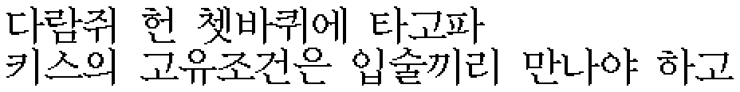

*`Munjo24` from the same disk (1988), built without `--symbols` (`36,564 B`, 24x24, ascent 24, descent 0). Hangul only, with no Latin, space, or symbols. x2.*

## HangulTalk 7.1.x type-3 `fbit` fonts

Type-3 `fbit` fonts (`Seoul12`, `AppleGothic12/24`, `AppleMyungjo12/24`) from Korean System 7.1.2 / HangulTalk 7.1.2 (1994, Apple Korea / Elex Computer). They compose the 2,350 KS X 1001 syllables and 51 compatibility jamo using the `HTBL` 1 table from `InputBackSupport`. KS X 1001 symbols live in separate `KSSymbol12` / `KSSymbol24Disk` archives that these tools do not read.

**Input:** `InputBackSupport[INIT].rsrc`, the font `[splt]` data fork (for example `Seoul12[splt].data`), and optionally the family suitcase (`Seoul[FFIL].rsrc`, etc.) for Latin `NFNT` strikes.

```sh
python3 maker/srcprep.py mac-htbl "InputBackSupport[INIT].rsrc" $OUT/HTBL1.bin
python3 tools/macfbit3.py unpack "Seoul12[splt].data" $OUT/Seoul12.rsrc
python3 tools/macfbit3.py fbit $OUT/Seoul12.rsrc $OUT/Seoul12.fbit
python3 tools/macfbit3.py bdf $OUT/Seoul12.fbit $OUT/HTBL1.bin Seoul12 $OUT/seoul12.bdf
python3 tools/macfbit_svf.py build $OUT/Seoul12.fbit $OUT/HTBL1.bin -o $OUT/SEOUL12J.SVF
python3 tools/macfbit_svf.py build $OUT/Seoul12.fbit $OUT/HTBL1.bin --mode derived -o $OUT/SEOUL12D.SVF
python3 tools/macfbit_svf.py verify $OUT/SEOUL12J.SVF $OUT/Seoul12.fbit $OUT/HTBL1.bin
```

- `direct` (default) keeps the Mac structure as a JMAP and composes only the 2,350 KS syllables exactly.
- `derived` fits a JSET for all 11,172 syllables; the 8,822 non-KS syllables are extrapolated, not Mac output.
- Pass `--latin "Seoul[FFIL].rsrc"` to `macfbit_svf.py build` to include Latin letters from the family suitcase.
- For a precomposed face, run `srcprep.py bdf-pixel-size` and `mkfont.py` on the BDF below, or pass the BDF to `bdfface.py --hangul` with a separate `--ascii` font and `--cell 12x12 --chars-from $OUT/ks.txt`.

```sh
# Precomposed BDF route (no Latin companion needed)
python3 maker/srcprep.py bdf-pixel-size $OUT/seoul12.bdf $OUT/seoul12-sized.bdf --size 12
python3 tools/mkfont.py $OUT/seoul12-sized.bdf $OUT/seoul12.svf --size 12 --bpp 1 --unicode ascii,ksx1001-hangul

# Shrink a derived face for an MCU budget (takes about 2 minutes)
python3 tools/jamomerge.py merge --face $OUT/SEOUL12D.SVF --points 8192 7168 --prefix SM -o $OUT/SMALL
```

| Font / mode | Size | Glyphs / pieces | Cell | Ascent / descent | Check line (`안녕하세요 ABC 123`) |
| --- | --- | --- | --- | --- | --- |
| `Seoul12` direct | 15,016 B | 207 pieces (KS 2,350 + 51 jamo) | 12x12 | 10 / 2 | `width=60`, ink 142, `ks_bad 0` |
| `Seoul12` derived | 9,716 B (v2: 7,928 B) | 219 pieces (9/6/3 sets, 8x4, 11,172 syllables) | 12x12 | 10 / 2 | `width=60`, ink 142, `ks_bad 0` |
| `Seoul12` direct + Latin | 17,924 B | 207 pieces + ASCII | 12x12 | 10 / 2 | `width=111`, ink 253, `ks_bad 0` |
| `Seoul12` derived + Latin | 12,624 B | 219 pieces + ASCII | 12x12 | 10 / 2 | `width=111`, ink 253, `ks_bad 0` |
| `Seoul12` BDF + `mkfont.py` | 103,012 B | 2,350 glyphs | 12x12 | 10 / 2 | `width=60`, ink 142 |
| `Seoul12` `jamomerge` 8K / 7K | 7,964 B / 7,032 B | 191 pieces (7K, 7/6/3 sets) | 12x12 | 10 / 2 | verified |
| `AppleGothic12` direct + Latin | 22,860 B | 364 pieces + ASCII | 12x12 | 10 / 2 | `width=122`, ink 285, `ks_bad 0` |
| `AppleMyungjo24` direct + Latin | 37,244 B | 465 pieces + ASCII | 24x24 | 20 / 4 | `width=242`, ink 944, `ks_bad 0` |

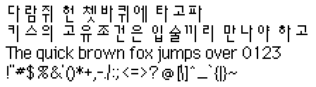

*Korean System 7.1.2 / HangulTalk 7.1.2 CD (1994) `Seoul12`, `direct` with 12 pt `NFNT` from `Seoul[FFIL]` (`17,924 B`, 12x12, ascent 10, descent 2). No KS X 1001 symbols. x2.*

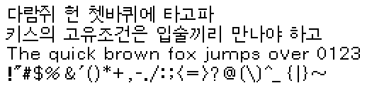

*`AppleGothic12` from the same CD (1994), `direct` with 12 pt `NFNT` from `AppleGothic[FFIL]` (`22,860 B`, 12x12, ascent 10, descent 2). No KS X 1001 symbols. x2.*

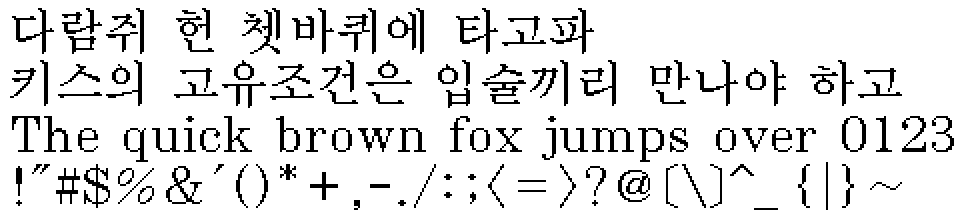

*`AppleMyungjo24` from the same CD (1994), `direct` with 24 pt `NFNT` from `AppleMyungjo[FFIL]` (`37,244 B`, 24x24, ascent 20, descent 4). No KS X 1001 symbols, and the backtick (`` ` ``) is blank in the 24 pt `NFNT`. x2.*

<a id="classic-mac-truetype-bitmap-strikes"></a>

## TrueType bitmap strikes (System 7.5.3–Mac OS 8.5)

Starting with Korean System 7.5.3 (1996, earliest examined; 7.5.1 still ships the `fbit` Seoul12) through Mac OS 8.5 (1998), Korean fonts are TrueType in `FFIL` suitcases. Their `bloc`/`bdat` tables hold 1 bpp bitmap strikes at 9, 10, 12, 14, 16, 18, 20, and 24 ppem; convert them via the [Mac-format TrueType](outline-fonts.md#mac-format-truetype) route ([Embedded bitmap strikes](bitmap-fonts.md#embedded-bitmap-strikes)).

**Input:** `FFIL` resource fork (bitmap-only copies in the 7.5.3 CD's `Bitmap 서체 설치` folder, or `한강체[FFIL].rsrc` in Mac OS 8.5's `자형 폴더`).

```sh
python3 tools/macsfnt.py extract "AppleGothic[FFIL].rsrc" $OUT/AppleGothic.ttf
python3 tools/macsfnt.py unicode $OUT/AppleGothic.ttf $OUT/AppleGothicU.ttf
python3 tools/mkfont.py $OUT/AppleGothicU.ttf $OUT/agothic16.svf --size 16 --bpp 1 --unicode ascii,ksx1001-hangul
```

- `--size` must be one of the eight strike sizes above.
- Mac OS 8.5 `한강체` (Hangang) already has a Unicode cmap, so skip `macsfnt.py unicode`.
- The strikes also hold KS X 1001 symbols and, in most faces, hanja, which a wider `--unicode` set includes.

Running the commands above on 7.5.3 bitmap-only `AppleGothic` 16 px produces a precomposed face of `123,360 B` with 2,446 glyphs. The table below lists sample faces holding only the characters of the four sample lines (`--unicode file:`).

| Font (strike) | Size | Cell | Ascent / descent | Missing |
| --- | --- | --- | --- | --- |
| AppleGothic 12 (7.5.3) | 4,828 B | 12x12 | 9 / 3 | `_` (falls below the cell) |
| AppleGothic 16 (7.5.3) | 5,596 B | 16x16 | 13 / 3 | none |
| AppleMyungjo 16 (7.5.3) | 5,844 B | 16x16 | 13 / 3 | none |
| AppleMyungjo 24 (7.5.3) | 8,824 B | 24x24 | 19 / 5 | none |
| Seoul 12 (7.5.3) | 4,772 B | 12x12 | 10 / 2 | none |
| Seoul 16 (7.5.3) | 5,536 B | 16x16 | 13 / 3 | none |
| #신명조 16 (7.5.3) | 5,368 B | 16x16 | 12 / 4 | none |
| #궁서체 16 (7.5.3) | 5,228 B | 16x16 | 12 / 4 | none |
| 한강체 (Hangang) 16 (Mac OS 8.5) | 5,748 B | 16x16 | 13 / 3 | none |

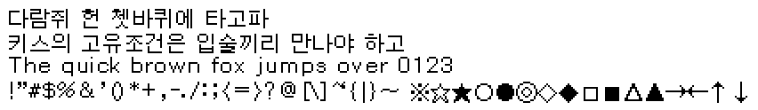

*Korean System 7.5.3 (1996) AppleGothic 12 ppem bitmap-only strike. `_` is omitted because it lies below the 12x12 cell. x2.*

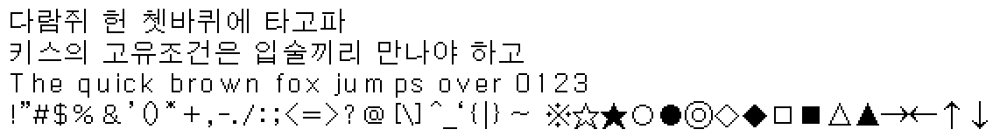

*Korean System 7.5.3 (1996) AppleGothic 16 ppem strike. x2.*

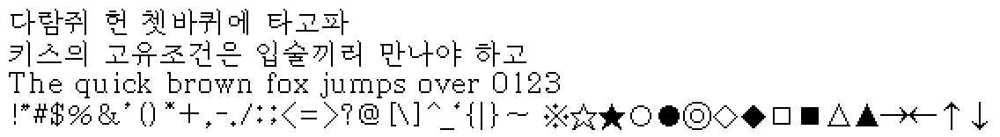

*Korean System 7.5.3 (1996) AppleMyungjo 16 ppem strike. x2.*

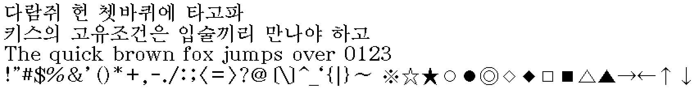

*Korean System 7.5.3 (1996) AppleMyungjo 24 ppem strike. x2.*

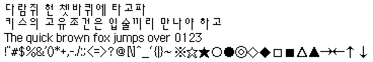

*Korean System 7.5.3 (1996) Seoul 12 ppem strike. x2.*

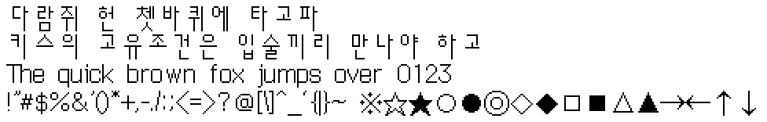

*Korean System 7.5.3 (1996) Seoul 16 ppem strike. x2.*


*Korean System 7.5.3 (1996) #신명조 (Shin Myeongjo) 16 ppem strike. x2.*

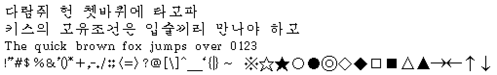

*Korean System 7.5.3 (1996) #궁서체 (Gungseo) 16 ppem strike. x2.*


*Mac OS 8.5 Korean (1998) 한강체 (Hangang) 16 ppem strike. x2.*

<a id="classic-mac-samples"></a>

## Making the samples

The 14 sample images above (33,924 B total) render four lines at x2 scale: two Korean pangrams, one English line, and ASCII plus KS X 1001 symbols (`※☆★○●◎◇◆□■△▲→←↑↓`). Characters missing from a face are omitted. `tools/doc_figures_mac.py` draws them directly from your source folders without storing font copies in the repository.

```sh
python3 -I tools/doc_figures_mac.py --ht10 "$SRC/HT10/System Folder" --ht712 "$SRC/HT712/More Additions" \
    --htbl "$SRC/HT712/InputBackSupport[INIT].rsrc" --kh753 "$SRC/KH753/Bitmap 서체 설치" \
    --kh85 "$SRC/KH85/한글 시스템/자형 폴더" [--check]
```

`--check` compares against the committed PNGs byte for byte and fails if any face is skipped ([tool reference](../tools.md#toolsdoc_figures_macpy)).

## Notes

- **Maker local mode:** The desktop app reads these fonts in place and writes faces only to the folder you choose. See the [maker desktop guide](../maker-desktop.md), [route table](desktop-routes.md#desktop-app-and-maker-routes), and [Apple font tables and resource forks](../recipes.md#ref-apple).
- **HangulTalk 7.5.1 differences:** `Seoul12[fbit]` on the 7.5.1 installer disk is byte-identical to 7.1.2 (8,760 B). The 7.5.1 copy of `InputBackSupport` is compressed, so `srcprep.py mac-htbl` refuses it.
- **Bitmap-only TrueType:** The 7.5.3 `Bitmap 서체 설치` copies have no outlines and no `head` table. `mkfont.py` reads per-glyph advances from strike metrics via fontTools, and non-strike sizes fail to open.
- **NFNT shifts:** `macfbit_svf.py` shifts Latin glyphs that extend past the cell back inside (`AppleGothic12` `W` -1 px, `AppleMyungjo24` `j` +1 px).
- **Real-file tests:** Synthetic tests run by default. To test against your own files, set `JOHAB_FONTS` (1.0) or `MACFBIT3_CD712` and `SVF_MAC71_INPUTS` (7.1.2). The 1.0 golden file (`tools/testdata/mac-fbit-golden.json`) is not shipped.
- **Sample reproducibility:** `fbit` images depend only on the font files; strike images also depend on Pillow and FreeType (built with Pillow 10.2.0 and FreeType 2.13.2).

[Recipes index](../recipes.md) · [Tool reference](../tools.md)
