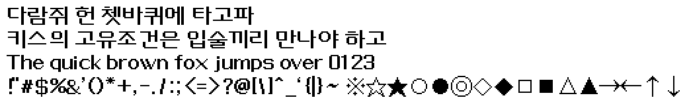

**English** | [한국어](classic-mac.ko.md)

# Recipes: Classic Mac Korean bitmap fonts

HangulTalk 1.0 `fbit` fonts (45 glyph sets and the `fdef` rule: an exact jamo set) and HangulTalk 7.1 type-3 `fbit` fonts with HTBL 1 (a precomposed face and a jamo set); the maker's local mode reads them in place. The TrueType bitmap strikes of System 7.5 and later, and sample images of each face, follow.

**Before you start.** Commands run from the project root with `$OUT` set as in the [index](../recipes.md); every face ends with the checks of [Checking a face](../recipes.md#checking-a-face). Source files are proprietary and supplied separately. Mac-format TrueType (`.dfont`, suitcases) is in [Outline fonts](outline-fonts.md#mac-format-truetype).

Up: [Recipes index](../recipes.md) · Related: [Outline fonts](outline-fonts.md), [Choosing the number of sets (벌 수)](sets.md), [Jamo sets](../jamo-sets.md).

## Classic Mac Korean bitmap fonts

Supply your own source files. The maker's local mode ([maker desktop guide](../maker-desktop.md)) reads these fonts in place from your disk, through the same tools, and writes the faces only into a folder you
choose [Apple font tables and resource forks](../recipes.md#ref-apple).

**HangulTalk 1.0 'fbit' fonts** (Korean System 4.1: Gotic12/16, Munjo12/16/24). Input: the font's resource fork as a
file (copied out of a Mac volume, or the fork of an archive; `tools/macsfnt.py list` shows its 'fbit' resource). The
fork holds an 'fbit' resource of 45 glyph sets and the 'fdef' driver resource with its 18 lookup tables. The set system is
derived from the font's own rule, so every syllable composes as the Mac draws it:

    python3 tools/jamoset.py --layout mac-fbit-45sets Munjo24.rsrc --symbols --check -o $OUT/MUNJO24J.SVF

Output: a 1 bpp jamo set of all 11,172 syllables (8 lead classes, 4 tail classes, 20 initial sets for these fonts),
cell = the font's size. `--check` composes everything and compares with jamoset's own copy of the 'fdef' rule; a golden
file (`tools/testdata/mac-fbit-golden.json`, not shipped: it would hold Apple bitmaps) adds an independent comparison
when you make one. Tests on the real files run when `JOHAB_FONTS` names a tree holding
`mac/extracted/kh10_system_disk/System Folder/*.rsrc` and the reference renderer; they skip otherwise.

Run on the System Disk of Korean System 4.1 / HangulTalk 1.0 (Jan 1988, Apple Korea / Elex Computer; proprietary), whose
`System Folder` holds the four fonts as resource-fork files. `Munjo24` (24 px Myeongjo; `list` shows `fbit` 17409, 47,714
bytes, and its `fdef` 3, 2,398 bytes): `36,660 bytes`, 653 pieces of 24x24, 8 lead x 4 tail classes, 20/15/4 sets, `check:
composed 11172 syllables from 655 glyphs`, and the self-consistency line `IoU 1.000, exact 11172` against jamoset's copy of the
`fdef` rule (no golden file), 1.0 s; `width=120 ascent=24 descent=0` for the sample line (these fonts hold no Latin: only the five
syllables are drawn), ink 591. `Gotic12` (12 px Gothic): `23,368 bytes`, the same sets, `width=60 ascent=12 descent=0`. The
maker's local mode (`detect.scan(..., local=True)`, on copies of the four fonts) reads them as "HangulTalk 1.0 fbit (45
sets), 24 x 24" (Munjo24; Munjo12, Gotic12 12 x 12, Munjo16 16 x 16), source kind `mac-fbit1`, coverage 2,350 KS / 11,172
syllables and 51 compatibility jamo, and offers the `mac fbit 1.0` route, which runs the command above; upload mode
says "Mac bitmap font (NFNT/fbit): not converted here (local-only mode)".

The images of this chapter show what each face draws of four sample lines (two Korean pangrams, an English line, the
ASCII symbols and the KS X 1001 symbols `※☆★○●◎◇◆□■△▲→←↑↓`), black on white, every pixel doubled; a character a face
does not have is left out of its line ([Making the samples](#classic-mac-samples)). The HangulTalk 1.0 faces are built by
the command above without `--symbols` (that option adds a box and three dots drawn by `jamoset.py`, not by the font):

*`Gotic12` of the Korean System 4.1 / HangulTalk 1.0 System Disk (1988) as a 12x12 jamo set, ascent 12, descent 0
(`23,304 bytes`). The font holds Hangul only, so only the two Korean lines are drawn, and a space is half a cell of
paper (the font has no space glyph); x2*

*`Munjo24` of the same disk (1988) as a 24x24 jamo set, ascent 24, descent 0 (`36,564 bytes`); Hangul only, as above;
x2*

**HangulTalk 7.1.x type-3 'fbit' fonts** (Seoul12, AppleGothic12/24, AppleMyungjo12/24): the planes are composed by a
table, InputBackSupport 'HTBL' 1, and only the 2,350 KS X 1001 syllables and 51 compatibility jamo exist.

    python3 maker/srcprep.py mac-htbl "InputBackSupport[INIT].rsrc" $OUT/HTBL1.bin     # the HTBL 1 of the extension (7.1.2 CD), 9,816 bytes
    python3 tools/macfbit3.py unpack Seoul12.splt.data $OUT/Seoul12.rsrc     # the 7.1.2 Installer's 'splt' "JM" archive
    python3 tools/macfbit3.py fbit $OUT/Seoul12.rsrc $OUT/Seoul12.fbit
    python3 tools/macfbit3.py bdf $OUT/Seoul12.fbit $OUT/HTBL1.bin Seoul12 $OUT/seoul12.bdf          # 2,401 glyphs, Unicode BDF
    python3 tools/macfbit_svf.py build $OUT/Seoul12.fbit $OUT/HTBL1.bin -o $OUT/SEOUL12J.SVF         # direct: the Mac structure (JMAP)
    python3 tools/macfbit_svf.py build $OUT/Seoul12.fbit $OUT/HTBL1.bin --mode derived -o $OUT/SEOUL12D.SVF   # a JSET face, all 11,172
    python3 tools/macfbit_svf.py verify $OUT/SEOUL12J.SVF $OUT/Seoul12.fbit $OUT/HTBL1.bin

`direct` keeps the Mac planes as pieces and composes only the KS syllables exactly; `derived` fits a JSET whose 8,822
extra syllables are extrapolated (not Mac output). For a precomposed face with Latin, pass that BDF as `bdfface.py --hangul`, supply a separate `--ascii` font,
and set `--cell 12x12 --chars-from $OUT/ks.txt`. The `mkfont.py` route below needs no Latin companion. To shrink a many-variant face for an MCU budget:

    python3 tools/jamomerge.py merge --face $OUT/SEOUL12D.SVF --points 8192 7168 --prefix SM -o $OUT/SMALL

(keeps every piece as drawn and merges variants, sets and classes by a pixel objective). Tests: `tools/test_macfbit3.py`
and `tools/test_macfbit_svf.py` run on synthetic fbit / HTBL / NFNT data built in the tests; `MACFBIT3_CD712=<CD tree>`
and `SVF_MAC71_INPUTS=<dir of Name.fbit and Name.htbl1>` add the checks on your files. Outline Mac TrueType fonts: see
[Mac-format TrueType](outline-fonts.md#mac-format-truetype). The maker's routes for these fonts are in the
[route table](desktop-routes.md#desktop-app-and-maker-routes).

Run on Seoul12 of Korean System 7.1.2 / HangulTalk 7.1.2 (Apple Korea / Elex Computer; proprietary): `Seoul12[splt]` from the
CD's `More Additions` folder (the HangulTalk 7.5.1 installer's `Seoul12[fbit]` fork gives the same 8,760-byte `fbit`, `cmp`
identical) and the HTBL 1 of that CD's `InputBackSupport` extension. The HTBL is one more step the commands above did not
show, now the first line of the block above (`srcprep.py mac-htbl`, 9,816 bytes); the 7.5.1 copy of the extension is compressed
and `srcprep.py` answers "not an HTBL 1 table". With that `$OUT/HTBL1.bin` the chapter's commands run as written: `unpack` `JM 1843 -> 9673 bytes`, `fbit` 8,760 bytes, `bdf` 2,401
glyphs; `direct` `15,016 bytes`, 207 pieces, `verify` ks_bad 0, compat_bad 0, non_ks_present 0; `derived` `9,716 bytes`, 219 pieces,
8 x 4 classes, 9/6/3 sets (`7,928 bytes` as JSET v2), with the KS syllables and compatibility jamo verified; both draw the five syllables of the sample line as
`width=60 ascent=10 descent=2`, ink 142. The BDF route (`macfbit3.py bdf`, then `srcprep.py bdf-pixel-size seoul12.bdf
seoul12-sized.bdf --size 12`, then `mkfont.py ... --size 12 --bpp 1 --unicode ascii,ksx1001-hangul` and the canonical step) gives
`103,012 bytes`, 2,350 glyphs, the same `width=60 ascent=10 descent=2` and ink 142. With the family suitcase for the Latin letters
(`--latin "Seoul[FFIL].rsrc"`: a `FOND` and two `NFNT` strikes, 9 and 12 pt, from the same CD) `direct` is `17,924 bytes` (1,388 of
Latin) and `derived` `12,624 bytes`, both `width=111 ascent=10 descent=2`, ink 253, `verify` clean. `jamomerge.py merge --points 8192
7168` (about 2 minutes) writes `SM8K.SVF` `7,964 bytes` and `SM7K.SVF` `7,032 bytes` (191 pieces, 7/6/3 sets), verified. The maker's
local mode reads the files (`detect.scan(..., local=True)`): the `Seoul12` fork, the `splt` file and a raw fork are "HangulTalk 7.1
type-3 fbit, 12 px, 482 planes (needs HTBL 1)" with the routes `mac fbit 7.1 direct`, `derived` and `bdf + mkfont`; the extension
is "HangulTalk 7.1 HTBL 1 (InputBackSupport): the composition table"; `Seoul[FFIL]` is "Mac bitmap suitcase (FOND + NFNT): Latin
strikes at 9, 12 pt".

The same commands run on the CD's other type-3 fonts with the HTBL 1 above and their family suitcases for the Latin
letters: `AppleGothic12[splt]` with `--latin "AppleGothic[FFIL].rsrc"` gives `22,860 bytes`; `AppleMyungjo24[splt]` with
the 24 pt `NFNT` of `AppleMyungjo[FFIL]` gives `37,244 bytes` (`latin_notes`: `j` shifted 1 px into the cell); `verify`
is clean for both (ks_bad 0, compat_bad 0, non_ks_present 0). Neither the fonts nor the suitcases hold KS X 1001
symbols (those are in the separate `KSSymbol12` / `KSSymbol24` archives, which these tools do not read), so the symbol
line has the ASCII symbols only:

*`Seoul12` of the Korean System 7.1.2 / HangulTalk 7.1.2 CD (1994), `direct` face with the 12 pt `NFNT` of
`Seoul[FFIL]` (`17,924 bytes`), 12x12, ascent 10, descent 2; no KS X 1001 symbols; x2*

*`AppleGothic12` of the same CD (1994), `direct` face with the 12 pt `NFNT` of `AppleGothic[FFIL]` (`22,860 bytes`),
12x12, ascent 10, descent 2; no KS X 1001 symbols; x2*

*`AppleMyungjo24` of the same CD (1994), `direct` face with the 24 pt `NFNT` of `AppleMyungjo[FFIL]` (`37,244 bytes`),
24x24, ascent 20, descent 4; no KS X 1001 symbols; x2*

### TrueType bitmap strikes (System 7.5 to Mac OS 8.5)

From Korean System 7.5 on, the Korean fonts are TrueType in family suitcases (`FFIL`) with 1 bpp strikes in Apple's
`bloc`/`bdat` tables at 9, 10, 12, 14, 16, 18, 20 and 24 ppem; the CD's `Bitmap 서체 설치` (bitmap font install) folder
holds bitmap-only copies (strikes, no outlines). No tool of this chapter reads them: they take the
[Mac-format TrueType](outline-fonts.md#mac-format-truetype) route, and at a strike's size FreeType draws the strike's
pixels ([Embedded bitmap strikes](bitmap-fonts.md#embedded-bitmap-strikes)):

    python3 tools/macsfnt.py extract "AppleGothic[FFIL].rsrc" $OUT/AppleGothic.ttf
    python3 tools/macsfnt.py unicode $OUT/AppleGothic.ttf $OUT/AppleGothicU.ttf     # only the Mac Korean cmap: add a Unicode one
    python3 tools/mkfont.py $OUT/AppleGothicU.ttf $OUT/agothic16.svf --size 16 --bpp 1 --unicode ascii,ksx1001-hangul

On the 7.5.3 bitmap-only AppleGothic they give `123,360 bytes`, 2,446 glyphs. `--size` must be one of the strikes (between them FreeType rasterises the outline, and a bitmap-only copy does not
open). The result is a precomposed face; the strikes also hold the font's KS X 1001 symbols and, in most faces, hanja,
which a wider `--unicode` set takes. A bitmap-only copy has no `head` table, so `mkfont.py` takes each glyph's advance from the
strike's metrics through fontTools.

Run on the bitmap-only copies of Korean System 7.5.3 (the CD for the Power Macintosh 7220, 1996; fonts "1994-1995 Elex
Computer") and on Hangang (한강체) of the Mac OS 8.5 Korean CD (1998), a full font (outlines and strikes at the same eight
sizes) that already has a Unicode cmap, so `unicode` is not needed. Each face below holds the sample's characters
(`--unicode file:` of the four lines):

| Font (strike) | Cell | Ascent / descent | Face | Not in the face |
| --- | --- | --- | --- | --- |
| AppleGothic 12 | 12x12 | 9 / 3 | 4,828 bytes | `_` (the strike's `_` lies below the cell) |
| AppleGothic 16 | 16x16 | 13 / 3 | 5,596 bytes | none |
| AppleMyungjo 16 | 16x16 | 13 / 3 | 5,844 bytes | none |
| AppleMyungjo 24 | 24x24 | 19 / 5 | 8,824 bytes | none |
| Seoul 12 | 12x12 | 10 / 2 | 4,772 bytes | none |
| Seoul 16 | 16x16 | 13 / 3 | 5,536 bytes | none |
| #신명조 16 | 16x16 | 12 / 4 | 5,368 bytes | none |
| #궁서체 16 | 16x16 | 12 / 4 | 5,228 bytes | none |
| 한강체 (Hangang) 16, Mac OS 8.5 | 16x16 | 13 / 3 | 5,748 bytes | none |

*The 12 ppem strike of AppleGothic, Korean System 7.5.3 (1996), bitmap-only copy; the `_` is left out (it lies below
the 12x12 cell); x2*

*The 16 ppem strike of AppleGothic, Korean System 7.5.3 (1996); x2*

*The 16 ppem strike of AppleMyungjo, Korean System 7.5.3 (1996); x2*

*The 24 ppem strike of AppleMyungjo, Korean System 7.5.3 (1996); x2*

*The 12 ppem strike of Seoul, Korean System 7.5.3 (1996); x2*

*The 16 ppem strike of Seoul, Korean System 7.5.3 (1996); x2*

*The 16 ppem strike of #신명조 (Shin Myeongjo), Korean System 7.5.3 (1996); x2*

*The 16 ppem strike of #궁서체 (Gungseo), Korean System 7.5.3 (1996); x2*

*The 16 ppem strike of 한강체 (Hangang), Mac OS 8.5 Korean (1998); x2*

### Making the samples

The images of this chapter are drawn by `tools/doc_figures_mac.py` from the files themselves, with the commands above;
it needs the folders, not a copy of the fonts in the repository:

    python3 -I tools/doc_figures_mac.py --ht10 "$SRC/HT10/System Folder" --ht712 "$SRC/HT712/More Additions" \
        --htbl "$SRC/HT712/InputBackSupport[INIT].rsrc" --kh753 "$SRC/KH753/Bitmap 서체 설치" \
        --kh85 "$SRC/KH85/한글 시스템/자형 폴더" [--check]

Fourteen images, 33,924 bytes in all; `--check` compares them byte for byte and fails when a face was skipped
([tool reference](../tools.md#toolsdoc_figures_macpy)). The strike images depend on Pillow and its FreeType (made with
Pillow 10.2.0, FreeType 2.13.2); the `fbit` images on the font files alone.

[Recipes index](../recipes.md) · [Tool reference](../tools.md)
