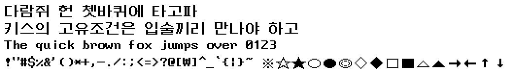
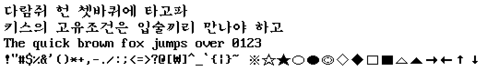
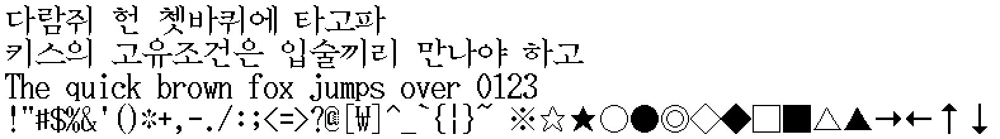
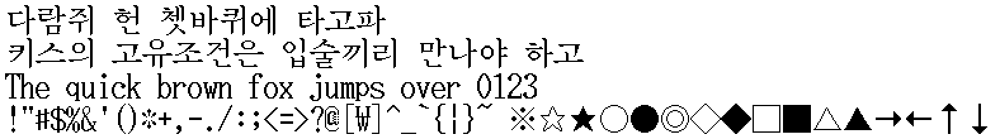

[English](dos-fonts.md) | **한국어**

# 레시피: DOS 시대 원시 폰트

DOS 시대 한글 프로그램의 원시 폰트 파일: 자모 조각 폰트(8x4x4 `HANGUL.FNT`, san, 도깨비, Kyrandia 등), HWP 1.x/2.x와 HWP 3.0 폰트, KS X 1001 원시 덤프(코드 순서의 음절 2,350자나 94 x 94 표).

**시작 전에.** 명령은 [색인](../recipes.ko.md)에서처럼 `$OUT`을 정하고 프로젝트 루트에서 실행한다. 모든 페이스는 [페이스 점검](../recipes.ko.md#페이스-점검)의 점검으로 끝난다. 독점 폰트의 원본 파일은 따로 마련한다. 자기 파일이 아니라 프로그램 안에 든 폰트는 [프로그램과 드라이버 안의 폰트](programs-and-drivers.ko.md)에 있다.

위로: [레시피 색인](../recipes.ko.md) · 관련 문서: [프로그램과 드라이버 안의 폰트](programs-and-drivers.ko.md), [벌 수 정하기](sets.ko.md), [자모 세트](../jamo-sets.ko.md).

## DOS 시대 원시 폰트

DOS 한글 시스템(한글 BIOS, 이야기, 한메, san, 도깨비, 게임)은 음절이 아니라 자모 조각을 저장했다. 음절은 초성, 중성, 선택적인
종성의 OR이었고, 어느 벌을 쓸지는 다른 자모가 정했다. 도구는 이 원시 파일을 **정확한 바이트 크기**로(maker의 `detect.py`도
마찬가지이며, 목록에 없는 크기의 파일은 "unknown"이다) 그리고 레이아웃으로 읽는다. 냄새로 알아볼 헤더는 없다.

### 그 밖의 DOS 시대 한글 폰트

| `--layout` | 파일 | 바이트 | 조각 |
|---|---|---|---|
| `844` | 원시 8x4x4 (`HANGUL.FNT`, `*.KOR`, `$K*ZN16`), 16/24/40/48 px | 11,520 (2 바이트 헤더가 있으면 11,522), 25,920, 72,000, 103,680; 15,584 (DKB2, 16 px로 읽음) | 360: 초성 8벌(각 20), 중성 4벌(각 22), 종성 4벌(각 28); 각 벌의 슬롯 0은 빈 칸 |
| `844-ihnm` | SAGA IHNM 8x4x4 (중성 벌이 ㄱ ㅋ에 맞게 바뀜) | 11,520+ | 360 |
| `844-hbios24` | HBIOS / 태백 3.5 24x30 (`GOTHIC24.FNT`, `MY24.FNT`) | 243,900 | 처음 360개 |
| `1044-san` | san 1.0 10x4x4 | 12,800 | 400 |
| `621` | 6x2x1 (Apple II 시대), 바이트 열 글리프 | 6,144 | 192 |
| `dkb-printer-7x2x2` / `dkb-printer-12x4x4` | 도깨비 프린터 `HANGUL16/24.FNT` / `HANGUL40/48.FNT` (`--face 0|1`) | 15,360 / 34,560; 176,000 / 253,440 | 페이스당 240 / 440 |
| `kyra-lok` | Kyra LoK `MK15.BIT`, 15x15 | 11,550 | 385 |

    python3 tools/jamoset.py --layout 844 HANGUL.FNT --eng ENGLISH.FNT --symbols --check -o $OUT/MYFONT16J.SVF
    python3 tools/johab844.py HANGUL.FNT svf/dos/NEODG16.SVF $OUT/MYFONT16.SVF --eng ENGLISH.FNT     # precomposed instead

`--eng`는 ASCII용 원시 8x16 영문 폰트(2,048 또는 4,096 바이트; 셀에 맞게 정수배로 확대)를 받는다. `--base FACE.SVF`는 다른
페이스의 음절 아닌 글리프를 유지한다. ascent의 기본값은 셀의 7/8이다(`--ascent N`). 8x16 DOS 폰트는 기준선을 13행 또는 14행에
둔다. `--check`는 음절 11,172개를 모두 조합한다. `johab844.py`는 16x16 1 bpp 베이스의 음절을 원시 조각으로 다시 그리고 베이스의
나머지 글리프는 유지한다. Synthetic(`tools/test_recipes.py`에서 만든 합성 파일): 8x16 영문 폰트가 딸린 원시 8x4x4 폰트(가를
조합한 결과 = 원시 슬롯 1과 161의 OR, 바이트 단위로 동일), 6x2x1 폰트(초성 클래스 1개 / 종성 클래스 2개, 벌 6/2/1), 완성형
페이스의 재맞춤(NEODG16J에 `--from-svf`, IoU 1.000).

실제 폰트로 실행(2026-11-22. 모든 줄에 `--symbols --check`, 이름이 있는 곳에는 `--eng`. 샘플 줄은 `안녕하세요 ABC 123`, "잉크"는 렌더 점검의 수.
`--eng`를 줄 때만 ASCII가 그려지므로 주지 않은 페이스는 음절 다섯 개를 잰다):

| `--layout` | 원본(폰트, 제품; 따로 적지 않으면 독점) | 결과 |
|---|---|---|
| `844` | GOTHIC16.FNT, 11,520 바이트(태백 3.5.1 고딕 16), 같은 패키지의 `--eng ROMAN16.FNT` | `15,756 바이트`, 조각 344개, 글리프 441개, `johab844.py`의 음절과 동일. `width=144 ascent=14 descent=2`, 잉크 566 |
| `844` | TBG1.FNT, 2 바이트 헤더가 붙은 11,522 바이트(T-Hangul, 초기 태백), `--eng ROMAN16.FNT` | `15,712 바이트`, 같은 조각 344개, 잉크 566 |
| `844` | DKBBM.FNT, 15,584 바이트(한글 도깨비 B 명조), `--eng ROMAN16.FNT` | `15,744 바이트`, 글리프 441개, `johab844.py`와 동일. 잉크 512 |
| `844` | MHANC24.PFT, 25,920 바이트(태백 3.5.1 명조 24 px), `--eng MASCII24.PFT`(12,288 바이트, 12x24 영문 폰트) | `23,088 바이트`, 조각 344개. `width=216 ascent=20 descent=4`, 잉크 916 |
| `844` | GHANC40.PFT, 72,000 바이트(태백 3.5.1 고딕 40 px), `--eng GASCII40.PFT`(30,720 바이트, 20x40 영문 폰트) | `42,716 바이트`, 글리프 441개. `width=360 ascent=34 descent=6`, 잉크 3,078 |
| `844` | GHANC48.PFT, 103,680 바이트(태백 3.5.1 고딕 48 px), `--eng GASCII48.PFT`(49,152 바이트, 24x48) | `51,972 바이트`. `width=432 ascent=40 descent=8`, 잉크 3,921(`line 440 56 0 48`: 줄이 400보다 넓다) |
| `844` | MHANC48.PFT, 103,680 바이트(태백 3.5.1 명조 48 px), `--eng MASCII48.PFT`(49,152 바이트) | `54,112 바이트`. `width=432 ascent=40 descent=8`, 잉크 3,573(`line 440 56 0 48`) |
| `844-hbios24` | GOTHIC24.FNT, 243,900 바이트(태백 3.5.1, HBIOS 24x30 레이아웃) | `17,776 바이트`, 글리프 346개. `width=120 ascent=21 descent=3`, 잉크 551 |
| `844-hbios24` | MY24.FNT, 243,900 바이트(태백 3.5.1 명조 24), `--eng GASCII24.PFT` | `23,136 바이트`. `width=216 ascent=20 descent=4`, 잉크 964 |
| `1044-san` | HANPL.KOR, 12,800 바이트(san 1.0의 `font-kor/`. GitHub의 san 프로젝트) | `13,988 바이트`, 조각 382개, 글리프 384개. `width=80 ascent=14 descent=2`, 잉크 328 |
| `621` | han_woori.fnt, 6,144 바이트("우리", GitHub의 iolo 6x2x1-fonts, Apple II 시대) | `6,584 바이트`, 조각 183개, 글리프 185개. 잉크 204 |
| `dkb-printer-7x2x2` | HANGUL16.FNT 15,360 바이트와 HANGUL24.FNT 34,560 바이트(한글 도깨비 5.1 프린터 폰트), `--face 0` / `--face 1` | 16 px `8,928` / `8,868 바이트`, 조각 229개, 잉크 367 / 363. 24 px `12,068` / `11,872 바이트`, 잉크 542 / 537 |
| `dkb-printer-12x4x4` | HANGUL40.FNT 176,000 바이트와 HANGUL48.FNT 253,440 바이트(같은 제품), `--face 0` / `--face 1` | 40 px `38,704` / `38,624 바이트`, 조각 420개(글리프 422개), 잉크 1,595 / 1,766. 48 px `52,932` / `48,908 바이트`, 잉크 2,472 / 2,538 |
| `kyra-lok` | MK15.BIT, 11,550 바이트(The Legend of Kyrandia 한글판) | `14,036 바이트`, 조각 382개, 15x15. `width=80 ascent=13 descent=2`, 잉크 344 |
| `844-ihnm` | 없음: SAGA IHNM 데이터를 찾지 못했다 | 실행하지 않음 |

모든 페이스가 음절 11,172개를 조합한다(`--check`). 조각 수는 쓰인 조각의 수로, 안 쓰는 슬롯을 버리므로 표의 조각 수보다 적다. 같은
GOTHIC16.FNT에 `johab844.py`(`--eng ROMAN16.FNT`, 베이스 `svf/dos/NEODG16.SVF`)를 쓰면 `133,688 바이트`, 원시 폰트의 음절 2,357자,
ROMAN16.FNT의 ASCII 글리프 94개, 베이스의 다른 글리프 454개, `width=144 ascent=12 descent=4`, 잉크 566이고 `svf2to3.py --check`는 크기를
유지한다. 이 파일들의 사본에 maker의 `detect.scan`을 쓰면 모두 종류 `dos-raw`, 크기 16 / 24 / 40 / 48 / 15, 경로 `dos raw`를 얻는다.
GOTHIC16.FNT(레이블 "844, 844-ihnm". 두 레이아웃의 크기가 같다)는 `johab844`도 얻고, 11,522 바이트의 TBG1.FNT와 15,584 바이트의 DKBBM.FNT는 `dos raw`만
얻는다. 도깨비 프린터 파일은 페이스마다 항목 하나를 주고, GASCII24.PFT / MASCII24.PFT와 ROMAN16.FNT는 "Latin companion"으로 나열된다.

**함정.** 크기가 맞는 파일이 다른 레이아웃이어도 크기 점검은 통과한다. 슬롯 0의 채움 조각이 비어 있지 않으면 `jamoset.py`가
거부하지만, 결과를 직접 보라(`svfline.py line ... "가나다"`). 2 바이트 헤더가 있는 폰트(T-Hangul)는 오프셋 2에서 읽는다. 24 px
이상의 원본에는 거기에 맞는 영문 폰트나 `--base`가 필요하다. `--eng`는 8x16 폰트와 같은 패키지의 12x24, 20x40(30,720 바이트),
24x48(49,152 바이트) PFT 영문 폰트를 받아 셀에 맞게 정수배로 키운다. 데스크톱 앱은 40, 48 px 페이스에 같은 높이의 영문 폰트를, 같은
계열(G / M)을 먼저 짝짓는다.

### IBM PC DOS 한글 (HBIOS V3.0)

한국IBM의 HBIOS V3.0 디스크(1994년판, 파일 날짜 1998)는 한글 BIOS(`HBIOS.EXE`)와 폰트 파일을 따로 둔다. 폰트 파일에는 헤더가
없고, 드라이버가 설정 파일 `DOSK.INI`의 키(`SBCS0816`, `SBCS1224`, `DBCS1616`, `DBCS2424`, `SPHJ1616`, `SPHJ2424`, `FONTPATH`)로
경로를 읽는다. 이름의 HN은 반각(SBCS, 영문), ZN은 전각(DBCS, 한글), SPHJ는 기호와 한자다(일본 DOS/V와 같은 짜임).

| 키 | 파일 | 바이트 | 내용 |
|---|---|---:|---|
| `DBCS1616` | `$KGOZN16.FNT`, `$KMYZN16.FNT` | 11,520 | 16x16 8x4x4 자모 세트 360개(고딕, 명조) |
| `DBCS2424` | `$KMYZN24.FNT` | 243,900 | 24x30 셀 2,710개(90 바이트, 잉크는 3-26행): 8x4x4 자모 세트 360개, 그다음 KS X 1001 음절 2,350자 |
| `SBCS0816` | `$KSAHN16.FNT`(산세리프), `$KROHN16.FNT`(로만) | 4,096 | 8x16 영문 256자 |
| `SBCS1224` | `$KROHN24.FNT` | 15,360 | 16x30 셀 256자(60 바이트, 12x24 그림은 3-26행) |
| `SPHJ1616` | `$KSPHJ16.FNT` | 192,512 | 16x16, 기호 1,128칸 + 한자 4,888자(KS X 1001 순서, 32 바이트) |
| `SPHJ2424` | `$KSPHJ24.FNT` | 541,440 | 24x30 셀, 기호 1,128칸 + 한자 4,888자(90 바이트) |

`$KGOZN24.FNT`(고딕 24)는 설정에 이름이 있지만 디스크에 없다. `HJSPC.TBL`(12,508 바이트)은 코드 표이고 글리프가 없다. `*.DRV`는
화면과 키보드 드라이버다. 음절은 드라이버가 자모 세트로 조합하므로, 16 px 파일은 [위의 표](#그-밖의-dos-시대-한글-폰트)의 원시
8x4x4이고 24 px 파일은 `844-hbios24` 레이아웃이다(태백 3.5의 `GOTHIC24.FNT`, `MY24.FNT`와 같은 배치). 영문 절반은 같은 디스크의
SBCS 파일이다: 8x16은 원시 4,096 바이트, 16x30 셀의 12x24는 `--eng`가 크기(15,360)로 알아본다.

**출처와 라이선스.** 한국IBM의 독점 펌웨어 폰트다. 사용자 자신의 디스크에서 읽었고, 연구용으로만 쓰며, `svf/`의 페이스는 이것으로
만들지 않는다. 아래 그림은 레시피가 만든 페이스를 작은 샘플로 보여 줄 뿐이고, 폰트와 거기서 만든 파일은 배포하지 않는다. 폰트
파일은 신뢰할 수 없는 데이터다: 도구는 바이트만 읽는다(`python3 -I`). `HBIOS.EXE`는 실행하지 않는다. `$HB`는 디스크의 파일이 든 폴더다(이름의
`$`가 셸에서 풀리지 않게 작은따옴표로 감싼다).

    python3 -I tools/jamoset.py --layout 844 "$HB"/'$KGOZN16.FNT' --eng "$HB"/'$KSAHN16.FNT' --symbols --check -o $OUT/KGOZN16J.SVF
    python3 -I tools/jamoset.py --layout 844 "$HB"/'$KMYZN16.FNT' --eng "$HB"/'$KROHN16.FNT' --symbols --check -o $OUT/KMYZN16J.SVF
    python3 -I tools/jamoset.py --layout 844-hbios24 "$HB"/'$KMYZN24.FNT' --eng "$HB"/'$KROHN24.FNT' --symbols --check -o $OUT/KMYZN24J.SVF

`$KMYZN24.FNT`의 완성형 음절 2,350자는 자모 360개 뒤(360 x 90 = 32,400 바이트), 셀의 3행부터(+9 바이트)이고, `$KROHN24.FNT`의
ASCII는 오프셋 6(3행 x 2 바이트)에서 60 바이트 간격이다. 기준선은 잘라 낸 24행의 22행이다: `$KROHN24.FNT`의 'H'는 30행 셀의
5-24행, 잘라 낸 칸의 2-21행을 덮고, `jamoset.py`는 12x24 `--eng` 페이스의 기준선을 그 아래 행으로 잡는다. 완성형도 같은 22로 자른다:

    python3 -I tools/rawcarve.py bdf "$HB"/'$KMYZN24.FNT' --offset 32409 --glyph 24x24 --stride 90 --chars ks-hangul --dense --ascent 22 -o $OUT/kmyzn24-hangul.bdf
    python3 -I tools/rawcarve.py bdf "$HB"/'$KROHN24.FNT' --offset 6 --glyph 12x24 --stride 60 --chars ascii --count 128 --ascent 22 -o $OUT/krohn24.bdf
    python3 -I tools/bdfface.py --hangul $OUT/kmyzn24-hangul.bdf --ascii $OUT/krohn24.bdf --cell 24x24 --chars-from $OUT/ks.txt -o $OUT/KMYZN24.SVF

기호와 한자는 [Windows 레시피](windows.ko.md#windows-hfont-sys)의 `HFONT.SYS`처럼 `tbmfont.py map`의 슬롯 맵으로 자른다(SPHJ
파일은 헤더 없이 기호 블록부터 시작한다):

    python3 -I tools/tbmfont.py map --blocks symbols,hanja -o $OUT/sphj.map
    python3 -I tools/rawcarve.py bdf "$HB"/'$KSPHJ16.FNT' --offset 0 --glyph 16x16 --chars map --map $OUT/sphj.map -o $OUT/ksphj16.bdf
    python3 -I tools/rawcarve.py bdf "$HB"/'$KSPHJ24.FNT' --offset 9 --glyph 24x24 --stride 90 --chars map --map $OUT/sphj.map --ascent 22 -o $OUT/ksphj24.bdf

측정한 결과(점검 줄 `안녕하세요 ABC 123`, 24 px의 잉크는 `line 400 32 0 24`):

| 페이스 | 바이트 | 글리프 | measure | 잉크 |
|---|---:|---|---|---:|
| `KGOZN16J.SVF`, 고딕 16 px 자모 세트(`--eng $KSAHN16`) | `15,736` | 441(조각 344) | `width=144 ascent=14 descent=2` | 535 |
| `KMYZN16J.SVF`, 명조 16 px 자모 세트(`--eng $KROHN16`) | `15,864` | 441(조각 344) | `width=144 ascent=14 descent=2` | 509 |
| `KMYZN24J.SVF`, 명조 24 px 자모 세트(`--eng $KROHN24`) | `23,380` | 441(조각 344) | `width=216 ascent=22 descent=2` | 966 |
| `KMYZN24.SVF`, 같은 파일의 완성형 2,350자 + `$KROHN24` ASCII | `220,248` | 2,447 | `width=216 ascent=22 descent=2` | 983 |
| `ksphj16.bdf` / `ksphj24.bdf` | | 5,872 / 5,871 | | |

세 자모 세트 모두 `--check`가 음절 11,172자를 조합하고, 16 px 둘은 `johab844.py`의 음절과 같다("identical to johab844.py").
`svf2to3.py --check`는 네 페이스를 모두 그대로 둔다. `fontmetrics.py`는 16 px 자모 세트에서 `--symbols`의 U+2026 하나만 advance를
1 px 넘는다고 알린다. 24 px 자모 세트의 ascent 22는 `--eng` 페이스의 기준선('H' 잉크 아래 행)으로,
`jamoset.py`가 12x24 영문 페이스에서 기본으로 가져온다. 완성형 페이스도 같은 `--ascent 22`로 잘랐으므로 둘 다 영문 기준선에 선다.

**자모 세트와 같은 파일의 완성형.** `$KMYZN24.FNT`에는 두 가지가 다 있으니 비교할 수 있다. 자모 세트(`KMYZN24J.SVF`)가 조합한
KS X 1001 음절 2,350자를 파일 자신의 완성형 음절과 같은 24x24 칸에서 비교하면 정확히 같은 음절은 0자, 평균 IoU 0.450(p5 0.211)이다.
칸을 옮겨도(가로 -2..2, 세로 -3..3) 나아지지 않는다. 1 px 허용 F1은 평균 0.947(p5 0.823)이고, 잉크 합계는 거의 같다(완성형 292,819, 자모
세트 294,308 픽셀). 획의 모양은 같고, 조각이 놓이는 자리가 음절마다 1 px씩 다르다: 완성형은 모음과 받침에 맞춰 자모를 따로
옮겨 그렸다(예: `헌`의 ㅎ과 ㅓ). 가장 다른 음절은 ㅟ, ㅝ, ㅢ 계열이다(`뗍 찌 츤 쮜 쒼 쭤 윗 귓 킥 쪄`). 반대 방향으로, 완성형
페이스에 `jamoset.py --layout 844 --from-svf $OUT/KMYZN24.SVF --mask-font none --check`로 8x4x4를 맞추면 `fit: 2350 syllables, IoU
0.719 (p5 0.457), F1 tol1 0.986`, 정확 17자, `30,664 바이트`다. 파일의 자모 세트는 HBIOS가 그리는 그대로이고, 완성형 페이스는
음절마다 손본 디자인이다(바이트는 약 9.4배).

*IBM HBIOS V3.0 고딕 16 px: `$KGOZN16.FNT` 자모 세트, `$KSAHN16.FNT` 영문, `$KSPHJ16.FNT` 기호, 2배*

*IBM HBIOS V3.0 명조 16 px: `$KMYZN16.FNT` 자모 세트, `$KROHN16.FNT` 영문, `$KSPHJ16.FNT` 기호, 2배*

*IBM HBIOS V3.0 명조 24 px 자모 세트(`$KMYZN24.FNT`의 자모 360개), `$KROHN24.FNT` 영문, `$KSPHJ24.FNT` 기호, 2배*

*같은 `$KMYZN24.FNT`의 완성형 음절 2,350자(같은 영문과 기호), 2배: 위 자모 세트와 비교*

그림은 `tools/doc_figures_hbios.py --disk "$HB"`가 위의 명령으로 페이스를 만들어 그린다(`--check`로 저장소의 그림과 바이트 단위 비교,
[도구 설명서](../tools.ko.md)).

### HWP 1.x와 2.x 폰트

한글과컴퓨터의 DOS 워드프로세서는 자체 비트맵 폰트를 실었다. `tools/hwpfont.py`가 이것을 읽는다. HWP 1.x `.SFT`(화면)와
`.PFT`(프린터), HWP 3.0 `.FNT`([아래](#hwp-30-fnt-폰트))를 읽어 유니코드 BDF로 쓰고, `jamoset.py --layout hwp1`은 HWP 1.x 한글
페이스를 HWP 자체의 조합 규칙 그대로 자모 세트로 만든다. 형식은 johab-fonts 연구 노트에서 왔고(거기서 HWP.EXE를 바이트로만 읽었으며
실행한 적은 없다), 전체는 `hwpfont.py`의 docstring에 있다.

- HWP 1.x(1989-1990): 32 바이트 "HWP Font Editor v1.0" 헤더(`HPFT3.LZH`의 `HANGUL3.PFT`는 대신 "FE"), 0x1C에 글리프 수(빅엔디언 16비트),
  0x1E에 (폭 - 1, 높이 - 1), 그다음 글리프. 파일 크기는 정확히 32 + 글리프 수 x 글리프 바이트이다. 화면 폰트(16행)는 행 우선,
  프린터 폰트(24행, 24핀 헤드)는 열 우선이며 한 열이 3 바이트, MSB가 위다.
- `HANGUL.SFT`(16x16, 글리프 1,193개)와 `HANGUL1/2/3.PFT`(24x24, 980개)는 페이스 셋을 담는다(HWP의 스타일 0, 1, 2: 메뉴 순서로 명조,
  고딕, 샘물. 증명되지는 않았다). 페이스는 초성, 중성, 종성 조각 벌(한 벌에 조각 31, 29, 31개)로 되어 있다. SFT는 10/4/4, 7/2/2,
  6/2/2 벌, PFT는 7/2/3, 7/2/2, 5/2/2 벌.
- `ASCII.SFT`(8x16)와 `ASCII.PFT`(14x24): 글리프 991개. 다른 글리프 109개 다음에 코드 0x20-0xB2의 페이스 여섯(명조, 고딕, 위첨자,
  아래첨자, 이탤릭, 필기체). `HANJA.SFT`: KS X 1001 한자 4,888자. 기호 파일(`SPECIAL1/2`, `JAPAN`, `USER1/2`, `SYSTEM.PFT`)은
  알아보지만(`hwpfont.py info`) 변환하지 않는다.

**맞춤이 아니라 자모 세트.** HWP.EXE는 음절을 조각 셋의 OR로 조합하며, 그 벌을 초성의 부류(ㄱ ㅋ 또는 나머지), 종성 유무,
중성의 모양 부류로 고른다. 이것은 JSET 방식의 벌 규칙이고, 부류 2 x 2와 많아야 10/4/4 벌라서 표준 JSET 한도에 그대로 들어간다.
`--layout hwp1`은 고른 페이스(`--face 0..2`)의 HWP.EXE 표를 그대로 쓰고, 모든 음절이 비트 단위로 똑같이 조합된다. `--check`는 쓴
페이스에서 음절 11,172개를 모두 조합해, HWP의 표를 통해 조각을 직접 읽는 `hwpfont.py` 자체의 조합과 하나씩 비교한다. 그러므로
자모 세트가 이 폰트들의 본래 형태이다(16 px에서 약 120 KB 대신 10-18 KB). 같은 음절의 완성형 페이스는 `hwpfont.py bdf`와
`mkfont.py`로 만든다(maker의 `hwp bdf + mkfont`). HWP가 옛한글용으로 둔 조각(초성 20-31, 중성 22-29, 종성 28-31)은 유니코드의 현대 한글 완성형
음절에 속하지 않아 빠진다.

    python3 -I tools/hwpfont.py info HANGUL.SFT
    python3 -I tools/jamoset.py --layout hwp1 --face 1 HANGUL.SFT --eng ASCII.SFT --check -o $OUT/HWPS1J.SVF
    python3 -I tools/hwpfont.py bdf HANGUL1.PFT --face 1 --ascii ASCII.PFT -o $OUT/hwp24.bdf
    python3 tools/mkfont.py $OUT/hwp24.bdf $OUT/hwp24.tmp --size 24 --bpp 1 --unicode ascii,ksx1001-hangul
    python3 tools/svf2to3.py $OUT/hwp24.tmp $OUT/HWP24.SVF --profile default

`--eng`(jamoset.py)와 `--ascii`(hwpfont.py)는 HWP 영문 파일을 그대로 받는다. `--eng-face N` / `--ascii-face N`이 따로 말하지
않으면 여섯 페이스 중 0번이다. 전에 `--eng`가 읽던 영문 폰트도 모두 받는다. `hwpfont.py bdf --syllables all`은 HWP 1.x 페이스의
KS X 1001 음절 2,350자 대신 11,172자를 모두 쓴다. 완성형 BDF는 영문 페이스의 기준선을 ascent로 삼는다(`ASCII.SFT`는 12,
`ASCII.PFT`는 20. `--ascent`로 바꾼다). `jamoset.py`는 다른 DOS 폰트와 같이 16 px 셀의 8x16 영문 폰트를 7/8(ascent 14)에 놓는다.

DOS용 HWP 1.20(한글과컴퓨터, 1989-1990; archive.org `hwp-120`; 독점)으로 2026-11-23에 실행했다. 영문 폰트는 같은 폴더의 것, 페이스 0:

| 원본 | 명령 | 결과 |
|---|---|---|
| `HANGUL.SFT`(38,208 바이트), 페이스 0 / 1 / 2, `--eng ASCII.SFT` | `jamoset.py --layout hwp1 --face N --check` | `16,996` / `11,188` / `10,468 바이트`, 조각 382 / 229 / 210개(벌 10/4/4, 7/2/2, 6/2/2); `width=144 ascent=14 descent=2`, 잉크 497 / 403 / 363 |
| `HANGUL1.PFT`(70,592 바이트), 페이스 0 / 1 / 2, `--eng ASCII.PFT` | 위와 같음 | `18,224` / `16,712` / `14,252 바이트`, 조각 256 / 229 / 191개; `width=232 ascent=20 descent=4`, 잉크 886 / 886 / 818 |
| `HANGUL.SFT` 페이스 1과 `ASCII.SFT` | `hwpfont.py bdf --face 1`, `mkfont.py --size 16`, `svf2to3.py` | `122,440 바이트`, 음절 2,350자; `width=144 ascent=12 descent=4`, 잉크 403 |
| `HANGUL1.PFT` 페이스 1과 `ASCII.PFT` | 같은 명령, `--size 24` | `218,748 바이트`; `width=232 ascent=20 descent=4`, 잉크 886 |

자모 줄마다 `hwp1: 11172 syllables identical to the HWP 1.x rule (hwpfont.py)`가 찍혔다. `tools/test_hwpfont.py`는 `JOHAB_FONTS`로 선택 원본 파일을 제공하면 기록된 음절 해시도 점검한다.

DOS용 HWP 2.x는 폰트를 `.HFT` 파일로 둔다(아래). HWP 2.x 화면 폰트 가운데 평범한 원시 8x4x4인 것은 한글 2.1 PRO 디스크(13번)의
`HMJ.FNT`(11,520 바이트) 하나이며 다른 `844` 폰트처럼 읽힌다. `python3 tools/jamoset.py --layout 844 HMJ.FNT --eng ROMAN16.FNT --check
-o $OUT/HMJ.SVF`는 `15,700 바이트`를 쓰고 음절 11,172개를 모두 조합하며 `johab844.py`와 동일하다.

**읽지 않는 것:** HWP 2.0("HWP 2.0 font file" 헤더), 2.1, 3.0("Han Unified Font File 1.0"; HWP 3.0 CD의 `HNC/FONT`에 160개)의
`.HFT` 폰트. 헤더를 살펴보았다. 비트맵이 아니라 크기 조절이 되는 윤곽선 또는 획 폰트이며(HWP 2.0 헤더는 1,200 단위 정사각형을
적는다), 여기에는 그것을 해독하는 도구가 없다. HWP 1.x 기호 파일은 목록에만 나오고 변환하지 않는다. `HANJA.SFT`(와 HWP 3.0의
`HAJ16_0.FNT`)는 한자 4,888자를 유니코드 코드 포인트에 둔 BDF가 되지만(`hwpfont.py bdf`), maker는 이를 한글 페이스 경로로 제공하지 않는다. `mkfont.py --unicode ksx1001`로 BDF의 한자를 고를 수 있다.

**maker**(로컬 모드에서만. Mac 폰트와 같이 업로드 작업은 HWP 파일마다 "HWP font: not converted here (local-only mode)"로 보인다)는
HWP 1.x 한글 파일을 페이스마다 하나씩 `hwp1` 항목 셋으로("HWP 1.x Hangul (printer .PFT, 24x24), face 1 of 3 (Gothic by HWP's menu
order)") 경로 `hwp1`(자모, native)과 `hwp bdf + mkfont`(완성형)와 함께 보이고, 영문 파일은 라틴 짝으로("HWP 1.x English (--eng,
14x24; face 0 of 6)") 보인다. 이 짝은 HWP와 KS 페이스에만 주어진다(DOS 원시 폰트의 경로는 원시 영문 폰트를 읽는다). 다른 파일은 `other`이다("HWP 1.x font: 4888 hanja of 16x16, not a Hangul face"). 위 파일의 사본에
`detect.scan(..., local=True)`와 `routes.routes`를 돌리고 모든 경로의 명령을 실행해 확인했다(2026-11-23). `hwp1` 경로는 표의
16,712 바이트 페이스를, `hwp bdf + mkfont`는 218,748 바이트 페이스를 쓴다.

### HWP 3.0 FNT 폰트

DOS용 HWP 3.0(1995; CD의 `HNCAPP/HDR30/FONT`)은 비트맵 폰트를 72 바이트 헤더가 붙은 `.FNT` 파일로 둔다. "FNT" 01, 형식 바이트(0 영문,
1 한글, 2 한자), 01, 6과 8에 폭과 높이(리틀엔디언 16비트), 0x10에 글리프 수(32비트), 0x14에 조합형으로 된 폰트 이름("고딕체 16*16"),
그다음 행 우선 글리프. 한글 FNT는 KS X 1001 음절 2,350자를 코드 순서로, 가부터 완성형으로 담는다. 16 px 파일(`HAN16_*.FNT`,
86,792 바이트)은 그 뒤에 나머지 음절을 위한 360개짜리 8x4x4 자모 조각 벌을 더 두며, `jamoset.py --layout 844-hwp3`가 그것을
읽는다(채움 슬롯을 점검하고, `--check`는 `johab844.py`와 같다). `HAN24_*` / `HAN40_0` / `96MT`는 2,350자만 담는다(HAN24의 헤더는
그래도 2,710이라고 센다). 영문 FNT는 0x20부터의 코드를 담는다(글리프 147개; `ENG40_0`은 96개).

    python3 -I tools/hwpfont.py bdf HAN16_0.FNT --ascii ENG16_3.FNT -o $OUT/han16.bdf
    python3 tools/mkfont.py $OUT/han16.bdf $OUT/han16.tmp --size 16 --bpp 1 --unicode ascii,ksx1001-hangul
    python3 tools/svf2to3.py $OUT/han16.tmp $OUT/HAN16.SVF --profile default
    python3 -I tools/jamoset.py --layout 844-hwp3 HAN16_0.FNT --eng ENG16_3.FNT --check -o $OUT/HAN16J.SVF
    python3 tools/jamoset.py --layout 844 --from-svf $OUT/HAN24.SVF --mask-font none --check -o $OUT/HAN24J.SVF

DOS용 HWP 3.0 CD(한글과컴퓨터, 1995; archive.org `hwp-30-dos`; 독점)로 2026-11-23에 실행했다. 완성형 페이스는 `hwpfont.py bdf`,
셀 크기의 `mkfont.py`, `svf2to3.py --profile default`로 만들었다:

| 원본 | 명령 | 결과 |
|---|---|---|
| `HAN16_0.FNT`("고딕체 16*16"), `--ascii ENG16_3.FNT`("고딕체 8*16") | 완성형 | `115,112 바이트`, 음절 2,350자; `width=144 ascent=12 descent=4`, 잉크 523 |
| 같은 파일, `--eng ENG16_3.FNT` | `jamoset.py --layout 844-hwp3 --check` | `15,432 바이트`, 조각 344개, `johab844.py`와 동일; `width=144 ascent=14 descent=2`, 잉크 523 |
| 완성형 `HAN16_0` 페이스 | `jamoset.py --layout 844 --from-svf --mask-font none` | `16,308 바이트`, IoU 0.994(2,350자 중 2,166자 정확) |
| `HAN16_1` / `_2` / `_3` / `_4`(명조체, 샘물체, 필기체, 모양체), `--ascii ENG16_0.FNT` | 완성형 | `118,020` / `122,100` / `123,468` / `115,272 바이트`; 잉크 496 / 363 / 521 / 501 |
| `HAN24_0.FNT`("고딕체 24*24", 169,272 바이트), `--ascii ENG24_0.FNT`(12x24) | 완성형 | `218,472 바이트`; `width=216 ascent=22 descent=2`, 잉크 972 |
| `HAN24_1.FNT`("명조체 24*24"), `--ascii ENG24_0.FNT` | 완성형 | `220,044 바이트`, 잉크 984 |
| `HAN40_0.FNT`("명조체 40*40", 470,072 바이트), `--ascii ENG40_0.FNT`(20x40) | 완성형 | `492,420 바이트`; `width=360 ascent=34 descent=6`, 잉크 2,289 |
| `96MT.FNT`("문화부 바탕체 96*96", 2,707,272 바이트), 영문 폰트 없음 | 완성형, `--size 96` | `2,154,232 바이트`, 음절 2,350자 모두; `width=576 ascent=84 descent=12`, 잉크 6,058(`line 576 104 0 96`. BDF의 빈 U+0020이 48씩 나아간다) |
| `HAN24_0` / `HAN40_0` 페이스 | `jamoset.py --layout 844 --from-svf --mask-font none` | `28,928` / `64,904 바이트`, IoU 0.819 / 0.687 |

16 px FNT의 음절 2,350자가 모두 그 자모 세트의 조합인 것은 아니다. 8x4x4 자모 세트가 조합하는 것과 같은 음절은 2,083자(`HAN16_0`),
1,788자(`_1`), 2,221자(`_2`), 375자(`_3`, 필기체), 1,700자(`_4`)이고 나머지는 통째로 그렸다. 그러니 2,350자는 완성형 페이스가
더 낫고, 11,172자 전체는 자모 세트로 간다. maker(로컬 모드)는 한글 FNT를 `ks-raw`("HWP 3.0 FNT Hangul 16x16: 2,350 KS X 1001
syllables + an 8x4x4 jamo set")로 `hwp bdf + mkfont`, `hwp3 844`(16 px 파일만), 실험적인 `hwp bdf + from-svf fit`과 함께 보이고,
영문 FNT는 라틴 짝("HWP 3.0 English (--eng, 12x24)")으로 보인다. `HAJ16_0.FNT`는 `other`이다.

### KS X 1001 원시 덤프

KS X 1001 완성형 음절 2,350자의 원시 덤프(일부 DOS와 임베디드 시스템이 하듯 코드 순서로 음절마다 비트맵 하나, 행 우선, 헤더
없음)는 `hwpfont.py`가 크기로 읽는다. 2,350 x 16, 24, 32, 40, 48 px 정사각형 글리프의 바이트 수(75,200, 169,200, 300,800,
470,000, 676,800 바이트)이고, 첫 글리프와 마지막 글리프에 잉크가 있으며 서로 달라야 한다. 덤프를 유니코드 BDF로 쓰고, `--eng`가
읽는 어떤 영문 폰트의 ASCII든 함께 넣는다. maker는 그런 파일을 `ks-raw`("KS X 1001 raw dump Hangul 24x24: 2,350 KS X 1001 syllables",
DOS 원시 폰트를 크기로 읽듯 업로드와 로컬 모드 모두)로 `hwp bdf + mkfont`와 실험적인 `hwp bdf + from-svf fit`과 함께 보인다.
`jamoset.py --layout 844`는 여전히 거부한다(`size 169200 is not an 8x4x4 size`). 덤프는 완성형이고, 그 자모 세트는 맞춤이다.

    python3 -I tools/hwpfont.py bdf GHAN24.PFT --ascii GASCII24.PFT -o $OUT/ghan24.bdf
    python3 tools/mkfont.py $OUT/ghan24.bdf $OUT/ghan24.tmp --size 24 --bpp 1 --unicode ascii,ksx1001-hangul
    python3 tools/svf2to3.py $OUT/ghan24.tmp $OUT/GHAN24.SVF --profile default
    python3 tools/jamoset.py --layout 844 --from-svf $OUT/GHAN24.SVF --mask-font none --check -o $OUT/GHAN24J.SVF

태백 3.5.1(`FNT/`, 독점)로 2026-11-23에 실행했다. 각각 같은 계열과 높이의 영문 폰트를 썼다:

| 원본 | 결과 |
|---|---|
| `GHAN24.PFT`(고딕 24 px, 169,200 바이트), `--ascii GASCII24.PFT`(12x24) | `216,192 바이트`, 음절 2,350자; `width=216 ascent=20 descent=4`, 잉크 1,133; 자모 세트 `33,428 바이트`, 조각 344개, IoU 0.710, 잉크 1,096 |
| `MHAN24.PFT`(명조 24 px), `--ascii MASCII24.PFT` | `213,812 바이트`; `width=216 ascent=20 descent=4`, 잉크 907; 자모 세트 `31,664 바이트`, IoU 0.623 |
| `GHAN40.PFT`(470,000 바이트), `--ascii GASCII40.PFT`(20x40) | `487,808 바이트`; `width=360 ascent=34 descent=6`, 잉크 3,112 |
| `GHAN48.PFT`(676,800 바이트), `--ascii GASCII48.PFT`(24x48) | `663,328 바이트`; `width=432 ascent=40 descent=8`, 잉크 3,926(`line 440 56 0 48`) |

맞춤이 나쁜 것(IoU 0.710)은 페이스가 조각의 OR이 아니라 음절 통째의 디자인이라서다. `hwpfont.py`가 생기기 전 `rawcarve.py`로
잘라 낸 BDF에서도 같은 IoU가 나왔다. `rawcarve.py bdf --dense`는 여전히 더 큰 파일 안에 든 덤프를 잘라 내고(`--offset`), 94 x 94 표
전체의 덤프는 그 대신 `--grid 0xA1,0xA1,94`를 쓴다([OS/2 한글 폰트](os2.ko.md#os2-한글-폰트완성형에서-완성형-페이스와-자모-세트-만들기)):

    python3 -I tools/rawcarve.py bdf GHAN24.PFT --glyph 24x24 --chars ks-hangul --dense --ascent 22 -o $OUT/ghan24.bdf

[레시피 색인](../recipes.ko.md) · [도구 설명서](../tools.ko.md)
