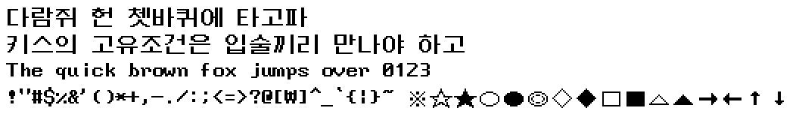
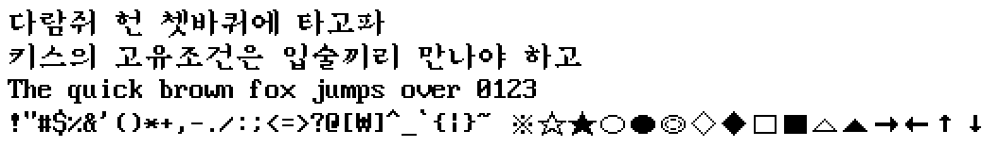
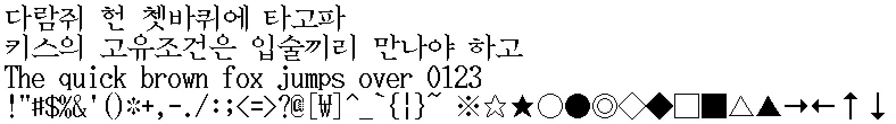
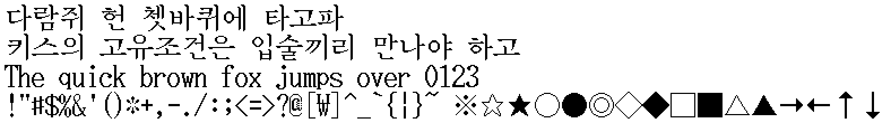

**English** | [한국어](dos-fonts.ko.md)

# Recipes: DOS-era raw fonts

Raw font files of DOS-era Korean programs: jamo-piece fonts (8x4x4 `HANGUL.FNT`, san, Dokkaebi, Kyrandia and others), the HWP 1.x/2.x and HWP 3.0 fonts, and KS X 1001 raw dumps (2,350 syllables in code order, or a 94 x 94 table).

**Before you start.** Commands run from the project root with `$OUT` set as in the [index](../recipes.md); every face ends with the checks of [Checking a face](../recipes.md#checking-a-face). Source files of proprietary fonts are supplied separately. A font kept inside a program rather than in a file of its own is in [Fonts inside programs and drivers](programs-and-drivers.md).

Up: [Recipes index](../recipes.md) · Related: [Fonts inside programs and drivers](programs-and-drivers.md), [Choosing the number of sets (벌 수)](sets.md), [Jamo sets](../jamo-sets.md).

## DOS-era raw fonts

DOS Hangul systems (Hangul BIOS, 이야기, 한메, san, Dokkaebi, games) stored jamo pieces, not syllables; a syllable was the
OR of an initial, a medial and an optional final, the set chosen by the other jamo. The tools read these raw files **by
exact byte size** (the maker's `detect.py` does the same, and a file of an unlisted size is "unknown") and by layout; there
is no header to sniff.

### Other DOS-era Korean fonts

| `--layout` | File | Bytes | Pieces |
|---|---|---|---|
| `844` | raw 8x4x4 (`HANGUL.FNT`, `*.KOR`, `$K*ZN16`), 16/24/40/48 px | 11,520 (or 11,522 with a 2-byte header), 25,920, 72,000, 103,680; 15,584 (DKB2, read as 16 px) | 360: 8 initial sets of 20, 4 medial of 22, 4 final of 28; slot 0 of each set blank |
| `844-ihnm` | SAGA IHNM 8x4x4 (medial sets swapped for ㄱ ㅋ) | 11,520+ | 360 |
| `844-hbios24` | HBIOS / Taebaek 3.5 24x30 (`GOTHIC24.FNT`, `MY24.FNT`) | 243,900 | the first 360 |
| `1044-san` | san 1.0 10x4x4 | 12,800 | 400 |
| `621` | 6x2x1 (Apple II era), byte-column glyphs | 6,144 | 192 |
| `dkb-printer-7x2x2` / `dkb-printer-12x4x4` | Dokkaebi printer `HANGUL16/24.FNT` / `HANGUL40/48.FNT` (`--face 0|1`) | 15,360 / 34,560; 176,000 / 253,440 | 240 / 440 a face |
| `kyra-lok` | Kyra LoK `MK15.BIT`, 15x15 | 11,550 | 385 |

    python3 tools/jamoset.py --layout 844 HANGUL.FNT --eng ENGLISH.FNT --symbols --check -o $OUT/MYFONT16J.SVF
    python3 tools/johab844.py HANGUL.FNT svf/dos/NEODG16.SVF $OUT/MYFONT16.SVF --eng ENGLISH.FNT     # precomposed instead

`--eng` takes a raw English font for ASCII (8×16 files: 2,048 or 4,096 bytes; larger companions are described below), scaled by whole numbers to the cell; `--base
FACE.SVF` keeps another face's non-syllable glyphs. The ascent defaults to 7/8 of the cell (`--ascent N`); 8x16 DOS
fonts put the baseline at row 13 or 14. `--check` composes all 11,172 syllables. `johab844.py` redraws the syllables of a
16x16 1 bpp base with the raw pieces and keeps the base's other glyphs. Synthetic (`tools/test_recipes.py`): a raw 8x4x4 font with an 8x16 English font (가 composed = the OR of raw slots 1 and 161, byte
for byte), a 6x2x1 font (1 lead / 2 tail classes, 6/2/1 sets), and a refit of a precomposed face (`--from-svf` over
NEODG16J, IoU 1.000).

Run on real fonts (2026-11-22; `--symbols --check` on every line, `--eng` where named; the sample line `안녕하세요 ABC 123`; "ink" is the
count of the render check; ASCII is drawn only when `--eng` is given, so a face without it measures five syllables):

| `--layout` | Source (font, product; proprietary unless noted) | Result |
|---|---|---|
| `844` | GOTHIC16.FNT, 11,520 bytes (Taebaek 3.5.1 Gothic 16), `--eng ROMAN16.FNT` of the same package | `15,756 bytes`, 344 pieces, 441 glyphs, identical to `johab844.py`'s syllables; `width=144 ascent=14 descent=2`, ink 566 |
| `844` | TBG1.FNT, 11,522 bytes with the 2-byte header (T-Hangul, an early Taebaek), `--eng ROMAN16.FNT` | `15,712 bytes`, the same 344 pieces and ink 566 |
| `844` | DKBBM.FNT, 15,584 bytes (Hangul Dokkaebi B Myeongjo), `--eng ROMAN16.FNT` | `15,744 bytes`, 441 glyphs, identical to `johab844.py`; ink 512 |
| `844` | MHANC24.PFT, 25,920 bytes (Taebaek 3.5.1 Myeongjo 24 px), `--eng MASCII24.PFT` (12,288 bytes, the 12x24 English font) | `23,088 bytes`, 344 pieces; `width=216 ascent=20 descent=4`, ink 916 |
| `844` | GHANC40.PFT, 72,000 bytes (Taebaek 3.5.1 Gothic 40 px), `--eng GASCII40.PFT` (30,720 bytes, the 20x40 English font) | `42,716 bytes`, 441 glyphs; `width=360 ascent=34 descent=6`, ink 3,078 |
| `844` | GHANC48.PFT, 103,680 bytes (Taebaek 3.5.1 Gothic 48 px), `--eng GASCII48.PFT` (49,152 bytes, 24x48) | `51,972 bytes`; `width=432 ascent=40 descent=8`, ink 3,921 (`line 440 56 0 48`: the line is wider than 400) |
| `844` | MHANC48.PFT, 103,680 bytes (Taebaek 3.5.1 Myeongjo 48 px), `--eng MASCII48.PFT` (49,152 bytes) | `54,112 bytes`; `width=432 ascent=40 descent=8`, ink 3,573 (`line 440 56 0 48`) |
| `844-hbios24` | GOTHIC24.FNT, 243,900 bytes (Taebaek 3.5.1, the HBIOS 24x30 layout) | `17,776 bytes`, 346 glyphs; `width=120 ascent=21 descent=3`, ink 551 |
| `844-hbios24` | MY24.FNT, 243,900 bytes (Taebaek 3.5.1 Myeongjo 24), `--eng GASCII24.PFT` | `23,136 bytes`; `width=216 ascent=20 descent=4`, ink 964 |
| `1044-san` | HANPL.KOR, 12,800 bytes (san 1.0, `font-kor/`; the san project on GitHub) | `13,988 bytes`, 382 pieces, 384 glyphs; `width=80 ascent=14 descent=2`, ink 328 |
| `621` | han_woori.fnt, 6,144 bytes ("Woori", iolo's 6x2x1-fonts on GitHub, Apple II era) | `6,584 bytes`, 183 pieces, 185 glyphs; ink 204 |
| `dkb-printer-7x2x2` | HANGUL16.FNT 15,360 bytes and HANGUL24.FNT 34,560 bytes (Hangul Dokkaebi 5.1, printer fonts), `--face 0` / `--face 1` | 16 px `8,928` / `8,868 bytes`, 229 pieces, ink 367 / 363; 24 px `12,068` / `11,872 bytes`, ink 542 / 537 |
| `dkb-printer-12x4x4` | HANGUL40.FNT 176,000 bytes and HANGUL48.FNT 253,440 bytes (the same), `--face 0` / `--face 1` | 40 px `38,704` / `38,624 bytes`, 420 pieces (422 glyphs), ink 1,595 / 1,766; 48 px `52,932` / `48,908 bytes`, ink 2,472 / 2,538 |
| `kyra-lok` | MK15.BIT, 11,550 bytes (The Legend of Kyrandia, Korean release) | `14,036 bytes`, 382 pieces, 15x15; `width=80 ascent=13 descent=2`, ink 344 |
| `844-ihnm` | none: no SAGA IHNM data was found | not run |

Every face composes all 11,172 syllables (`--check`); the piece counts are the used pieces, below the table's counts
because unused slots are dropped. `johab844.py` over the same GOTHIC16.FNT (`--eng ROMAN16.FNT`, base `svf/dos/NEODG16.SVF`):
`133,688 bytes`, 2,357 syllables from the raw font, 94 ASCII glyphs from ROMAN16.FNT, 454 other glyphs from the base,
`width=144 ascent=12 descent=4`, ink 566, and `svf2to3.py --check` keeps the size. The maker's `detect.scan` on copies of these
files gives kind `dos-raw` with the sizes 16 / 24 / 40 / 48 / 15 and the route `dos raw` for every one; GOTHIC16.FNT (labelled
"844, 844-ihnm", the two layouts share the size) also gets `johab844`, the 11,522-byte TBG1.FNT and the 15,584-byte DKBBM.FNT only `dos raw`;
the Dokkaebi printer files give one entry per face; GASCII24.PFT / MASCII24.PFT and ROMAN16.FNT are listed as "Latin companion".

**Pitfalls.** A file of the right size in another layout passes the size check; `jamoset.py` refuses it when the slot-0
fill pieces are not blank, but look at the result (`svfline.py line ... "가나다"`). Fonts with a 2-byte header
(T-Hangul) are read at offset 2. A 24 px or larger source needs a matching English font or `--base`: `--eng` takes the 8x16 fonts and the 12x24, 20x40
(30,720 bytes) and 24x48 (49,152 bytes) PFT English fonts of the same package, each scaled by whole numbers to the cell;
the desktop app pairs a 40 or 48 px face with the English font of its own height, the same family (G / M) first.

### IBM PC DOS 한글 (HBIOS V3.0)

The IBM Korea HBIOS V3.0 disk (1994 release, files dated 1998) keeps the Hangul BIOS (`HBIOS.EXE`) and its fonts in
separate files. The font files have no header; the driver reads their paths from the keys of its configuration file
`DOSK.INI` (`SBCS0816`, `SBCS1224`, `DBCS1616`, `DBCS2424`, `SPHJ1616`, `SPHJ2424`, `FONTPATH`). In the names HN is
half width (SBCS, English), ZN full width (DBCS, Hangul), SPHJ symbols and hanja (the scheme of Japanese DOS/V).

| Key | Files | Bytes | Contents |
|---|---|---:|---|
| `DBCS1616` | `$KGOZN16.FNT`, `$KMYZN16.FNT` | 11,520 | a 16x16 8x4x4 jamo set of 360 pieces (gothic, myeongjo) |
| `DBCS2424` | `$KMYZN24.FNT` | 243,900 | 2,710 cells of 24x30 (90 bytes, ink in rows 3-26): the 360 pieces of an 8x4x4 jamo set, then the 2,350 KS X 1001 syllables |
| `SBCS0816` | `$KSAHN16.FNT` (sans), `$KROHN16.FNT` (roman) | 4,096 | 256 English glyphs of 8x16 |
| `SBCS1224` | `$KROHN24.FNT` | 15,360 | 256 cells of 16x30 (60 bytes, the 12x24 art in rows 3-26) |
| `SPHJ1616` | `$KSPHJ16.FNT` | 192,512 | 16x16: the 1,128 symbol slots + 4,888 hanja (KS X 1001 order, 32 bytes) |
| `SPHJ2424` | `$KSPHJ24.FNT` | 541,440 | 24x30 cells: the 1,128 symbol slots + 4,888 hanja (90 bytes) |

`$KGOZN24.FNT` (gothic 24) is named in the configuration but not on the disk. `HJSPC.TBL` (12,508 bytes) is a code
table with no glyphs; the `*.DRV` files are display and keyboard drivers. The driver composes syllables from a jamo
set, so the 16 px files are the raw 8x4x4 of [the table above](#other-dos-era-korean-fonts) and the 24 px file is the
`844-hbios24` layout (the layout of Taebaek 3.5's `GOTHIC24.FNT` and `MY24.FNT`). The English half is the disk's SBCS
file: the 8x16 ones are raw 4,096-byte fonts, and `--eng` knows the 12x24 one in 16x30 cells by its size (15,360).

**Source and licence.** IBM Korea's proprietary firmware fonts, read from the user's own disk; for research only, and
no face in `svf/` is made from them. The images below show faces the recipe built as small samples only; the fonts and
the files made from them are not distributed. The font files are untrusted data: the tools only read bytes (`python3
-I`); `HBIOS.EXE` is not run. `$HB` is the folder with the disk's files (quote the names so the shell leaves their `$`
alone).

    python3 -I tools/jamoset.py --layout 844 "$HB"/'$KGOZN16.FNT' --eng "$HB"/'$KSAHN16.FNT' --symbols --check -o $OUT/KGOZN16J.SVF
    python3 -I tools/jamoset.py --layout 844 "$HB"/'$KMYZN16.FNT' --eng "$HB"/'$KROHN16.FNT' --symbols --check -o $OUT/KMYZN16J.SVF
    python3 -I tools/jamoset.py --layout 844-hbios24 "$HB"/'$KMYZN24.FNT' --eng "$HB"/'$KROHN24.FNT' --symbols --check -o $OUT/KMYZN24J.SVF

The 2,350 precomposed syllables of `$KMYZN24.FNT` start after the 360 jamo pieces (360 x 90 = 32,400 bytes), at row 3
of the cell (+9 bytes); the ASCII of `$KROHN24.FNT` starts at offset 6 (row 3 x 2 bytes), 60 bytes apart. The baseline
is row 22 of the 24-row cut: the 'H' of `$KROHN24.FNT` covers rows 5-24 of its 30-row cell, rows 2-21 of the cut, and
`jamoset.py` takes the row under it as the baseline of a 12x24 `--eng` face. The precomposed cut uses the same 22:

    python3 -I tools/rawcarve.py bdf "$HB"/'$KMYZN24.FNT' --offset 32409 --glyph 24x24 --stride 90 --chars ks-hangul --dense --ascent 22 -o $OUT/kmyzn24-hangul.bdf
    python3 -I tools/rawcarve.py bdf "$HB"/'$KROHN24.FNT' --offset 6 --glyph 12x24 --stride 60 --chars ascii --count 128 --ascent 22 -o $OUT/krohn24.bdf
    python3 -I tools/bdfface.py --hangul $OUT/kmyzn24-hangul.bdf --ascii $OUT/krohn24.bdf --cell 24x24 --chars-from $OUT/ks.txt -o $OUT/KMYZN24.SVF

The symbols and hanja are cut with the slot map of `tbmfont.py map`, as `HFONT.SYS` in the [Windows
recipe](windows.md#windows-hfont-sys) (the SPHJ files have no header and start with the symbol block):

    python3 -I tools/tbmfont.py map --blocks symbols,hanja -o $OUT/sphj.map
    python3 -I tools/rawcarve.py bdf "$HB"/'$KSPHJ16.FNT' --offset 0 --glyph 16x16 --chars map --map $OUT/sphj.map -o $OUT/ksphj16.bdf
    python3 -I tools/rawcarve.py bdf "$HB"/'$KSPHJ24.FNT' --offset 9 --glyph 24x24 --stride 90 --chars map --map $OUT/sphj.map --ascent 22 -o $OUT/ksphj24.bdf

Measured (check line `안녕하세요 ABC 123`; the ink of the 24 px faces with `line 400 32 0 24`):

| Face | Bytes | Glyphs | measure | Ink |
|---|---:|---|---|---:|
| `KGOZN16J.SVF`, gothic 16 px jamo set (`--eng $KSAHN16`) | `15,736` | 441 (344 pieces) | `width=144 ascent=14 descent=2` | 535 |
| `KMYZN16J.SVF`, myeongjo 16 px jamo set (`--eng $KROHN16`) | `15,864` | 441 (344 pieces) | `width=144 ascent=14 descent=2` | 509 |
| `KMYZN24J.SVF`, myeongjo 24 px jamo set (`--eng $KROHN24`) | `23,380` | 441 (344 pieces) | `width=216 ascent=22 descent=2` | 966 |
| `KMYZN24.SVF`, the same file's 2,350 precomposed syllables + `$KROHN24` ASCII | `220,248` | 2,447 | `width=216 ascent=22 descent=2` | 983 |
| `ksphj16.bdf` / `ksphj24.bdf` | | 5,872 / 5,871 | | |

For all three jamo sets `--check` composes the 11,172 syllables, and the two 16 px ones equal the syllables of
`johab844.py` ("identical to johab844.py"). `svf2to3.py --check` leaves all four faces as they are. `fontmetrics.py`
reports, for the 16 px jamo sets, only the U+2026 of `--symbols` reaching 1 px past its advance. The ascent 22 of the
24 px jamo set is the baseline of its `--eng` face (the row under the ink of 'H'), which `jamoset.py` takes by default
for a 12x24 English face; the precomposed face is cut with the same `--ascent 22`, so both stand on the English
baseline.

**The jamo set against the same file's precomposed syllables.** `$KMYZN24.FNT` holds both, so they can be compared.
The 2,350 KS X 1001 syllables composed by the jamo set (`KMYZN24J.SVF`), against the file's own precomposed syllables
in the same 24x24 box: 0 exactly the same, mean IoU 0.450 (p5 0.211). Moving the box (-2..2 across, -3..3 down) does
not help. With 1 px tolerance the F1 is 0.947 on average (p5 0.823), and the ink totals are nearly equal (292,819
pixels precomposed, 294,308 composed). The strokes have the same shapes; the pieces sit 1 px elsewhere from syllable
to syllable: the precomposed glyphs move each jamo to suit the vowel and the final (the ㅎ and ㅓ of `헌`, for example).
The ㅟ, ㅝ, ㅢ families differ most (`뗍 찌 츤 쮜 쒼 쭤 윗 귓 킥 쪄`). The other way round, fitting an 8x4x4 to the precomposed
face with `jamoset.py --layout 844 --from-svf $OUT/KMYZN24.SVF --mask-font none --check` gives `fit: 2350 syllables,
IoU 0.719 (p5 0.457), F1 tol1 0.986`, 17 exact, `30,664 bytes`. The file's jamo set is what HBIOS draws; the
precomposed face is a design touched up syllable by syllable (about 9.4 times the bytes).

*IBM HBIOS V3.0 gothic 16 px: the `$KGOZN16.FNT` jamo set, `$KSAHN16.FNT` English, `$KSPHJ16.FNT` symbols, x2*

*IBM HBIOS V3.0 myeongjo 16 px: the `$KMYZN16.FNT` jamo set, `$KROHN16.FNT` English, `$KSPHJ16.FNT` symbols, x2*

*The IBM HBIOS V3.0 myeongjo 24 px jamo set (the 360 pieces of `$KMYZN24.FNT`), `$KROHN24.FNT` English, `$KSPHJ24.FNT` symbols, x2*

*The 2,350 precomposed syllables of the same `$KMYZN24.FNT` (same English and symbols), x2: compare with the jamo set above*

The images are drawn by `tools/doc_figures_hbios.py --disk "$HB"`, which builds the faces with the commands above
(`--check` compares with the images in the repository byte for byte; [Tool reference](../tools.md)).

### HWP 1.x and 2.x fonts

Hangul and Computer's DOS word processor shipped its own bitmap fonts. `tools/hwpfont.py` reads them - HWP 1.x `.SFT`
(screen) and `.PFT` (printer), and HWP 3.0 `.FNT` ([below](#hwp-30-fnt-fonts)) - and writes Unicode BDFs;
`jamoset.py --layout hwp1` makes an HWP 1.x Hangul face a jamo set by HWP's own composition rule. The supported layouts are described in [hwpfont.py](../../tools/hwpfont.py):

- HWP 1.x (1989-1990): a 32-byte "HWP Font Editor v1.0" header (the `HANGUL3.PFT` of `HPFT3.LZH` has "FE" instead), the
  glyph count (big-endian 16 bits) at 0x1C, (width - 1, height - 1) at 0x1E, then the glyphs; the file is exactly 32 +
  count x glyph bytes. Screen fonts (16 rows) are row-major, printer fonts (24 rows, a 24-pin head) column-major, three
  bytes a column, MSB at the top.
- `HANGUL.SFT` (16x16, 1,193 glyphs) and `HANGUL1/2/3.PFT` (24x24, 980) hold three faces (HWP's style 0, 1, 2: Myeongjo,
  Gothic, Saemmul by its menu order, not proven). A face is its initial, vowel and final piece sets (31, 29 and 31 pieces a
  set): 10/4/4, 7/2/2 and 6/2/2 sets in the SFT, 7/2/3, 7/2/2 and 5/2/2 in a PFT.
- `ASCII.SFT` (8x16) and `ASCII.PFT` (14x24): 991 glyphs, 109 others and then six faces of the codes 0x20-0xB2
  (Myeongjo, Gothic, superscript, subscript, italic, script). `HANJA.SFT`: the 4,888 KS X 1001 hanja. The symbol files
  (`SPECIAL1/2`, `JAPAN`, `USER1/2`, `SYSTEM.PFT`) are recognised (`hwpfont.py info`) and not converted.

**A jamo set, not a fit.** HWP.EXE composes a syllable as the OR of three pieces whose sets it picks from the initial's
class (ㄱ ㅋ or the rest), whether there is a final, and the vowel's shape class. That is a set rule of the JSET kind, and
with 2 x 2 classes and at most 10/4/4 sets it fits the standard JSET limits as it is: `--layout hwp1` writes HWP.EXE's
tables of the chosen face (`--face 0..2`), and every syllable composes bit for bit. `--check` composes all 11,172
syllables from the written face and compares each with `hwpfont.py`'s own composition, which reads the pieces through
HWP's tables directly. So the jamo set is the native form of these fonts (10-18 KB instead of about 120 KB at 16 px); a
precomposed face of the same syllables comes from `hwpfont.py bdf` and `mkfont.py` (the maker's `hwp bdf + mkfont`).
The pieces HWP keeps for old Hangul (initials 20-31, vowels 22-29, finals 28-31) belong to no modern precomposed Unicode Hangul syllable and are
left out.

    python3 -I tools/hwpfont.py info HANGUL.SFT
    python3 -I tools/jamoset.py --layout hwp1 --face 1 HANGUL.SFT --eng ASCII.SFT --check -o $OUT/HWPS1J.SVF
    python3 -I tools/hwpfont.py bdf HANGUL1.PFT --face 1 --ascii ASCII.PFT -o $OUT/hwp24.bdf
    python3 tools/mkfont.py $OUT/hwp24.bdf $OUT/hwp24.tmp --size 24 --bpp 1 --unicode ascii,ksx1001-hangul
    python3 tools/svf2to3.py $OUT/hwp24.tmp $OUT/HWP24.SVF --profile default

`--eng` (jamoset.py) and `--ascii` (hwpfont.py) take an HWP English file as it is, face 0 of its six unless `--eng-face N`
/ `--ascii-face N` says otherwise, besides every English font `--eng` read before; `hwpfont.py bdf --syllables all`
writes all 11,172 syllables of an HWP 1.x face instead of the 2,350 of KS X 1001. A precomposed BDF takes the English
face's baseline as its ascent (12 for `ASCII.SFT`, 20 for `ASCII.PFT`; `--ascent` sets another); `jamoset.py` puts an
8x16 English font in a 16 px cell at 7/8 (ascent 14) as for every DOS font.

Run on HWP 1.20 for DOS (Hangul and Computer, 1989-1990; archive.org `hwp-120`; proprietary) on 2026-11-23, the English
font of the same folder, face 0:

| Source | Command | Result |
|---|---|---|
| `HANGUL.SFT` (38,208 bytes), faces 0 / 1 / 2, `--eng ASCII.SFT` | `jamoset.py --layout hwp1 --face N --check` | `16,996` / `11,188` / `10,468 bytes`, 382 / 229 / 210 pieces (10/4/4, 7/2/2, 6/2/2 sets); `width=144 ascent=14 descent=2`, ink 497 / 403 / 363 |
| `HANGUL1.PFT` (70,592 bytes), faces 0 / 1 / 2, `--eng ASCII.PFT` | the same | `18,224` / `16,712` / `14,252 bytes`, 256 / 229 / 191 pieces; `width=232 ascent=20 descent=4`, ink 886 / 886 / 818 |
| `HANGUL.SFT` face 1 and `ASCII.SFT` | `hwpfont.py bdf --face 1`, `mkfont.py --size 16`, `svf2to3.py` | `122,440 bytes`, 2,350 syllables; `width=144 ascent=12 descent=4`, ink 403 |
| `HANGUL1.PFT` face 1 and `ASCII.PFT` | the same at `--size 24` | `218,748 bytes`; `width=232 ascent=20 descent=4`, ink 886 |

Every jamo line printed `hwp1: 11172 syllables identical to the HWP 1.x rule (hwpfont.py)`. `tools/test_hwpfont.py` also checks recorded syllable hashes when `JOHAB_FONTS` supplies the optional source files.

HWP 2.x for DOS keeps its fonts as `.HFT` files (below); the one HWP 2.x screen font that is a plain raw 8x4x4 is
`HMJ.FNT` (11,520 bytes) of the Hangul 2.1 PRO disks (disk 13), read as any `844` font: `python3 tools/jamoset.py
--layout 844 HMJ.FNT --eng ROMAN16.FNT --check -o $OUT/HMJ.SVF` writes `15,700 bytes` and composes all 11,172 syllables,
identical to `johab844.py`.

**Not read:** the `.HFT` fonts of HWP 2.0 ("HWP 2.0 font file" header), 2.1 and 3.0 ("Han Unified Font File 1.0"; the
HWP 3.0 CD's `HNC/FONT` has 160 of them). Their headers were looked at: they are scalable outline or stroke fonts (the HWP
2.0 header names a 1,200-unit square), not bitmaps, and no tool here decodes them. The HWP 1.x symbol files are listed
and not converted; `HANJA.SFT` (and HWP 3.0's `HAJ16_0.FNT`) becomes a BDF of the 4,888 hanja at their Unicode code
points (`hwpfont.py bdf`), which the maker does not offer as a Hangul-face route; `mkfont.py --unicode ksx1001` can select Hanja from the BDF.

**The maker** (local mode only, as for the Mac fonts: an upload job lists each HWP file as "HWP font: not converted here
(local-only mode)") lists an HWP 1.x Hangul file as three `hwp1` entries, one a face ("HWP 1.x Hangul (printer .PFT,
24x24), face 1 of 3 (Gothic by HWP's menu order)"), with the routes `hwp1` (jamo, native) and `hwp bdf + mkfont`
(precomposed), and the English files as Latin companions ("HWP 1.x English (--eng, 14x24; face 0 of 6)"), offered to HWP and KS faces only (a DOS raw font's routes read the raw English fonts); the other
files are `other` ("HWP 1.x font: 4888 hanja of 16x16, not a Hangul face"). Checked with `detect.scan(..., local=True)`
and `routes.routes` on copies of the files above, and every route's commands run on them (2026-11-23): the `hwp1` route
writes the 16,712-byte face of the table, `hwp bdf + mkfont` the 218,748-byte one.

### HWP 3.0 FNT fonts

HWP 3.0 for DOS (1995; `HNCAPP/HDR30/FONT` of the CD) keeps its bitmap fonts as `.FNT` files with a 72-byte header:
"FNT" 01, a type byte (0 English, 1 Hangul, 2 hanja), 01, the width and height (little-endian 16 bits) at 6 and 8, the
glyph count (32 bits) at 0x10 and the font's name in Johab at 0x14 ("고딕체 16*16"); then row-major glyphs. A Hangul FNT
holds the 2,350 KS X 1001 syllables in code order, precomposed, from 가; a 16 px one (`HAN16_*.FNT`, 86,792 bytes) adds an
8x4x4 set of 360 jamo pieces after them for the other syllables, which `jamoset.py --layout 844-hwp3` reads (its fill
slots checked, `--check` equal to `johab844.py`). `HAN24_*` / `HAN40_0` / `96MT` hold the 2,350 only (HAN24's header
still counts 2,710). The English FNTs hold the codes from 0x20 (147 glyphs; `ENG40_0` 96).

    python3 -I tools/hwpfont.py bdf HAN16_0.FNT --ascii ENG16_3.FNT -o $OUT/han16.bdf
    python3 tools/mkfont.py $OUT/han16.bdf $OUT/han16.tmp --size 16 --bpp 1 --unicode ascii,ksx1001-hangul
    python3 tools/svf2to3.py $OUT/han16.tmp $OUT/HAN16.SVF --profile default
    python3 -I tools/jamoset.py --layout 844-hwp3 HAN16_0.FNT --eng ENG16_3.FNT --check -o $OUT/HAN16J.SVF
    python3 tools/jamoset.py --layout 844 --from-svf $OUT/HAN24.SVF --mask-font none --check -o $OUT/HAN24J.SVF

Run on the HWP 3.0 DOS CD (Hangul and Computer, 1995; archive.org `hwp-30-dos`; proprietary) on 2026-11-23, the precomposed
faces with `hwpfont.py bdf`, `mkfont.py` at the cell size and `svf2to3.py --profile default`:

| Source | Command | Result |
|---|---|---|
| `HAN16_0.FNT` ("고딕체 16*16"), `--ascii ENG16_3.FNT` ("고딕체 8*16") | precomposed | `115,112 bytes`, 2,350 syllables; `width=144 ascent=12 descent=4`, ink 523 |
| the same, `--eng ENG16_3.FNT` | `jamoset.py --layout 844-hwp3 --check` | `15,432 bytes`, 344 pieces, identical to `johab844.py`; `width=144 ascent=14 descent=2`, ink 523 |
| the precomposed `HAN16_0` face | `jamoset.py --layout 844 --from-svf --mask-font none` | `16,308 bytes`, IoU 0.994 (2,166 of 2,350 exact) |
| `HAN16_1` / `_2` / `_3` / `_4` (명조체, 샘물체, 필기체, 모양체), `--ascii ENG16_0.FNT` | precomposed | `118,020` / `122,100` / `123,468` / `115,272 bytes`; ink 496 / 363 / 521 / 501 |
| `HAN24_0.FNT` ("고딕체 24*24", 169,272 bytes), `--ascii ENG24_0.FNT` (12x24) | precomposed | `218,472 bytes`; `width=216 ascent=22 descent=2`, ink 972 |
| `HAN24_1.FNT` ("명조체 24*24"), `--ascii ENG24_0.FNT` | precomposed | `220,044 bytes`, ink 984 |
| `HAN40_0.FNT` ("명조체 40*40", 470,072 bytes), `--ascii ENG40_0.FNT` (20x40) | precomposed | `492,420 bytes`; `width=360 ascent=34 descent=6`, ink 2,289 |
| `96MT.FNT` ("문화부 바탕체 96*96", 2,707,272 bytes), no English font | precomposed, `--size 96` | `2,154,232 bytes`, all 2,350 syllables; `width=576 ascent=84 descent=12`, ink 6,058 (`line 576 104 0 96`; the BDF's blank U+0020 steps 48) |
| the `HAN24_0` / `HAN40_0` faces | `jamoset.py --layout 844 --from-svf --mask-font none` | `28,928` / `64,904 bytes`, IoU 0.819 / 0.687 |

The 16 px FNTs' 2,350 syllables are not all their jamo set's composition: 2,083 (`HAN16_0`), 1,788 (`_1`), 2,221 (`_2`),
375 (`_3`, the handwriting face) and 1,700 (`_4`) of them equal what the 8x4x4 set composes; the others were drawn whole.
So the precomposed face is the better 2,350 and the jamo set the way to all 11,172. The maker (local mode) lists a Hangul
FNT as `ks-raw` ("HWP 3.0 FNT Hangul 16x16: 2,350 KS X 1001 syllables + an 8x4x4 jamo set") with `hwp bdf + mkfont`,
`hwp3 844` (a 16 px one only) and the experimental `hwp bdf + from-svf fit`, and the English FNTs as Latin companions
("HWP 3.0 English (--eng, 12x24)"); `HAJ16_0.FNT` is `other`.

### KS X 1001 raw dumps

A raw dump of the 2,350 precomposed KS X 1001 syllables (one bitmap per syllable in code order, row-major, no header, as
some DOS and embedded systems keep them) is read by `hwpfont.py` by its size: 2,350 x the bytes of a 16, 24, 32, 40 or
48 px square glyph (75,200, 169,200, 300,800, 470,000 or 676,800 bytes), its first and last glyph inked and different.
It writes the dump as a Unicode BDF, with the ASCII of any English font `--eng` reads; the maker lists such a file as
`ks-raw` ("KS X 1001 raw dump Hangul 24x24: 2,350 KS X 1001 syllables", in upload and local mode, as it reads DOS raw
fonts by size) with `hwp bdf + mkfont` and the experimental `hwp bdf + from-svf fit`. `jamoset.py --layout 844` still
refuses one (`size 169200 is not an 8x4x4 size`): a dump is precomposed, and its jamo set is a fit.

    python3 -I tools/hwpfont.py bdf GHAN24.PFT --ascii GASCII24.PFT -o $OUT/ghan24.bdf
    python3 tools/mkfont.py $OUT/ghan24.bdf $OUT/ghan24.tmp --size 24 --bpp 1 --unicode ascii,ksx1001-hangul
    python3 tools/svf2to3.py $OUT/ghan24.tmp $OUT/GHAN24.SVF --profile default
    python3 tools/jamoset.py --layout 844 --from-svf $OUT/GHAN24.SVF --mask-font none --check -o $OUT/GHAN24J.SVF

Run on Taebaek 3.5.1 (`FNT/`, proprietary) on 2026-11-23, each with the English font of its own family and height:

| Source | Result |
|---|---|
| `GHAN24.PFT` (Gothic 24 px, 169,200 bytes), `--ascii GASCII24.PFT` (12x24) | `216,192 bytes`, 2,350 syllables; `width=216 ascent=20 descent=4`, ink 1,133; the jamo set `33,428 bytes`, 344 pieces, IoU 0.710, ink 1,096 |
| `MHAN24.PFT` (Myeongjo 24 px), `--ascii MASCII24.PFT` | `213,812 bytes`; `width=216 ascent=20 descent=4`, ink 907; the jamo set `31,664 bytes`, IoU 0.623 |
| `GHAN40.PFT` (470,000 bytes), `--ascii GASCII40.PFT` (20x40) | `487,808 bytes`; `width=360 ascent=34 descent=6`, ink 3,112 |
| `GHAN48.PFT` (676,800 bytes), `--ascii GASCII48.PFT` (24x48) | `663,328 bytes`; `width=432 ascent=40 descent=8`, ink 3,926 (`line 440 56 0 48`) |

The fit is poor (IoU 0.710) because the face is a whole-syllable design, not an OR of pieces; the same IoU came from
the BDF `rawcarve.py` cut before `hwpfont.py` existed. `rawcarve.py bdf --dense` still cuts a dump that sits inside a
bigger file (`--offset`), and a dump of the whole 94 x 94 table takes `--grid 0xA1,0xA1,94` instead
([OS/2 Korean fonts](os2.md#os2-korean-fonts-완성형-to-a-precomposed-face-and-a-jamo-set)):

    python3 -I tools/rawcarve.py bdf GHAN24.PFT --glyph 24x24 --chars ks-hangul --dense --ascent 22 -o $OUT/ghan24.bdf

[Recipes index](../recipes.md) · [Tool reference](../tools.md)
