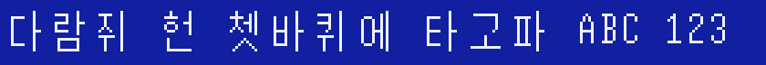
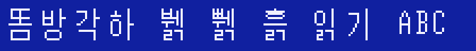
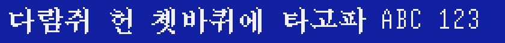
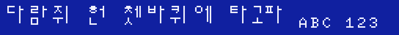

**English** | [한국어](rom-msx.ko.md)

# Recipes: Korean MSX fonts (MSX2 and MSX1)

The Hangul fonts of Korean MSX machines (Daewoo, Goldstar): the MSX2 Daewoo jamo-set font in the SUB-ROM (exact), the CPC-400S 256 KB precomposed font ROM, and the MSX1 BIOS jamo cells laid out as the machine does, found with the openMSX harvest; coding-agent prompts first, then the commands by hand.

**Before you start.** Commands run from the project root with `$OUT` set as in the [index](../recipes.md); every face ends with the checks of [Checking a face](../recipes.md#checking-a-face). The ROMs are proprietary and supplied separately; the MSX1 harvest needs openMSX. The method is the one of [Fonts inside programs and drivers](programs-and-drivers.md), which also writes `$OUT/ks.txt`.

Up: [Recipes index](../recipes.md) · Related: [Fonts inside programs and drivers](programs-and-drivers.md), [Choosing the number of sets (벌 수)](sets.md), [Jamo sets](../jamo-sets.md), [Tool reference](../tools.md).

<a id="korean-msx-fonts-msx2-and-msx1"></a>

## Korean MSX fonts (MSX2 and MSX1)

The Korean MSX computers (Daewoo, Goldstar; 1984-1988) keep three Hangul fonts in ROM, each drawn by a different
rule:

| Machines | Where the font is | Kind | Result |
|---|---|---|---|
| Daewoo CPC-300, CPC-300E, CPC-330K, CPC-400S (MSX2) | upper 16 KB of the SUB-ROM (`cpc-300_msx2sub.rom`), on the CPC-400S the first 16 KB of `CPC-400S.U44` | 16x16 jamo pieces: 6 initial sets x 20, 2 medial x 28, 2 final x 29 | exact jamo set, all 11,172 syllables |
| Daewoo CPC-400, CPC-400S (MSX2) | 256 KB font ROM `cpc-400s_hangulfont.rom` behind I/O ports D8h/D9h | 16x16 precomposed, the machine's own order; code -> slot tables in the "Kanji control ROM" (last 16 KB of `CPC-400S.U44`) | precomposed face of the 2,591 syllables the driver can draw |
| Daewoo DPC-100, DPC-180, DPC-200, Goldstar FC-80U (MSX1) | BIOS character table at 0x1B49 (`dpc-200_basic-bios1.rom`) | 8x8 jamo cells, a syllable = 2 text rows x 1 or 2 columns | precomposed face; the layout rule was read off the running machine |

The Hangul BASIC ROMs (`cpc-300_hangul.rom`, `dpc-200_hangul.rom`, `fc-80u_hangul.rom`) hold the drivers (the
composing code and the MSX-TUTOR program), no glyphs. The recommended path is to give the work to a coding agent with
the prompts of [With a coding agent](#msx-with-a-coding-agent-recommended); the commands after them are the by-hand
path. File names below are the openMSX system ROM names; `$ROMS` is the
folder holding them.

**Source and licence.** The fonts are Daewoo and Goldstar firmware designs in dumps of proprietary ROM chips. Use them
for research; no face of `svf/` is made from them. The openMSX system ROM set is on file-hunter's download server
(folder `System ROMs/RomDB SystemROMs OpenMSX`; the server refuses curl's default User-Agent with HTTP 405, a browser
User-Agent with the folder as Referer works). The openMSX machine files (`share/machines/Daewoo_CPC-300.xml`,
`Daewoo_CPC-400S.xml`, `Daewoo_DPC-200.xml`, `Goldstar_FC-80U.xml`) give each ROM's file name and SHA1; check the files
with `sha1sum` before use:

| File | Bytes | SHA1 |
|---|---:|---|
| `cpc-300_msx2sub.rom` | 32,768 | `fb51c505adfbc174df94289fa894ef969f5357bc` |
| `cpc-300e_msx2sub.rom` | 32,768 | `09f7d788698a23aa7eec140237e907d4c37cbfe0` |
| `CPC-400S.U44` | 65,536 | `6b640c1d8cbeda6ca7d6facd16a206b62e059eee` |
| `cpc-400s_hangulfont.rom` | 262,144 | `22d5f4e522250dc5eb17e15b68f4a51bb752cba1` |
| `dpc-200_basic-bios1.rom` (= DPC-100, DPC-180, FC-80U BIOS) | 32,768 | `171b587bd5a947a13f3114120b6e7baca3b57d78` |

The tools only read the ROMs (`python3 -I`); the machine is run only inside the emulator (openMSX) [Korean MSX machines
and openMSX](../recipes.md#ref-msx).

<a id="msx-with-a-coding-agent-recommended"></a>

### With a coding agent (recommended)

Most of this work is reading: hex dumps, glyph sheets, Z80 code, emulator screens. Hand it to a coding agent that can
run commands in this repository, such as Claude Code, with one of the three prompts below. Fill in the angle brackets.
The subsections after the prompts are the by-hand path: the same steps, run by you, with the results the prompts
should reproduce. Like the prompt in [The prompt](programs-and-drivers.md#the-prompt), each prompt names its inputs, the tools to use, the
safety rules, the acceptance numbers and the outputs.

**(a) Find and decode a font in an MSX ROM set** (a jamo-piece font like the Daewoo SUB-ROM's, or a precomposed one
like the CPC-400S font ROM):

```
Find the Hangul font of the MSX machine <MACHINE, e.g. Daewoo CPC-300> in the ROM files <$ROMS/FILE ...> (the
openMSX system ROMs; the machine file <openMSX share/machines/MACHINE.xml> says which file is mapped where), decode
how the Hangul driver draws a syllable, and build SVF faces with the tools of this repository (docs/recipes/rom-msx.md,
"Korean MSX fonts"). Work in $OUT, outside the repository.

Safety: the ROMs are untrusted data. Read them only with `python3 -I` (tools/binscan.py, tools/rawcarve.py, or
scripts you write in $OUT and run with -I); never execute ROM code on the host (Z80 disassembly is fine: z80dasm, or a
small disassembler you write). Nothing taken from the ROMs goes into the repository: no ROM bytes, glyph images,
BDFs or SVFs; a compose spec holds offsets and rules only.

1. Check every file against the SHA1 in the machine file (`sha1sum`). `binscan.py info FILE --block 4096` for each:
   fonts and tables stay below program code (code about 7 bits a byte; the Daewoo jamo font blocks 1.8-5.5, the
   CPC-400S font ROM 3-6.5).
2. Look for glyphs: `binscan.py runs FILE --glyph 16x16` (also 8x16 and 8x8), `binscan.py ascii FILE` (--height 16
   and 8), and `binscan.py render FILE --offset O --glyph WxH --count 256 --png $OUT/o.png` on every candidate; read
   the PNGs. Jamo pieces look like single consonants and vowels in several positions; a precomposed font shows whole
   syllables. Draw long strips (--glyph 16x512) where nothing lines up.
3. Find the driver that draws them: search the ROMs for the font's address as a little-endian word (pointer tables
   in the ROM header, e.g. at 4014h of a SUB-ROM) and for I/O port numbers of a font device (OUT (D8h) / OUT (D9h)).
   Disassemble the routine that reads the pieces and write down its tables: piece addresses and strides, how the
   Johab code is split, which set it picks for each vowel and final, which slots it skips. For a precomposed font,
   find the table that turns a character code into a glyph slot.
4. Jamo pieces: write the rule as a rawcarve.py compose spec ($OUT/SPEC.json; the format is in the rawcarve.py
   docstring; "slots" renumbers a set whose numbering skips stored slots), with offsets from the start of the font
   block cut by `rawcarve.py cut`. Precomposed: write the code -> slot list as "SLOT U+XXXX" lines for
   `rawcarve.py bdf --chars map`.
5. Build: `jamoset.py --layout spec --spec $OUT/SPEC.json BLOCK --eng ENG --check -o $OUT/<NAME>J.SVF`, and
   `rawcarve.py compose ... --syllables all` + `rawcarve.py bdf --chars ascii` + `bdfface.py` for the precomposed face
   (or `rawcarve.py bdf --chars map` + `bdfface.py`).

Acceptance (report each number):
- `jamoset.py --check` prints "all 11172 syllables identical to rawcarve.py compose";
- a second implementation of the driver's routine, written by you straight from the disassembly in a script of its
  own (not from the spec), composes the same pixels: 0 of 11,172 syllables differ (for a precomposed font: the slot
  list equals the driver's table for every code it accepts, and no listed glyph is blank);
- the machine draws the same glyphs: check a few syllables on the emulator screen as in prompt (c).
Outputs: $OUT/SPEC.json (or the slot list), the SVF faces, and a short report: the files and their SHA1, the offsets
and tables found (with the routine addresses), the commands, the sizes and glyph counts, `svfline.py measure` and the
ink of "안녕하세요 ABC 123", the acceptance numbers, and what you could not resolve.
```

**(b) The emulator method, for a layout no table holds** (the Korean MSX1, where the Hangul ROM arranges BIOS cells by
code):

```
Find out how the Korean MSX1 <MACHINE, e.g. Daewoo_DPC-200> lays out each Hangul syllable in 모아쓰기 mode, by
running the machine in openMSX, and then build the font from the BIOS character table alone (docs/recipes/rom-msx.md,
"Korean MSX fonts", MSX1). Work in $OUT, outside the repository.

Safety: the ROMs are untrusted data. Run their code only inside openMSX (headless: `xvfb-run -a openmsx -machine
MACHINE -script $OUT/s.tcl`, always under `timeout`); read ROM files on the host only with `python3 -I`. Nothing from
the ROMs goes into the repository (no ROM bytes, dumps, screenshots, BDFs or SVFs).

For a machine of the Daewoo / Goldstar family start with `python3 -I tools/msx1_harvest.py MACHINE $OUT/h --emu EMU`
(or `--openmsx BIN`), which does steps 1, 3 and 4 below, and go on at step 5. For another machine, read
tools/msx1_harvest.py and adapt its stored bytes (step 2) and screen geometry in a script of your own in $OUT.

1. Boot the machine from a Tcl script. `set throttle off` makes emulated time run as fast as the host allows (use it
   for typing and dumping; no frames are drawn, so switch it on again before a `screenshot`). Write results to files
   from Tcl: `puts` output does not reach the shell. RAM is the debuggable "Main RAM".
2. Find how a typed syllable is stored: `type "poke -851,0\r"` (모아쓰기), type `10 rem ` and 2-set keys in Hangul
   mode (the Han/Eng key is key matrix row 6 bit 4: `keymatrixdown 6 0x10`, then `after time 0.3 { keymatrixup 6
   0x10 }`: a press shorter than a keyboard scan is missed), dump RAM
   (`debug read_block "Main RAM" 0 0x10000`) and read the BASIC line (the program starts at the word at F676h).
3. Type a BASIC program that waits for a flag in RAM, PRINTs the syllables a Tcl procedure has written at C000h (one
   length byte and the jamo bytes per syllable), 77 to a screen at LOCATE positions (the text window starts 2 columns
   in, so 7 slots of 4 columns a row), then sets a done flag. For each screen dump the SCREEN 1 name table
   (`debug read_block VRAM 0x1800 768`) and once the pattern table (`debug read_block VRAM 0 2048`); 146 screens
   cover all 11,172 syllables (145 x 77 + 7: pad the last batch to 77 with copies of its last syllable, or the
   program prints stale bytes from the batch before). Take one `screenshot` (throttle on) as a visual check.
4. Write $OUT/h.index (the syllables in order, one hex code point a line), $OUT/h.names and $OUT/h.patterns, and
   derive the rule: group the syllables by vowel kind (vertical, ㅗㅛㅜㅠㅡ, compound) and by final (none, one cell,
   two cells) and read which cell codes fill each position.
5. Check the rule with `python3 -I tools/msxfont.py msx1-verify $OUT/h --bios BIOS`. If it differs from
   tools/msxfont.py's layout(), say where and why (another machine may use another rule); do not change the tool to
   fit unexplained data.
6. Build without the emulator: `python3 -I tools/msxfont.py msx1 BIOS -o $OUT/msx1.bdf`, then
   `python3 tools/mkfont.py $OUT/msx1.bdf $OUT/MSX1.SVF --size 16 --bpp 1 --unicode ascii,ksx1001-hangul`.

Acceptance: "layout rule vs the machine: 11172 of 11172 syllables identical"; the VRAM pattern table equals the BIOS
table in 255 of 256 cells (0xFF is the cursor); the same counts on a second machine of the family if you have its
ROMs. Outputs: the Tcl script and the harvest files in $OUT, $OUT/MSX1.SVF, and a short report: the stored bytes found
in step 2, the rule as a table, the verify output, the face's size, glyph count, `svfline.py measure` and ink of
"안녕하세요 ABC 123", the run time, and the pitfalls you hit.
```

**(c) Check a decoded font against the machine screen:**

```
Check the face <$OUT/FACE.SVF>, decoded from the ROMs of <MACHINE>, against what the machine itself draws, in openMSX
(docs/recipes/rom-msx.md, "Korean MSX fonts", "The emulator as ground truth"). Work in $OUT, outside the repository.

Safety: run ROM code only inside openMSX under `xvfb-run` and `timeout`; read files on the host only with `python3 -I`;
nothing from the ROMs, the screens or the dumps goes into the repository.

1. Boot the machine (throttle on for screenshots; the CPC-400S needs about 20 s, the others about 12 s) and make it
   draw known text: a screen the firmware shows by itself (the CPC-300's MSX-TUTOR), or `type` a PRINT of syllables
   (Daewoo MSX2: Hangul in SCREEN 9, strings are Johab codes, `print chr$(&H88)+chr$(&H61)` is 가; in Tcl escape `$` as
   `\$` and `&` as `\&`; MSX1: 모아쓰기 after `poke -851,0`). Pick 20 syllables or more that use every set the rule
   distinguishes (each vowel kind with and without a final, double finals, ㅍ/ㅎ initials).
2. Read what was drawn exactly: in a text mode the name and pattern tables (`debug read_block VRAM ...`); in a bitmap
   mode (SCREEN 5-8; the Daewoo SCREEN 9 is built on SCREEN 6) the VRAM pixels of the text area. `screenshot -raw
   FILE.png` gives the raw MSX screen at 320x240, `screenshot -raw -doublesize FILE.png` at 640x480, which keeps
   every pixel of a 512-wide mode (SCREEN 6, 7 and the Daewoo SCREEN 9; the CPC-300's MSX-TUTOR runs in SCREEN 7);
   a plain `screenshot` is scaled and filtered, use it only to look.
3. Draw the same text from the face (`svfline.py line`, or the glyph rows from jamoset.parse_svfn) and compare pixel
   by pixel at the position the machine used.

Acceptance: for each syllable the number of differing pixels, 0 for all of them; if not, show the difference (both
bitmaps) and say whether the face or the comparison is wrong (screen position, scaling, a cell the screen mode
crops). Outputs: the Tcl script, the dumps and screenshots in $OUT, and a short report with the table of syllables
and differing pixels.
```

### MSX2: the Daewoo jamo-set font (exact)



*The Daewoo MSX2 (CPC-300) font, precomposed face built by this recipe, white on blue, x3*



*The same font as a jamo set: syllables outside KS X 1001 (똠 뷁 쀍) composed by the machine's rule, x3*

<small>Samples rendered from the faces this recipe builds (firmware designs by Daewoo and Goldstar, shown here as small samples only; the ROMs and faces are not distributed).</small>


By hand, from here on: the commands the prompts above run, with the measured results.

The SUB-ROM's header holds four pointer words at 4014h, 4016h, 4018h and 401Ah (CPU address = file offset): the initial
pieces at 0x59DE, the medial at 0x68DE, the final at 0x6FDE and the 8x16 English font at 0x771E (code 0x10, so code 0
is at 0x761E; `binscan.py ascii` finds 0x761e). Pieces are 32 bytes (16x16, row-major, MSB left) and a syllable is the
OR of three. The Hangul BASIC routine 4DC4h of `cpc-300_hangul.rom` picks the sets by Johab code (M = the medial code):

| Syllable | Initial set | Medial set | Final set |
|---|---|---|---|
| no final, vertical vowel (ㅏ .. ㅣ) | 1 | 7 | - |
| no final, ㅗ ㅛ ㅜ ㅠ ㅡ | 2 | 7 | - |
| no final, ㅘ ㅙ ㅚ ㅝ ㅞ ㅟ ㅢ | 5 | 7 | - |
| final, vertical vowel | 3 | 8 | 10 for ㅏ ㅑ ㅣ, else 9 |
| final, ㅗ ㅛ ㅜ ㅠ ㅡ | 4 | 8 | 9 |
| final, ㅘ ㅙ ㅚ ㅝ ㅞ ㅟ ㅢ | 6 | 8 | 10 for ㅘ ㅚ ㅟ ㅢ, else 9 |

Piece numbers: initial (set - 1) x 20 + code - 1 (Johab initial 2 .. 20), medial (set - 7) x 28 + M - 2, final
(set - 9) x 29 + code - 1. Johab final codes skip 18, so a final set has 29 slots for 27 finals. The whole font block
is 0x59DE .. 0x7E1E, 9,280 bytes: the 234 pieces (7,488 bytes, to 0x771E), then the 8x16 English font (codes
0x10-0x7F, 1,792 bytes). The rule is the compose spec `tools/specs/msx2-daewoo.json`: its
offsets are from the block's start, its final sets list their used slots (`"slots"`), so the one spec reads the block
of every model:

    python3 -I tools/rawcarve.py cut $ROMS/cpc-300_msx2sub.rom --offset 0x59DE --length 9280 -o $OUT/cpc300-font.bin
    python3 -I tools/rawcarve.py cut $ROMS/CPC-400S.U44 --offset 0x19E8 --length 9280 -o $OUT/cpc400s-font.bin
    cmp $OUT/cpc300-font.bin $OUT/cpc400s-font.bin        # identical (also the CPC-300E's at 0x59DE)
    python3 -I tools/rawcarve.py eng $ROMS/cpc-300_msx2sub.rom --offset 0x761E -o $OUT/cpc300-eng.bin
    python3 -I tools/jamoset.py --layout spec --spec tools/specs/msx2-daewoo.json $OUT/cpc300-font.bin \
        --eng $OUT/cpc300-eng.bin --check -o $OUT/CPC300J.SVF
    #   ... 10584 bytes, 210 pieces of 16x16 ... by the spec's rule (6/2/2 sets, 1x2 classes)
    #   check: all 11172 syllables identical to rawcarve.py compose
    python3 -I tools/rawcarve.py compose $OUT/cpc300-font.bin --spec tools/specs/msx2-daewoo.json --syllables all \
        --ascent 14 -o $OUT/cpc300-hangul.bdf
    python3 -I tools/rawcarve.py bdf $ROMS/cpc-300_msx2sub.rom --offset 0x761E --glyph 8x16 --chars ascii --ascent 14 \
        -o $OUT/cpc300-ascii.bdf
    python3 -I tools/bdfface.py --hangul $OUT/cpc300-hangul.bdf --ascii $OUT/cpc300-ascii.bdf --cell 16x16 \
        --chars-from $OUT/ks.txt -o $OUT/CPC300.SVF

On the CPC-400S the same block sits 10 bytes further in its copy of the SUB-ROM half (pointers 59E8h, 68E8h, 6FE8h,
7728h), which is the first 16 KB of `CPC-400S.U44`, mapped at 4000h: hence 0x19E8. Results (2026-11-27): jamo set
`10,584 bytes`, 305 glyphs (210 pieces, 95 ASCII), JSET 707 bytes, `width=144 ascent=14 descent=2`, ink 333;
precomposed `125,012 bytes`, 2,447 glyphs, the same line and ink. All 11,172 syllables composed by the spec are
identical to an independent implementation of routine 4DC4h, for the CPC-300 and the CPC-400S ROM alike.

### MSX2: the CPC-400S precomposed font



*The CPC-400S precomposed font from its 256 KB font ROM, x3*


`cpc-400s_hangulfont.rom` is 262,144 bytes, 8,192 slots of 32 bytes (16x16, row-major). The driver writes the slot's
low 6 bits to port D8h and the high 7 bits to D9h and reads 32 bytes from D9h (openMSX's `MSXKanji` device, type
`hangul`). Slot map: 0-1408 KS X 1001 symbols (slot = (row - 1) x 94 + column - 1, rows 1-15), 1410-2725 Hangul list A
(1,316 syllables), 2726-4416 hanja group 1, 4417-5693 Hangul list B (1,275 syllables), then two more hanja groups.
The syllables are in the machine's own order, so the font is read through the driver's tables: routine 8A96h of the
Kanji control ROM (the last 16 KB of `CPC-400S.U44`, mapped at 8000h) takes the Johab code, finds the trail byte in
list A (start offsets per lead byte 88h .. D3h at 97BFh, trail bytes at 98F3h) or list B (9859h, 9E18h), and draws slot
0581h + index (A) or 1141h + index (B). `tools/msxfont.py kfn-map` reads those tables into a slot list and
`rawcarve.py bdf --chars map` cuts the glyphs:

    python3 -I tools/msxfont.py kfn-map $ROMS/CPC-400S.U44 -o $OUT/cpc400s-map.txt
    #   2591 syllables (2217 of the 2,350 KS X 1001), slots 1410..5692
    python3 -I tools/rawcarve.py bdf $ROMS/cpc-400s_hangulfont.rom --glyph 16x16 --chars map --map $OUT/cpc400s-map.txt \
        --ascent 14 -o $OUT/cpc400s-hangul.bdf
    python3 -I tools/rawcarve.py bdf $ROMS/CPC-400S.U44 --offset 0x3628 --glyph 8x16 --chars ascii --ascent 14 \
        -o $OUT/cpc400s-ascii.bdf
    python3 -c "import sys; open(sys.argv[1], 'w', encoding='utf-8').write(''.join(chr(c) for c in range(0xAC00, 0xD7A4)))" $OUT/all.txt
    python3 -I tools/bdfface.py --hangul $OUT/cpc400s-hangul.bdf --ascii $OUT/cpc400s-ascii.bdf --cell 16x16 \
        --chars-from $OUT/all.txt -o $OUT/CPC400S.SVF

Results: `137,416 bytes`, 2,688 glyphs (2,591 syllables, 95 ASCII, U+2026, U+25A1), `width=144 ascent=14 descent=2`,
ink 437. With `--chars-from $OUT/ks.txt`: 2,217 syllables, `117,976 bytes` (133 of the 2,350 KS syllables, among them 갊 걜 곌,
are not in the ROM; of the syllables outside KS X 1001 it has only those its lists name, so 뷁 and 힣 are absent too). An 8x4x4 fit of the face (`jamoset.py --layout 844 --from-svf`) reaches only IoU 0.794 (`19,900
bytes`, 83 syllables exact): the precomposed design is not built from jamo pieces. The hanja groups use the driver's
own codes (lead byte D4h and up), not KS X 1001, and are left out.

### MSX1: the jamo cells of the BIOS, laid out as the machine does



*The MSX1 font: BIOS 8x8 jamo cells laid out by the 모아쓰기 rule; ASCII is the native 8x8 cell on the baseline, x3*


The Korean MSX1 BIOS replaces the standard character table (0x1BBF) with its own at 0x1B49: 256 cells of 8x8, Latin at
0x20-0x7E, the 19 initials at 0x86-0x98, the vowels at 0x99-0xA6 and 85 "initial over ㅗ ㅛ ㅜ ㅠ ㅡ" cells at
0xA7-0xFB (the last 10 continue at 0x02-0x0B), stem pieces at 0x0C-0x0E. In 모아쓰기 mode (`POKE -851,0`) the Hangul ROM
prints a syllable as 2 text rows of these cells, 1 column wide for a ㅗ ㅛ ㅜ ㅠ ㅡ syllable without a double final, 2
otherwise. Which cells go where is not stored in a table: it was read from the running machine.

The method (openMSX 19.1, machine `Daewoo_DPC-200`, headless under Xvfb), run by `tools/msx1_harvest.py`. `$EMU` is
an openMSX unpacked without installing it (the Debian package `dpkg -x` into `$EMU/root`, the system ROMs in
`$EMU/userdata/share/systemroms`); with an installed openMSX give `--openmsx $(which openmsx)` instead of `--emu`.
`$HARVEST` is a folder outside the repository:

    python3 -I tools/msx1_harvest.py Daewoo_DPC-200 $HARVEST/dpc200 --emu $EMU
    #   wrote .../dpc200.tcl and .../dpc200.index: 11172 syllables in 146 screens
    #   openMSX exit 0; screens dumped 146 of 146; screenshot .../dpc200.png
    python3 -I tools/msxfont.py msx1-verify $HARVEST/dpc200 --bios $ROMS/dpc-200_basic-bios1.rom
    #   layout rule vs the machine: 11172 of 11172 syllables identical
    #   VRAM pattern table vs the BIOS table: 255 of 256 cells identical (differ: 0xff)

The harvest takes 5 seconds of real time (2026-11-27). Cell 0xFF is the cursor. `Goldstar_FC-80U` gives the same
counts and a byte-identical `.names` file. What the script does, step by step (its Tcl is `$HARVEST/dpc200.tcl`;
`--script-only` writes it without running the emulator):

1. It runs `timeout 600 xvfb-run -a openmsx -machine Daewoo_DPC-200 -script $HARVEST/dpc200.tcl` (`--timeout`
   changes the 600). The script starts with `set throttle off`: emulated time runs as fast as the host allows, and
   no frames are drawn; it turns throttle on again before its one screenshot and ends with `exit`.
2. The bytes typed for each syllable were found first by hand: type 2-set keys into a BASIC `REM` line (Han/Eng is key
   matrix row 6, bit 4: `keymatrixdown 6 0x10`, then `after time 0.3 { keymatrixup 6 0x10 }`, held across a keyboard
   scan) and read the program back from RAM (`debug read_block "Main RAM" 0 0x10000`, the program from the address
   at F676h). A syllable is stored as jamo bytes: the initial 0x86 + L, the vowel cell (ㅏ 99 ㅐ 9A ㅑ 9B ㅒ 9C ㅓ 9D
   ㅔ 9E ㅕ 9F ㅖ A0 ㅗ A1 ㅛ A2 ㅜ A3 ㅠ A4 ㅡ A5 ㅣ A6; a compound vowel is two: ㅘ = A1 99, ㅢ = A5 A6), the final as its
   consonant cells (ㄳ = 86 8F). The ROM composes at print time. The script writes these bytes directly.
3. It types `poke -851,0` (모아쓰기) and this program, then `run`: `10 defint a-z`, `20 if peek(&hbffe)=0 then 20`,
   `30 poke &hbffe,0:poke &hbfff,0:cls:a=&hc000`, `40 for k=0 to 76`, `50 locate (k mod 7)*4,(k\7)*2`,
   `60 n=peek(a):a=a+1`, `70 for j=1 to n:print chr$(peek(a));:a=a+1:next`, `80 print " ";`, `90 next`,
   `100 poke &hbfff,1`, `110 goto 20`. 77 syllables a screen (7 to a row: the text window starts 2 columns in, so a
   row holds 7 slots of 4 columns, not 8).
4. For each screen it writes 77 syllables (a length byte and the jamo bytes each) at C000h with `debug write_block
   "Main RAM" 0xC000 ...`, sets BFFEh to 1, waits until the program sets BFFFh to 1, and appends the SCREEN 1 name
   table to `.names` (`debug read_block VRAM 0x1800 768`); once, the pattern table to `.patterns` (`debug read_block
   VRAM 0 2048`). 146 screens cover the 11,172 syllables (145 x 77 + 7: the last screen is padded to 77 with copies of
   its last syllable, else the program would print stale bytes). Results go to files: `puts` output does not reach
   the shell.
5. Visual check: the last screen as `screenshot -raw -doublesize` in `.png`.
6. The rule was derived from the name tables (cell codes per syllable, sorted by vowel kind and final);
   `msxfont.py msx1-verify` checks it against every syllable (above).

The rule (L = initial cell 0x86 + L; v, h = vowel cells; T1, T2 = final cells; _ = blank 0xFC; M(L, h) = merged cell
0xA7 + 5L + h, h = 0 .. 4 for ㅗ ㅛ ㅜ ㅠ ㅡ, wrapping to 0x02 for ㅍ ㅎ; ext(v) = stem 0C for ㅏ ㅑ ㅣ, 0D for ㅓ ㅕ, 0E for
ㅐ ㅒ ㅔ ㅖ):

| Vowel | No final | Final |
|---|---|---|
| vertical v | `[L v] / [_ ext(v)]` | `[L v] / [T1 T2 or _]` |
| ㅗ ㅛ ㅜ ㅠ ㅡ (h) | `[L] / [h]` | one cell `[M(L,h)] / [T1]`, two `[M(L,h) _] / [T1 T2]` |
| compound h + v | `[L v] / [h ext(v)]` | `[M(L,h) v] / [T1 T2 or _]` |

With the rule the emulator is no longer needed: `tools/msxfont.py msx1` builds the font from the BIOS table alone, and
`mkfont.py` keeps each glyph's own advance (8 or 16):

    python3 -I tools/msxfont.py msx1 $ROMS/dpc-200_basic-bios1.rom -o $OUT/msx1.bdf
    #   11172 syllables (1615 8x16, 9557 16x16) + 95 ASCII (8x8 at row 8), ascent 16
    python3 tools/mkfont.py $OUT/msx1.bdf $OUT/MSX1.SVF --size 16 --bpp 1 --unicode ascii,ksx1001-hangul

Results: `106,504 bytes`, 2,445 glyphs, `width=136 ascent=16 descent=0`, ink 238. ASCII is the machine's 8x8 cell on
the baseline (`--ascii-top 8`), next to 16-row Hangul, as the screen draws it. `bdfface.py` would step every syllable
by 16 pixels; use `mkfont.py` here. The DPC-100, DPC-180 and FC-80U BIOS ROMs are byte-identical to the DPC-200's.

### TrueType files

Each face goes on to a TrueType bitmap font ([An SVF face back to a TTF bitmap font](svf-and-ttf.md#an-svf-face-back-to-a-ttf-bitmap-font)):

    python3 tools/svf2ttf.py ttf $OUT/CPC300J.SVF $OUT/CPC300J.ttf --composite --licence none
    python3 tools/svf2ttf.py ttf $OUT/CPC400S.SVF $OUT/CPC400S.ttf --licence none
    python3 tools/svf2ttf.py ttf $OUT/MSX1.SVF $OUT/MSX1.ttf --licence none

Results: `671,640 bytes` (210 pieces, 11,172 composite syllables, 11,318 glyphs), `623,164 bytes` (2,688 glyphs),
`374,680 bytes` (2,445 glyphs), each with a 16 px strike. `--licence none` because no licence note goes with these
fonts.

### The emulator as ground truth

A decoded ROM font is checked against what the machine draws:

- **Screenshot of typed text.** A Tcl script that types and shoots (`set renderer SDL`, `after time 12 { type
  "print 1\r"; after time 3 { screenshot OUT.png; exit } }`; times are emulated seconds, keep throttle on). The CPC-300
  boots into MSX-TUTOR, whose first screen ("아이큐 교실은 컴퓨터를 처음 배우는 분을 위하여 ...") is drawn with the
  SUB-ROM jamo font: compare it with `svfline.py line` of the same text from `CPC300J.SVF`. The CPC-400S needs about 20
  seconds to boot and Hangul output needs SCREEN 9; strings are Johab codes, so `type "screen 9\rprint
  chr\$(\&H88)+chr\$(\&H61)+chr\$(\&H88)+chr\$(\&H62)+chr\$(\&HB7)+chr\$(\&H65)\r"` (in Tcl `$` and `&` escaped) prints
  가각은 from the 256 KB font. The screenshot is scaled (640 x 480 from 512-pixel lines), so compare shapes by eye.
- **VRAM dump.** For a text screen, the name table and pattern table give the cells exactly (`debug read_block VRAM
  ...`, as in the MSX1 harvest): this is pixel-exact where a screenshot is not.
- **RAM dump.** `debug read_block "Main RAM" ...` shows what the driver stored for typed keys (step 2 above).

[Recipes index](../recipes.md) · [Tool reference](../tools.md)
