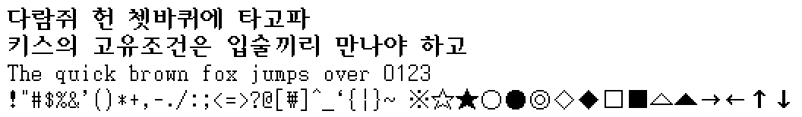
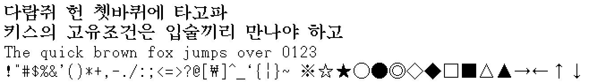
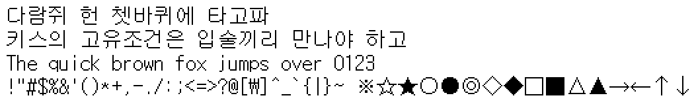
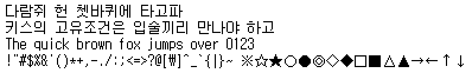
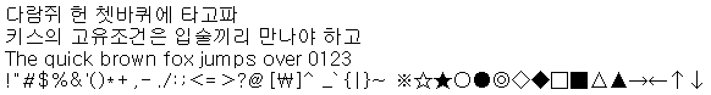
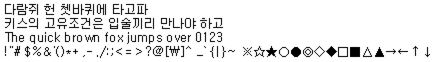
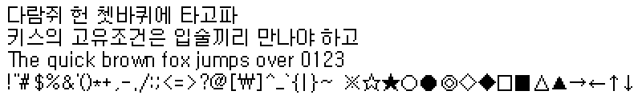
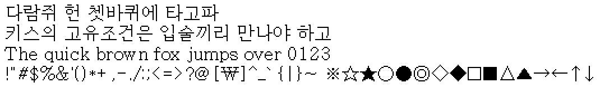

[English](windows.md) | **한국어**

# 레시피: Windows 한글 비트맵 폰트 (3.1, 95, XP)

Windows 계열의 한글 비트맵 폰트: Windows 3.1 한글판의 `BT16.TBM`과 `BT20.TBM`, Windows 95 한글판 설치 CAB의 `GULIM16.TBM`과
`GULIM12.TBM`(완성형 TBM 형식), DOS 모드용 `HFONT.SYS`(기호와 한자), 그리고 Windows 95와 XP의 TrueType 폰트(`gulim.ttc`,
`batang.ttc`)에 든 내장 비트맵 스트라이크.

**시작 전에.** 명령은 [색인](../recipes.ko.md)에서처럼 `$OUT`을 정하고 프로젝트 루트에서 실행한다. 모든 페이스는 [페이스 점검](../recipes.ko.md#페이스-점검)의 점검으로 끝난다. 폰트는 독점 파일이라 따로 마련한다. `$OUT/ks.txt`는 [프로그램과 드라이버 안의 폰트](programs-and-drivers.ko.md#프롬프트)에서처럼 쓴다.

위로: [레시피 색인](../recipes.ko.md) · 관련 문서: [비트맵 폰트](bitmap-fonts.ko.md)([내장 비트맵 스트라이크](bitmap-fonts.ko.md#내장-비트맵-스트라이크), [Windows FNT와 FON](bitmap-fonts.ko.md#windows-fnt와-fon)), [프로그램과 드라이버 안의 폰트](programs-and-drivers.ko.md), [OS/2 한글 폰트](os2.ko.md), [도구 설명서](../tools.ko.md).

## Windows 한글 비트맵 폰트

| Windows | 파일 | 형식 | 결과 |
|---|---|---|---|
| 3.1 한글판 | `BT16.TBM`(330,328 바이트), `BT20.TBM`(568,576 바이트), `HGPART.TBM` | TBM: KS X 1001 표 전체(기호, 음절 2,350자, 한자)와 ASCII 128자, 반전 저장 | 바탕 16 px와 20 px 완성형 페이스 |
| 95 한글판 | 설치 CAB의 `MINI/GULIM16.TBM`(330,728 바이트), `GULIM12.TBM`(263,280 바이트) | 같은 TBM 형식 | 굴림 16 px와 12 px 완성형 페이스 |
| 95 한글판 | `WIN95_18.CAB`의 `hfont.sys`(206,276 바이트) | 16x16 원시 배열: 기호 1,128자 + 한자 4,888자, 음절 없음 | 기호와 한자 BDF(페이스 없음) |
| 95 한글판 | `gulim.ttc`, `batang.ttc`(TrueType, `EBLC` 스트라이크) | 내장 비트맵 스트라이크 12-21, 24, 25 ppem에 음절 11,172자 | 스트라이크 크기의 완성형 페이스 |
| XP(그리고 지금의 Windows) | `gulim.ttc`, `batang.ttc` | 내장 비트맵 스트라이크 11-21, 24, 25 ppem에 음절 11,172자 | 스트라이크 크기의 완성형 페이스 |

### 어느 폰트부터 CP949 한글 11,172자를 그리는가

| Windows | 폰트 | 그리는 한글 음절 |
|---|---|---:|
| 3.1 한글판 | `BT16.TBM`, `BT20.TBM`(TBM 비트맵) | 2,350 |
| 95 한글판 | MINI CAB의 `GULIM16.TBM`, `GULIM12.TBM`(TBM 비트맵) | 2,350 |
| 95 한글판 | `gulim.ttc`, `batang.ttc`(TrueType, 스트라이크 12-21, 24, 25 px) | 11,172 |
| XP와 지금의 Windows | `gulim.ttc`, `batang.ttc`(TrueType, 스트라이크 11 px도) | 11,172 |

이 모음에서 음절 11,172자가 모두 처음 나오는 것은 Windows 95 한글판의 TrueType 굴림과 바탕이고, 같은 Windows 95의 TBM 파일은
Windows 3.1의 KS X 1001 2,350자 그대로다. 측정한 Windows 95 CD는 첫 출시판이 아니라 1996년 말(OSR2 무렵)의 빌드다: `README.TXT`에
"1996년 8월", `LAYOUT.INF`에 1996년 11월 12일 생성으로 적혀 있고, 두 TTC 파일의 날짜는 1996년 10월 30일이다.

한계: 여기서 비교한 파일만 본 것이고, 센 것은 한글 음절뿐이다(CP949는 한자와 기호도 다룬다). 보지 않은 것: Windows 3.1 한글판의
TrueType `BATANG`, `DOTUM`, `GULIM`, `GUNGSUH`(디스크에 SZDD로 나뉜 파일 `BATANG.1T_`, `BATANG.2T_`, ...로 들어 있고 여기서는
이어 붙이지 않았다), Windows 95 `MINI1` CAB의 `GULIM.TTF`, 그리고 1995년의 Windows 95 한글판 첫 출시판.

**출처와 라이선스.** 모두 Microsoft의 독점 폰트다(글리프 디자인은 한양정보통신). 연구용으로만 쓰며, `svf/`의 페이스는 이것으로
만들지 않는다. 이 문서의 그림은 레시피가 만든 페이스를 작은 샘플로 보여 줄 뿐이고, 폰트 자체나 거기서 만든 BDF와 SVF는 배포하지
않는다. 측정에 쓴 사본: Windows 3.1 한글판 디스크 세트의 `BT16.TBM`, `BT20.TBM`, `HGPART.TBM`, Windows 95 한글판 CD의 CAB을
7z로 푼 `MINI/GULIM16.TBM`, `GULIM12.TBM`, `WIN95_18/hfont.sys`와 `gulim.ttc`, `batang.ttc`(9,876,248, 11,582,968 바이트),
Windows XP RTM 한글판의 `gulim.ttc`, `batang.ttc`(13,518,660, 16,258,580 바이트), 그리고 비교용으로 지금의 Windows의 `GULIM.TTC`,
`BATANG.TTC`(13,533,424, 16,273,348 바이트).

폰트 파일은 신뢰할 수 없는 데이터다. 도구는 바이트만 읽는다(`python3 -I`). 아래 `$W31`은 3.1 파일이 든 폴더, `$W95`는 Windows 95
CAB을 푼 폴더(CAB마다 제 이름의 폴더로, 예를 들어 `$W95/MINI`, `$W95/WIN95_18`), `$WXP`는 XP 폰트가 든 폴더다.

`gulim.ttc`와 `batang.ttc`는 한 CAB에 따로 들어 있지 않다. CD의 `WIN95` 폴더의 `WIN95_*.CAB`은 여러 볼륨으로 된 한 세트이고, 두
폰트는 볼륨을 걸쳐 있다: `LAYOUT.INF`는 `batang.ttc=8`, `gulim.ttc=11`(시작하는 디스크)로 적고, `batang.ttc`는 `WIN95_08.CAB`에서
`WIN95_11.CAB`까지, `gulim.ttc`는 `WIN95_11.CAB`에서 `WIN95_12.CAB`까지 이어진다. 7z는 파일이 시작하는 CAB을 열면 같은 폴더의 다른
볼륨을 읽어 그런 파일을 풀어 낸다. CAB은 이웃 볼륨을 소문자(`win95_09.cab`)로, `PRECOPY2.CAB`은 대문자로 가리키므로, 대소문자를
가리는 파일 시스템에서는 먼저 CD의 CAB을 두 가지 이름으로 링크한다(`$CD`는 마운트한 CD). 두 TTC 파일은 `$W95`에 풀린다:

    mkdir -p $W95/cab
    for f in "$CD"/WIN95/*.CAB; do b=$(basename "$f"); ln -s "$f" "$W95/cab/$b"; ln -sf "$f" "$W95/cab/$(echo "$b" | tr A-Z a-z)"; done
    (cd $W95/cab && 7z x -o"$W95" win95_08.cab batang.ttc && 7z x -o"$W95" win95_11.cab gulim.ttc)

### TBM 폰트 (Windows 3.1과 95)

TBM 파일은 서명 "TTBITMAP VARIABLE-PITCH HANGEUL"로 시작한다. 그 뒤에 글리프 크기, 범위 레코드, 글리프마다 7 바이트인 글리프 표가
오고, 글리프 데이터는 행마다 ceil(너비 / 8) 바이트, 잉크가 0 비트다(반전). 측정한 네 파일은 같은 배치다: ASCII 128자(반각), 그다음
KS X 1001 순서대로 빈칸 없이 기호 1,128칸(행 A1-AC), 음절 2,350자(B0A1-C8FE), 한자 4,888자(CA-FD). `tools/tbmfont.py info`가 헤더를
점검하고 블록의 오프셋을 출력한다. 형식은 그 도구의 docstring에 있다.

    python3 -I tools/tbmfont.py info $W31/BT16.TBM

    $W31/BT16.TBM: 330328 bytes, cell 16x16, 67 ranges, 8494 glyphs, data 0xec98..0x50a58, 0 bytes after the data
      glyphs 0..127: 128 of 8x16 (16 bytes) from 0xec98
      glyphs 128..8493: 8366 of 16x16 (32 bytes) from 0xf498
      ascii: offset 0xec98 (60568), 128 glyphs
      symbols: offset 0xf498 (62616), 1128 glyphs
      hangul: offset 0x18198 (98712), 2350 glyphs
      hanja: offset 0x2a758 (173912), 4888 glyphs

| 파일 | 셀 | 범위 | 반각 | ascii | symbols | hangul | hanja | 데이터 뒤 |
|---|---|---:|---|---|---|---|---|---:|
| `BT16.TBM` | 16x16 | 67 | 8x16 | `0xec98` | `0xf498` | `0x18198` | `0x2a758` | 0 |
| `BT20.TBM` | 20x20 | 125 | 10x20 | `0xf038` | `0x10438` | `0x20c98` | `0x43360` | 0 |
| `GULIM16.TBM` | 16x16 | 90 | 8x16 | `0xee08` | `0xf608` | `0x18308` | `0x2a8c8` | 32 |
| `GULIM12.TBM` | 12x12 | 90 | 6x12 | `0xee08` | `0xf408` | `0x15dc8` | `0x23a18` | 24 |

데이터 뒤의 바이트는 빈 글리프 하나다(0xFF). 글리프는 바로 이어지므로 `binscan.py render`로 확인할 수 있다:
`python3 -I tools/binscan.py render $W31/BT16.TBM --offset 0x18198 --glyph 16x16 --invert --count 64 --png $OUT/bt16.png`는
가, 각, 간, ...을 그린다. `--invert`가 없으면 검은 바탕에 흰 글자다. `HGPART.TBM`(4,712 바이트)은 글리프가 아니다: "HGPartTbl"
다음에 u16 25와 KS 코드 2,350개(B0A1..C8FE, 빅 엔디언)가 있다. 2,350 음절 목록이고, 위 `hangul` 블록의 순서와 같다.

#### 페이스 만들기

ASCII, 음절, 그리고 (원하면) KS X 1001 전체를 `rawcarve.py bdf --invert`로 잘라 내고 `bdfface.py`로 굽는다. BT16:

    python3 -I tools/rawcarve.py bdf $W31/BT16.TBM --offset 0xec98 --glyph 8x16 --invert --chars ascii --count 128 -o $OUT/bt16-ascii.bdf
    python3 -I tools/rawcarve.py bdf $W31/BT16.TBM --offset 0x18198 --glyph 16x16 --invert --chars ks-hangul --dense -o $OUT/bt16-hangul.bdf
    python3 -I tools/bdfface.py --hangul $OUT/bt16-hangul.bdf --ascii $OUT/bt16-ascii.bdf --cell 16x16 --chars-from $OUT/ks.txt -o $OUT/BT16.SVF

기호와 한자까지 담은 BDF는 `tbmfont.py map`의 슬롯 맵으로 자른다(코드 포인트로 풀리지 않는 기호 칸은 빠진다):

    python3 -I tools/tbmfont.py map -o $OUT/tbm.map            # 8225 glyphs of 8366 slots (symbols,hangul,hanja)
    python3 -I tools/rawcarve.py bdf $W31/BT16.TBM --offset 0xf498 --glyph 16x16 --invert --chars map --map $OUT/tbm.map -o $OUT/bt16-ks.bdf

다른 파일은 위 표의 오프셋과 크기로 같은 명령을 쓴다: BT20은 `--glyph 10x20`(ASCII)와 `20x20`, `--cell 20x20`, GULIM16은 BT16과
같은 크기, GULIM12는 `6x12`와 `12x12`, `--cell 12x12`. 기준선은 파일의 ASCII에서 'H' 잉크 바로 아래 행이다. BT16과 GULIM16에서는
`rawcarve.py`의 기본값(셀의 7/8, 14행)과 같다. BT20의 'H'는 4-16행, GULIM12의 'H'는 0-9행을 덮으므로, 세 번의 자르기(ASCII, 음절,
KS X 1001 표)에 BT20은 `--ascent 17`, GULIM12는 `--ascent 10`을 준다. 측정한 결과(점검 줄 `안녕하세요 ABC 123`; 12 px와 20 px의 잉크는 `line 400
C+8 0 C`):

| 페이스 | 바이트 | 음절 | measure | 잉크 | `bt*-ks.bdf` 글리프 |
|---|---:|---:|---|---:|---:|
| `BT16.SVF`, 바탕 16 px | `123,048` | 2,350 | `width=144 ascent=14 descent=2` | 472 | 8,224 |
| `BT20.SVF`, 바탕 20 px | `191,092` | 2,350 | `width=180 ascent=17 descent=3` | 602 | 8,224 |
| `GULIM16.SVF`, 굴림 16 px | `124,836` | 2,350 | `width=144 ascent=14 descent=2` | 368 | 8,222 |
| `GULIM12.SVF`, 굴림 12 px | `106,152` | 2,350 | `width=108 ascent=10 descent=2` | 294 | 8,222 |

모든 페이스에서 `svf2to3.py --check`는 같은 바이트를 쓰고, `bdfface.py`는 잘린 글리프 0개를 알린다. `fontmetrics.py`는 BT16,
GULIM16, GULIM12에서 `bdfface.py`가 그린 U+2026(…) 하나만 advance를 1-2 px 넘는다고 알린다. ASCII는 고정폭(반각)이다.

*Windows 3.1 한글판 `BT16.TBM`(바탕 16 px)으로 만든 완성형 페이스: 한국어 두 줄, 영문, ASCII 기호와 같은 파일의 KS X 1001 기호, 2배*

*Windows 3.1 한글판 `BT20.TBM`(바탕 20 px), 2배*

*Windows 95 한글판 `GULIM16.TBM`(굴림 16 px), 2배*

*Windows 95 한글판 `GULIM12.TBM`(굴림 12 px), 2배*

`GULIM16.TBM`의 음절 2,350자 가운데 2,047자는 Windows 95 `gulim.ttc`의 16 ppem 스트라이크와 픽셀까지 같다(기준선 맞춤, 평균
IoU 0.973). `GULIM12.TBM`을 제 기준선(`--ascent 10`)으로 자르면 12 ppem 스트라이크와
기준선(ascent 10)이 같고, 음절 2,171자가 스트라이크와 같다(평균 IoU 0.990).
BT16과 BT20(바탕)은 TrueType 바탕의 스트라이크와 다른 디자인이다(16 px 평균 IoU 0.27). ASCII는 TBM 쪽이 고정폭이라 모두 다르다.

### HFONT.SYS (Windows 95의 DOS 모드)

Windows 95 한글판의 `WIN95_18.CAB`에 든 `hfont.sys`(206,276 바이트)는 MS-DOS 6.22 한글판 `HFONT.SYS`(192,560 바이트)와 앞
192,560 바이트가 같고, 그 뒤에 13,716 바이트의 코드 표가 붙어 있다. 48 바이트 헤더 다음에 16x16 글리프(32 바이트, 반전 아님)가
KS X 1001 순서로 기호 1,128칸, 한자 4,888자 있다. 음절은 없다: DOS의 한글 드라이버가 자기 자모 세트로 음절을 조합한다
([자모 세트](../jamo-sets.ko.md)). 그래서 페이스는 만들지 않고, 기호와 한자 BDF만 자른다:

    python3 -I tools/tbmfont.py map --blocks symbols,hanja -o $OUT/hfont.map     # 5875 glyphs of 6016 slots
    python3 -I tools/rawcarve.py bdf $W95/WIN95_18/hfont.sys --offset 48 --glyph 16x16 --chars map --map $OUT/hfont.map -o $OUT/hfont.bdf

`wrote $OUT/hfont.bdf: 5874 glyphs (0 Hangul syllables) of 16x16`(빈 칸 하나는 빠진다). 이 BDF는 다른 페이스의 기호와 한자를
보충할 때 `mkfont.py`에 줄 수 있다(`--size 16 --unicode file:LIST --only-listed`. KS X 1001 A1A9 = U+00AD는 Pillow의 셰이퍼가
버리니 목록에서 빼라: [OS/2 한글 폰트](os2.ko.md#os2-한글-폰트완성형에서-완성형-페이스와-자모-세트-만들기) 참고).

### TrueType 내장 스트라이크 (Windows 95와 XP)

굴림, 돋움, 바탕, 궁서는 Windows 95부터 TrueType 폰트(`gulim.ttc`: 굴림, 굴림체, 돋움, 돋움체. `batang.ttc`: 바탕, 바탕체, 궁서,
궁서체)이고, 작은 크기를 위한 비트맵 스트라이크(`EBLC`/`EBDT`)가 들어 있다. FreeType은 스트라이크의 크기에서 그 픽셀을 쓴다.
방법은 [내장 비트맵 스트라이크](bitmap-fonts.ko.md#내장-비트맵-스트라이크)와 같다. `mkfont.py`는 TTC의 첫 페이스(굴림, 바탕)를
바로 연다. 다른 페이스는 먼저 `srcprep.py ttc-face`로 뽑는다:

    python3 -I tools/mkfont.py $W95/gulim.ttc $OUT/w95-gulim16.svf --size 16 --bpp 1 --unicode ascii,ksx1001-hangul
    python3 maker/srcprep.py ttc-face $WXP/gulim.ttc $OUT/xp-dotum.ttf --index 2     # 돋움 (fontTools 필요)

어느 크기에 스트라이크가 있고 거기에 음절이 몇 자 있는지는 fontTools로 `EBLC`의 색인 부분표를 읽어 센다(첫 페이스, 음절 =
U+AC00..U+D7A3 가운데 스트라이크에 글리프가 있는 것):

    python3 -c "import sys; from fontTools.ttLib import TTFont; f = TTFont(sys.argv[1], fontNumber=0, lazy=True); c = f.getBestCmap(); h = {g for u, g in c.items() if 0xAC00 <= u <= 0xD7A3}; print([(s.bitmapSizeTable.ppemY, len(h & {n for t in s.indexSubTables for n in t.names})) for s in f['EBLC'].strikes])" $W95/gulim.ttc

| 폰트 | 스트라이크(ppem) | 음절 11,172자가 있는 스트라이크 | 한글 없는 스트라이크 | `EBDT` 형식 |
|---|---|---|---|---|
| Windows 95 `gulim.ttc`, `batang.ttc`(4 페이스 모두) | 11-25 | 12-21, 24, 25 | 11, 22, 23(굴림체 등 고정폭 페이스의 11은 ASCII도 없음) | 5, 7, 9 |
| Windows XP `gulim.ttc`, `batang.ttc` | 11-25 | 11-21, 24, 25 | 22, 23 | 2, 5, 8 |
| 지금의 Windows `GULIM.TTC`, `BATANG.TTC` | 11-25 | 11-21, 24, 25 | 22, 23 | 2, 5, 8 |

모든 스트라이크에 ASCII 94자가 있다(95의 고정폭 페이스 11 ppem 제외). 음절은 한 장의 비트맵이 아니라 대부분 자모 조각 2-3개를
겹친 복합 글리프다(형식 8, 9). 어느 음절이나 그려지므로 `--unicode`에 `hangul`(11,172자)을 줄 수 있다. 스트라이크가 없거나
한글이 없는 크기(22, 23, 26 이상)에서는 윤곽선을 래스터화한다. `--bpp 2`는 스트라이크 크기에서도 윤곽선을 쓴다. 측정한 결과
(`--unicode ascii,ksx1001-hangul`, 글리프 2,446개):

| 페이스 | 바이트 | measure | 잉크 |
|---|---:|---|---:|
| Windows 95 굴림 16 px | `125,280` | `width=151 ascent=14 descent=2` | 371 |
| Windows 95 굴림 12 px | `106,200` | `width=114 ascent=10 descent=2` | 297 |
| Windows 95 바탕 16 px | `125,340` | `width=155 ascent=14 descent=2` | 394 |
| Windows XP 굴림 16 px | `125,288` | `width=149 ascent=14 descent=2` | 371 |
| Windows XP 굴림 12 px | `106,208` | `width=114 ascent=10 descent=2` | 298 |
| Windows XP 바탕 16 px | `125,316` | `width=154 ascent=14 descent=2` | 394 |

`svf2to3.py --profile default --check`는 모두 그대로 둔다. 판마다 비교하면(KS X 1001 음절 2,350자, 기준선 맞춤): 굴림 16 px와 바탕
16 px의 음절은 Windows 95와 XP에서 모두 같고, ASCII는 94자 가운데 3자가 다르다. 굴림 12 px는 2,350자 가운데 2,123자가 같다(평균
IoU 0.994). XP와 지금의 Windows의 굴림 12, 16 px는 음절과 ASCII 모두 같다. 지금의 Windows 굴림은 [내장 비트맵
스트라이크](bitmap-fonts.ko.md#내장-비트맵-스트라이크)의 수치와 같다(16 px `125,288` 바이트, 잉크 371).

*Windows 95 `gulim.ttc`의 16 ppem 스트라이크(굴림 16 px), 2배*

*Windows 95 `gulim.ttc`의 12 ppem 스트라이크(굴림 12 px), 2배*

*Windows XP `gulim.ttc`의 12 ppem 스트라이크(굴림 12 px), 2배*

*Windows XP `batang.ttc`의 16 ppem 스트라이크(바탕 16 px), 2배*

### 샘플 그림

그림은 `tools/doc_figures_windows.py`가 그린다. 폰트 경로를 인수로 받아 위의 명령으로 페이스를 만들고, `svfline.py`로 네 줄을
흰 바탕에 검은 글자, 2배로 그린다. TBM 페이스의 기호 줄은 같은 파일의 기호 블록에서 `mkfont.py`로 구운 두 번째 페이스에서 온다.
`--check`는 저장소의 그림과 바이트 단위로 비교한다([도구 설명서](../tools.ko.md)):

    python3 -I tools/doc_figures_windows.py --bt16 $W31/BT16.TBM --bt20 $W31/BT20.TBM --gulim16 $W95/MINI/GULIM16.TBM \
        --gulim12 $W95/MINI/GULIM12.TBM --win95-gulim $W95/gulim.ttc --xp-gulim $WXP/gulim.ttc --xp-batang $WXP/batang.ttc --check

[레시피 색인](../recipes.ko.md) · [도구 설명서](../tools.ko.md)
