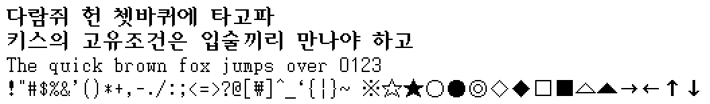
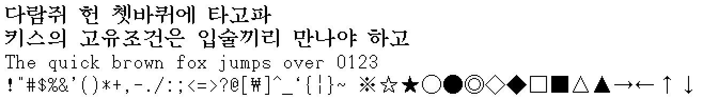
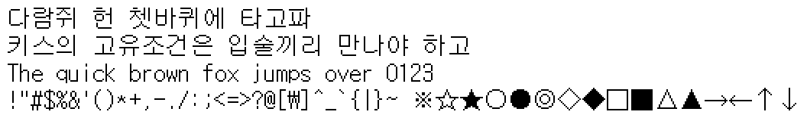
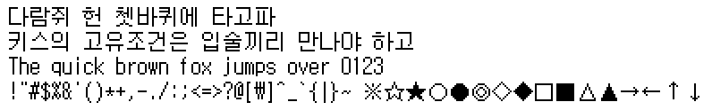
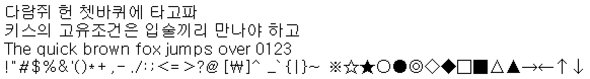
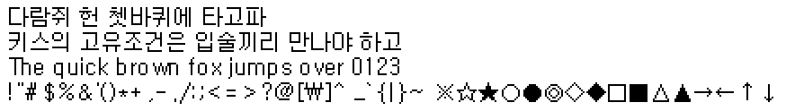
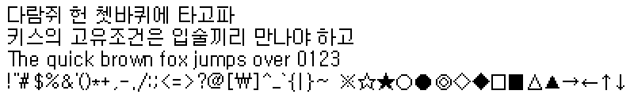
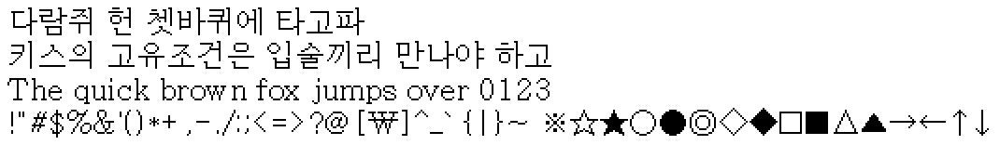

**English** | [한국어](windows.ko.md)

# Recipes: Windows Korean bitmap fonts (3.1, 95, XP)

The Korean bitmap fonts of Windows: `BT16.TBM` and `BT20.TBM` of Korean Windows 3.1, `GULIM16.TBM` and `GULIM12.TBM`
of the Korean Windows 95 setup cabinets (the wansung TBM format), `HFONT.SYS` for DOS mode (symbols and hanja), and the
embedded bitmap strikes of the Windows 95 and XP TrueType fonts (`gulim.ttc`, `batang.ttc`).

**Before you start.** Commands run from the project root with `$OUT` set as in the [index](../recipes.md); every face ends with the checks of [Checking a face](../recipes.md#checking-a-face). The fonts are proprietary and supplied separately. `$OUT/ks.txt` is written as in [Fonts inside programs and drivers](programs-and-drivers.md#the-prompt).

Up: [Recipes index](../recipes.md) · Related: [Bitmap fonts](bitmap-fonts.md) ([Embedded bitmap strikes](bitmap-fonts.md#embedded-bitmap-strikes), [Windows FNT and FON](bitmap-fonts.md#windows-fnt-and-fon)), [Fonts inside programs and drivers](programs-and-drivers.md), [OS/2 Korean fonts](os2.md), [Tool reference](../tools.md).

## Windows Korean bitmap fonts

| Windows | Files | Format | Result |
|---|---|---|---|
| 3.1 Korean | `BT16.TBM` (330,328 bytes), `BT20.TBM` (568,576 bytes), `HGPART.TBM` | TBM: the whole KS X 1001 table (symbols, the 2,350 syllables, hanja) and 128 ASCII glyphs, stored inverted | Batang 16 px and 20 px precomposed faces |
| 95 Korean | `MINI/GULIM16.TBM` (330,728 bytes), `GULIM12.TBM` (263,280 bytes) of the setup cabinets | the same TBM format | Gulim 16 px and 12 px precomposed faces |
| 95 Korean | `hfont.sys` (206,276 bytes) of `WIN95_18.CAB` | a raw 16x16 array: 1,128 symbols + 4,888 hanja, no syllables | a symbol and hanja BDF (no face) |
| 95 Korean | `gulim.ttc`, `batang.ttc` (TrueType, `EBLC` strikes) | embedded bitmap strikes with all 11,172 syllables at 12-21, 24, 25 ppem | precomposed faces at a strike's size |
| XP (and current Windows) | `gulim.ttc`, `batang.ttc` | embedded bitmap strikes with all 11,172 syllables at 11-21, 24, 25 ppem | precomposed faces at a strike's size |

**Source and licence.** All are proprietary Microsoft fonts (glyph design HanYang I&C). They are for research only;
no face in `svf/` is made from them. The images in this document show faces the recipe built as small samples only;
the fonts and the BDF and SVF files made from them are not distributed. The copies measured: `BT16.TBM`, `BT20.TBM`,
`HGPART.TBM` of a Korean Windows 3.1 disk set; `MINI/GULIM16.TBM`, `GULIM12.TBM`, `WIN95_18/hfont.sys` and `gulim.ttc`,
`batang.ttc` (9,876,248 and 11,582,968 bytes) from the cabinets of a Korean Windows 95 CD, unpacked with 7z;
`gulim.ttc`, `batang.ttc` (13,518,660 and 16,258,580 bytes) of Korean Windows XP RTM; and for comparison `GULIM.TTC`,
`BATANG.TTC` (13,533,424 and 16,273,348 bytes) of a current Windows.

The font files are untrusted data; the tools only read bytes (`python3 -I`). Below, `$W31` is the folder with the 3.1
files, `$W95` the folder the Windows 95 cabinets were unpacked into, `$WXP` the folder with the XP fonts.

### TBM fonts (Windows 3.1 and 95)

A TBM file starts with the signature "TTBITMAP VARIABLE-PITCH HANGEUL", followed by the glyph size, range records and a
glyph table of 7 bytes a glyph; the glyph data is ceil(width / 8) bytes a row, with ink as the 0 bits (inverted). The
four files measured have the same layout: 128 ASCII glyphs (half width), then in KS X 1001 order with no gaps the 1,128
symbol slots (rows A1-AC), the 2,350 syllables (B0A1-C8FE) and 4,888 hanja (CA-FD). `tools/tbmfont.py info` checks the
header and prints the offset of each block; its docstring describes the format.

    python3 -I tools/tbmfont.py info $W31/BT16.TBM

    $W31/BT16.TBM: 330328 bytes, cell 16x16, 67 ranges, 8494 glyphs, data 0xec98..0x50a58, 0 bytes after the data
      glyphs 0..127: 128 of 8x16 (16 bytes) from 0xec98
      glyphs 128..8493: 8366 of 16x16 (32 bytes) from 0xf498
      ascii: offset 0xec98 (60568), 128 glyphs
      symbols: offset 0xf498 (62616), 1128 glyphs
      hangul: offset 0x18198 (98712), 2350 glyphs
      hanja: offset 0x2a758 (173912), 4888 glyphs

| File | Cell | Ranges | Half width | ascii | symbols | hangul | hanja | After the data |
|---|---|---:|---|---|---|---|---|---:|
| `BT16.TBM` | 16x16 | 67 | 8x16 | `0xec98` | `0xf498` | `0x18198` | `0x2a758` | 0 |
| `BT20.TBM` | 20x20 | 125 | 10x20 | `0xf038` | `0x10438` | `0x20c98` | `0x43360` | 0 |
| `GULIM16.TBM` | 16x16 | 90 | 8x16 | `0xee08` | `0xf608` | `0x18308` | `0x2a8c8` | 32 |
| `GULIM12.TBM` | 12x12 | 90 | 6x12 | `0xee08` | `0xf408` | `0x15dc8` | `0x23a18` | 24 |

The bytes after the data are one blank glyph (0xFF). The glyphs follow one another, so `binscan.py render` shows them:
`python3 -I tools/binscan.py render $W31/BT16.TBM --offset 0x18198 --glyph 16x16 --invert --count 64 --png $OUT/bt16.png`
draws 가, 각, 간, ...; without `--invert` it is white on black. `HGPART.TBM` (4,712 bytes) holds no glyphs: "HGPartTbl",
a u16 25 and 2,350 KS codes (B0A1..C8FE, big-endian), the list of the 2,350 syllables in the order of the `hangul` block
above.

#### Building the faces

Cut the ASCII, the syllables and (if wanted) the whole KS X 1001 table with `rawcarve.py bdf --invert` and bake with
`bdfface.py`. BT16:

    python3 -I tools/rawcarve.py bdf $W31/BT16.TBM --offset 0xec98 --glyph 8x16 --invert --chars ascii --count 128 -o $OUT/bt16-ascii.bdf
    python3 -I tools/rawcarve.py bdf $W31/BT16.TBM --offset 0x18198 --glyph 16x16 --invert --chars ks-hangul --dense -o $OUT/bt16-hangul.bdf
    python3 -I tools/bdfface.py --hangul $OUT/bt16-hangul.bdf --ascii $OUT/bt16-ascii.bdf --cell 16x16 --chars-from $OUT/ks.txt -o $OUT/BT16.SVF

A BDF with the symbols and hanja as well is cut with the slot map of `tbmfont.py map` (symbol slots no code point
decodes to are left out):

    python3 -I tools/tbmfont.py map -o $OUT/tbm.map            # 8225 glyphs of 8366 slots (symbols,hangul,hanja)
    python3 -I tools/rawcarve.py bdf $W31/BT16.TBM --offset 0xf498 --glyph 16x16 --invert --chars map --map $OUT/tbm.map -o $OUT/bt16-ks.bdf

The other files take the same commands with the offsets and sizes of the table above: BT20 `--glyph 10x20` (ASCII) and
`20x20`, `--cell 20x20`; GULIM16 the sizes of BT16; GULIM12 `6x12` and `12x12`, `--cell 12x12`. Measured (check line
`안녕하세요 ABC 123`; the ink of the 12 px and 20 px faces with `line 400 C+8 0 C`):

| Face | Bytes | Syllables | measure | Ink | `bt*-ks.bdf` glyphs |
|---|---:|---:|---|---:|---:|
| `BT16.SVF`, Batang 16 px | `123,048` | 2,350 | `width=144 ascent=14 descent=2` | 472 | 8,224 |
| `BT20.SVF`, Batang 20 px | `191,092` | 2,350 | `width=180 ascent=18 descent=2` | 602 | 8,224 |
| `GULIM16.SVF`, Gulim 16 px | `124,836` | 2,350 | `width=144 ascent=14 descent=2` | 368 | 8,222 |
| `GULIM12.SVF`, Gulim 12 px | `106,156` | 2,350 | `width=108 ascent=11 descent=1` | 294 | 8,222 |

For every face `svf2to3.py --check` writes the same bytes and `bdfface.py` reports 0 glyphs clipped. `fontmetrics.py`
reports, for BT16, GULIM16 and GULIM12, only the U+2026 (…) that `bdfface.py` draws reaching 1-2 px past its advance.
The ASCII is fixed width (half width).

*The precomposed face built from Korean Windows 3.1 `BT16.TBM` (Batang 16 px): two Korean lines, English, ASCII symbols and the KS X 1001 symbols of the same file, x2*

*Korean Windows 3.1 `BT20.TBM` (Batang 20 px), x2*

*Korean Windows 95 `GULIM16.TBM` (Gulim 16 px), x2*

*Korean Windows 95 `GULIM12.TBM` (Gulim 12 px), x2*

Of the 2,350 syllables of `GULIM16.TBM`, 2,047 are pixel for pixel those of the 16 ppem strike of the Windows 95
`gulim.ttc` (aligned on the baseline; mean IoU 0.973). `GULIM12.TBM` is drawn one row lower than the 12 ppem strike
(ascent 11 against 10); moved up a row, 2,171 are the same. BT16 and BT20 (Batang) are other designs than the strikes
of the TrueType Batang (mean IoU 0.27 at 16 px). The ASCII differs throughout, as the TBM's is fixed width.

### HFONT.SYS (DOS mode of Windows 95)

`hfont.sys` (206,276 bytes) in `WIN95_18.CAB` of Korean Windows 95 has the same first 192,560 bytes as the
`HFONT.SYS` of Korean MS-DOS 6.22 (192,560 bytes), followed by a 13,716-byte code table. After a 48-byte header come
16x16 glyphs (32 bytes, not inverted) in KS X 1001 order: the 1,128 symbol slots and 4,888 hanja. There are no
syllables: the DOS Hangul driver composes them from its own jamo set ([Jamo sets](../jamo-sets.md)). So no face is
made; only the symbol and hanja BDF is cut:

    python3 -I tools/tbmfont.py map --blocks symbols,hanja -o $OUT/hfont.map     # 5875 glyphs of 6016 slots
    python3 -I tools/rawcarve.py bdf $W95/WIN95_18/hfont.sys --offset 48 --glyph 16x16 --chars map --map $OUT/hfont.map -o $OUT/hfont.bdf

`wrote $OUT/hfont.bdf: 5874 glyphs (0 Hangul syllables) of 16x16` (one blank slot is left out). This BDF can supply
symbols and hanja for another face through `mkfont.py` (`--size 16 --unicode file:LIST --only-listed`; leave KS X 1001
A1A9 = U+00AD out of the list, as Pillow's shaper drops it: see [OS/2 Korean fonts](os2.md#os2-korean-fonts-완성형-to-a-precomposed-face-and-a-jamo-set)).

### TrueType embedded strikes (Windows 95 and XP)

From Windows 95 on, Gulim, Dotum, Batang and Gungsuh are TrueType fonts (`gulim.ttc`: Gulim, GulimChe, Dotum,
DotumChe; `batang.ttc`: Batang, BatangChe, Gungsuh, GungsuhChe) with bitmap strikes (`EBLC`/`EBDT`) for the small
sizes. FreeType uses a strike's pixels at its size. The route is that of [Embedded bitmap
strikes](bitmap-fonts.md#embedded-bitmap-strikes). `mkfont.py` opens the first face of a TTC (Gulim, Batang) directly;
take another face out with `srcprep.py ttc-face` first:

    python3 -I tools/mkfont.py $W95/gulim.ttc $OUT/w95-gulim16.svf --size 16 --bpp 1 --unicode ascii,ksx1001-hangul
    python3 maker/srcprep.py ttc-face $WXP/gulim.ttc $OUT/xp-dotum.ttf --index 2     # Dotum (needs fontTools)

Which sizes have a strike, and how many syllables each holds, is counted from the index subtables of `EBLC` with
fontTools (the first face; syllables = the code points U+AC00..U+D7A3 whose glyph the strike has):

    python3 -c "import sys; from fontTools.ttLib import TTFont; f = TTFont(sys.argv[1], fontNumber=0, lazy=True); c = f.getBestCmap(); h = {g for u, g in c.items() if 0xAC00 <= u <= 0xD7A3}; print([(s.bitmapSizeTable.ppemY, len(h & {n for t in s.indexSubTables for n in t.names})) for s in f['EBLC'].strikes])" $W95/gulim.ttc

| Font | Strikes (ppem) | Strikes with all 11,172 syllables | Strikes without Hangul | `EBDT` formats |
|---|---|---|---|---|
| Windows 95 `gulim.ttc`, `batang.ttc` (all 4 faces) | 11-25 | 12-21, 24, 25 | 11, 22, 23 (11 of the fixed-width faces such as GulimChe has no ASCII either) | 5, 7, 9 |
| Windows XP `gulim.ttc`, `batang.ttc` | 11-25 | 11-21, 24, 25 | 22, 23 | 2, 5, 8 |
| Current Windows `GULIM.TTC`, `BATANG.TTC` | 11-25 | 11-21, 24, 25 | 22, 23 | 2, 5, 8 |

Every strike has the 94 ASCII glyphs (except 11 ppem of the Windows 95 fixed-width faces). A syllable is mostly not one
bitmap but a compound glyph of 2-3 jamo pieces laid over each other (formats 8, 9); every syllable is drawn, so
`--unicode` can take `hangul` (all 11,172). At a size with no strike or a strike without Hangul (22, 23, 26 and up) the
outline is rasterised; `--bpp 2` uses the outline even at a strike's size. Measured (`--unicode
ascii,ksx1001-hangul`, 2,446 glyphs):

| Face | Bytes | measure | Ink |
|---|---:|---|---:|
| Windows 95 Gulim 16 px | `125,280` | `width=151 ascent=14 descent=2` | 371 |
| Windows 95 Gulim 12 px | `106,200` | `width=114 ascent=10 descent=2` | 297 |
| Windows 95 Batang 16 px | `125,340` | `width=155 ascent=14 descent=2` | 394 |
| Windows XP Gulim 16 px | `125,288` | `width=149 ascent=14 descent=2` | 371 |
| Windows XP Gulim 12 px | `106,208` | `width=114 ascent=10 descent=2` | 298 |
| Windows XP Batang 16 px | `125,316` | `width=154 ascent=14 descent=2` | 394 |

`svf2to3.py --profile default --check` leaves every one as it is. Between versions (the 2,350 KS X 1001 syllables,
aligned on the baseline): the Gulim 16 px and Batang 16 px syllables are the same in Windows 95 and XP, with 3 of the
94 ASCII glyphs different; Gulim 12 px has 2,123 of 2,350 the same (mean IoU 0.994). XP and current Windows Gulim 12
and 16 px are the same in syllables and ASCII. Current Windows Gulim gives the numbers of [Embedded bitmap
strikes](bitmap-fonts.md#embedded-bitmap-strikes) (16 px `125,288` bytes, ink 371).

*The 16 ppem strike of Windows 95 `gulim.ttc` (Gulim 16 px), x2*

*The 12 ppem strike of Windows 95 `gulim.ttc` (Gulim 12 px), x2*

*The 12 ppem strike of Windows XP `gulim.ttc` (Gulim 12 px), x2*

*The 16 ppem strike of Windows XP `batang.ttc` (Batang 16 px), x2*

### Sample images

The images are drawn by `tools/doc_figures_windows.py`. It takes the font paths as arguments, builds the faces with the
commands above and draws the four lines with `svfline.py`, black on white, x2. The symbol line of a TBM face comes from
a second face baked by `mkfont.py` from the same file's symbol block. `--check` compares with the images in the
repository byte for byte ([Tool reference](../tools.md)):

    python3 -I tools/doc_figures_windows.py --bt16 $W31/BT16.TBM --bt20 $W31/BT20.TBM --gulim16 $W95/MINI/GULIM16.TBM \
        --gulim12 $W95/MINI/GULIM12.TBM --win95-gulim $W95/gulim.ttc --xp-gulim $WXP/gulim.ttc --xp-batang $WXP/batang.ttc --check

[Recipes index](../recipes.md) · [Tool reference](../tools.md)
