[English](x-window.md) | **한국어**

# 레시피: X 윈도와 유닉스의 한글 폰트

X 윈도와 유닉스의 한글 비트맵 폰트(1987-2004)에서 SVF 페이스를 만든다: X11 기본 배포판의 대우 폰트, 백묵, 한양, KAIST 폰트, 미지, 그리고 hanterm의 조합형 자모 세트 폰트(johab844-1과 johab-1)를 계열별로, 실제 파일에 돌린 명령, 측정 결과, 라이선스, 샘플과 함께 다룬다.

**시작 전에.** 명령은 [색인](../recipes.ko.md)에서처럼 `$OUT`을 정하고 프로젝트 루트에서 실행한다. 모든 페이스는 [페이스 점검](../recipes.ko.md#페이스-점검)의 점검으로 끝난다. `$SRC`는 아래 압축 파일을 저마다 다른 폴더에 푼 곳이다. 파일은 데이터로만 `python3 -I`로 읽고 실행하지 않는다. KS C 5601 BDF/PCF의 일반 경로(폰트 하나, 그다음 맞춘 자모 세트)는 [KS C 5601 BDF와 PCF](bitmap-fonts.ko.md#ks-c-5601-bdf와-pcf)에 있다.

위로: [레시피 색인](../recipes.ko.md) · 관련 문서: [비트맵 폰트](bitmap-fonts.ko.md), [DOS 시대 원시 폰트](dos-fonts.ko.md), [자모 세트](../jamo-sets.ko.md), [도구 설명서](../tools.ko.md).

## X 윈도와 유닉스의 한글 폰트

한글 X 터미널과 편집기(hanterm, hanemacs, 한글 폰트 세트를 쓰는 Netscape)는 X 비트맵 폰트에서 한글을 두 가지 형태로 그렸다.
KS C 5601 음절 2,350자를 담은 완성형 폰트, 그리고 DOS 드라이버처럼 hanterm이 음절마다 조합한 자모 세트 폰트다. 둘 다 여기서
도구로 읽는다.

| 형태 | `CHARSET_REGISTRY`(폰트 이름) | `ENCODING` | 도구 |
|---|---|---|---|
| 완성형, KS C 5601 GL | `KSC5601.1987-0`, `KSX1001.1997-0`, `KSX1001.1998-0` | GL 코드(0x2121-0x7E7E, 행 x 256 + 열) | `bdfface.py`(PCF는 먼저 `srcprep.py pcf-bdf`) |
| 완성형, KS C 5601 GR | `KSC5601.1987-1`(미지 `mzgt16h1`) | GR 코드(0xA1A1-0xFEFE) | `bdfface.py`(GL과 GR 코드를 똑같이 읽는다) |
| 자모 세트, hanterm johab | `JOHAB-1`, `JOHABS-1`, `JOHABSH-1`, `JOHABNZ-1`(hanterm-font `10-6-6`, `10-6-6-nz`) | 글리프 번호 0-528(johab-1) | `jamoset.py --layout hanterm-johab` |
| 자모 세트, 8x4x4 | `johab844-1`(hanterm-font `8-4-4`) | DOS 8x4x4 순서의 글리프 번호 0-359 | `jamoset.py --layout hanterm-844` |
| 유니코드 | `ISO10646-1`(`18x18ko`, jfbterm의 `*_uni` 폰트) | 코드 포인트 | `mkfont.py`([ISO 10646 BDF와 PCF](bitmap-fonts.ko.md#iso-10646-bdf와-pcf)) |

어느 한글 폰트도 ASCII를 그 코드에 담고 있지 않다. X는 한글 폰트와 라틴 폰트를 짝지어 썼다(hanterm의 `-fn`과 `-hfn`).
레시피는 X를 설치하면 함께 오는 X11 기본 폰트, Sony `8x16`과 `12x24`, Misc Fixed `6x12`에서 ASCII를 가져온다.

### 파일에 든 것

파일에서 잰 값이다(글리프 수는 BDF의 `CHARS`, "2,350"은 KS X 1001 음절이 모두 있다는 뜻):

| 계열 | 파일 | 출처와 연도 | 인코딩 | 글리프 | 음절 | 그 밖의 KS X 1001 문자 |
|---|---|---|---|---:|---|---|
| 대우 고딕, 명조 | `hanglg16.pcf.gz`, `hanglm16.pcf.gz`, `hanglm24.pcf.gz`(X.Org `font-daewoo-misc`) | 대우전자, 1987-1988 | `KSC5601.1987-0` | 8,224 | 2,350 | 기호, 자모, 한자 4,888자 |
| 백묵 바탕, 돋움, 굴림, 헤드라인 | `baekmuk-2.0`과 `baekmuk-bdf-2.2`(각각 BDF 42개: 10, 12, 14, 16, 18, 20, 24 px, 바탕과 굴림은 굵은꼴도) | 김정환(환 디자인)과 미지리서치, 1986-2002. 2.2는 2004-08-08 | `ksx1001.1997-0`(2.0), `KSX1001.1998-0`(2.2) | 8,224(2.0), 8,226(2.2: + € ®) | 2,350 | 기호, 자모, 한자 |
| 한양 고딕(Kodig), 명조 | `hanyang-font-pcf`(`hgm`과 `hmm`, 10, 12, 14, 16, 18, 20 px) | KAIST ftp `hanfont.pcf`의 한양 폰트를 Netscape용으로 줄 간격을 고친 것 | `KSC5601.1987-0` | 8,223 | 2,350 | 기호, 자모, 한자 |
| KAIST newmj | `kaist-newmj16.bdf`, `kaist-newmj18.bdf` | 홍훈수(KAIST), 1998-02-10 | `ksc5601.1987-0` | 8,224(18 px: 하나는 인코딩 없음) | 2,350 | 대우 고딕의 것(16). 18: 한자는 HLaTeX 0.97에서 |
| KAIST iyagi, philgi | `ks_iyagi16.bdf`, `ks_philgi16.bdf` | hanterm 조합형 폰트 `iyagi16`과 `johabp16`을 홍훈수가 완성형으로 바꾼 것, 1997-11 | `ksc5601.1987-0` | 8,224 | 2,350 | 대우 고딕의 것 |
| KAIST 명조 `h16m` | `han-1.0fb`(`h16m.bdf`, 리눅스 프레임버퍼 콘솔 `han`) | "by ujsung A.I.Lab KAIST", 1991-01-16 | `KSC5601.1987-0` | 2,391 | 2,350(+ 쩆으로 읽히는 코드 하나) | 자모 40자 |
| 미지 고딕, 명조, 필기, 샘물 | `xfntmizi-1.1-2` RPM(`mz*16h.pcf`, `mzgt16h1.pcf`) | 미지리서치, "HTM에서 생성"(미지의 글꼴 서버). `COPYRIGHT` 1997 서영진. RPM 1999 | `ksc5601.1987-0`, `mzgt16h1`: `-1` | 8,460(234개는 KS X 1001이 비워 둔 코드) | 2,350 | 기호, 자모, 한자 |
| jfbterm `ihan_ksc` | `jfbterm-font-pack-1`(`ihan_ksc.pcf.gz`) | `-gnu-kofont-`, jfbterm 한글 폰트 팩 | `ksc5601.1987-0` | 2,444 | 2,350 | 자모 94자 |
| Pinetree 완성형 | `pinetree.precomposed-1.01-bdf`(`ptpR`, `ptpB` 8, 10, 12, 14, 18, 24 px) | 나래(서울대학교), 1995 | `ksc5601.1987-0`, 비례폭(`P`) | 2,401 | 2,350 | 없음 |
| zhcon `ksc-16.bpsf` | `zhcon_0.2.6.orig`(`font/ksc-16.bpsf`, 프레임버퍼 콘솔 zhcon) | `getbpsf`(이석민, 2002)로 X 폰트에서 떠낸 것. 음절은 대우 명조 16의 것 | zhcon의 BPSF: 9바이트 머리 뒤에 KS X 1001 94 x 94 격자(0xA1행부터)의 16x16 글리프 | 슬롯 8,742개 | 2,350 | 기호, 자모, 한자 |
| hanterm johab844-1 | `hanterm-font-3.1/hanterm-font/8-4-4`(BDF 133개) | 김윤수의 글꼴 모음 #002(1994-04-10, 여러 사람이 만든 DOS 글꼴). PCF는 이상윤 1996, BDF는 John Simon 1999 | `johab844-1` | 360 | 자모 세트(11,172자 모두) | 없음 |
| hanterm johab-1 | `hanterm-font-3.1/hanterm-font/10-6-6`(BDF 11개, `hanterm304fonts`와 바이트 단위로 같다), `10-6-6-nz`(11개) | KAIST 고딕, 명조, 필기와 iyagi. hanterm 3.0.4(김대식). `-nz`는 hanmaum 1998-02 | `JOHAB-1`(글리프 529개), `JOHABS-1`(1,644: + 기호), `JOHABSH-1`(6,563: + 한자) | 529 / 1,644 / 6,563(`-nz`: 하나 더) | 자모 세트(11,172자 모두) | `s`, `sh` 폰트의 글리프 528 뒤 |

압축 파일은 KLDP 자료실(`ftp.kr.freebsd.org/pub/kldp.net/download/`: hanterm-font 3.1, 백묵 BDF 2.2, jfbterm 폰트 팩),
archive.debian.org(zhcon 0.2.6), FreeBSD-kr 포트 distfiles(`ftp.kr.freebsd.org/pub/FreeBSD-kr/distfiles/`: hanterm304fonts,
hanyang-font-pcf, baekmuk-2.0, kaist-newmj16/18, ks_iyagi16, ks_philgi16, pinetree.precomposed, xfntmizi, han-1.0fb)에서
받았다. 대우 폰트는 X.Org를 설치한 곳이면 어디에나 있고(데비안과 우분투 `xfonts-base`의 `/usr/share/fonts/X11/misc`), 데비안의
`xfonts-baekmuk` 2.2-9는 같은 백묵 2.2를 PCF로 담는다(그 굴림 16은 2.2 BDF와 바이트 단위로 같은 페이스가 된다). hanterm 프로그램
소스(hanterm 3.1-3.3.1, hanterm-xf 2.0)에는 폰트가 없고, 그 `hangul.c`에 두 hanterm 레이아웃이 따르는 조합 규칙이 있다.

위의 완성형 계열은 모두 음절 2,350자가 빠짐없이 있고, 모두 `bdfface.py`로 구워진다. 비례폭인 Pinetree만 예외다. `bdfface.py`는
모든 음절을 한 가지 폭(`--hangul-advance`, 기본값은 첫 음절의 `DWIDTH`)으로 띄우는데, Pinetree의 음절은 폭이 6에서 14 px까지
8가지(`ptpR14`; `ptpR18`: 9에서 22 px까지 10가지)라서 여기서는 변환하지 않는다.

### 준비: 음절 목록, ASCII 절반, PCF

[KS C 5601 BDF와 PCF](bitmap-fonts.ko.md#ks-c-5601-bdf와-pcf)의 음절 목록, KS X 1001 기호와 자모까지 담은 둘째 목록(한자만 뺀
전부), 그리고 BDF로 바꾼 ASCII 폰트를 만든다(`srcprep.py pcf-bdf`는 gzip이든 아니든 PCF를 표준 라이브러리만으로 읽는다).

    python3 -c "import sys; sys.path.insert(0, 'tools'); import mkfont; open(sys.argv[1], 'w', encoding='utf-8').write(''.join(chr(c) for c in mkfont.NAMED_RANGES['ksx1001-hangul']()))" $OUT/ks.txt
    python3 -c "import sys; sys.path.insert(0, 'tools'); import mkfont; open(sys.argv[1], 'w', encoding='utf-8').write(''.join(chr(c) for c in mkfont.NAMED_RANGES['ksx1001-nohanja']()))" $OUT/ksnh.txt
    for f in 8x16 12x24 6x12; do python3 -I maker/srcprep.py pcf-bdf /usr/share/fonts/X11/misc/$f.pcf.gz $OUT/$f.bdf; done

`bdfface.py`는 한글 BDF에서 `--chars-from`이 지정한 음절만 가져온다. `--symbols`를 주면 목록이 지정한 다른 문자(KS X 1001 기호,
자모, 한자)도 BDF에 있는 것은 가져와, 음절의 기준선에 그 문자 자신의 `DWIDTH`로 놓는다. 아래 페이스는 두 방식으로 만들었다.
`ks.txt`로(음절과 ASCII, 다른 레시피와 견줄 수 있다), 그리고 `ksnh.txt --symbols`로(샘플이 보여 주는 것).

### X11 기본 배포판의 대우 폰트

`hanglg16`(대우 고딕 16), `hanglm16`(대우 명조 16), `hanglm24`(대우 명조 24)는 X11 기본 배포판의 한글 폰트다(X.Org
`font-daewoo-misc`). KS C 5601 GL, 셀은 16x16과 24x24, `FONT_ASCENT`는 14와 22. 다른 X 폰트가 빌려 쓰는 폰트이기도 하다.
KAIST 폰트의 기호는 대우 고딕의 것이다.

    for f in hanglg16 hanglm16 hanglm24; do python3 -I maker/srcprep.py pcf-bdf /usr/share/fonts/X11/misc/$f.pcf.gz $OUT/$f.bdf; done
    python3 -I tools/bdfface.py --hangul $OUT/hanglg16.bdf --ascii $OUT/8x16.bdf --cell 16x16 --chars-from $OUT/ksnh.txt --symbols -o $OUT/DWGOT16.SVF
    python3 -I tools/bdfface.py --hangul $OUT/hanglm16.bdf --ascii $OUT/8x16.bdf --cell 16x16 --chars-from $OUT/ksnh.txt --symbols -o $OUT/DWMIN16.SVF
    python3 -I tools/bdfface.py --hangul $OUT/hanglm24.bdf --ascii $OUT/12x24.bdf --cell 24x24 --chars-from $OUT/ksnh.txt --symbols -o $OUT/DWMIN24.SVF
    python3 tools/jamoset.py --layout 844 --from-svf $OUT/DWGOT16.SVF --mask-font none --check -o $OUT/DWGOT16J.SVF

PCF는 237,492, 239,529, 353,568바이트이고 BDF는 1,365,300, 1,365,300, 2,089,011바이트, 각각 글리프 8,224개다. 페이스와 맞춤 결과는
[측정 결과](#측정-결과)의 표에 있다. PCF 속성은 권리자만 적는다: `COPYRIGHT "Copyright (c) 1987, 1988 Daewoo Electronics Co.,Ltd."`.
[라이선스](#라이선스)를 보라.

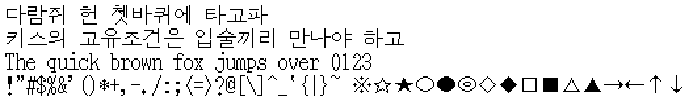

*이 레시피로 만든 대우 고딕 16(`hanglg16`)과 Sony 8x16 ASCII: 한국어 두 줄, 영문, ASCII 기호와 KS X 1001 기호, 2배*

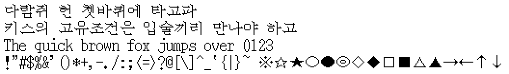

*대우 명조 16(`hanglm16`), 같은 줄, 2배*

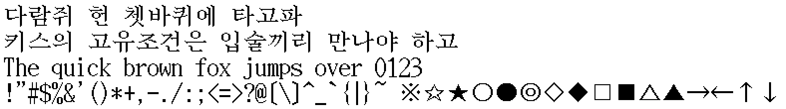

*대우 명조 24(`hanglm24`)와 Sony 12x24 ASCII, 2배*

### 백묵

백묵 바탕, 돋움, 굴림, 헤드라인은 2000년대 리눅스 배포판의 자유 한글 폰트이고, 여기서는 X BDF로 다룬다. `baekmuk-2.0`과
`baekmuk-bdf-2.2`는 같은 폰트 42개를 담는다(`batang`, `gulim`은 10-24 px와 굵은꼴, `dotum`, `hline`은 10-24 px). 2.2는 레지스트리
이름을 `KSX1001.1998`로 바꾸고 유로 기호와 ®를 더했다(글리프 8,226개). 16 px 바탕, 돋움, 굴림, 헤드라인의 음절 2,350자는 2.0에서
구우나 2.2에서 구우나 같은 픽셀이다.

박스가 셀과 같지 않다. 굴림 16은 `FONTBOUNDINGBOX 16 16 0 -2`, `FONT_ASCENT 14`이지만 바탕과 돋움 16은 `FONT_ASCENT 12`이고 음절이
기준선 위로 13행, 아래로 3-4행까지 간다. 폰트 자신의 ascent로는 16x16 셀에서 음절이 16개(바탕)와 7개(돋움), 기호까지 치면 각각
글리프 82개가 잘린다. `--hangul-ascent 13`이면 음절이 셀 안에 든다(바탕: 잘림 0, 돋움: 1. `--symbols`를 주면 더 아래로 내려가는
괘선 같은 기호 때문에 53과 52).

    B=$SRC/baekmuk-bdf-2.2/bdf
    python3 -I tools/bdfface.py --hangul $B/gulim16.bdf --ascii $OUT/8x16.bdf --cell 16x16 --chars-from $OUT/ksnh.txt --symbols -o $OUT/BMGUL16.SVF
    python3 -I tools/bdfface.py --hangul $B/batang16.bdf --ascii $OUT/8x16.bdf --cell 16x16 --hangul-ascent 13 --chars-from $OUT/ksnh.txt --symbols -o $OUT/BMBAT16.SVF
    python3 -I tools/bdfface.py --hangul $B/dotum16.bdf --ascii $OUT/8x16.bdf --cell 16x16 --hangul-ascent 13 --chars-from $OUT/ksnh.txt --symbols -o $OUT/BMDOT16.SVF
    python3 -I tools/bdfface.py --hangul $B/gulim12.bdf --ascii $OUT/6x12.bdf --cell 12x12 --chars-from $OUT/ksnh.txt --symbols -o $OUT/BMGUL12.SVF
    python3 -I tools/bdfface.py --hangul $B/batang24.bdf --ascii $OUT/12x24.bdf --cell 24x24 --chars-from $OUT/ksnh.txt --symbols -o $OUT/BMBAT24.SVF

헤드라인 16은 14씩 나아가고(그 `DWIDTH`) 원점보다 한 열 왼쪽까지 그린다(`hline16.bdf`: `--hangul-ascent 13`에서 음절 4개 잘림).
바탕 24는 25씩 나아간다. 백묵 24 px 페이스를 16 px로 줄인 것은
[고해상도 비트맵 폰트에서 저해상도 페이스 만들기](bitmap-fonts.ko.md#고해상도-비트맵-폰트에서-저해상도-페이스-만들기)에 있다.

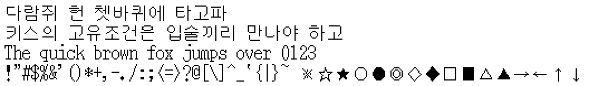

*이 레시피로 만든 백묵 굴림 16과 Sony 8x16 ASCII, 2배*

*`--hangul-ascent 13`으로 만든 백묵 바탕 16, 2배*

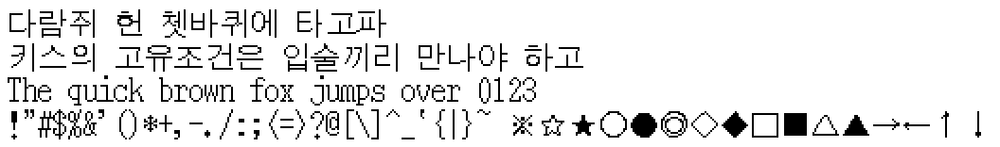

*`--hangul-ascent 13`으로 만든 백묵 돋움 16, 2배*

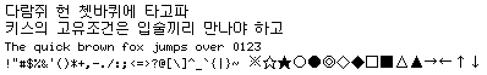

*백묵 굴림 12와 Misc Fixed 6x12 ASCII, 2배*

### hanterm 조합형 폰트

한글 xterm인 hanterm은 KS C 5601 폰트뿐 아니라 자모 세트 폰트로도 한글을 그렸다(`-hfn`, 그리고 폰트 종류 `johab`이나 `johab844`).
그런 폰트가 두 벌 남아 있고, 둘 다 `hanterm-font-3.1.tar.gz`(KLDP 자료실. 3.1pre3과 같다)에 들어 있다.

- **`8-4-4`**: `johab844-1` 폰트 133개, 16x16, 글리프 360개, `ENCODING` 0-359. 김윤수의 DOS 글꼴 모음 #002(1994)를 X 형식으로
  바꾼 것이다. README에 따르면 이상윤이 PCF로 바꾸고(1996) John Simon이 BDF로 떠내며 이름을 고쳤다(1999). 폰트 이름에는
  제작사 `postech`와 DOS 글꼴의 이름이 들어 있다(`dkbgoth.bdf`는 `-postech-DoGgaiBi_GoDig-...`, `goth00.bdf`는
  `-postech-GaNeun_GoDig-...`).
- **`10-6-6`**: hanterm 3.0.4의 폰트(`hanterm304fonts`의 BDF 11개와 바이트 단위로 같다). KAIST 고딕, 명조, 필기와 iyagi가 각각
  `johab-1`(글리프 529개, 자모만), `johabs-1`(1,644개: + KS X 1001 기호), `johabsh-1`(6,563개: + 한자)로 있다(iyagi는 `johab-1`과
  `johabsh-1`). **`10-6-6-nz`**: 폭 0인 글리프를 받지 않는 X 서버를 위한 같은 폰트(hanmaum, 1998). 모든 글리프가 16씩 나아가고
  글리프 529가 16만큼 되돌아간다.

**johab844-1 (`--layout hanterm-844`).** hanterm의 `convert_3_to_jo844font`(hanterm 3.1.5와 hanterm-xf 3.3.1p18의 `hangul.c`)는
DOS 8x4x4의 벌 표로 음절을 글리프 `type1 * 20 + L`, `160 + type2 * 22 + V`, `248 + type3 * 28 + T`에서 그린다. 그러니 johab844-1
BDF는 원시 8x4x4 폰트(11,520바이트)를 BDF로 옮긴 것이고, 글리프의 `ENCODING`이 곧 글리프 슬롯이다. `jamoset.py --layout
hanterm-844`는 BDF(글리프 360개. 벌마다 슬롯 0은 비어 있어야 한다)를 읽어 8x4x4 자모 세트를 만들고, `--check`는 음절 11,172자를
같은 글리프 360개로 `johab844.py`가 조합한 것과 모두 비교한다. ASCII는 X11 Sony 8x16 폰트로 만든 페이스를 `--base`로 준다.

    python3 -I tools/mkfont.py /usr/share/fonts/X11/misc/8x16.pcf.gz $OUT/ASCII16.SVF --size 16 --bpp 1 --unicode ascii
    python3 -I tools/jamoset.py --layout hanterm-844 $SRC/hanterm-font/8-4-4/dkbgoth.bdf --base $OUT/ASCII16.SVF --check -o $OUT/HTDKB16J.SVF

`ASCII16.SVF`는 3,268바이트(글리프 95개). `HTDKB16J.SVF`: `15,840 바이트`, 조각 344개, `check: composed 11172 syllables from 439
glyphs, JSET 1101 bytes; identical to johab844.py`, `width=144 ascent=14 descent=2`, 잉크 471. `--base`가 없으면 `12,624 바이트`.
`goth00.bdf`: `15,728 바이트`, 잉크 370. `han.bdf`(MyeongJo): `16,616 바이트`, 잉크 475. 폴더의 폰트 133개가 모두 만들어지고
`--check`를 통과한다. `dkbgoth`와 `goth00`은 hanterm의 `convert_3_to_jo844font` 자체를 옮겨 쓴 코드로도 음절 11,172자를 조합해
자모 세트와 비교했다: 11,172자 중 11,172자가 같다(`tools/test_jamoset.py`는 같은 코드로 합성 폰트에서 레이아웃의 표를 검사한다).

**johab-1 (`--layout hanterm-johab`).** hanterm 자체의 10 / (3 또는 4) / 4 벌 체계로 된 글리프 번호 0-528(종성 클래스 셋: 없음,
ㄴ, 그 밖. [자모 세트](../jamo-sets.ko.md)):

    python3 -I tools/jamoset.py --layout hanterm-johab $SRC/hanterm-font/10-6-6/johabm16.bdf --base $OUT/ASCII16.SVF --check -o $OUT/HTERM16J.SVF

KAIST 명조(`johabm16.bdf`): `16,956 바이트`, 조각 368개, `check: composed 11172 syllables from 463 glyphs, JSET 1303 bytes`,
`width=144 ascent=14 descent=2`, 잉크 469. 고딕(`johabg16.bdf`) `16,396 바이트`, 잉크 373. 필기(`johabp16.bdf`) `16,700 바이트`,
잉크 487. iyagi(`iyagi16.bdf`) `16,812 바이트`, 잉크 480. `--base` 없이(ASCII 없음. 대신 `--eng`에 원시 8x16 영문 폰트를 줄 수
있다): 명조 `13,740 바이트`, `width=80`(샘플 줄의 음절 다섯 개), 잉크 310. 고딕 `13,180 바이트`, 잉크 214. `johabs`와 `johabsh`
폰트도 같은 자모 세트를 준다(도구는 글리프 0-528을 읽는다). `-nz` 폰트는 바이트 단위로 같은 것을 준다(`johabnzm16.bdf` =
`johabm16.bdf`). 실제 데이터로 한 검사: 홍훈수가 `iyagi16`과 `johabp16`에서 바꾼 완성형 폰트 `ks_iyagi16.bdf`와
`ks_philgi16.bdf`는 KS X 1001 음절 2,350자 모두에서 그 두 폰트의 자모 세트와 같다.

maker의 `detect.scan`은 두 종류 모두에 종류 `bdf-johab`, 레이블 "BDF (johab)", 크기 [16], 경로 `hanterm`(`hanterm-johab`)을 준다.
`johab844-1` 폰트에서는 그 경로가 `BDF lacks glyph ENCODING 360 of the 529 johab-1 glyphs`로 멈추므로 위의 명령으로 만든다. 두
레이아웃은 서로의 폰트를 거부한다(johab-1 폰트에 `hanterm-844`: `not this layout: fill slots [20, 40, 60, 80] are not blank`).
Synthetic(`tools/test_recipes.py`): 글리프 529개의 johab-1 BDF는 10/4/4 벌로 음절 11,172자를 모두 조합하고, 글리프 360개의
johab844-1 BDF와 ASCII base 페이스는 `johab844.py`와 같은 8/4/4 세트를 만든다.

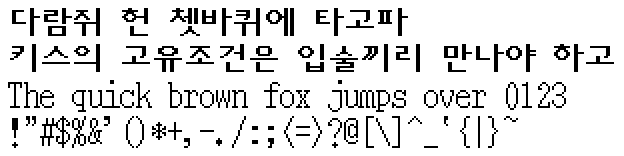

*hanterm johab844-1 폰트 `dkbgoth`(도깨비 고딕)를 자모 세트로, Sony 8x16 ASCII와 함께. 이 폰트에는 KS X 1001 기호가 없다, 2배*

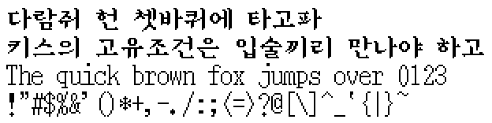

*hanterm johab-1 폰트 `johabm16`(KAIST 명조, `10-6-6`)을 자모 세트로, Sony 8x16 ASCII와 함께, 2배*

### 한양

`hanyang-font-pcf`에는 한양 고딕(`hgm`, 폰트 이름 Kodig)과 명조(`hmm`)가 10-20 px로 있다. KAIST ftp `hanfont.pcf`의 한양 폰트를
`FONT_DESCENT`를 늘리고 문자 셀 간격으로 바꾼 것이다(README). "16 px" 폰트는 16보다 크다. `hgm16`은 음절을 기준선 위 15행부터
아래 2행까지 그리고(`FONT_ASCENT` 16), `hmm16`은 위 16행부터 아래 3행까지, 17열 폭으로 그린다(`FONT_ASCENT` 18). 폰트 자신의
ascent로는 16x16 셀에서 `ksnh.txt`가 지정한 글리프 중 341개와 3,125개가 잘린다. 셀을 키우고 음절 기준선을 옮기면 남는다.

    for f in hgm16 hmm16; do python3 -I maker/srcprep.py pcf-bdf $SRC/hanyang-font-pcf/$f.pcf $OUT/$f.bdf; done
    python3 -I tools/bdfface.py --hangul $OUT/hgm16.bdf --ascii $OUT/8x16.bdf --cell 16x17 --ascent 14 --hangul-ascent 15 --chars-from $OUT/ksnh.txt --symbols -o $OUT/HYGOT16.SVF
    python3 -I tools/bdfface.py --hangul $OUT/hmm16.bdf --ascii $OUT/8x16.bdf --cell 16x18 --ascent 14 --hangul-ascent 16 --chars-from $OUT/ksnh.txt --symbols -o $OUT/HYMYE16.SVF

고딕: 잘린 음절 0개(`--symbols`면 기호 58개). 명조: 잘린 음절 4개(기호까지 글리프 68개). 압축 파일은 라이선스를 적지 않는다.

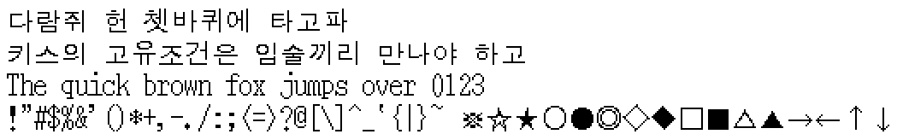

*16x17 셀의 한양 고딕 16(`hgm16`)과 Sony 8x16 ASCII, 2배*

### KAIST 폰트 (newmj, iyagi, philgi, h16m)

`kaist-newmj16.bdf`와 `kaist-newmj18.bdf`는 홍훈수(KAIST 물리학과, 1998)가 그린 명조다. 기호는 대우 고딕의 것이고, 18 px의
한자는 HLaTeX 0.97의 Type 1 폰트에서 왔다. `ks_iyagi16.bdf`와 `ks_philgi16.bdf`는 hanterm 조합형 폰트 iyagi와 KAIST 필기를 같은
사람이 완성형으로 바꾼 것이다(1997). `han` 프레임버퍼 콘솔(han-1.0fb)의 `h16m.bdf`는 1991년의 KAIST 명조로, 자모 40자가 있고
기호는 없다. 모두 16x16(newmj18: 18x18), `FONT_ASCENT` 14(15)다.

    python3 -I tools/bdfface.py --hangul $SRC/kaist-newmj16.bdf --ascii $OUT/8x16.bdf --cell 16x16 --chars-from $OUT/ksnh.txt --symbols -o $OUT/NEWMJ16.SVF
    python3 -I tools/bdfface.py --hangul $SRC/kaist-newmj18.bdf --ascii $OUT/8x16.bdf --cell 18x18 --ascent 14 --chars-from $OUT/ksnh.txt --symbols -o $OUT/NEWMJ18.SVF
    python3 -I tools/bdfface.py --hangul $SRC/ks_iyagi16.bdf --ascii $OUT/8x16.bdf --cell 16x16 --chars-from $OUT/ksnh.txt --symbols -o $OUT/IYAGI16.SVF
    python3 -I tools/bdfface.py --hangul $SRC/ks_philgi16.bdf --ascii $OUT/8x16.bdf --cell 16x16 --chars-from $OUT/ksnh.txt --symbols -o $OUT/PHILGI16.SVF
    python3 -I tools/bdfface.py --hangul $SRC/han-1.0fb/h16m.bdf --ascii $OUT/8x16.bdf --cell 16x16 --chars-from $OUT/ksnh.txt --symbols -o $OUT/H16M.SVF

`kaist-newmj18.bdf`에는 `ENCODING -1`인 글리프가 하나 있다. `bdfface.py`는 이것을 건너뛴다(전에는 `bytes must be in range(0, 256)`으로
멈췄다). 8x4x4 맞춤이 각 폰트가 만들어진 방식을 보여 준다. hanterm이 자모로 조합한 iyagi와 philgi는 IoU 0.985와 0.961, `h16m`은
1.000(음절 2,350자 중 2,349자가 정확: 8x4x4 폰트를 음절로 조합한 것), 손으로 그린 newmj는 0.906이다.

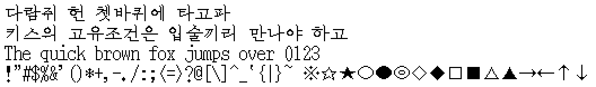

*KAIST newmj 16과 Sony 8x16 ASCII. 기호는 대우 고딕의 것, 2배*

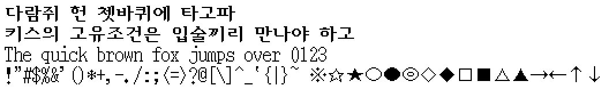

*KAIST iyagi 16(`ks_iyagi16`, hanterm iyagi 폰트의 완성형), 2배*

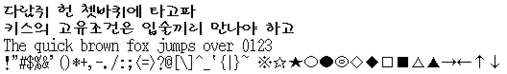

*KAIST philgi 16(`ks_philgi16`, hanterm KAIST 필기 폰트의 완성형), 2배*

### 미지

`xfntmizi-1.1-2` RPM(미지리서치, 1999)에는 16 px 한글 폰트 네 개, `mzgt16h`(고딕), `mzmj16h`(명조), `mzpg16h`(필기),
`mzsm16h`(샘물)과 각각의 영문 짝(`mz*16e`), 그리고 Netscape를 위해 고딕을 GR 코드(`ksc5601.1987-1`)로 담은 `mzgt16h1`이 있다.
README에 따르면 미지의 HTM 글꼴 서버가 주는 글꼴을 비트맵으로 저장한 것이다. `bdfface.py`는 GR 폰트를 GL 폰트와 똑같이 읽는다
(같은 음절 2,350자, 바이트 단위로 같은 페이스).

    python3 -I maker/srcprep.py pcf-bdf $SRC/xfntmizi/mzgt16h.pcf $OUT/mzgt16h.bdf
    python3 -I tools/bdfface.py --hangul $OUT/mzgt16h.bdf --ascii $OUT/8x16.bdf --cell 16x16 --chars-from $OUT/ksnh.txt --symbols -o $OUT/MZGOT16.SVF

`FONTBOUNDINGBOX 16 16 0 -3`, `FONT_ASCENT 13`(대우: `16 16 0 -2`, 14). 8x4x4 맞춤은 0.983(정확한 음절 2,116자)이다. HTM
글꼴은 자모로 음절을 조합한다.

### 그 밖의 X와 콘솔 폰트

- **jfbterm**(프레임버퍼 터미널): `jfbterm-font-pack-1`에는 KS C 5601 폰트가 하나, `ihan_ksc.pcf.gz`(`-gnu-kofont-`, 음절 2,350자와
  자모 94자, `COPYRIGHT "Public Domain. Share and enjoy"`) 있다. `bdfface.py`로 `115,808 바이트`, 잉크 512. 팩의 `ieng_ihangul`과
  `unifont`는 GNU Unifont(`iso10646-1`)이고, jfbterm uxp 추가 패키지의 폰트(`iyagi_uni`, `aply_apple`)도 유니코드 인덱스다.
  이들은 `mkfont.py`로 간다.
- **Pinetree 완성형**(나래, 1995): 비례폭이라 변환하지 않는다(위).
- **zhcon**(CJK 프레임버퍼 콘솔): 0.2.6 소스의 `font/ksc-16.bpsf`는 zhcon의 BPSF다(279,753바이트: 9바이트 머리 뒤에 16x16
  글리프 8,742개가 32바이트씩, 0xA1A1부터 KS X 1001 격자로). `tools/getbpsf.txt`에 따르면 생성기는 X 서버의 16x16
  `ksc5601.1987-0` 폰트를 떠낸다. 음절 2,350자는 대우 명조 16의 것이다(잉크 상자로 잘라 보면 모두 같다). `rawcarve.py`로 잘라 낸다.

      python3 -I tools/rawcarve.py bdf $SRC/zhcon-0.2.6/font/ksc-16.bpsf --offset 9 --glyph 16x16 --chars ks-nonhanja --grid 0xA1,0xA1,94 -o $OUT/zhksc16.bdf
      python3 -I tools/bdfface.py --hangul $OUT/zhksc16.bdf --ascii $OUT/8x16.bdf --cell 16x16 --chars-from $OUT/ks.txt -o $OUT/ZHKSC16.SVF

  `wrote zhksc16.bdf: 3334 glyphs (2350 Hangul syllables) of 16x16, ascent 14`. 페이스는 `125,124 바이트`. zhcon은 GNU GPL
  버전 2(`COPYING`)이고, 폰트는 대우의 것이다.
- **hanja65**(CTAN, HBF)는 한자만 담는다.
- **`18x18ko`**(Misc Fixed Wide, X.Org): 유니코드. [ISO 10646 BDF와 PCF](bitmap-fonts.ko.md#iso-10646-bdf와-pcf)를 보라.

### 측정 결과

각 페이스를 `--chars-from $OUT/ks.txt`로(음절 2,350자와 ASCII. 옵션은 위와 같고 `--symbols`만 뺀다), 다시 `--chars-from
$OUT/ksnh.txt --symbols`로 만들고, 앞의 것에 8x4x4를 맞췄다(`jamoset.py --layout 844 --from-svf ... --mask-font none --check`).
measure와 잉크는 [페이스 점검](../recipes.ko.md#페이스-점검)의 것이다(16 px 틀. 12와 24 px: `line 400 C+8 0 C`). 기호가 있든
없든 같다. 2026-11-27에 실행했다.

| 페이스 | `ks.txt` 페이스 | 잘림 | `--symbols`(가져온 다른 문자) | 잘림 | `measure`, 잉크 | 8x4x4 맞춤 |
|---|---|---:|---|---:|---|---|
| 대우 고딕 16 | `125,088 바이트` | 0 | `170,168 바이트`(986) | 0 | `width=144 ascent=14 descent=2`, 382 | `18,192 바이트`, IoU 0.796 |
| 대우 명조 16 | `125,124 바이트` | 0 | `170,204 바이트`(986) | 0 | `width=144 ascent=14 descent=2`, 379 | `18,464 바이트`, IoU 0.826 |
| 대우 명조 24 | `218,448 바이트` | 0 | `292,080 바이트`(986) | 0 | `width=216 ascent=22 descent=2`, 877 | - |
| 백묵 굴림 16 | `125,128 바이트` | 0 | `167,436 바이트`(987) | 0 | `width=144 ascent=14 descent=2`, 384 | `18,768 바이트`, IoU 0.782 |
| 백묵 바탕 16(`--hangul-ascent 13`) | `123,048 바이트` | 0 | `165,572 바이트`(986) | 53 | `width=144 ascent=14 descent=2`, 379 | `18,872 바이트`, IoU 0.692 |
| 백묵 돋움 16(`--hangul-ascent 13`) | `124,464 바이트` | 1 | `167,460 바이트`(986) | 52 | `width=144 ascent=14 descent=2`, 411 | `19,564 바이트`, IoU 0.671 |
| 백묵 헤드라인 16(`--hangul-ascent 13`) | `124,052 바이트` | 4 | `167,476 바이트`(987) | 205 | `width=134 ascent=14 descent=2`, 730 | - |
| 백묵 굴림 12 | `105,944 바이트` | 0 | `143,528 바이트`(988) | 0 | `width=108 ascent=10 descent=2`, 265 | - |
| 백묵 바탕 24 | `206,872 바이트` | 0 | `273,868 바이트`(986) | 17 | `width=221 ascent=22 descent=2`, 746 | - |
| 한양 고딕 16(16x17) | `119,508 바이트` | 0 | `162,660 바이트`(985) | 58 | `width=144 ascent=14 descent=3`, 386 | - |
| 한양 명조 16(16x18) | `118,592 바이트` | 4 | `161,764 바이트`(985) | 68 | `width=144 ascent=14 descent=4`, 378 | - |
| KAIST newmj 16 | `124,480 바이트` | 0 | `169,560 바이트`(986) | 0 | `width=144 ascent=14 descent=2`, 394 | `17,644 바이트`, IoU 0.906 |
| KAIST newmj 18(18x18) | `150,416 바이트` | 0 | `194,304 바이트`(985) | 0 | `width=154 ascent=14 descent=4`, 425 | - |
| KAIST iyagi 16 | `122,856 바이트` | 0 | `167,936 바이트`(986) | 0 | `width=144 ascent=14 descent=2`, 480 | `17,428 바이트`, IoU 0.985 |
| KAIST philgi 16 | `122,412 바이트` | 0 | `167,492 바이트`(986) | 0 | `width=144 ascent=14 descent=2`, 487 | `17,144 바이트`, IoU 0.961 |
| KAIST `h16m` | `118,460 바이트` | 0 | `120,008 바이트`(40) | 0 | `width=144 ascent=14 descent=2`, 451 | `16,844 바이트`, IoU 1.000 |
| 미지 고딕 16 | `122,952 바이트` | 0 | `166,320 바이트`(988) | 0 | `width=144 ascent=14 descent=2`, 380 | `16,552 바이트`, IoU 0.983 |

모든 페이스에 음절 2,350자가 있다. `fontmetrics.py`는 두 가지 넘침을 찾는다. 하나는 헤드라인 16으로, 글리프가 14 px 간격에
최대 16 px 폭이다(음절과 기호, 2 px 넘침). 다른 하나는 `bdfface.py`가 그려 넣는 U+2026으로, ASCII 공백의 8 px(굴림 12: 6 px)
advance에 11 px 점을 찍는다. 폰트에서 U+2026을 가져오지 않는 페이스(`ks.txt` 페이스, 기호가 없는 `h16m`)에서 나타난다. 24 px
페이스와 그 밖의 `--symbols` 페이스는 모든 글리프가 advance 안에 든다. 모든 맞춤은 `--check`에서 음절 11,172자를 모두 조합한다. hanterm 폰트의 자모 세트는
[hanterm 조합형 폰트](#hanterm-조합형-폰트)에 있다.

### 라이선스

파일에 적힌 것이고, 법률 의견이 아니다. 폰트는 저장소에 없고 `svf/`의 어떤 페이스도 이것으로 만들지 않는다. 위의 작은 샘플은
이 문서를 위한 소유자의 결정이다.

| 계열 | 파일에 적힌 것 |
|---|---|
| 대우(`hanglg16`, `hanglm16`, `hanglm24`) | PCF `COPYRIGHT "Copyright (c) 1987, 1988 Daewoo Electronics Co.,Ltd."`. X.Org의 `font-daewoo-misc/COPYING`(데비안 `xfonts-base`의 copyright 파일에 있다)은 이 한 줄뿐이고 허가 문구가 없다. X.Org, 데비안(main), 우분투가 이 폰트를 싣고 재배포한다. |
| Sony `8x16`, `12x24`(ASCII) | `font-sony-misc/COPYING`: "Copyright 1989 by Sony Corp. Permission to use, copy, modify, and distribute this software ... without fee is hereby granted, provided that the above copyright notices appear in all copies ...". |
| Misc Fixed `6x12`(ASCII) | `font-misc-misc/COPYING`: "Public domain font. Share and enjoy." |
| 백묵 2.0, 2.2 | `COPYRIGHT`(2.2와 데비안 `xfonts-baekmuk`): "Copyright (c) 1986-2002 Kim Jeong-Hwan. Permission to use, copy, modify and distribute this font is hereby granted, provided that both the copyright notice and this permission notice appear in all copies of the font, derivative works or modified versions, and that the following acknowledgement appear in supporting documentation: Baekmuk Batang, Baekmuk Dotum, Baekmuk Gulim, and Baekmuk Headline are registered trademarks owned by Kim Jeong-Hwan." 데비안 copyright의 한국어 문구: "저작권자는 이 서체를 자유롭게 사용, 복사, 수정 및 배포할 수 있도록 허가합니다 ...". BDF의 `COPYRIGHT` 속성: Hwan Design Inc.와 Mizi Research Inc. |
| hanterm `8-4-4` | `LICENSE.euc-kr`는 김윤수의 글꼴 모음 해설(1994-04-10)이다. 글꼴마다 만든 사람이 다르고 글꼴별로 이름을 적었다. `#`, `*`, `+` 표가 붙은 글꼴(자신이 만들거나 손본 것)은 파일 이름을 바꾸지 말 것, 출처를 밝힐 것, 허가 없이 상용 프로그램에 쓰지 말 것. 영화체(장영화)는 만든 사람이 상업용 사용을 제한했다. |
| hanterm `10-6-6`, `10-6-6-nz`, `hanterm304fonts` | 압축 파일에 라이선스가 없다(README는 설치 안내: 김대식, hanmaum). `iyagi16.bdf`: "GENERATED BY bin2bdf 1.0, AUTHOR mleisher@nmsu.edu". |
| 한양(`hanyang-font-pcf`) | 압축 파일에도 PCF 속성에도 라이선스나 저작권 표시가 없다. |
| KAIST newmj 16, 18 | BDF 주석: "이 font를 상업적으로 이용하는 것을 금합니다. 상업적으로 이용하고자 할 경우에는 저에게서 서면으로 허가를 받아야 합니다."(홍훈수, KAIST, 1998-02-10) |
| KAIST `ks_iyagi16`, `ks_philgi16` | BDF 주석: 홍훈수가 변환만 했고 "not the author of this font". 조건은 없다. |
| KAIST `h16m`(han-1.0fb) | `COPYRIGHT "Copyright (c) 1991 Korea Advanced Institute of Science and Technology"`. han-1.0fb 패키지는 GNU GPL 버전 2(`COPYING`). |
| 미지(`xfntmizi`) | PCF `COPYRIGHT "Copyright 1997 Seo, Young-Jin."`. RPM의 라이선스 태그는 `free`. |
| jfbterm `ihan_ksc` | `COPYRIGHT "Public Domain. Share and enjoy"`. |
| Pinetree 완성형 | BDF 주석: "Copyleft 1995, Narae, Lee yongjae". 고지를 유지하면 사용, 복사, 수정, 배포, 판매를 허가한다. |

### 샘플 만들기

이 문서의 그림은 `tools/doc_figures_x11.py`가 이 레시피의 명령으로 파일 자체에서 그린다. 폴더만 있으면 되고 저장소에 폰트
사본을 둘 필요가 없다.

    python3 -I tools/doc_figures_x11.py --misc /usr/share/fonts/X11/misc --baekmuk $SRC/baekmuk-bdf-2.2/bdf \
        --hanterm $SRC/hanterm-font --hanyang $SRC/hanyang-font-pcf --newmj $SRC/kaist-newmj16.bdf \
        --iyagi $SRC/ks_iyagi16.bdf --philgi $SRC/ks_philgi16.bdf [--check]

그림 13개, 모두 36,494바이트. `--check`는 바이트 단위로 비교한다([도구 설명서](../tools.ko.md#toolsdoc_figures_x11py)).

[레시피 색인](../recipes.ko.md) · [도구 설명서](../tools.ko.md)
