**English** | [한국어](x-window.ko.md)

# Recipes: Korean fonts from X Window and Unix

The Korean bitmap fonts of X Window and Unix (1987-2004) to SVF faces: the Daewoo fonts of the X11 core distribution, Baekmuk, Hanyang, the KAIST fonts, Mizi, and hanterm's johab jamo-set fonts (johab844-1 and johab-1), family by family, with the commands run on the real files, measured results, licences and samples.

**Before you start.** Commands run from the project root with `$OUT` set as in the [index](../recipes.md); every face ends with the checks of [Checking a face](../recipes.md#checking-a-face). `$SRC` is the folder where the archives below were unpacked, each in its own folder; the files are data, read with `python3 -I` and never run. The generic KS C 5601 BDF/PCF route (one font, then a fitted jamo set) is in [KS C 5601 BDF and PCF](bitmap-fonts.md#ks-c-5601-bdf-and-pcf).

Up: [Recipes index](../recipes.md) · Related: [Bitmap fonts](bitmap-fonts.md), [DOS-era raw fonts](dos-fonts.md), [Jamo sets](../jamo-sets.md), [Tool reference](../tools.md).

## Korean fonts from X Window and Unix

Korean X terminals and editors (hanterm, hanemacs, Netscape with a Korean font set) drew Hangul from X bitmap fonts in
two forms: precomposed fonts of the 2,350 KS C 5601 syllables, and jamo-set fonts that hanterm composed syllable by
syllable, as the DOS drivers did. Both reach the tools here:

| Form | `CHARSET_REGISTRY` (font name) | `ENCODING` | Tool |
|---|---|---|---|
| precomposed, KS C 5601 GL | `KSC5601.1987-0`, `KSX1001.1997-0`, `KSX1001.1998-0` | the GL code (0x2121-0x7E7E, row x 256 + column) | `bdfface.py` (a PCF through `srcprep.py pcf-bdf` first) |
| precomposed, KS C 5601 GR | `KSC5601.1987-1` (Mizi `mzgt16h1`) | the GR code (0xA1A1-0xFEFE) | `bdfface.py` (it reads GL and GR codes alike) |
| jamo set, hanterm johab | `JOHAB-1`, `JOHABS-1`, `JOHABSH-1`, `JOHABNZ-1` (hanterm-font `10-6-6`, `10-6-6-nz`) | the glyph number 0-528 (johab-1) | `jamoset.py --layout hanterm-johab` |
| jamo set, 8x4x4 | `johab844-1` (hanterm-font `8-4-4`) | the glyph number 0-359 in the DOS 8x4x4 order | `jamoset.py --layout hanterm-844` |
| Unicode | `ISO10646-1` (`18x18ko`, the jfbterm `*_uni` fonts) | the code point | `mkfont.py` ([ISO 10646 BDF and PCF](bitmap-fonts.md#iso-10646-bdf-and-pcf)) |

None of the Korean fonts holds ASCII under its own codes: X paired a Hangul font with a Latin one (hanterm's `-fn` and
`-hfn`). The recipes take ASCII from the X11 core fonts that come with every X installation, Sony `8x16` and `12x24`
and Misc Fixed `6x12`.

### What the files hold

Measured on the files (glyph counts are the BDF's `CHARS`; "2,350" means every KS X 1001 syllable is there):

| Family | Files | Origin and years | Encoding | Glyphs | Syllables | Other KS X 1001 characters |
|---|---|---|---|---:|---|---|
| Daewoo Gothic, Mincho | `hanglg16.pcf.gz`, `hanglm16.pcf.gz`, `hanglm24.pcf.gz` (X.Org `font-daewoo-misc`) | Daewoo Electronics, 1987-1988 | `KSC5601.1987-0` | 8,224 | 2,350 | symbols, jamo, 4,888 Hanja |
| Baekmuk Batang, Dotum, Gulim, Headline | `baekmuk-2.0` and `baekmuk-bdf-2.2` (42 BDFs each: 10, 12, 14, 16, 18, 20, 24 px; Batang and Gulim also bold) | Kim Jeong-Hwan (Hwan Design) with Mizi Research, 1986-2002; 2.2 of 2004-08-08 | `ksx1001.1997-0` (2.0), `KSX1001.1998-0` (2.2) | 2.0: 8,224 in most regular fonts (8,262-8,742 in Batang 10, 12 and Gulim 12), 8,309-8,928 in the bold ones; 2.2: 8,226 (+ € ®; Gulim 14: 8,227) | 2,350 | symbols, jamo, Hanja |
| Hanyang Kodig, Myeongjo | `hanyang-font-pcf` (`hgm` and `hmm`, 10, 12, 14, 16, 18, 20 px) | Hanyang fonts of the KAIST ftp `hanfont.pcf`, re-spaced for Netscape | `KSC5601.1987-0` | 8,223 | 2,350 | symbols, jamo, Hanja |
| KAIST newmj | `kaist-newmj16.bdf`, `kaist-newmj18.bdf` | Hong Hunsoo (KAIST), 1998-02-10 | `ksc5601.1987-0` | 8,224 (18 px: one unencoded) | 2,350 | from the Daewoo Gothic (16); 18: Hanja from HLaTeX 0.97 |
| KAIST iyagi, philgi | `ks_iyagi16.bdf`, `ks_philgi16.bdf` | the hanterm johab fonts `iyagi16` and `johabp16` converted to wansung by Hong Hunsoo, 1997-11 | `ksc5601.1987-0` | 8,224 | 2,350 | from the Daewoo Gothic |
| KAIST myungjo `h16m` | `han-1.0fb` (`h16m.bdf.gz`, the Linux framebuffer console `han`) | "by ujsung A.I.Lab KAIST", 1991-01-16 | `KSC5601.1987-0` | 2,391 | 2,350 (+ one code that decodes to 쩆) | 40 jamo |
| Mizi gothic, myeongjo, philgi, saemmul | `xfntmizi-1.1-2.noarch.rpm` (`mz*16h.pcf.Z`, `mzgt16h1.pcf.Z`) | Mizi Research, "generated from HTM" (its font server); `COPYRIGHT` 1997 Seo Young-Jin; RPM 1999 | `ksc5601.1987-0`, `mzgt16h1`: `-1` | 8,460 (234 at codes KS X 1001 leaves empty) | 2,350 | symbols, jamo, Hanja |
| jfbterm `ihan_ksc` | `jfbterm-font-pack-1` (`ihan_ksc.pcf.gz`) | `-gnu-kofont-`, jfbterm Korean font pack | `ksc5601.1987-0` | 2,444 | 2,350 | 94 jamo |
| Pinetree precomposed | `pinetree.precomposed-1.01-bdf` (`ptpR`, `ptpB` 8, 10, 12, 14, 18, 24 px) | Narae (Seoul National University), 1995 | `ksc5601.1987-0`, proportional (`P`) | 2,401 | 2,350 | none |
| zhcon `ksc-16.bpsf` | `zhcon_0.2.6.orig` (`font/ksc-16.bpsf`, the framebuffer console zhcon) | dumped from an X font by `getbpsf` (Lee Seokmin, 2002): the syllables are Daewoo Mincho 16's | zhcon's BPSF: a 9-byte header, then 16x16 glyphs in the KS X 1001 94 x 94 grid from row 0xA1 | 8,742 slots | 2,350 | symbols, jamo, Hanja |
| hanterm johab844-1 | `hanterm-font-3.1/hanterm-font/8-4-4` (133 BDFs) | Kim Yunsoo's font collection #002 (1994-04-10, DOS fonts by many authors); PCF by Sang-yoon Lee 1996, BDF by John Simon 1999 | `johab844-1` | 360 | jamo set (all 11,172) | none |
| hanterm johab-1 | `hanterm-font-3.1/hanterm-font/10-6-6` (11 BDFs, byte for byte the `hanterm304fonts` set), `10-6-6-nz` (11) | KAIST Gothic, Myeongjo, Philgi and iyagi; hanterm 3.0.4 (Daeshik Kim); `-nz` by hanmaum 1998-02 | `JOHAB-1` (529 glyphs), `JOHABS-1` (1,644: + symbols), `JOHABSH-1` (6,563: + Hanja) | 529 / 1,644 / 6,563 (`-nz`: one more) | jamo set (all 11,172) | in the `s` and `sh` fonts, after glyph 528 |

The archives come from the KLDP archive (`ftp.kr.freebsd.org/pub/kldp.net/download/`: hanterm-font 3.1, Baekmuk BDF
2.2, the jfbterm font pack), archive.debian.org (zhcon 0.2.6) and the FreeBSD-kr ports distfiles (`ftp.kr.freebsd.org/pub/FreeBSD-kr/distfiles/`: hanterm304fonts,
hanyang-font-pcf, baekmuk-2.0, kaist-newmj16/18, ks_iyagi16, ks_philgi16, pinetree.precomposed, xfntmizi, han-1.0fb);
the Daewoo fonts are in every X.Org installation (`/usr/share/fonts/X11/misc` from Debian and Ubuntu `xfonts-base`), and
Debian's `xfonts-baekmuk` 2.2-9 holds the same Baekmuk 2.2 as PCF (its Gulim 16 bakes byte for byte the face of the
2.2 BDF). The hanterm program sources (hanterm 3.1-3.3.1, hanterm-xf 2.0) carry no fonts; their `hangul.c` holds the
composition rules the two hanterm layouts follow.

The 2,350 syllables are complete in every precomposed family above; each one bakes with `bdfface.py`, except Pinetree,
which is proportional: `bdfface.py` steps every syllable by one advance (`--hangul-advance`, default the first
syllable's `DWIDTH`), and Pinetree's syllables have 8 widths from 6 to 14 px (`ptpR14`; `ptpR18`: 10 widths, 9 to 22 px), so it
is not converted here.

### Preparing: the syllable list, the ASCII half and PCF

The syllable list of [KS C 5601 BDF and PCF](bitmap-fonts.md#ks-c-5601-bdf-and-pcf), a second list with the KS X 1001
symbols and jamo (everything but Hanja), and the ASCII fonts as BDF (`srcprep.py pcf-bdf` reads a PCF, gzipped or not,
with the standard library only):

    python3 -c "import sys; sys.path.insert(0, 'tools'); import mkfont; open(sys.argv[1], 'w', encoding='utf-8').write(''.join(chr(c) for c in mkfont.NAMED_RANGES['ksx1001-hangul']()))" $OUT/ks.txt
    python3 -c "import sys; sys.path.insert(0, 'tools'); import mkfont; open(sys.argv[1], 'w', encoding='utf-8').write(''.join(chr(c) for c in mkfont.NAMED_RANGES['ksx1001-nohanja']()))" $OUT/ksnh.txt
    for f in 8x16 12x24 6x12; do python3 -I maker/srcprep.py pcf-bdf /usr/share/fonts/X11/misc/$f.pcf.gz $OUT/$f.bdf; done

Several fonts come gzipped (`kaist-newmj16.bdf.gz`, `kaist-newmj18.bdf.gz`, `ks_iyagi16.bdf.gz`, `ks_philgi16.bdf.gz`,
`h16m.bdf.gz` in `han-1.0fb.tar.gz`) and `bdfface.py` reads plain BDF only: decompress them first (`gzip -d`); the
commands below name the decompressed files. `srcprep.py pcf-bdf` reads a gzipped PCF itself, but not a `compress`ed one
(`.pcf.Z`, see [Mizi](#mizi)).

`bdfface.py` takes from the Hangul BDF only the syllables `--chars-from` names, unless `--symbols` is given: then it
also takes the other characters the list names (KS X 1001 symbols, jamo, Hanja) where the BDF has them, on the
syllables' baseline with their own `DWIDTH`. The faces below are made both ways: with `ks.txt` (syllables and ASCII,
comparable with the other recipes) and with `ksnh.txt --symbols` (what the samples show).

### Daewoo fonts of the X11 core distribution

`hanglg16` (Daewoo Gothic 16), `hanglm16` (Daewoo Mincho 16) and `hanglm24` (Daewoo Mincho 24) are the Korean fonts of
the X11 core distribution (X.Org `font-daewoo-misc`): KS C 5601 GL, 16x16 and 24x24 cells, `FONT_ASCENT`
14 and 22. They are the fonts the other X fonts borrow from: the KAIST fonts take their symbols from Daewoo Gothic.

    for f in hanglg16 hanglm16 hanglm24; do python3 -I maker/srcprep.py pcf-bdf /usr/share/fonts/X11/misc/$f.pcf.gz $OUT/$f.bdf; done
    python3 -I tools/bdfface.py --hangul $OUT/hanglg16.bdf --ascii $OUT/8x16.bdf --cell 16x16 --chars-from $OUT/ksnh.txt --symbols -o $OUT/DWGOT16.SVF
    python3 -I tools/bdfface.py --hangul $OUT/hanglm16.bdf --ascii $OUT/8x16.bdf --cell 16x16 --chars-from $OUT/ksnh.txt --symbols -o $OUT/DWMIN16.SVF
    python3 -I tools/bdfface.py --hangul $OUT/hanglm24.bdf --ascii $OUT/12x24.bdf --cell 24x24 --chars-from $OUT/ksnh.txt --symbols -o $OUT/DWMIN24.SVF
    python3 -I tools/bdfface.py --hangul $OUT/hanglg16.bdf --ascii $OUT/8x16.bdf --cell 16x16 --chars-from $OUT/ks.txt -o $OUT/DWGOT16K.SVF
    python3 tools/jamoset.py --layout 844 --from-svf $OUT/DWGOT16K.SVF --mask-font none --check -o $OUT/DWGOT16J.SVF

The PCFs are 237,492, 239,529 and 353,568 bytes; the BDFs 1,365,300, 1,365,300 and 2,089,011 bytes, 8,224 glyphs each.
The jamo set is fitted to the syllables-and-ASCII face `DWGOT16K.SVF` (`18,192 bytes`); fitted to `DWGOT16.SVF` it
carries the 986 symbols along and is `63,272 bytes` (the same IoU, 0.796).
The faces and fits are in the table under [Measured results](#measured-results). The PCF properties name the
licence holder only: `COPYRIGHT "Copyright (c) 1987, 1988 Daewoo Electronics Co.,Ltd."`; see [Licences](#licences).

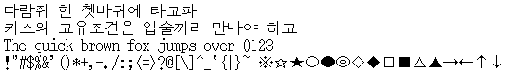

*Daewoo Gothic 16 (`hanglg16`) with Sony 8x16 ASCII, built by this recipe: two Korean lines, English, ASCII and KS X 1001 symbols, x2*

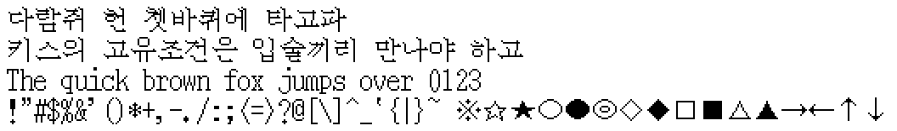

*Daewoo Mincho 16 (`hanglm16`), the same lines, x2*

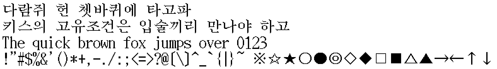

*Daewoo Mincho 24 (`hanglm24`) with Sony 12x24 ASCII, x2*

### Baekmuk

Baekmuk (백묵) Batang, Dotum, Gulim and Headline, the free Korean fonts of Linux distributions in the 2000s, as X BDFs:
`baekmuk-2.0` and `baekmuk-bdf-2.2` hold the same 42 file names (`batang`, `gulim` 10-24 px with bold; `dotum`, `hline`
10-24 px). Version 2.2 renames the registry to `KSX1001.1998` and adds the euro sign and ® (8,226 glyphs). The 2,350
syllables, compared as placed pixels (relative to the baseline) and step (`DWIDTH`), are the same in both in every
Dotum size, Batang 12, 16, 18, 20, Gulim 16, 18, 20 and Headline 10, 14, 18, 20, 24, and in bold Batang 14, 16, 18,
20, 24 and bold Gulim 16, 18, 20, 24. The pixels differ in Gulim 10, 12, 14, 24, Batang 10 and 14, bold Batang 10 and
bold Gulim 10, 12, 14; the step differs in Batang 14 (2.0: 14, 2.2: 16), Batang 24 (24, 25), bold Batang 12 (12, 13),
Headline 12 (14, 12) and Headline 16 (18, 14). The commands below use 2.2.

The boxes are not the cell: Gulim 16 has `FONTBOUNDINGBOX 16 16 0 -2` and `FONT_ASCENT 14`, but Batang and Dotum 16
have `FONT_ASCENT 12` with syllables reaching 13 rows above the baseline and 3 or 4 below. With the font's own ascent
a 16x16 cell clips 16 (Batang) and 7 (Dotum) syllables, 82 glyphs each with the symbols; `--hangul-ascent 13` puts the
syllables in the cell (Batang: 0 clipped, Dotum: 1; with `--symbols` 53 and 52, box-drawing and other symbols that
reach lower):

    B=$SRC/baekmuk-bdf-2.2/bdf
    python3 -I tools/bdfface.py --hangul $B/gulim16.bdf --ascii $OUT/8x16.bdf --cell 16x16 --chars-from $OUT/ksnh.txt --symbols -o $OUT/BMGUL16.SVF
    python3 -I tools/bdfface.py --hangul $B/batang16.bdf --ascii $OUT/8x16.bdf --cell 16x16 --hangul-ascent 13 --chars-from $OUT/ksnh.txt --symbols -o $OUT/BMBAT16.SVF
    python3 -I tools/bdfface.py --hangul $B/dotum16.bdf --ascii $OUT/8x16.bdf --cell 16x16 --hangul-ascent 13 --chars-from $OUT/ksnh.txt --symbols -o $OUT/BMDOT16.SVF
    python3 -I tools/bdfface.py --hangul $B/gulim12.bdf --ascii $OUT/6x12.bdf --cell 12x12 --chars-from $OUT/ksnh.txt --symbols -o $OUT/BMGUL12.SVF
    python3 -I tools/bdfface.py --hangul $B/batang24.bdf --ascii $OUT/12x24.bdf --cell 24x24 --chars-from $OUT/ksnh.txt --symbols -o $OUT/BMBAT24.SVF

Headline 16 of 2.2 steps by 14 (its `DWIDTH`; 2.0: 18) and reaches one column left of its origin (`hline16.bdf`: 4 syllables clipped at
`--hangul-ascent 13`). Batang 24 of 2.2 steps by 25 (2.0: 24). The Baekmuk 24 px faces scaled down to 16 px are in
[A low-resolution face from a high-resolution bitmap font](bitmap-fonts.md#a-low-resolution-face-from-a-high-resolution-bitmap-font).

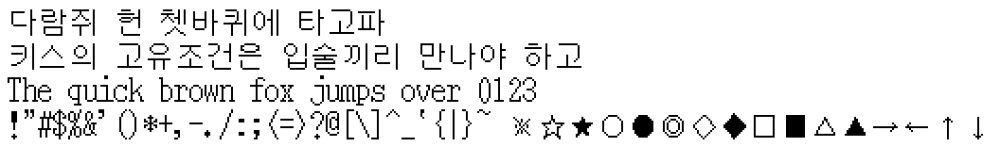

*Baekmuk Gulim 16 with Sony 8x16 ASCII, built by this recipe, x2*

*Baekmuk Batang 16 at `--hangul-ascent 13`, x2*

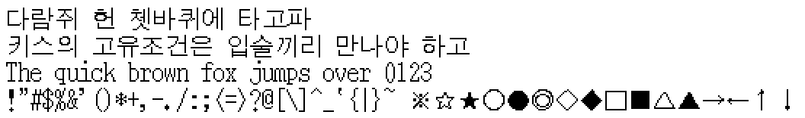

*Baekmuk Dotum 16 at `--hangul-ascent 13`, x2*

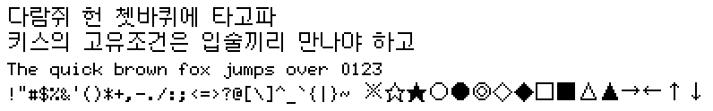

*Baekmuk Gulim 12 with Misc Fixed 6x12 ASCII, x2*

### hanterm johab fonts

hanterm, the Korean xterm, drew Hangul from jamo-set fonts as well as from KS C 5601 fonts (`-hfn`, and the font type
`johab` or `johab844`). Two sets of them are left, both in `hanterm-font-3.1.tar.gz` (the KLDP archive; identical to
3.1pre3):

- **`8-4-4`**: 133 fonts `johab844-1`, 16x16, 360 glyphs, `ENCODING` 0-359. Kim Yunsoo's DOS font collection #002
  (1994) in X form: the README says they were converted to PCF by Sang-yoon Lee (1996) and dumped to BDF with names
  corrected by John Simon (1999); the font names carry the foundry `postech` and the DOS font's name
  (`-postech-DoGgaiBi_GoDig-...` for `dkbgoth.bdf`, `-postech-GaNeun_GoDig-...` for `goth00.bdf`).
- **`10-6-6`**: the hanterm 3.0.4 fonts (byte for byte the 11 BDFs of `hanterm304fonts`): KAIST Gothic, Myeongjo and
  Philgi and iyagi, each as `johab-1` (529 glyphs, the jamo only), `johabs-1` (1,644: + the KS X 1001 symbols) and
  `johabsh-1` (6,563: + Hanja; iyagi has `johab-1` and `johabsh-1`). **`10-6-6-nz`**: the same fonts for X servers
  that refuse zero-width glyphs (hanmaum, 1998): every glyph advances 16 and glyph 529 steps back 16.

**johab844-1 (`--layout hanterm-844`).** hanterm's `convert_3_to_jo844font` (`hangul.c` of hanterm 3.1.5 and
hanterm-xf 3.3.1p18) draws a syllable from glyphs `type1 * 20 + L`, `160 + type2 * 22 + V` and `248 + type3 * 28 + T`
with the DOS 8x4x4 type tables, so a johab844-1 BDF is a raw 8x4x4 font (11,520 bytes) in BDF form, glyph `ENCODING`
for glyph slot. `jamoset.py --layout hanterm-844` reads the BDF (its 360 glyphs; slot 0 of every set must be blank),
builds the 8x4x4 jamo set, and `--check` compares all 11,172 syllables with `johab844.py`'s composition of the same 360
glyphs. The ASCII comes from a face made from the X11 Sony 8x16 font, given as `--base`:

    python3 -I tools/mkfont.py /usr/share/fonts/X11/misc/8x16.pcf.gz $OUT/ASCII16.SVF --size 16 --bpp 1 --unicode ascii
    python3 -I tools/jamoset.py --layout hanterm-844 $SRC/hanterm-font/8-4-4/dkbgoth.bdf --base $OUT/ASCII16.SVF --check -o $OUT/HTDKB16J.SVF

`ASCII16.SVF` is 3,268 bytes (95 glyphs). `HTDKB16J.SVF`: `15,840 bytes`, 344 pieces, `check: composed 11172 syllables
from 439 glyphs, JSET 1101 bytes; identical to johab844.py`, `width=144 ascent=14 descent=2`, ink 471. Without
`--base`: `12,624 bytes`. `goth00.bdf`: `15,728 bytes`, ink 370; `han.bdf` (MyeongJo): `16,616 bytes`, ink 475. All 133
fonts of the folder build and pass `--check`. For `dkbgoth` and `goth00` all 11,172 syllables were also composed by a
transcription of hanterm's `convert_3_to_jo844font` itself and compared with the jamo set: 11,172 of 11,172 equal
(`tools/test_jamoset.py` checks the layout's tables against the same code on synthetic fonts).

**johab-1 (`--layout hanterm-johab`).** glyph numbers 0-528 in hanterm's own 10 / (3 or 4) / 4 set system (three tail
classes: none, ㄴ, other; [Jamo sets](../jamo-sets.md)):

    python3 -I tools/jamoset.py --layout hanterm-johab $SRC/hanterm-font/10-6-6/johabm16.bdf --base $OUT/ASCII16.SVF --check -o $OUT/HTERM16J.SVF

KAIST Myeongjo (`johabm16.bdf`): `16,956 bytes`, 368 pieces, `check: composed 11172 syllables from 463 glyphs, JSET 1303
bytes`, `width=144 ascent=14 descent=2`, ink 469; Gothic (`johabg16.bdf`) `16,396 bytes`, ink 373; Philgi (`johabp16.bdf`)
`16,700 bytes`, ink 487; iyagi (`iyagi16.bdf`) `16,812 bytes`, ink 480. Without `--base` (no ASCII; `--eng` takes a raw
8x16 English font instead): Myeongjo `13,740 bytes`, `width=80` (the five syllables of the sample), ink 310; Gothic
`13,180 bytes`, ink 214. The `johabs` and `johabsh` fonts give the same jamo set (the tool reads glyphs 0-528); the
`-nz` fonts give a byte-identical one (`johabnzm16.bdf` = `johabm16.bdf`). A check on real data: the wansung fonts
`ks_iyagi16.bdf` and `ks_philgi16.bdf`, which Hong Hunsoo converted from `iyagi16` and `johabp16`, equal the jamo sets
of those two on all 2,350 KS X 1001 syllables.

The maker's `detect.scan` gives both kinds kind `bdf-johab`, label "BDF (johab)", size [16] and the route `hanterm`
(`hanterm-johab`); for a `johab844-1` font that route stops with `BDF lacks glyph ENCODING 360 of the 529 johab-1
glyphs`, so build those with the command above. Each layout refuses the other's fonts (`hanterm-844` on a johab-1
font: `not this layout: fill slots [20, 40, 60, 80] are not blank`). Synthetic (`tools/test_recipes.py`): a 529-glyph
johab-1 BDF composes all 11,172 syllables in 10/4/4 sets; a 360-glyph johab844-1 BDF with an ASCII base face builds
an 8/4/4 set identical to `johab844.py`.

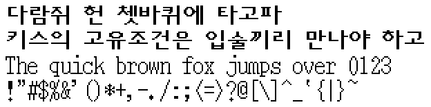

*The hanterm johab844-1 font `dkbgoth` (DoGgaiBi GoDig) as a jamo set with Sony 8x16 ASCII; the font has no KS X 1001 symbols, x2*

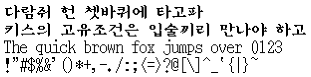

*The hanterm johab-1 font `johabm16` (KAIST Myeongjo, `10-6-6`) as a jamo set with Sony 8x16 ASCII, x2*

### Hanyang

`hanyang-font-pcf` holds Hanyang Kodig (`hgm`) and Myeongjo (`hmm`) in 10-20 px, the Hanyang fonts of the KAIST ftp
`hanfont.pcf` changed to give a larger `FONT_DESCENT` and a character-cell spacing (its README). The "16 px" fonts are
taller than 16: `hgm16` draws syllables from 15 rows above the baseline to 2 below (`FONT_ASCENT` 16), `hmm16` from 16
above to 3 below and 17 columns wide (`FONT_ASCENT` 18). With the fonts' own ascents a 16x16 cell clips 341 and 3,125
of the glyphs `ksnh.txt` names; a taller cell with the syllable baseline moved keeps them:

    for f in hgm16 hmm16; do python3 -I maker/srcprep.py pcf-bdf $SRC/hanyang-font-pcf/$f.pcf $OUT/$f.bdf; done
    python3 -I tools/bdfface.py --hangul $OUT/hgm16.bdf --ascii $OUT/8x16.bdf --cell 16x17 --ascent 14 --hangul-ascent 15 --chars-from $OUT/ksnh.txt --symbols -o $OUT/HYGOT16.SVF
    python3 -I tools/bdfface.py --hangul $OUT/hmm16.bdf --ascii $OUT/8x16.bdf --cell 16x18 --ascent 14 --hangul-ascent 16 --chars-from $OUT/ksnh.txt --symbols -o $OUT/HYMYE16.SVF

Kodig: 0 syllables clipped (58 symbols with `--symbols`); Myeongjo: 4 syllables clipped (68 glyphs with symbols). The
archive states no licence.

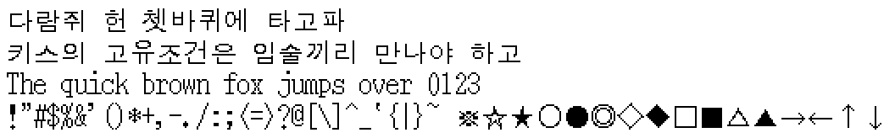

*Hanyang Kodig 16 (`hgm16`) in a 16x17 cell with Sony 8x16 ASCII, x2*

### KAIST fonts (newmj, iyagi, philgi, h16m)

`kaist-newmj16.bdf` and `kaist-newmj18.bdf` are a myeongjo drawn by Hong Hunsoo (KAIST physics, 1998); their symbols
are Daewoo Gothic's, the 18 px Hanja come from the HLaTeX 0.97 Type 1 fonts. `ks_iyagi16.bdf` and `ks_philgi16.bdf` are
the hanterm johab fonts iyagi and KAIST Philgi converted to wansung by the same person (1997). `h16m.bdf` of the `han`
framebuffer console (han-1.0fb) is a KAIST myungjo of 1991 with 40 jamo and no symbols. All are 16x16 (newmj18:
18x18), `FONT_ASCENT` 14 (15):

    python3 -I tools/bdfface.py --hangul $SRC/kaist-newmj16.bdf --ascii $OUT/8x16.bdf --cell 16x16 --chars-from $OUT/ksnh.txt --symbols -o $OUT/NEWMJ16.SVF
    python3 -I tools/bdfface.py --hangul $SRC/kaist-newmj18.bdf --ascii $OUT/8x16.bdf --cell 18x18 --ascent 14 --chars-from $OUT/ksnh.txt --symbols -o $OUT/NEWMJ18.SVF
    python3 -I tools/bdfface.py --hangul $SRC/ks_iyagi16.bdf --ascii $OUT/8x16.bdf --cell 16x16 --chars-from $OUT/ksnh.txt --symbols -o $OUT/IYAGI16.SVF
    python3 -I tools/bdfface.py --hangul $SRC/ks_philgi16.bdf --ascii $OUT/8x16.bdf --cell 16x16 --chars-from $OUT/ksnh.txt --symbols -o $OUT/PHILGI16.SVF
    gzip -dc $SRC/han-1.0fb/h16m.bdf.gz > $OUT/h16m.bdf
    python3 -I tools/bdfface.py --hangul $OUT/h16m.bdf --ascii $OUT/8x16.bdf --cell 16x16 --chars-from $OUT/ksnh.txt --symbols -o $OUT/H16M.SVF

`kaist-newmj18.bdf` has one glyph with `ENCODING -1`; `bdfface.py` skips it (it stopped with `bytes must be in
range(0, 256)` before). The 8x4x4 fits show how each font was made: iyagi and philgi, composed by hanterm from jamo,
fit at IoU 0.985 and 0.961, `h16m` at 1.000 (2,349 of 2,350 syllables exact: an 8x4x4 font composed into syllables),
the hand-drawn newmj at 0.906.

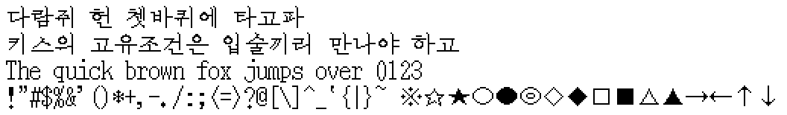

*KAIST newmj 16 with Sony 8x16 ASCII; the symbols are Daewoo Gothic's, x2*

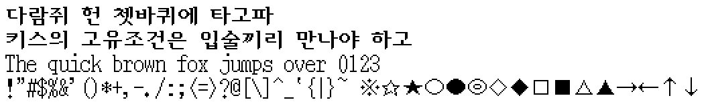

*KAIST iyagi 16 (`ks_iyagi16`, the wansung form of the hanterm iyagi font), x2*

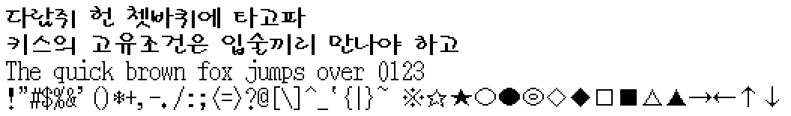

*KAIST philgi 16 (`ks_philgi16`, the wansung form of the hanterm KAIST Philgi font), x2*

### Mizi

The `xfntmizi-1.1-2` RPM (Mizi Research, 1999) holds four 16 px Korean fonts, `mzgt16h` (gothic), `mzmj16h`
(myeongjo), `mzpg16h` (philgi), `mzsm16h` (saemmul), each with an English partner (`mz*16e`), and `mzgt16h1`, the gothic
under GR codes (`ksc5601.1987-1`) for Netscape. Its README says the fonts were saved as bitmaps from Mizi's HTM font
server. The RPM holds the fonts as `compress` files (`.pcf.Z`), which `srcprep.py pcf-bdf` does not read: unpack the
RPM (`rpm2cpio | cpio`, or `7z x` the RPM and `cpio -id` the `.cpio` it gives) and decompress with `gzip -d`, which
reads the `.Z` format. `bdfface.py` reads the GR font as it reads the GL one (the same 2,350 syllables, byte for byte the
same face):

    mkdir -p $SRC/xfntmizi && cd $SRC/xfntmizi && rpm2cpio ../xfntmizi-1.1-2.noarch.rpm | cpio -id --no-absolute-filenames && cd -
    gzip -dc $SRC/xfntmizi/usr/lib/X11/fonts/misc/mzgt16h.pcf.Z > $OUT/mzgt16h.pcf
    python3 -I maker/srcprep.py pcf-bdf $OUT/mzgt16h.pcf $OUT/mzgt16h.bdf
    python3 -I tools/bdfface.py --hangul $OUT/mzgt16h.bdf --ascii $OUT/8x16.bdf --cell 16x16 --chars-from $OUT/ksnh.txt --symbols -o $OUT/MZGOT16.SVF

`FONTBOUNDINGBOX 16 16 0 -3`, `FONT_ASCENT 13` (Daewoo: `16 16 0 -2`, 14). The 8x4x4 fit is 0.983 (2,116 syllables
exact): the HTM fonts compose syllables from jamo.

### Other X and console fonts

- **jfbterm** (the framebuffer terminal): `jfbterm-font-pack-1` has one KS C 5601 font, `ihan_ksc.pcf.gz`
  (`-gnu-kofont-`, 2,350 syllables and 94 jamo; `COPYRIGHT "Public Domain. Share and enjoy"`): `bdfface.py` gives
  `115,808 bytes`, ink 512. Its `ieng_ihangul` and `unifont` are GNU Unifont (`iso10646-1`), and the fonts of the
  jfbterm uxp add-on (`iyagi_uni`, `aply_apple`) are Unicode-indexed too: they go through `mkfont.py`.
- **Pinetree precomposed** (Narae, 1995): proportional, not converted (above).
- **zhcon** (a CJK framebuffer console): `font/ksc-16.bpsf` of the 0.2.6 source is zhcon's BPSF (279,753 bytes: a
  9-byte header, then 8,742 glyphs of 16x16, 32 bytes each, in the KS X 1001 grid from 0xA1A1). Its `tools/getbpsf.txt`
  says the generator dumps a 16x16 `ksc5601.1987-0` font of the X server; the 2,350 syllables are those of Daewoo Mincho
  16, each identical once cropped to its ink. `rawcarve.py` cuts it:

      python3 -I tools/rawcarve.py bdf $SRC/zhcon-0.2.6/font/ksc-16.bpsf --offset 9 --glyph 16x16 --chars ks-nonhanja --grid 0xA1,0xA1,94 -o $OUT/zhksc16.bdf
      python3 -I tools/bdfface.py --hangul $OUT/zhksc16.bdf --ascii $OUT/8x16.bdf --cell 16x16 --chars-from $OUT/ks.txt -o $OUT/ZHKSC16.SVF

  `wrote zhksc16.bdf: 3334 glyphs (2350 Hangul syllables) of 16x16, ascent 14`; the face is `125,124 bytes`. zhcon is
  under the GNU GPL version 2 (`COPYING`); the font is Daewoo's.
- **hanja65** (CTAN, HBF) is Hanja only.
- **`18x18ko`** (Misc Fixed Wide, X.Org): Unicode, see [ISO 10646 BDF and PCF](bitmap-fonts.md#iso-10646-bdf-and-pcf).

### Measured results

Each face with `--chars-from $OUT/ks.txt` (the 2,350 syllables and ASCII; the options as above, without `--symbols`),
then with `--chars-from $OUT/ksnh.txt --symbols`, and the 8x4x4 fit of the first (`jamoset.py --layout 844 --from-svf
... --mask-font none --check`). The measure and ink are those of [Checking a face](../recipes.md#checking-a-face) (16 px
template; 12 and 24 px: `line 400 C+8 0 C`), the same with and without symbols. Run 2026-11-27.

| Face | `ks.txt` face | Clipped | with `--symbols` (others taken) | Clipped | `measure`, ink | 8x4x4 fit |
|---|---|---:|---|---:|---|---|
| Daewoo Gothic 16 | `125,088 bytes` | 0 | `170,168 bytes` (986) | 0 | `width=144 ascent=14 descent=2`, 382 | `18,192 bytes`, IoU 0.796 |
| Daewoo Mincho 16 | `125,124 bytes` | 0 | `170,204 bytes` (986) | 0 | `width=144 ascent=14 descent=2`, 379 | `18,464 bytes`, IoU 0.826 |
| Daewoo Mincho 24 | `218,448 bytes` | 0 | `292,080 bytes` (986) | 0 | `width=216 ascent=22 descent=2`, 877 | - |
| Baekmuk Gulim 16 | `125,128 bytes` | 0 | `167,436 bytes` (987) | 0 | `width=144 ascent=14 descent=2`, 384 | `18,768 bytes`, IoU 0.782 |
| Baekmuk Batang 16 (`--hangul-ascent 13`) | `123,048 bytes` | 0 | `165,572 bytes` (986) | 53 | `width=144 ascent=14 descent=2`, 379 | `18,872 bytes`, IoU 0.692 |
| Baekmuk Dotum 16 (`--hangul-ascent 13`) | `124,464 bytes` | 1 | `167,460 bytes` (986) | 52 | `width=144 ascent=14 descent=2`, 411 | `19,564 bytes`, IoU 0.671 |
| Baekmuk Headline 16 (`--hangul-ascent 13`) | `124,052 bytes` | 4 | `167,476 bytes` (987) | 205 | `width=134 ascent=14 descent=2`, 730 | - |
| Baekmuk Gulim 12 | `105,944 bytes` | 0 | `143,528 bytes` (988) | 0 | `width=108 ascent=10 descent=2`, 265 | - |
| Baekmuk Batang 24 | `206,872 bytes` | 0 | `273,868 bytes` (986) | 17 | `width=221 ascent=22 descent=2`, 746 | - |
| Hanyang Kodig 16 (16x17) | `119,508 bytes` | 0 | `162,660 bytes` (985) | 58 | `width=144 ascent=14 descent=3`, 386 | - |
| Hanyang Myeongjo 16 (16x18) | `118,592 bytes` | 4 | `161,764 bytes` (985) | 68 | `width=144 ascent=14 descent=4`, 378 | - |
| KAIST newmj 16 | `124,480 bytes` | 0 | `169,560 bytes` (986) | 0 | `width=144 ascent=14 descent=2`, 394 | `17,644 bytes`, IoU 0.906 |
| KAIST newmj 18 (18x18) | `150,416 bytes` | 0 | `194,304 bytes` (985) | 0 | `width=154 ascent=14 descent=4`, 425 | - |
| KAIST iyagi 16 | `122,856 bytes` | 0 | `167,936 bytes` (986) | 0 | `width=144 ascent=14 descent=2`, 480 | `17,428 bytes`, IoU 0.985 |
| KAIST philgi 16 | `122,412 bytes` | 0 | `167,492 bytes` (986) | 0 | `width=144 ascent=14 descent=2`, 487 | `17,144 bytes`, IoU 0.961 |
| KAIST `h16m` | `118,460 bytes` | 0 | `120,008 bytes` (40) | 0 | `width=144 ascent=14 descent=2`, 451 | `16,844 bytes`, IoU 1.000 |
| Mizi gothic 16 | `122,952 bytes` | 0 | `166,320 bytes` (988) | 0 | `width=144 ascent=14 descent=2`, 380 | `16,552 bytes`, IoU 0.983 |

Every face has the 2,350 syllables. `fontmetrics.py` finds two kinds of overhang: Headline 16, whose glyphs are up to
16 px wide on its 14 px step (syllables and symbols, 2 px over); and `bdfface.py`'s own U+2026, 11 px of dots in the
8 px (Gulim 12: 6 px) advance of the ASCII space, in the faces that take no U+2026 from the font (the `ks.txt` faces,
and `h16m`, which has no symbols). The 24 px faces and the other `--symbols` faces have every glyph inside its advance.
Every fit composes all 11,172 syllables under `--check`. The jamo sets of
the hanterm fonts are under [hanterm johab fonts](#hanterm-johab-fonts).

### Licences

What the files say; nothing here is a legal opinion. The fonts are not in the repository and no face of `svf/` is made
from them; the small samples above are the owner's decision for this document.

| Family | What the files state |
|---|---|
| Daewoo (`hanglg16`, `hanglm16`, `hanglm24`) | PCF `COPYRIGHT "Copyright (c) 1987, 1988 Daewoo Electronics Co.,Ltd."`. X.Org's `font-daewoo-misc/COPYING` (in Debian's `xfonts-base` copyright file) is that one line, with no permission text; X.Org, Debian (main) and Ubuntu ship and redistribute the fonts. |
| Sony `8x16`, `12x24` (ASCII) | `font-sony-misc/COPYING`: "Copyright 1989 by Sony Corp. Permission to use, copy, modify, and distribute this software ... without fee is hereby granted, provided that the above copyright notices appear in all copies ...". |
| Misc Fixed `6x12` (ASCII) | `font-misc-misc/COPYING`: "Public domain font. Share and enjoy." |
| Baekmuk 2.0, 2.2 | `COPYRIGHT` (2.2, and Debian's `xfonts-baekmuk`): "Copyright (c) 1986-2002 Kim Jeong-Hwan. Permission to use, copy, modify and distribute this font is hereby granted, provided that both the copyright notice and this permission notice appear in all copies of the font, derivative works or modified versions, and that the following acknowledgement appear in supporting documentation: Baekmuk Batang, Baekmuk Dotum, Baekmuk Gulim, and Baekmuk Headline are registered trademarks owned by Kim Jeong-Hwan." The BDFs' `COPYRIGHT` property: Hwan Design Inc. and Mizi Research Inc. |
| hanterm `8-4-4` | `LICENSE.euc-kr` is Kim Yunsoo's collection notes (1994-04-10): the fonts have many authors, named per font; for the fonts marked `#`, `*`, `+` (his own or reworked by him): do not rename the files, name the source, no use in commercial programs without his permission; one font (영화체, Jang Yeonghwa) is barred from commercial use by its author. |
| hanterm `10-6-6`, `10-6-6-nz`, `hanterm304fonts` | No licence in the archives (README: install notes, Daeshik Kim; hanmaum). `iyagi16.bdf`: "GENERATED BY bin2bdf 1.0, AUTHOR mleisher@nmsu.edu". |
| Hanyang (`hanyang-font-pcf`) | No licence or copyright in the archive or the PCF properties. |
| KAIST newmj 16, 18 | BDF comment (Korean): commercial use is forbidden; commercial use needs the author's written permission (Hong Hunsoo, KAIST, 1998-02-10). |
| KAIST `ks_iyagi16`, `ks_philgi16` | BDF comments: converted by Hong Hunsoo, "not the author of this font"; no terms. |
| KAIST `h16m` (han-1.0fb) | `COPYRIGHT "Copyright (c) 1991 Korea Advanced Institute of Science and Technology"`; the han-1.0fb package is under the GNU GPL version 2 (`COPYING`). |
| Mizi (`xfntmizi`) | PCF `COPYRIGHT "Copyright 1997 Seo, Young-Jin."`; the RPM's licence tag is `free`. |
| jfbterm `ihan_ksc` | `COPYRIGHT "Public Domain. Share and enjoy"`. |
| Pinetree precomposed | BDF comment: "Copyleft 1995, Narae, Lee yongjae", permission to use, copy, modify, distribute and sell with the notices kept. |

### Making the samples

The images of this document are drawn by `tools/doc_figures_x11.py` from the files themselves, with the commands of
this recipe; it needs the folders, not a copy of the fonts in the repository:

    python3 -I tools/doc_figures_x11.py --misc /usr/share/fonts/X11/misc --baekmuk $SRC/baekmuk-bdf-2.2/bdf \
        --hanterm $SRC/hanterm-font --hanyang $SRC/hanyang-font-pcf --newmj $SRC/kaist-newmj16.bdf \
        --iyagi $SRC/ks_iyagi16.bdf --philgi $SRC/ks_philgi16.bdf [--check]

Thirteen images, 36,494 bytes in all; `--check` compares them byte for byte ([tool reference](../tools.md#toolsdoc_figures_x11py)).

[Recipes index](../recipes.md) · [Tool reference](../tools.md)
