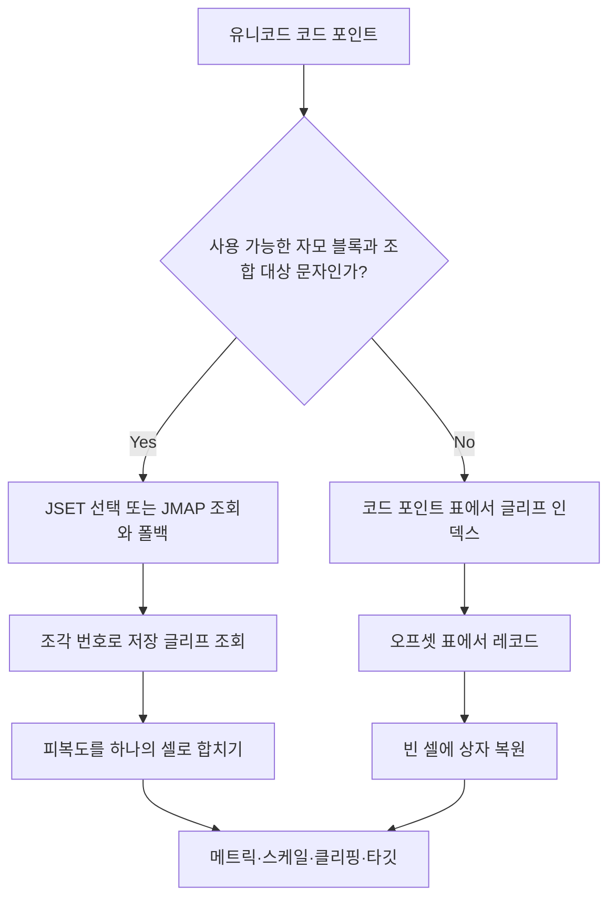
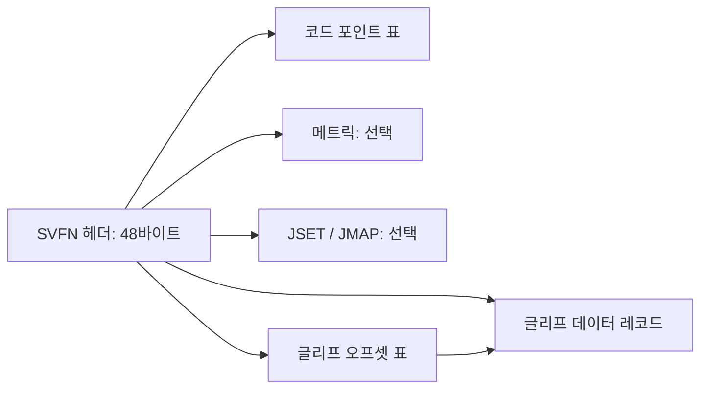

[English](SVF.md) | **한국어**

# SVF (SVFN) 비트맵 폰트 형식

## 1. SVF는 무엇이고 왜 쓰는가

SVF는 글자의 픽셀 모양을 미리 저장하는 비트맵 폰트 형식이다. MCU의 작은 LCD, DOS 화면, 게임의 대사창,
웹의 `<canvas>`에서 같은 모양을 그리면서 실행 시 윤곽선 폰트 엔진을 두지 않으려는 경우에 쓴다.
파일의 매직은 `SVFN`이며, 여기서 설명하는 파일 형식은 버전 3이다.

**완성형 페이스**는 지원하는 한글 음절마다 글리프를 저장한다. **자모 세트 페이스**는 초성·중성·종성의
위치별 [조각(piece)](#term-piece)과 선택 표를 저장하고, 그릴 때 음절을 조합하여 저장 공간을 줄인다.
어느 쪽이든 문자 조회의 입력은 유니코드 코드 포인트다([Unicode 3장](#references)). 파일을 메모리나 플래시에 두고 직접 읽을 수도 있고,
[스트리밍](#term-streaming)으로 표만 RAM에 올리고 필요한 글리프만 읽을 수도 있다.
[1·2·8 bpp](#term-bpp)는 단색 비트맵부터 미리 계산한 안티앨리어싱 [피복도(coverage)](#term-coverage)까지 담는다.

### 1.1. 읽는 순서

| 하고 싶은 일 | 먼저 읽을 곳 |
|---|---|
| 앱이나 펌웨어에서 글자 그리기 | [C 렌더러 사용법](../docs/c-renderer-guide.ko.md), [웹 렌더러 사용법](../docs/web-renderer-guide.ko.md) |
| 조합형의 원리와 메모리 선택 이해하기 | [자모 세트 배경과 예제](../docs/jamo-sets.ko.md), 아래 [자모 블록](#jamo-block) |
| 파일 읽기·쓰기 구현하기 | [헤더와 dy](#header), [셀과 레이아웃](#layout), [검증](#validation), 필요한 자모 블록 버전 |
| 폰트 변환·부분집합·프로파일 만들기 | [도구 사용법](../docs/tools.ko.md), [작업별 레시피](../docs/recipes.ko.md) |
| 앱에서 폰트 고르기·만들기 | [데스크톱 앱](../docs/desktop-app.ko.md), [폰트 제작 앱](../docs/maker-desktop.ko.md) |
| ScummVM 연동 범위 확인하기 | [연동 부록](#scummvm-loading) |

낯선 말은 끝의 [한영 용어집](#glossary)을 참고한다. 이식 가능한 C API는
[svf.h](../c/include/svf.h)에 있으며 버전 3 파일만 읽는다. 출력과 메모리 소유권은 [렌더러 설계](renderer-design.ko.md)에 설명되어 있다.

SVFN은 **버전 3**이다. 버전 1과 2는 폐기되었다(아래 "폐기: 버전 1과 2" 참고). `tools/svf2to3.py`가 v2 페이스를
변환한다.

<a id="bitmap-fonts"></a>

## 2. 비트맵 폰트 구조

페이스는 문자 조회와 픽셀 저장을 분리한다. 같은 그리기 코드가 라틴 글리프, 저장된 한글 음절, 조합한 조각을 사용할 수 있다. [svf_face.c](../c/src/svf_face.c)가 페이스를 열고 저장 글리프를 찾으며, [svf_draw.c](../c/src/svf_draw.c)가 타깃에 배치한다.

조회는 파일의 코드 포인트 표를 사용한다. 한 페이스에 ASCII, 기호, 한글을 함께 넣을 수 있으며 코드 페이지 변환 파일은 필요하지 않다.
저장 글리프와 조합형 글리프는 같은 셀·메트릭·그리기 경로를 사용한다. 페이스 체인과 출력 타깃은
[렌더러 설계](renderer-design.ko.md)에 설명되어 있다.

<a id="jamo-block"></a>

### 2.1. 자모 세트 폰트 (플래그 비트 1)

자모 블록은 “이 음절에서 각 자모의 어떤 모양을 쓸까?”를 정한다. [클래스](#term-class)는 이웃 자모의 문맥을 묶고, [벌](#term-set)은 위치별 모양을 고른다. [svf_jamo.c](../c/src/svf_jamo.c)가 이 선택을 읽고 조각의 [피복도](#term-coverage)를 합친다. 블록 버전과 SVFN 파일 버전은 별개다.



헤더 플래그 비트 1(0x2)은 자모 블록이 있음을 나타낸다. 헤더의 오프셋과 크기가 **JSET** 블록을 가리킨다.
리더는 지원하는 블록 버전에 따라 음절을 조합하며, 블록을 사용할 수 없으면 코드 포인트 표로 조회한다.

함께 보기: [docs/jamo-sets.ko.md](../docs/jamo-sets.ko.md). 배경(문자 집합으로서의 조합형과 글꼴 기법으로서의 조합형,
DOS의 벌 체계), 실제 페이스로 따라가는 예, 형태별 MCU 제약을 설명한다.

- 조각은 코드 포인트 U+F0000 + 조각 번호의 글리프이다. U+F0000은 [평면 15 사용자 정의 영역](#references)의 시작이다.
  번호는 폰트 고유이며 JSET 테이블이 그것을 지명한다.
- 그 밖의 글리프(ASCII, 기호, 통째로 저장된 호환 자모)는 다른 SVFN과 같이 조회한다.
- 블록은 헤더 바이트 36(오프셋)과 40(크기)이 가리키는 곳에 있으며, 플래그가 없으면 둘 다 0이다. 오프셋은 테이블 단위의
  배수이고 바이트 48 이상에 있으며 크기와 함께 파일 안에 있다. 크기는 블록의 개수들이 주는 값과 같아야 한다. 검증에
  실패한 블록(개수, 클래스, 범위 밖의 벌, 맞지 않거나 플래그가 설정되었는데 0인 크기, 글리프 없는 조각 번호)은 페이스를
  일반 SVFN으로 불러오게 한다(C 렌더러의 `SVF_FACE_JSET_BAD`). 파일 밖이거나 헤더
  안인 JSET 범위만 범위 오류이다.
- U+AC00..U+D7A3은 조각들의 픽셀별 최대 피복도로 합성한다(1bpp 스텐실의 OR이며 2bpp와 8bpp도 동작한다).
  compatPiece가 있는 U+3131..U+3163은 그 조각 하나이다. 합성된 글리프는 셀 하나(저장된 글리프 상자)의 크기로 복원되며 JSET
  advance만큼, 그것이 0이면 셀 폭만큼 전진한다.

JSET 블록은 리틀 엔디언이며 블록 자체의 버전 워드가 인코딩을 구분한다. 버전 1·2는 클래스와 벌 표를,
버전 3([JMAP](#jmap))은 음절별 매핑을 담는다. **버전 1은 일반적인 JSET 작성의 표준 형식**이며,
버전 2는 메모리가 제한된 대상을 위해 명시적으로 선택하는 압축 형식이다. 버전 1:

```
4  "JSET"
2  version (1)
1  LC  lead classes   (1..12; BIG 1..19)
1  TC  tail classes   (1..12; BIG 1..28)
1  NI  initial sets   (1..32; BIG 1..128)
1  NM  medial sets    (1..24; BIG 1..128)
1  NF  final sets     (1..16; BIG 1..64)
1  advance            syllable advance in px; 0 = the cell width
19 leadClass[19]      class of each initial (ㄱ..ㅎ), < LC
28 tailClass[28]      class of each tail, index 0 = no tail, < TC
LC*21*TC initSet      set of the initial for (leadClass, vowel, tailClass), < NI
LC*21*TC medSet       set of the medial
LC*21*TC finSet       set of the final (read only when tail != 0)
NI*19 u16 initPiece   piece number per (set, initial); 0xFFFF = blank
NM*21 u16 medPiece    per (set, vowel)
NF*27 u16 finPiece    per (set, tail 1..27)
51 u16 compatPiece    U+3131..U+3163 drawn from one piece; 0xFFFF = not by piece
```

세 벌 테이블은 `(leadClass * 21 + vowel) * TC + tailClass`로 인덱싱한다(vowel 0..20은 유니코드 순서, ㅏ..ㅣ).
조각 테이블은 `set * 19 + initial`, `set * 21 + vowel`, `set * 27 + tail - 1`로 인덱싱한다. 종성 벌은 tail 1..27 중
어느 하나가 속한 종성 클래스에 대해서만 검증하고 읽는다. `tools/jamoset.py`가 이런 폰트를 쓰며, 윤곽 폰트로부터 2 bpp로도 쓰고(`--bpp 2`,
최댓값으로 합성한 안티앨리어싱 조각), 폰트에 맞춘 벌 체계로도 쓴다(`--layout adaptive`, 위 한도까지).

표준 한도는 초성·종성 클래스 12 × 12와 초성·중성·종성 벌 32 / 24 / 16이다. 가장 큰 버전 1 블록은
12,321바이트이다. adaptive의 기본 벌 예산은 32 / 24 / 12이다. 개수가 빌드의 한도를 벗어난 단독 JSET 블록은
사용하지 않는다(`SVF_FACE_JSET_BAD`).

`SVF_JSET_BIG`은 버전 1과 2의 한도를 제자리에서 넓힌다(새 버전 워드 없음). 초성 19 x 종성 28 클래스와 초성 / 중성 / 종성
벌 128 / 128 / 64이며, 가장 큰 블록은 47,373바이트(버전 1)와 29,708바이트(버전 2, NA = 0; 모든 슬롯이 별칭이면
45,068)이다. 이것 없이 빌드한 리더는 12 x 12 / 32 / 24 / 16을 넘는 개수를 잘못된 JSET으로 취급한다. 작성기
(`--jset-big`)와 `jamoset.pack`은 요청이 없으면 표준 행을 넘는 테이블을 거부하고, `jamoset.unpack`은 둘 다 읽는다. 표준
한도 안의 출력은 어느 쪽이든 바이트가 같다.
버전 1 크기: `12 + 19 + 28 + 3 * LC * 21 * TC + 2 * (NI*19 + NM*21 + NF*27 + 51)` 바이트.

<a id="jset-v2"></a>

#### 2.1.1. JSET 블록 버전 2 (압축형, 예외 전용)

같은 선택 정보를 더 촘촘하게 저장하는 인코딩이다. 해독 작업을 늘리는 대신 표의 바이트 수를 줄이며 그리는 모양은 같다. 먼저 버전 1에서 압축 대상인 표를 이해하면 읽기 쉽다.

버전 2는 같은 테이블을 더 적은 바이트로 담는다. 세 벌 테이블은 비트 패킹하고, 조각 번호는 암묵적이며(슬롯별 존재 비트,
벌별 base, 순서대로 매긴 조각) 슬롯 사이에서 공유되는 조각을 위한 별칭 이스케이프가 있고, 호환 테이블은 자모당
1바이트이다. 비트맵, 글리프 레코드, 셀, 합성 규칙, 한도(LC, TC <= 12; NI <= 32, NM <= 24, NF <= 16; BIG: 19, 28; 128,
128, 64, 버전 1과 같다)는 바꾸지 않으며, SVFN 헤더와 그 JSET 오프셋(36)과 크기(40) 필드는 버전 1과 같다. 블록 안의 어떤
것도 정렬되지 않으며, 비트는 리틀 엔디언 바이트 스트림에서 LSB부터 번호를 매긴다(비트 `b`는 바이트 `b >> 3`의 비트
`b & 7`).

```
off  size            field
0    4               "JSET"
4    u16             version = 2
6    1               LC  lead classes (1..12; BIG 1..19)
7    1               TC  tail classes (1..12; BIG 1..28)
8    1               NI  initial sets (1..32; BIG 1..128)
9    1               NM  medial sets  (1..24; BIG 1..128)
10   1               NF  final sets   (1..16; BIG 1..64)
11   1               advance (px; 0 = cell width)
12   u16             NA  alias entries (0..NI*19+NM*21+NF*27)
14   u16             reserved, 0
16   19              leadClass[19]  < LC
35   28              tailClass[28]  < TC, index 0 = no tail
63   S               set table: LC*21*TC cells of W bits each, S = ceil(LC*21*TC*W / 8)
63+S NI*RI           initial set rows
     NM*RM           medial set rows
     NF*RF           final set rows
     NA*2            alias table: u16 piece numbers
     51              compat[51]: one byte per U+3131..U+3163
```

**벌 테이블.** 셀 `c = (leadClass[lead]*21 + vowel)*TC + tailClass[tail]`이며 버전 1과 같다. `width(n)`은 n = 1이면
0이고, 아니면 `ceil(log2 n)`이다(2 -> 1, 32 -> 5). `WI = width(NI)`, `WM = width(NM)`, `WF = width(NF)`,
`W = WI + WM + WF`(0..14; BIG 0..20). 셀 `c`는 비트 `c*W .. c*W + W - 1`을 차지한다. 초성 벌은 하위 WI비트, 중성 벌은
그다음 WM비트, 종성 벌은 최상위 WF비트이다. 폭 0은 벌 0으로 읽는다. 리더는 각 필드를 바이트 오프셋(비트 오프셋
`>> 3`)에서 2바이트 읽기 한 번, 비트 오프셋 `& 7`만큼의 시프트, 마스크로 얻는다(필드는 최대 5비트 폭이다. BIG은 7:
비트 오프셋 7의 7비트 필드도 2바이트 읽기에 들어간다).

**벌 행.** 벌마다 한 행이며 테이블별로 크기가 고정이므로, 행 `s`는 `rows + s*R`에 있다. PB는 바이트 단위의 존재 폭이다.
초성(19슬롯)과 중성(21)은 3, 종성(27)은 4이다.

```
NA = 0:  u16 base | presence PB bytes                                  RI = RM = 5, RF = 6
NA > 0:  u16 base | u16 abase | presence PB bytes | alias PB bytes     RI = RM = 10, RF = 12
```

슬롯 `j`(초성 0..18, 중성 0..20, 종성 인덱스 1..27은 비트 `tail - 1`에 저장)는 존재 비트 `j`가 설정되어 있을 때 그려진다.
슬롯 개수 이상의 비트는 패딩이며 0이어야 한다. 별칭 비트는 존재 비트가 있는 곳에만 설정할 수 있다. 그려지는 슬롯의
조각은 별칭 비트가 설정되어 있으면(NA > 0일 때만) `alias[abase + popcount(aliasBits & below(j))]`, 아니면
`base + popcount((presenceBits & ~aliasBits) & below(j))`이며, `below(j)`는 비트 0..j-1의 마스크이다. 따라서 벌의 새
조각은 자모 순서로 `base, base+1, ...`이고, 별칭은 아무 조각이나 번호로 지명할 수 있다. 리더는 base가 누적적이거나
서로소라고 가정하지 않는다. 0xFFFF는 유효한 별칭 항목이 아니다(빈 슬롯은 존재 비트가 꺼진 것이다).

**호환.** U+3131 + k의 `compat[k]`: 0xFF는 조각으로 그리지 않음을 뜻한다. 그 외에는 비트 0-6이 벌 번호이고 비트 7이
테이블 전환이다(벌은 해당 테이블의 개수보다 작아야 한다. 표준 행에서는 최대 31, BIG에서 초성과 중성 테이블은 127이다.
비트 7 형식은 종성 벌을 지명하며 최대 `0x80 | 63 = 0xBF`이므로 0xFF는 벌을 지명하지 않는다). k의 자연스러운 테이블:
k >= 30은 중성 테이블의 vowel `k - 30`이고, 초성 인덱스가 있는 자음은 그 초성의 초성 테이블을, 겹받침 자음은 그 종성
인덱스의 종성 테이블을 쓴다. 초성 인덱스가 있는 자음에 비트 7이 있으면 대신 그 종성 인덱스의 종성 테이블을 고른다(모음,
겹받침, ㄸ ㅃ ㅉ 중 하나에 비트 7이 있으면 무효이다). 그려지는 조각은 그 벌의 해당 자모 슬롯이며 존재해야 한다.
리더의 상수 맵(k = 0..29, 초성 인덱스 또는 `T` + 종성 인덱스):

```
ㄱ0 ㄲ1 ㄳT3 ㄴ2 ㄵT5 ㄶT6 ㄷ3 ㄸ4 ㄹ5 ㄺT9 ㄻT10 ㄼT11 ㄽT12 ㄾT13 ㄿT14 ㅀT15 ㅁ6 ㅂ7 ㅃ8 ㅄT18 ㅅ9 ㅆ10 ㅇ11 ㅈ12 ㅉ13 ㅊ14 ㅋ15 ㅌ16 ㅍ17 ㅎ18
```

그리고 비트 7 형식에서 초성이 될 수 있는 자음의 종성 인덱스: ㄱ1 ㄲ2 ㄴ4 ㄷ7 ㄹ8 ㅁ16 ㅂ17 ㅅ19 ㅆ20 ㅇ21 ㅈ22
ㅊ23 ㅋ24 ㅌ25 ㅍ26 ㅎ27.

**크기.** `size = 63 + S + NI*RI + NM*RM + NF*RF + 2*NA + 51`. 가장 큰 유효한 블록(12 x 12 클래스, 32 / 24 / 16 벌, 모든
슬롯이 별칭, NA = 1,544)은 9,246바이트이다. BIG(19 x 28 클래스, 128 / 128 / 64 벌)에서는 NA = 0일 때 29,708바이트,
모든 슬롯이 별칭이면 45,068바이트이다. 예(NA = 0): 1 x 2 클래스의 6 / 2 / 1 벌은 181바이트(버전 1: 653), 2 x 2 클래스의
8 / 4 / 4 벌은 272(1,101), 8 x 8 클래스의 32 / 24 / 12 벌은 2,818(7,065), 12 x 12 클래스의 24 / 16 / 16 벌은 5,324에
별칭을 더한 값(11,681).

**검증** (아래의 모든 것은 페이스를 일반으로 불러오게 하며 `SVF_FACE_JSET_BAD`이고 오류는 아니다. 각 검사는 앞선 검사가 범위를
확정한 바이트만 읽는다): (1) 길이 >= 16, 매직, 버전 2, 다섯 개수가 한도 안, reserved == 0, NA <= NI*19 + NM*21 + NF*27;
(2) 길이 == 크기 공식; (3) `leadClass[i] < LC`, `tailClass[i] < TC`; (4) 모든 셀의 초성 벌 < NI, 중성 벌 < NM이고,
종성 벌 < NF는 tail 1..27 중 어느 하나가 속한 종성 클래스의 셀에서만; (5) 모든 행: 존재와 별칭의 패딩 비트가 0, 별칭
비트는 존재 비트의 부분집합, `abase + popcount(alias) <= NA`; (6) 그려지는 모든 슬롯(새 것이든 별칭이든)이 32비트 계산으로
0xFFFF보다 작고 글리프가 존재하는 조각 번호로 해석되며, 별칭 테이블 항목이 0xFFFF가 아닐 것(어느 슬롯도 쓰지 않는 별칭
항목은 글리프를 검사하지 않는다); (7) 모든 호환 바이트가 0xFF이거나 `c & 0x7F`가 해당 테이블의 개수보다 작고, 비트 7은
종성 형태가 있고 초성이 될 수 있는 자음(ㄸ ㅃ ㅉ 제외)에만 있으며, 그 벌의 해당 문자 슬롯이 존재할 것.

<a id="choose-v2"></a>

#### 2.1.2. 버전 2를 쓸 때

블록 인코딩은 읽을 프로그램의 빌드와 함께 고른다. 목적 장치가 해독할 수 있어야 플래시 절약이 의미가 있다. [jamoset.py](../tools/jamoset.py)는 표를 다루고, [svf2to3.py](../tools/svf2to3.py)는 옛 파일을 변환한다.

일반적인 JSET 작성의 기본값은 버전 1이다. maker는 업로드된 페이스의 블록 버전을 유지한다.
버전 2는 메모리가 제한된 대상에서 블록 크기 절약이 필요하고 해당 리더를 포함한 경우에 선택한다.
`--jset-version auto`는 버전 1보다 `JSET_V2_MIN_SAVING`(1,024바이트) 이상 작아질 때만 버전 2를 쓴다.
블록 크기와 해독 비용을 함께 비교해야 한다. [크기 측정](../c/cross/SIZES.md)과
[성능 측정](../c/bench/MEASUREMENTS.md)은 각각의 빌드와 측정 조건을 명시한다.

어느 빌드가 무엇을 읽는지(C 렌더러, `c/include/svf.h`): `SVF_JSET_V1`(기본 1)과 `SVF_JSET_V2`(기본 1, 0으로 두는 빌드는
제외: AVR은 기본으로, 그리고 v1 페이스를 내장하므로 v1로 고정된 CH582 포트)가 리더를 컴파일하며, 빌드가 읽지 않는 버전의
페이스는 일반으로 불러와진다(`SVF_FACE_JSET_UNREAD`. `SVF_FACE_JSET_BAD`는 잘못된 블록을 위해 남겨 둔다). 단, `SVF_JMAP=1`인 빌드는 둘 다 0이어도 된다. 그렇지 않으면 적어도 하나는 1이어야 한다. `SVF_JSET_POP4`(기본 1, `SVF_SMALL`과 AVR에서는 0)는 버전 2 리더의 popcount에 비트 지우기 루프 대신 16항목 니블
테이블을 고른다. 픽셀은 바뀌지 않는다. `SVF_JMAP_LIST`(기본값은 `SVF_JMAP`의 값이므로 호스트, DOS, WASM, SDL 빌드에서는 켜지고
모든 MCU에서는 꺼진다. 명시적 `-DSVF_JMAP_LIST=0/1`이 우선하며 `SVF_JMAP` 없이 1이면 `#error`)는 `SVF_JMAP` 안에서 LIST 블록(플래그
0x08)의 리더를 컴파일한다. 이것이 없으면 LIST 블록은 `SVF_FACE_JMAP_UNREAD`이다("리더 상태" 참고). `SVF_JSET_TRUSTED`(기본 0)는
테이블 내용의 검증을 건너뛴다. **경고:** 개발자가 플래시에 내장하는 페이스 전용이다. 악의적이거나 손상된 JSET(개수, 클래스,
벌, 조각)은 이때 범위 밖을 읽는다. 헤더 길이, 매직, 버전, 개수가 주는 블록 크기와 영역 길이의 비교만 여전히 검사하므로
(버전 1 리더는 개수 한도도 검사하고, 버전 2 리더는 개수를 신뢰한다), 스트리밍 페이스는 자신의 영역보다 많이 불러오지
않는다. `SVF_JSET_V2`와 `SVF_JSET_TRUSTED`가 모두 켜진 16비트 빌드(AVR)에서는 손상된 개수의 크기 곱이 랩어라운드할 수 있다.
`SVF_JMAP`에서는 버전 3 블록이 `SVF_JSET_TRUSTED` 아래에서 헤더 규칙(R1-R4. LIST는 R1', L2, L3, R4)만 유지한다. 그 rank
테이블, 비트맵, 항목, 호환 항목, 모든 조각의 글리프(R5-R8. LIST는 L5, L6, L7)는 신뢰하며, 손상된 rank나 비트맵은 블록
훨씬 바깥(약 264 KB)의 항목 읽기를 일으킨다. 툴체인이 쓴 페이스 전용이다. 퍼즈 하니스는 이것을 켜고는 컴파일을 거부한다.
Python `jamoset.unpack`은 세 버전(1, 2, 버전 3의 JMAP)을 모두 읽는다. JSET 버전을 선택하는 도구의 `--jset-version 1|2|auto`는 기본값이 1이다. JMAP 업로드의 변환 제약은
[도구 사용법](../docs/tools.ko.md)을 참고한다.

<a id="jmap"></a>

#### 2.1.3. 버전 3: 매핑 테이블 (JMAP)

어떤 페이스는 클래스 규칙으로 표현할 수 없는 음절별 선택이 필요하다. [JMAP](#term-jmap)은 그 선택을 직접 기록한다. sparse와 LIST 형식은 일부 음절만 엔트리가 필요할 때 전체 매핑을 저장하지 않게 한다. 폴백이 있으면 나머지 선택을 맡는다.

버전 3은 클래스·벌 테이블을 음절에서 조각으로 가는 직접 맵으로 대체한다. 자모 클래스만으로 선택 규칙을
표현할 수 없거나 음절별 예외가 필요한 페이스에 쓴다. 모든 수는 리틀 엔디언이며 리더는 바이트
읽기만 쓴다.

| offset | size | field |
|---|---|---|
| 0 | 4 | `"JSET"` |
| 4 | u16 | version = 3 |
| 6 | u8 | flags: 0x01 4B (항목이 4바이트, 아니면 3), 0x02 SPARSE (비트맵과 NS개 항목, 아니면 dense이며 NS = 11,172), 0x04 FALLBACK (항목 뒤에 JSET 버전 1 또는 2 블록이 오고 영역 끝까지 이어진다), 0x08 LIST (공유 조각 풀 위의, 키로 정렬된 8바이트 항목 NS개. 0x01과 0x02를 배제한다). 비트 4-7은 0 |
| 7 | u8 | advance (px, 0 = 셀 폭) |
| 8 | u16 | NS, 항목 수. LIST: 1..255이므로 바이트 9는 0 |
| 10 | u16 | PI, 초성 조각, U+F0000 + 0 .. PI-1 (LIST: 0) |
| 12 | u16 | PM, 중성 조각, U+F0000 + PI .. PI+PM-1 (LIST: 0) |
| 14 | u16 | PF, 종성 조각, U+F0000 + PI+PM .. PI+PM+PF-1 (LIST: 0) |
| 16 | u16[51] | U+3131 + k의 호환 조각 번호: 0xFFFF는 빈 것, 아니면 PI+PM+PF보다 작음 (LIST: 글리프가 있는 풀의 조각) |
| 118 | u16[44] | SPARSE 전용: `rank[b]`, 비트맵에서 비트 `b * 256` 아래의 설정된 비트 수 |
| 206 | u8[1397] | SPARSE 전용: U+AC00..U+D7A3에 대한 존재 비트맵. 비트 `s`는 바이트 `s >> 3`의 비트 `s & 7`이며 비트 11,172..11,175는 0 |
| 1603 | u8 | SPARSE 전용: 패드, 0 |
| E | NS x 3, 4 또는 8 | 항목. E = 1,604 (SPARSE) 또는 118 (dense, LIST). LIST: 8바이트, `u16 key, u16 i, u16 m, u16 f`이며 key로 엄격히 증가하도록 정렬, `key = cp - 0xAC00`. 세 필드는 조각 번호(U+F0000 + n의 글리프)이며 0xFFFF는 빈 것. Dense와 SPARSE, 3B: `[i, m, f]`. 4B: `[b0, i_lo, m_lo, f_lo]`, `b0 = (i >> 8) \| ((m >> 8) << 3) \| ((f >> 8) << 6)`. dense와 SPARSE 항목에서 필드 0은 그 평면의 조각이 없다는 뜻이고, k는 그 평면의 k번째 조각을 뜻한다 (LIST 필드는 조각 번호이며 0은 조각 0) |
| F | rest | FALLBACK 전용: F = E + NS x (3 또는 4), LIST는 118 + 8 NS (최대 2,158). JSET 버전 1 또는 2 블록이며 길이는 영역에서 F를 뺀 것 |

한도: 3B: PI, PM, PF <= 255; 4B: PI, PM <= 2,047, PF <= 1,023; PI + PM + PF >= 1 (dense와 SPARSE. LIST는 PI = PM = PF = 0,
규칙 L2); SPARSE: 1 <= NS <= 11,172 (11,172도 유효하다. 예외 목록이 전부를 덮을 수 있다); dense: NS = 11,172; LIST:
1 <= NS <= 255; 영역은 최대 65,534바이트이다(JSET 크기는 열 때 0xFFFF로 잘리므로 정확히 65,535인 영역은 유효하지 않다).
크기: 폴백 없이 음절 2,350개를 담은 sparse 3B는 16 + 102 + 1,486 + 2,350 x 3 = 8,654, dense 3B는 33,634, dense 4B는
44,806, 항목 11,172개의 sparse 4B는 46,292, LIST는 118 + 8 NS로 최대 2,158 (NS 36: 406)에 폴백 블록을 더한다.

**조회.** 음절 인덱스 `s = cp - 0xAC00`. Dense: `idx = s`. SPARSE: 비트맵의 비트 `s`가 설정되어 있으면 음절이 있으며,
`idx = rank[s >> 8] + popcount(bitmap bytes (s >> 8) * 32 .. (s >> 3) - 1) + popcount(byte (s >> 3) &
((1 << (s & 7)) - 1))`이다. 필드 `i, m, f`를 가진 히트의 조각: 초성 `i - 1`, 중성 `PI + m - 1`, 종성
`PI + PM + f - 1`. 필드 0은 `SVF_PIECE_BLANK`(0xFFFF)이다. 조각 수는 항목이 정한다. 음절의 종성과 무관하게 `f != 0`이면 3개,
아니면 2개이다. 조각은 평면별로 번호를 매기며, 두 평면이 공유하는 글리프는 두 번 저장된다.

**LIST 조회.** 플래그 0x08이면 음절 인덱스 `s = cp - 0xAC00`(0..11,171. 그 외의 `s`는 미스)을 NS개 항목(키는 118 + 8 j,
엄격히 증가)에 대한 이진 탐색으로 찾는다. 히트의 필드는 평면 인덱스가 아니라 하나의 공유 풀의 조각 번호이다. 누가
저장하든 U+F0000 + n의 글리프(폴백 테이블의 조각, 호환 조각, 또는 LIST만을 위해 존재하는 글리프)이며 0xFFFF는 빈 것이다.
조각 0은 조각이지 "없음"이 아니다. 히트의 조각은 `f != 0xFFFF`이면 `[i, m, f]`, 아니면 `[i, m]`이다(조각 수는 항목이 정하며,
빈 `i`나 `m`은 합성할 때 건너뛴다). 통글리프(완성형 셀)는 `i`가 그 조각 번호이고 `m = f = 0xFFFF`인 항목이다. 이는 조각으로서
셀의 dy 0에 그려지고 JSET advance만큼 전진하며, 자체 메트릭 항목은 참조하지 않는다. 키 미스는 SPARSE 미스와 똑같이 폴백으로
간다. 폴백이 없으면 음절은 합성되지 않는다. 폴백의 조각 번호는 옮겨지지 않는다. 같은 풀의 조각을 지명하며, 항목과
조각을 공유하는 것이 요점이다.

**호환.** JMAP 자체의 호환 항목이 비어 있지 않으면 그것이 우선한다. 비어 있으면 폴백의 호환 항목으로(폴백이 있다면),
없으면 cmap 글리프로 간다. 여러 조각이 필요한 호환 자모는 JMAP 호환 항목을 비워 두고 U+3131 + k에 통글리프로 저장할 수 있다.

**폴백.** 미스(비트맵이 나열하지 않은 음절)는 폴백 JSET, 버전 1 또는 2에서만 답한다. 없으면 음절은 합성되지 않는다
(일반 페이스처럼 cmap 글리프 또는 없는 글리프). 폴백의 advance 바이트는 JMAP advance와 같아야 한다. 폴백은 JMAP 평면과 같은
U+F0000 + n 공간의 조각을 지명하므로, dense나 SPARSE 블록에서는 그것이 지명하는 모든 조각 번호(조각 목록과 호환)가 BLANK이거나 최소
PI + PM + PF여야 한다. 작성기는 폴백의 조각을 PI + PM + PF만큼 올리고 `jamoset.pack_fallback(tables,
version, base)`로 블록을 쓰는데, 이는 주어진 조각 번호를 유지한다(버전 2는 그려지는 슬롯이 행의 첫 조각에서부터 세어 올라가면
새 조각으로, 아니면 별칭으로 저장하므로 어떤 번호든 들어맞으며, 그 대가로 `pack`의 것보다 블록이 커진다). `jamoset.pack_jmap`은 겹침을
거부한다. 서로소 조건은 쓰기 쪽 규칙일 뿐이며 리더는 검사하지 않는다(R8에 따라 조각 번호는 무엇이든 글리프 테이블 안에 머문다). 따라서
리더는 이런 검사를 더하지 않는다. 이는 dense와 SPARSE에 적용된다. LIST는 PI + PM + PF = 0이라 아무것도 옮기지 않으며 폴백과 풀을
공유한다(겹침 거부 없음).

**검증.** 리더는 이 순서로 검사하며, 각 규칙은 앞선 규칙이 범위를 확정한 바이트만 읽는다.

- R1: 길이 >= 118, 매직 `JSET`, 버전 3, dense나 SPARSE 블록은 `flags & 0xF8 == 0`. LIST의 규칙은 R1'이다. 길이 >= 118, 매직,
  버전 3, `flags & 0xF0 == 0`, 그리고 `(flags & 0x08) && (flags & 0x03)`가 아닐 것(4B나 SPARSE와 함께인 LIST).
- R2 (dense와 SPARSE): PI, PM, PF가 3B 또는 4B 한도 안, PI + PM + PF >= 1.
- L2 (LIST, R2 대신): PI = PM = PF = 0. R2의 `PI + PM + PF >= 1`은 적용되지 않는다.
- R3: NS가 1..11,172 (SPARSE) 또는 == 11,172 (dense).
- L3 (LIST, R3 대신): NS가 1..255이고 바이트 9가 0이다(오프셋 8의 u16에 대한 한 번의 검사. `ns - 1u >= 255u`이면 블록은 실패한다).
- R4: 영역은 최대 65,534바이트이다(LIST는 F = 118 + 8 NS, 최대 2,158). FALLBACK이 없으면 길이는 정확히 F이고, 있으면 길이는 최소
  F + 12이며 폴백 헤더를 읽을 수 있어야 한다(매직, 버전 1 또는 2). 폴백의 advance 바이트(폴백 헤더의 바이트 11)가 JMAP
  advance(JMAP 헤더의 바이트 7)와 같아야 하며, 헤더를 읽을 수 있는 모든 빌드에서 그러하다. 그다음 빌드가 그 버전을 읽으면
  폴백이 올바르게 구성되어 있어야 한다. 따라서 advance 때문에 한 빌드에서는 잘못되고 다른 빌드에서는 쓸 수 있는 페이스는
  없다.
- R5: 모든 호환 항목이 0xFFFF이거나 PI + PM + PF보다 작다(dense와 SPARSE).
- L5 (LIST, R5 대신): 모든 호환 항목이 0xFFFF이거나 글리프가 존재하는 조각 번호이다.
- R6: SPARSE 전용: 패드 바이트가 0, 비트맵 비트 11,172..11,175가 0, b = 0..43에 대해 `rank[b]`가 `b * 256` 아래의 설정된
  비트 수와 같고, 총합이 NS와 같다.
- L6 (LIST, R6 대신): 키는 엄격히 증가하며 마지막은 최대 11,171이다(R4가 NS를 영역에 대해 확정한 뒤에만 읽는다).
- R7: 모든 항목 필드가 그 평면의 개수 이하이다.
- L7 (LIST, R7과 R8의 항목 부분 대신): 모든 항목 필드가 0xFFFF이거나 글리프가 존재하는 조각 번호이다.
- R8 (JSET과 마찬가지로 호출자의 것. dense와 SPARSE): PI + PM + PF보다 작은 모든 조각 번호, 폴백이 지명하는 모든 조각, 빈 것이
  아닌 모든 호환 조각에 글리프가 있다. 폴백 자체의 조각은 폴백을 읽을 수 있는 빌드에서만 검사할 수 있다. 읽을 수 없는
  빌드(`SVF_FACE_JSET_UNREAD`)에서는 JMAP 부분은 계속 쓸 수 있고, 모든 버전을 읽는 Python은 폴백이 글리프 없는 조각을 지명하는 블록을
  잘못된 것으로 표시한다(설계상 빌드에 따라 다르다. 평면 조각과 호환 조각은 어디서나 검사한다).

LIST의 헤더 규칙은 R1', L2, L3, R4이고 내용 규칙은 L5, L6, L7이다. L5와 L7은 R8처럼 호출자의 검사이다. Python
`jamoset.unpack_jmap`은 이를 하지 않는다(`parse_svfn`의 usable 규칙은 한다).

**리더 상태.** 부분마다 원인 비트가 하나씩 있다. `SVF_FACE_JSET_BAD`(0x0008)는 잘못되었거나 버전이 0 또는 >= 4인 JSET 부분
블록이다. `SVF_FACE_JSET_UNREAD`(0x0010)는 헤더가 올바른 버전 1 또는 2인데 리더가 컴파일되지 않은 경우이다.
`SVF_FACE_JMAP_BAD`(0x0020)는 위의 어느 규칙에든 실패한 버전 3 블록이며 잘못된 폴백도 포함한다(블록 하나, 판정 하나).
`SVF_FACE_JMAP_UNREAD`(0x0040)는 `SVF_JMAP` 없이 `SVF_JMAP_RECOG`가 있는 빌드의 버전 3 블록, 그리고 `SVF_JMAP`이 있고
`SVF_JMAP_LIST=0`인 빌드에서 헤더 규칙을 통과한 LIST 블록이며, 아니면 `SVF_FACE_JMAP_BAD`이다(아래 표 참고. RECOG 빌드의 경우 인식은
플래그와 NS를 읽고, FALLBACK이 있으면 올바른 버전 1 또는 2 폴백을 JMAP 대신 읽는다. 데스크톱 빌드에서는 기본 켜짐이고 AVR,
`SVF_SMALL`, 다른 MCU에서는 꺼짐). `SVF_JMAP`도 `SVF_JMAP_RECOG`도 없는 빌드는 버전 3을 다른 알 수 없는 버전처럼 다룬다.
`SVF_FACE_JSET_BAD`, 일반 페이스이며 폴백은 쓰이지 않는다.
`SVF_JMAP_RECOG`이 있고 `SVF_JMAP`이 없는 빌드에서는 폴백이 JSET 부분이다. 그 판정은 `SVF_FACE_JSET_BAD` / `SVF_FACE_JSET_UNREAD`이며(`SVF_FACE_JMAP_UNREAD`와 함께), 거기서 `SVF_FACE_JMAP_BAD`를 설정하는 것은 advance 비교(R4), 플래그와 NS 규칙(R1, R3. LIST는 R1'과 L3), 정확히 65,535바이트인 영역(R4)뿐이다(폴백 헤더에 못 미치게 잘린 영역은 잘못된 폴백이다. `SVF_FACE_JMAP_UNREAD`와 함께 `SVF_FACE_JSET_BAD`). 따라서 "블록 하나, 판정 하나"는 블록을 읽는 빌드(`SVF_JMAP`, LIST는 `SVF_JMAP_LIST`도)에서 성립하며, `SVF_JMAP_LIST=0`이나 RECOG 빌드에서는 성립하지 않는다. 올바르게 구성된 폴백이라도 그 버전 1 또는 2 리더가 컴파일되어 있지 않으면 블록을 잘못된 것으로 만들지 않는다. JMAP 부분은 계속
쓸 수 있고 폴백 부분은 `SVF_FACE_JSET_UNREAD`이다. `SVF_JMAP`이 있고 `SVF_JSET_BIG`이 없는 빌드에서, 다섯 개수가 BIG 행 안에
있지만 빌드의 행을 하나 넘는 폴백에도 같은 것이 적용된다. 그 폴백은 `SVF_FACE_JSET_UNREAD`이고(개수만 읽는다) JMAP 부분은
계속 쓸 수 있다. 그런 개수를 가진 단독 JSET은 `SVF_FACE_JSET_BAD`이다. JMAP 검증에 실패한 페이스는 일반 페이스로 불러온다. JMAP을 읽지 않는 빌드는 위 조건에 따라 폴백을 사용할 수 있다.

| build | LIST face (flag 0x08) |
|---|---|
| `SVF_JMAP=1`, `SVF_JMAP_LIST=1` (`SVF_JMAP`의 기본값) | 읽는다. 키 미스는 폴백으로 간다. 규칙(R1', L2, L3, R4, L5, L6, L7) 실패: `SVF_FACE_JMAP_BAD`, 일반 |
| `SVF_JMAP=1`, `SVF_JMAP_LIST=0` | 헤더 규칙 R1', L2, L3, R4만, 폴백 자체의 올바른 구성도 포함한다. 실패는 `SVF_FACE_JMAP_BAD`, 일반. 통과는 `SVF_FACE_JMAP_UNREAD`이며 폴백을 쓴다. 여기서는 L5-L7을 적용하지 않으므로 키가 정렬되지 않았거나 글리프 없는 필드가 있는 블록은 `SVF_JMAP_LIST=1`에서는 `SVF_FACE_JMAP_BAD`이고 여기서는 "폴백 사용"이다(RECOG 빌드에 있는 것과 같은 종류의 예외이며, "블록 하나, 판정 하나"는 블록을 읽는 빌드에 대한 약속이다) |
| `SVF_JMAP=0`, `SVF_JMAP_RECOG=1` | 인식은 자체의 규칙 집합과 읽기 패턴을 유지한다. 바이트 6-9를 읽고, F + 12 <= 영역이 되면 F + 11의 한 바이트를 읽으며, 바이트 10-15는 읽지 않는다(그래서 L2와 R2는 적용되지 않는다). R1'(마스크와 조합 검사), L3(NS 1..255), LIST의 F = 118 + 8 NS는 안다. R1', L3, advance 비교, 정확히 65,535바이트인 영역에는 `SVF_FACE_JMAP_BAD`, 그 외에는 `SVF_FACE_JMAP_UNREAD`이며 블록에 올바르게 구성된 폴백이 있으면 그것을 쓴다. 빌드의 `SVF__JSET_LOAD_MAX`보다 긴 스트리밍 영역은 불러오지 않는다. 페이스는 일반으로 남고 `SVF_FACE_JMAP_UNREAD`만 설정된다(SPARSE 블록도 같다) |
| 둘 다 없음 | `SVF_FACE_JSET_BAD`, 일반. 모든 버전 3 블록과 같다 |

Python 레퍼런스는 `jamoset.unpack_jmap`이며 그 ValueError 텍스트는
`JMAP Rn`으로 시작한다(LIST는 `JMAP R1`, `JMAP L2`, `JMAP L3`, `JMAP R4`, `JMAP L6`).

<a id="header"></a>

### 2.2. 헤더와 글리프별 dy (헤더 바이트 17과 18, 메트릭 바이트 3)

헤더는 각 표의 위치와 해석 방법을 알려 준다. [ascent](#term-ascent)는 공통 기준선을 정하고, [dy](#term-dy)는 저장된 셀을 바꾸지 않고 개별 글리프를 옮긴다. [svfdy.py](../tools/svfdy.py)로 이 배치를 조정한다.



SVFN v3 헤더는 48바이트이며 리틀 엔디언이다.

```
0  "SVFN"   4 u16 version (3)   6 u16 flags (bit 0 metrics table, bit 1 JSET, bit 2 marks at origin; others 0, and a reader refuses a face with other bits set)
8  bpp (1, 2, 8)   9 layout: record and row units   10 layout: table unit and offset width   11 reserved (0)
12 u16 glyphs (1..65535)
14 cell width   15 cell height   16 ascent (baseline row)   17 dy_min (int8, <= 0)   18 dy_max (int8, >= 0)   19 reserved (0)
20 u32 metrics table offset      24 u32 glyph data offset        28 u32 glyph data size
32 u32 code point table offset   36 u32 JSET offset              40 u32 JSET size
44 u32 glyph offset table offset
```

메트릭 항목은 4바이트이다. 전진 폭(advance), 왼쪽 베어링(int8), 잉크 폭, **dy**(int8). 글리프는 셀 위치보다 `dy`행 아래에 그려지며
(음수: 위), `dy_min <= dy <= dy_max`이다. 글리프의 행은 언제나처럼 셀 안에 저장되며, dy는 그려지는 위치만 옮긴다. 그래서
셀 밖에 놓이게 된 잉크도 타깃의 클립 범위 안이면 그려진다. 셀 아래쪽 근처의 한글 기준선에 글자가 서야 하는 라틴 페이스는 글자를
디센더가 들어갈 만큼 높게 저장하고 dy만큼 낮게 그린다(`tools/svfdy.py`가 설정하고 `jamoset.py`가 읽어서 유지한다).

- 메트릭 테이블이 없거나 `dy_min > 0`, `dy_max < 0`, `-dy_min > cell height`, `dy_max > cell height`이면
  0이 아닌 dy 범위를 무시한다. C 렌더러는 `SVF_FACE_DY_IGNORED`를 설정하고 모든 글리프를 dy 0으로 그린다.
  개별 글리프의 dy가 유효 범위 밖이면 그 글리프만 dy 0으로 그린다. 코어는 경고를 출력하지 않는다.
- 스케일이 1/1일 때 셀 윗변은 `y_baseline - ascent + dy`이다. `svf_measure_utf8`의 ascent와 descent는
  셀 높이와 dy를 포함한 배치 범위이며, 잉크 픽셀의 경계 상자는 아니다.
- 자모 세트 페이스는 음절을 dy 0으로 합성한다. 조각에는 dy를 지정하지 않는다(`jamoset.check`가 거부한다).
  그 밖의 저장 글리프는 dy를 가질 수 있다.

<a id="layout"></a>

### 2.3. 셀, 레이아웃 바이트, 예약 바이트

렌더러가 복원하는 비트맵이 [셀](#term-cell)이다. 레코드는 그 안의 상자만 저장하고, 레이아웃 단위는 CPU에 맞는 패딩과 정렬을 정한다. 표 오프셋은 영역의 위치를 가리키며 하나의 물리적 순서를 강제하지 않는다. [jamoset.py](../tools/jamoset.py)가 이 레이아웃을 읽고 쓴다.

**셀**은 리더가 돌려주는 글리프 상자이다. 셀 폭(바이트 14) x 셀 높이(바이트 15) 픽셀이며 `pitch * cell height` 바이트,
`pitch = (cell width * bpp + 7) / 8`, 행은 MSB 우선이다. 행의 마지막 바이트에서 셀 폭을 넘는 비트는 0으로 쓰고 리더가
마스킹한다.

리더는 저장된 픽셀을 8비트 coverage로 펼친다. 1 bpp 잉크는 255, 2 bpp 단계 k(0..3)는 k * 85, 8 bpp 바이트는 그대로이다. 단계가
무엇을 위한 것인지, 타깃마다 어떤 색이 되는지, 1, 2, 8 bpp를 언제 고르는지는 [안티앨리어싱](../docs/anti-aliasing.ko.md)에 있다.

**레이아웃 바이트(9와 10)**는 정렬 단위를 주며, 각각 2의 거듭제곱을 log2로 저장한 0..6(1..64바이트)이다.

```
byte 9   bits 0-2  REC  log2 of the record unit: every glyph record starts at a multiple of 2^REC from the file start
         bits 3-5  ROW  log2 of the row unit: each row of a record takes wb rounded up to 2^ROW bytes
         bits 6-7  0
byte 10  bits 0-2  TAB  log2 of the table unit: the code point table, metrics table, JSET, glyph offset table and glyph
                        data start at multiples of 2^TAB (the glyph data also at a multiple of 2^REC)
         bit 3     OFF  glyph offset table entries: 0 = u16 counting in units of 2^REC, 1 = u32 counting bytes
         bits 4-7  0
```

`REC, ROW, TAB <= 6`이고 `ROW <= REC`이며 예약 비트는 0이다. 바이트 11과 바이트 19는 예약이며 0으로 쓰고 모든 리더가
무시한다. (바이트 9..11은 버전 1과 2의 그림자와 코드 페이지였으며, 버전 3에서는 위 레이아웃 바이트와 예약 바이트로 해석한다.)

**테이블.** 모든 오프셋은 파일 오프셋이며 바이트 48 이상이고, 각 테이블은 파일 안에 있다.

- 코드 포인트 테이블(바이트 32): `u32 code point, u32 glyph index` 항목 `glyphs`개이며 보통 코드 포인트로 정렬된다. 두 번
  나열된 코드 포인트는 마지막 항목으로 해석된다.
- 메트릭 테이블(플래그 비트 0, 바이트 20): 4바이트 항목 `glyphs`개, `advance, bearing_x (int8), ink_w, dy (int8)`("글리프별
  dy" 참고). 리더는 advance, bearing, 잉크 폭을 여기서 가져오며, 레코드의 상자에서 가져오지 않는다.
- JSET(플래그 비트 1, 바이트 36과 40): "자모 세트 폰트"를 참고한다. 플래그가 없으면 두 필드 모두 0이다.
- 글리프 오프셋 테이블(바이트 44): `glyphs + 1`개 항목. 항목 `i`는 글리프 데이터 오프셋에 대한 레코드 `i`의 시작이며(OFF에 따라
  2^REC 단위의 u16 또는 u32 바이트), 항목 `glyphs`는 글리프 데이터 크기와 같고, 항목은 감소하지 않으며, 바이트로 환산한 각각은
  2^REC의 배수이다. 레코드 `i`의 길이는 `off[i+1] - off[i]`이다.
- 글리프 데이터(바이트 24, 크기는 28): 인덱스 순서의 레코드.

바이트 20..47의 다섯 오프셋은 2^TAB의 배수이고, 글리프 데이터 오프셋은 2^REC의 배수이기도 하며, 글리프 데이터 크기는
2^REC의 배수이다.

**글리프 레코드.**

```
0  x0   left edge of the box, in BYTES of a cell row
1  y0   top row of the box in the cell
2  wb   box width in BYTES (0 = blank glyph, no rows follow)
3  h    box rows (0 = blank glyph)
4  phase bytes (below), then h rows of rp bytes, rp = wb rounded up to 2^ROW,
   then padding to the next multiple of 2^REC
```

`x0 + wb <= pitch`이고 `y0 + h <= cell height`이다. 행은 셀 자체의 행 바이트를 바이트 경계에서 자른 것이므로, 리더는 셀을
비우고 `h`개 행 각각을 `cell + (y0 + r) * pitch + x0`에 복사한다(합성된 음절 조각이면 픽셀별 최댓값을 취한다. 1 bpp는 비트 OR, 2 bpp는 2비트 필드별 최댓값, 8 bpp는 바이트별 최댓값이다). 빈 글리프는
`wb == 0` 또는 `h == 0`이다. 행 없이 4바이트 헤더 뒤에 `2^REC` 단위까지 패딩하며 셀은 비어 있다. **Phase:** `REC >= 2`이고 `ROW == 0`일 때 `wb == pitch`인 레코드는
행을 `4 + ((y0 * pitch) & 3)`에서 시작하므로 행은 셀 안의 위치와 4로 나눈 나머지가 같은 오프셋에 놓인다. 그 밖의 모든 레코드는
phase가 0이다. 쓰는 쪽이 어떤 상자(셀 전체, 전체 행, 또는 바이트 단위의 잉크 열과 행)를 고를지는 그쪽의 정책이며, 리더는
알지 못한다.

**프로파일.** 작성기(`--profile`, 기본 `default`)는 이름 붙은 단위 집합을 받는다. 페이스의 픽셀은 어느 프로파일에서나
같다.

| profile | REC / ROW / TAB (bytes) | box | offsets |
|---|---|---|---|
| `mcu-strict` | 4 / 1 / 4 | x-boxed | u16 (데이터가 `65535 << REC`를 넘으면 u32) |
| `default` | 4 / 1 / 4 | x-boxed | u32 |
| `dos`, `wasm` | 1 / 1 / 1 | x-boxed | u16 (65,535바이트를 넘으면 u32) |
| `full` | 4 / 1 / 4 | full cells | u32 |
| `simd16` | 16 / 1 / 16 | x-boxed | u32 |

**지원 집합.** 리더 빌드는 유효한 레이아웃 중 일부만 받아들이고 나머지는 테이블을 읽기 전에 `SVF_E_LAYOUT`으로 거부할 수 있다.
C 라이브러리는 `SVF_LAYOUTS`로 빌드하지 않는 한 모든 유효한 레이아웃을 받는다(Cortex-M0+ P1/P2와 AVR 빌드는 정확히
`mcu-strict` 단위를 받는다). Python 도구는 모든 유효한 레이아웃을 읽는다.

설계와 측정: [v3 설계](../docs/superpowers/specs/2026-10-21-svf-v3-design.md), [렌더러 설계](renderer-design.ko.md).

<a id="validation"></a>

### 2.4. 검증

검증은 열 수 없는 파일과 안전하게 버려도 되는 선택 정보를 구별한다. 열기 오류와 페이스 상태를 따로 확인해야 한다. [svf_face.c](../c/src/svf_face.c)는 매핑 파일을 검증하고, [svf_stream.c](../c/src/svf_stream.c)는 스트리밍 레코드를 읽을 때도 검사한다.

기본 검증을 사용하는 C 렌더러는 다음을 검사한다. Python의 `jamoset.parse_svfn`도 파일 구조를 검사하며,
검사 순서와 오류 표현은 다를 수 있다.

- 매직 `SVFN`, 다음으로 버전 3(아니면 `SVF_E_VERSION`), 다음으로 레이아웃 바이트(예약 비트 0, 단위는 최대 6, `ROW <= REC`)와
  빌드의 지원 집합, 플래그의 알 수 없는 비트(`SVF_E_LAYOUT`).
- `bpp`는 1, 2, 8. 글리프 수 0이나 빈 글리프 상자(셀 폭 또는 높이 0)는 거부한다.
- 코드 포인트 테이블, 글리프 오프셋 테이블, 글리프 데이터는 파일 안에 있고 헤더 뒤에 있으며(`SVF_E_RANGE`), 크기가 있는 JSET
  블록도 그렇다.
- 정렬 마스크와 글리프 오프셋 테이블(항목은 2^REC의 배수, 감소하지 않음, 마지막은 글리프 데이터 크기와 같음)이 성립한다
  (`SVF_E_LAYOUT`).
- 코드 포인트 테이블의 모든 글리프 인덱스는 `glyphs`보다 작다. mapped 페이스는 열 때 모든 레코드를 검사한다(상자가 셀 안에
  있고, 행이 레코드 길이 안에 있음: `SVF_E_RANGE`). 스트리밍 페이스는 레코드를 읽을 때 검사하며 그때 셀은 빈 채로 남는다.
- 파일에 들어맞지 않거나 헤더 안에 놓인 메트릭 테이블(플래그 비트 0)은 버려지고 글리프는 유지된다. 이후 저장 글리프는 셀 폭만큼 전진하며, 조합한 문자는 JSET/JMAP의 전진 폭을 유지한다.
- 코드 포인트 테이블에 두 번 나열된 코드 포인트는 마지막 항목으로 해석된다.

<a id="retired"></a>

### 2.5. 폐기: 버전 1과 2

이 절은 옛 SVFN 파일 버전을 다룬다. 여전히 지원하는 JSET 블록 버전과 구별해야 한다. 옛 파일은 버전 3 리더에 넘기기 전에 변환한다.

버전 1은 글리프를 코드 페이지 순서로 두었고 코드 포인트 테이블이 없었다. 버전 2는 헤더가 36바이트였으며 코드 포인트 테이블이
바이트 32에, 그림자와 코드 페이지가 바이트 9..11에, 고정 stride의 전체 셀 글리프 데이터가 있었고, JSET 블록은 코드 포인트
테이블 바로 뒤에 있었다. 버전 3 리더는 둘 다 읽지 않는다. C 렌더러는 `SVF_E_VERSION`을 반환하고, `jamoset.parse_svfn`은
`ValueError("SVFN version 2: convert with tools/svf2to3.py")`를 일으킨다. `tools/svf2to3.py`(비공개 `_parse_v2`가 남은 유일한 v2 리더이다)는 v2 페이스를 어느
프로파일의 v3로든 변환하며 픽셀이 바뀌지 않았음을 증명한다. 변환 동일성의 측정 결과는 [V2V3-IDENTITY.md](../c/bench/V2V3-IDENTITY.md)에 있다.

<a id="marks"></a>

### 2.6. 결합 부호 (플래그 비트 2)

결합 악센트는 다음 문자 자리를 차지하는 대신 바탕 글자의 위치에 겹친다. 플래그는 저장된 잉크와 펜의 관계를 설명하고, 어떤 코드 포인트가 결합 부호인지는 리더가 정한다. [svf_draw.c](../c/src/svf_draw.c)가 이식 가능한 배치 규칙을 구현한다.

헤더 플래그에 비트 2(0x4)가 있는 파일은 각 결합 부호를, 잉크가 셀 안에서 펜의 왼쪽에 오도록 저장한다. 리더는 부호를 이렇게
그린다.

- 부호는 advance가 0이다.
- `anchorX - originX`에 그린다. `anchorX`는 현재 펜이다. 부호가 아닌 직전 글리프 뒤의 펜이며, 줄 맨 앞의 부호라면 줄이 시작되는
  펜이다. 이것이 이식 가능한 규칙이다(C 렌더러).
- `originX`는 페이스에 플래그 비트 2가 있고 부호의 왼쪽 베어링(메트릭 바이트 1)이 음수이면 `min(-bearing_x, cell width)`,
  아니면 0이다.

비트 2가 없으면 `originX`는 언제나 0이다. 부호의 행은 펜에서 시작한다. 어떤 코드 포인트가 부호인지는 파일이 아니라 리더의
선택이다. C 렌더러는 기본으로 U+0300..U+036F를 쓰며 호출자의 판정
함수(`c/include/svf.h`의 `svf_is_mark_fn`)를 받는다.

<a id="scummvm-loading"></a>

## 3. ScummVM 연동 (부록)

<a id="load-policy"></a>
<a id="preload-policy"></a>

`[fonts]`, `[load]`, `[preload]`, `.HOT`는 ScummVM 연동 계층의 설정이며 SVFN 파일 형식의 일부가 아니다.
이식 가능한 C 렌더러는 이 설정을 읽지 않는다. 메모리 접근 방식은 `svf_open_mapped` 또는 `svf_open_stream`으로 고르고,
캐시 크기는 호출자가 지정한다. [C 렌더러 사용법](../docs/c-renderer-guide.ko.md)을 참고한다.

<a id="glossary"></a>

## 4. 한영 용어집

| 용어 | 뜻 |
|---|---|
| <a id="term-face"></a>페이스 / face | 자기 셀·글리프·표를 가진 하나의 열린 폰트. |
| <a id="term-glyph"></a>글리프 / glyph | 저장하거나 조합한 그릴 수 있는 글자 모양. 유니코드 코드 포인트와 구별한다. |
| <a id="term-cell"></a>셀 / cell | 복원된 글리프 비트맵 상자. 셀 너비 × 셀 높이. |
| <a id="term-pitch"></a>피치 / pitch | 복원된 셀의 한 행 바이트 수. 레코드 행 패딩은 별도의 레이아웃 선택이다. |
| <a id="term-advance"></a>전진 폭 / advance | 글리프 뒤에 펜이 이동하는 거리. 잉크 너비와 다르다. |
| <a id="term-ascent"></a>어센트 / ascent | 셀 위에서부터 잰 기준선 행. |
| <a id="term-baseline"></a>기준선 / baseline | 텍스트 줄에서 페이스들을 정렬하는 공통 수직 기준. |
| <a id="term-bearing"></a>베어링 / bearing | 펜에 대한 잉크 배치를 설명하는 메트릭. |
| <a id="term-dy"></a>수직 이동 / dy | 셀 위치에서 아래로 이동할 행 수. 음수는 위로 이동한다. |
| <a id="term-piece"></a>조각 / piece | 조각 번호에 U+F0000을 더한 글리프로 저장하는 위치별 자모 모양. |
| <a id="term-set"></a>벌 / set | 초성·중성·종성 중 한 구성 요소의 위치별 조각 묶음. |
| <a id="term-class"></a>클래스 / class | 벌 선택 표의 인덱스에 쓰는 초성 또는 종성 문맥의 분류. |
| <a id="term-jset"></a>자모 선택 블록 / JSET | 블록 매직. 버전 1·2는 클래스·벌·조각 표를 인코딩한다. |
| <a id="term-jmap"></a>음절 매핑 / JMAP | JSET 블록의 버전 3. 음절을 조각에 직접 매핑한다. |
| <a id="term-compat"></a>호환 자모 / compatibility jamo | compat 엔트리로 다루는 독립 문자 U+3131..U+3163. 결합용 자모와 구별한다. |
| <a id="term-bpp"></a>픽셀당 비트 / bpp levels | 1 bpp coverage는 0/255, 2 bpp는 0/85/170/255, 8 bpp는 0..255이다. |
| <a id="term-coverage"></a>피복도 / coverage | 한 픽셀의 잉크 양. 조합에서는 합계가 아니라 최댓값을 취한다. |
| <a id="term-streaming"></a>스트리밍 / streaming | 표를 RAM에 두고 필요할 때 오프셋 읽기로 글리프 레코드를 얻는 방식. |
| <a id="term-record"></a>레코드 / record | 저장된 글리프 상자의 헤더·행·레이아웃 패딩. |
| <a id="term-profile"></a>프로파일 / profile | 작성기가 고르는 레이아웃 단위·상자·오프셋 폭. 픽셀은 같다. |
| <a id="term-fallback"></a>폴백 / fallback | 기본 매핑에 엔트리가 없을 때 쓰는 보조 소스. |
| <a id="term-metrics"></a>메트릭 / metrics | 전진 폭·베어링·잉크 너비·dy. 레코드의 저장 상자와 구별한다. |
| <a id="term-chain"></a>페이스 체인 / face chain | 페이스의 순서 있는 목록. 문자를 지원하는 첫 페이스가 그린다. |
| <a id="term-units"></a>레이아웃 단위 / REC, ROW, TAB | 레코드 시작·레코드 행·표의 정렬 단위. 2의 거듭제곱으로 인코딩한다. |
| <a id="term-sparse"></a>희소 매핑 / SPARSE, LIST | 일부 음절만 저장하는 JMAP 인코딩. SPARSE는 비트맵과 rank, LIST는 정렬된 키를 쓴다. |
| <a id="term-scale"></a>스케일 / scaling | 출력 크기 조절. [svf_scale.c](../c/src/svf_scale.c)가 구현한다. |

<a id="references"></a>

## 5. 참고 문헌

- [Unicode 17.0, Chapter 3: Conformance](https://www.unicode.org/versions/Unicode17.0.0/core-spec/chapter-3/): UTF-8과 코드 포인트 정의.
- [Unicode 17.0, Chapter 18: East Asia](https://www.unicode.org/versions/Unicode17.0.0/core-spec/chapter-18/): 한글 음절 분해·조합과 자모 순서.
- [Unicode Private-Use Characters](https://www.unicode.org/faq/private_use.html): 평면 15의 사용자 정의 영역.
