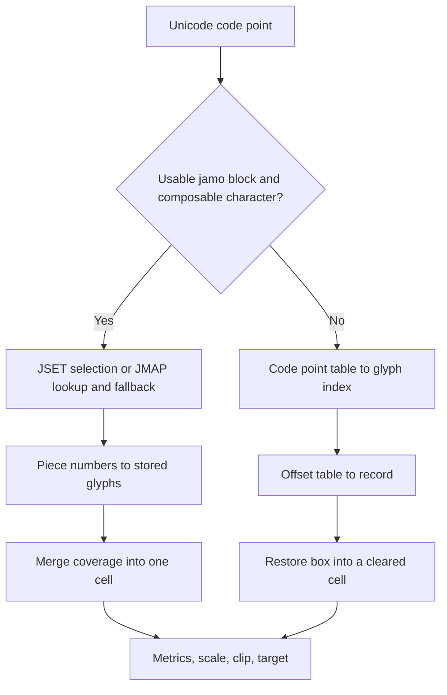
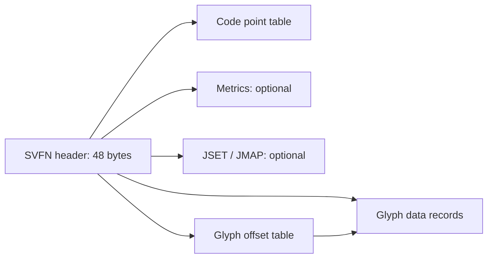

**English** | [한국어](SVF.ko.md)

# SVF (SVFN) bitmap font format

<a id="what-svf-is-and-why-to-use-it"></a>

## 1. What SVF is and why to use it

SVF is a bitmap font format: it stores the pixels of letters ahead of time. Use it to draw the same shapes on a small
MCU LCD, a DOS screen, a game's dialogue box or a web `<canvas>` without running an outline font engine.
The file magic is `SVFN`; the file format described here is version 3.

A **precomposed face** stores a glyph for each Hangul syllable it covers. A **jamo-set face** stores positional initial,
medial and final [pieces](#term-piece) and selection tables, composing syllables at draw time to save storage.
Both look up characters by Unicode code point ([Unicode Chapter 3](#references)). Readers can access a whole file in memory or flash, or use
[streaming](#term-streaming) to keep only tables in RAM and read glyphs as needed.
[1, 2 and 8 bpp](#term-bpp) range from crisp monochrome bitmaps to precomputed antialiased coverage.

<a id="reading-guide"></a>

### 1.1. Reading guide

| What you want to do | Start here |
|---|---|
| Draw text in an application or firmware | [C renderer guide](../docs/c-renderer-guide.md), [web renderer guide](../docs/web-renderer-guide.md) |
| Understand composition and memory choices | [Jamo-set background and examples](../docs/jamo-sets.md), [jamo blocks](#jamo-block) below |
| Implement a reader or writer | [Header and dy](#header), [cells and layout](#layout), [validation](#validation), then the jamo block version you need |
| Convert, subset or reprofile a face | [Tools](../docs/tools.md), [recipes](../docs/recipes.md) |
| Pick or make fonts in an application | [Desktop app](../docs/desktop-app.md), [font maker](../docs/maker-desktop.md) |
| Check the ScummVM integration boundary | [Integration appendix](#scummvm-loading) |

See the [bilingual glossary](#glossary) for unfamiliar terms. The portable C API is
[svf.h](../c/include/svf.h) and reads version 3 files only. See the [renderer design](renderer-design.md) for output and memory ownership.

SVFN is at **version 3**. Versions 1 and 2 are retired (see "Retired: versions 1 and 2" below); `tools/svf2to3.py`
converts a v2 face.

<a id="bitmap-fonts"></a>

<a id="bitmap-fonts-g2"></a>

## 2. Bitmap font structure

A face separates character lookup from pixel storage: the same drawing code can use a Latin glyph, a stored Hangul syllable or composed pieces. [svf_face.c](../c/src/svf_face.c) opens the face and resolves stored glyphs; [svf_draw.c](../c/src/svf_draw.c) places them on a target.

Lookup uses the file's code point table. One face can contain ASCII, symbols and Hangul; no code-page conversion file is required.
Stored and composed glyphs share the cell, metrics and drawing paths. See the [renderer design](renderer-design.md)
for face chains and output targets.

<a id="jamo-set-fonts-flags-bit-1"></a>
<a id="자모-세트-폰트-플래그-비트-1"></a>
<a id="jamo-block"></a>

### 2.1. Jamo-set fonts (flags bit 1)

A jamo block answers “which shape of each jamo fits this syllable?” A [class](#term-class) groups neighboring jamo contexts; a [set](#term-set) selects positional shapes. [svf_jamo.c](../c/src/svf_jamo.c) reads these choices and merges the [coverage](#term-coverage) of their pieces. The block version is separate from the SVFN file version.



Header flag bit 1 (0x2) indicates a jamo block. The header's offset and size locate the **JSET** block.
The reader composes syllables using a supported block version; when the block is unusable it uses the code point table.

See also [docs/jamo-sets.md](../docs/jamo-sets.md): the background (johab as a character set and as a font technique,
the DOS set systems), a worked example through a real face, and the MCU constraints of each form.

- The pieces are glyphs at code point U+F0000 + piece number. U+F0000 starts the [plane 15 private-use area](#references).
  The numbers are the font's own; the JSET tables name them.
- Any other glyph (ASCII, symbols, compatibility jamo stored whole) is looked
  up as in any SVFN.
- The block is where header bytes 36 (offset) and 40 (size) say; both are 0 without the flag. The offset is a
  multiple of the table unit and lies at or after byte 48 and inside the file together with the size. The size must
  equal what the block's counts give. A block that fails validation (counts, classes, sets out of range, a size that
  does not add up or is 0 with the flag set, a piece number with no glyph) makes the face load as a plain SVFN
  (`SVF_FACE_JSET_BAD` in the C renderer). Only a JSET range outside the
  file or inside the header is a range error.
- U+AC00..U+D7A3 are composed from the pieces by the maximum coverage at each
  pixel (the OR of a 1bpp stencil; 2bpp and 8bpp work too); U+3131..U+3163 with
  a compatPiece are that piece alone. A composed glyph is reconstructed at one cell size (the
  stored glyph box) and advances by the JSET advance, or the cell width when
  that is 0.

A JSET block is little-endian; its own version word identifies the encoding. Versions 1 and 2 contain class and set
tables; version 3 ([JMAP](#jmap)) contains per-syllable mappings. **Version 1 is the standard for ordinary JSET writing**;
version 2 is a compact format explicitly selected for constrained targets. Version 1:

```
4  "JSET"
2  version (1)
1  LC  lead classes   (1..12; BIG 1..19)
1  TC  tail classes   (1..12; BIG 1..28)
1  NI  initial sets   (1..32; BIG 1..128)
1  NM  medial sets    (1..24; BIG 1..128)
1  NF  final sets     (1..16; BIG 1..64)
1  advance            syllable advance in px; 0 = the cell width
19 leadClass[19]      class of each initial (ㄱ..ㅎ), < LC
28 tailClass[28]      class of each tail, index 0 = no tail, < TC
LC*21*TC initSet      set of the initial for (leadClass, vowel, tailClass), < NI
LC*21*TC medSet       set of the medial
LC*21*TC finSet       set of the final (read only when tail != 0)
NI*19 u16 initPiece   piece number per (set, initial); 0xFFFF = blank
NM*21 u16 medPiece    per (set, vowel)
NF*27 u16 finPiece    per (set, tail 1..27)
51 u16 compatPiece    U+3131..U+3163 drawn from one piece; 0xFFFF = not by piece
```

The three set tables are indexed `(leadClass * 21 + vowel) * TC + tailClass`
(vowel 0..20 in Unicode order, ㅏ..ㅣ); a piece table is indexed
`set * 19 + initial`, `set * 21 + vowel`, `set * 27 + tail - 1`. A final set
is validated and read only for tail classes some tail 1..27 belongs to. `tools/jamoset.py`
writes such fonts, also at 2 bpp from an outline font (`--bpp 2`, anti-aliased
pieces composed by the maximum) and with set systems fitted to the font
(`--layout adaptive`, up to the limits above).

The standard limits are 12 × 12 lead/tail classes and 32 / 24 / 16 initial/medial/final sets. The largest version 1
block is 12,321 bytes. The adaptive default set budget is 32 / 24 / 12. A standalone JSET block whose counts exceed
the build's limits is unusable (`SVF_FACE_JSET_BAD`).

Readers predating JSET ignore flag bit 1 and the JSET block and read the face as a plain font. This applies only to
SVFN file versions those readers support; it does not imply support for an unknown file version.
JSET readers from before the class-limit expansion in 2026-10 reject blocks with more than eight lead or tail classes.
Faces with 9..12 classes therefore require a reader supporting the expanded limits. The class/set table layout did not
change, so the block version remains 1. Sources: the class-limit and compatibility comments in `tools/jamoset.py`,
and the fork's `jamo_set.h` and `jamo_set.cpp`.

`SVF_JSET_BIG` widens the limits of versions 1 and 2 in place (no new version word): 19 lead x 28 tail classes and
128 / 128 / 64 initial / medial / final sets; the largest blocks are 47,373 bytes (version 1) and 29,708 bytes (version 2, NA = 0;
45,068 with every slot an alias). A reader built without it treats counts over 12 x 12 / 32 / 24 / 16 as a bad JSET. Writers
(`--jset-big`) and `jamoset.pack` refuse a table over the standard row unless asked; `jamoset.unpack` reads both. Output within the
standard limits is byte-identical either way.
Version 1 sizes: `12 + 19 + 28 + 3 * LC * 21 * TC + 2 * (NI*19 + NM*21 + NF*27 + 51)` bytes.

<a id="jset-v2"></a>

<a id="jset-block-version-2-compact-exception-only"></a>

#### 2.1.1. JSET block version 2 (compact; exception-only)

This encoding packs the same selection information more tightly. It trades decoding work for fewer table bytes; the drawn shapes stay the same. Read version 1 first to understand the tables being compressed.

Version 2 holds the same tables in fewer bytes: the three set tables are bit-packed, the piece numbers are implicit
(a presence bit per slot, a base per set, pieces numbered in order) with an alias escape for a piece shared between
slots, and the compat table is one byte per jamo. It changes no bitmap, glyph record, cell or composition rule and no
limit (LC, TC <= 12; NI <= 32, NM <= 24, NF <= 16; BIG: 19, 28; 128, 128, 64, as for version 1); the SVFN header and its JSET offset (36) and size (40) fields are as
for version 1. Nothing inside the block is aligned; bits are numbered LSB first within a little-endian byte stream
(bit `b` is bit `b & 7` of byte `b >> 3`).

```
off  size            field
0    4               "JSET"
4    u16             version = 2
6    1               LC  lead classes (1..12; BIG 1..19)
7    1               TC  tail classes (1..12; BIG 1..28)
8    1               NI  initial sets (1..32; BIG 1..128)
9    1               NM  medial sets  (1..24; BIG 1..128)
10   1               NF  final sets   (1..16; BIG 1..64)
11   1               advance (px; 0 = cell width)
12   u16             NA  alias entries (0..NI*19+NM*21+NF*27)
14   u16             reserved, 0
16   19              leadClass[19]  < LC
35   28              tailClass[28]  < TC, index 0 = no tail
63   S               set table: LC*21*TC cells of W bits each, S = ceil(LC*21*TC*W / 8)
63+S NI*RI           initial set rows
     NM*RM           medial set rows
     NF*RF           final set rows
     NA*2            alias table: u16 piece numbers
     51              compat[51]: one byte per U+3131..U+3163
```

**Set table.** Cell `c = (leadClass[lead]*21 + vowel)*TC + tailClass[tail]`, as in version 1. `width(n)` is 0 for n = 1,
else `ceil(log2 n)` (2 -> 1, 32 -> 5); `WI = width(NI)`, `WM = width(NM)`, `WF = width(NF)`, `W = WI + WM + WF`
(0..14; BIG 0..20). Cell `c` occupies bits `c*W .. c*W + W - 1`: the initial set in the low WI bits, the medial set in the next
WM, the final set in the top WF. A width of 0 reads as set 0. A reader takes each field with one two-byte fetch at
the byte offset (bit offset `>> 3`), a shift by the bit offset `& 7` and a mask (a field is at most 5 bits wide; BIG 7: a 7-bit field at bit offset 7 still fits the two-byte fetch).

**Set rows.** One row per set, a fixed size per table, so row `s` is at `rows + s*R`. PB is the presence width in
bytes: 3 for initial (19 slots) and medial (21), 4 for final (27).

```
NA = 0:  u16 base | presence PB bytes                                  RI = RM = 5, RF = 6
NA > 0:  u16 base | u16 abase | presence PB bytes | alias PB bytes     RI = RM = 10, RF = 12
```

Slot `j` (initial 0..18, vowel 0..20, tail index 1..27 stored at bit `tail - 1`) is drawn when presence bit `j` is set.
Bits at and above the slot count are padding and must be 0. An alias bit may be set only where the presence bit is.
The piece of a drawn slot is `alias[abase + popcount(aliasBits & below(j))]` when its alias bit is set (NA > 0 only),
else `base + popcount((presenceBits & ~aliasBits) & below(j))`, where `below(j)` is the mask of bits 0..j-1. So a
set's fresh pieces are `base, base+1, ...` in jamo order, and an alias names any piece by number; the reader never
assumes bases are cumulative or disjoint. 0xFFFF is never a valid alias entry (a blank slot is a clear presence bit).

**Compat.** `compat[k]` for U+3131 + k: 0xFF = not drawn by piece; else bits 0-6 a set number and bit 7 a table
switch (the set must be below its table's count: at most 31 in the standard row, 127 for initial and medial tables under BIG;
the bit 7 form names a final set, at most `0x80 | 63 = 0xBF`, so 0xFF never names a set). The natural table of k: k >= 30 is vowel `k - 30` in the medial table; a consonant
with a lead index uses the initial table at that lead; a cluster consonant uses the final table at its tail index.
Bit 7 on a consonant that has a lead index selects the final table at its tail index instead (bit 7 on a vowel, a
cluster, or one of ㄸ ㅃ ㅉ is invalid). The drawn piece is that set's slot for that jamo, which must be present. The
reader's constant map for k = 0..29 (lead index, or `T` + tail index):

```
ㄱ0 ㄲ1 ㄳT3 ㄴ2 ㄵT5 ㄶT6 ㄷ3 ㄸ4 ㄹ5 ㄺT9 ㄻT10 ㄼT11 ㄽT12 ㄾT13 ㄿT14 ㅀT15 ㅁ6 ㅂ7 ㅃ8 ㅄT18 ㅅ9 ㅆ10 ㅇ11 ㅈ12 ㅉ13 ㅊ14 ㅋ15 ㅌ16 ㅍ17 ㅎ18
```

and the tail index of a lead-capable consonant for the bit 7 form: ㄱ1 ㄲ2 ㄴ4 ㄷ7 ㄹ8 ㅁ16 ㅂ17 ㅅ19 ㅆ20 ㅇ21 ㅈ22
ㅊ23 ㅋ24 ㅌ25 ㅍ26 ㅎ27.

**Size.** `size = 63 + S + NI*RI + NM*RM + NF*RF + 2*NA + 51`. The largest valid block (12 x 12 classes, 32 / 24 / 16
sets, every slot an alias, NA = 1,544) is 9,246 bytes; under BIG (19 x 28 classes, 128 / 128 / 64 sets) 29,708 bytes with NA = 0
and 45,068 with every slot an alias. Examples (NA = 0): 6 / 2 / 1 sets in 1 x 2 classes, 181 bytes
(version 1: 653); 8 / 4 / 4 sets in 2 x 2 classes, 272 (1,101); 32 / 24 / 12 sets in 8 x 8 classes, 2,818 (7,065);
24 / 16 / 16 sets in 12 x 12 classes, 5,324 plus the aliases (11,681).

**Validation** (everything below makes the face load plain, `SVF_FACE_JSET_BAD`, never an error; each check reads
only bytes the earlier ones have bounded): (1) length >= 16, magic, version 2, the five counts inside the limits,
reserved == 0, NA <= NI*19 + NM*21 + NF*27; (2) length == the size formula; (3) `leadClass[i] < LC`,
`tailClass[i] < TC`; (4) every cell's initial set < NI and medial set < NM, final set < NF only in cells of a tail
class some tail 1..27 belongs to; (5) every row: padding bits of presence and alias 0, alias bits a subset of the
presence bits, `abase + popcount(alias) <= NA`; (6) every drawn slot (fresh or alias) resolves, in 32 bits, to a piece number below
0xFFFF whose glyph exists, and no alias table entry is 0xFFFF (alias entries no slot uses are not checked for a glyph);
(7) every compat byte is 0xFF or has `c & 0x7F` below its table's count, with bit 7 only on a lead-capable consonant
with a final form (not ㄸ ㅃ ㅉ), and that set's slot for the character is present.

<a id="choose-v2"></a>

<a id="when-to-use-version-2"></a>

#### 2.1.2. When to use version 2

Choose a block encoding together with the reader build: saving flash helps only when the intended device can decode that encoding. [jamoset.py](../tools/jamoset.py) handles the tables; [svf2to3.py](../tools/svf2to3.py) handles old file conversion.

The published jamo faces in `svf/` stay at JSET version 1. Select version 2 explicitly when producing a target build or pack.
The [JSET identity record](../c/bench/JSET2-IDENTITY.md) follows this policy too.

Version 1 is the default for ordinary JSET writing. The maker preserves the block version of an uploaded face.
Choose version 2 when a constrained target needs smaller blocks and includes its reader. `--jset-version auto`
uses version 2 only when it saves at least `JSET_V2_MIN_SAVING` (1,024 bytes) over version 1.
Compare block size with decoding cost. The [size measurements](../c/cross/SIZES.md) and
[performance measurements](../c/bench/MEASUREMENTS.md) identify their builds and measurement conditions.

Which build reads which (C renderer, `c/include/svf.h`): `SVF_JSET_V1` (default 1) and `SVF_JSET_V2` (default 1, except builds
that leave it at 0: AVR by default, and the CH582 port, pinned to v1 because it embeds a v1 face) compile the readers; a face of a version the build does not read loads plain (`SVF_FACE_JSET_UNREAD`; `SVF_FACE_JSET_BAD` is kept for a malformed block), and at
least one must be 1 unless `SVF_JMAP=1` (a JMAP-only build may set both to 0). `SVF_JSET_POP4` (default 1; 0 under `SVF_SMALL` and on AVR) picks a 16-entry nibble table over a
bit-clearing loop for the version 2 reader's popcount; the pixels do not change. `SVF_JMAP_LIST` (default: the value of `SVF_JMAP`, so on for host, DOS, WASM and SDL builds and off for every MCU; an explicit `-DSVF_JMAP_LIST=0/1` wins, and 1 without `SVF_JMAP` is an `#error`) compiles the reader of a LIST block (flag 0x08) inside `SVF_JMAP`; without it a LIST block is `SVF_FACE_JMAP_UNREAD` (see "Reader statuses"). `SVF_JSET_TRUSTED` (default 0) skips
the validation of the table contents. **Warning:** it is only for faces the developer builds into flash; a hostile or
corrupt JSET (counts, classes, sets, pieces) then reads out of bounds. Only the header length, the magic, the version and
the block size the counts give against the region length are still checked (the version 1 reader also its count limits; the
version 2 reader trusts its counts), so a streamed face loads no more than its region; in a 16-bit build (AVR) with both
`SVF_JSET_V2` and `SVF_JSET_TRUSTED` the size product of a corrupt count can wrap. With `SVF_JMAP` a version 3 block keeps only its header rules (R1-R4; for a LIST R1', L2, L3, R4) under `SVF_JSET_TRUSTED`: its rank table, bitmap, entries, compat entries and the glyph of every piece (R5-R8; for a LIST L5, L6, L7) are trusted, and a corrupt rank or bitmap drives an entry read far outside the block (about 264 KB); only for faces the toolchain wrote. The fuzz harnesses refuse to compile with it. The
Python `jamoset.unpack` reads all three versions (1, 2 and the JMAP of version 3). Tools that select a JSET version take `--jset-version 1|2|auto` (default 1). See [tools](../docs/tools.md) for restrictions on rewriting uploaded JMAP faces.

<a id="jmap"></a>

<a id="version-3-mapping-table-jmap"></a>

#### 2.1.3. Version 3: mapping table (JMAP)

Some faces need syllable-specific choices that class rules cannot express. [JMAP](#term-jmap) records those choices directly; sparse and LIST forms avoid storing a full mapping when only some syllables need entries. A fallback supplies the remaining choices when present.

Version 3 replaces class and set tables with a direct map from syllables to pieces. Use it when jamo classes cannot
express the selection rules or when syllable-specific exceptions are needed. All numbers are little-endian; a reader uses byte reads only.

| offset | size | field |
|---|---|---|
| 0 | 4 | `"JSET"` |
| 4 | u16 | version = 3 |
| 6 | u8 | flags: 0x01 4B (entries are 4 bytes, else 3), 0x02 SPARSE (a bitmap and NS entries, else dense, NS = 11,172), 0x04 FALLBACK (a JSET version 1 or 2 block follows the entries and runs to the end of the region), 0x08 LIST (NS entries of 8 bytes, sorted by key, over a shared piece pool; excludes 0x01 and 0x02); bits 4-7 zero |
| 7 | u8 | advance in px (0 = the cell width) |
| 8 | u16 | NS, the number of entries; LIST: 1..255, so byte 9 is zero |
| 10 | u16 | PI, initial pieces, U+F0000 + 0 .. PI-1 (LIST: 0) |
| 12 | u16 | PM, medial pieces, U+F0000 + PI .. PI+PM-1 (LIST: 0) |
| 14 | u16 | PF, final pieces, U+F0000 + PI+PM .. PI+PM+PF-1 (LIST: 0) |
| 16 | u16[51] | compat piece numbers for U+3131 + k: 0xFFFF blank, else below PI+PM+PF (LIST: a piece of the pool that has a glyph) |
| 118 | u16[44] | SPARSE only: `rank[b]`, the set bits of the bitmap below bit `b * 256` |
| 206 | u8[1397] | SPARSE only: presence bitmap over U+AC00..U+D7A3, bit `s` is byte `s >> 3`, bit `s & 7`; bits 11,172..11,175 are zero |
| 1603 | u8 | SPARSE only: pad, zero |
| E | NS x 3, 4 or 8 | the entries; E = 1,604 (SPARSE) or 118 (dense, LIST). LIST: 8 bytes, `u16 key, u16 i, u16 m, u16 f`, sorted by key, strictly increasing, `key = cp - 0xAC00`; the three fields are piece numbers (the glyph at U+F0000 + n), 0xFFFF blank. Dense and SPARSE, 3B: `[i, m, f]`. 4B: `[b0, i_lo, m_lo, f_lo]` with `b0 = (i >> 8) \| ((m >> 8) << 3) \| ((f >> 8) << 6)`. In dense and SPARSE entries a field 0 means no piece of that plane, k means the k-th piece of the plane (a LIST field is a piece number: 0 is piece 0) |
| F | rest | FALLBACK only: F = E + NS x (3 or 4), or 118 + 8 NS for a LIST (at most 2,158); a JSET version 1 or 2 block, whose length is the region minus F |

Limits: 3B: PI, PM, PF <= 255; 4B: PI, PM <= 2,047 and PF <= 1,023; PI + PM + PF >= 1 (dense and SPARSE; a LIST has PI = PM = PF = 0, rule L2); SPARSE: 1 <= NS <= 11,172
(11,172 is valid: an exception list may cover everything); dense: NS = 11,172; LIST: 1 <= NS <= 255; the region is at most 65,534 bytes (the
JSET size is clipped to 0xFFFF at open, so a region of exactly 65,535 is never valid). Sizes: sparse 3B for 2,350
syllables without fallback is 16 + 102 + 1,486 + 2,350 x 3 = 8,654; dense 3B 33,634; dense 4B 44,806; sparse 4B with
11,172 entries 46,292; LIST 118 + 8 NS, at most 2,158 (NS 36: 406), plus the fallback block.

**Lookup.** Syllable index `s = cp - 0xAC00`. Dense: `idx = s`. SPARSE: the syllable is present when bit `s` of the
bitmap is set, and `idx = rank[s >> 8] + popcount(bitmap bytes (s >> 8) * 32 .. (s >> 3) - 1) + popcount(byte (s >> 3) &
((1 << (s & 7)) - 1))`. The pieces of a hit with fields `i, m, f`: initial `i - 1`, medial `PI + m - 1`, final
`PI + PM + f - 1`; a 0 field is `SVF_PIECE_BLANK` (0xFFFF). The entry decides the count: 3 pieces when `f != 0`,
else 2, whatever the syllable's final. Pieces are numbered per plane; a glyph two planes share is stored twice.

**LIST lookup.** With flag 0x08 the syllable index `s = cp - 0xAC00` (0..11,171; any other `s` is a miss) is searched by
binary search over the NS entries (key at 118 + 8 j, strictly increasing). The fields of a hit are piece numbers of one
shared pool, not plane indices: the glyph at U+F0000 + n, whoever stores it (a piece of the fallback's tables, a compat
piece, or a glyph that exists only for the LIST), and 0xFFFF is blank. Piece 0 is a piece, not "none". The pieces of a hit
are `[i, m, f]` when `f != 0xFFFF`, else `[i, m]` (the entry decides the count; a blank `i` or `m` is skipped when
composing). A whole glyph (a precomposed cell) is an entry with `i` = its piece number and `m = f = 0xFFFF`: it is drawn
as a piece, into the cell at dy 0, advancing by the JSET advance; its own metrics entry is not consulted. A key miss
goes to the fallback exactly as a SPARSE miss does; without a fallback the syllable is not composed. The fallback's piece
numbers are not shifted: it names pieces in the same pool, and sharing a piece with the entries is the point.

**Compat.** The JMAP's own compat entry wins when it is not blank; a blank one falls to the fallback's compat
entry (if there is a fallback), else the cmap glyph. A compatibility jamo requiring multiple pieces can be stored as a whole glyph at U+3131 + k with its JMAP compat entry blank.

**Fallback.** A miss (a syllable the bitmap does not list) is answered by the fallback JSET, version 1 or 2
only; without one the syllable is not composed (the cmap glyph, or the missing glyph, as in a plain face). The
fallback's advance byte must equal the JMAP advance. The fallback names pieces in the same U+F0000 + n space as the
JMAP's planes, so, in a dense or SPARSE block, every piece number it names (its piece lists and compat) must be BLANK or at least PI + PM + PF; a
writer shifts the fallback's pieces up by PI + PM + PF and writes the block with `jamoset.pack_fallback(tables,
version, base)`, which keeps the piece numbers it is given (version 2 stores a drawn slot as a fresh piece when it
counts up from its row's first piece and as an alias otherwise, so any numbers fit, at the cost of a larger block than
`pack`'s); `jamoset.pack_jmap` refuses an overlap. The disjointness is a writer rule only: readers do not check it (a
piece number stays inside the glyph table whatever it is, under R8), so a reader adds no such check. This holds for dense and
SPARSE; a LIST has PI + PM + PF = 0, shifts nothing and shares the pool with its fallback (no overlap refusal).

**Validation.** A reader checks in this order, each rule reading only bytes the earlier ones bounded:

- R1: length >= 118, magic `JSET`, version 3, `flags & 0xF8 == 0` for a dense or SPARSE block. For a LIST the rule is R1':
  length >= 118, magic, version 3, `flags & 0xF0 == 0`, and not `(flags & 0x08) && (flags & 0x03)` (LIST with 4B or SPARSE).
- R2 (dense and SPARSE): PI, PM, PF within the 3B or 4B limits, PI + PM + PF >= 1.
- L2 (LIST, in place of R2): PI = PM = PF = 0; R2's `PI + PM + PF >= 1` does not apply.
- R3: NS in 1..11,172 (SPARSE) or == 11,172 (dense).
- L3 (LIST, in place of R3): NS in 1..255 and byte 9 is 0 (one test on the u16 at offset 8: the block fails when `ns - 1u >= 255u`).
- R4: the region is at most 65,534 bytes (F = 118 + 8 NS, at most 2,158, for a LIST); without FALLBACK the length is exactly F; with it the length is at least
  F + 12 and the fallback header is readable (magic, version 1 or 2); the advance byte of the fallback (byte 11 of the fallback header) equals the JMAP advance (byte 7 of the JMAP
  header), in every build that can read the header; then, when the build reads that
  version, the fallback is well-formed. So one face is never bad in one build and usable in another because of the
  advance.
- R5: every compat entry is 0xFFFF or below PI + PM + PF (dense and SPARSE).
- L5 (LIST, in place of R5): every compat entry is 0xFFFF or a piece number whose glyph exists.
- R6: SPARSE only: the pad byte is 0, bitmap bits 11,172..11,175 are 0, `rank[b]` equals the set bits below `b * 256`
  for b = 0..43, and the total equals NS.
- L6 (LIST, in place of R6): the keys are strictly increasing and the last is at most 11,171 (read only after R4 has bounded NS against the region).
- R7: every entry field is at most its plane's count.
- L7 (LIST, in place of R7 and the entry part of R8): every entry field is 0xFFFF or a piece number whose glyph exists.
- R8 (the caller's, as for JSET; dense and SPARSE): every piece number below PI + PM + PF, every piece the fallback names and every
  non-blank compat piece has a glyph. A fallback's own pieces can be checked only by a build that can read the fallback: in a build
  that cannot (`SVF_FACE_JSET_UNREAD`) the JMAP part stays usable while Python, which reads every version, marks a block whose fallback
  names a piece without a glyph bad (build-dependent by design; the plane pieces and the compat pieces are checked everywhere).

For a LIST the header rules are R1', L2, L3 and R4, and the content rules are L5, L6 and L7. L5 and L7 are the caller's check, like R8: the Python `jamoset.unpack_jmap` does not make them (`parse_svfn`'s usable rule does).

**Reader statuses.** One cause bit per part: `SVF_FACE_JSET_BAD` (0x0008) for a JSET-part block that is malformed,
or of version 0 or >= 4; `SVF_FACE_JSET_UNREAD` (0x0010) for a well-formed version 1 or 2 header whose reader is not
compiled; `SVF_FACE_JMAP_BAD` (0x0020) for a version 3 block that fails any rule above, a malformed fallback included
(one block, one verdict); `SVF_FACE_JMAP_UNREAD` (0x0040) for a version 3 block in a build without `SVF_JMAP` but
with `SVF_JMAP_RECOG`, and for a LIST block in a build with `SVF_JMAP` and `SVF_JMAP_LIST=0` when its header rules pass, else `SVF_FACE_JMAP_BAD` (see the table below; for the RECOG build, the recognition: it reads the flags and NS, and with FALLBACK reads a well-formed version 1 or 2
fallback in the JMAP's place; default on for desktop builds, off on AVR, `SVF_SMALL` and other MCUs). A build with neither
`SVF_JMAP` nor `SVF_JMAP_RECOG` treats version 3 like any unknown version: `SVF_FACE_JSET_BAD`, a plain face, no fallback
use. In a build with `SVF_JMAP_RECOG` and without `SVF_JMAP` the fallback is the JSET part: its verdict is `SVF_FACE_JSET_BAD` / `SVF_FACE_JSET_UNREAD` (beside `SVF_FACE_JMAP_UNREAD`); only the advance comparison (R4), the flag and NS rules (R1, R3; for a LIST R1' and L3) and a region of exactly 65,535 bytes (R4) set `SVF_FACE_JMAP_BAD` there (a region cut short of the fallback header is a malformed fallback: `SVF_FACE_JSET_BAD` beside `SVF_FACE_JMAP_UNREAD`), so "one block, one verdict" holds for builds that read the block (`SVF_JMAP`, and for a LIST also `SVF_JMAP_LIST`), not for `SVF_JMAP_LIST=0` or RECOG builds. A well-formed fallback whose version 1 or 2 reader is not compiled does not make the block bad: the JMAP part stays
usable and the fallback part is `SVF_FACE_JSET_UNREAD`. The same holds in a build with `SVF_JMAP` and without
`SVF_JSET_BIG` for a fallback whose five counts are within the BIG row but one over the build's row: the fallback is
`SVF_FACE_JSET_UNREAD` (only its counts are read) and the JMAP part stays usable; a stand-alone JSET of such counts is
`SVF_FACE_JSET_BAD`. A face that fails JMAP validation loads plain. A build without a JMAP reader may use the fallback under the conditions above.

| build | LIST face (flag 0x08) |
|---|---|
| `SVF_JMAP=1`, `SVF_JMAP_LIST=1` (default with `SVF_JMAP`) | read: a key miss goes to the fallback; a failed rule (R1', L2, L3, R4, L5, L6, L7): `SVF_FACE_JMAP_BAD`, plain |
| `SVF_JMAP=1`, `SVF_JMAP_LIST=0` | the header rules R1', L2, L3 and R4 only, the fallback's own well-formedness included: a failure is `SVF_FACE_JMAP_BAD`, plain; a pass is `SVF_FACE_JMAP_UNREAD` and the fallback is used. L5-L7 are not applied here, so a block with unsorted keys or a field without a glyph is `SVF_FACE_JMAP_BAD` with `SVF_JMAP_LIST=1` and "fallback used" here (an exemption of the kind RECOG builds have; "one block, one verdict" is promised for builds that read the block) |
| `SVF_JMAP=0`, `SVF_JMAP_RECOG=1` | the recognition keeps its own rule set and read pattern: it reads bytes 6-9, then one byte at F + 11 once F + 12 <= the region, and never reads bytes 10-15 (so L2 and R2 are not applied). It learns R1' (the mask and the combination test), L3 (NS in 1..255) and F = 118 + 8 NS for a LIST. `SVF_FACE_JMAP_BAD` for R1', L3, the advance comparison or a region of exactly 65,535 bytes; otherwise `SVF_FACE_JMAP_UNREAD`, with the fallback used when the block has a well-formed one. A streamed region longer than the build's `SVF__JSET_LOAD_MAX` is not loaded: the face stays plain with `SVF_FACE_JMAP_UNREAD` alone (the same for a SPARSE block) |
| neither switch | `SVF_FACE_JSET_BAD`, plain, as for every version 3 block |

The Python reference is `jamoset.unpack_jmap`, whose ValueError text starts
`JMAP Rn` (for a LIST `JMAP R1`, `JMAP L2`, `JMAP L3`, `JMAP R4` or `JMAP L6`).

<a id="header"></a>

<a id="per-glyph-dy-header-bytes-17-and-18-metrics-byte-3"></a>

### 2.2. Header and per-glyph dy (header bytes 17 and 18, metrics byte 3)

The header tells a reader where each table lives and how to interpret it. [Ascent](#term-ascent) sets a common baseline; [dy](#term-dy) moves an individual glyph without changing its stored cell. [svfdy.py](../tools/svfdy.py) adjusts this placement.



The SVFN v3 header is 48 bytes, little-endian:

```
0  "SVFN"   4 u16 version (3)   6 u16 flags (bit 0 metrics table, bit 1 JSET, bit 2 marks at origin; others 0, and a reader refuses a face with other bits set)
8  bpp (1, 2, 8)   9 layout: record and row units   10 layout: table unit and offset width   11 reserved (0)
12 u16 glyphs (1..65535)
14 cell width   15 cell height   16 ascent (baseline row)   17 dy_min (int8, <= 0)   18 dy_max (int8, >= 0)   19 reserved (0)
20 u32 metrics table offset      24 u32 glyph data offset        28 u32 glyph data size
32 u32 code point table offset   36 u32 JSET offset              40 u32 JSET size
44 u32 glyph offset table offset
```

A metrics entry is 4 bytes: advance, left bearing (int8), ink width, and **dy**
(int8): the glyph is drawn `dy` rows below its cell position (negative: above),
`dy_min <= dy <= dy_max`. The glyph's rows are stored in the cell as always; dy
only moves where they are drawn, and ink that then lies outside the cell is
drawn when inside the target's clip rectangle. A Latin face whose letters must stand on a Hangul baseline
near the bottom of the cell stores them high enough for their descenders and
draws them lower by dy (`tools/svfdy.py` sets it; `jamoset.py` reads and
keeps it).

- A nonzero dy range is ignored if there is no usable metrics table, `dy_min > 0`, `dy_max < 0`,
  `-dy_min > cell height`, or `dy_max > cell height`. The C renderer sets `SVF_FACE_DY_IGNORED` and draws all glyphs
  at dy 0. An individual dy outside a valid range is drawn at 0 for that glyph. The core prints no warnings.
- At scale 1/1 the cell top is `y_baseline - ascent + dy`. The ascent and descent from `svf_measure_utf8` include
  the cell height and dy; they describe placed cells rather than an ink-pixel bounding box.
- A jamo-set face composes syllables at dy 0. Pieces must not carry dy (`jamoset.check` rejects it).
  Other stored glyphs may carry dy.

<a id="cells-layout-bytes-and-reserved-bytes"></a>
<a id="셀-레이아웃-바이트-예약-바이트"></a>
<a id="layout"></a>

### 2.3. Cells, layout bytes and reserved bytes

The [cell](#term-cell) is the bitmap a renderer reconstructs. A record stores only a box within it, while layout units control padding and alignment for different CPUs. Table offsets locate regions; they do not prescribe one physical order. [jamoset.py](../tools/jamoset.py) reads and writes the layout.

A **cell** is the glyph box a reader hands back: cell width (byte 14) by cell
height (byte 15) pixels, `pitch * cell height` bytes with
`pitch = (cell width * bpp + 7) / 8`, rows MSB first. Bits past the cell width
in the last byte of a row are written 0 and masked by readers.

A reader expands a stored pixel to 8-bit coverage: 1 bpp ink is 255, a 2 bpp level k (0..3) is k * 85, an 8 bpp byte is
itself. What the levels are for, how they become colours on each target and when to choose 1, 2 or 8 bpp:
[Anti-aliasing](../docs/anti-aliasing.md).

**Layout bytes (9 and 10)** give the alignment units, each a power of two stored
as its log2, 0..6 (1..64 bytes):

```
byte 9   bits 0-2  REC  log2 of the record unit: every glyph record starts at a multiple of 2^REC from the file start
         bits 3-5  ROW  log2 of the row unit: each row of a record takes wb rounded up to 2^ROW bytes
         bits 6-7  0
byte 10  bits 0-2  TAB  log2 of the table unit: the code point table, metrics table, JSET, glyph offset table and glyph
                        data start at multiples of 2^TAB (the glyph data also at a multiple of 2^REC)
         bit 3     OFF  glyph offset table entries: 0 = u16 counting in units of 2^REC, 1 = u32 counting bytes
         bits 4-7  0
```

`REC, ROW, TAB <= 6` and `ROW <= REC`; the reserved bits are 0. Byte 11 and byte
19 are reserved: written 0, ignored by every reader. (Bytes 9..11 were the shadow
and the code page of version 1 and 2; version 3 interprets them as the layout and reserved bytes above.)

**Tables.** All offsets are file offsets, at or after byte 48, and each table lies
inside the file.

- Code point table (byte 32): `glyphs` entries of `u32 code point, u32 glyph
  index`, normally sorted by code point; a code point listed twice resolves to
  its last entry.
- Metrics table (flags bit 0, byte 20): `glyphs` entries of 4 bytes, `advance,
  bearing_x (int8), ink_w, dy (int8)` (see "Per-glyph dy"). A reader takes
  advance, bearing and ink width from here, never from a record's box.
- JSET (flags bit 1, bytes 36 and 40): see "Jamo-set fonts". Both fields are 0
  without the flag.
- Glyph offset table (byte 44): `glyphs + 1` entries; entry `i` is the start of
  record `i` relative to the glyph data offset (u16 in units of 2^REC, or u32
  bytes, per OFF), entry `glyphs` equals the glyph data size, entries do not
  decrease, and each, in bytes, is a multiple of 2^REC. The length of record `i`
  is `off[i+1] - off[i]`.
- Glyph data (byte 24, size at 28): the records in index order.

The five offsets of bytes 20..47 are multiples of 2^TAB, the glyph data offset
also of 2^REC, and the glyph data size of 2^REC.

**Glyph record.**

```
0  x0   left edge of the box, in BYTES of a cell row
1  y0   top row of the box in the cell
2  wb   box width in BYTES (0 = blank glyph, no rows follow)
3  h    box rows (0 = blank glyph)
4  phase bytes (below), then h rows of rp bytes, rp = wb rounded up to 2^ROW,
   then padding to the next multiple of 2^REC
```

`x0 + wb <= pitch` and `y0 + h <= cell height`. Rows are the cell's own row bytes
cut at byte boundaries, so a reader clears the cell and copies (or, for a
composed syllable piece, takes the per-pixel maximum of) each of the `h` rows into
`cell + (y0 + r) * pitch + x0`. A blank glyph is `wb == 0` or `h == 0`: a
4-byte header followed by padding to `2^REC` bytes, with no rows; the cell stays clear. Composition uses OR at 1 bpp, a maximum per 2-bit field at 2 bpp, and a maximum per byte at 8 bpp. **Phase:** when `REC >= 2` and `ROW == 0`, a
record with `wb == pitch` starts its rows at `4 + ((y0 * pitch) & 3)`, so the
rows lie at the same offset modulo 4 as their place in the cell; every other
record has phase 0. Which box a writer chooses (the whole cell, whole rows, or
the ink columns and rows in bytes) is its policy; a reader does not know.

**Profiles.** The writers (`--profile`, default `default`) take a named set of
units; the pixels of a face are the same in every profile:

| profile | REC / ROW / TAB (bytes) | box | offsets |
|---|---|---|---|
| `mcu-strict` | 4 / 1 / 4 | x-boxed | u16 (u32 when the data passes `65535 << REC`) |
| `default` | 4 / 1 / 4 | x-boxed | u32 (the form used in `svf/`) |
| `dos`, `wasm` | 1 / 1 / 1 | x-boxed | u16 (u32 above 65,535 bytes) |
| `full` | 4 / 1 / 4 | full cells | u32 |
| `simd16` | 16 / 1 / 16 | x-boxed | u32 |

**Supported sets.** A reader build may accept only some valid layouts and refuses
the rest with `SVF_E_LAYOUT` before reading any table: the C library takes every
valid layout unless built with `SVF_LAYOUTS` (the Cortex-M0+ P1/P2 and AVR builds
accept exactly the `mcu-strict` units); the Python tools read every valid layout.

Design and measurements: [v3 design](../docs/superpowers/specs/2026-10-21-svf-v3-design.md), [renderer design](renderer-design.md).

<a id="검증"></a>
<a id="validation"></a>

### 2.4. Validation

Validation distinguishes a file that cannot be opened from optional information that can be dropped safely. Check the open error and the face status separately. [svf_face.c](../c/src/svf_face.c) validates mapped files; [svf_stream.c](../c/src/svf_stream.c) also checks streamed records as they are read.

The C renderer with default validation checks the following. Python's `jamoset.parse_svfn` also checks file structure;
check order and error reporting can differ:

- Magic `SVFN`, then version 3 (`SVF_E_VERSION` otherwise), then the layout
  bytes (reserved bits 0, units at most 6, `ROW <= REC`) and the build's
  supported set, and unknown header flag bits (`SVF_E_LAYOUT`).
- `bpp` 1, 2 or 8; a glyph count of 0 or an empty glyph box (cell width or height
  0) is refused.
- The code point table, the glyph offset table and the glyph data lie inside the
  file and after the header (`SVF_E_RANGE`), as does a JSET block that has a size.
- The alignment masks and the glyph offset table (entries multiples of 2^REC,
  non-decreasing, the last equal to the glyph data size) hold (`SVF_E_LAYOUT`).
- Every glyph index of the code point table is below `glyphs`. A mapped face has
  every record checked at open (box inside the cell, rows inside the record's
  length: `SVF_E_RANGE`); a streamed face when a record is read, the cell then left
  blank.
- A metrics table (flags bit 0) that does not fit in the file or lies inside the
  header is dropped and the glyphs are kept: stored glyphs then advance by the cell width; composed characters retain their JSET/JMAP advance.
- A code point listed twice in the code point table resolves to its last entry.

<a id="retired"></a>

<a id="retired-versions-1-and-2"></a>

### 2.5. Retired: versions 1 and 2

These are older SVFN file versions, not the still-supported JSET block versions. Convert old files before passing them to a version 3 reader.

Version 1 ordered its glyphs by a code page and had no code point table. Version
2 had a 36-byte header with the code point table at byte 32, shadow and code page
at bytes 9..11, fixed-stride full-cell glyph data and its JSET block right after
the code point table. Neither is read by version 3 readers: the C renderer returns
`SVF_E_VERSION`, `jamoset.parse_svfn` raises `ValueError("SVFN version 2: convert with tools/svf2to3.py")`. `tools/svf2to3.py` (its private `_parse_v2` is the one
v2 reader left) converts a v2 face to v3 in any profile and proves the pixels did
not change. Conversion identity measurements are recorded in [V2V3-IDENTITY.md](../c/bench/V2V3-IDENTITY.md).

<a id="marks"></a>

<a id="combining-marks-flags-bit-2"></a>

### 2.6. Combining marks (flags bit 2)

A combining accent shares its base letter’s position instead of consuming another character slot. The flag describes how its stored ink relates to the pen; the reader decides which code points count as marks. [svf_draw.c](../c/src/svf_draw.c) implements the portable placement rule.

A file whose header flags carry bit 2 (0x4) stores each combining mark with
its ink left of the pen inside the cell. A reader draws a mark this way:

- The mark advances 0.
- It is drawn at `anchorX - originX`. `anchorX` is the current pen: the pen
  after the previous glyph that is not a mark, or, for a mark first in the
  line, the pen where the line starts. This is the portable rule (the C
  renderer).
- `originX` is `min(-bearing_x, cell width)` when the face has flags bit 2 and
  the mark's left bearing (metrics byte 1) is negative, else 0.

Without bit 2 `originX` is always 0: the mark's rows start at the pen. Which
code points are marks is the reader's choice, not the file's. The C renderer defaults to U+0300..U+036F and
takes a caller predicate (`svf_is_mark_fn` in `c/include/svf.h`).

<a id="scummvm-loading"></a>

<a id="scummvm-loading-appendix"></a>

## 3. Loading in the ScummVM fork (appendix)

This appendix describes the implementation in [TaehyunKimLL/scummvm, branch `jamo`, directory `graphics/hires_text`](https://github.com/TaehyunKimLL/scummvm/tree/jamo/graphics/hires_text).
Map settings are not part of the SVFN file format. This fork's `bitmap_font.cpp` reads SVFN file versions 1 and 2
and rejects version 3. Do not apply its reader behavior directly to the version 3 format or portable C renderer.
C and web applications use the APIs in the [C renderer guide](../docs/c-renderer-guide.md) and [web renderer guide](../docs/web-renderer-guide.md).

### 3.1. Code point lookup and `encoding.dat`

In `bitmap_font.cpp`, `glyphIndex()` searches the code point table (cmap) when present. Version 2 files have a cmap
and do not depend on code-page order or `encoding.dat`. An unsorted table gets a sorted lookup index; duplicate
code points resolve to the last entry in file order. The table can include ASCII.

Version 1 without a cmap uses the header's code page. For ISO-8859-1 and Windows-1252 fonts, a code point below 256
is used directly as the index. CJK fonts hold only the double-byte block and return -1 for ASCII.
`legacyGlyphIndex()` builds a reverse lookup once by decoding each index's byte pair through `Common::U32String`.
The actual decoders in `common/str-enc.cpp` load CJK tables from `encoding.dat`; legacy CJK lookup fails when the
required table is unavailable. The shared conversion layer warns about missing or invalid `encoding.dat`.
`codepage_kr.cpp` also has an independent table of 2,350 KS X 1001 Hangul syllables, but this legacy lookup path
does not call it. Sources: `bitmap_font.cpp`, `codepage_kr.cpp`, `common/str-enc.cpp`.

<a id="load-policy"></a>

<a id="whole-or-streamed-the-load-section"></a>

### 3.2. Whole or streamed: the `[load]` section

Loading policy balances RAM against later I/O. Use a per-face choice when file size alone does not reflect how often the game draws it.

An SVF is either read into memory whole, or only its metrics (four bytes per glyph when present) and cmap (eight bytes per glyph in version 2) are and each glyph is read from the file as it is drawn (a cache of
`HIRES_SVF_CACHE_KB` (default 32 KiB budget), a per-line prefetch). By default the size decides: glyph
data up to the threshold is read whole (64 KiB, `HIRES_SVF_STREAM_MIN`; the DOS
port raises it to 512 KiB, `dos_svf_preload_kb`), anything larger streams. A map
can decide per face instead, because it knows which faces carry the dialogue
every second and which are drawn once, on a title card:

The DOS option is read globally or from the command line, capped at 4,096 KiB; zero makes `auto` stream every face.

```ini
[fonts]
dlg=NGOTB21A.SVF
card=GBATB23A.SVF

[load]
dlg=whole        ; always in memory, however large
card=stream      ; always read from the file, however small
[load:clut8]
card=auto        ; the size rule again for the 8-bit set
```

Keys are `[fonts]` names, not paths. Relative paths resolve against the map file directory; `data:` searches extrapath
and ScummVM data folders. The path after `data:` must be relative and contain no `..`. Values:

| value | the face |
|-------|----------|
| `whole` | is read into memory whatever its size; when the allocation fails it still falls back to streaming |
| `stream` | stays in its file whatever its size |
| `auto` | follows the size rule above; the default for every face the section does not name |

Regardless of policy, `load()` and `loadStreamed()` have a caller-controlled file-size limit, default 64 MiB. Structural
or read errors fail the load; `whole` falls back to streaming only when the whole-file buffer allocation fails.
Jamo blocks are also read and validated at open.

`[load:<qualifier>]` follows the rules of `[fonts]`: the bare section and then
each qualifier, least specific first, so a qualified entry replaces the bare one
for that name (`auto` included, which undoes a bare `whole`/`stream`). The choice belongs to the resolved path. After merging qualifiers per name, `auto` entries are skipped when building
the path-keyed table. The first remaining policy wins; a different explicit policy from another name causes a warning.
Thus one name’s `auto` does not erase another name’s explicit policy for the same file. A name absent from `[fonts]` is warned about and ignored. Values are case-insensitive; an invalid value warns and means `auto`. A map without `[load]` follows the default size rule. A jamo-set face honours the
choice as well, as it wraps the same font. SCUMM, SCI and AGI read the section;
AGS loads SVF faces whole and warns that it does not use it. A path cannot be used directly as a `[load]` key. Opening code looks up the resolved path, so a face opened through
another path setting can inherit the policy of a `[fonts]` name that resolves to that same path.

<a id="preload-policy"></a>

<a id="preloading-the-glyphs-a-game-draws-the-preload-section"></a>

### 3.3. Preloading the glyphs a game draws: the `[preload]` section

Preloading moves likely reads to loading time. It warms a streamed face’s cache; it does not change glyph lookup or guarantee that an entry stays cached forever.

A streamed face reads from disk when a required glyph is absent from both the glyph cache and lower read blocks. A map can
say which characters a face is expected to draw, so they are read once, when the
map is loaded, instead of one by one during play:

```ini
[fonts]
dlg=NGOTB16B.SVF
card=GBATB23.SVF

[preload]
dlg=NGOTB16B.HOT       ; characters to keep in memory for this face
card=data:GBATB23.HOT  ; a path next to the map, or data:
```

A `.HOT` file is UTF-8 text, at least one byte and at most 1 MiB: the characters in any order with any line breaks;
a line whose first character is `#` is a comment; U+0000..U+0020, U+007F..U+009F and U+FEFF are skipped, and duplicates are collapsed. This does not exclude every Unicode whitespace character.
The fork's `tools/korean/charsetchars.py --map MAP --hot-dir DIR` writes a list for each file used by the map's face chains.
It combines their character sets, map replacement characters (`[glyphs]`, `missing=`) and printable ASCII.
Both `U` and `L` presets are included by default. Lists can also be edited by hand. Keys and
qualifiers follow `[load]`: keys are `[fonts]` names, `[preload:clut8]` overlays
the bare section (an empty value drops a list), a face has one list (two names on
one file: the first nonempty list wins, with a warning if they differ), an unknown name is a warning, and a
list file that cannot be read is one warning and no preload. A map without `[preload]` loads without a list. An empty value clears that name’s list, but does not clear a list
from another name resolving to the same file.

What the engine does, when it opens a face that streams (`stream`, `auto` above the threshold, or a face whose whole-file allocation failed): the face's glyph cache is sized to the list. Let `N` be the number of distinct listed code points the face has,
`B = glyphPitch() * cellHeight()` and `R = HIRES_SVF_READ_BLOCK` (default 4,096 bytes).
The slot count is `max(32, N, floor(ceil(N * B / R) * R / B))`. Each slot costs its expanded rows plus an estimated 64 bytes of overhead. If no listed character is present in the face, the cache is left unchanged. Glyphs are read immediately in glyph-index order, so glyphs in one read block are read together.
The lower read cache groups `max(1, floor(R / B))` glyphs per block. After that the cache is the usual LRU one:
a glyph outside the list pushes out the least recently used, which can be a listed
one (read again on its next use). A face held whole ignores the list. A jamo-set
face expands the list's syllables to the pieces the file holds and preloads those.
When the memory for the cache is not there, the face keeps the cache it has, reads
nothing and one warning says so. SCUMM, SCI and AGI read the section; AGS warns
that it does not use it.

The debug socket's `caches all` shows, per face, `list` (glyphs the list named that
the face has), `preloaded` (of those, read at open), `misses` (lookups that were not
hits) and `listevict` (listed glyphs pushed out since); `hits`, `reads` and `read`
are updated by drawing and prefetch. Preload restores `lookups` and `hits`, but its reads remain included in `reads`
and `read`. `reads` counts lower-level glyph-block read calls and `read` the bytes requested; table loading is not included.

Sources (unqualified file names are in `graphics/hires_text/`): `font_map.h`, `font_map.cpp` (`buildLoadSection()`, `buildPreloadSection()`, `resolvePath()`),
`bitmap_font.h`, `bitmap_font.cpp`, `glyph_source_file.h`, `glyph_source_file.cpp`, `glyph_source_svfn.h`,
`glyph_source_svfn.cpp`, `glyph_source_jamo.h`, `glyph_source_jamo.cpp`.
Engine application: `engines/scumm/hires_text.cpp`, `engines/sci/graphics/cache.cpp`, `engines/agi/hirestext.cpp`,
`engines/ags/shared/font/hires_font_chain.cpp`. DOS defaults: `backends/platform/dos/dos.cpp`.
Line prefetch: `engines/scumm/hires_text.cpp`, `engines/sci/graphics/text16.cpp`.
Debug statistics: `common/file-cache-stats.h`, `gui/debugsocket.cpp`.
List generation: the fork's `tools/korean/charsetchars.py`.

### 3.4. dy buffers and clipping outside the cell

`SvfnGlyphSource` uses `inkRowsAbove() = -dy_min` and `inkRowsBelow() = dy_max`; the loader sets both to zero for
an invalid range. `row(cp, y)` answers from `-inkRowsAbove()` through `cellHeight() + inkRowsBelow() - 1`, with the
glyph already shifted by dy. A NULL row outside the cell is blank. A buffer preserving all ink holds
`inkRowsAbove() + cellHeight() + inkRowsBelow()` rows and is drawn `inkRowsAbove()` rows above the cell top.
The baseline and cell height remain distinct from the expanded buffer height. `bearingY` is `ascent - dy`.

Fallback chains use the maximum expansion above and below their sources. `NormalizedGlyphSource` computes the rows
that actually leave its normalized cell. The jamo source forwards the inner SVF source's above/below range.

| Path | Treatment of rows outside the cell |
|---|---|
| SCUMM `drawRows()` | Draws an expanded buffer; vertical mirroring flips the expanded rows and corrects placement relative to the cell |
| SCI `GfxFontUnicode::draw()` | Draws an expanded buffer; the active-placement path clips vertically to the text line |
| AGI | Reads expanded rows but discards anything outside the final 16-row box |
| AGS | Reads from `-inkRowsAbove()` through the lower expansion and applies the output target's clip |
| Grim `svfnCoverage()` | Reads only cell-height rows, clipping shifted ink that leaves the cell |
| `HiResGlyphRenderer::drawGlyph(font)` | Reads the whole stored cell and adds dy to output y; does not use a glyph-source expansion buffer |

Sources: `graphics/hires_text/glyph_source.h`, `glyph_source_svfn.h`, `glyph_source_svfn.cpp`,
`glyph_source_fallback.cpp`, `glyph_source_jamo.cpp`, `glyph_renderer.cpp`;
`engines/scumm/hires_text.cpp`, `engines/sci/graphics/fontunicode.cpp`, `engines/agi/hirestext.cpp`,
`engines/ags/shared/font/glyph_font_draw.cpp`, `engines/grim/font.cpp`.

### 3.5. SCUMM combining-mark anchors

`SvfnGlyphSource::metrics()` sets `originX = min(-bearingX, cellWidth)` for a combining mark with flag bit 2 set
and `bearingX < 0`. SCUMM draws a mark at `_anchorX - originX` when a valid anchor exists on the same y, otherwise
at the current pen `x - originX`. After a non-mark glyph it updates `_anchorX = drawX + originX + own`.
`own` is the source advance, falling back to the metrics advance when nonpositive. `drawX` can include slack added
to center a glyph in the game cell, so this anchor need not equal the current pen. Distinguish it from the portable
C renderer's current-pen rule. Sources: `graphics/hires_text/glyph_source_svfn.cpp`, `engines/scumm/hires_text.cpp`.

### 3.6. Engine verification record — 2026-09-05

The running-engine verification account added to the fork's `graphics/hires_text/README.md` on 2026-09-05 reports
checks of shipped fonts in MI2 and Indy3 Korean targets. In the 2,350-glyph Korean sets U+AC00 mapped to glyph 0
and U+D79D to glyph 2,349; 'A' mapped to glyph 65 in the Latin sets. The engine's legacy `.fnt` files were rejected,
allowing the caller to fall back. This is a historical record of those runs and fonts, not an index rule for every SVF.
The current `bitmap_font.cpp`, `test/graphics/hires_text_bitmap_font.h` and `test/graphics/hires_text_codepage_kr.h`
also support that Korean ordering and its lookup boundaries.

<a id="glossary"></a>

<a id="koreanenglish-glossary"></a>

## 4. Korean–English glossary

| Term | Meaning |
|---|---|
| <a id="term-face"></a>페이스 / face | One opened font with its own cell, glyphs and tables. |
| <a id="term-glyph"></a>글리프 / glyph | A stored or composed drawable character shape; not a Unicode code point ([Unicode Chapter 3](#references)). |
| <a id="term-cell"></a>셀 / cell | The reconstructed glyph bitmap box, cell width by cell height. |
| <a id="term-pitch"></a>피치 / pitch | Bytes per reconstructed cell row; record row padding is a separate layout choice. |
| <a id="term-advance"></a>전진 폭 / advance | How far the pen moves after a glyph, not its ink width. |
| <a id="term-ascent"></a>어센트 / ascent | The baseline row measured from the cell top. |
| <a id="term-baseline"></a>기준선 / baseline | The common vertical reference used to align faces in a text line. |
| <a id="term-bearing"></a>베어링 / bearing | A metric describing ink placement relative to the pen. |
| <a id="term-dy"></a>수직 이동 / dy | Signed row displacement below the cell position; negative moves up. |
| <a id="term-piece"></a>조각 / piece | A positional jamo shape stored as glyph U+F0000 plus its piece number. |
| <a id="term-set"></a>벌 / set | A group of positional pieces for one jamo component: initial, medial or final. |
| <a id="term-class"></a>클래스 / class | A grouping of initial or tail contexts used to index the set-selection tables. |
| <a id="term-jset"></a>자모 선택 블록 / JSET | The block magic; versions 1 and 2 encode classes, sets and piece tables. |
| <a id="term-jmap"></a>음절 매핑 / JMAP | Version 3 of the JSET block: maps syllables directly to pieces. |
| <a id="term-compat"></a>호환 자모 / compatibility jamo | Standalone characters U+3131..U+3163 handled by compat entries; distinct from conjoining jamo. |
| <a id="term-bpp"></a>픽셀당 비트 / bpp levels | 1 bpp has 0/255 coverage; 2 bpp has 0/85/170/255; 8 bpp has 0..255. |
| <a id="term-coverage"></a>커버리지 / coverage | The amount of ink at a pixel. Composition takes the maximum, not a sum. |
| <a id="term-streaming"></a>스트리밍 / streaming | Keep tables in RAM and obtain glyph records by offset reads as needed. |
| <a id="term-record"></a>레코드 / record | A stored glyph box header, rows and layout padding. |
| <a id="term-profile"></a>프로파일 / profile | A writer’s choice of layout units, boxes and offset width; pixels stay the same. |
| <a id="term-fallback"></a>폴백 / fallback | A secondary source used when the primary mapping has no entry. |
| <a id="term-metrics"></a>메트릭 / metrics | Advance, bearing, ink width and dy, separate from a record’s stored box. |
| <a id="term-chain"></a>페이스 체인 / face chain | An ordered list of faces; the first one supporting a character supplies it. |
| <a id="term-units"></a>레이아웃 단위 / REC, ROW, TAB | Record-start, record-row and table alignment units, encoded as powers of two. |
| <a id="term-sparse"></a>희소 매핑 / SPARSE, LIST | JMAP encodings that store only selected syllables; SPARSE uses a bitmap and rank, LIST sorted keys. |
| <a id="term-scale"></a>스케일 / scaling | Output-size adjustment implemented by [svf_scale.c](../c/src/svf_scale.c). |

<a id="references"></a>

## 5. References

- [Unicode 17.0, Chapter 3: Conformance](https://www.unicode.org/versions/Unicode17.0.0/core-spec/chapter-3/): UTF-8 and code point definitions.
- [Unicode 17.0, Chapter 18: East Asia](https://www.unicode.org/versions/Unicode17.0.0/core-spec/chapter-18/): Hangul syllable decomposition, composition and jamo order.
- [Unicode Private-Use Characters](https://www.unicode.org/faq/private_use.html): The plane 15 private-use area.
- [ScummVM fork: `jamo`, `graphics/hires_text`](https://github.com/TaehyunKimLL/scummvm/tree/jamo/graphics/hires_text): map, loading and lookup implementation described in the appendix.
