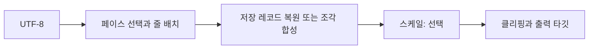

[English](renderer-design.md) | **한국어**

# 이식 가능한 C SVF 렌더러: 설계

## 1. 목적과 범위

C 렌더러는 [SVFN 버전 3](SVF.ko.md) 페이스로 UTF-8 텍스트를 그리는 C99 라이브러리다.
초성·중성·종성 [조각](SVF.ko.md#term-piece)을 조합하는 자모 페이스와 완성형 페이스를 같은 API로 다룬다.
웹·DOS·MCU·SDL 포트가 같은 코어를 사용한다. 사용 예는 [C 렌더러 사용법](../docs/c-renderer-guide.ko.md),
[웹 렌더러 사용법](../docs/web-renderer-guide.ko.md), 전체 구성은 [README](../README.ko.md)를 참고한다.

주된 용도는 메뉴, 상태 줄, 짧은 메시지다. 코어는 한 줄을 배치하며 문단 줄바꿈, 양방향 텍스트 배치,
셰이핑, 커닝은 제공하지 않는다. 윤곽선 글꼴의 래스터화와 파일 쓰기는 [Python 도구](../docs/tools.ko.md)가 맡는다.
폰트 선택과 제작 UI는 각각 [데스크톱 앱](../docs/desktop-app.ko.md)과 [폰트 제작 앱](../docs/maker-desktop.ko.md)을 참고한다.

코어는 `<stdint.h>`, `<stddef.h>`, `<string.h>`만 사용하며 동적 할당을 하지 않는다.
호출자가 페이스, 테이블, 캐시, 스크래치, 출력 버퍼를 소유한다. SVFN 버전 1·2는 `SVF_E_VERSION`으로 거부한다.
버전 2의 변환은 [svf2to3.py](../tools/svf2to3.py)가 맡는다. ScummVM 맵과 장식 효과는 코어의 범위 밖이다.

## 2. 구성과 데이터 흐름

| 파일 | 역할 |
|---|---|
| [c/include/svf.h](../c/include/svf.h) | 공개 API, 오류·상태, 빌드 옵션 |
| [c/src/svf_face.c](../c/src/svf_face.c) | 헤더·표·레코드 검증, 문자 조회, 메트릭, 셀 복원 |
| [c/src/svf_jamo.c](../c/src/svf_jamo.c) | JSET·JMAP 검증과 선택, 조각 합성 |
| [c/src/svf_stream.c](../c/src/svf_stream.c) | 읽기 콜백, 스트리밍 테이블, LRU 블록 캐시 |
| [c/src/svf_draw.c](../c/src/svf_draw.c) | UTF-8, 페이스 체인, 줄 배치·측정, 출력 타깃, 합성 셀 캐시 |
| [c/src/svf_scale.c](../c/src/svf_scale.c) | 스케일된 coverage 셀 |
| [c/tests/](../c/tests/) | 호스트 비교·잘못된 입력 검사, fuzz 하니스 |
| [c/cross/](../c/cross/) | 크로스 빌드, 코드 크기·심볼·스택 검사 |
| [c/bench/](../c/bench/) | 속도 측정, 픽셀 동일성 검증, 원시 측정 기록 |
| [c/ports/dos/](../c/ports/dos/README.ko.md) | DJGPP, VGA 모드 13h와 VBE 2.0, 스트리밍 페이스 |
| [c/ports/pico/](../c/ports/pico/README.ko.md) | RP2040/RP2350, ST7789·SSD1327·SSD1306 |
| [c/ports/esp32/](../c/ports/esp32/README.ko.md) | ESP32-C3/S3, ILI9341·SSD1327·SSD1306 |
| [c/ports/arduino/](../c/ports/arduino/README.ko.md) | Uno, PROGMEM 페이스와 SSD1306 I2C |
| [c/ports/ch582/](../c/ports/ch582/README.ko.md) | CH582, SH1106 I2C |
| [c/ports/web/](../c/ports/web/README.ko.md) | Emscripten 접착 코드. 페이지는 [web/](../web/README.ko.md) |
| [c/ports/sdl/](../c/ports/sdl/README.ko.md) | SDL2/SDL3 표면 |

파일의 셀·메트릭·피복도(coverage) 정의는 [형식 명세](SVF.ko.md#layout)를 따른다.
조합형의 배경과 벌 선택 예는 [자모 세트](../docs/jamo-sets.ko.md)에 있다.

## 3. 페이스 열기와 조회

`svf_open_mapped(f, data, len)`은 메모리·플래시의 파일을 제자리에서 읽는다. 열 때 모든 표와 레코드를
검증하므로 사용하는 동안 파일 바이트를 바꾸면 안 된다. AVR의 별도 주소 공간은 `SVF_RD8`을
`pgm_read_byte`로 재정의하여 읽는다([Arduino 포트](../c/ports/arduino/README.ko.md)).

`svf_open_stream(f, rd, ctx, file_len, tables, tables_len, cache, cache_len, block_size)`은 표를 호출자의
RAM으로 읽고 글리프 레코드를 필요할 때 읽는다. 레코드는 읽는 시점에 검사한다. 두 방식은 같은 조회·그리기 API를 쓴다.
`svf_stream_tables_size(rd, ctx, file_len, &err)`로 필요한 테이블 버퍼 크기를 먼저 구한다.

열기는 `svf_err`를 반환하며 실패하면 페이스를 0으로 지운다. 오류와 별개로 `svf_status`를 확인해야 한다.
정렬되지 않았거나 중복된 코드 포인트 표는 `SVF_FACE_CMAP_LINEAR`가 되고 선형 탐색하며 마지막 항목이 우선한다.
정렬된 표는 이진 탐색한다. 잘못된 선택 정보의 처리와 상태 비트는 [검증](SVF.ko.md#validation)과
[JMAP 리더 상태](SVF.ko.md#jmap)에 정의되어 있다. 코어는 경고를 출력하지 않는다.

`svf_has`는 페이스가 지원하는 문자인지 확인하고, `svf_metrics_of`는 전진 폭(advance)·베어링·잉크 폭·dy를 돌려준다.
`svf_glyph`는 MSB 우선의 셀을 호출자 버퍼에 복원한다. 행 끝에서 셀 너비를 넘는 비트는 0이다.
메트릭이 없으면 `{cell_w, 0, cell_w, 0}`을 사용한다.

## 4. 자모 선택과 합성

JSET 버전 1·2는 클래스와 벌 선택 표를 사용한다. 표준 한도는 클래스 12 × 12, 초성·중성·종성 벌
32 / 24 / 16이다. `SVF_JSET_BIG`은 이를 19 × 28, 128 / 128 / 64로 넓힌다.
JSET 버전 3인 JMAP은 dense·SPARSE·LIST 매핑을 사용하며, 선택적으로 버전 1·2 폴백을 둔다.
인코딩과 빌드별 지원은 [자모 블록](SVF.ko.md#jamo-block)에 정의되어 있다.

`svf_jamo_pieces`는 선택된 조각 번호를 반환하고 `svf_compose`는 그 조각을 합친다.
`0xFFFF` 조각은 비어 있다. 합성은 픽셀별 최댓값이다. 1 bpp는 비트 OR, 2 bpp는 2비트 필드별 최댓값,
8 bpp는 바이트별 최댓값을 사용한다. 조각의 메트릭과 dy는 합성 배치에 적용하지 않는다.
조합된 문자는 JSET/JMAP advance만큼 전진하고, 그 값이 0이면 셀 너비만큼 전진한다.

유효한 JSET은 U+AC00..U+D7A3 음절 11,172자를 모두 합성한다. JMAP만 있는 페이스는 매핑에 있는 음절만
합성하며 미스는 폴백, 저장 글리프 순으로 처리한다. U+3131..U+3163은 사용 가능한 호환 조각이 있으면
그것을 사용하고, 없으면 저장 글리프를 찾는다. 한글 분해 순서는 참고 문헌의 Unicode 18장을 따른다.

## 5. 줄 배치와 측정

실제 그리기 호출은 `svf_draw_utf8(c, s, len, x, y_baseline, t, scratch, scratch_len)`이다.
`svf_chain`이 페이스 배열과 개수, 결합 부호 판정 함수, 없는 글리프의 전진 폭, 스케일을 담는다.
문자열 길이는 바이트 수이며 내장 NUL도 코드 포인트로 처리한다.

- 각 코드 포인트는 그것을 지원하는 첫 페이스에서 가져온다.
- 잘못된 UTF-8은 Unicode의 최대 비정상 부분열(maximal subpart) 단위로 U+FFFD가 된다.
  체인에 U+FFFD가 없으면 그 부분열은 전진 없이 건너뛴다.
- 지원하지 않는 정상 코드 포인트는 그리지 않고 `missing_advance`만큼 전진한다(0으로 초기화하면 0).
- 스케일 1/1에서 셀 윗변은 `y_baseline - ascent + dy`, 왼쪽은 현재 펜이다.
- 결합 부호는 전진하지 않는다. 현재 펜에서 `originX`를 뺀 곳에 그린다. `originX`는 페이스에
  `SVF_FLAG_MARKS_AT_ORIGIN`이 있고 `bearing_x < 0`이면 `min(-bearing_x, cell_w)`, 아니면 0이다.
  `is_mark`가 NULL이면 기본 판정은 U+0300..U+036F이며 더 넓은 범위는 호출자가 지정한다.

`svf_measure_utf8(c, s, len, &extent)`는 같은 배치 규칙으로 폭·ascent·descent를 구하며 글리프 픽셀은
읽지 않는다. 수직 범위는 배치된 셀을 기준으로 하며 dy를 포함한다. 폭은 32,767에서 포화한다.

## 6. 출력 타깃과 안티앨리어싱

`svf_target_init`은 버퍼 길이·폭·높이·stride를 검사하고 클립을 전체 타깃으로 설정한다.
그리기는 클립과 타깃 범위의 교집합 안에서 coverage가 0보다 큰 픽셀만 출력한다.

| 타깃 | 저장과 합성 |
|---|---|
| `SVF_T_COVERAGE_CB` | 픽셀마다 `plot(ctx, x, y, coverage)` 호출. 겹치는 셀은 각각 호출 |
| `SVF_T_MONO_PAGE` | 바이트당 세로 8픽셀. 임계값 이상의 비트만 설정 |
| `SVF_T_MONO_ROW` | MSB 우선의 1 bpp 행. 임계값 이상의 비트만 설정 |
| `SVF_T_GRAY8` | 바이트당 coverage 하나. 기존 값과 최댓값 |
| `SVF_T_GRAY` | 행 단위 1·2·4·8비트 단계. 기존 단계와 최댓값 |
| `SVF_T_INDEXED8` | 팔레트 램프의 인덱스. 기존 인덱스와 최댓값 |
| `SVF_T_RGB565`, `SVF_T_RGB555` | 지정한 전경·단색 배경을 채널별로 혼합. 기존 픽셀은 읽지 않음 |
| `SVF_T_XRGB8888`, `SVF_T_RGB888` | 메모리 순서 B G R X 또는 B G R. 지정한 전경·배경 혼합 |

흑백 타깃의 기본 임계값은 128이다. RGB16은 기본 하위 바이트 우선이며 `SVF_TF_RGB16_BIGENDIAN`으로
바꾼다. RGB 타깃에서 겹치는 셀은 뒤의 셀이 혼합한 색을 남긴다. GRAY와 INDEXED8의 단계 변환,
배경 선택, 겹침 처리는 [안티앨리어싱](../docs/anti-aliasing.ko.md)에 설명되어 있다.

## 7. 스케일과 메모리

`scale_num/scale_den`은 줄 전체에 적용한다. 0/0은 1/1이며, 그 밖에는 각각 1..16이어야 한다.
기약분수로 줄인 뒤 분모가 1이면 원본 픽셀을 정수배 복사하고, 그 밖에는 박스 필터 면적 평균을 사용한다.
셀 밖은 coverage 0으로 취급한다. 좌표와 클립은 출력 픽셀 단위이며 스케일하지 않는다.
길이·반올림의 정확한 규칙은 [svfline.py](../tools/svfline.py)의 `Scaling`에 있다.

`B = ceil(cell_w * bpp / 8) * cell_h`일 때 호출자가 필요한 스크래치는 다음과 같다.

| 조건 | 페이스당 필요량 |
|---|---|
| 1/1, mapped 또는 블록 캐시 있음 | `B` |
| 1/1, 블록 캐시 없는 스트리밍 | `2 * B` |
| 1/1이 아닌 스케일 | `2 * B + ceil(cell_w * num / den) * ceil(cell_h * num / den)` |

체인은 가장 큰 필요량을 사용한다. `svf_chain_scratch_bytes`로 구하며, 24 × 24 2 bpp의 `B`는 144바이트다.
페이스 구조체 크기는 ABI와 빌드 옵션에 따라 다르므로 `sizeof(svf_face)`로 구한다. `SVF_JMAP`은 구조체 배치를
바꾸므로 라이브러리와 호출부에 같은 값으로 적용해야 한다. 코어 스택과 출력 버퍼는 이 스크래치와 별도다.

## 8. 스트리밍과 캐시

`svf_read_fn`은 `long read(ctx, offset, dst, len)` 형태이며 정확히 `len`을 반환해야 성공이다.
짧은 읽기나 오류는 `SVF_E_IO`다. 테이블 버퍼에는 8바이트 상태, 코드 포인트 표, 사용 가능한 메트릭,
자모 영역, 글리프 오프셋 표가 들어간다. 자모 영역의 적재 크기는 빌드의 리더에 따라 달라진다.
버퍼가 작으면 `svf_open_stream`은 `SVF_E_NOMEM`을 반환한다.

선택적 블록 캐시는 64..4096바이트의 2의 거듭제곱 블록을 사용한다. 슬롯당 태그 8바이트가 추가로 들고,
최소 2슬롯이 필요하며 LRU로 교체한다. 캐시가 없으면 셀 안에 들어가는 레코드는 보통 한 번에 읽고,
레코드가 더 크면 헤더와 행을 나누어 읽는다. 행 정렬 때문에 셀 버퍼에 들어가지 않는 행들은 행별로 읽는다.
줄은 문자 순서로 처리하며 파일 위치순 사전 읽기는 하지 않는다.

`svf_chain_cache(c, buf, len)`는 별도의 합성 셀 캐시다. 슬롯은 가장 큰 셀과 태그 8바이트를 담고,
키는 `(페이스 인덱스, 코드 포인트)`이며 선형 탐색·라운드 로빈 교체를 사용한다.
원본 크기 셀을 보관하므로 스케일과 타깃은 캐시 조회 뒤에 적용한다. 페이스 체인을 바꾸거나 페이스를 다시 열면
캐시를 다시 초기화한다. 스트리밍 페이스의 테이블·블록 캐시와 체인의 합성 캐시는 동시에 여러 스레드에서 사용하지 않는다.

## 9. 빌드, 검증, 성능 목표

빌드 옵션 `SVF_TARGETS`, `SVF_LAYOUTS`, `SVF_NO_SCALE`, `SVF_NO_STREAM`, `SVF_SMALL`로 필요한 기능만
포함할 수 있다. 리더별 옵션과 기본값은 [svf.h](../c/include/svf.h)에 있다. [레시피](../docs/recipes.ko.md)는
대상에 맞는 폰트 프로파일 선택을 설명한다.

호스트 빌드는 `make -C c`이며 기본 출력은 `c/build`, `O=DIR`로 바꾼다.
`make -C c check`는 할당 함수 심볼 검사, 출력 커널 검사, sanitizer 빌드와 Python 비교 검사를 실행한다.
[tools/test_c_renderer.py](../tools/test_c_renderer.py)는 글리프·음절·줄·타깃·스케일과 잘못된 입력을 검사한다.
픽셀 기준은 [jamoset.py](../tools/jamoset.py), 줄 배치와 스케일 기준은 [svfline.py](../tools/svfline.py)다.

### 9.1. 픽셀·오류·메모리 검증

호스트 비교 검사는 `svf/`의 실제 페이스를 읽어 모든 저장 글리프의 행과 메트릭, 자모 페이스의 음절 11,172자,
호환 조각을 Python 결과와 바이트 단위로 비교한다. 줄 검사는 페이스 체인·dy·합성 결합 부호 페이스를 포함한다.
정수배와 면적 평균 스케일도 Python 기준과 비교하며, 픽셀 차이를 허용하지 않는다.

잘못된 입력 검사는 잘린 파일, 파일 밖 오프셋, 잘못된 dy 범위, 빌드 한도를 넘는 JSET 개수, 잘못된 블록 길이,
글리프 없는 조각을 포함한다. 호스트 sanitizer 빌드는 `-fsanitize=address,undefined`로 범위 밖 접근을 검사한다.
동적 할당 없음은 `c/check.sh`가 코어 오브젝트에 미정의 `malloc`, `calloc`, `realloc`, `free` 심볼이 없는지
`nm`으로 검사한다. mapped 페이스의 표와 레코드는 파일에서 읽으며, 셀 복원·합성·스케일에 쓰는 스크래치만 별도로 둔다.

### 9.2. 툴체인과 측정 방법

`c/cross/build-all.sh`는 C99와 `-Wall -Wextra -Werror`로 gcc·clang·DJGPP·Arm·AVR·ESP32·Emscripten 빌드를
검사한다. 설치·버전 검증은 `c/cross/install-toolchains.sh`와 `manifest.sh`가 맡고, 사용한 플래그와 결과는
[cross/SIZES.md](../c/cross/SIZES.md)에 기록한다. 빌드 성공과 실제 장치에서의 동작·속도 검증은 별개다.

속도 스크립트는 `c/bench/run-pico.sh`(rp2040js), `run-avr.sh`(simavr), `run-dos.sh`(DOSBox-X),
`run-esp32.sh`(Espressif QEMU), `run-wasm.sh`에 있다. Pico·AVR은 에뮬레이터의 사이클 수를,
ESP32 QEMU는 명령 수를 보고한다. DOSBox-X의 486 설정은 실제 486 클록 수가 아니므로 근사 시간으로 읽는다.
실물 ESP32 측정은 `run-esp32-hw.sh`로 구분한다. 측정에는 페이스·컴파일러·플래그·클럭과 픽셀 체크섬을 함께 기록한다.
성능 목표를 넘긴 결과도 그대로 보고하며 목표값을 측정 결과에 맞춰 바꾸지 않는다.

### 9.3. 성능 목표

다음 값은 설계 성능 목표다. 개별 빌드의 달성 여부는 [코드 크기](../c/cross/SIZES.md)와
[성능 측정](../c/bench/MEASUREMENTS.md)의 대상·클럭·컴파일러·페이스·측정 방법을 함께 확인한다.
측정 표에는 에뮬레이션과 실물 측정이 구분되어 있으며 다른 페이스나 장치의 성능을 보장하지 않는다.

| 항목 | 목표 |
|---|---|
| Cortex-M0+, `-Os` | 코어와 출력 경로 하나의 코드 크기 ≤ 8 KB |
| Uno급 대상 | RAM 2 KB·플래시 32 KB 안에서 플래시의 1 bpp 자모 페이스와 흑백 출력 사용 |
| Pico, 125 MHz | 16 px 음절 하나 ≤ 50 µs, 약 32글리프의 128 × 64 텍스트 화면 ≤ 2 ms |
| DOS, 486급 | 40자 한 줄 ≤ 16 ms |
| WASM | 선택기의 샘플 줄 다시 그리기 ≤ 1 ms |

## 10. 참고 문헌

- [Unicode 17.0, Chapter 3: Conformance](https://www.unicode.org/versions/Unicode17.0.0/core-spec/chapter-3/): UTF-8, 최대 비정상 부분열.
- [Unicode 17.0, Chapter 18: East Asia](https://www.unicode.org/versions/Unicode17.0.0/core-spec/chapter-18/): 한글 음절 분해와 조합.
