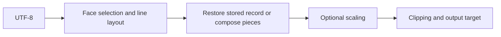

**English** | [한국어](renderer-design.ko.md)

# Portable C SVF renderer: design

## 1. Purpose and scope

The C renderer is a C99 library that draws UTF-8 text using [SVFN version 3](SVF.md) faces.
It handles precomposed faces and jamo faces composed from initial, medial and final [pieces](SVF.md#term-piece)
through the same API. Web, DOS, MCU and SDL ports share the core. See the [C renderer guide](../docs/c-renderer-guide.md),
[web renderer guide](../docs/web-renderer-guide.md) and [README](../README.md) for usage and an overview.

Its main use is menus, status lines and short messages. The core lays out one line; it provides no paragraph wrapping,
bidirectional layout, shaping or kerning. [Python tools](../docs/tools.md) rasterize outline fonts and write files.
See the [desktop app](../docs/desktop-app.md) for font selection and the [font maker](../docs/maker-desktop.md) for creation.

The core uses only `<stdint.h>`, `<stddef.h>` and `<string.h>` and performs no dynamic allocation.
The caller owns faces, tables, caches, scratch and output buffers. SVFN versions 1 and 2 are rejected with
`SVF_E_VERSION`; [svf2to3.py](../tools/svf2to3.py) converts version 2. ScummVM maps and decoration effects are outside the core.

## 2. Components and data flow

| File | Role |
|---|---|
| [c/include/svf.h](../c/include/svf.h) | Public API, errors, status and build options |
| [c/src/svf_face.c](../c/src/svf_face.c) | Header, table and record validation, lookup, metrics and cell reconstruction |
| [c/src/svf_jamo.c](../c/src/svf_jamo.c) | JSET/JMAP validation and selection, piece composition |
| [c/src/svf_stream.c](../c/src/svf_stream.c) | Read callback, streamed tables and LRU block cache |
| [c/src/svf_draw.c](../c/src/svf_draw.c) | UTF-8, face chains, line layout and measurement, targets and composed-cell cache |
| [c/src/svf_scale.c](../c/src/svf_scale.c) | Scaled coverage cells |
| [c/tests/](../c/tests/) | Host comparisons, malformed-input checks and fuzz harnesses |
| [c/cross/](../c/cross/) | Cross builds, code-size, symbol and stack checks |
| [c/bench/](../c/bench/) | Speed measurements, pixel identity checks and raw measurement records |
| [c/ports/dos/](../c/ports/dos/README.md) | DJGPP, VGA mode 13h and VBE 2.0, streamed faces |
| [c/ports/pico/](../c/ports/pico/README.md) | RP2040/RP2350, ST7789, SSD1327 and SSD1306 |
| [c/ports/esp32/](../c/ports/esp32/README.md) | ESP32-C3/S3, ILI9341, SSD1327 and SSD1306 |
| [c/ports/arduino/](../c/ports/arduino/README.md) | Uno, PROGMEM faces and SSD1306 I2C |
| [c/ports/ch582/](../c/ports/ch582/README.md) | CH582, SH1106 I2C |
| [c/ports/web/](../c/ports/web/README.md) | Emscripten glue; the page is in [web/](../web/README.md) |
| [c/ports/sdl/](../c/ports/sdl/README.md) | SDL2/SDL3 surfaces |

Cells, metrics and coverage follow the [format specification](SVF.md#layout).
See [jamo sets](../docs/jamo-sets.md) for composition background and positional-set examples.

## 3. Opening and querying faces

`svf_open_mapped(f, data, len)` reads a file in memory or flash in place. It validates every table and record at open;
file bytes must remain unchanged while the face is in use. For AVR's separate address space, redefine `SVF_RD8`
to use `pgm_read_byte` ([Arduino port](../c/ports/arduino/README.md)).

`svf_open_stream(f, rd, ctx, file_len, tables, tables_len, cache, cache_len, block_size)` reads tables into caller RAM
and reads glyph records on demand. Records are checked when read. Both access modes use the same query and drawing APIs.
Call `svf_stream_tables_size(rd, ctx, file_len, &err)` first to obtain the required tables buffer size.

Open returns `svf_err` and clears the face to zero on failure. Check `svf_status` separately from the error.
An unsorted or duplicate code point table sets `SVF_FACE_CMAP_LINEAR` and uses a linear search, with the last entry
winning. A sorted table uses binary search. The [validation rules](SVF.md#validation) and [JMAP reader statuses](SVF.md#jmap)
define handling of unusable selection data. The core prints no warnings.

`svf_has` checks character support; `svf_metrics_of` returns advance, bearing, ink width and dy.
`svf_glyph` reconstructs an MSB-first cell into a caller buffer. Bits past the cell width at each row end are zero.
Without metrics, the defaults are `{cell_w, 0, cell_w, 0}`.

## 4. Jamo selection and composition

JSET versions 1 and 2 use classes and set-selection tables. Standard limits are 12 × 12 classes and 32 / 24 / 16
initial/medial/final sets. `SVF_JSET_BIG` extends them to 19 × 28 and 128 / 128 / 64.
JMAP, version 3 of the JSET block, uses dense, SPARSE or LIST mappings with an optional version 1 or 2 fallback.
See [jamo blocks](SVF.md#jamo-block) for encodings and build support.

`svf_jamo_pieces` returns selected piece numbers; `svf_compose` merges them. Piece `0xFFFF` is blank.
Composition takes the maximum per pixel: bitwise OR at 1 bpp, maximum per 2-bit field at 2 bpp, maximum per byte at 8 bpp.
Piece metrics and dy do not affect composition placement. A composed character advances by the JSET/JMAP advance,
or the cell width when that value is zero.

A usable JSET composes all 11,172 syllables U+AC00..U+D7A3. A JMAP-only face composes only listed syllables;
a miss tries the fallback and then a stored glyph. U+3131..U+3163 use an available compatibility piece or otherwise
a stored glyph. Hangul decomposition order follows Unicode Chapter 18 in the references.

## 5. Line layout and measurement

The drawing call is `svf_draw_utf8(c, s, len, x, y_baseline, t, scratch, scratch_len)`.
`svf_chain` holds the face array and count, mark predicate, missing-glyph advance and scale.
The string length is in bytes; an embedded NUL is treated as a code point.

- Each code point comes from the first face that supports it.
- Invalid UTF-8 becomes U+FFFD per Unicode maximal invalid subpart. If the chain has no U+FFFD, the subpart is skipped
  without advancing.
- A valid unsupported code point draws nothing and advances by `missing_advance` (zero in a zeroed chain).
- At scale 1/1 the cell top is `y_baseline - ascent + dy`, and its left edge is the current pen.
- A combining mark does not advance. It draws at the current pen minus `originX`. This is `min(-bearing_x, cell_w)`
  when the face has `SVF_FLAG_MARKS_AT_ORIGIN` and `bearing_x < 0`, otherwise zero. With `is_mark` NULL the default
  predicate covers U+0300..U+036F; callers can supply a wider predicate.

`svf_measure_utf8(c, s, len, &extent)` obtains width, ascent and descent using the same layout rules, without reading
glyph pixels. Vertical extents describe placed cells and include dy. Width saturates at 32,767.

## 6. Output targets and anti-aliasing

`svf_target_init` checks buffer length, width, height and stride and sets the clip to the whole target.
Drawing emits only pixels with coverage greater than zero inside the intersection of the clip and target bounds.

| Target | Storage and composition |
|---|---|
| `SVF_T_COVERAGE_CB` | Calls `plot(ctx, x, y, coverage)` per pixel; overlapping cells call it separately |
| `SVF_T_MONO_PAGE` | Eight vertical pixels per byte; sets only bits meeting the threshold |
| `SVF_T_MONO_ROW` | MSB-first 1 bpp rows; sets only bits meeting the threshold |
| `SVF_T_GRAY8` | One coverage byte per pixel; maximum with the existing value |
| `SVF_T_GRAY` | Packed 1, 2, 4 or 8-bit row levels; maximum with the existing level |
| `SVF_T_INDEXED8` | Palette-ramp index; maximum with the existing index |
| `SVF_T_RGB565`, `SVF_T_RGB555` | Blends specified foreground and solid background per channel; does not read the existing pixel |
| `SVF_T_XRGB8888`, `SVF_T_RGB888` | Memory order B G R X or B G R; blends specified foreground and background |

The default monochrome threshold is 128. RGB16 defaults to low byte first; `SVF_TF_RGB16_BIGENDIAN` changes it.
For RGB targets, overlapping cells leave the later cell's blended colour. See [anti-aliasing](../docs/anti-aliasing.md)
for GRAY and INDEXED8 level conversion, background selection and overlap behavior.

## 7. Scaling and memory

`scale_num/scale_den` applies to the whole line. 0/0 means 1/1; otherwise each value must be 1..16.
After reducing the ratio, denominator 1 copies source pixels at integer multiples; other ratios use box-filter area averaging.
Coverage outside the cell is zero. Coordinates and clipping use output pixels and are not scaled.
See `Scaling` in [svfline.py](../tools/svfline.py) for exact length and rounding rules.

With `B = ceil(cell_w * bpp / 8) * cell_h`, caller scratch requirements are:

| Condition | Bytes needed per face |
|---|---|
| 1/1, mapped or with a block cache | `B` |
| 1/1, streamed without a block cache | `2 * B` |
| Any scale other than 1/1 | `2 * B + ceil(cell_w * num / den) * ceil(cell_h * num / den)` |

The chain uses the largest requirement. Obtain it with `svf_chain_scratch_bytes`; `B` for a 24 × 24 2 bpp cell is 144 bytes.
Face struct size depends on ABI and build options; use `sizeof(svf_face)`. `SVF_JMAP` changes its layout and must have
the same value in the library and caller. Core stack and output buffers are additional to this scratch.

## 8. Streaming and caches

`svf_read_fn` has the shape `long read(ctx, offset, dst, len)` and succeeds only by returning exactly `len`.
A short read or error is `SVF_E_IO`. The tables buffer contains eight bytes of state, the code point table,
usable metrics, the jamo region and the glyph offset table. The loaded jamo-region size depends on the build's readers.
`svf_open_stream` returns `SVF_E_NOMEM` when the buffer is too small.

The optional block cache uses power-of-two blocks of 64..4096 bytes, plus eight tag bytes per slot.
It requires at least two slots and uses LRU replacement. Without it, records that fit the cell are usually read in
one call; larger records use separate header and row reads. Rows that do not fit the cell buffer because of row
alignment are read individually. Lines are processed in character order without a file-order prefetch pass.

`svf_chain_cache(c, buf, len)` supplies a separate composed-cell cache. A slot holds the largest cell plus eight tag bytes;
its key is `(face index, code point)`, with linear lookup and round-robin replacement.
It stores unscaled cells, so scale and target processing follow lookup. Reinitialize the cache after changing the face
chain or reopening a face. A streamed face's tables/block cache and a chain's composition cache must not be used
concurrently by multiple threads.

## 9. Building, verification and performance targets

`SVF_TARGETS`, `SVF_LAYOUTS`, `SVF_NO_SCALE`, `SVF_NO_STREAM` and `SVF_SMALL` select the required features.
See [svf.h](../c/include/svf.h) for reader switches and defaults, and [recipes](../docs/recipes.md) for choosing font profiles.

Build on the host with `make -C c`; the default output is `c/build`, changed with `O=DIR`.
`make -C c check` runs allocator-symbol checks, output-kernel checks, sanitizer builds and Python comparisons.
[tools/test_c_renderer.py](../tools/test_c_renderer.py) checks glyphs, syllables, lines, targets, scaling and malformed input.
[jamoset.py](../tools/jamoset.py) is the glyph reference; [svfline.py](../tools/svfline.py) defines line layout and scaling.

### 9.1. Pixel, error and memory checks

Host comparisons read the actual faces in `svf/` and compare every stored glyph's rows and metrics, all 11,172 syllables
of jamo faces and compatibility pieces byte for byte with Python. Line tests include face chains, dy and a synthetic
combining-mark face. Integer and area-averaged scaling also use the Python reference; pixel differences are not accepted.

Malformed-input checks include truncated files, out-of-file offsets, invalid dy ranges, JSET counts exceeding the build's
limits, wrong block lengths and pieces without glyphs. Host sanitizer builds use `-fsanitize=address,undefined` to check
out-of-bounds access. `c/check.sh` uses `nm` to verify that core objects have no undefined `malloc`, `calloc`, `realloc`
or `free` symbols. Mapped tables and records are read from the file; cell reconstruction, composition and scaling use
separate caller scratch.

### 9.2. Toolchains and measurement method

`c/cross/build-all.sh` checks gcc, clang, DJGPP, Arm, AVR, ESP32 and Emscripten builds with C99 and
`-Wall -Wextra -Werror`. `c/cross/install-toolchains.sh` and `manifest.sh` handle installation and version checks;
[cross/SIZES.md](../c/cross/SIZES.md) records flags and results. Building successfully is separate from verifying device
operation and speed.

Speed scripts are `c/bench/run-pico.sh` (rp2040js), `run-avr.sh` (simavr), `run-dos.sh` (DOSBox-X),
`run-esp32.sh` (Espressif QEMU) and `run-wasm.sh`. Pico and AVR report emulator cycles; ESP32 QEMU reports instruction
counts. DOSBox-X's 486 setting does not count real 486 clocks, so its times are approximate. Hardware ESP32 runs use
the separate `run-esp32-hw.sh`. Measurements record the face, compiler, flags, clock and pixel checksum together.
Report missed performance targets as measured; do not change targets to match results.

### 9.3. Performance targets

The following are design performance targets. To assess an individual build, read [code sizes](../c/cross/SIZES.md)
and [performance measurements](../c/bench/MEASUREMENTS.md) together with their target, clock, compiler, face and method.
The measurements distinguish emulation from hardware runs and do not guarantee performance for other faces or devices.

| Item | Target |
|---|---|
| Cortex-M0+, `-Os` | Core plus one output path ≤ 8 KB of code |
| Uno-class target | Flash-resident 1 bpp jamo face and monochrome output within 2 KB RAM and 32 KB flash |
| Pico, 125 MHz | One 16 px syllable ≤ 50 µs; 128 × 64 text screen of about 32 glyphs ≤ 2 ms |
| DOS, 486-class | A 40-character line ≤ 16 ms |
| WASM | Redraw a picker sample line ≤ 1 ms |

## 10. References

- [Unicode 17.0, Chapter 3: Conformance](https://www.unicode.org/versions/Unicode17.0.0/core-spec/chapter-3/): UTF-8 and maximal invalid subparts.
- [Unicode 17.0, Chapter 18: East Asia](https://www.unicode.org/versions/Unicode17.0.0/core-spec/chapter-18/): Hangul decomposition and composition.
